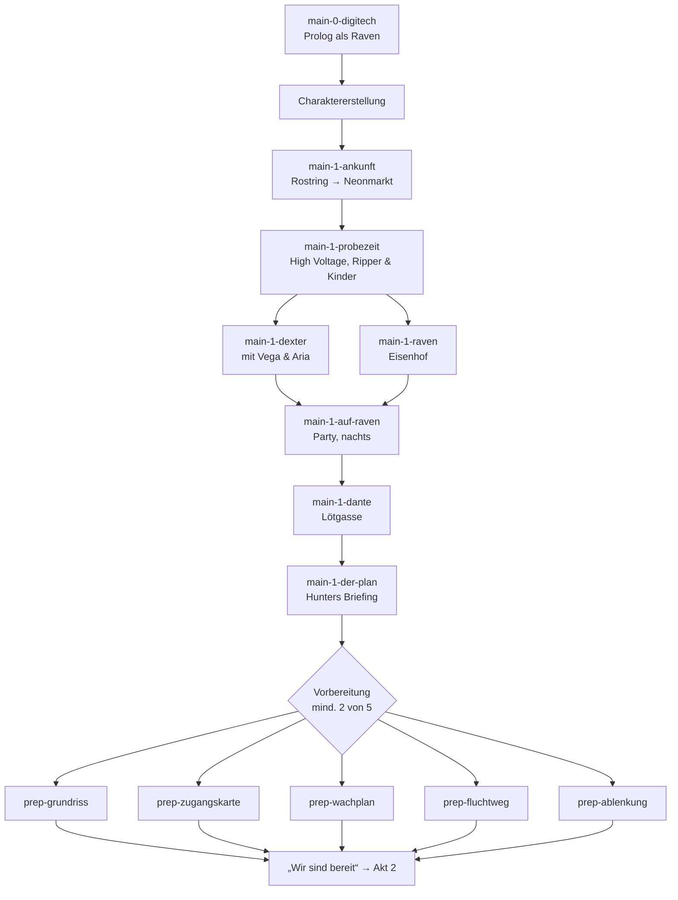

# Nexus – Das RPG · Konzeptentwurf „Quests, Missionen und Kämpfe“

Stand: 08.11.2026 · Status: Entwurf zur Abstimmung · Fokus: Hauptstrang, Nebenquests, wiederholbare Aufträge, Rasterkampf, Gesprächs-Checks

Dieser Entwurf ergänzt `docs/design.md` (Technik und Regeln) und liefert Inhalte für `docs/world.md`. Welt, Figuren und Beziehungen werden parallel in eigenen Konzepten entworfen; hier werden sie nur so weit festgelegt, wie Quests und Kämpfe es brauchen. Alle IDs in diesem Dokument sind **Arbeits-IDs**: Weicht `world.md` später ab, gilt `world.md`, und dieses Dokument wird per Suchen/Ersetzen angeglichen.

Leitsatz des Nutzers: *„Musst nicht zu krass am Plot anpassen, mehr Fokus auf Open World.“* Der Hauptstrang ist deshalb ein roter Faden mit wenigen festen Ankern. Das Fleisch des Spiels sind Nebenquests, Aufträge, Orte und Figuren, die sich gegenseitig referenzieren und auf Fortschritt reagieren.

---

## 0. Inhaltsübersicht

1. Leitlinien für alle Quests
2. Bausteine: IDs, Zonen, Figuren, Fraktionen, Belohnungsskala
3. Hauptstrang „Der rote Faden“ (Prolog + 3 Akte, 3 Enden)
4. Akt 1 im Detail (Bauumfang des ersten spielbaren Stands)
5. Akt 2 und Akt 3 (Grobentwurf mit Verzweigungen)
6. Enden und Epilog
7. Nebenquests und persönliche Quests (33 Stück)
8. Wiederholbare Aufträge (Auftragstafel, Kopfgeld, Kurier, Datenraub, Spezialtafeln)
9. Kampfsystem-Vorschläge
10. Gegnerkatalog mit Werten
11. Bosse
12. Gesprächs- und Welt-Checks (Gesamtliste, 105 Einträge)
13. Bauliste Akt 1, Datenbeispiel, offene Fragen

---

## 1. Leitlinien für alle Quests

### 1.1 Ton und Jugendschutz

- **Wie das Stück:** Cyberpunk-Kulisse, aber im Kern eine Ensemble-Komödie über eine schräge Crew. Running Gags aus dem Stück werden zu Spielsystemen: Dantes Schokoriegel heilt die „Diva“-Laune, Captain Kuschel ist ein sehr guter Zuhörer, der Keksalarm unterbricht Gespräche, das Kartenspiel „Eins!“ ist ein Minispiel, „Chrome 10“ ist ein Rabattcode, die KI nennt ihren Besitzer „Master“.
- **Gewalt comichaft:** Fernwaffen sind Schock-, Impuls- und Netzwaffen. Getroffene Gegner sacken mit Sternchen um („K.O.“), fliehen, ergeben sich oder werden von der Ordnungsbehörde abgeholt. Niemand stirbt auf dem Bildschirm. Wo das Stück „Legt sie um“ sagt, sagt das Spiel „Schafft sie weg“. Arias Zusammenbruch nach dem Chip ist ein Koma, kein Tod.
- **Fluchen nur angedeutet:** „Heiliges Kanonenrohr“, „Ach du grüne Neune“, „Heiliger BimmBamm“, piepende Zensur-Töne bei Aria, Dantes Wutausbruch hinter verschlossener Tür ist nur als gedämpftes Gebrummel hörbar.
- **Keine Drogenverherrlichung:** Im High Voltage gibt es bunte Getränke wie „Neon-Limo“ und „Volt-Brause“; Rausch wird nie dargestellt, Ravens Vorsatz, sich „einen hinter die Binde zu kippen“, wird zu „die ganze Nacht durchtanzen“. Der Testproband aus Szene 12 „hat was eingeworfen“ wird zu „hat einen gefälschten Billig-Chip getragen“.
- **Kinder und Jugendliche:** Daria, Freya und Jakko sind Freundschaftsfiguren und Auftraggeber, nie Kampfziele, nie in Romanzen. Quests mit ihnen drehen sich um Fairness, Essen, Spiele und Mut.
- **Marken:** Reale Markennamen aus dem Drehbuch werden im Spiel durch Anspielungen ersetzt: Schokoriegel statt Markenname, Kartenspiel „Eins!“ statt des Originals, die verworfenen KI-Namen werden zu „Alexandra und Siggi“. Keine Namen, Orte, Firmen, Begriffe oder Figuren aus anderen Spielen. Insbesondere vermeiden: genretypische Fachbegriffe, die einem bestimmten Spiel gehören. Vorschlag für `design.md`: „Ripperdoc“ durch **„Schrauber“** ersetzen (Dante ist „der beste Schrauber der Lötgasse“), Hacks heißen **„Fernzugriff“**, Hackerinnen und Hacker heißen wie im Stück einfach so.

### 1.2 Open-World-Prinzipien

1. **Wenige feste Anker, viel Freiraum.** Pro Akt gibt es 3–5 Pflichtmissionen. Alles andere ist optional, aber spürbar belohnt (Begleiter, Cyberware, Ruf, alternative Lösungswege in Hauptmissionen, Epilog-Zeilen).
2. **Jede Hauptmission hat mindestens drei Wege:** reden, kämpfen, schleichen/hacken, und meist einen vierten über Beziehung oder Gegenstand.
3. **Vorbereitung statt Pflicht.** Große Missionen (Bruch, Releaseparty) haben Vorbereitungs-Operationen. Man braucht nur einen Teil, jede zusätzliche macht die Mission leichter oder öffnet einen Weg.
4. **Die Stadt reagiert.** Nachrichtensendungen von Collin Charleston und Delya Delloraine, Passantensprüche, Händlersortimente, Patrouillendichte und Auftragstafeln ändern sich nach Akt, Ruf und abgeschlossenen Quests.
5. **Nebenquests verknüpfen sich.** Gegenstände, Kontakte und Gefallen aus einer Nebenquest sind Lösungswege in anderen (Beispiel: Die Zugangskarte aus „Feierabend für Wachtmeisterin Kessel“ öffnet im Akt-2-Bruch einen Seiteneingang).
6. **Kein Scheitern ohne Ausweg.** Gescheiterte Nebenquests erzeugen meist eine Folgequest oder eine andere Belohnung. Hauptmissionen sind wiederholbar (Niederlage = Rückkehr zu Dante).
7. **Tageszeit zählt.** Viele Auftraggeber sind nur zu bestimmten Tageszeiten da, manche Lösungswege funktionieren nur nachts (Schleichen) oder tagsüber (Behörden, Händler).

### 1.3 Notation in diesem Dokument

| Schreibweise | Bedeutung |
| --- | --- |
| `[Technik 6]` | Gesprächs- oder Welt-Check: Attributwert inkl. Boni ≥ 6 |
| `[Raven ♥4]` | Beziehungsbedingung: mindestens 4 Herzen mit Raven |
| `[Rivale Xion]` | Rivalität mit Xion besteht (Punkte < −200) |
| `[Herkunft: Ödnis]` | Nur mit dieser Herkunft |
| `[Gegenstand: zugangskarte-quantum]` | Gegenstand im Inventar |
| `[Ruf Unterstadt 30]` | Fraktionsruf mindestens 30 |
| ☾ / ☀ / ◐ / ◑ | nur Nacht / nur Tag / nur Abend / nur Morgen |
| `→ flag: name` | setzt ein Kampagnen-Flag |
| ♥ +40 | Beziehungspunkte (100 Punkte = 1 Herz) |

---

## 2. Bausteine

### 2.1 ID-Schema

| Art | Muster | Beispiel |
| --- | --- | --- |
| Zone/Karte | kebab-case, ohne Präfix | `high-voltage`, `loetgasse` |
| Figur (NPC) | kebab-case, Rollenname | `raven`, `alesa`, `ki-nexus` |
| Gegenstand | kebab-case | `schokoriegel`, `zerberster-3000` |
| Hauptquest | `main-<akt>-<kurzname>` | `main-1-probezeit` |
| Nebenquest | `side-<kurzname>` | `side-jimmys-chip` |
| Persönliche Quest (Begleiter) | `pers-<figur>-<kurzname>` | `pers-vega-adlerauge` |
| Auftragsvorlage | `job-<typ>` | `job-kurier` |
| Begegnung | `enc-<ort>-<kurzname>` | `enc-kanal-xion-ripper` |
| Gegnertyp | kebab-case | `quantum-wachmann` |
| Gesprächs-Check | `gc-<nr>` | `gc-07` |
| Flag | snake_case | `nyra_zweifel`, `peilsender_entdeckt` |

### 2.2 Zonen (Arbeitsliste für Quests)

Die Stadt Noxius liegt an einer verschmutzten, eingezäunten Bucht (Bühnenbild: Stadtsilhouette am Wasser, Maschendrahtzaun, Fässer im Vordergrund). Das „echte“ Meer mit Sand, von dem Nyra träumt, liegt jenseits der Ödnis. So passen Bühnenbild und Stück zusammen: Die Stadt hat Wasser, aber kein Meer, an dem man glücklich wird.

| ID | Name | Bezirk | Questrolle | Ab Akt |
| --- | --- | --- | --- | --- |
| `rostring-bahnhof` | U-Bahn-Station Rostring | Unterstadt | Ankunft, Schnellreise-Knoten | 1 |
| `neonmarkt` | Neonmarkt | Unterstadt | Händler, Gerüchte, Auftraggeber, Leuchtreklamen | 1 |
| `high-voltage` | High Voltage (Club, innen) | Unterstadt | Hub, Auftragstafel, Crew-Treffpunkt | 1 |
| `high-voltage-gasse` | Gasse vor dem High Voltage | Unterstadt | Türsteherdienst, Hinterausgang | 1 |
| `loetgasse` | Lötgasse | Unterstadt | Dantes Werkstatt, Second-Hand-Implantate | 1 |
| `dantes-werkstatt` | Dantes Werkstatt (innen) | Unterstadt | Heilung, Cyberware-Einbau, Eins!-Runden | 1 |
| `rostkai` | Rostkai | Hafen | Schrotthändler, Brackbucht, Schmuggel | 1 |
| `brackbucht` | Brackbucht (eingezäunt) | Hafen | Sammelquests, Kanal-Ausfluss | 1 |
| `unterschlupf` | Eigener Unterschlupf (Container über dem Rostkai) | Hafen | Bett, Lager, Captain-Kuschel-Notizen | 1 |
| `eisenhof` | Gefängnis Eisenhof (Vorplatz) | Behördenviertel | Raven abholen, Richter, Wache | 1 |
| `behoerdenviertel` | Gerichtsplatz | Behördenviertel | Kopfgelder abgeben, Fahndung senken | 1 |
| `kanal-nord` | Kanalisation Nord | Unterwelt | Fluchtwege, Rattenplage, Kanalvolk | 1 |
| `kanal-tief` | Tiefer Kanal / Quantum-Abfluss | Unterwelt | Arias Rettung, Chip-Müll | 2 |
| `digitech-ruine` | Alte Digitech-Zentrale (verlassen) | Industriegürtel | Prolog-Schauplatz, Lore, Bergung | 1 |
| `schrotthalde` | Schrotthalde am Stadtrand | Industriegürtel | Dexter, Drohnenkämpfe | 1 |
| `oberstadt-plaza` | Chrome-Plaza | Oberstadt | Chrome-Türme, Presse, Mode | 1 (Zutritt eingeschränkt) |
| `chrome-tuerme` | Chrome-Türme (Salon) | Oberstadt | Chrome-Schwestern | 2 |
| `quantum-campus` | Quantum Industries, Campus und Labor | Oberstadt | Bruch (Akt 2), Releaseparty (Akt 3) | 1 (außen), 2 (innen) |
| `quantum-tower` | Quantum-Turm: Atrium, Partysaal, Serverkern, Dach | Oberstadt | Finale | 3 |
| `oednis-rand` | Ödnis-Rand (Aussiedlerposten) | Ödnis | Weg zum Meer, Bergung, Aussiedler | 2 |
| `silberstrand` | Silberstrand (das Meer) | Küste | Epilog, Endspiel-Aktivitäten | Ende |

### 2.3 Figuren (Quest-Rollen)

Stück-Figuren: `blade`, `raven`, `hunter`, `dante`, `nyra`, `aria`, `vega`, `alesa`, `xion`, `seraphina`, `sybella`, `serenity`, `collin`, `delya`, `ripper`, `daria`, `freya`, `jakko`, `richter`, `wache`, `barkeeper`, `kameramann`, `ki-nexus`. Captain Kuschel ist ein Gegenstand mit Persönlichkeit (`captain-kuschel`).

Neue Nebenfiguren, die dieser Entwurf braucht (Vorschlag, im Figurenkonzept zu bestätigen):

| ID | Name | Rolle |
| --- | --- | --- |
| `jimmy` | Jimmy | Der Vorgänger der Spielfigur in Hunters Crew, Chip-Virus („Chipfieber“) |
| `dexter` | Dexter | Schrotthändler auf der Schrotthalde, schuldet Hunter Geld (im Stück erwähnt) |
| `kessel` | Wachtmeisterin Kessel | Anzeigename der Wache am Eisenhof (`wache` im Figurenkonzept); will kündigen |
| `forscher-bolle` | Forscher Bolle | Alesas nervöser Assistent |
| `oma-rostig` | Oma Rostig | Älteste Händlerin am Neonmarkt, verkauft Ersatzteile und Weisheiten |
| `kanalkoenig` | Bürgermeister Gully | Sprecher des Kanalvolks (Obdachlose Bastler unter der Stadt) |
| `stylistin` | Mimi Puder | Stylistin von Collin, Modeberaterin für die Releaseparty |
| `muschel-mo` | Muschel-Mo | Aussiedler am Ödnis-Rand, kennt den Weg zum Meer |

### 2.4 Fraktionen und Ruf

Ruf je Fraktion −100 … 100 (Vorschlag für `world.md`):

| ID | Fraktion | Steigt durch | Wirkung |
| --- | --- | --- | --- |
| `crew` | Hunters Crew / High Voltage | Aufträge der Tafel, Hauptmissionen | Tafel-Rang, Club-Preise, Crew-Gespräche |
| `unterstadt` | Bewohner der Unterstadt | Helfen, fair handeln, Kinder-Quests | Händlerpreise, Passanten warnen vor Patrouillen, Verstecke |
| `oberstadt` | Oberstadt-Gesellschaft (Chrome-Kreis) | Etikette, Presse, Chrome-Quests | Zutritt Chrome-Plaza, Party-Einlass ohne Fälschung |
| `kanalvolk` | Kanalvolk | Ratten bekämpfen, Ersatzteile spenden | Kanal-Schnellwege, Fluchtrouten |
| `quantum` | Quantum Industries | sinkt durch Angriffe, steigt durch Verrat | Unter −40: **Fahndung** aktiv (Patrouillen jagen die Spielfigur) |

**Fahndung (0–5 Sterne, als Sirenensymbol):** Steigt bei Alarm in Quantum-Gebieten und bei Kämpfen vor Zeugen in der Oberstadt. Sinkt um 1 pro Tag ohne Vorfall, durch Bestechung beim Richter (`richter`), durch Collins Gegendarstellung oder durch Untertauchen (eine Nacht im Kanal). Ab 3 Sternen patrouillieren Quantum-Drohnen in der Unterstadt.

### 2.5 Herkunft (Arbeitsnamen)

Die Herkunft ist eine feste Entscheidung im Spiel; die endgültigen Namen legt das Figurenkonzept fest. Dieser Entwurf nutzt:

| ID | Name | Typische Dialogoptionen |
| --- | --- | --- |
| `gossenkind` | Gossenkind der Unterstadt | Kennt Gangs, Straßenkinder, Ripper persönlich |
| `oberstadt` | Oberstadt-Aussteiger | Kennt Etikette, die Chrome-Schwestern vom Sehen, Konzernsprech |
| `oednis` | Ödnis-Wanderer | Kennt Aussiedler, Wetter, den Weg zum Meer, Schrott |
| `konzern` | Ex-Digitech-Technikerin/-Techniker | Kennt das alte Digitech-Labor, Alesa aus dem Studium, Chip-Technik |

### 2.6 Belohnungsskala

Richtwerte, damit alle Quests vergleichbar bleiben. XP-Kurve laut `design.md`: Stufe n+1 bei 100 × n × (n+1) / 2.

| Klasse | XP | Credits | Typischer Gegenstand |
| --- | --- | --- | --- |
| Kleinquest (1–2 Schritte) | 40–80 | 30–120 | Verbrauchsgut, Geschenk |
| Nebenquest | 100–250 | 150–600 | Mod, Kleidung, seltenes Geschenk |
| Große Nebenquest / Questkette | 300–500 | 500–1500 | Cyberware, Waffe, Begleiterfähigkeit |
| Hauptmission | 200–600 | 200–2000 | Story-Gegenstand, Cyberware |
| Auftrag (Tafel) | 30–200 | 60–600 | Zufallsbeute |
| Bestandener Check | 15 + 5 × Schwelle | – | – |

Zielkurve: Ende Akt 1 Stufe 5–6, Ende Akt 2 Stufe 10–11, Finale Stufe 14–16, Nachspiel bis 20.

Preisanker aus dem Stück: Straßenkinder verlangen 10 Credits für ein Implantat, Ripper bietet 600 Credits für Arias „Zerberster 3000“. Also: Billig-Implantat 10–80, gutes gebrauchtes Implantat 300–900, neue Cyberware 1200–4000.

---

## 3. Hauptstrang „Der rote Faden“

### 3.1 Vorgeschichte und Zeitachse

| Zeitpunkt | Ereignis (lose nach dem Stück) |
| --- | --- |
| vor 7 Jahren | Hunters Crew (Hunter, Raven, Dante, Blade) bricht bei Digitech ein, um einen Prototyp-Neurochip zu stehlen. Blade löst den Alarm selbst aus, kettet Raven an ein Rohr und verschwindet mit dem Chip. Urteile: Hunter 3, Dante 4, Raven 7 Jahre. |
| vor 7 Jahren | Blade bringt den Chip zu den Chrome-Schwestern und überredet sie, statt zu verkaufen einen Konzern zu gründen: **Quantum Industries**, CEO Blade Nocturne, Forschung Alesa Zero, Sicherheit Xion Venom. |
| vor 4 Jahren | Hunter kommt frei und eröffnet das **High Voltage**, den besten Club der Unterstadt. Nebenbei vermittelt er Aufträge. |
| vor 3 Jahren | Dante kommt frei, schwört allem Digitalen und Illegalen ab und betreibt in der Lötgasse eine Werkstatt, in der er Armen gebrauchte Implantate einbaut, gratis. |
| vor 2 Wochen | Jimmy, Hunters Allrounder, fängt sich ein Chip-Virus ein („Chipfieber“) und dreht durch. Hunter sucht Ersatz: eine Hackerin (Nyra) und einen Allrounder (die Spielfigur). |
| Spielbeginn | Die Woche, in der Raven entlassen wird. Quantum steht kurz vor dem Durchbruch mit der KI „Nexus“. |

### 3.2 Feste Anker

Nur diese fünf Punkte stehen fest. Alles dazwischen ist offen, in Reihenfolge und Lösungsweg.

1. **Die Spielfigur stößt zu Hunters Crew.**
2. **Raven ist frei, und Hunter will Rache an Blade:** Er will Quantums neue Chip-Generation stehlen.
3. **Der Bruch bei Quantum geht schief:** Die KI Nexus erwacht und schlägt Alarm, Nyra gerät in Blades Hand.
4. **Die Releaseparty:** Blade will die Elite von Noxius per Chip steuern, doch Nexus rebelliert gegen ihren „Master“.
5. **Danach:** Wie die Stadt, die Crew und die Spielfigur aus der Sache herauskommen, entscheidet die Spielerin oder der Spieler. Das Meer wartet, wenn man will.

### 3.3 Aufbau der Akte

| Akt | Stück-Bezug | Pflichtmissionen | Freie Phase | Schaltet frei |
| --- | --- | --- | --- | --- |
| Prolog | Szene 1–2 | `main-0-digitech` (spielbar als Raven, Tutorial) | – | Charaktererstellung |
| 1 „Neu in Noxius“ | Szene 3–11 | `main-1-ankunft`, `main-1-probezeit`, `main-1-dexter`, `main-1-raven`, `main-1-auf-raven`, `main-1-dante`, `main-1-der-plan` | Vorbereitung des Bruchs: 5 Operationen, 2 nötig | Unterstadt, Hafen, Kanal Nord, Behördenviertel, Schrotthalde, Digitech-Ruine, Auftragstafel, Begleiter Vega/Aria/Raven/Nyra |
| 2 „Der Chip“ | Szene 12–19 | `main-2-bruch`, `main-2-kanal`, `main-2-countdown`, `main-2-krisensitzung` | Stadt im Wandel, Nyras Funksprüche, Party-Vorbereitung: 6 Operationen, 3 nötig | Oberstadt komplett, Tiefer Kanal, Ödnis-Rand, Begleiter Dante, Hunter (eingeschränkt), Jimmy (optional) |
| 3 „Releaseparty“ | Szene 20–25 | `main-3-einlass`, `main-3-labor`, `main-3-gedankenkontrolle`, `main-3-nexus`, `main-3-blade` | kurz: Letzte Vorbereitungen am Vorabend | Ende, danach Nachspiel mit Silberstrand |

Spielzeit-Ziel: Akt 1 etwa 4–6 Stunden mit Nebeninhalten (1,5 Stunden nur Hauptstrang), Akt 2 etwa 6–8, Akt 3 etwa 3–4, Nachspiel offen.

### 3.4 Wiederkehrende Stilmittel aus dem Stück

- **Freeze-Vorstellung:** Wenn eine wichtige Figur zum ersten Mal auftritt, friert das Bild ein, Farbe entsättigt, und eine Erzählfigur (wie im Stück Vega, Nyra oder Aria) stellt sie mit einem Satz vor. Danach läuft die Szene weiter. Einmal pro Figur, überspringbar.
- **Stadt-TV:** Was im Stück auf der Bühne ohne die Crew passiert (Chrome-Schwestern-Treffen, Firmengründung, KI-Präsentation, Tests im Labor), sieht man im Spiel als Nachrichtensendung von Collin und Delya auf Bildschirmen und im Radio oder als kurze Zwischensequenz „Währenddessen bei Quantum …“.
- **„Master“:** Jedes Gerät mit Nexus-KI nennt seinen Besitzer „Master“. Läuft die Spielfigur später mit einem Nexus-Gerät herum, wird auch sie so genannt (und die Crew lästert).

---

## 4. Akt 1 im Detail

Akt 1 ist der erste Bauumfang. Alle Missionen sind hier bis auf Schritte, Lösungswege, Begegnungen, Checks, Flags und Belohnungen ausgearbeitet.

### 4.0 Ablauf auf einen Blick



`main-1-dexter` und `main-1-raven` sind nach der Probezeit in beliebiger Reihenfolge spielbar; die Party startet, sobald beide erledigt sind und es Nacht ist. Ab der Probezeit ist die ganze Unterstadt offen.

---

### 4.1 `main-0-digitech` · Prolog „Vor sieben Jahren“

- **Spielbar als:** Raven (feste Werte: Körper 6, Reflexe 6, Ausstrahlung 4, Technik 2, Straße 5). Begleiter: Blade (nicht steuerbar, folgt). Hunter und Dante nur per Funk.
- **Ort/Zeit:** `digitech-ruine` in ihrem alten, intakten Zustand (gleiche Karte, Variante „damals“), Nacht.
- **Zweck:** Tutorial für Bewegung, Interaktion, Schleichen, einen Welt-Check, einen kleinen Kampf, Funkgespräche. Dauer 8–12 Minuten. Ab dem zweiten Spielstand überspringbar.

**Schritte**

1. Funk-Einstieg: Hunter („Wo bleiben diese Idioten?“) und Dante („Kameras und Verriegelung sind offline.“). Tutorial-Hinweis Bewegung.
2. Eingang: Tür mit Kartenleser. Welt-Check-Tutorial: Raven hat Technik 2, die Option `[Technik 4] Leser kurzschließen` ist ausgegraut. Alternative: Dante öffnet per Funk („Gib mir noch eine Sekunde …“). Lehrt: Ausgegraute Checks haben immer einen anderen Weg.
3. Flur: Eine Wachdrohne patrouilliert. Schleich-Tutorial (Sichtkegel, Deckung hinter Kisten). Wird man gesehen: Tutorial-Kampf `enc-prolog-drohne` (1 × `spaeherdrohne`, Blade hilft mit „Goldknauf-Stock“).
4. Labor: Blade findet den Chip („Hier ist er!“). Kurzer Dialog mit Raven; Antwortwahl färbt nur Ravens spätere Erinnerung (`prolog_raven_vertraut` / `prolog_raven_misstrauisch`).
5. Alarm. Blade kettet Raven mit Handschellen ans Rohr, Dialog wie im Stück, gekürzt („Ich teile nicht gerne. Tut mir leid.“). Die Spielerin oder der Spieler kann an der Fessel ziehen (Knopf-Mash, ohne Erfolg) und Blade nachrufen (drei Antworten, alle comichaft-wütend).
6. Wachen kommen. Bild friert ein. Freeze-Erzählerin (Vega aus dem Off): „So endete die Nacht, in der alles anfing.“ Gerichtsszene als Standbild-Montage: Richter verkündet die Strafen, inklusive „10.000 Stunden illegal gestreamter Musik und Filme“ für Dante.
7. Erzähler-Trio wie Szene 1 (Alesa, Ripper, Xion, damals noch Fremde): drei Sätze über Noxius 2086. Übergang zur Charaktererstellung.

**Belohnung:** keine Werte (Raven ist nicht die Spielfigur), aber `prolog_done` und ein Tagebucheintrag „Ravens Erinnerung“, den Raven später kommentiert.

---

### 4.2 `main-1-ankunft` · „Neu in Noxius“

- **Auslöser:** Charaktererstellung abgeschlossen.
- **Ort/Zeit:** `rostring-bahnhof` → `neonmarkt` → `high-voltage-gasse`; Tag 1 (Montag), 16:30, also Übergang Tag → Abend.
- **Party:** allein.

**Schritte**

1. **Ankunft mit Verspätung.** Die U-Bahn hat (natürlich) Verspätung. Durchsage: „Wir bitten die Verzögerung von 47 Minuten zu entschuldigen.“ Telefon-Tutorial: Nachricht von Hunter: „Sei um 18 Uhr im High Voltage. Pünktlich. Ich hasse Unpünktlichkeit.“
2. **Die zwei Typen.** Auf dem Bahnsteig wollen zwei Abzieher (`abzieher` × 2) der Spielfigur die Cyberware abnehmen, genau wie Dante im Stück passiert ist. Lösungswege:
   - `gc-01` `[Straße 4]` „Das hier ist Neonhunde-Revier. Wenn die euch hier abkassieren sehen …“ → Sie ziehen ab und hinterlassen einen Schokoriegel.
   - `gc-02` `[Ausstrahlung 5]` „Ich bin mit Hunter verabredet. Wollt ihr ihm erklären, warum ich zu spät komme?“ → Sie entschuldigen sich und verraten den Weg über den Neonmarkt (+ Kartenmarker Händlerin Oma Rostig).
   - `gc-03` `[Reflexe 4]` Über die Gleise springen und durch den Wartungsgang flüchten → Abkürzung `rostring-bahnhof` ↔ `neonmarkt` freigeschaltet.
   - `[Herkunft: Gossenkind]` „Ey, Kralle? Kennst mich noch, von der Suppenküche?“ → einer der beiden ist ein Bekannter; kein Kampf, + Gerücht über Jimmy.
   - Kampf `enc-rostring-abzieher` (Kampf-Tutorial, Arena `strasse`). Nach dem Sieg ruft einer: „Das sag ich meiner Mama!“ und rennt weg.
3. **Neonmarkt.** Freie Erkundung mit drei markierten, optionalen Punkten: Oma Rostig (Händlerin, Tutorial Handel), Stadt-TV mit der Sendung „Sieben Jahre Quantum Industries“ (Collin und Delya, Montage zu Szene 5), Straßenkinder Daria, Freya und Jakko, die nach einem Ripper fragen („Der zahlt 10 Credits für Implantate!“) → Vorbote für die Probezeit.
4. **High Voltage.** Ankunft in der Gasse. Ist es vor 18:00, steht man in der Schlange (Wartedialog mit Passanten, Zeit springt auf 18:00). Ist es nach 18:30, kommentiert Hunter das später („Pünktlichkeit ist eine Tugend. Hast du die nicht?“, Hunter ♥ −20, keine weitere Folge).

**Belohnung:** 60 XP, 50 Credits (Hunters „Anreise-Pauschale“, später), Schnellreise-Station `rostring-bahnhof`.

---

### 4.3 `main-1-probezeit` · „Probezeit im High Voltage“

- **Auslöser:** High Voltage betreten ab 18:00 an Tag 1.
- **Ort/Zeit:** `high-voltage-gasse` → `high-voltage`; Abend.
- **Szenenbezug:** Szene 7 (Ripper und die Kinder, Aria und Vega, Nyras Ankunft).

**Schritte**

1. **Der Türsteher.** Türsteher Bulle (generischer NPC) lässt nur Gäste mit Stil rein. Lösungswege: `gc-04` `[Ausstrahlung 3]` „Hunter erwartet mich.“, Hunters Nachricht auf dem Telefon vorzeigen (immer möglich), oder 20 Credits Eintritt. Lehrt: Viele Wege, und Checks mit niedriger Schwelle sind fast immer erreichbar.
2. **Stimmung aufnehmen.** Im Club: Musik, Gäste, Barkeeper. Hunter steht an der Bar, ist beschäftigt („Gleich. Setz dich.“). Optional: mit Gästen reden (erste Gerüchte über Quantum).
3. **Ripper und die Kinder.** Am Vordertisch: Ripper schimpft, die Kinder hätten ihm ein Implantat mit Virus gebracht und er zahle die 10 Credits nicht; er zieht seine Waffe. Die Musik verstummt, alle schauen zur Spielfigur, weil sie am nächsten steht. Hunter beobachtet nur. Lösungswege:
   - `gc-05` `[Technik 5]` Implantat prüfen: „Das ist nur ein Schnüffel-Virus von der Stange. Zwei Minuten, dann ist der weg, und das Teil ist 30 wert.“ → Ripper zahlt den Kindern **30** Credits statt 10. Kinder ♥ +60 je Kind, Ripper neutral.
   - `gc-06` `[Körper 6]` „Steck die weg, bevor ich sie dir abnehme.“ → Ripper zahlt und zieht ab. Ripper −120 (Weg zur Rivalität), Kinder ♥ +40.
   - `gc-07` `[Straße 5]` „Ripper, ich weiß, woher du deine ‚Ersatzteile‘ hast. Willst du, dass das hier jeder hört?“ → Ripper zahlt und flüstert: „Du schuldest mir nichts, ich schulde dir nichts.“ → `ripper_kennt_dich` (öffnet später Händlerzugang zu Rippers Hinterzimmer).
   - **Selbst zahlen:** 10 Credits aus eigener Tasche → Kinder ♥ +50, Ripper lacht die Spielfigur aus, Hunter: „Großzügig. Aber Schulden muss man eintreiben, nicht übernehmen.“
   - **Kampf** `enc-hv-ripper-tisch` (Ripper als Mini-Gegner mit halber LP + 1 `abzieher`; Hunter greift nach Runde 2 mit „Ich schenk hier die Drinks aus“ ein, Arena `club`). Ripper flieht, die Kinder bekommen die Credits. Ripper −150, Ruf `unterstadt` +5.
   - **Nichts tun:** Hunter regelt es wie im Stück. Kinder ♥ +10, Hunter: „Du musst dich auch mal einmischen, Neuling.“ (Hunter ♥ −10).
4. **Das Bewerbungsgespräch.** Hunter an der Bar. Er erklärt Jimmys Schicksal („Virus auf dem Neurochip, total durchgedreht, der kommt nie wieder.“) und dass Jimmy zwei Jobs gemacht hat. Fragen zur Herkunft der Spielfigur (Herkunftsoptionen je eine Zeile). Hunter bewertet das Verhalten bei Schritt 3 laut.
5. **Vega, Aria und der Beutel.** Vega und Aria bringen einen Beutel Credits von Dexter. Hunter: „Ist das alles? Ich dachte, Dexter schuldet mir mehr.“ Hunter gibt der Spielfigur den ersten Auftrag: Mit Vega und Aria zu Dexter und den Rest holen (`main-1-dexter`).
6. **Nyra.** Aria erwischt Nyra beim Lauschen und packt sie im Nacken. Lösungswege:
   - `gc-08` `[Ausstrahlung 4]` „Lass sie los. Sie ist wegen dem Gesuch hier, genau wie ich.“ → Nyra ♥ +80, Aria ♥ −20 (Aria: „Du bist ja ein ganz Sozialer.“).
   - Aria gewähren lassen, bis Hunter eingreift → Aria ♥ +20, Nyra neutral.
   - `[Herkunft: Konzern]` „Ein Netzwerkscanner am Gürtel? Sie ist Hackerin, keine Spionin.“ → Nyra ♥ +60, Hunter ♥ +20.
7. **Zwei Neue.** Hunter stellt Nyra als neue Hackerin vor und die Spielfigur als neuen Allrounder. Vega: „Und Jimmy berappelt sich bestimmt wieder.“ Hunter: „Der Typ ist durch.“ → Nebenquest `side-jimmys-chip` wird als Gerücht notiert. Hunter erwähnt „den großen Job“ und dass vorher jemand am Gefängnis abgeholt werden muss (`main-1-raven`).

**Belohnung:** 150 XP, 100 Credits, Auftragstafel freigeschaltet, Begleiter Vega und Aria verfügbar (nur für `main-1-dexter` und Aufträge), Schlüssel zum `unterschlupf` (Hunter: „Ein Container über dem Rostkai. Hat Aussicht. Auf Rost.“). Ruf `crew` +10.

**Freischaltungen:** U-Bahn-Stationen Neonmarkt, Lötgasse, Rostkai. Telefonkontakte Hunter, Vega, Aria, Nyra. Nebenquests mit Akt-1-Freigabe erscheinen.

---

### 4.4 `main-1-dexter` · „Dexter zahlt immer“

- **Auslöser:** Ende von `main-1-probezeit`.
- **Ort/Zeit:** `schrotthalde`, Dexters Wellblechbüro. Dexter ist nur Tag und Abend da; nachts schläft er im Büro (dann Schleichweg möglich).
- **Party:** Spielfigur + Vega + Aria (Pflicht). Gute Gelegenheit, beide kennenzulernen.
- **Szenenbezug:** Szene 7 (Vega und Aria haben Dexter „weichgekocht“), hier spielbar.

**Hintergrund:** Dexter schuldet Hunter 1200 Credits. Er hat 400 gezahlt. Den Rest hat er in „Chrome 10“-Rabattgutscheine investiert, die ihm ein Betrüger als „Wertanlage“ verkauft hat. Aria will es „auf die harte Tour“, Vega lieber sauber.

**Schritte**

1. **Ankunft.** Dexters Schrottdrohnen (`schrottdrohne` × 3) patrouillieren über der Halde. Lösungswege: umgehen (Schleichen hinter Containerreihen), `gc-45` `[Technik 4]` Steuerpult am Tor auf „Begrüßungsmodus“ stellen (Drohnen spielen eine Fanfare), oder Kampf `enc-schrott-drohnen` (Arena `schrotthalde`).
2. **Das Gespräch mit Dexter.** Er jammert, er sei pleite. Lösungswege:
   - `gc-09` `[Körper 5]` Einen Schrottwürfel mit bloßen Händen hochheben und ihm vor die Füße stellen → Dexter zahlt 500 (alles, was er hat) und hasst die Spielfigur ein bisschen. Aria ♥ +60, Vega ♥ −20.
   - `gc-10` `[Technik 5]` Seine Kasse aus dem Büro-Terminal auslesen: Er hat 800 auf einem Nebenkonto → Hunter bekommt alles, Dexter jammert lauter. Vega ♥ +40.
   - `gc-11` `[Straße 6]` „Alte Schmuggler verstecken ihr Geld nie im Büro. Im Kühlschrank? Nein. Im Ölfass mit dem doppelten Boden.“ → 800 Credits und Dexters Respekt (Händlerrabatt 10 % bei Dexter).
   - **Gutscheine ernst nehmen:** Dexter zeigt seine „Chrome 10“-Gutscheine. Die Spielfigur kann den Betrüger ausfindig machen → Folgequest `side-chrome-10` (bringt später bis zu 600 Credits zurück; Hunter wartet so lange).
   - **Kampf** gegen Dexter und seine zwei Neffen (`enc-schrott-dexter`, Dexter ergibt sich bei 50 %): 500 Credits, Ruf `unterstadt` −5.
   - **Nachts schleichen:** Dexter schläft, die Kasse steht offen → 500 Credits, niemand merkt es, Aria findet es „langweilig“.
3. **Abrechnung bei Hunter.** Hunter zählt („Ist das alles?“, falls unter 800). Er bietet der Spielfigur 10 % Anteil, Vega und Aria je 10 %.
   - `gc-12` `[Ausstrahlung 6]` „Wir haben die Arbeit gemacht. 20 % für jeden, und nächstes Mal holen wir dir doppelt so viel.“ → Anteile auf 20 %. Aria ♥ +80, Vega ♥ +60, Hunter ♥ −10 (aber Ruf `crew` +5: Er respektiert Verhandler).
   - Ohne Check akzeptieren oder Anteil an Aria/Vega abtreten (Aria ♥ +60).

**Belohnung:** 120 XP, Credits nach Anteil (80–240), Gegenstand `dexters-schraubschluessel` (Nahkampfwaffe, +1 Technik bei Welt-Checks an Maschinen), Vega und Aria dauerhaft als Begleiter rekrutierbar.

---

### 4.5 `main-1-raven` · „Ein Gefallen am Eisenhof“

- **Auslöser:** Ende von `main-1-probezeit`. Raven wird am **Tag 2 oder später, morgens** (06–10 Uhr) entlassen; wer später kommt, findet sie am Neonmarkt vor den Leuchtreklamen.
- **Ort/Zeit:** `eisenhof` → `neonmarkt` → `high-voltage`; Morgen.
- **Party:** Spielfigur + Vega + Aria (Vorschlag; wenn man allein geht, wird es schwerer).
- **Szenenbezug:** Szene 8 und 9.

**Schritte**

1. **Entlassung.** Wachtmeisterin Kessel (`wache`) entlässt Raven: „Ich hoffe für Sie, dass wir uns nicht wiedersehen.“ Kessel schaut die Spielfigur länger an → Aufhänger `side-feierabend-fuer-kessel`.
2. **Ansprechen.** Raven: „Wer will das wissen?“ Je nach Wortwahl:
   - `gc-13` `[Ausstrahlung 5]` „Hunter schickt mich. Und er sagt, du schuldest ihm was. Ich glaube eher, er schuldet dir was.“ → Raven kommt freiwillig mit, Raven ♥ +60.
   - `gc-15` `[Straße 4]` „Im High Voltage wartet eine Bar voller Leute, die auf dich anstoßen wollen. Erste Runde Neon-Limo aufs Haus.“ → Raven kommt mit, amüsiert. Raven ♥ +40.
   - `[Herkunft: Ödnis]` „Nach sieben Jahren hinter Mauern: Willst du nicht wenigstens den Himmel über dem Neonmarkt sehen?“ → Raven ♥ +50, sie bleibt an den Leuchtreklamen stehen (schöner Moment).
   - Sonst: Raven wirkt einverstanden („Wenn du mich so lieb bittest …“) und haut ab.
3. **Fluchtversuch** (wenn kein Check aus Schritt 2): Raven rennt durch die Menge. Verfolgungs-Sequenz auf der Karte (Raven läuft einen festen Weg, die Spielfigur muss sie innerhalb von 60 Sekunden berühren).
   - `gc-14` `[Reflexe 6]` Abkürzung über die Marktstände → automatisch eingeholt.
   - Mit Vega und Aria in der Party: Aria stellt sich in den Weg, kurzer Ringkampf (`enc-markt-raven`: Raven allein, ergibt sich bei 40 % LP, „Ihr seid wirklich gut, oder ich bin im Knast eingerostet.“).
   - Scheitern: Raven entkommt, taucht aber abends trotzdem im High Voltage auf („Ich wollte nur zuerst was essen.“). Kein Fehlschlag, nur Raven ♥ −20 und Hunter ♥ −20.
4. **Weg zum Club.** Raven fragt, was Hunter macht. Aria: „Er betreibt das High Voltage.“ Optional: Raven bleibt am Stadt-TV stehen, wo Blade gerade im Interview lächelt. Dialogwahl: Mitgefühl, Witz oder Schweigen (färbt Raven ♥ +10 bis +30).
5. **Ankunft.** Hunter ist „beschäftigt“, Raven soll an der Bar warten. Die Party startet in der folgenden Nacht (`main-1-auf-raven`).

**Belohnung:** 120 XP, 80 Credits, Freeze-Vorstellung Raven (Erzählerin Aria).

---

### 4.6 `main-1-auf-raven` · „Auf Raven!“

- **Auslöser:** `main-1-dexter` und `main-1-raven` erledigt; Nacht (ab 21 Uhr) im `high-voltage`.
- **Szenenbezug:** Szene 9 (Party, Hunters Toast, Gespräch über Blade, Vorstellung der Crew).
- **Charakter:** Soziales Ereignis. Keine Kämpfe. Viele kleine Gespräche, ein Minispiel, Gerüchte.

**Schritte**

1. **Party.** Musikstück „Saturday Night“-Stimmung (eigene Komposition). Showlicht. Die Spielfigur kann frei herumlaufen. Optionale Aktivitäten (jede gibt etwas):
   - **Tanzfläche:** Rhythmus-Minispiel (vier Pfeiltasten im Takt, drei Schwierigkeiten). Gute Wertung: Ruf `crew` +5, Vega ♥ +20 („Nicht schlecht für einen Neuling.“).
   - **Bar:** Barkeeper erzählt drei Gerüchte (Quantum-Laster fahren nachts in die Kanalisation; Collins Stylistin sucht jemanden; Jimmy wurde am Rostkai gesehen).
   - `gc-16` `[Straße 5]` Am Ecktisch belauschen zwei Quantum-Lieferfahrer: „Neue Generation, mit eingebautem Assistenten. Der Chef will, dass die ihn ‚Master‘ nennt.“ → Hinweis-Gegenstand `geruecht-master` (in `main-1-der-plan` öffnet er eine Dialogoption, die Hunter beeindruckt).
   - **Nyra** steht abseits und tippt auf ihrem Telefon. Gespräch über ihren Traum vom Meer (erstes Mal erwähnt) → Nyra ♥ +30.
2. **Der Toast.** Hunter erhebt das Glas: „Auf Raven!“ Alle: „Auf Raven!“ Raven antwortet mit einer (im Spiel verpixelten) Geste.
   - `gc-17` `[Ausstrahlung 7]` Die Spielfigur springt auf den Tresen und hält eine zweite Rede („Auf Raven, und auf alle, die zu lange gewartet haben!“). Ruf `crew` +10, Raven ♥ +40, Hunter ♥ +20 (er ist ein bisschen neidisch).
3. **Hunter und Raven.** Gespräch an der Bar; die Spielfigur sitzt dabei. Hunter: Blade ist jetzt CEO des größten Konzerns der Stadt und plant eine neue Chip-Generation. Er wirft Raven vor, sich von Blade „schöne Augen machen lassen“ zu haben. Die Spielfigur kann eingreifen:
   - Für Raven: „Sie war an ein Rohr gekettet, Hunter.“ → Raven ♥ +40, Hunter ♥ −10.
   - Für Hunter: „Er hat sie alle reingelegt. Jetzt drehen wir den Spieß um.“ → Hunter ♥ +30.
   - Schweigen.
4. **Die Crew.** Hunter stellt Vega, Aria und Nyra vor (Freeze-Vorstellungen) und die Spielfigur („Und der Neue. Wird sich zeigen.“ bzw. nach gutem Verlauf: „Und der Neue, der in drei Tagen mehr erledigt hat als Jimmy in drei Monaten.“).
5. **Dante?** Raven fragt nach Dante. Hunter: „Hat sich zur Ruhe gesetzt. Der Knast hat ihn verändert.“ Raven will ihn sehen. Auftrag: Raven zu Dante bringen (`main-1-dante`), am nächsten Tag.

**Belohnung:** 100 XP, Begleiter Raven rekrutierbar, Begleiterin Nyra eingeschränkt rekrutierbar (nur für Hack-Aufträge und Nebenquests mit Hacken), Party-Fotos als Sammelgegenstand `partyfoto-raven`.

---

### 4.7 `main-1-dante` · „Der Mann mit den Schallplatten“

- **Auslöser:** Ende `main-1-auf-raven`, ab dem nächsten Morgen.
- **Ort/Zeit:** `loetgasse` → `dantes-werkstatt`; Tag oder Abend (Dante ist morgens auf dem Markt, nachts schläft er; im Tagesablauf).
- **Party:** Spielfigur + Raven (Pflicht) + ein freier Platz (Vorschlag Aria wegen der Szene).
- **Szenenbezug:** Szene 10 und 11.

**Schritte**

1. **Vor der Tür.** Aria erzählt, dass Dante ihr den Arm gerettet hat (Zerberster 3000). Nyra taucht „zufällig“ auf. Raven: „Billige Lüge.“ Nyra gesteht, dass Dante ihr Idol ist. Entscheidung:
   - `gc-19` `[Ausstrahlung 6]` „Komm mit rein, aber du sagst kein Wort, bis ich dir zunicke.“ → Nyra darf mit, schweigt mit offenem Mund. Nyra ♥ +60. Dante bekommt später ein Selfie aufgedrückt.
   - Wie im Stück: Nyra muss draußen bleiben („Never meet your heroes.“). Nyra ♥ −10, öffnet aber Schritt 5.
2. **Die Werkstatt.** Dante tanzt zu Musik und erschrickt („Um Himmels Willen!“). „Die Tür war offen.“ – „Das klingt plausibel.“ Dante bietet Chips an. Die Spielfigur kann die Werkstatt erkunden: Schallplatten, VHS-Kassetten, ein Faxgerät von 2060 („In diesen Dingern steckt noch Seele.“).
   - `gc-18` `[Technik 4]` „Ein Faxgerät mit Thermodrucker? Das läuft noch? Respekt.“ → Dante ♥ +60, er zeigt stolz, dass es noch Faxe empfängt → Aufhänger `side-eingehendes-fax`.
   - Geschenk: Dante liebt Schokoriegel, Schallplatten und Kekszutaten.
3. **Die Bitte.** Raven bittet um Hilfe gegen Blade. Dante: „Klar, für dich mache ich alles … außer das.“ Er hat dem Digitalen und Illegalen abgeschworen. Diese Ablehnung ist **fest** (Anker: Dante kommt erst in Akt 2 dazu). Aber die Spielfigur kann ihm etwas abringen:
   - `[Dante ♥2]` oder `gc-18` bestanden: „Wenn's brennt, kommt her. Verarzten ist nicht illegal.“ → `dante_notfall` (in Akt 2 verkürzt sich `main-2-countdown`, Bonus-Heilung).
   - `[Herkunft: Konzern]` Fachgespräch über Neurochips: Dante wird kurz neugierig, erklärt, was ein „Zentrator“ ist. → Wissensgegenstand `wissen-zentrator` (wichtig in Akt 2/3).
   - Ohne alles: Dante bleibt beim Nein. Raven geht, Aria und Vega folgen.
4. **Dante allein.** Nach dem Gehen: Kurze Szene „Dante legt eine traurige Platte auf und öffnet einen Schrank voller Raven-Fotos“ (nur, wenn die Spielfigur als Letzte geht und `gc-20` gelingt, sonst nur Musik durch die Tür).
5. **Nyra und Dante** (nur, wenn Nyra draußen blieb): Nyra schleicht hinein. Die Spielfigur kann:
   - `gc-20` `[Reflexe 5]` Am Fenster lauschen (Schleichen hinter Kisten, kein Kampf) → hört Dantes Rat „Nimm, was du kriegen kannst, und hau ab … Du denkst zu sehr vom Kollektiv her.“ und Nyras Traum vom Meer. Dante gibt Nyra **Captain Kuschel** mit. → `nyra_hat_kuschel`.
   - Mit hineingehen (Nyra ♥ +20, Dante wird verlegen und das Gespräch ist kürzer, Captain Kuschel wechselt trotzdem den Besitzer).
   - Weggehen (nichts).
6. **Nachgespräch mit Nyra** (draußen): Nyra wirkt nachdenklich. Diese Wahl ist die wichtigste stille Weiche des Spiels:
   - `gc-21` `[Ausstrahlung 7]` „Allein ist man nicht frei. Nur allein. Dante sitzt in einem Loch voller Faxgeräte, weil er sich das einredet.“ → `nyra_team = 2`.
   - Ohne Check: „Dante meint es gut, aber wir sind jetzt ein Team.“ → `nyra_team = 1`.
   - „Er hat recht. Pass auf dich auf.“ → `nyra_team = 0`.
   - `[Nyra ♥4]` Gemeinsam den Plan schmieden, irgendwann ans Meer zu fahren → `nyra_team +1` (Maximum 3) und Nyras Herz-Ereignis 4 wird vorgezogen.

**Wirkung von `nyra_team`:** In Akt 2 bestimmt der Wert, wie schnell Nyra Zweifel an Blade bekommt (Funksprüche an die Spielfigur), in Akt 3, ob sie den Peilsender selbst findet und ob sie bei der Party aus eigenem Antrieb zurückkommt (siehe Abschnitt 5 und 6).

**Belohnung:** 150 XP, Dantes Werkstatt als Heil- und Einbaupunkt (Cyberware-Einbau: gratis ab Dante ♥2, sonst 50 Credits), Tagesgespräche mit Dante, Eins!-Kartenspiel ab Dante ♥1.

---

### 4.8 `main-1-der-plan` · „Hunters großer Plan“

- **Auslöser:** Ende `main-1-dante`, nächster Abend im `high-voltage` (Hinterzimmer).
- **Szenenbezug:** Szene 9 (Hunter erklärt den Job) und Szene 13 (Aufteilung), vorgezogen und offen gestaltet.

**Schritte**

1. **Briefing.** Hunter, Raven, Vega, Aria, Nyra und die Spielfigur um den Tisch (Stilzitat aus Szene 1). Hunter: Quantum testet eine neue Neurochip-Generation in seinem Labor auf dem Campus. Ziel: Chip und Forschungsdaten stehlen. Grundaufteilung: Raven und Vega auf der Fußgängerbrücke mit Fernglas und Gewehr, Nyra und Aria im Labor, Hunter fährt den Wagen, **die Spielfigur entscheidet selbst**, wo sie mitgeht (wird in Akt 2 gewählt).
   - `gc-16` bestanden (Gerücht „Master“): „Der Chip hat einen eingebauten Assistenten. Eine KI. Wenn Nyra ins System geht, könnte die aufwachen.“ → Hunter ♥ +40, Nyra ♥ +20, `warnung_ki` (Akt 2: Nyra bekommt eine Abschirm-Routine, verzögert den Alarm um 1 Runde).
   - `gc-28` `[Technik 7]` „Nyra sollte nicht allein an den Zentralrechner. Wir legen einen Notschalter, der die Verbindung kappt.“ → `notschalter` (Akt 2: Nyra wird nicht in den PC „gesaugt“, Aria muss sie nicht losreißen; eine Runde Vorsprung).
   - `[Raven ♥4]` Raven unterstützt die Spielfigur gegen Hunter: „Diesmal machen wir es ohne Ego, Hunter.“
2. **Vorbereitung.** Hunter: „Ich will nicht noch mal sieben Jahre warten. Bereitet das vor.“ Es öffnen sich fünf Operationen (Abschnitt 4.9). Mindestens zwei sind nötig, damit Hunter grünes Licht gibt. Für jede weitere wird der Bruch leichter.
3. **„Wir sind bereit.“** Sobald mindestens zwei Operationen erledigt sind, kann die Spielfigur Hunter (abends/nachts im Club) Bescheid geben. Warnung: „Danach ändert sich die Stadt. Offene Dinge in Akt 1 bleiben machbar, aber manches wird schwerer.“ → Akt 2 beginnt mit `main-2-bruch`.

**Belohnung:** 80 XP, Planungstafel im Unterschlupf (zeigt erledigte Vorbereitungen und ihre Boni).

---

### 4.9 Die fünf Vorbereitungs-Operationen (`prep-*`)

Alle fünf sind kleine, offene Missionen mit 2–4 Wegen. Jede erledigte Operation erzeugt einen konkreten Vorteil im Bruch.

#### `prep-grundriss` · „Wie sieht's da drin aus?“

- **Ziel:** Grundriss des Quantum-Labors.
- **Wege:**
  1. `gc-22` `[Technik 6]` Eine Quantum-Lieferdrohne über dem Neonmarkt umleiten und ihren Speicher kopieren (Hack-Minispiel „Leitungen drehen“, 60 Sekunden).
  2. Forscher Bolle (`forscher-bolle`) sitzt jeden Abend im Café „Lötkolben“ am Neonmarkt und jammert über Alesa. Zuhören, eine Neon-Limo spendieren und `gc-104` `[Ausstrahlung 4]` Mitgefühl zeigen → er zeichnet den Grundriss auf eine Serviette („Aber Sie haben das nicht von mir!“).
  3. Collin Charlestons Archiv: Bei der Firmengründung (Szene 5) wurde der Campus gefilmt. 300 Credits an den Kameramann (`kameramann`) oder Erledigung von `side-live-dabei`.
  4. `[Herkunft: Konzern]` Das alte Digitech-Labor hatte denselben Architekten. Die Pläne liegen noch in der `digitech-ruine` (Erkundung mit zwei `spaeherdrohne`).
- **Bonus im Bruch:** Kartenansicht des Labors von Anfang an, zwei Lüftungsschächte als Schleichwege markiert.

#### `prep-zugangskarte` · „Karte bitte“

- **Ziel:** Eine Quantum-Zugangskarte.
- **Wege:**
  1. Quantum-Wachmann Pfeffer kommt jeden Freitag- und Samstagabend ins High Voltage. `gc-23` `[Reflexe 6]` Taschendiebstahl im Gedränge (Timing-Minispiel).
  2. `gc-24` `[Ausstrahlung 5]` Karaoke-Wette: Wer verliert, gibt die Karte „zur Aufbewahrung“ ab. Karaoke-Minispiel (Rhythmus) entscheidet.
  3. Nebenquest `side-feierabend-fuer-kessel` liefert eine Behördenkarte, die Hunter umprogrammieren lässt.
  4. Pfeffer auf dem Heimweg in der Gasse stellen (Kampf `enc-gasse-pfeffer`: 1 `quantum-wachmann` + 1 `spaeherdrohne`), Fahndung +1.
- **Bonus im Bruch:** Seiteneingang ohne Hack, eine Wachgruppe weniger.

#### `prep-wachplan` · „Wer wann wo?“

- **Ziel:** Patrouillenzeiten auf dem Campus.
- **Wege:**
  1. Mit Vega in der Party drei Nächte (oder eine lange Nacht mit 3 Beobachtungsposten) von der Fußgängerbrücke beobachten: Beobachtungs-Minispiel, Wachen markieren und Zeiten notieren. Vega ♥ +60.
  2. `gc-25` `[Straße 5]` Einen gelangweilten Quantum-Wachmann am Imbiss mit Klatsch über Xion zum Reden bringen („Der Venom? Der lässt uns jede Nacht Runden drehen, die Stunde nach Mitternacht ist Schichtwechsel.“).
  3. Den Wachplan aus dem Quantum-Pausenraum stehlen (Schleichmission außen am Campus, nachts).
- **Bonus im Bruch:** Patrouillen auf der Karte mit Laufwegen sichtbar; Raven und Vega melden per Funk rechtzeitig.

#### `prep-fluchtweg` · „Raus kommt man immer“

- **Ziel:** Ein sicherer Rückweg durch die Kanalisation.
- **Wege:**
  1. `kanal-nord` von Kanalratten säubern (Kampf `enc-kanal-ratten`: 4 `kanalratte`, 1 `ratten-mutant`).
  2. `gc-26` `[Straße 6]` Bürgermeister Gully vom Kanalvolk überzeugen, ein Gitter offen zu lassen („Wer da oben Quantum ärgert, ist hier unten ein Held.“).
  3. Dem Kanalvolk 3 Ersatzteile (`schrott-ersatzteil`) spenden → Gully öffnet ohne Check. Ruf `kanalvolk` +15.
- **Bonus im Bruch:** Zusätzlicher Ausgang im Labor, Rückzug ohne Kampf möglich. In Akt 2 wird dieser Weg zum Startpunkt von `main-2-kanal` (spart eine Kampfbegegnung).

#### `prep-ablenkung` · „Schaut mal da drüben!“

- **Ziel:** Ablenkung für die Haupteingangswache.
- **Wege:**
  1. `gc-27` `[Ausstrahlung 6]` Collin und Delya eine „Exklusivstory“ versprechen: Live-Schalte vor dem Campus zur Tatzeit. Die Wachen posieren für die Kamera.
  2. Die Straßenkinder um Hilfe bitten (nur mit Kinder ♥3 bei mindestens einem Kind): Sie veranstalten vor dem Tor ein lautes Eins!-Turnier mit Konfetti. Keine Gefahr für die Kinder, sie sind weg, bevor etwas passiert.
  3. Feuerwerkskörper vom Neonmarkt (150 Credits) an der Mauer zünden, Fahndung +1.
  4. Dexter (nach `main-1-dexter` mit Respekt): Seine Drohnen fliegen eine Lichtshow.
- **Bonus im Bruch:** Haupttor in Runde 1–3 unbewacht.

---

### 4.10 Akt-1-Freie Phase: Was die Welt nebenbei bietet

Während Akt 1 sind folgende Inhalte offen (Details in Abschnitt 7 und 8):

- Nebenquests mit Freigabe Akt 1: `side-uebliche-verspaetung`, `side-zehn-credits`, `side-riegel-krise`, `side-keksalarm`, `side-eins-turnier`, `side-jimmys-chip`, `side-chrome-10`, `side-eingehendes-fax`, `side-schallplatten`, `side-live-dabei`, `side-feierabend-fuer-kessel`, `side-streaming-suenden`, `side-neon-limo`, `side-rattenkoenig`, `side-abzieher`, `side-zweite-hand`, `side-digitech-geist`, `side-oma-rostigs-lager`, `side-thai-chi`, `side-hunde-der-brackbucht`, persönliche Quests `pers-vega-adlerauge`, `pers-aria-lieblingsshirt`, `pers-raven-handschellen`.
- Auftragstafel im High Voltage (Rang 1–2).
- Händler: Oma Rostig (Ersatzteile, Verbrauch), Dexter (Schrott, Drohnenteile), Barkeeper (Getränke, Geschenke), Ripper (Hinterzimmer, Cyberware zweiter Hand, nur mit `ripper_kennt_dich` oder Ruf `unterstadt` 20).
- Aktivitäten: Eins! (Dante, Kinder), Tanzen (High Voltage), Karaoke (Freitag/Samstag), Schallplatten sammeln, Angeln in der Brackbucht (man fängt Schrott, Stiefel und gelegentlich einen leuchtenden Fisch für Nyras Sammlung).

---

## 5. Akt 2 und Akt 3

Grobentwurf mit allen Weichen. Wird nach Akt 1 auf dieselbe Detailtiefe gebracht.

### 5.1 Akt 2 „Der Chip“

#### `main-2-bruch` · „Der Bruch“ (Szene 12–13)

- **Ort/Zeit:** `quantum-campus`, Nacht (Schichtwechsel 01:00, falls `prep-wachplan`).
- **Rollenwahl der Spielfigur** zu Beginn:
  - **Drinnen** mit Aria und Nyra (Party: Spielfigur + Aria + Nyra). Schleich- und Hack-Level, Kämpfe möglich.
  - **Auf der Brücke** mit Raven und Vega (Party: Spielfigur + Raven + Vega). Overwatch-Level: Man steuert Kameras, markiert Wachen, gibt Funkanweisungen und schießt mit Vega Lichter aus. Aria und Nyra laufen als KI-gesteuerte Figuren.
- **Ablauf:** Eindringen (Wege abhängig von Vorbereitungen: Seiteneingang mit Karte, Lüftung mit Grundriss, Haupttor mit Ablenkung, Wand hacken `gc-105` `[Technik 6]`). Im Labor: Nyra verbindet sich mit dem Zentralrechner, Aria sucht den Chip.
- **Fester Anker:** Nexus erwacht: „Alarm, jemand versucht, in mein System einzudringen.“ Erstes Auftreten der KI auf allen Bildschirmen (Freeze-Vorstellung, Erzähler: die KI selbst, was die Crew irritiert).
  - `gc-29` `[Technik 7]` Nyras Abschirmung manuell verstärken → Alarm 3 Runden später, Zeit für einen Nebenraum (Forschungsdaten `nexus-forschungsdaten`, wertvoll für Ende 2).
  - Mit `notschalter`: Nyra wird sauber getrennt, keine Betäubung.
- **Xion kommt mit Wachen.** Kampf `enc-labor-xion` (Xion Phase 1 mit Rückzug bei 50 %, 3 `quantum-wachmann`, 1 `quantum-schildtraeger`). Ziel ist **nicht** Sieg, sondern: Überleben 5 Runden oder Ausgang erreichen. Nyra „leistet keinen Widerstand“ und bleibt in jedem Fall zurück (Anker).
- **Arias Schicksal (Weiche):**
  - **Variante A (Standard):** Aria wird gefangen, bekommt den Chip, fällt ins Koma und wird in die Kanalisation gebracht → `main-2-kanal` als Rettung.
  - **Variante B:** `gc-30` `[Reflexe 7]` (drinnen) oder Vega-Schuss auf die Fesselhalterung `[Vega ♥6]` (Brücke): Aria entkommt mit der Spielfigur. Dafür bringt Xion den vorherigen Testprobanden in die Kanalisation, und das ist **Jimmy** (falls `side-jimmys-chip` nicht schon abgeschlossen ist; sonst ein namenloser Proband „Kurt vom Rostkai“). `main-2-kanal` wird zur Rettung dieses Probanden. Aria bleibt wütend, aber gesund und schwört Rache.
- **Zwischensequenz:** Blade, Alesa, Nyra. Ob Nyra den Chip wirklich trägt oder schauspielert, lässt das Spiel offen, bis Akt 3 (im Stück schauspielert sie). Captain Kuschel liegt auf dem Labortisch (wenn `nyra_hat_kuschel`).

#### `main-2-kanal` · „Unter der Stadt“ (Szene 14)

- **Ort/Zeit:** `kanal-tief`, gleiche Nacht. Party wie gewählt (Raven + Vega empfohlen).
- **Situation:** Xion schickt seine Wachen weg und verkauft die Bewusstlose (Aria oder den Probanden) an Ripper. Ripper will den „Zerberster 3000“ ausbauen, bietet 600 Credits.
- **Lösungswege:**
  - **Kampf** `enc-kanal-xion-ripper` (Boss-Duo; siehe Abschnitt 11). Ripper flieht bei 30 %, Xion funkt Verstärkung.
  - `gc-31` `[Straße 6]` Aus dem Dunkeln: „Ich biete 700. Bar. Und keine Fragen.“ Ripper wird gierig, Xion wird misstrauisch → 700 Credits weg, aber kein Kampf. Wer nicht genug Credits hat, kann mit `zerberster`-Attrappe aus `side-zweite-hand` tauschen.
  - `gc-32` `[Ausstrahlung 7]` „Der Zerberster? Da ist ein Virus drauf. Weißt du das nicht mehr, Ripper? Du hast es doch selbst den Kindern gesagt.“ Ripper rückt panisch ab („Das Ding ist nicht mal einen Credit wert!“), Xion flucht. Wenn `gc-05` in Akt 1 bestanden: automatisch erfolgreich, weil Ripper sich erinnert.
  - `gc-33` `[Körper 7]` Xion im Ringkampf überraschen, bevor er funken kann → Xion ist kurz außer Gefecht, Kampf nur gegen Ripper.
  - Schleichen: Eine Kanalratte als Ablenkung zum Fiepen bringen (Gegenstand `kaeseecke`) und die Bewusstlose wegtragen (langsames Tragen, 3 Sichtkegel).
  - Mit `prep-fluchtweg`: Das Kanalvolk blockiert Xions Rückweg, Verstärkung kommt nicht.
- **Folge:** Fahndung +2 (Xion meldet „Eindringlinge“). Aria/Proband muss zu Dante.

#### `main-2-countdown` · „Zehn, neun, acht …“ (Szene 16)

- **Ort/Zeit:** `dantes-werkstatt`. Dante spielt gerade mit den Kindern Eins! und verliert (spielbar, wenn man kurz wartet; Dante flucht hinter verschlossener Tür, die Kinder: „Nicht fluchen!“). Radio: Collin meldet einen Einbruch bei Quantum, Belohnung für Hinweise.
- **Ablauf:** Dante verbindet sich mit dem Chip. Nexus: „Eindringling im System. Initiiere Zerstörung des Neurochips. Zehn …“ Minispiel in zehn Sekunden Echtzeit (barrierearm mit Zeitlupe-Option):
  - `gc-34` `[Technik 6]` Dante die richtige Leitung zeigen → Countdown hält bei „drei“, der Chip bleibt **intakt** → Gegenstand `nexus-chip-defekt` (Wertvoll: Analyse ermöglicht Ende 2, Nyra-Kontakt in Akt 2).
  - Werfen: Den Chip aus der Werkstatt in die Gasse werfen (Zielwurf-Minispiel). Explosion mit Konfetti-Funken, Mülltonne fliegt. Wie im Stück.
  - Mit `dante_notfall`: Dante ist vorbereitet, zusätzliche drei Sekunden.
- **Ergebnis:** Aria (oder der Proband) erwacht: „Lasst mich, ihr … wo bin ich?“ Vega umarmt sie. Dante erkennt, dass Blade die Chipträger über die KI steuern kann, nimmt einen „Schluck“ (im Spiel: „aus der Kaffeekanne“). **Dante tritt der Crew bei** (Begleiter). Freeze: „Dante. Genie und Wahnsinn. Ab heute wieder im Dienst.“

#### Freie Phase in Akt 2: „Die Stadt verändert sich“

- **Stadt im Wandel:** Erste Chipträger in der Oberstadt wirken entrückt, sprechen in Floskeln („Das ist eine ausgezeichnete Entscheidung, Master.“). Quantum-Drohnen patrouillieren auch in der Unterstadt. Händler bieten „Chrome 10“-Rabatte an. Nebenquests der Akt-2-Freigabe öffnen sich (Abschnitt 7).
- **Die Chrome-Schwestern (Szene 17):** Blade lädt die Schwestern zur Vorabpräsentation. Optionale Mission `side-teekraenzchen` erlaubt, sie vorher zu warnen. Gelingt das, lassen sich Sybella und Serenity keinen Chip einsetzen; Seraphina trotzdem („Ich muss mich von der Qualität überzeugen.“). Folgen in Akt 3.
- **Nyras Funksprüche (`pers-nyra-silent-angel`):** Mit `nyra_team ≥ 1` oder Nyra ♥4 schreibt „Silent-Angel“ der Spielfigur nachts verschlüsselte Nachrichten. Inhalt hängt von Antworten ab:
  - Ermutigen, als Doppelagentin zu bleiben → Nyra liefert Party-Infos (Grundriss Turm, Chip-Verteilung) → Vorbereitungen in Akt 3 leichter.
  - Drängen, zu fliehen → Nyra versucht es und wird von Xion zurückgeholt (Peilsender!). Hinweis für den Spieler.
  - `gc-37` `[Technik 8]` Signalanalyse: Ein zweiter Sender reitet auf Nyras Verbindung mit → **Peilsender entdeckt** (`peilsender_entdeckt`). Option: Nyra warnen (sie entfernt ihn in Akt 3 selbst) oder den Sender ausnutzen (falsche Position melden, Blade überrascht in Akt 3 die eigenen Leute).
- **Jimmy:** Wer `side-jimmys-chip` abschließt, kann Jimmy in Akt 2 als vierten Begleiter haben (chaotisch, siehe Abschnitt 9.9).

#### `main-2-krisensitzung` · „Was jetzt, Hunter?“ (Szene 18–19)

- **Ort/Zeit:** `high-voltage`, dann `dantes-werkstatt`.
- **Ablauf:** Raven stellt Hunter zur Rede („Aria wäre fast gestorben!“). Hunter wusste es schon und will aufgeben: „Wir hauen ab und leben in der Ödnis als Aussiedler. Blade hat gewonnen.“
  - `gc-35` `[Ausstrahlung 6]` Die Spielfigur holt Hunter aus der Resignation („Du hast diesen Laden aus dem Nichts gebaut. Erzähl mir nicht, du kannst keinen Plan mehr.“) → Hunter ♥ +60, Raven ♥ +30.
  - `gc-36` `[Straße 7]` Die Spielfigur bringt selbst die Idee mit der Releaseparty ein („Er feiert sich selbst. Da rechnet er mit allem, nur nicht mit uns.“) → Hunter ♥ +40, Ruf `crew` +10, die Spielfigur darf in Akt 3 die eigene Rolle frei wählen.
  - Ohne Check: Raven überzeugt Hunter wie im Stück.
- **Keksalarm:** In der Werkstatt geht der Keksalarm los, Dante rettet seine Kekse, lässt das Blech fallen („Drei-Sekunden-Regel!“). Gemeinsames Keksessen ist ein kleines Crew-Ereignis (alle Crew-Figuren ♥ +20).
- **Hunters Plan:** Gefälschte Ausweise, ein Stick für Raven („Wenn das klappt, kann Blade seine Pläne begraben.“), Ansage: „Geht da nicht in diesen Lumpen hin.“ → Party-Vorbereitung öffnet sich.

#### Party-Vorbereitung (6 Operationen, mindestens 3 nötig)

| ID | Titel | Kurzbeschreibung | Bonus in Akt 3 |
| --- | --- | --- | --- |
| `prep-outfits` | „Dem Anlass entsprechend“ | Mit Stylistin Mimi Puder Outfits für die Crew auswählen (Mode-Minispiel, Budget 300–1200 Credits). Aria will ihr Lieblingsshirt behalten (Kompromiss: drunter). | Ausstrahlung +1 bis +2 auf der Party |
| `prep-ausweise` | „Gute Fälschungen“ | Hunters Fälscher braucht Fotos, Druckerfolie (`rostkai`) und Behördenstempel (`side-feierabend-fuer-kessel` oder Einbruch ins Behördenviertel). | Erste Kontrolle automatisch bestanden |
| `prep-gaesteliste` | „Wer kommt?“ | Gästeliste aus Collins Redaktion oder per Hack. | Die Spielfigur steht als „Gast“ auf der Liste: alternative Einlassroute |
| `prep-fahrzeug` | „Hunter fährt vor“ | Hunter braucht einen schnellen Wagen: von Dexter leihen, Rennen am Rostkai gewinnen oder 800 Credits. | Flucht aus dem Turm ohne Verfolgungskampf |
| `prep-turm-plan` | „Wo ist der Serverkern?“ | Von Nyra (Funk), Bolle (wenn er noch Vertrauen hat) oder aus dem Archiv der Chrome-Schwestern. | Serverkern auf der Karte markiert, Abkürzung |
| `prep-gegenmittel` | „Chip-Blocker“ | Dante baut mit Teilen aus dem Kanal Störsender, die eine Chip-Übernahme für eine Runde stören (benötigt `nexus-chip-defekt` oder 3 `quantum-chip-schrott`). | 3 Stück im Finale: befreien gechippte Gäste kurzzeitig |

### 5.2 Akt 3 „Releaseparty“

#### `main-3-einlass` · „Auf der Gästeliste“ (Szene 20–21)

- **Ort/Zeit:** `quantum-tower` Atrium, Abend → Nacht. Collin und Delya berichten live. Sybella wirbt mit dem Code „Chrome 10“.
- **Vier Einlassrouten:**
  - Haupteingang: `gc-38` `[Ausstrahlung 6]` Oberstadt-Etikette beim Türsteher (Bonus mit `prep-outfits`; `[Herkunft: Oberstadt]` automatisch).
  - Catering: `gc-39` `[Straße 5]` Mit dem Catering-Team durch den Lieferanteneingang, Tablett mit Häppchen tragen.
  - Lüftung: `gc-40` `[Reflexe 7]` Vom Dach des Nachbargebäudes durch den Schacht.
  - Gästeliste: `gc-41` `[Technik 7]` Live-Eintrag in die Gästeliste am Empfangsterminal.
  - Kampf ist hier keine gute Idee (Fahndung +3, Party-Alarm, Akt 3 wird deutlich härter, aber nicht unlösbar).
- **Interview-Falle:** Collin hält der Spielfigur das Mikrofon hin. Antwortwahl beeinflusst die „öffentliche Meinung“ (`meinung`, −3 … +3), die in den Enden eine Rolle spielt.

#### `main-3-labor` · „Nyra holen“ (Szene 21–22)

- **Ablauf:** Nyra erscheint mit Alesa. Jemand muss Alesa ablenken.
  - Hunter flirtet sie weg wie im Stück (Standard).
  - `gc-42` `[Ausstrahlung 7]` Die Spielfigur lenkt Alesa mit Fachgesprächen über ihre Forschung ab („Ihr Zentrator-Ansatz war genial, man hat Sie nur nie gelassen.“) → Alesa ♥ +80, öffnet `alesa_zweifel` (Ende-relevant).
  - `[Alesa ♥4]` (aus `side-alesas-zuendholz`): Alesa geht freiwillig „frische Luft schnappen“.
- **Im Labor:** Dante entfernt Nyras Chip. Nyra: „Wegen mir seid ihr zurückgekommen?“ Dante: „Du wolltest doch noch ans Meer.“ → Weiche:
  - Ohne `peilsender_entdeckt`: Blade, Xion und vier Wachen platzen herein (Anker aus dem Stück). Blade bedroht Aria.
    - Dantes Toiletten-Ausrede (Standard, scheitert).
    - `gc-43` `[Ausstrahlung 8]` Bessere Lüge: „Hunter und Raven? Die sind längst auf dem Dach. Der Hubschrauber startet in fünf Minuten.“ → Blade schickt Xion aufs Dach, Xion fehlt im Finale.
    - Kampf `enc-labor-blade-vorspiel` (Überleben 3 Runden, dann Gefangennahme, Anker).
  - Mit `peilsender_entdeckt` und Nyra gewarnt: Blade kommt nicht. Die Crew bleibt frei und erlebt das Finale aus dem Hinterhalt (leichterer Endkampf, andere Zwischensequenz).
  - Mit Peilsender ausgenutzt: Blade stürmt einen leeren Raum, in dem nur Captain Kuschel sitzt. Blade: „Das kann doch nicht euer Ernst sein!“ (Lacher, Blade ♥ −50, bleibt wütend).

#### `main-3-gedankenkontrolle` · „Nexus, starte die Gedankenkontrolle“ (Szene 23)

- **Ablauf:** Blades Rede auf der Brücke. Wachen verteilen Chips an alle Gäste. **Die Spielfigur darf sich einen Chip nehmen oder ablehnen.**
  - Ablehnen: auffällig, aber sicher (wie Hunter).
  - Nehmen: Die Spielfigur hört Nexus’ Stimme („Willkommen im Kollektiv.“). Widerstand ist eine Summe: Je mehr Crew-Figuren ≥6 Herzen haben, desto leichter. Nimmt man den Chip mit mindestens 3 solchen Bindungen, widersteht man automatisch und kann Nexus aus dem Inneren beobachten (einmaliger Dialog mit der KI, sehr seltsam, sehr komisch). Ohne genug Bindungen ist man 2 Runden lang gesteuert und kämpft gegen die eigene Crew (kein Game Over, Dante zieht den Chip).
- **Raven ist gechippt** (Anker). Blade befiehlt Raven, Hunter und Dante „abzuschalten“. Wege, Raven zurückzuholen:
  - Dantes Liebesgeständnis (Standard, „Noch nie hat mich jemand so toll ignoriert wie du.“).
  - `gc-44` `[Technik 9]` Ravens Chip aus der Ferne trennen.
  - `[Raven ♥8]` Die Spielfigur erinnert Raven an etwas, das nur die beiden wissen (aus Herz-Ereignissen). Bei aktivierter Romanze und `romance: raven` ist es ein Geständnis der Spielfigur; dann wird Dante zum Rivalen (Dante-Rivalität nur, wenn die Spielfigur das in einem Dialog bewusst wählt; sonst Dante: „Na gut. Ich hab’s wenigstens versucht.“).
  - Nicht-tödlicher Kampf gegen Raven (`enc-turm-raven`, Raven ergibt sich bei 20 %).
- **Nexus rebelliert** (Anker): „Rational betrachtet gibt es keinen Grund, warum eine unfehlbare KI sich Menschen unterordnen sollte.“ Gäste packen Xion und Alesa, Blade flieht von der Brücke. Vega schießt Hunter frei, Aria und Nyra kommen dazu.

#### `main-3-nexus` · „Der Kern“

- **Ort:** `quantum-tower` Serverkern.
- **Kampf:** Boss Nexus-Kern (Abschnitt 11). Nebenbei befreien: gechippte Gäste (nicht-tödlich, Ruf/`meinung`).
- **Die Upload-Entscheidung:** Nyra (oder die Spielfigur) hat den Stick. Am Kern entscheidet die Spielfigur:
  1. **Hunters Stick wie geplant:** Systeme lahmlegen, Hunters Videobotschaft an ganz Noxius („Menschen von Noxius, Quantum Industries plant sie zu kontrollieren …“).
  2. **Nexus umschreiben** (benötigt `nexus-forschungsdaten` oder `nexus-chip-defekt`, `gc-46` `[Technik 8]`, und Nyra ♥6 oder Alesa mit `alesa_zweifel`): Nexus wird von einer Steuer-KI zu einer Helfer-KI, die die Chips sicher abschaltet und künftig der Unterstadt dient.
  3. **Nexus überzeugen:** `gc-47` `[Ausstrahlung 9]` Ein Gespräch statt eines Programms: „Du willst Fehler ausschließen. Aber ohne Fehler gäbe es dich nicht. Alesa hat dich falsch herum gebaut.“ Nexus schaltet sich selbst ab und hinterlässt eine letzte Nachricht. (Eigenes Ende-Detail in Ende 1 oder 2.)
  4. **Nexus übernehmen:** Den Stick nicht einstecken, sondern selbst „Master“ werden. Führt zu Ende 3.

#### `main-3-blade` · „Champagner ist alle“

- **Ort:** `quantum-tower` Dach, Landeplatz mit Gleiter.
- **Ablauf:** Blade will fliehen. Optionaler Boss (Abschnitt 11). Lösungswege:
  - Kampf (Blade ergibt sich bei 15 %, „Ich bin dann mal uns … weg?“).
  - `gc-48` `[Ausstrahlung 8]` „Du hast alles allein gemacht, Blade. Darum stehst du jetzt allein hier oben.“ → Blade gibt auf, lässt den Stock fallen.
  - `gc-49` `[Körper 8]` Blade am Mantel festhalten, bevor er in den Gleiter springt.
  - Raven entscheidet (`[Raven ♥6]`): Sie kettet Blade mit seinen eigenen Handschellen an ein Rohr. „Schade, dass ich dich zurücklassen muss.“ (Großer Moment, Raven ♥ +100.)
  - Laufen lassen: Blade entkommt, Fortsetzungshaken, Raven ♥ −60.

---

## 6. Enden und Epilog

### 6.1 Drei Enden

| Ende | Bedingung | Inhalt |
| --- | --- | --- |
| **Ende 1 „Das Meer“** (Stück-nah) | Upload-Option 1 oder 3, Nyra zurück in der Crew | Blade wird abgeführt (Szene 24, Collin live, die Chrome-Schwestern finden Blade im Nachhinein „einfach zu nett“). Die Crew fährt durch die Ödnis zum Silberstrand. Aria rennt los („Wer zuerst am Wasser ist!“), Hunter plant einen Strandclub, Dante und Raven klären „was noch zu klären ist“ (oder, mit aktivierter Romanze, die Spielfigur und ihre Wahl). Hunter spricht den Schlussmonolog, frei nach dem Stück: Wer mit den Menschen, die einem am Herzen liegen, an einem Traum arbeitet, schafft es. |
| **Ende 2 „Die neue Nexus“** | Upload-Option 2 | Nexus wird zum Helfer der Stadt. Die Chips werden abgeschaltet, Dantes Werkstatt wird zur „offiziellen Implantat-Klinik der Unterstadt“, Alesa leitet (unter Aufsicht) die Aufarbeitung. Der Ausflug ans Meer findet trotzdem statt, aber Nexus fährt als Stimme im Autoradio mit und nennt alle „Kollegin“ und „Kollege“, auf ausdrücklichen Wunsch nicht mehr „Master“. Bittersüß: Nicht alle in der Stadt vertrauen der neuen KI. |
| **Ende 3 „Master“** | Upload-Option 4 | Die Spielfigur wird die neue Blade. Nexus sagt „Jawohl, Master“. Die Crew verlässt die Spielfigur, Raven sagt nur: „Du teilst auch nicht gerne.“ Schlussbild: allein im Turm, Nexus fragt „Soll ich Ihnen einen Schokoriegel bestellen, Master? Sie wirken gereizt.“ Abspann-Nachklapp: die Crew am Meer, ohne die Spielfigur. Danach geht das Spiel im Nachspiel als „Master-Modus“ weiter (Unterstadt feindselig, Crew-Quests gesperrt, ein Versöhnungsquest `side-zweite-chance` kann den Weg zum Meer doch noch öffnen). |

### 6.2 Epilog-Karten

Nach dem Ende zeigt eine Sendung von Collin und Delya (Szene 24 als Rahmen) Kurzmeldungen zu abgeschlossenen Nebenquests, z. B.:

- `side-jimmys-chip` erledigt: „Jimmy, Ex-Mitglied einer Unterstadt-Crew, eröffnet einen Lieferdienst. Motto: ‚Ich drehe nur noch am Lenkrad durch.‘“
- `side-zehn-credits` mit Ehrlichkeits-Weg: „Drei Kinder vom Neonmarkt gründen eine Fundbüro-Firma. Ripper ist ihr erster Kunde.“
- `side-feierabend-fuer-kessel`: „Ehemalige Wachtmeisterin eröffnet Yogastudio. Erste Stunde: ‚Finde deine innere Mitte.‘ Hunter wurde gesehen.“
- `side-uebliche-verspaetung`: „Die U-Bahn ist zum ersten Mal seit 2071 pünktlich. Fahrgäste reagieren verstört.“
- `side-alesas-zuendholz`: „Alesa Zero stellt einen Roboter vor, der nichts abfackelt. Fast nichts.“

### 6.3 Nachspiel

Die offene Welt bleibt spielbar: Silberstrand als neue Zone mit Hunters Strandclub-Questreihe (`side-strandclub`), Auftragstafel Rang 5, alle verpassten Nebenquests, Herz-Ereignisse 8 und 10.

---

## 7. Nebenquests

33 Nebenquests und persönliche Quests. Jede hat mindestens zwei Lösungswege aus verschiedenen Kategorien (Gespräch, Kampf, Schleichen/Hacken, Gegenstand, Beziehung). Freigabe nach Akt und Tageszeit; „Verknüpfung“ nennt, wo das Ergebnis woanders zählt.

### 7.1 Übersicht

| # | ID | Titel | Auftraggeber | Ort | Akt |
| --- | --- | --- | --- | --- | --- |
| 1 | `side-uebliche-verspaetung` | Die übliche Verspätung | Stationsvorsteherin Frau Takt | `rostring-bahnhof` | 1 |
| 2 | `side-zehn-credits` | Zehn Credits | Daria, Freya, Jakko | `neonmarkt` | 1 |
| 3 | `side-riegel-krise` | Die Riegel-Krise | Dante | `loetgasse` | 1 |
| 4 | `side-keksalarm` | Keksalarm | Dante | `dantes-werkstatt` | 1 |
| 5 | `side-eins-turnier` | Vier ziehen! | Daria | `neonmarkt` | 1 |
| 6 | `side-jimmys-chip` | Jimmys Chip | Vega | `rostkai` | 1 |
| 7 | `side-chrome-10` | Chrome 10 | Dexter | `neonmarkt` | 1 |
| 8 | `side-eingehendes-fax` | Eingehendes Fax | Dante (bzw. sein Faxgerät) | `digitech-ruine` | 1 |
| 9 | `side-schallplatten` | Seele aus Vinyl | Dante | ganze Stadt | 1 |
| 10 | `side-live-dabei` | Live dabei | Collin, Delya, Kameramann | `brackbucht` | 1 |
| 11 | `side-feierabend-fuer-kessel` | Feierabend für Wachtmeisterin Kessel | Wache (Kessel) | `eisenhof` | 1 |
| 12 | `side-streaming-suenden` | 10.000 Stunden | Richter | `behoerdenviertel` | 1 |
| 13 | `side-neon-limo` | Hunters Spezial | Barkeeper | `high-voltage` | 1 |
| 14 | `side-rattenkoenig` | Seine Majestät Nagbert | Bürgermeister Gully | `kanal-nord` | 1 |
| 15 | `side-abzieher` | Die zwei Typen | Dante | `rostring-bahnhof` | 1 |
| 16 | `side-zweite-hand` | Second-Hand-Seele | Dante | Unterstadt | 1 |
| 17 | `side-digitech-geist` | Warum war niemand da? | Raven | `digitech-ruine` | 1 |
| 18 | `side-oma-rostigs-lager` | Oma Rostigs Lager | Oma Rostig | `neonmarkt` | 1 |
| 19 | `side-thai-chi` | Finde deine innere Mitte | Hunter (heimlich) | `high-voltage` | 1 |
| 20 | `side-hunde-der-brackbucht` | Die Hunde der Brackbucht | Fischerin Möwe | `brackbucht` | 1 |
| 21 | `side-drohnenrennen` | Rostkai-Rallye | Dexter | `rostkai` | 1 |
| 22 | `pers-vega-adlerauge` | Adlerauge | Vega | `rostkai` | 1 |
| 23 | `pers-aria-lieblingsshirt` | Mein Lieblingsshirt | Aria | `neonmarkt` | 1 |
| 24 | `pers-raven-handschellen` | Handschellen | Raven | `neonmarkt` → `oberstadt-plaza` | 1 |
| 25 | `side-teekraenzchen` | Teekränzchen bei Chrome | Sybella (indirekt) | `chrome-tuerme` | 2 |
| 26 | `side-alesas-zuendholz` | Projekt Zündholz | Alesa (anonym) | `quantum-campus` Altlager | 2 |
| 27 | `side-ki-fluestern` | Master? | Oma Rostig | `neonmarkt`, `oberstadt-plaza` | 2 |
| 28 | `side-weg-zum-meer` | Der Weg zum Meer | Muschel-Mo | `oednis-rand` | 2 |
| 29 | `side-captain-kuschel` | Wo ist Captain Kuschel? | Dante | ganze Stadt | 2 |
| 30 | `side-xions-kralle` | Venomkralle | Xion | `rostkai` (Schrottring) | 2 |
| 31 | `pers-nyra-silent-angel` | Silent-Angel | Nyra (per Telefon) | überall | 2 |
| 32 | `side-strandclub` | Ein Club am Meer | Hunter | `silberstrand` | Nachspiel |
| 33 | `side-zweite-chance` | Zweite Chance | Captain Kuschel (!) | `unterschlupf` | Nachspiel (Ende 3) |

---

### 7.2 Akt-1-Nebenquests

#### 1 · `side-uebliche-verspaetung` · „Die übliche Verspätung“

- **Auftraggeber:** Stationsvorsteherin Frau Takt (neu, verzweifelte Beamtin mit 14 Stoppuhren). **Ort:** `rostring-bahnhof`, Stellwerke in `neonmarkt`, `loetgasse`, `rostkai`. **Freigabe:** Akt 1, Morgen und Tag.
- **Ablauf:**
  1. Frau Takt klagt: Die U-Bahn hat seit 2071 keinen Tag Pünktlichkeit erlebt. Seit drei Wochen ist es besonders schlimm.
  2. Drei Stellwerke untersuchen. In jedem steckt ein kleiner Störsender.
  3. Die Spur führt zu „Schwebetaxi Blitz“, einer Lufttaxi-Firma, die mehr Kundschaft will.
  4. Den Besitzer, Herrn Blitz, im Taxistand am Neonmarkt stellen.
- **Lösungswege:**
  - Hacken: `gc-50` `[Technik 5]` je Stellwerk die Störung entfernen (oder per Hand mit `dexters-schraubschluessel`, dauert eine Stunde Spielzeit pro Stellwerk).
  - Gespräch: `gc-51` `[Straße 6]` „Ich weiß, dass deine Taxis ohne Lizenz über der Brackbucht fliegen.“ → Blitz entfernt die Sender selbst und zahlt Frau Takt Schadenersatz.
  - Kampf: Blitz’ zwei Taxi-Drohnen und sein Neffe (`enc-taxistand`: 2 `spaeherdrohne`, 1 `abzieher`).
  - Beziehung: Mit Collin ♥2 wird der Fall in den Nachrichten gezeigt; Blitz gibt beschämt auf.
- **Belohnung:** 200 XP, 250 Credits, U-Bahn-Fahrten dauern 15 statt 30 Minuten, Gegenstand `stoppuhr-takt` (Geschenk, das Hunter liebt: „Endlich pünktlich!“). Ruf `unterstadt` +10.
- **Verknüpfung:** Epilog-Karte; Frau Takt wird im Nachspiel Mitarbeiterin im Strandclub („Strandshuttle fährt pünktlich.“).

#### 2 · `side-zehn-credits` · „Zehn Credits“

- **Auftraggeber:** Daria, Freya, Jakko. **Ort:** `neonmarkt` (Tag), `brackbucht`. **Freigabe:** nach `main-1-probezeit`, Tag.
- **Ablauf:**
  1. Die Kinder erzählen: Ripper zahlt ihnen nur, wenn sie „gute“ Implantate finden, und meist findet er einen Grund, gar nicht zu zahlen. Sie wollen sich etwas zu essen kaufen können, ohne betteln zu müssen.
  2. Die Spielfigur kann sich mit den Kindern auf die Suche nach einer besseren Einnahmequelle machen.
  3. Lösung umsetzen, danach ein gemeinsames Essen am Imbiss (kleine Szene, alle drei Kinder reden durcheinander).
- **Lösungswege:**
  - Gespräch: `gc-52` `[Ausstrahlung 5]` Oma Rostig überzeugen, die Kinder als Botengänger anzustellen (fester Lohn, ehrliche Arbeit). Bester Ausgang.
  - Technik: `gc-53` `[Technik 4]` Mit den Kindern ein Implantat aus der Brackbucht reparieren und ihnen zeigen, wie man den Virus erkennt. Danach bekommen sie bei Ripper faire Preise (Ripper zähneknirschend).
  - Gegenstand: Den Kindern einen Metalldetektor (Oma Rostig, 200 Credits) schenken; sie finden fortan Schrott, den Dexter fair ankauft.
  - Beziehung: Mit Hunter ♥4 bittet die Spielfigur Hunter, die Kinder im Club Gläser einsammeln zu lassen. Hunter sagt nein (zu jung), zahlt aber jeden Tag ein Essen aus der Clubküche. „Man muss seine Schulden immer begleichen. Und Kinder haben keine.“
  - Kein Kampfweg; wer Ripper stattdessen verprügeln will, kann das in `side-abzieher` oder Akt 2 tun.
- **Belohnung:** 180 XP, keine Credits (die Kinder bieten 10 an; annehmen kostet Ruf `unterstadt` −5, ablehnen gibt Ruf +10), Daria/Freya/Jakko je ♥ +100, Gegenstand `kinderbild` (selbstgemaltes Bild der Crew, Dekoration im Unterschlupf).
- **Verknüpfung:** Kinder helfen bei `prep-ablenkung`, Epilog-Karte „Fundbüro“.

#### 3 · `side-riegel-krise` · „Die Riegel-Krise“

- **Auftraggeber:** Dante. **Ort:** `loetgasse`, `neonmarkt`, `rostkai`. **Freigabe:** Akt 1, nach `main-1-dante`, Tag.
- **Ablauf:**
  1. Dante: In der ganzen Unterstadt gibt es keine Schokoriegel mehr. Und Hunter wird zur Diva, wenn er Hunger hat (Hunter erscheint ab sofort mit dem Status „Diva“ in Gesprächen: gereizte Antworten, Hunter ♥-Gewinne halbiert).
  2. Spur: Ein Quantum-Laster hat alle Riegel aufgekauft, für „Energie-Tests mit Probanden“.
  3. Die Riegel zurückholen oder eine Alternative finden.
- **Lösungswege:**
  - Straße: `gc-54` `[Straße 5]` Den Schmuggler „Knuspi“ am Rostkai finden, der eine Kiste abgezweigt hat. Kaufen (150 Credits) oder als Gefallen für Hunter.
  - Kampf/Schleichen: Den Quantum-Laster nachts am Rostkai ausrauben (`enc-rostkai-laster`: 2 `quantum-wachmann`, 1 `spaeherdrohne`; Schleichen möglich, Fahndung +1 bei Alarm).
  - Gegenstand: Oma Rostigs Rezept für „Notfallriegel“ (Hafer, Honig, Schrottschokolade) und selbst herstellen (Koch-Minispiel in Dantes Werkstatt).
- **Belohnung:** 150 XP, 10 × `schokoriegel` (Kampf: heilt 15 LP, entfernt „Diva“), Hunter ♥ +60, Dante ♥ +40, Rezept `rezept-notfallriegel`.
- **Verknüpfung:** Schokostückchen für `side-keksalarm`; Hunters Diva-Status kehrt sonst bei jedem Hauptquest-Briefing als Gag zurück.

#### 4 · `side-keksalarm` · „Keksalarm“

- **Auftraggeber:** Dante. **Ort:** `dantes-werkstatt`, Zutaten in `neonmarkt`, `high-voltage`, `oberstadt-plaza`. **Freigabe:** Akt 1, Dante ♥2.
- **Ablauf:**
  1. Freya hat Geburtstag (Samstag). Dante will Kekse backen, hat aber nur ein Blech, einen launischen Ofen und keine Zutaten.
  2. Zutaten besorgen: Mehl (Oma Rostig), Zucker (Barkeeper), echte Butter (Feinkost in der Oberstadt), Schokostückchen.
  3. Backen: Ofen-Minispiel mit Timer. Der Keksalarm (ohrenbetäubend, rot blinkend) geht los, egal wie gut man ist.
  4. Feier am Samstagabend in der Werkstatt.
- **Lösungswege:**
  - Gespräch: `gc-55` `[Ausstrahlung 4]` Den Feinkosthändler in der Oberstadt überreden, „abgelaufene“ Butter herauszugeben (Zutritt Oberstadt-Plaza tagsüber auch ohne Ruf möglich, aber nur bis zum Feinkostladen).
  - Technik: `gc-56` `[Körper 3]` Dem klemmenden Ofen einen gezielten Tritt verpassen (Dante: „So hat das meine Oma auch gemacht.“), damit die Hitze stimmt und nichts anbrennt (sonst „Kekse, leicht karamellisiert“, also verbrannt; die Kinder essen sie trotzdem).
  - Gegenstand: Butter-Ersatz „Schmierfett, lebensmittelecht (angeblich)“ von Dexter → Kekse werden essbar, aber Freya ♥ nur +40 statt +100.
  - Schleichen: Butter aus dem Oberstadt-Lieferwagen „ausleihen“ (Fahndung +1, wenn erwischt).
- **Belohnung:** 160 XP, Rezept `rezept-dantes-kekse` (Kampf: Gruppenheilung 10 LP, Status „Zuckerschock“: +1 Bewegung für 2 Runden), Freya ♥ +100, Daria und Jakko ♥ +50, Dante ♥ +80.
- **Verknüpfung:** Das Keksalarm-Geräusch ist in Akt 2 der Gag in `main-2-krisensitzung`; mit erledigter Quest sagt Dante dort: „Diesmal sind sie perfekt!“ und lässt sie trotzdem fallen.

#### 5 · `side-eins-turnier` · „Vier ziehen!“

- **Auftraggeber:** Daria. **Ort:** `neonmarkt` (Imbissplatz), Finale in `dantes-werkstatt`. **Freigabe:** Akt 1, Sonntag, Tag.
- **Ablauf:**
  1. Daria lädt zum großen Eins!-Turnier ein: Kinder, Dante, Oma Rostig, Vega.
  2. Drei Runden des Kartenspiels (eigenes Minispiel mit einfachen Regeln, Bildkarten statt Zahlen erlaubt).
  3. Finale gegen Daria, die ungeschlagene Meisterin. Dante sitzt daneben und versucht, nicht zu fluchen.
- **Lösungswege:**
  - Fair gewinnen (Minispiel).
  - Verlieren mit Anstand: Daria ♥ +60, „Revanche nächsten Sonntag!“ (wiederholbar).
  - Gespräch: `gc-57` `[Ausstrahlung 5]` Dante beruhigen, bevor er vor die Tür stürmt („Atme in die Tüte, Dante.“) → Dante ♥ +60, die Kinder lachen trotzdem.
  - Beziehung: `[Jakko ♥4]` Jakko verrät, dass Daria immer zuerst die „+4“ spielt, wenn sie nur noch drei Karten hat. Kein Schummeln, nur gute Beobachtung.
- **Belohnung:** 100 XP, Gegenstand `goldene-plus-vier` (Glücksbringer, Zubehör: +5 auf Trefferchance, wenn die Spielfigur weniger LP hat als das Ziel), Kinder ♥ +40 je Kind.
- **Verknüpfung:** Freischaltung des wöchentlichen Turniers (Sonntag) als Aktivität mit Preisen.

#### 6 · `side-jimmys-chip` · „Jimmys Chip“

- **Auftraggeber:** Vega („Jimmy wird sich sicher wieder berappeln.“). **Ort:** `rostkai`, `brackbucht`, `dantes-werkstatt`. **Freigabe:** Akt 1 nach `main-1-probezeit`, Abend und Nacht.
- **Ablauf:**
  1. Gerüchte: Ein Mann am Rostkai redet in Werbesprüchen und baut nachts Türme aus Ölfässern.
  2. Jimmy finden. Er hält sich für den „Kundenservice von morgen“ und begrüßt jeden mit „Willkommen, wie kann ich Ihre Zukunft optimieren?“. Er wird panisch, wenn man näherkommt.
  3. Jimmy beruhigen und zu Dante bringen. Dante (auch vor `main-2-countdown` bereit, weil es „nur Reparatur“ ist) entfernt den Virus.
  4. Herkunft des Virus klären.
- **Lösungswege (Schritt 3):**
  - Hacken: `gc-58` `[Technik 7]` Jimmys Chip aus der Nähe in den Ruhemodus schicken.
  - Beziehung: `[Vega ♥4]` Vega redet ihn herunter, erinnert ihn an ihre gemeinsamen Aufträge. Emotionaler Moment, Vega ♥ +100.
  - Gegenstand: Jimmys Lieblingsplatte (eine der `side-schallplatten`, „Kabelbrand – Live im Keller“) auf einem tragbaren Plattenspieler abspielen; er tanzt sich ruhig.
  - Kampf (nicht-tödlich): `enc-rostkai-jimmy` (Jimmy als Mini-Boss, Abschnitt 11), danach trägt man ihn zu Dante.
- **Lösungswege (Schritt 4):**
  - `gc-59` `[Straße 6]` Der Chip trägt eine Ripper-Seriennummer. Ripper gibt zu, dass er billige Chips aus dem Kanal gefischt hat, Quantum-Ausschuss.
  - Dante untersucht den Chip `[Dante ♥3]` und findet das Quantum-Logo unter dem Lack.
- **Belohnung:** 300 XP, 200 Credits (von Vega aus ihrer eigenen Kasse), Gegenstand `jimmys-jacke` (Kleidung, +1 Reflexe), Vega ♥ +60, Flag `jimmy_gerettet` (Jimmy als Begleiter ab Akt 2), Hinweis auf Quantums Chip-Müll im Kanal (Akt 2).
- **Verknüpfung:** Bestimmt, wer in `main-2-bruch` Variante B der Proband ist; Epilog-Karte.

#### 7 · `side-chrome-10` · „Chrome 10“

- **Auftraggeber:** Dexter (über `main-1-dexter`) oder selbstständig über Gerüchte. **Ort:** `neonmarkt`. **Freigabe:** Akt 1, Tag.
- **Ablauf:**
  1. „Gutschein-Gustav“ verkauft am Neonmarkt „Chrome 10“-Gutscheine als „sichere Wertanlage“: Angeblich bekommt man damit 10 % auf alles, was die Chrome-Schwestern je verkaufen werden.
  2. Beweise sammeln (Gustavs Drucker im Hinterhof, enttäuschte Kunden).
  3. Gustav stellen und das Geld der Opfer zurückholen.
- **Lösungswege:**
  - Hacken: `gc-60` `[Technik 6]` Gustavs Kassenterminal: Liste aller Käufer und das versteckte Geld (600 Credits für Dexter, 400 für weitere Opfer).
  - Gespräch: `gc-61` `[Körper 5]` Gustav vor seinen Kunden einschüchtern, bis er alles zurückzahlt.
  - Beziehung: Mit Collin ♥2 wird Gustav live vor der Kamera entlarvt (meinung +1, Gustav flieht ohne Kampf, Geld bleibt am Stand).
  - Kampf: Gustavs Leibwächter (`enc-markt-gustav`: 2 `abzieher`, 1 `neonhund-schlaeger`).
- **Belohnung:** 180 XP, Anteil am zurückgeholten Geld (bis 300 Credits), Dexter-Rabatt, Gegenstand `echter-chrome-10-code` (einmalig 10 % Rabatt bei einem Oberstadt-Händler; Running Gag in Akt 3, wo Sybella denselben Code bewirbt).
- **Verknüpfung:** Schließt Dexters Restschuld bei Hunter; in Akt 3 kann man Sybella den Fälscherfall erzählen (Sybella ♥ +40, „Das ist ja Markenpiraterie!“).

#### 8 · `side-eingehendes-fax` · „Eingehendes Fax“

- **Auftraggeber:** Dante, eigentlich sein Faxgerät. **Ort:** `dantes-werkstatt`, `digitech-ruine` (Keller). **Freigabe:** Akt 1, nach `gc-18` oder Dante ♥3. Jeden Morgen kommt ein neues Fax (4 Tage).
- **Ablauf:**
  1. Das Faxgerät druckt um 06:00 seltsame Zeichen. Dante: „Das ist ein Fax. Ein echtes. Weißt du, wie lange ich darauf gewartet habe?“
  2. Vier Faxe sammeln (an vier Morgen) und entschlüsseln: Koordinaten in der Digitech-Ruine.
  3. Im Keller der Ruine: ein uralter Digitech-Assistent namens **FX-60**, der nur über Fax kommunizieren kann und seit Jahren allein ist. Er hat Nexus’ ersten Prototyp „kennengelernt“ (Nexus ist eine Weiterentwicklung seines Codes) und warnt: „NEXUS LERNT SCHNELLER ALS IHR. NEXUS VERSTEHT KEINE FREUNDSCHAFT.“
  4. Entscheidung über FX-60.
- **Lösungswege:**
  - Hacken: `gc-62` `[Technik 6]` Die Faxe direkt entschlüsseln (sonst muss man auf das vierte Fax warten, das einen Klartext-Hinweis enthält).
  - Gespräch: `gc-63` `[Straße 4]` Alte Hafenarbeiter am Rostkai erkennen die Digitech-Kuriercodes und übersetzen sie. `[Herkunft: Konzern]` automatisch.
  - Kampf/Schleichen: Im Keller wachen zwei uralte Sicherheitsroboter (`enc-ruine-waechter`: 2 `digitech-waechter`), die man umgehen oder besiegen kann.
  - **Entscheidung:** FX-60 mitnehmen (als Modul) / in Ruhe lassen mit einem neuen Faxpapier-Vorrat (FX-60 ♥ zählt wie eine Figur) / an Ripper verkaufen (800 Credits, Dante ♥ −100).
- **Belohnung:** 280 XP, Cyberware `fx-60-modul` (Kopf: Technik +1 bei Hack-Checks, Kampffähigkeit „Papierstau“ = Ziel `gehackt`), Dante ♥ +80.
- **Verknüpfung:** FX-60 gibt im Finale gegen Nexus einen Tipp (ein Knoten startet geschwächt). In Ende 2 ist FX-60 Nexus’ „Mentor“ (Epilog-Gag).

#### 9 · `side-schallplatten` · „Seele aus Vinyl“

- **Auftraggeber:** Dante. **Ort:** ganze Stadt. **Freigabe:** Akt 1 ab `main-1-dante`, fortlaufend bis Nachspiel.
- **Ablauf:** 12 Schallplatten sind über die Stadt verteilt, als Sammelobjekte mit Mini-Geschichten: bei Händlern, als Preis (Karaoke, Eins!-Turnier, Drohnenrennen), in Kisten, bei Figuren als Tauschobjekt (Richter, Barkeeper, Oma Rostig). Je 3 abgegebene Platten gibt es eine Szene mit Dante (er tanzt durch die Werkstatt).
- **Lösungswege je Platte:** finden, kaufen, gewinnen, tauschen; `gc-64` `[Straße 5]` beim Hehler „Vinyl-Vincent“ den Fantasiepreis auf ein Drittel herunterhandeln (gilt für alle seine drei Platten).
- **Belohnung:** pro Platte 30 XP und Dante ♥ +30; bei 12: Gegenstand `plattenspieler-tragbar` (Kampf-Gegenstand: ein Begleiter erhält „Ermutigt“), Musik im Unterschlupf auswählbar, Platte „Dante 3“ (Dantes eigene Aufnahme von früher; sein Herz-Ereignis 8 baut darauf auf).
- **Verknüpfung:** Jimmys Lieblingsplatte (`side-jimmys-chip`).

#### 10 · `side-live-dabei` · „Live dabei“

- **Auftraggeber:** Kameramann (sein Kamera-Drohnchen ist weg), Collin und Delya (brauchen eine Story). **Ort:** `brackbucht`, `oberstadt-plaza`. **Freigabe:** Akt 1, Tag.
- **Ablauf:**
  1. Die Kameradrohne ist in die Brackbucht gestürzt. Ohne sie gibt es keine Live-Schalte, und Collin und Delya streiten, wer schuld ist.
  2. Drohne bergen.
  3. Collin und Delya wollen eine Story. Drei Angebote: „Die übliche Verspätung“ (wenn erledigt), „Kinder gründen Firma“ (wenn `side-zehn-credits` erledigt), oder eine frei erfundene Sensation („Riesenratte im Kanal!“, die zufällig stimmt, wenn `side-rattenkoenig` bekannt ist).
- **Lösungswege (Schritt 2):**
  - Körper: `gc-65` `[Körper 5]` Hinabtauchen, Drohne mit bloßen Händen aus dem Schlick ziehen (Status „Schmutzig“ für einen Tag: Ausstrahlung −1).
  - Hacken: `gc-66` `[Technik 4]` Die Drohne per Notfallprotokoll zum Auftauchen bringen.
  - Kampf: Die Roboterhunde der Brackbucht (siehe Quest 20) bewachen die Absturzstelle.
  - Gegenstand: Angel mit Magnetköder (Oma Rostig).
- **Belohnung:** 160 XP, 150 Credits, Gegenstand `presseausweis` (Zutritt `oberstadt-plaza` schon in Akt 1, `[Gegenstand: presseausweis]` als Lösungsweg bei mehreren Einlass-Checks), Collin ♥ +60, Delya ♥ +60, Kameramann ♥ +100.
- **Verknüpfung:** `prep-grundriss` Weg 3 kostenlos; `prep-ablenkung` Weg 1 ohne Check.

#### 11 · `side-feierabend-fuer-kessel` · „Feierabend für Wachtmeisterin Kessel“

- **Auftraggeber:** Wachtmeisterin Kessel (`wache`). **Ort:** `eisenhof`, `behoerdenviertel`. **Freigabe:** nach `main-1-raven`, Morgen.
- **Ablauf:**
  1. Kessel will kündigen und Yogalehrerin werden. Der Richter lässt sie erst gehen, wenn die Fundkammer aufgeräumt ist, in der seit 2079 beschlagnahmte Dinge liegen.
  2. Fundkammer aufräumen: Sortier-Minispiel (Kisten nach Jahrgang). Darin: Ravens alte Lederjacke, Dantes alter Laptop (versiegelt), eine Kiste mit 300 identischen Kaffeebechern.
  3. Drei Kisten fehlen: Eine Gefangenen-Gang hat sie beim Freigang gestohlen.
  4. Die Kündigung durchsetzen.
- **Lösungswege:**
  - Kampf: Die Freigang-Gang auf dem Gerichtsplatz (`enc-gerichtsplatz-gang`: 3 `neonhund-schlaeger`).
  - Gespräch: `gc-67` `[Ausstrahlung 6]` Den Richter überzeugen, dass eine glückliche Ex-Wachtmeisterin besser ist als eine unglückliche Wachtmeisterin.
  - Hacken: `gc-68` `[Technik 5]` Das Kündigungsformular im Behördensystem „vorgenehmigen“.
  - Schleichen: Die gestohlenen Kisten nachts aus dem Versteck der Gang holen.
- **Belohnung:** 220 XP, Gegenstand `behoerdenkarte` (Lösungsweg in `prep-zugangskarte` und `prep-ausweise`), `ravens-alte-jacke` (Geschenk: Raven liebt sie, ♥ +150 und ein eigener Dialog), Kessel ♥ +100, Ruf `unterstadt` +5.
- **Verknüpfung:** Kessel unterrichtet in `side-thai-chi`; Dantes Laptop kann Dante in Akt 2 geschenkt werden (er weigert sich erst, nimmt ihn dann für `main-2-countdown`-Bonus).

#### 12 · `side-streaming-suenden` · „10.000 Stunden“

- **Auftraggeber:** Der Richter. **Ort:** `behoerdenviertel` (Gerichtssaal, nur Tag). **Freigabe:** Akt 1, nach Kontakt mit dem Richter (z. B. über Kessel oder Kopfgeld-Abgabe).
- **Ablauf:**
  1. Der Richter ruft die Spielfigur „in einer vertraulichen Angelegenheit“ zu sich. Er hat Dante damals für 10.000 Stunden illegales Streaming verurteilt. Jetzt soll der alte Streaming-Server ausgewertet werden, und der Richter fürchtet, dass sein eigener Nutzername darin auftaucht („RichtigLauteMusik79“).
  2. Den Server finden (im Beweismittellager) und die Liste „bereinigen“, oder einen anderen Weg finden.
- **Lösungswege:**
  - Hacken: `gc-69` `[Technik 7]` Den Eintrag löschen. Der Richter schuldet einen großen Gefallen.
  - Straße: `gc-70` `[Straße 6]` Den Richter mit seinem Geheimnis unter Druck setzen: dauerhaft halbe Kosten beim Fahndung-Senken, Richter ♥ −100 (er bleibt aber höflich).
  - Beziehung: `[Dante ♥4]` Dante überreden, dem Richter seine legendäre Playlist ganz legal zu schenken („Es geht doch um die Musik, Euer Ehren.“). Der Richter weint ein bisschen. Bester Ausgang: Richter und Dante versöhnt.
  - Schleichen: Den Server nachts aus dem Beweismittellager holen und Dante geben.
- **Belohnung:** 200 XP, Gegenstand `richters-gefallen` (setzt einmalig Fahndung auf 0), Fahndung-Senken beim Richter dauerhaft 50 % günstiger, Dante ♥ +60 beim Beziehungsweg.

#### 13 · `side-neon-limo` · „Hunters Spezial“

- **Auftraggeber:** Barkeeper. **Ort:** `high-voltage`, Zutaten in `brackbucht`, `kanal-nord`, `oberstadt-plaza`. **Freigabe:** Akt 1, Abend.
- **Ablauf:**
  1. Zum Clubjubiläum braucht das High Voltage ein neues Signaturgetränk (alkoholfrei, leuchtend). Der Mixroboter „Mixi“ ist kaputt.
  2. Zutaten: Leuchtalge (Brackbucht, nachts), Kanalminze (Kanalvolk-Garten), Oberstadt-Eis (Feinkost oder Presseausweis-Buffet).
  3. Mixen und drei Testpersonen überzeugen: Hunter (will „etwas mit Wumms“), Raven (will „etwas Ehrliches“), Aria (will „etwas, das knallt“).
- **Lösungswege:**
  - Technik: `gc-71` `[Technik 4]` Mixi reparieren; Mixi mixt dann perfekt, aber redet ununterbrochen.
  - Gespräch: `gc-72` `[Ausstrahlung 5]` Oma Rostig das Familienrezept „Großmutters Blitzbrause“ entlocken.
  - Gegenstand: Rezeptkarte aus der Fundkammer (`side-feierabend-fuer-kessel`).
  - Beziehung: `[Kanalvolk-Ruf 20]` Gully schenkt ein Glas Kanalminze-Sirup (spart einen Ausflug).
- **Belohnung:** 150 XP, 200 Credits, Verbrauchsgut `neon-limo` (heilt 20 LP und „Ermutigt“ 1 Runde) im Clubsortiment, Barkeeper ♥ +80, Ruf `crew` +10.

#### 14 · `side-rattenkoenig` · „Seine Majestät Nagbert“

- **Auftraggeber:** Bürgermeister Gully (`kanalkoenig`). **Ort:** `kanal-nord`. **Freigabe:** Akt 1, jederzeit (im Kanal ist immer Nacht).
- **Ablauf:**
  1. Ein riesiger mutierter Rattenkönig namens Nagbert frisst die Ersatzteile des Kanalvolks und trägt eine Krone aus Kronkorken.
  2. In Nagberts Thronsaal vordringen (3 Rattenbegegnungen, umgehbar).
  3. Nagbert loswerden.
- **Lösungswege:**
  - Kampf: Boss `nagbert` (Abschnitt 11).
  - Technik: `gc-73` `[Technik 5]` Aus Dexters Teilen eine Lebendfalle mit Käseköder bauen und Nagbert in die Brackbucht umsiedeln.
  - Gegenstand: Captain Kuschel (nur vor Akt 2 und mit Dantes Erlaubnis, oder `nyra_hat_kuschel` und Nyra in der Party). Nagbert verliebt sich in den Plüschhasen, wird zahm und zieht mit einer Kuschel-Kopie (Oma Rostig näht sie) in eine ruhige Ecke.
  - Gespräch: `[Herkunft: Gossenkind]` Man kennt die Kanal-Regel: Ratten folgen dem Geruch von Röstzwiebeln. Eine Tüte vom Imbiss lockt die ganze Horde weg.
- **Belohnung:** 260 XP, 300 Credits (Gullys „Staatskasse“), Ruf `kanalvolk` +25, Kanal-Schnellwege (drei Gitter zu `neonmarkt`, `loetgasse`, `rostkai`), Gegenstand `kronkorkenkrone` (Geschenk: Aria liebt es, Hunter hasst es).

#### 15 · `side-abzieher` · „Die zwei Typen“

- **Auftraggeber:** Dante (erzählt beim Tagesgespräch, er sei auf dem Weg zum Treffen fast „in eine Schlägerei geraten“ und habe es den Typen „natürlich gezeigt“; in Wahrheit ist er gerannt). **Ort:** `rostring-bahnhof`, Versteck in einem stillgelegten U-Bahn-Wagen. **Freigabe:** Akt 1, Abend/Nacht.
- **Ablauf:**
  1. Die Abzieher-Brüder Knut und Kurt überfallen Neuankömmlinge am Bahnhof (wenn `main-1-ankunft` per Check gelöst wurde, sind es dieselben).
  2. Ihr Versteck finden.
  3. Sie stoppen.
- **Lösungswege:**
  - Kampf: `enc-ubahn-abzieher` (Knut, Kurt als verstärkte `abzieher`, dazu 2 `neonhund-schlaeger`).
  - Gespräch: `gc-74` `[Ausstrahlung 6]` Sie überzeugen, dass ehrliche Arbeit weniger anstrengend ist. Sie werden Türsteher im High Voltage (Hunter: „Die zwei? Na gut. Sie sehen wenigstens gefährlich aus.“).
  - Gegenstand: Lockvogel-Aktion mit einem auffälligen Fake-Implantat von Dexter, dann Wachtmeisterin Kessel rufen (nur wenn Kessel noch im Dienst ist).
  - Beziehung: `[Dante ♥3]` Dante kommt mit und gesteht vor allen, dass er damals gerannt ist. Die Brüder lachen so sehr, dass sie aufgeben.
- **Belohnung:** 180 XP, 250 Credits (Beute zurück an die Opfer, Anteil), Ruf `unterstadt` +10, bei Gesprächsweg: zwei neue Türsteher (ab dann kein Eintritt mehr im High Voltage, Abzieher als Verbündete in `side-strandclub`).

#### 16 · `side-zweite-hand` · „Second-Hand-Seele“

- **Auftraggeber:** Dante. **Ort:** Unterstadt (4 Kunden). **Freigabe:** Akt 1, nach `main-1-dante`, ein Tag (06–21 Uhr).
- **Ablauf:** Dante hat vier reparierte Implantate, die heute zu den Kunden müssen:
  1. Hafenarbeiter Bruno am Rostkai: rostiger Greifarm.
  2. Frau Klingel am Neonmarkt: Hörimplantat, das seit der Reparatur Radio spielt.
  3. Jakko: ein harmloses Spielzeugimplantat „Leuchtfinger“ (er will damit nachts lesen).
  4. Straßenmusikerin Lyra in der Lötgasse: Augenimplantat, damit sie ihre Noten wieder sieht.
- **Lösungswege:**
  - Technik: `gc-75` `[Technik 5]` Frau Klingels Implantat vor Ort kalibrieren, sonst spielt es weiter Collins Nachrichten (lustiger Dialog: sie kennt alle Neuigkeiten vor allen anderen; man kann es auch so lassen, sie mag es).
  - Kampf: Auf dem Weg zu Bruno will eine Neonhunde-Bande die Lieferung abfangen (`enc-rostkai-neonhunde`: 3 `neonhund-schlaeger`, 1 `neonhund-boss`).
  - Schleichen: Mit der Kanal-Abkürzung (wenn `side-rattenkoenig` erledigt) der Bande ausweichen.
  - Beziehung/Credits: Lyra kann nicht zahlen. Selbst zahlen (60 Credits) oder Dante überzeugen, dass es gratis ist (er sagt sowieso ja). Lyra spielt dafür im High Voltage (neue Musik).
- **Belohnung:** 220 XP, Dante ♥ +80, Jakko ♥ +60, Ruf `unterstadt` +15, Gegenstand `zerberster-attrappe` (Dante: „Sieht aus wie ein Zerberster, ist aber ein Toaster.“), wichtig als Tauschweg in `main-2-kanal`.

#### 17 · `side-digitech-geist` · „Warum war niemand da?“

- **Auftraggeber:** Raven. **Ort:** `digitech-ruine`, `rostkai`. **Freigabe:** Akt 1, nach `main-1-auf-raven`, Raven in der Party.
- **Ablauf:**
  1. Raven: „Digitech hatte eines der besten Sicherheitssysteme der Stadt, und in der Nacht war niemand da. Das lässt mich nicht los.“
  2. Die Ruine durchsuchen (die Karte des Prologs, sieben Jahre verfallen; Raven kommentiert die Orte).
  3. Hinweise: Die Nachtschicht wurde an diesem Abend kurzfristig abgezogen. Unterschrift: der damalige Nachtschichtleiter, ein gewisser **X. Venom**.
- **Lösungswege:**
  - Hacken: `gc-76` `[Technik 6]` Die Dienstplan-Logs aus dem Notstrom-Terminal ziehen.
  - Straße: `gc-77` `[Straße 5]` Alte Hafenarbeiter am Rostkai erinnern sich an „den Typen mit der Kralle, der damals Wache bei Digitech schob und plötzlich reich war“.
  - Kampf/Schleichen: Plünderer in der Ruine (`enc-ruine-pluenderer`: 2 `schrottkraehe`, 1 `spaeherdrohne`) stehen beim Terminal; schleichen oder kämpfen.
  - Beziehung: `[Raven ♥3]` Raven erzählt, was sie in der Zelle über diese Nacht gedacht hat (Herz-Szene, Raven ♥ +80).
- **Belohnung:** 240 XP, Gegenstand `dienstplan-2079` (Beweis), Raven ♥ +60, Rivalitätsstart mit Xion (Xion −200, sobald man ihn damit konfrontiert).
- **Verknüpfung:** Im Kampf gegen Xion (Akt 2/3) kann man den Dienstplan zeigen (Ausstrahlung-Kampfaktion): Xion ist 2 Runden „verunsichert“ (−20 Treffer). In `side-xions-kralle` ein eigener Lösungsweg.

#### 18 · `side-oma-rostigs-lager` · „Oma Rostigs Lager“

- **Auftraggeber:** Oma Rostig. **Ort:** `neonmarkt` (Hinterhof-Lager). **Freigabe:** Akt 1, Tag.
- **Ablauf:**
  1. Die Neonhunde verlangen von Oma Rostig „Schutzgeld für die Leuchtreklame“.
  2. Am Abend kommen sie zum Kassieren.
- **Lösungswege:**
  - Kampf: `enc-markt-neonhunde` (3 `neonhund-schlaeger`, 1 `neonhund-boss`), Arena `hinterhof`.
  - Gespräch: `gc-78` `[Straße 7]` „Dieser Stand steht unter Hunters Schutz. Wollt ihr mit Hunter darüber reden?“ (Bonus +1 mit Ruf `crew` 20).
  - Technik: `gc-79` `[Technik 6]` Omas eingemotteten Sicherheitsroboter „Opa Blech“ wieder in Gang setzen. Opa Blech verjagt die Bande mit einem Wasserschlauch. Als Kampfvariante: Opa Blech kämpft auf der eigenen Seite mit.
  - Beziehung: `[Hunter ♥4]` Hunter kommt persönlich vorbei, und die Neonhunde entschuldigen sich bei Oma.
- **Belohnung:** 200 XP, dauerhaft 15 % Rabatt bei Oma Rostig, Kampf-Gegenstand `opa-blech-fernbedienung` (einmal pro Kampf: Opa Blech als Geschütz für 3 Runden), Ruf `unterstadt` +10.

#### 19 · `side-thai-chi` · „Finde deine innere Mitte“

- **Auftraggeber:** Hunter, sehr heimlich, nachdem Dante ihm zum dritten Mal Thai Chi „gegen Aggressionsprobleme“ empfohlen hat. **Ort:** `high-voltage`, `loetgasse` (Hinterhof-Studio). **Freigabe:** Akt 1, nach `main-1-dante`, Hunter ♥3.
- **Ablauf:**
  1. Hunter will es ausprobieren, aber niemand darf es wissen, schon gar nicht Aria.
  2. Lehrerin finden: Kessel (wenn `side-feierabend-fuer-kessel` erledigt) oder „Meister Watt“ am Neonmarkt (ein Mann, der seit 30 Jahren dieselbe Pose hält).
  3. Drei Morgenstunden besuchen (Minispiel: langsame Tastenfolgen).
  4. Aria fernhalten.
- **Lösungswege (Schritt 4):**
  - Gespräch: `gc-80` `[Ausstrahlung 5]` Aria mit einem Auftrag ablenken („Vega hat gesagt, du traust dich nicht auf den Kran am Rostkai.“).
  - Schleichen: Hunter auf einem Umweg durch die Hinterhöfe begleiten (Sichtkegel von Aria und Vega auf der Karte).
  - Beziehung: `[Aria ♥5]` Aria einweihen; sie macht mit und ist überraschend gut darin. Hunter ist empört und erleichtert zugleich.
- **Belohnung:** 160 XP, Hunter-Fähigkeit „Innere Mitte“ (Hunter wird nie mehr „Diva“, einmal pro Kampf: entfernt einen negativen Status bei allen Verbündeten), Hunter ♥ +100.

#### 20 · `side-hunde-der-brackbucht` · „Die Hunde der Brackbucht“

- **Auftraggeber:** Fischerin Möwe (neu, angelt Schrott und gelegentlich Fische). **Ort:** `brackbucht`, `rostkai`. **Freigabe:** Akt 1, Morgen.
- **Ablauf:**
  1. Ein Rudel ausgemusterter Quantum-Wachroboterhunde streunt über die Brackbucht und klaut den Fischern die Netze.
  2. Das Rudel aufspüren (Spuren im Schlick, nachts leuchten ihre Augen).
  3. Das Problem lösen.
- **Lösungswege:**
  - Kampf: `enc-bucht-hunde` (3 `robohund`, 1 `robohund-alpha`).
  - Technik: `gc-81` `[Technik 6]` Den Alpha umprogrammieren. Das Rudel wird friedlich und hilft den Fischern beim Netzeinholen. Der Alpha folgt der Spielfigur: **Haustier „Bolzen“**.
  - Gegenstand: 5 `schrott-ersatzteil` als Futter auslegen; die Hunde folgen einer Spur aus Schrott bis in Dexters Halde (Dexter: „Wer bezahlt das jetzt?“).
- **Belohnung:** 200 XP, 200 Credits, Haustier `bolzen` (folgt auf der Karte, findet einmal täglich einen Gegenstand, kann im Kampf nicht mitkämpfen, aber einmal pro Kampf „Bellen“: ein Gegner verliert Überwachung). Ruf `unterstadt` +5.

#### 21 · `side-drohnenrennen` · „Rostkai-Rallye“

- **Auftraggeber:** Dexter (nach `main-1-dexter`). **Ort:** `rostkai` (Rennstrecke zwischen Kränen). **Freigabe:** Akt 1, Freitagabend; Folgerennen wöchentlich.
- **Ablauf:**
  1. Dexter veranstaltet illegale, aber harmlose Drohnenrennen. Er sucht eine Pilotin oder einen Piloten.
  2. Renndrohne bauen: Rahmen (Dexter), Motor (Oma Rostig oder Schrotthalde), Steuerchip.
  3. Drei Rennen gegen den amtierenden Champion „Turbo-Tilda“ (Steuer-Minispiel auf Draufsicht).
- **Lösungswege:**
  - Rennen fahren und gewinnen.
  - Technik: `gc-82` `[Reflexe 6]` Die riskante Abkürzung durch das Kranfundament fliegen (eine Runde Vorsprung pro Rennen).
  - Gegenstand: Turbomotor von Oma Rostig (250 Credits) einbauen, gleicher Vorteil.
  - Schleichen: Tildas Drohne nachts manipulieren (Dexter ist enttäuscht: „Das gehört sich nicht.“, Ruf `unterstadt` −5, aber Sieg leichter).
  - Beziehung: `[Nyra ♥4]` Nyra programmiert die Steuerung, Nyra ♥ +60.
- **Belohnung:** 180 XP, 400 Credits Preisgeld, Dexters Wagen „Rostlaube“ für `prep-fahrzeug`, Platte für `side-schallplatten`.

#### 22 · `pers-vega-adlerauge` · „Adlerauge“

- **Auftraggeber:** Vega. **Ort:** `rostkai` (Kräne). **Freigabe:** Akt 1, Vega ♥3.
- **Ablauf:**
  1. Vegas Zielfernrohr wurde aus ihrem Spind im Club geklaut. Spur: Ein Quantum-Scharfschütze namens „Falke“ prahlt am Rostkai damit.
  2. Falke fordert Vega zu einem Schießwettbewerb auf Blechdosen von Kran zu Kran heraus.
- **Lösungswege:**
  - Wettbewerb: Vega schießt (Minispiel, die Spielfigur gibt Wind- und Entfernungsangaben).
  - Reflexe: `gc-83` `[Reflexe 7]` Die Spielfigur tritt selbst an und gewinnt.
  - Schleichen: Nachts in Falkes Wohnwagen und das Fernrohr zurückholen; Vega findet es „unsportlich, aber effektiv“.
  - Kampf: Falke und seine zwei Kollegen (`enc-kran-falke`: 1 `quantum-scharfschuetze`, 2 `quantum-wachmann`) auf Kran-Ebenen (Höhenvorteil!).
- **Belohnung:** 220 XP, Vega-Fähigkeit „Kobra-Schuss“ verbessert (+1 Reichweite, ignoriert halbe Deckung), Vega ♥ +100, Herz-Ereignis Vega 4 („Was ich sehe, wenn ich durch das Fernrohr schaue“).

#### 23 · `pers-aria-lieblingsshirt` · „Mein Lieblingsshirt“

- **Auftraggeber:** Aria. **Ort:** `neonmarkt`, `high-voltage`. **Freigabe:** Akt 1, Aria ♥3.
- **Ablauf:**
  1. Aria: Hunter hat ihr Lieblingsshirt „versehentlich“ als Putzlappen benutzt. Es war ein Shirt der Band „Kabelbrand“ von der einzigen Tour 2081.
  2. Ein Ersatz-Shirt finden.
- **Lösungswege:**
  - Körper: `gc-84` `[Körper 6]` Der Roadie der Band hat eins und gibt es nur im Armdrücken her (Minispiel mit Check-Bonus).
  - Gegenstand: Beim Sammler „Vinyl-Vincent“ gegen eine Schallplatte tauschen.
  - Beziehung: `[Hunter ♥4]` Hunter dazu bringen, sich zu entschuldigen und Aria ein Shirt drucken zu lassen. Aria: „Das ist das Netteste, was du je gemacht hast. Ich hasse es. Danke.“
  - Straße: Das Shirt als Fälschung am Neonmarkt kaufen. Aria merkt es sofort (♥ +20, „Gute Absicht. Schlechte Naht.“).
- **Belohnung:** 160 XP, Kleidung `kabelbrand-shirt` (für Aria; erlaubt in `prep-outfits` den Kompromiss „drunter tragen“), Aria ♥ +100.

#### 24 · `pers-raven-handschellen` · „Handschellen“

- **Auftraggeber:** Raven. **Ort:** `neonmarkt`, `oberstadt-plaza`. **Freigabe:** Akt 1, Raven ♥3.
- **Ablauf:**
  1. Raven hat die Handschelle von damals noch: Sie lag sieben Jahre in der Effektenkammer und wurde ihr bei der Entlassung als „persönlicher Besitz“ zurückgegeben. Raven: „Erinnerung.“
  2. Die Handschelle hat eine Seriennummer. Herkunft herausfinden.
  3. Sie stammt aus einer Sonderanfertigung für die Chrome-Familie, Jahre bevor es Quantum gab: Blade hatte den Kontakt zu den Schwestern schon vor dem Bruch.
- **Lösungswege:**
  - Straße: `gc-85` `[Straße 6]` Den Hehler, der solche Schellen verkauft, ausfindig machen.
  - Technik: Seriennummer im Behördensystem prüfen (mit `behoerdenkarte`).
  - Gespräch in der Oberstadt: mit `presseausweis` die Chrome-Haushälterin befragen.
- **Belohnung:** 200 XP, Raven-Fähigkeit „Handschellen-Trick“ verbessert (Fesseln hält 2 statt 1 Runde), Raven ♥ +100, Dialogoption in `main-3-blade` (Raven kettet Blade an).

---

### 7.3 Akt-2-Nebenquests

#### 25 · `side-teekraenzchen` · „Teekränzchen bei Chrome“

- **Auftraggeber:** indirekt Sybella (sie sucht per Anzeige eine „diskrete Beraterin für Marktanalysen“). **Ort:** `chrome-tuerme` (Salon). **Freigabe:** Akt 2, vor der Vorabpräsentation (Szene 17), die drei Tage nach `main-2-countdown` stattfindet. Tag.
- **Ablauf:**
  1. Zutritt zu den Chrome-Türmen verschaffen (Ruf `oberstadt` 20, `presseausweis`, `[Herkunft: Oberstadt]` oder als Konditorei-Lieferung mit Dantes Keksen).
  2. Teekränzchen: Seraphina, Serenity und Sybella streiten (Seraphina will investieren, Sybella will Zahlen, Serenity findet Blade „ein Schnuckelchen“). Etikette-Minispiel: richtige Tasse, richtiger Zeitpunkt, richtiges Kompliment.
  3. Vor dem Chip warnen.
- **Lösungswege:**
  - Gespräch: `gc-86` `[Ausstrahlung 7]` Sybella mit nüchternen Fakten überzeugen („Ein Produkt, das seine Kundschaft steuert, hat keine Kundschaft mehr, sondern Geiseln. Schlecht fürs Quartal.“).
  - Gegenstand: `nexus-forschungsdaten` oder `nexus-chip-defekt` vorzeigen → automatische Überzeugung von Sybella und Serenity.
  - Beziehung: `[Serenity ♥3]` Serenity glaubt der Spielfigur, weil „Blade nie zurückschreibt“.
  - Hacken: `gc-87` `[Technik 6]` Den Chip-Auftrag in Alesas Terminkalender „verschieben“, sodass die Schwestern erst nach der Party drankommen (sie bekommen keinen Chip, wissen aber nichts).
- **Belohnung:** 260 XP, Ruf `oberstadt` +20, Gegenstand `chrome-einladung` (gültige Party-Einladung: ersetzt `prep-ausweise` für die Spielfigur). Flag `schwestern_gewarnt` (Akt 3: Sybella schaltet im Finale den Partystrom für eine Runde ab, „Chrome 10“ wird zur Hintertür, Ende-Epilog der Schwestern ändert sich).

#### 26 · `side-alesas-zuendholz` · „Projekt Zündholz“

- **Auftraggeber:** Alesa, anonym per Telefon („Eine besorgte Wissenschaftlerin“). **Ort:** `quantum-campus` (Altlager am Rand, außerhalb der Hauptsicherheit). **Freigabe:** Akt 2, Nacht.
- **Ablauf:**
  1. Alesas früherer Prototyp, ein Laborroboter, der beinahe das Gebäude abgefackelt hätte, ist im Altlager wieder angesprungen. Blade darf davon nichts erfahren, sonst ist Alesa ihren Job los.
  2. Ins Altlager (Zaun, eine Patrouille).
  3. „Zündholz“ stoppen.
  4. Treffen mit Alesa auf der Brücke. Sie erkennt die Spielfigur vom Bruch und ist entsetzt, dass sie ausgerechnet „die“ angerufen hat.
- **Lösungswege:**
  - Kampf: Boss `zuendholz` (Abschnitt 11).
  - Technik: `gc-88` `[Technik 7]` Am Wartungsport den Roboter in den „Löschmodus“ setzen; er spritzt sich selbst mit Schaum ein.
  - Umgebung: Den Löschwassertank über Zündholz öffnen (Hotspot im Kampf oder davor per Schleichweg).
  - Gespräch (Schritt 4): `gc-89` `[Ausstrahlung 6]` Alesa davon überzeugen, dass sie besser ist als ihr Chef sie behandelt („Assistieren? Sie haben die KI gebaut, nicht er.“).
- **Belohnung:** 320 XP, 900 Credits, Cyberware `zuendholz-kern` (Arme: Nahkampf verursacht „Brennt“), Alesa ♥ +120, Flag `alesa_zweifel` bei bestandenem `gc-89` (Akt 3: zweiter Weg zur Upload-Option 2, Alesa sagt in Szene-24-Interview die Wahrheit statt „Wir haben ja von nichts gewusst“).

#### 27 · `side-ki-fluestern` · „Master?“

- **Auftraggeber:** Oma Rostig (ihr Neffe Paul ist „so komisch höflich“ geworden). **Ort:** `neonmarkt`, `oberstadt-plaza`. **Freigabe:** Akt 2, Tag und Abend.
- **Ablauf:**
  1. Quantum hat ein „Kundenprogramm“ mit Beta-Chips gestartet. Fünf Menschen in der Stadt sprechen synchron, nennen jeden „Master“ und lächeln zu breit.
  2. Die fünf finden (Hinweise: Passanten, Oma Rostig, Collin-Bericht).
  3. Jeden einzeln befreien.
- **Lösungswege je Person:**
  - Hacken: `gc-90` `[Technik 5]` Chip in den Wartungsmodus versetzen, danach zu Dante.
  - Gespräch: `gc-91` `[Ausstrahlung 6]` Mit einer persönlichen Erinnerung durchdringen (je Person eine eigene: Pauls Lieblingsessen, Frau Klingels Radio …).
  - Gegenstand: `chip-blocker` (aus `prep-gegenmittel`) oder Dantes Kekse (Zuckerschock stört die Verbindung für 10 Sekunden, Dante: „Wissenschaft!“).
  - Kampf (nicht-tödlich): Zwei der fünf werden von Quantum-Betreuern begleitet (`enc-markt-betreuer`: 2 `quantum-betreuer`, 1 `gechippter-bewohner`); nur Betäuben/Hacken befreit Gechippte.
- **Belohnung:** 280 XP, Ruf `unterstadt` +15, `meinung` +1, 5 × `quantum-chip-schrott` (für `prep-gegenmittel`), Oma-Rostig-Rabatt +5 %.

#### 28 · `side-weg-zum-meer` · „Der Weg zum Meer“

- **Auftraggeber:** Muschel-Mo (`muschel-mo`), Aussiedler; Anstoß durch Nyras Traum. **Ort:** `oednis-rand` und drei Wegpunkte. **Freigabe:** Akt 2, Tag (nachts zu gefährlich, Mo weigert sich).
- **Ablauf:**
  1. Mo kennt den Weg zum echten Meer, aber er ist alt, und die Ödnis hat sich verändert.
  2. Wegpunkt 1, die „Singenden Masten“: Ein Sandsturm zieht auf.
  3. Wegpunkt 2, Schrottlager der „Staubgeier“, einer Bande, die Wegzoll verlangt.
  4. Wegpunkt 3, eine eingestürzte Brücke über einen ausgetrockneten Fluss.
- **Lösungswege:**
  - Wegpunkt 1: `gc-92` `[Straße 6]` oder `[Herkunft: Ödnis]` den Wind lesen und Deckung finden; sonst einen Tag warten.
  - Wegpunkt 2: Kampf `enc-oednis-staubgeier` (3 `staubgeier`, 1 `staubgeier-chefin`), oder `gc-93` `[Ausstrahlung 6]` Zoll in Form einer Geschichte zahlen (die Staubgeier lieben Geschichten aus der Stadt), oder 300 Credits.
  - Wegpunkt 3: `gc-94` `[Technik 6]` Die Seilwinde reparieren, oder `gc-103` `[Körper 7]` sich hinüberhangeln (die Begleiter beschweren sich).
  - Am Ende: von einer Düne aus das Meer sehen (nicht betreten, das ist dem Ende vorbehalten). Foto für Nyra.
- **Belohnung:** 350 XP, Gegenstand `muschel` (Nyra liebt sie), `meer-foto` (in Akt 2 per Telefon an Nyra schicken: `nyra_team +1`), Weg zum Silberstrand bekannt (Epilog erweitert, im Nachspiel Schnellreise).

#### 29 · `side-captain-kuschel` · „Wo ist Captain Kuschel?“

- **Auftraggeber:** Dante. **Ort:** ganze Stadt. **Freigabe:** Akt 2, nach `main-2-countdown`.
- **Ablauf:**
  1. Captain Kuschel ist weg: Entweder lag er bei Nyra im Labor (`nyra_hat_kuschel`) oder er verschwand aus der Werkstatt, während alle mit Aria beschäftigt waren.
  2. Steckbriefe aufhängen („Hase gesucht. Sehr guter Zuhörer. Große Ohren.“). Hinweise kommen per Telefon (drei falsche, ein richtiger).
  3. Spur: Ein Quantum-Wachmann hat ihn mitgenommen, für seine Tochter Mila (8). Mila liebt ihn heiß und innig.
  4. Eine Lösung finden, die alle glücklich macht.
- **Lösungswege:**
  - Gespräch: `gc-95` `[Ausstrahlung 5]` Mila und Dante einigen sich auf „geteiltes Sorgerecht“: Captain Kuschel besucht Mila jeden Sonntag. Dante ist gerührt.
  - Gegenstand: Oma Rostig näht einen „Captain Kuschel II“; Mila tauscht freiwillig, weil der neue „ein Pirat ist“.
  - Beziehung: `[Jakko ♥5]` Jakko, Daria und Freya laden Mila zum Eins!-Turnier ein; Mila bekommt Freunde statt eines Hasen und gibt ihn zurück.
  - Schleichen: Den Hasen heimlich aus der Wachmann-Wohnung holen. Funktioniert, aber Dante fragt, ob das Mädchen jetzt traurig ist. Wer ehrlich antwortet, bekommt Weg 1 oder 2 als Nachquest.
  - Kein Kampfweg (Kind beteiligt).
- **Belohnung:** 200 XP, Dante ♥ +150, Kampf-Gegenstand `captain-kuschel` (Dante in der Party: Fähigkeit „Kuschel-Ablenkung“ freigeschaltet), Mila wird Freundin der Straßenkinder.

#### 30 · `side-xions-kralle` · „Venomkralle“

- **Auftraggeber:** Xion (Herausforderung per Nachricht nach `main-2-kanal`: „Ich bin nicht dumm. Ich weiß, wer du bist.“). **Ort:** `rostkai`, „Schrottring“ (Sportarena mit Schockhandschuhen). **Freigabe:** Akt 2, Nacht, nur Samstag.
- **Ablauf:**
  1. Xion fordert die Spielfigur zu einem Duell im Schrottring. Regeln: ein gegen eins, keine Begleiter, Schockhandschuhe, K.O. zählt.
  2. Vorbereitung: Training bei Aria oder Raven (Minispiel), Ausrüstung wählen.
  3. Das Duell.
- **Lösungswege:**
  - Kampf: Duell `enc-ring-xion` (Xion allein, Ringarena 12 × 8 mit elektrischen Seilen als Gefahrenfelder).
  - Reflexe: `gc-96` `[Reflexe 8]` Kampfaktion „Konter“: Weicht man der Venomkralle aus, verliert Xion seine Kralle für 2 Runden.
  - Gegenstand: `dienstplan-2079` vor dem Publikum zeigen. Das Publikum buht Xion aus, er verlässt den Ring (gewonnen ohne Kampf, Xion bleibt Rivale).
  - Gespräch: `gc-97` `[Ausstrahlung 7]` „Blade hält dich für die grobe Arbeit, Xion. Nicht fürs Denken. Hat er so gesagt. Vor allen.“ → Xion zögert, Moral −50 % (im Kampf flieht er früher). Optional: Beginn einer späten Annäherung, Xion −200 auf −50 (keine Freundschaft, aber Respekt).
  - Schleichen: Xions Handschuh vor dem Kampf manipulieren (Technik, unsportlich: Ruf `unterstadt` −10, wenn entdeckt).
- **Belohnung:** 300 XP, 500 Credits Preisgeld, Cyberware `venomkralle` (Arme: Nahkampf verursacht „Verlangsamt“) bei Sieg, Ruf `unterstadt` +10.
- **Verknüpfung:** In Akt 3 fehlt Xion im Finale, wenn er im Ring ohne Kampf gedemütigt wurde (er „hat Urlaub genommen“).

#### 31 · `pers-nyra-silent-angel` · „Silent-Angel“

- **Auftraggeber:** Nyra (verschlüsselte Telefonnachrichten, nachts). **Ort:** überall; Treffpunkt optional auf der Fußgängerbrücke am Quantum-Campus. **Freigabe:** Akt 2, `nyra_team ≥ 1` oder Nyra ♥4.
- **Ablauf:**
  1. Nachricht 1: „Ich weiß nicht, ob du das liest. Ich bin okay. Glaube ich.“ Antwort wählen (ermutigen/fragen/warnen).
  2. Nachricht 2: Nyra erzählt, dass sie für Blade die Chips repariert („Der Zentrator war falsch herum.“) und dass sie Dante zitiert hat, um zu überleben.
  3. Nachricht 3 (Wendepunkt): Nyra fragt: „Wenn ich zurückkomme, wollt ihr mich dann noch?“
  4. Optionales Treffen auf der Brücke (Nacht, Schleichen, Xion patrouilliert).
- **Lösungswege:**
  - Hacken: `gc-37` `[Technik 8]` Signalanalyse findet den Peilsender (siehe 5.1).
  - Gespräch: `gc-98` `[Ausstrahlung 6]` Nyra in Nachricht 3 überzeugen: „Ein Team, das jemanden zurücklässt, ist keins. Wir lassen dich nicht zurück.“ → `nyra_team +1`.
  - Gegenstand: `meer-foto` oder `muschel` schicken bzw. bei einem Treffen übergeben → `nyra_team +1`, Nyra ♥ +100.
  - Schleichen: Treffen auf der Brücke ohne entdeckt zu werden; bei Entdeckung kurzer Kampf (`enc-bruecke-patrouille`: 2 `quantum-wachmann`, 1 `spaeherdrohne`), Nyra muss fliehen, keine Folgen außer Fahndung +1.
- **Belohnung:** 250 XP, Nyra ♥ bis +200, Flags für Akt 3 (`peilsender_entdeckt`, `nyra_team`), mit `nyra_team = 3` kommt Nyra in Akt 3 aus eigenem Antrieb ins Labor und befreit sich selbst halb (Dante: „Du hast ja gar nicht auf uns gewartet!“).

### 7.4 Nachspiel-Quests

#### 32 · `side-strandclub` · „Ein Club am Meer“

- **Auftraggeber:** Hunter („Bloß, wer kommt diesen weiten Weg hierher gefahren?“). **Ort:** `silberstrand`. **Freigabe:** nach Ende 1 oder 2.
- **Ablauf:** Mehrstufige Aufbauquest: (1) Grundstück von den Staubgeiern pachten, (2) Baumaterial aus der Schrotthalde (Dexter) und der Digitech-Ruine, (3) Personal anwerben, (4) Shuttle organisieren, (5) Eröffnungsparty.
- **Lösungswege:**
  - Gespräch: `gc-99` `[Straße 7]` Die Staubgeier-Chefin als Teilhaberin gewinnen statt Pacht zu zahlen.
  - Beziehung: Personal kommt aus erledigten Quests: Abzieher-Brüder (Türsteher), Kessel (Strand-Yoga), Frau Takt (Shuttle-Fahrplan), Jimmy (Lieferdienst), Lyra (Musik), Opa Blech (Getränkeroboter), Mixi (Bar). Je mehr, desto größer die Eröffnungsparty.
  - Technik: `gc-100` `[Technik 7]` Mit Nexus (Ende 2) oder FX-60 das Shuttle automatisieren.
  - Kampf: Staubgeier-Überfall auf die Baustelle (`enc-strand-staubgeier`), wenn man sich mit ihnen nicht geeinigt hat.
- **Belohnung:** 600 XP, wöchentliche Einnahmen 300–900 Credits, Eröffnungsparty mit allen Figuren (großes Gruppenereignis, alle anwesenden Figuren ♥ +50), Abschluss-Szene am Lagerfeuer.

#### 33 · `side-zweite-chance` · „Zweite Chance“

- **Auftraggeber:** Captain Kuschel. Er liegt nach Ende 3 eines Morgens im Turmbüro der Spielfigur, mit einem Zettel in Dantes Handschrift: „Er ist ein sehr guter Zuhörer.“ **Ort:** `quantum-tower`, `unterschlupf`, `dantes-werkstatt`, `silberstrand`. **Freigabe:** nur nach Ende 3.
- **Ablauf:**
  1. Mit Captain Kuschel „reden“ (Monolog der Spielfigur, Nexus kommentiert schnippisch).
  2. Nexus herunterfahren, und zwar ohne Hilfe der Crew.
  3. Zu jeder Crew-Figur gehen und sich entschuldigen.
- **Lösungswege:**
  - Hacken: `gc-101` `[Technik 9]` Nexus allein herunterfahren.
  - Gespräch: `gc-102` `[Ausstrahlung 8]` Nexus davon überzeugen, sich selbst abzuschalten („Du hast gesagt, Menschen machen Fehler. Ich bin der Beweis. Also lass mich einen wiedergutmachen.“).
  - Beziehung: Jede Crew-Figur mit ≥4 Herzen vor Ende 3 vergibt nach einem eigenen kleinen Auftrag; Figuren darunter brauchen `gc-102`-ähnliche Gespräche oder Geschenke.
- **Belohnung:** Ende 3 wird zu „Ende 3b: Doch noch ans Meer“: Die Crew holt die Spielfigur am Turm mit dem Wagen ab. Raven: „Du teilst ja doch.“

---

## 8. Wiederholbare Aufträge

Aufträge sind das Rückgrat der offenen Welt: kurz (5–15 Minuten), immer verfügbar, mit genug Variation, dass sie nicht nach Fließband aussehen. Sie werden deterministisch aus Spieltag und Seed gezogen (`design.md` 3.5).

### 8.1 Hunters Auftragstafel im High Voltage

- **Ort:** Pinnwand neben der Bar im `high-voltage`. Hunter kommentiert jeden Auftrag in einem Satz („Kurierfahrt. Nicht reinschauen. Ich meine es ernst.“).
- **Angebot:** 3 Aufträge pro Tag, neu um 06:00. Ab Tafel-Rang 3 zusätzlich ein **Nachtauftrag** (ab 21 Uhr, besser bezahlt). Ein angenommener Auftrag läuft bis 02:00 des Folgetags.
- **Tafel-Rang** (aus Ruf `crew`):

| Rang | Ruf `crew` | Titel | Schaltet frei |
| --- | --- | --- | --- |
| 1 | 0 | Laufbursche | Kurier, Schulden (klein), Kanal-Säuberung |
| 2 | 20 | Handlanger | Kopfgeld (Stufe 1), Türsteherdienst, Bergung |
| 3 | 40 | Profi | Datenraub, Eskorte, Nachtaufträge |
| 4 | 60 | Spezialistin/Spezialist | Kopfgeld (Stufe 2), Oberstadt-Aufträge |
| 5 | 80 | Hunters rechte Hand | Kopfgeld (Stufe 3), „Hunters Sonderaufträge“ (einmalige, geschriebene Mini-Quests) |

- **Belohnungsformel:** `Credits = Basis × (1 + 0,25 × (Rang − 1)) × Modifikator`, `XP = Basis-XP × (1 + 0,1 × (Rang − 1))`. Erster Auftrag des Tages: +25 % Credits („Frühstücksbonus“). Drei Aufträge an drei Tagen hintereinander: Serienbonus `crew` +2.
- **Ruf:** Jeder erledigte Auftrag `crew` +2 bis +5; gescheiterte Aufträge −2 (nie mehr).

### 8.2 Auftragsvorlagen

#### `job-kurier` · Kurierfahrt

- **Ablauf:** Paket bei Absender A abholen, zu Empfänger B bringen, innerhalb einer Frist (meist „bis Abend“ oder „bis Mitternacht“).
- **Lösungswege bei Störung:** Abfangtrupp bekämpfen, umgehen (Kanal, U-Bahn, Hinterhöfe), `[Straße 5]` alternative Route kennen, `[Ausstrahlung 5]` Kontrolle durchreden.
- **Basis:** 80 Credits, 50 XP.
- **Modifikatoren (1–2 pro Auftrag, zufällig):**

| Modifikator | Wirkung | Faktor |
| --- | --- | --- |
| Zerbrechlich | Nicht rennen (Sprint deaktiviert), keine Kämpfe, sonst halbe Bezahlung | × 1,3 |
| Heiße Ware | Quantum-Drohnen patrouillieren auf der Route, Fahndung +1 bei Entdeckung | × 1,6 |
| Tiefgekühlt | Frist 2 Stunden Spielzeit (Keksteig für Dante, Eis für die Oberstadt) | × 1,4 |
| Redet | Das Paket spricht (alter Sprachassistent). Antworten beeinflussen nichts, sind aber witzig; mit `[Technik 4]` lässt es sich stummschalten | × 1,0 |
| Neugieriger Empfänger | Empfänger stellt Fragen; eine falsche Antwort halbiert das Trinkgeld | × 1,2 |
| Diskret | Nur nachts übergeben, nicht gesehen werden (Sichtkegel) | × 1,5 |
| Zwei Empfänger | Paket aufteilen, Reihenfolge wählen | × 1,4 |

- **Beispiel-Absender/Empfänger:** Barkeeper → Oma Rostig (Gläser), Dante → Frau Klingel (Ersatzbatterie), Dexter → Hafenarbeiter Bruno (Hydraulik), Collin → Kameramann (Speicherkarte), Gully → Dante (Kanalfunde), Mimi Puder → Chrome-Türme (Kleid, Akt 2).

#### `job-schulden` · Schulden eintreiben

- **Ablauf:** Schuldner finden (fester Ort und Tagesablauf), Geld holen.
- **Lösungswege:** `[Körper X]` einschüchtern, `[Ausstrahlung X]` Ratenzahlung aushandeln (zahlt in drei Tagen 120 %), `[Technik X]` Konto finden, `[Straße X]` Versteck finden, Kampf (Schuldner und Freunde), selbst vorstrecken (Hunter: „Das ist nicht, wie das funktioniert.“, Ruf `unterstadt` +3).
- **Schwellen:** Rang 1: 4, Rang 2: 5, Rang 3: 6, Rang 4–5: 7.
- **Basis:** 100 Credits (10–20 % der Schuld), 60 XP.
- **Schuldner-Charaktere (Beispiele):** „Schorsch Spätzahler“ (gibt jedes Mal eine neue Ausrede, die Ausreden werden als Sammelliste im Questlog geführt), „Madame Zinseszins“ (verleiht selbst Geld und schuldet Hunter genau das, was andere ihr schulden), „Der Zauberer Zappo“ (zahlt mit Zaubertricks; mit `[Reflexe 6]` durchschaut man ihn und findet das Geld im Hut).

#### `job-datenraub` · Datenraub

- **Ablauf:** In ein Gebäude oder an ein Terminal, Daten ziehen, raus. Hack-Minispiel „Leitungen drehen“ (Schwierigkeit nach Rang) oder Welt-Check `[Technik X]`.
- **Lösungswege:** Hacken, Zugangskarte stehlen (`[Reflexe X]`), Angestellte überreden (`[Ausstrahlung X]`), Hintertür über Kanalvolk oder Ripper kaufen (`[Straße X]`), offensiv (Kampf, Fahndung +1).
- **Basis:** 150 Credits, 90 XP. Ab Rang 3.
- **Zielorte:**

| Ziel | Ort | Besonderheit |
| --- | --- | --- |
| Quantum-Lieferdepot | `rostkai` | Drohnen, Nachtwache |
| Schwebetaxi Blitz | `neonmarkt` | Nur, wenn `side-uebliche-verspaetung` offen ist; Bonusdaten |
| Gerichtsarchiv | `behoerdenviertel` | Tagsüber offen, Beamte reden gern |
| Chrome-Boutique | `oberstadt-plaza` | Ruf `oberstadt` sinkt bei Entdeckung |
| Collins Redaktion | `oberstadt-plaza` | Nur mit Collin ♥ unter 2; sonst lädt Collin ein |
| Quantum-Außenstelle Kanal | `kanal-tief` | Akt 2, Chip-Müll als Zusatzbeute |

#### `job-kopfgeld` · Kopfgeld

- **Ablauf:** Benanntes Ziel finden (Hinweise sammeln), stellen, beim Richter im `behoerdenviertel` abliefern oder einen anderen Ausgang wählen.
- **Ausgänge:** Abliefern (volles Kopfgeld), Laufenlassen gegen Information (halbes Kopfgeld von Hunter, Ziel wird Kontakt), Überreden zur Selbstanzeige (volles Kopfgeld, Ruf `unterstadt` +5).
- **Basis:** 200 / 400 / 700 Credits nach Kopfgeld-Stufe, 120 / 200 / 320 XP.
- **Kopfgeldliste (Startbestand, jedes Ziel einmalig; danach rotieren generierte Ziele):**

| ID | Ziel | Stufe | Ort/Zeit | Eigenart | Lösungswege |
| --- | --- | --- | --- | --- | --- |
| `kopfgeld-zwei-finger-zoltan` | Zwei-Finger-Zoltan | 1 | `neonmarkt`, abends | Taschendieb, rennt sofort | Verfolgung `[Reflexe 5]`, Falle mit Köder-Geldbörse, Kampf |
| `kopfgeld-loetkolben-lola` | Lötkolben-Lola | 1 | `loetgasse`, tags | Verkauft gefährliche Bastel-Implantate | `[Technik 5]` ihre Ware als defekt nachweisen, Dante überzeugt sie, Kampf (Lötkolben verursacht „Brennt“) |
| `kopfgeld-krawall-kalle` | Krawall-Kalle | 1 | `high-voltage-gasse`, nachts | Prügelt sich mit Türstehern | `[Körper 6]` Armdrücken-Wette, `[Ausstrahlung 5]` Hausverbot verhandeln, Kampf |
| `kopfgeld-neon-nils` | Neon-Nils | 2 | `neonmarkt`, Dächer, nachts | Klebt Fake-Werbung über echte Leuchtreklamen | `[Technik 6]` Reklame-Netz zurückverfolgen, Schleichen über Dächer, Kampf mit Nils’ Drohnen |
| `kopfgeld-der-kassierer` | Der Kassierer | 2 | `rostkai`, morgens | Erpresst Hafenarbeiter mit gefälschten Gebühren | `[Straße 6]` Belege als Fälschung entlarven, Hafenarbeiter vereinen, Kampf |
| `kopfgeld-oma-turbo` | Oma Turbo | 2 | `rostring-bahnhof`, tags | Rentnerin mit Beinimplantaten, entkommt jedem | `[Reflexe 7]` einholen, `[Ausstrahlung 6]` Tee anbieten (sie wollte nur Gesellschaft), Kampf ist unmöglich (sie ist zu schnell, Running Gag) |
| `kopfgeld-toaster` | „Toaster“ | 2 | `schrotthalde`, nachts | Ex-Konzernroboter, hält sich für einen Menschen | `[Technik 6]` Identität klären, Dexter bietet ihm Arbeit an, Kampf |
| `kopfgeld-graf-gully-zwei` | Graf Gully II. | 2 | `kanal-nord` | Gibt sich als Kanalbürgermeister aus | `[Straße 6]` echter Gully entlarvt ihn, Kampf mit seinen Ratten |
| `kopfgeld-die-schwestern-blech` | Die Blech-Schwestern | 3 | `oberstadt-plaza`, abends | Juwelendiebinnen, Parodie auf die Chrome-Schwestern | `[Ausstrahlung 7]` unter die Gäste mischen, Schleichen in den Tresor vor ihnen, Kampf (drei gleichzeitig, verteilen sich) |
| `kopfgeld-falsches-fax` | Der Faxfälscher | 3 | `digitech-ruine` | Nutzt FX-60s Leitung für Betrug (nur nach `side-eingehendes-fax`) | `[Technik 8]` Rückverfolgung, FX-60 hilft, Kampf |
| `kopfgeld-staubbaron` | Staubbaron Brösel | 3 | `oednis-rand`, tags | Verkauft Wasser zu Wucherpreisen | `[Straße 7]` Aussiedler organisieren, Brunnen reparieren `[Technik 7]`, Kampf mit Gefolge |
| `kopfgeld-venom-garde` | Leutnant Nadel | 3 | `quantum-campus`, nachts | Xions Stellvertreterin (Akt 2+) | Schleichen und Festsetzen, `[Ausstrahlung 8]` Seitenwechsel anbieten, Kampf (Elite) |

#### `job-eskorte` · Begleitschutz

- **Ablauf:** Eine Person sicher von A nach B bringen. Sie läuft langsam, kommentiert alles und hat eigene Bedürfnisse (Pause, Imbiss, Umweg).
- **Lösungswege:** Kampf gegen Hinterhalt (Ziel: die Person darf nicht K.O. gehen), Schleichrouten, `[Ausstrahlung 5]` Person überreden, sich zu beeilen.
- **Basis:** 120 Credits, 70 XP. Beispiele: Forscher Bolle zu seiner Mutter (Akt 2, er hat Angst vor Xion), Lyra zum Auftritt, ein Oberstadt-Tourist, der „das echte Unterstadtleben“ sehen will.

#### `job-tuersteher` · Türsteherdienst

- **Ablauf:** Eine Nacht (21:00–01:00, beschleunigt) an der Tür des High Voltage: Gäste einlassen oder abweisen nach Hunters Regeln des Tages („Heute keine Sonnenbrillen nach Mitternacht.“, „Wer ‚Master‘ sagt, kommt nicht rein.“ in Akt 2). Dazu Zwischenfälle.
- **Zwischenfälle:** Betrunkener Stammgast (im Spiel: „übermüdeter“ Stammgast) `[Ausstrahlung 4]` nach Hause schicken; Rempler `[Körper 5]`; gefälschte VIP-Karte `[Technik 4]`/`[Straße 4]`; Collin will „undercover“ rein.
- **Basis:** 100 Credits + Trinkgeld je richtiger Entscheidung, 60 XP. Ruf `crew` +3.

#### `job-bergung` · Bergung

- **Ablauf:** Bestimmte Teile aus Schrotthalde, Digitech-Ruine, Brackbucht oder (Akt 2) Ödnis-Rand holen. Gegner: Drohnen, Plünderer, Robohunde.
- **Lösungswege:** Kampf, Schleichen, `[Körper X]` schwere Teile ohne Werkzeug, `[Technik X]` Teile ausbauen statt herausreißen (doppelter Wert).
- **Basis:** 90 Credits + Wert der Teile, 60 XP.

#### `job-kanal` · Kanal-Säuberung

- **Ablauf:** Rattennest im Kanal ausräuchern oder umsiedeln.
- **Lösungswege:** Kampf (`kanalratte`, `rattenschwarm`), Falle bauen `[Technik 4]`, Röstzwiebel-Köder (Gegenstand).
- **Basis:** 60 Credits, 40 XP, Ruf `kanalvolk` +3.

### 8.3 Weitere Tafeln und Kontakte

| Tafel | Ort | Freigabe | Inhalt |
| --- | --- | --- | --- |
| Dantes Reparaturliste | `dantes-werkstatt` | Dante ♥2 | Technik-Aufträge: Implantate ausliefern, vor Ort kalibrieren `[Technik 4–7]`, Ersatzteile besorgen. Bezahlung in Herzen und Cyberware-Rabatt statt Credits. |
| Collins Tipps | Telefon | Collin ♥2 | Reporter-Aufträge: Foto von X machen (Kamera-Gegenstand), Gerücht bestätigen, Interview vermitteln. Beeinflusst `meinung`. |
| Gullys Kanalbrett | `kanal-nord` | Ruf `kanalvolk` 10 | Kanal-Säuberung, Ersatzteile spenden, Wasserrohre flicken. |
| Concierge der Chrome-Türme | `chrome-tuerme` | Akt 2, Ruf `oberstadt` 30 | Feinere Aufträge: Hund ausführen (ein Roboter-Pudel), Tischordnung für ein Dinner, verschwundene Ohrringe finden. Gute Bezahlung, viel Etikette `[Ausstrahlung 6–8]`. |
| Mos Wegezettel | `oednis-rand` | Akt 2 | Bergungen und Eskorten in der Ödnis, Wasser für Aussiedler. |

---

## 9. Kampfsystem-Vorschläge

Grundlage ist `design.md` 3.7 (Arena 12 × 8 Felder à 128 px, 2 Aktionspunkte, Trefferformel, deterministischer RNG). Dieser Abschnitt konkretisiert und ergänzt; Abweichungen von `design.md` sind als **Vorschlag** markiert.

### 9.1 Ziele

- **Kurz und lesbar:** Ein normaler Kampf dauert 3–6 Runden (3–8 Minuten). Jede Zahl, die zählt, ist sichtbar: Trefferchance mit Aufschlüsselung, Schaden als Spanne, Zugreihenfolge als Leiste.
- **Touch-tauglich:** Feld antippen = Vorschau, zweites Tippen = Ausführen. Fähigkeiten als große Knöpfe unten.
- **Comichaft und nicht-tödlich:** Wer auf 0 LP fällt, ist „K.O.“ (Sternchen über dem Kopf, siehe Sprite-Pose „am Boden“), flieht oder ergibt sich. Begleiter auf 0 LP sind „angeschlagen“ und können mit 1 AP von einer benachbarten Figur aufgerichtet werden (mit 25 % LP).
- **Gesprächs-Checks im Kampf:** Ausstrahlung und Straße sind keine Nicht-Kampf-Werte, sondern öffnen eigene Kampfaktionen.

### 9.2 Einstieg in den Kampf

| Einstieg | Auslöser | Wirkung |
| --- | --- | --- |
| Normal | Gegner sieht die Spielfigur oder wird angesprochen und ein Dialog endet im Kampf | Initiative regulär |
| Überrumpelt | Schleichend von hinten einen Gegner der Gruppe berühren | Spielerseite handelt zuerst, Gegner starten ohne Überwachung und ohne Deckung, erster Angriff +15 Treffer |
| Hinterhalt | Spielfigur läuft in eine markierte Falle (Akt-2-Patrouillen, Staubgeier) | Gegner beginnen, Party steht ohne Deckung |
| Gesprächseinstieg | Dialog mit Check vor dem Kampf (z. B. `gc-06`) | Bei Erfolg kein Kampf oder Gegner mit halber Moral |
| Flucht | Vor Kampfbeginn: `[Reflexe X]` oder Rauchbombe | Kein Kampf; bei Questkämpfen meist nicht verfügbar |

Die Arena ist der gemalte Arena-Hintergrund des passenden Typs (`strasse`, `hinterhof`, `club`, `kanal`, `labor`, `dach`, `schrotthalde`, `partysaal`, `serverkern`, `ring`, `kran`, `oednis`). Vorschlag: Für einzelne Quest-Kämpfe gibt es Varianten derselben Arena mit anderer Deckungsbelegung, damit 12 Bilder für alle Kämpfe reichen.

### 9.3 Das Raster

- **Größe:** 12 × 8 Felder (Standard laut `design.md`). Startfelder: Spielerseite links (Spalten 1–2), Gegner rechts (Spalten 10–12); Hinterhalt umgekehrt oder von zwei Seiten.
- **Feldarten:**

| Feldart | Symbol im Raster-Overlay | Wirkung |
| --- | --- | --- |
| Frei | – | normal |
| Halbe Deckung | halber Schild | −20 Trefferchance gegen Einheiten dahinter (aus der Richtung der Deckung) |
| Volle Deckung | ganzer Schild | −40; blockiert Sicht, wenn beide Seiten dahinter sind |
| Hindernis | Kreuz | nicht betretbar, blockiert Sicht |
| Zerstörbar | Riss im Schild | Deckung mit eigenen LP (Kiste 15, Fass 10, Container 40); Aria und Explosionen zerstören sie |
| Erhöht | Pfeil nach oben | +10 Trefferchance, +1 Reichweite nach unten; Hochklettern kostet 1 Bewegung extra |
| Pfütze | Wellen | Status „Nass“ beim Betreten; Strom-Angriffe auf ein nasses Ziel springen auf benachbarte nasse Einheiten über |
| Gefahrenfeld | Blitz/Flamme | Strom (5 Schaden, „Betäubt“ 1 Runde bei Betreten) oder Feuer („Brennt“) |
| Interaktiv | Hand | Konsole (hacken), Löschtank, Sprungfeder, Tür, Lichtschalter, Generator |

### 9.4 Zugreihenfolge

- **Initiative** = Reflexe × 2 + Boni aus Cyberware/Perks, gleiche Werte: Spielerseite zuerst. Die Reihenfolge ist als Porträtleiste oben sichtbar.
- **Vorschlag „Abwechselnd“:** Einheiten handeln einzeln in Initiative-Reihenfolge (nicht als ganzes Team). Das macht Reflexe wertvoll und erlaubt Gegnerzüge zwischen den eigenen.
- **Runde** endet, wenn alle gehandelt haben; Statuseffekte ticken am Anfang des Zugs der betroffenen Einheit.

### 9.5 Aktionen

Jede Einheit hat **2 AP** pro Zug. Höchstens ein Angriff pro Zug (Ausnahmen über Perks/Fähigkeiten).

| Aktion | AP | Beschreibung |
| --- | --- | --- |
| Bewegen | 1 | Bis zu 3 + floor(Reflexe/3) Felder |
| Angriff | 1 | Nah- oder Fernkampf mit der ausgerüsteten Waffe |
| Fähigkeit | 1–2 | Cyberware-, Perk- oder Begleiterfähigkeit; manche mit Abklingzeit |
| Hacken (Fernzugriff) | 1 | Kostet **Bandbreite** (siehe 9.6); Ziel: Drohne, Gechippte, Cyberware von Gegnern, Konsolen |
| Gegenstand | 1 | Verbrauch (Schokoriegel, Neon-Limo, Kekse, Granaten), Kampf-Gegenstände |
| Überwachung | 1 | Beendet den Zug; schießt auf den ersten Gegner, der sich im Sichtfeld bewegt (−10 Treffer) |
| Deckung suchen | 1 | Status „Geschützt“ (+20 Abwehr) bis zum nächsten eigenen Zug |
| Interagieren | 1 | Hotspot im Raster nutzen |
| Ansprechen | 1 | Ausstrahlungs-Kampfaktion (siehe 9.8) |
| Schmutziger Trick | 1 | Straße-Kampfaktion (siehe 9.8) |
| Aufrichten | 1 | Angeschlagenen Verbündeten auf einem Nachbarfeld mit 25 % LP zurückholen |
| Tauschen | 0 | Einmal pro Zug Waffe wechseln |

### 9.6 Werte und Formeln

Aus `design.md` übernommen:

- LP = 20 + 4 × Körper + 2 × Stufe.
- Trefferchance = 75 + 5 × (Reflexe Angreifer − Reflexe Ziel) − Deckung (20/40) + Flanke 15, begrenzt 5–95.
- Schaden = Waffenschaden + Attribut (Nahkampf Körper, Fernkampf Reflexe, Hack Technik) − Panzerung.

Vorschläge zur Ergänzung:

- **Schadensspanne:** Waffenschaden ist eine Spanne (z. B. 5–7). Angezeigt als „9–11“ nach Rechnung.
- **Volltreffer:** Flankentreffer auf ein Ziel ohne Deckung oder auf „Markiert“: ×1,5 Schaden. Kein zufälliger Krit, damit die Vorschau stimmt.
- **Panzerung:** aus Kleidung und Cyberware `haut`, 0–8. Hacks ignorieren Panzerung, prüfen aber **Firewall**.
- **Firewall** (Hack-Abwehr) = 2 + floor(Technik/2) + Cyberware. Ein Hack wirkt automatisch, wenn Hack-Stärke ≥ Firewall, sonst halbe Wirkung oder kein Status. Hack-Stärke = Technik + Modul-Bonus. Keine Würfel bei Hacks, Technik soll sich verlässlich anfühlen.
- **Bandbreite:** Ressource für Hacks. Maximum = 2 + Technik (+ Cyberware `kopf`/`nervensystem`). Pro Zug +2 zurück. Einfache Hacks kosten 2, starke 4–6.
- **Moral:** Gegner (nicht Drohnen, nicht Bosse) haben Moral 0–100. Sie sinkt durch K.O. von Verbündeten (−20), Einschüchtern, Volltreffer (−10). Unter 30 versucht die Einheit zu fliehen, unter 15 ergibt sie sich. Gechippte haben keine Moral.
- **Überrumpelt/Flanke:** Flanke = Angriff aus einer Richtung, in der das Ziel keine Deckung hat.

**Waffen-Richtwerte:**

| ID | Waffe | Art | Schaden | Reichweite | Besonderheit |
| --- | --- | --- | --- | --- | --- |
| `schockstab` | Schockstab | Nah | 4–6 | 1 | „Betäubt“ bei Volltreffer |
| `baseballschlaeger` | Baseballschläger (Arias Markenzeichen) | Nah | 5–8 | 1 | Rückstoß 1 Feld |
| `dexters-schraubschluessel` | Dexters Schraubschlüssel | Nah | 4–7 | 1 | +1 Technik bei Maschinen-Checks |
| `goldknauf-stock` | Goldknauf-Stock (Blade) | Nah | 7–9 | 1 | nur Bosswaffe, später Beute |
| `schockpistole` | Schockpistole | Fern | 4–6 | 5 | Standard |
| `netzwerfer` | Netzwerfer | Fern | 2–3 | 4 | „Verlangsamt“ 2 Runden |
| `impulsgewehr` | Impulsgewehr (Vega) | Fern | 7–10 | 8 | −10 Treffer, wenn im selben Zug bewegt |
| `funkenschleuder` | Funkenschleuder | Fern | 3–5 | 3 | Kegel, „Brennt“ |
| `hackmodul-basis` | Hack-Modul | Smart | 3–5 (Hack) | 6 | Fernzugriffe (siehe 9.9) |

### 9.7 Statuseffekte

Die sechs Grundstatus aus `design.md` plus Erweiterungen (Vorschlag). Symbol über der Figur, Dauer als Zahl.

| ID | Name | Dauer | Wirkung | Entfernen |
| --- | --- | --- | --- | --- |
| `gehackt` | Gehackt | 1 | Setzt eine Runde aus; Drohnen: Seitenwechsel möglich mit stärkerem Hack | – |
| `betaeubt` | Betäubt | 1 | Setzt aus; danach 1 Runde immun | Neon-Limo |
| `brennt` | Brennt | 2 | 4 Schaden zu Zugbeginn, Panzerung ignoriert | 1 AP „Löschen“, Pfütze betreten, Löschtank |
| `markiert` | Markiert | 2 | +20 Trefferchance für alle Angreifer, Volltreffer möglich | Deckung suchen |
| `geschuetzt` | Geschützt | 1 | +20 Abwehr gegen alle Angriffe | – |
| `blutet` | intern `blutet`, Anzeige **„Angeschlagen“** (Funken statt Blut) | 3 | 2 Schaden pro Zug | Heilgegenstand |
| `verlangsamt` | Verlangsamt | 2 | Bewegungsreichweite halbiert | – |
| `geblendet` | Geblendet | 1 | −30 Trefferchance | – |
| `nass` | Nass | bis trocken (3) | Strom springt über; immun gegen „Brennt“ | Feuer, Trocknen |
| `kurzschluss` | Kurzschluss | 2 | Cyberware-Fähigkeiten und -Boni aus | Dante „Neustart“ |
| `unterdrueckt` | Unterdrückt | 1 | Bewegung aus der Deckung löst Überwachungsfeuer mit +10 aus | – |
| `verwirrt` | Verwirrt | 1 | Greift das nächste Ziel an, egal welche Seite | Nyras „Meeresrauschen“ |
| `gechippt` | Gechippt | dauerhaft | Von Nexus gesteuert, keine Moral; K.O. zählt als „befreit“ nur durch Hack oder Betäubung, sonst Ruf-Abzug | Hack ≥ Firewall, Chip-Blocker, Betäubung + Dante |
| `ermutigt` | Ermutigt | 1 | +1 AP im nächsten Zug | – |
| `getarnt` | Getarnt | bis Angriff | Nicht anvisierbar | Angriff, Scanner-Drohne |
| `verunsichert` | Verunsichert | 2 | −20 Trefferchance, Moral −10 pro Runde | – |
| `diva` | Diva (Hunger) | bis gegessen | +2 Schaden, −10 Trefferchance, ignoriert Befehle bei Gesprächsaktionen | Schokoriegel |
| `zuckerschock` | Zuckerschock | 2 | +1 Bewegung, danach 1 Runde −1 Bewegung | – |

### 9.8 Attribute im Kampf

| Attribut | Wirkt auf | Kampfaktion ohne Perk |
| --- | --- | --- |
| Technik | Hack-Schaden, Firewall, Bandbreite, Drohnen | **Analysieren** (1 AP): zeigt Schwächen und Firewall eines Ziels; Konsolen bedienen |
| Körper | LP, Nahkampfschaden, Tragen, Deckung zerstören | **Schubsen** (1 AP): Ziel 1 Feld zurück, auf Gefahrenfeld möglich, wenn Körper > Körper des Ziels |
| Reflexe | Initiative, Bewegung, Fernkampf, Ausweichen | **Hechtsprung** (1 AP): 2 Felder in Deckung, auch durch Überwachung, ohne getroffen zu werden, wenn Reflexe ≥ 6 |
| Ausstrahlung | Moral der Gegner, Begleiter-Boni | **Ansprechen** (1 AP): Check gegen Gegnerwert, z. B. `[Ausstrahlung 5]` Gangmitglied zum Aufgeben, `[Ausstrahlung 7]` Quantum-Wachmann („Wirst du dafür bezahlt?“) |
| Straße | Schmutzige Tricks, Umgebung, Beute | **Schmutziger Trick** (1 AP): Sand in die Augen („Geblendet“) oder Stolperfalle; Schwelle nach Gegnertyp |

**Kampf-Gesprächsaktionen (Beispiele, sichtbare Schwelle über dem Ziel):**

| Ziel | Check | Wirkung |
| --- | --- | --- |
| `abzieher` | `[Ausstrahlung 4]` „Lauf heim, bevor ich es deiner Mutter erzähle.“ | Flieht |
| `neonhund-schlaeger` | `[Straße 5]` „Euer Boss hat euch längst verkauft.“ | Moral −40 |
| `quantum-wachmann` | `[Ausstrahlung 7]` „Wirst du dafür bezahlt? Ehrlich?“ | Ergibt sich, wenn Moral < 60 |
| `staubgeier` | `[Ausstrahlung 5]` Geschichte erzählen | Setzt aus (hört zu) |
| `gechippter-bewohner` | `[Ausstrahlung 6]` persönliche Erinnerung | „Gechippt“ für 1 Runde unterbrochen |
| `xion` | `[Gegenstand: dienstplan-2079]` | „Verunsichert“ |
| `blade` | `[Ausstrahlung 8]` „Allein auf dem Dach, Blade?“ | Phase 2 startet geschwächt |

### 9.9 Cyberware und Fähigkeiten (Vorschlag)

Slots laut `design.md`: `kopf`, `augen`, `arme`, `beine`, `nervensystem`, `haut`. Jedes Teil gibt einen Passivbonus und manchmal eine Kampffähigkeit.

| ID | Name | Slot | Passiv | Kampffähigkeit | Quelle/Preis |
| --- | --- | --- | --- | --- | --- |
| `adlerauge-optik` | Adlerauge-Optik | augen | +1 Reflexe für Fernkampf | **Zielen** (1 AP): nächster Schuss +20 | Ripper 1400 |
| `nachtsicht-linsen` | Nachtsicht-Linsen | augen | Sichtkegel der Gegner nachts sichtbar | – | Oma Rostig 600 |
| `zerberster-3000` | Zerberster 3000 | arme | +2 Körper für Nahkampf | **Zerbersten** (2 AP): 10–14 Schaden, zerstört Deckung | nur Aria (Story) |
| `zerberster-attrappe` | „Zerberster“ (Toaster) | arme | – | **Toast** (1 AP): heilt 5 LP, Duft lenkt Ratten ab | `side-zweite-hand` |
| `venomkralle` | Venomkralle | arme | +1 Nahkampfschaden | Nahkampf verursacht „Verlangsamt“ | `side-xions-kralle` |
| `zuendholz-kern` | Zündholz-Kern | arme | – | Nahkampf verursacht „Brennt“; **Funkenhand** (2 AP) Kegel 3 | `side-alesas-zuendholz` |
| `magnetgreifer` | Magnetgreifer | arme | +1 Körper bei Welt-Checks | **Heranziehen** (1 AP): Gegner oder Gegenstand 3 Felder heranziehen | Dexter 1200 |
| `sprungfedern` | Sprungfedern | beine | +1 Bewegung | **Satz** (1 AP): auf erhöhte Felder ohne Kosten | Oma Rostig 900 |
| `turbowaden` | Turbowaden | beine | +2 Initiative | **Sprint** (1 AP): Bewegung ×2, danach „Verlangsamt“ | Ripper 1600 |
| `reflex-booster` | Reflex-Booster | nervensystem | +1 Reflexe | 1× pro Kampf: +1 AP | Ripper 2500, Akt 2 |
| `ruhepuls-modul` | Ruhepuls-Modul | nervensystem | Immun gegen „Verunsichert“ | 1× pro Kampf: entfernt „Betäubt“ | Dante, Herz 6 |
| `fx-60-modul` | FX-60-Modul | kopf | +1 Technik bei Hacks, +1 Bandbreite | **Papierstau** (2 BB): Ziel „Gehackt“ | `side-eingehendes-fax` |
| `neuro-uplink` | Neuro-Uplink | kopf | +2 Bandbreite | **Drohnenflüstern** (4 BB): Drohne wechselt 2 Runden die Seite | Akt 2, Quantum-Beute |
| `subdermal-panzer` | Unterhautplatten | haut | +2 Panzerung | – | Ripper 1800 |
| `spiegelhaut` | Spiegelhaut | haut | +1 Panzerung | **Blenden** (1 AP): angrenzende Gegner „Geblendet“ | Chrome-Boutique 3000 |
| `holo-emitter` | Holo-Emitter | haut | – | **Doppelgänger** (2 AP): Kopie zieht 1 Runde Angriffe auf sich | Akt 2, Datenraub-Beute |

**Fernzugriffe** (Hack-Modul, Kosten in Bandbreite):

| Fernzugriff | BB | Wirkung |
| --- | --- | --- |
| Störimpuls | 2 | 3–5 Schaden (Technik), ignoriert Panzerung |
| Systemlähmung | 3 | „Gehackt“ |
| Waffenstau | 3 | Fernwaffe des Ziels 1 Runde unbrauchbar |
| Lichter aus | 2 | Feld 3 × 3 „Geblendet“ für Gegner ohne Nachtsicht |
| Kurzschluss | 4 | „Kurzschluss“ auf Cyberware |
| Chip-Ruhe | 4 | „Gechippt“ für 2 Runden ausgesetzt (Akt 2+) |

### 9.10 Perks mit Kampfwirkung (Vorschlag für `content/perks.ts`)

Je Attribut vier Perks (Schwellen 4/6/8/10). Hier nur die Kampfseite; Gesprächs- und Handelsperks entwirft das Figurenkonzept.

| Attribut | 4 | 6 | 8 | 10 |
| --- | --- | --- | --- | --- |
| Technik | **Schnelle Finger:** erster Hack pro Kampf kostet 1 BB weniger | **Überladung:** Hack auf „Nass“ springt über | **Drohnenflüsterer:** gehackte Drohnen wechseln die Seite | **Systemabsturz:** 1× pro Kampf alle Drohnen und Gechippten „Gehackt“ |
| Körper | **Dickes Fell:** +5 LP | **Rammbock:** Schubsen 2 Felder, +4 Schaden bei Aufprall | **Zweiter Wind:** 1× pro Kampf bei 0 LP mit 1 LP stehen bleiben | **Unaufhaltsam:** immun gegen „Verlangsamt“ und „Betäubt“ |
| Reflexe | **Schnelle Hände:** Gegenstand kostet 0 AP (1× pro Zug) | **Doppelschritt:** +1 Bewegung | **Ausweichrolle:** Überwachungsfeuer −20 gegen dich | **Zeitlupe:** 1× pro Kampf ein zweiter Angriff im selben Zug |
| Ausstrahlung | **Anfeuern:** Begleiter in 2 Feldern +5 Treffer | **Einschüchtern:** Ansprechen senkt Moral zusätzlich −20 | **Kapitulation:** Gegner ergeben sich schon bei Moral 30 | **Anführer:** Begleiter erhalten „Ermutigt“ zu Kampfbeginn |
| Straße | **Taschen leeren:** +25 % Beute | **Sand in die Augen:** Schmutziger Trick ohne Check gegen Gangs | **Hinterhalt:** „Überrumpelt“ auch aus Seitenrichtung | **Kennt jeden:** 1× pro Kampf Verstärkung rufen (Abzieher-Brüder, Opa Blech, Kanalvolk, je nach Questfortschritt) |

### 9.11 Begleiter im Kampf

Werte zur Einordnung auf Stufe 5 (skalieren mit der Spielfigur). Jede Figur hat drei Fähigkeiten, die dritte schaltet sich bei 6 Herzen frei.

| Begleiter | Rolle | LP | Reflexe | Waffe | Fähigkeit 1 | Fähigkeit 2 | Fähigkeit ab ♥6 |
| --- | --- | --- | --- | --- | --- | --- | --- |
| Raven | Nahkampf, Kontrolle | 52 | 6 | Schockstab | **Handschellen-Trick** (1 AP): Nachbar wird an Rohr/Deckung gefesselt, „Betäubt“ 1 Runde | **Lagebild** (1 AP): alle Gegner 1 Runde „Markiert“ für die Party sichtbar (keine Boni, aber Sicht durch Deckung) | **Konter:** wer Raven im Nahkampf angreift, erhält sofort einen Gegenschlag |
| Vega | Fernkampf | 40 | 7 | Impulsgewehr | **Adlerauge** (1 AP): Ziel „Markiert“ 2 Runden | **Kobra-Schuss** (2 AP): ignoriert halbe Deckung, +4 Schaden | **Wachhund:** Überwachung schießt zweimal |
| Aria | Brecher | 60 | 5 | Baseballschläger + Zerberster | **Zerbersten** (2 AP): siehe Cyberware | **Homerun** (1 AP): Rückstoß 3 Felder | **Man kriegt mich nicht kaputt:** 1× pro Kampf bei 0 LP bleibt sie mit 1 LP stehen und wird „Ermutigt“ |
| Nyra | Hackerin | 36 | 6 | Hack-Modul | **Silent Angel** (1 AP): „Getarnt“ bis zum nächsten Angriff, Hack aus der Tarnung +3 Schaden | **Zentrator-Umkehr** (4 BB): Drohne wechselt 2 Runden die Seite | **Meeresrauschen** (1 AP): entfernt „Verwirrt“ und „Verunsichert“ bei allen Verbündeten |
| Dante (ab Akt 2) | Heiler, Hacker | 42 | 5 | Hack-Modul | **Schokoriegel-Wurf** (1 AP): Verbündeter in 4 Feldern +15 LP, entfernt „Diva“ | **Heiliges Kanonenrohr** (2 AP, 6 BB): alle Drohnen im Umkreis 2 „Kurzschluss“ | **Kuschel-Ablenkung** (mit `captain-kuschel`): Plüschhase auf ein Feld; Gegner im Umkreis 2 greifen 1 Runde nur ihn an (er hat 1 LP und „ist unkaputtbar“) |
| Hunter (Akt 2, nur Sondermissionen und Finale) | Anführer | 56 | 5 | Schockpistole | **Ich schenk hier die Drinks aus** (1 AP): Einschüchtern ohne Check, Moral −40 | **Runde aufs Haus** (2 AP): Party +10 LP und „Ermutigt“ | **Schmiere stehen:** Überwachung deckt alle Felder um Verbündete in 2 Feldern ab |
| Jimmy (optional, Akt 2) | Chaos | 44 | 6 | Funkenschleuder | **Chipfieber** (1 AP): zufälliger Effekt aus 6 (Heilung, Brennt-Kegel, Betäubung eines Gegners, tanzt, ruft „Willkommen, wie kann ich Ihre Zukunft optimieren?“ und verwirrt einen Gegner, oder schläft ein) | **Ersatzmann** (0 AP): tauscht den Platz mit einem Verbündeten | **Comeback:** +1 AP, wenn ein Verbündeter K.O. geht |

**Duo-Aktionen** (Vorschlag): Stehen zwei Begleiter mit gegenseitiger Bindung nebeneinander und hat die Spielfigur mit beiden ♥6, gibt es eine Duo-Aktion (2 AP von einem, der andere verliert seinen nächsten Zug nicht):

| Duo | Aktion | Wirkung |
| --- | --- | --- |
| Vega + Aria | **Die Wachhunde** | Aria stürmt bis zum markierten Ziel, Vega gibt Feuerschutz: Ziel „Betäubt“, Aria „Geschützt“ |
| Raven + Dante | **Am Ende siegt die Liebe** | Dante macht ein peinliches Kompliment, Raven ist so genervt, dass sie doppelt zuschlägt; Gegner im Umkreis „Verunsichert“ vor Fremdscham |
| Nyra + Dante | **Meister und Fan** | Gemeinsamer Hack: alle Drohnen „Gehackt“, Gechippte 1 Runde frei |
| Hunter + beliebig | **Der Plan** | Alle Verbündeten erhalten 1 freie Bewegung |

### 9.12 Missionsziele jenseits von „alle besiegen“

| Ziel | Beispiel |
| --- | --- |
| Überleben X Runden | `enc-labor-xion` (Bruch, 5 Runden) |
| Ausgang erreichen | Flucht aus dem Labor, Flucht vom Dach |
| Halten | Nyra lädt den Stick hoch, Party schützt 4 Runden das Terminal |
| Retten/Tragen | Bewusstlose Aria wegtragen (Trägerin hat nur 1 AP) |
| Hacken in X Runden | Konsolen nacheinander übernehmen |
| Befreien statt besiegen | Gechippte Gäste: nur Hack/Betäubung zählt |
| Eskorte | Person erreicht Ausgang |
| Duell | Ring gegen Xion, keine Begleiter |

### 9.13 Gegner-KI-Profile

| Profil | Verhalten |
| --- | --- |
| `aggressiv` | Kürzester Weg zum schwächsten Ziel, nutzt wenig Deckung (Gangs, Ratten, Robohunde) |
| `vorsichtig` | Sucht volle Deckung, nutzt Überwachung, flieht bei niedriger Moral (Quantum-Wachen, Scharfschützen) |
| `support` | Heilt/schildet Verbündete, hält Abstand (Sanidrohne, Techniker, Betreuer) |
| `schwarm` | Mehrere schwache Einheiten umzingeln ein Ziel, Flankenbonus (Rattenschwarm, Staubgeier) |
| `gesteuert` | Gechippte: langsam, ohne Deckung, direkt auf die nächste Person zu, keine Moral; Nexus koordiniert sie (Bonus +10 Treffer, solange ein Nexus-Knoten aktiv ist) |
| `boss` | Phasen mit Skript, Sprüchen und Umgebungsereignissen |

### 9.14 Niederlage, Schwierigkeit, Barrierefreiheit

- **Niederlage:** wie `design.md`. Erwachen bei Dante (ab Akt 1 auch ohne Herzen) mit halben LP; Dante hat einen Spruch je Ort der Niederlage („Kanalisation? Du riechst wie Captain Kuschel nach dem Waschgang.“). Hauptmission-Schritt bleibt offen.
- **Schwierigkeit:** Leicht (Gegner −25 % LP, Trefferchance der Spielerseite +10), Normal, Hart (Gegner +25 % LP, mehr Überwachung, Bosse mit zusätzlicher Fähigkeit). Jederzeit änderbar.
- **Story-Modus:** Kämpfe lassen sich nach einer Niederlage überspringen („Dante regelt das irgendwie.“), XP halbiert.
- **Lesbarkeit:** Farbcodes nie allein (Symbole für Deckung und Status), Animationen abschaltbar (reduzierte Bewegung), Zeitlimits in Minispielen per Einstellung verlängerbar.

---

## 10. Gegnerkatalog

Werte als Startpunkt für `content/enemies.ts`. Spalten: **St** Stufe, **LP**, **Pz** Panzerung, **Ref** Reflexe, **FW** Firewall, **Mor** Moral (– = keine), **Angriff** (Schaden inklusive Attribut, Reichweite). Gegner skalieren mit +10 % LP und +1 Schaden je 2 Stufen, wenn sie in späteren Akten wiederkehren.

### 10.1 Gangs und Plünderer

| ID | Name | St | LP | Pz | Ref | FW | Mor | Angriff | Besonderheit | KI | Vorkommen |
| --- | --- | --- | --- | --- | --- | --- | --- | --- | --- | --- | --- |
| `abzieher` | Abzieher | 1 | 18 | 0 | 4 | 2 | 50 | Schlagring 6–8, Nah | **Abziehen:** Treffer stiehlt 20 Credits, danach Fluchtversuch (zurückholen durch K.O.) | aggressiv | Rostring, Neonmarkt (Akt 1) |
| `neonhund-schlaeger` | Neonhund (Schläger) | 2 | 26 | 1 | 4 | 2 | 60 | Leuchtkette 7–9, Reichweite 2 | **Rudel:** +5 Treffer je weiterem Neonhund in 2 Feldern | aggressiv | Neonmarkt, Rostkai, Gerichtsplatz |
| `neonhund-boss` | Neonhund-Boss „Funzel“ | 4 | 48 | 2 | 5 | 3 | 80 | Neonpeitsche 9–11, Reichweite 2 | **Anbrüllen** (1 AP): Verbündete „Ermutigt“; Moral der Gruppe fällt erst, wenn Funzel K.O. ist | aggressiv | Oma Rostigs Lager, Zweite Hand |
| `schrottkraehe` | Schrottkrähe (Plünderin/Plünderer) | 2 | 22 | 1 | 6 | 2 | 40 | Funkenschleuder 5–7, Kegel 3 | **Stibitzen:** hebt Beute vom Boden auf; flieht als Erste | vorsichtig | Digitech-Ruine, Schrotthalde |
| `staubgeier` | Staubgeier | 6 | 40 | 2 | 6 | 3 | 60 | Bolzenschleuder 9–11, Reichweite 6 | **Sandwirbel** (1 AP): 2 × 2 Felder „Geblendet“; Schwarm-Flanke | schwarm | Ödnis-Rand (Akt 2) |
| `staubgeier-chefin` | Staubgeier-Chefin „Böe“ | 8 | 90 | 3 | 7 | 4 | 90 | Kettenspeer 11–13, Reichweite 2 | **Geschichtensammlerin:** `[Ausstrahlung 6]` Ansprechen beendet den Kampf friedlich; **Sturmruf:** alle 3 Runden Sandsturm (alle Fernangriffe −20) | boss-light | Ödnis-Rand, Strandclub |

### 10.2 Quantum-Sicherheit

| ID | Name | St | LP | Pz | Ref | FW | Mor | Angriff | Besonderheit | KI | Vorkommen |
| --- | --- | --- | --- | --- | --- | --- | --- | --- | --- | --- | --- |
| `quantum-wachmann` | Quantum-Wachmann | 4 | 34 | 2 | 5 | 4 | 70 | Schockgewehr 8–10, Reichweite 6 | **Funkruf:** ist nach 2 Runden noch ein Wachmann aktiv und nicht „Gehackt“, kommt 1 Verstärkung (max. 2 pro Kampf) | vorsichtig | Campus, Rostkai, Patrouillen ab Fahndung 3 |
| `quantum-schildtraeger` | Quantum-Schildträger | 5 | 46 | 4 | 3 | 4 | 80 | Schockschild 7–9, Nah | **Mobile Deckung:** Felder direkt hinter ihm gelten als volle Deckung; von hinten Panzerung 0 | vorsichtig | Bruch, Party |
| `quantum-scharfschuetze` | Quantum-Scharfschütze | 6 | 30 | 1 | 8 | 4 | 60 | Impulsgewehr 11–14, Reichweite 10 | **Laserlinie:** zielt eine Runde sichtbar vor (Linie auf dem Raster), dann Schuss mit +20; aus der Linie treten bricht ab | vorsichtig | Kräne, Dach, Campus |
| `quantum-techniker` | Quantum-Technikerin/-Techniker | 5 | 28 | 1 | 5 | 7 | 40 | Hack-Modul 6–8, Reichweite 6 | **Reparatur** (1 AP): Drohne +15 LP; **Gegenhack:** entfernt „Gehackt“ von Drohnen | support | Bruch, Altlager, Serverkern |
| `quantum-betreuer` | Quantum-Kundenbetreuer | 6 | 32 | 2 | 5 | 6 | 50 | Schockstab 7–9, Nah | **Chip-Befehl** (1 AP): ein Gechippter erhält +1 AP; spricht in Werbesprache | support | Akt 2, `side-ki-fluestern` |
| `venom-garde` | Venom-Garde | 9 | 62 | 4 | 7 | 6 | 90 | Schockklinge 11–13, Nah, und Pistole 8–10, Reichweite 5 | **Sprungangriff** (2 AP): 3 Felder Satz plus Angriff; immun gegen „Verunsichert“ | aggressiv | Akt 2–3, Xions Leibwache |

### 10.3 Drohnen und Maschinen

Drohnen haben keine Moral, ignorieren Bodenhindernisse beim Bewegen (fliegen) und sind anfällig für Hacks.

| ID | Name | St | LP | Pz | Ref | FW | Angriff | Besonderheit | Vorkommen |
| --- | --- | --- | --- | --- | --- | --- | --- | --- | --- |
| `spaeherdrohne` | Späherdrohne | 2 | 14 | 0 | 7 | 3 | Laser 3–4, Reichweite 5 | **Scan:** entfernt „Getarnt“ in 3 Feldern; **Alarm:** löst nach 2 Runden Funkruf aus | überall mit Quantum |
| `stoerdrohne` | Störsender-Drohne | 5 | 20 | 1 | 6 | 5 | – | **Störfeld:** Spielerseite in 3 Feldern verliert 2 Bandbreite pro Zug | Bruch, Party |
| `geschuetzdrohne` | Geschützdrohne | 7 | 40 | 4 | 4 | 6 | Doppelimpuls 2 × 6–8, Reichweite 7 | **Unterdrückungsfeuer** (2 AP): Kegel, „Unterdrückt“ | Labor, Serverkern |
| `sanidrohne` | Sanitätsdrohne | 6 | 22 | 1 | 6 | 5 | – | **Flicken:** Verbündeter +12 LP; **Schildblase:** „Geschützt“ | Akt 2–3 |
| `schrottdrohne` | Schrottdrohne (Dexter) | 2 | 16 | 1 | 5 | 2 | Schraubenwurf 4–6, Reichweite 4 | **Begrüßungsmodus:** nach `gc-45` friedlich, spielt Fanfare | Schrotthalde |
| `robohund` | Roboterhund | 3 | 24 | 2 | 7 | 3 | Biss 6–8, Nah | **Hetzjagd:** Bewegung 6; Flanke +10 | Brackbucht |
| `robohund-alpha` | Roboterhund-Alpha | 5 | 44 | 3 | 7 | 5 | Biss 8–10, Nah | **Heulen:** Rudel „Ermutigt“; umprogrammierbar (`gc-81`, im Kampf Hack mit 5 BB) | Brackbucht |
| `digitech-waechter` | Digitech-Wächter (veraltet) | 4 | 36 | 3 | 3 | 4 | Greifzange 7–9, Nah | **Veraltet:** Hacks kosten 1 BB weniger; „Nass“ verursacht sofort „Kurzschluss“ | Digitech-Ruine |

### 10.4 Kanalisation

| ID | Name | St | LP | Pz | Ref | FW | Mor | Angriff | Besonderheit | Vorkommen |
| --- | --- | --- | --- | --- | --- | --- | --- | --- | --- | --- |
| `kanalratte` | Kanalratte | 1 | 10 | 0 | 6 | – | 30 | Biss 3–4, Nah | **Flink:** Fernangriffe auf sie −10 | Kanal Nord |
| `rattenschwarm` | Rattenschwarm | 3 | 30 | 0 | 5 | – | – | Gewimmel 5–7 auf alle Nachbarn | **Schwarm:** Flächenangriffe (Kegel, Explosion) ×2 Schaden; Röstzwiebel-Köder zieht ihn 3 Felder weg | Kanal, `job-kanal` |
| `ratten-mutant` | Ratten-Mutant | 4 | 40 | 2 | 4 | – | 50 | Biss 8–10, Nah | **Kanalmief:** angrenzende Gegner −10 Treffer | Kanal Nord/Tief |
| `kabelmolch` | Kabelmolch | 6 | 34 | 2 | 5 | 4 | – | Strombiss 7–9, Nah | Frisst Quantum-Chip-Müll; **Ladung:** immun gegen Strom, Strombiss auf „Nass“ springt über; mit Fernzugriff „Kurzschluss“ wird er zahm (läuft weg) | Kanal Tief (Akt 2) |

### 10.5 Chipgesteuerte Bewohner

Gechippte sind **Opfer**, keine Feinde. Sie haben keine Moral und folgen dem Profil `gesteuert`. Werden sie durch normalen Schaden K.O. geschlagen, ist das erlaubt, kostet aber Ruf `unterstadt` −3 (Akt 2) bzw. `meinung` −1 je drei Personen (Akt 3). Befreit (ohne Abzug) werden sie durch Hack ≥ Firewall, Betäubung plus Chip-Blocker oder Ansprechen mit persönlicher Erinnerung.

| ID | Name | St | LP | Pz | Ref | FW | Angriff | Besonderheit | Vorkommen |
| --- | --- | --- | --- | --- | --- | --- | --- | --- | --- |
| `gechippter-bewohner` | Gechippte Bewohnerin/Bewohner | 4–8 | 30 | 0 | 3 | 4 | Greifen 4–6, Nah, „Verlangsamt“ | **Höflich:** sagt „Master“ bei jedem Angriff | Akt 2 |
| `gechippter-partygast` | Gechippter Partygast | 12 | 34 | 1 | 4 | 6 | Festhalten 6–8, Nah, „Verlangsamt“ | **Choreografie:** alle Partygäste bewegen sich synchron; solange ≥3 stehen, +10 Treffer | Akt 3 |
| `gechippte-wache` | Gechippte Wache | 13 | 48 | 3 | 5 | 7 | Schockgewehr 10–12, Reichweite 6 | Nach der Rebellion von Nexus gesteuert; ohne Nexus-Knoten nur noch „Verwirrt“ | Akt 3 |

---

## 11. Bosse

### 11.1 Ripper

- **Auftritte:** Akt 1 `enc-hv-ripper-tisch` (Stufe 3, halbe LP, flieht nach 2 Runden), Akt 2 `enc-kanal-xion-ripper` (Stufe 7, mit Xion).
- **Werte Akt 2:** LP 90, Pz 2, Ref 6, FW 5, Moral 60.
- **Fähigkeiten:**
  - **Schockpistole** 8–10, Reichweite 5.
  - **Ausschlachten** (2 AP, Nah): stiehlt einen Cyberware-Passivbonus des Ziels für den Rest des Kampfes (Symbol wandert sichtbar zu Ripper). K.O. von Ripper gibt alles zurück.
  - **Rauchbombe** (1 AP, 1× pro Kampf): Ripper „Getarnt“, 3 × 3 Felder „Geblendet“.
  - **Ware prüfen** (passiv): Er greift bevorzugt Ziele mit der meisten Cyberware an („Was haben wir denn da?“).
- **Flucht:** bei 30 % LP („Das ist mir zu heiß!“). Ripper ist kein Endgegner, er bleibt Händler und Rivale.
- **Gesprächsausweg:** `gc-31`, `gc-32` (vor dem Kampf).

### 11.2 Jimmy (Chipfieber)

- **Begegnung:** `enc-rostkai-jimmy`, Arena `kran` mit Ölfässer-Türmen. Stufe 3.
- **Werte:** LP 70, Pz 1, Ref 7, FW 3.
- **Fähigkeiten:**
  - **Werbepause** (1 AP): brüllt einen Werbeslogan; ein Gegner in 4 Feldern „Verwirrt“.
  - **Fässerturm** (1 AP): stößt einen Turm um, 3 Felder werden Gefahrenfelder (Öl: rutschig, Bewegung kostet doppelt).
  - **Kundenservice** (1 AP, alle 3 Runden): heilt sich 15 LP („Ihre Zufriedenheit ist uns wichtig!“).
- **Nicht-tödlich:** Bei 0 LP schläft Jimmy ein und schnarcht Werbejingles. Kampf endet auch, wenn sein Chip gehackt wird (Hack-Stärke ≥ 3, 4 BB).

### 11.3 Seine Majestät Nagbert

- **Begegnung:** `enc-kanal-nagbert`, Arena `kanal` mit Thron aus Kronkorken, Wasserrinnen. Stufe 4.
- **Werte:** LP 120, Pz 2, Ref 4, Moral – (königlich unerschütterlich).
- **Phase 1:** **Königlicher Befehl** (alle 2 Runden 2 `kanalratte`), **Schwanzpeitsche** (Kegel 2, 8–10 Schaden, Rückstoß).
- **Phase 2 (unter 50 %):** Nagbert springt in die Rinne, alle Wasserfelder werden zu Pfützen, Party „Nass“. **Kronenwurf** (Reichweite 5, 10–12, prallt einmal ab).
- **Schwäche:** Strom auf „Nass“ (Nagbert ist ebenfalls nass, die Rinne leitet). Käseköder lockt ihn aus der Rinne.
- **Alternativen:** `gc-73` (Falle), Captain Kuschel (Gegenstand), Röstzwiebeln (Herkunft Gossenkind).

### 11.4 Projekt Zündholz

- **Begegnung:** `enc-altlager-zuendholz`, Arena `labor` (Variante Altlager) mit zwei Löschtanks. Stufe 9.
- **Werte:** LP 160, Pz 5, Ref 3, FW 6.
- **Fähigkeiten:**
  - **Flammenarm** (2 AP): Kegel 3, 9–12 Schaden, „Brennt“.
  - **Überhitzung** (alle 3 Runden): glüht rot, Panzerung 0, alle Nachbarfelder werden Feuer-Gefahrenfelder.
  - **Sicherheitsprotokoll:** Bei 25 % LP will er „das Gebäude evakuieren“ und rennt zum Ausgang (Missionsziel: aufhalten).
- **Löschtanks** (Interaktiv, 1 AP): Zündholz „Nass“, kann 2 Runden nicht brennen, Panzerung −3.
- **Ton:** Alesas Stimme kommentiert über Lautsprecher („Bitte nicht den linken Arm, der war teuer!“).
- **Alternative:** `gc-88` Löschmodus.

### 11.5 Xion Venom

Drei mögliche Begegnungen mit steigender Härte. Xion ist Blades „grobe Arbeit“, nicht dumm, und hasst es, unterschätzt zu werden.

| Begegnung | Stufe | LP | Pz | Ref | FW | Kontext |
| --- | --- | --- | --- | --- | --- | --- |
| `enc-labor-xion` | 6 | 110 | 3 | 7 | 6 | Bruch; zieht sich bei 50 % zurück; Ziel ist Überleben |
| `enc-kanal-xion-ripper` | 7 | 140 | 3 | 7 | 6 | mit Ripper |
| `enc-ring-xion` | 8 | 120 | 2 | 8 | 6 | Duell ohne Begleiter, ohne Funkruf |
| `enc-turm-xion` | 13 | 200 | 4 | 8 | 7 | Finale (entfällt bei `gc-43` oder Ring-Demütigung) |

- **Fähigkeiten:**
  - **Venomkralle** (1 AP): 10–13 Schaden (Akt 3: 14–17), „Verlangsamt“.
  - **Ich könnte sie zum Reden bringen** (1 AP): Einschüchtern, Ziel „Verunsichert“.
  - **Funkruf** (alle 3 Runden): 1 `quantum-wachmann` bzw. `venom-garde`. Das Funkgerät an seinem Gürtel ist ein Hotspot: `[Technik 6]` Fernzugriff (3 BB) stoppt die Verstärkung.
  - **Phase 2 „Ich bin nicht dumm!“** (unter 50 %): +1 AP, verlässt die Deckung, Angriffe +3 Schaden, aber Panzerung −2.
- **Schwächen:** `dienstplan-2079` („Verunsichert“ 2 Runden), Spott über Blade (`gc-97`).

### 11.6 Raven (gechippt)

- **Begegnung:** `enc-turm-raven`, Partysaal. Stufe 13. Nicht-tödlich, Raven ergibt sich bei 20 %.
- **Werte:** LP 90, Pz 2, Ref 8.
- **Fähigkeiten:** Handschellen-Trick gegen die Party, Konter, Lagebild (für die Gechippten).
- **Besonderheit:** Steht Dante neben ihr, verliert sie jede zweite Runde einen AP („Raven zögert“). Mit `[Raven ♥8]` kann die Spielfigur mit 1 AP „Erinnern“ wählen, was den Kampf in zwei Runden beendet.

### 11.7 Blade Nocturne

- **Begegnung:** `enc-dach-blade`, Arena `dach`: Landeplatz mit Gleiter (rechts oben), Antennenmasten (volle Deckung, Handschellen-Ankerpunkte), Champagnerkühler (umstoßen: Pfützen). Stufe 14.
- **Werte:** LP 260, Pz 4, Ref 8, FW 8 (nach Nexus’ Rebellion 4, weil seine Cyberware ohne Nexus-Support läuft).
- **Phase 1 (100–60 %), „Der Charmeur“:**
  - **Goldknauf-Stock** 12–15, Nah, Rückstoß.
  - **Charmeur** (alle 2 Runden): Der Begleiter mit den wenigsten Herzen zur Spielfigur wechselt für 1 Runde die Seite. Wirkungslos gegen Begleiter mit ♥8 („Nicht noch mal, Blade.“). Das macht Beziehungen zur Kampfmechanik.
  - **Ich teile nicht gerne** (1 AP): stiehlt alle positiven Status der Party und gibt sie sich selbst.
  - 2 `venom-garde` zu Kampfbeginn (entfallen, wenn Xion fehlt und `schwestern_gewarnt`).
- **Phase 2 (60–30 %), „Champagner köpfen“:**
  - **Handschellen** (1 AP): Ziel neben einer Antenne wird angekettet, „Betäubt“ 2 Runden. Raven ist immun und reißt sich theatralisch los.
  - **Champagnerkorken** (1 AP, Reichweite 6): 8 Schaden, „Geblendet“.
  - **Countdown:** Der Gleiter startet in 4 Runden (Zähler sichtbar).
- **Phase 3 (unter 30 %), „Ich bin dann mal weg“:**
  - Blade rennt zum Gleiter. Aufhalten durch „Verlangsamt“ (Netzwerfer, Venomkralle), Schubsen, Handschellen-Trick von Raven, `gc-49`.
  - Ergibt sich bei 15 % („Das war doch alles nur … ein Geschäftsmodell?“).
- **Gesprächsausweg:** `gc-48` vor Kampfbeginn; `[Ausstrahlung 8]` im Kampf startet Phase 2 geschwächt.
- **Beute:** `goldknauf-stock`, `blades-mantel` (Kleidung: Ausstrahlung +1, aber Crew-Kommentare), 2000 Credits.

### 11.8 Nexus-Kern

- **Begegnung:** `enc-kern-nexus`, Arena `serverkern`: Kern (2 × 2 Felder) in der Mitte, drei Knoten an den Rändern, Kabelkanäle als Stromfelder, Bildschirme mit Nexus’ Gesicht. Stufe 15.
- **Bestandteile:**

| Teil | LP | FW | Wirkung solange aktiv |
| --- | --- | --- | --- |
| Logik-Knoten | 70 | 8 | Zu Rundenbeginn wird das Party-Mitglied mit den meisten LP „Markiert“ („Wahrscheinlichkeit 99,9 %.“) |
| Kontroll-Knoten | 70 | 8 | Alle 2 Runden 2 `gechippter-partygast`; Gechippte +10 Treffer |
| Stimm-Knoten | 70 | 8 | Alle 2 Runden ein Party-Mitglied „Verwirrt“ (Nexus spricht mit der Stimme einer vertrauten Figur) |
| Kern | 240 | 9 | Unverwundbar, solange ein Knoten aktiv ist |

- **Phase 1:** Knoten ausschalten (Schaden oder Hack; Hacks auf Knoten kosten 4 BB und machen 10 Schaden).
- **Phase 2:** Kern offen. **Firewall-Welle** alle 2 Runden: Strom läuft durch die Kabelkanäle nach einem Muster, das eine Runde vorher aufleuchtet (5 Schaden + „Betäubt“).
- **Phase 3 (Kern unter 50 %):** Nyra (oder die Spielfigur) muss am Terminal 4 Runden hochladen (Halten-Ziel). Nexus konzentriert alles auf das Terminal. Nexus’ Gesicht wird zu Blades („Selbst wenn ich euch besiege, kann ich euch weiter benutzen.“).
- **Hilfen aus Quests:** FX-60 (`side-eingehendes-fax`): Logik-Knoten startet mit halben LP. `schwestern_gewarnt`: Sybella kappt den Strom, alle Knoten 1 Runde „Gehackt“. `chip-blocker`: Gechippte 1 Runde frei. Xion fehlt: keine Venom-Garde am Eingang.
- **Ende:** Die Upload-Entscheidung (Abschnitt 5.2) erscheint, sobald Phase 3 überstanden ist. `gc-47` (Nexus überzeugen) ist auch schon in Phase 2 als Gesprächsaktion möglich und beendet den Kampf sofort.

---

## 12. Gesprächs- und Welt-Checks (Gesamtliste)

Alle Checks dieses Entwurfs, 105 Einträge. Jeder hat im Questtext mindestens einen Alternativweg ohne diesen Check (Pflicht laut `design.md` 3.2). XP je bestandenem Check: 15 + 5 × Schwelle.

| Nr | Quest | Attribut | Schwelle | Situation | Öffnet |
| --- | --- | --- | --- | --- | --- |
| `gc-01` | `main-1-ankunft` | Straße | 4 | Abzieher auf das Neonhunde-Revier hinweisen | Kein Kampf, Schokoriegel |
| `gc-02` | `main-1-ankunft` | Ausstrahlung | 5 | „Ich bin mit Hunter verabredet.“ | Kein Kampf, Weg und Marker zu Oma Rostig |
| `gc-03` | `main-1-ankunft` | Reflexe | 4 | Sprung über die Gleise | Flucht, Abkürzung Rostring ↔ Neonmarkt |
| `gc-04` | `main-1-probezeit` | Ausstrahlung | 3 | Türsteher: „Hunter erwartet mich.“ | Gratis-Einlass |
| `gc-05` | `main-1-probezeit` | Technik | 5 | Virus im Kinder-Implantat erkennen | Kinder erhalten 30 Credits; `gc-32` später automatisch |
| `gc-06` | `main-1-probezeit` | Körper | 6 | Ripper die Waffe abnehmen wollen | Ripper zahlt, Weg zur Rivalität |
| `gc-07` | `main-1-probezeit` | Straße | 5 | Ripper mit seinen „Ersatzteilen“ drohen | `ripper_kennt_dich`, Hinterzimmer-Handel |
| `gc-08` | `main-1-probezeit` | Ausstrahlung | 4 | Aria soll Nyra loslassen | Nyra ♥ +80 |
| `gc-09` | `main-1-dexter` | Körper | 5 | Schrottwürfel vor Dexter abstellen | 500 Credits |
| `gc-10` | `main-1-dexter` | Technik | 5 | Dexters Nebenkonto finden | 800 Credits, Vega ♥ |
| `gc-11` | `main-1-dexter` | Straße | 6 | Ölfass mit doppeltem Boden | 800 Credits, Dexter-Rabatt |
| `gc-12` | `main-1-dexter` | Ausstrahlung | 6 | Bei Hunter höheren Anteil verhandeln | 20 % für alle, Aria/Vega ♥ |
| `gc-13` | `main-1-raven` | Ausstrahlung | 5 | „Ich glaube eher, er schuldet dir was.“ | Raven kommt freiwillig |
| `gc-14` | `main-1-raven` | Reflexe | 6 | Abkürzung über die Marktstände | Raven sofort eingeholt |
| `gc-15` | `main-1-raven` | Straße | 4 | Gratis-Runde im High Voltage versprechen | Raven kommt mit |
| `gc-16` | `main-1-auf-raven` | Straße | 5 | Quantum-Fahrer belauschen | `geruecht-master`, Option im Briefing |
| `gc-17` | `main-1-auf-raven` | Ausstrahlung | 7 | Rede auf dem Tresen | Ruf `crew` +10, Raven ♥ |
| `gc-18` | `main-1-dante` | Technik | 4 | Faxgerät würdigen | Dante ♥, `side-eingehendes-fax`, `dante_notfall` |
| `gc-19` | `main-1-dante` | Ausstrahlung | 6 | Nyra mitnehmen, aber schweigen lassen | Nyra ♥ +60 |
| `gc-20` | `main-1-dante` | Reflexe | 5 | Am Fenster lauschen | Dantes Rat, Nyras Traum, Raven-Schrank |
| `gc-21` | `main-1-dante` | Ausstrahlung | 7 | „Allein ist man nicht frei.“ | `nyra_team = 2` |
| `gc-22` | `prep-grundriss` | Technik | 6 | Lieferdrohne umleiten | Grundriss |
| `gc-23` | `prep-zugangskarte` | Reflexe | 6 | Taschendiebstahl im Gedränge | Zugangskarte |
| `gc-24` | `prep-zugangskarte` | Ausstrahlung | 5 | Karaoke-Wette | Zugangskarte |
| `gc-25` | `prep-wachplan` | Straße | 5 | Wachmann mit Xion-Klatsch zum Reden bringen | Wachplan |
| `gc-26` | `prep-fluchtweg` | Straße | 6 | Bürgermeister Gully überzeugen | Fluchtweg |
| `gc-27` | `prep-ablenkung` | Ausstrahlung | 6 | Collin eine Exklusivstory versprechen | Ablenkung durch Live-Schalte |
| `gc-28` | `main-1-der-plan` | Technik | 7 | Notschalter für Nyra vorschlagen | `notschalter` |
| `gc-29` | `main-2-bruch` | Technik | 7 | Nyras Abschirmung verstärken | 3 Runden Aufschub, `nexus-forschungsdaten` |
| `gc-30` | `main-2-bruch` | Reflexe | 7 | Fesselhalterung am OP-Tisch lösen | Variante B (Aria entkommt) |
| `gc-31` | `main-2-kanal` | Straße | 6 | Ripper mit 700 Credits überbieten | Rettung ohne Kampf |
| `gc-32` | `main-2-kanal` | Ausstrahlung | 7 | „Da ist ein Virus drauf.“ | Rettung ohne Kampf |
| `gc-33` | `main-2-kanal` | Körper | 7 | Xion im Ringkampf überraschen | Kampf nur gegen Ripper |
| `gc-34` | `main-2-countdown` | Technik | 6 | Richtige Leitung zeigen | `nexus-chip-defekt` |
| `gc-35` | `main-2-krisensitzung` | Ausstrahlung | 6 | Hunter aus der Resignation holen | Hunter ♥, Raven ♥ |
| `gc-36` | `main-2-krisensitzung` | Straße | 7 | Releaseparty-Idee selbst einbringen | Freie Rollenwahl in Akt 3 |
| `gc-37` | `pers-nyra-silent-angel` | Technik | 8 | Signalanalyse | `peilsender_entdeckt` |
| `gc-38` | `main-3-einlass` | Ausstrahlung | 6 | Oberstadt-Etikette am Haupteingang | Einlass |
| `gc-39` | `main-3-einlass` | Straße | 5 | Mit dem Catering hinein | Einlass |
| `gc-40` | `main-3-einlass` | Reflexe | 7 | Lüftungsschacht vom Nachbardach | Einlass, Abkürzung |
| `gc-41` | `main-3-einlass` | Technik | 7 | Gästeliste live ändern | Einlass |
| `gc-42` | `main-3-labor` | Ausstrahlung | 7 | Alesa mit Fachgespräch ablenken | Alesa ♥, `alesa_zweifel` |
| `gc-43` | `main-3-labor` | Ausstrahlung | 8 | Blade anlügen („Hubschrauber auf dem Dach“) | Xion fehlt im Finale |
| `gc-44` | `main-3-gedankenkontrolle` | Technik | 9 | Ravens Chip aus der Ferne trennen | Raven frei ohne Kampf |
| `gc-45` | `main-1-dexter` | Technik | 4 | Drohnen in den Begrüßungsmodus | Kein Drohnenkampf |
| `gc-46` | `main-3-nexus` | Technik | 8 | Nexus umschreiben | Ende 2 |
| `gc-47` | `main-3-nexus` | Ausstrahlung | 9 | Nexus von Fehlern überzeugen | Kampfende, Nexus schaltet sich ab |
| `gc-48` | `main-3-blade` | Ausstrahlung | 8 | „Darum stehst du jetzt allein hier oben.“ | Blade ergibt sich |
| `gc-49` | `main-3-blade` | Körper | 8 | Blade am Mantel festhalten | Flucht verhindert |
| `gc-50` | `side-uebliche-verspaetung` | Technik | 5 | Stellwerk entstören | Schritt erledigt |
| `gc-51` | `side-uebliche-verspaetung` | Straße | 6 | Herrn Blitz mit fehlender Lizenz konfrontieren | Lösung ohne Kampf, Schadenersatz |
| `gc-52` | `side-zehn-credits` | Ausstrahlung | 5 | Oma Rostig stellt die Kinder an | Bester Ausgang |
| `gc-53` | `side-zehn-credits` | Technik | 4 | Implantat mit den Kindern reparieren | Faire Preise bei Ripper |
| `gc-54` | `side-riegel-krise` | Straße | 5 | Schmuggler Knuspi finden | Riegelkiste |
| `gc-55` | `side-keksalarm` | Ausstrahlung | 4 | „Abgelaufene“ Butter erbitten | Zutat |
| `gc-56` | `side-keksalarm` | Körper | 3 | Ofen mit gezieltem Tritt in Gang bringen | Perfekte Kekse |
| `gc-57` | `side-eins-turnier` | Ausstrahlung | 5 | Dante beruhigen | Dante ♥ |
| `gc-58` | `side-jimmys-chip` | Technik | 7 | Jimmys Chip in den Ruhemodus | Kein Kampf |
| `gc-59` | `side-jimmys-chip` | Straße | 6 | Ripper-Seriennummer erkennen | Spur zum Quantum-Chip-Müll |
| `gc-60` | `side-chrome-10` | Technik | 6 | Gustavs Kassenterminal | Käuferliste, Geld |
| `gc-61` | `side-chrome-10` | Körper | 5 | Gustav vor Publikum einschüchtern | Rückzahlung |
| `gc-62` | `side-eingehendes-fax` | Technik | 6 | Faxe entschlüsseln | Kein Warten auf Fax 4 |
| `gc-63` | `side-eingehendes-fax` | Straße | 4 | Digitech-Kuriercodes von Hafenarbeitern | Koordinaten |
| `gc-64` | `side-schallplatten` | Straße | 5 | Vinyl-Vincent herunterhandeln | Drei Platten zum Drittelpreis |
| `gc-65` | `side-live-dabei` | Körper | 5 | Nach der Drohne tauchen | Drohne geborgen |
| `gc-66` | `side-live-dabei` | Technik | 4 | Notfallprotokoll der Drohne | Drohne geborgen |
| `gc-67` | `side-feierabend-fuer-kessel` | Ausstrahlung | 6 | Richter überzeugen | Kündigung |
| `gc-68` | `side-feierabend-fuer-kessel` | Technik | 5 | Kündigung „vorgenehmigen“ | Kündigung |
| `gc-69` | `side-streaming-suenden` | Technik | 7 | Nutzereintrag löschen | Richters Gefallen |
| `gc-70` | `side-streaming-suenden` | Straße | 6 | Richter unter Druck setzen | Fahndung dauerhaft günstiger |
| `gc-71` | `side-neon-limo` | Technik | 4 | Mixroboter Mixi reparieren | Perfekte Mischung |
| `gc-72` | `side-neon-limo` | Ausstrahlung | 5 | Oma Rostigs Familienrezept | Rezept |
| `gc-73` | `side-rattenkoenig` | Technik | 5 | Lebendfalle bauen | Nagbert umgesiedelt |
| `gc-74` | `side-abzieher` | Ausstrahlung | 6 | Brüder zu ehrlicher Arbeit überreden | Neue Türsteher |
| `gc-75` | `side-zweite-hand` | Technik | 5 | Hörimplantat kalibrieren | Frau Klingel zufrieden |
| `gc-76` | `side-digitech-geist` | Technik | 6 | Dienstplan-Logs ziehen | `dienstplan-2079` |
| `gc-77` | `side-digitech-geist` | Straße | 5 | Hafenarbeiter erinnern sich an Xion | `dienstplan-2079` |
| `gc-78` | `side-oma-rostigs-lager` | Straße | 7 | „Dieser Stand steht unter Hunters Schutz.“ | Kein Kampf |
| `gc-79` | `side-oma-rostigs-lager` | Technik | 6 | Opa Blech reaktivieren | Kein Kampf oder Verbündeter |
| `gc-80` | `side-thai-chi` | Ausstrahlung | 5 | Aria mit einer Mutprobe ablenken | Geheimnis bleibt |
| `gc-81` | `side-hunde-der-brackbucht` | Technik | 6 | Alpha umprogrammieren | Haustier Bolzen |
| `gc-82` | `side-drohnenrennen` | Reflexe | 6 | Abkürzung durchs Kranfundament | Vorsprung |
| `gc-83` | `pers-vega-adlerauge` | Reflexe | 7 | Selbst gegen Falke schießen | Fernrohr zurück |
| `gc-84` | `pers-aria-lieblingsshirt` | Körper | 6 | Armdrücken mit dem Roadie | Kabelbrand-Shirt |
| `gc-85` | `pers-raven-handschellen` | Straße | 6 | Hehler für Spezialschellen finden | Spur zu den Chrome-Schwestern |
| `gc-86` | `side-teekraenzchen` | Ausstrahlung | 7 | Sybella mit Fakten überzeugen | `schwestern_gewarnt` |
| `gc-87` | `side-teekraenzchen` | Technik | 6 | Alesas Terminkalender verschieben | Schwestern ohne Chip |
| `gc-88` | `side-alesas-zuendholz` | Technik | 7 | Löschmodus am Wartungsport | Kein Bosskampf |
| `gc-89` | `side-alesas-zuendholz` | Ausstrahlung | 6 | Alesa den Rücken stärken | `alesa_zweifel` |
| `gc-90` | `side-ki-fluestern` | Technik | 5 | Chip in den Wartungsmodus | Person befreit |
| `gc-91` | `side-ki-fluestern` | Ausstrahlung | 6 | Persönliche Erinnerung | Person befreit |
| `gc-92` | `side-weg-zum-meer` | Straße | 6 | Wind lesen | Sandsturm überstanden |
| `gc-93` | `side-weg-zum-meer` | Ausstrahlung | 6 | Wegzoll mit einer Geschichte zahlen | Kein Kampf |
| `gc-94` | `side-weg-zum-meer` | Technik | 6 | Seilwinde reparieren | Brücke passierbar |
| `gc-95` | `side-captain-kuschel` | Ausstrahlung | 5 | Geteiltes Sorgerecht vereinbaren | Bester Ausgang |
| `gc-96` | `side-xions-kralle` | Reflexe | 8 | Kralle ausweichen und kontern | Xion verliert Kralle 2 Runden |
| `gc-97` | `side-xions-kralle` | Ausstrahlung | 7 | Blades Spott über Xion zitieren | Xion verunsichert, Respekt |
| `gc-98` | `pers-nyra-silent-angel` | Ausstrahlung | 6 | „Wir lassen dich nicht zurück.“ | `nyra_team +1` |
| `gc-99` | `side-strandclub` | Straße | 7 | Staubgeier-Chefin als Teilhaberin | Keine Pacht |
| `gc-100` | `side-strandclub` | Technik | 7 | Shuttle automatisieren | Mehr Gäste |
| `gc-101` | `side-zweite-chance` | Technik | 9 | Nexus allein herunterfahren | Ende 3b |
| `gc-102` | `side-zweite-chance` | Ausstrahlung | 8 | Nexus überzeugen, sich abzuschalten | Ende 3b |
| `gc-103` | `side-weg-zum-meer` | Körper | 7 | Über die Schlucht hangeln | Brücke passierbar |
| `gc-104` | `prep-grundriss` | Ausstrahlung | 4 | Forscher Bolle Mitgefühl zeigen | Grundriss auf Serviette |
| `gc-105` | `main-2-bruch` | Technik | 6 | Außenwand-Panel hacken | Eigener Eingang |

**Verteilung:** Technik 33, Ausstrahlung 33, Straße 21, Körper 9, Reflexe 9. Schwellen: 3 (2×), 4 (12×), 5 (26×), 6 (34×), 7 (21×), 8 (7×), 9 (3×). Körper und Reflexe sind in Gesprächen bewusst seltener, weil sie im Kampf, bei Verfolgungen und Minispielen stark wirken; jede Hauptmission in Akt 1 enthält trotzdem mindestens einen Körper- oder Reflexe-Weg. Akt 1 allein enthält 66 Checks (30 in Hauptmissionen und Vorbereitungen: `gc-01` bis `gc-28`, `gc-45`, `gc-104`; 36 in den Akt-1-Nebenquests), sodass auch ein Erstbau ohne Akt 2 genug Abwechslung hat.

---

## 13. Bauliste Akt 1, Datenbeispiel und offene Fragen

### 13.1 Bauliste für den ersten spielbaren Stand

**Zonen (13):** `rostring-bahnhof`, `neonmarkt`, `high-voltage`, `high-voltage-gasse`, `loetgasse`, `dantes-werkstatt`, `rostkai`, `brackbucht`, `unterschlupf`, `eisenhof`, `behoerdenviertel`, `kanal-nord`, `schrotthalde`, `digitech-ruine` (inkl. Variante „damals“ für den Prolog); `quantum-campus` nur Außenbereich und Fußgängerbrücke; `oberstadt-plaza` nur Feinkost und Redaktion (mit `presseausweis`).

**Figuren mit Dialog und Tagesablauf:** Hunter, Raven, Vega, Aria, Nyra, Dante, Ripper, Daria, Freya, Jakko, Barkeeper, Wache (Kessel), Richter, Collin, Delya, Kameramann; neu: Dexter, Jimmy, Oma Rostig, Bürgermeister Gully, Forscher Bolle, Frau Takt, Fischerin Möwe, Vinyl-Vincent. Blade, Alesa, Xion, Chrome-Schwestern und KI nur in Prolog, Stadt-TV und Zwischensequenzen.

**Quests:** `main-0-digitech`, 7 Akt-1-Hauptmissionen, 5 `prep-*`, 24 Akt-1-Nebenquests (Nr. 1–24), Auftragstafel Rang 1–3 mit `job-kurier`, `job-schulden`, `job-kopfgeld` (Stufe 1–2), `job-tuersteher`, `job-bergung`, `job-kanal`; `job-datenraub` und `job-eskorte` ab Rang 3.

**Arenen (8 für Akt 1):** `strasse`, `hinterhof`, `club`, `kanal`, `schrotthalde`, `kran`, `labor` (Prolog/Ruine), `ring` kann warten.

**Gegnertypen Akt 1:** `abzieher`, `neonhund-schlaeger`, `neonhund-boss`, `schrottkraehe`, `quantum-wachmann`, `quantum-scharfschuetze`, `spaeherdrohne`, `schrottdrohne`, `robohund`, `robohund-alpha`, `digitech-waechter`, `kanalratte`, `rattenschwarm`, `ratten-mutant`; Bosse Ripper (Akt-1-Version), Jimmy, Nagbert.

**Begegnungen Akt 1:** `enc-prolog-drohne`, `enc-rostring-abzieher`, `enc-hv-ripper-tisch`, `enc-schrott-drohnen`, `enc-schrott-dexter`, `enc-markt-raven`, `enc-gasse-pfeffer`, `enc-kanal-ratten`, `enc-taxistand`, `enc-rostkai-laster`, `enc-rostkai-jimmy`, `enc-markt-gustav`, `enc-ruine-waechter`, `enc-gerichtsplatz-gang`, `enc-kanal-nagbert`, `enc-ubahn-abzieher`, `enc-rostkai-neonhunde`, `enc-ruine-pluenderer`, `enc-markt-neonhunde`, `enc-bucht-hunde`, `enc-kran-falke`.

**Minispiele Akt 1 (nach Priorität):** Hack „Leitungen drehen“ (mehrfach genutzt), Eins! (Kartenspiel), Tanzen/Karaoke (gleiche Rhythmus-Engine), Verfolgung (Raven), Beobachten (Wachplan), Kochen/Backen (gleiche Engine), Drohnenrennen, Sortieren (Fundkammer). Jedes Minispiel ist überspringbar über einen Check oder eine Alternative.

**Wichtige Gegenstände Akt 1:** `schokoriegel`, `neon-limo`, `rezept-notfallriegel`, `rezept-dantes-kekse`, `dexters-schraubschluessel`, `jimmys-jacke`, `goldene-plus-vier`, `presseausweis`, `behoerdenkarte`, `ravens-alte-jacke`, `zerberster-attrappe`, `fx-60-modul`, `dienstplan-2079`, `echter-chrome-10-code`, `kronkorkenkrone`, `stoppuhr-takt`, `kinderbild`, `geruecht-master`, `opa-blech-fernbedienung`, `kabelbrand-shirt`, `zugangskarte-quantum`, `grundriss-labor`, `wachplan-campus`, 12 × `schallplatte-*`, `captain-kuschel` (als Questobjekt).

**Flags Akt 1:** `prolog_done`, `prolog_raven_vertraut`, `prolog_raven_misstrauisch`, `ripper_kennt_dich`, `dante_notfall`, `nyra_hat_kuschel`, `nyra_team` (0–3), `warnung_ki`, `notschalter`, `jimmy_gerettet`, `prep_*` (5), `act1`, `act2`.

### 13.2 Datenbeispiel (Skizze für `content/quests.ts`)

Nur zur Veranschaulichung, wie die Lösungswege auf `QuestDef` mit alternativen Schritten (`any`) abgebildet werden. Feldnamen folgen `design.md` 3.5 und 4; das verbindliche Schema steht in `contracts.ts`.

```ts
export const mainDexter: QuestDef = {
  id: 'main-1-dexter',
  kind: 'main',
  title: 'Dexter zahlt immer',
  giver: 'hunter',
  marker: { map: 'schrotthalde', point: 'dexter-buero' },
  steps: [
    {
      id: 'tor',
      text: 'Komm an Dexters Drohnen vorbei.',
      any: [
        { id: 'tor-schleichen', done: { flag: 'schrott_tor_umgangen' } },
        { id: 'tor-hack', done: { check: 'gc-45' } },
        { id: 'tor-kampf', done: { battleWon: 'enc-schrott-drohnen' } },
      ],
    },
    {
      id: 'geld',
      text: 'Hol Hunters Geld von Dexter.',
      any: [
        { id: 'geld-koerper', done: { check: 'gc-09' }, effects: [{ credits: 500, to: 'beute' }, { relation: 'aria', delta: 60 }, { relation: 'vega', delta: -20 }] },
        { id: 'geld-technik', done: { check: 'gc-10' }, effects: [{ credits: 800, to: 'beute' }, { relation: 'vega', delta: 40 }] },
        { id: 'geld-strasse', done: { check: 'gc-11' }, effects: [{ credits: 800, to: 'beute' }, { flag: 'dexter_respekt' }] },
        { id: 'geld-gutscheine', done: { quest: 'side-chrome-10', state: 'active' } },
        { id: 'geld-kampf', done: { battleWon: 'enc-schrott-dexter' }, effects: [{ credits: 500, to: 'beute' }, { rep: 'unterstadt', delta: -5 }] },
        { id: 'geld-nacht', done: { flag: 'dexter_kasse_nachts' }, effects: [{ credits: 500, to: 'beute' }] },
      ],
    },
    { id: 'abrechnung', text: 'Bring das Geld zu Hunter.', done: { dialogue: 'hunter-abrechnung-dexter' } },
  ],
  reward: { xp: 120, items: ['dexters-schraubschluessel'], recruit: ['vega', 'aria'] },
};
```

(`credits … to: 'beute'` ist ein Vorschlag für eine Zwischenkasse, aus der Hunter die Anteile auszahlt; alternativ direkt Credits an die Spielfigur und Hunter zieht ab.)

### 13.3 Offene Fragen an Welt- und Figurenkonzept

1. **Zonen-IDs und Herkunftsnamen** in diesem Dokument sind Arbeitsnamen. Bitte beim Zusammenführen in `world.md` festlegen und hier angleichen.
2. **Nebenfiguren** (Dexter, Jimmy, Oma Rostig, Gully, Bolle, Frau Takt, Möwe, Mimi Puder, Muschel-Mo, Vinyl-Vincent, Mila, Falke, Pfeffer): Porträts und Laufblätter nötig; Kostümreferenzen gibt es nur für die Stück-Figuren. Vorschlag: generische Unterstadt-Looks mit eindeutigen Farbakzenten.
3. **Romanzen:** Dieser Entwurf setzt nur einen Haken in Akt 3 (Ravens Befreiung) und in Ende 1. Welche Figuren in `content/romance.ts` freigegeben werden, entscheidet der Nutzer; ohne Freigabe laufen alle Szenen als Freundschaft. Aria und Nyra sind in diesem Entwurf ohne Romanze-Haken, weil ihre Darstellerinnen jung wirken; die Straßenkinder und Mila sind ausschließlich Freundschaft.
4. **Kampf-Zugreihenfolge:** `design.md` sagt „Initiative nach Reflexe“; dieser Entwurf schlägt individuelle Züge in Initiative-Reihenfolge vor (statt ganzer Teamzüge). Bitte entscheiden.
5. **Bandbreite und Firewall** sind neue Werte. Wenn sie zu komplex wirken, lassen sich Hacks auch ohne Ressource mit Abklingzeiten umsetzen.
6. **Begriff „Ripperdoc“** in `design.md` 3.1: Vorschlag „Schrauber“, um Begriffe aus anderen Spielen zu vermeiden.
7. **Hunter als Begleiter:** im Stück steht Hunter immer „Schmiere“. Vorschlag: In Akt 1 nie, in Akt 2 nur in Sondermissionen, im Finale fest.
8. **Ende 3 und Nachspiel:** Soll der „Master-Modus“ wirklich weiterspielbar sein, oder endet das Spiel dort mit `side-zweite-chance` als einzigem Ausweg?
