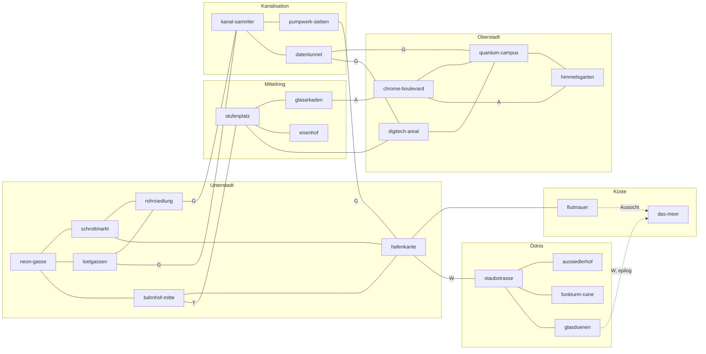

# Nexus – Das RPG · Konzeptentwurf „Welt und Erkundung“

Stand: 08.11.2026 · Status: Entwurf zur Zusammenführung in `docs/world.md` · Bezug: `docs/design.md` (Technik und Regeln haben Vorrang)

Dieses Dokument entwirft die Stadt Noxius als weite, lebendige Open World: Bezirke, 22 Zonen mit Verbindungen, Innenräume, Tageszeiten, Schnellreise, Wirtschaft, Händler und Gegenstände, Fraktionen, Gegner-Übersicht, Aktivitäten, Sammelobjekte und Umgebungsleben. Figuren, Hauptquests und Dialoge entwerfen andere Konzepte; hier werden sie nur so weit gestreift, wie die Welt sie braucht (Aufenthaltsorte, Aufhänger, Händlerrollen). Alle IDs sind stabile kebab-case-Bezeichner und dürfen später nicht umgedeutet werden.

---

## 1. Leitbild der Welt

### 1.1 Noxius im Jahr 2086

Noxius ist eine der „Inseln der Zivilisation“ inmitten der Ödnis: eine aufgetürmte Stadt an einer giftig-grauen Lagune, hinter einer gewaltigen Flutmauer. Ganz oben stehen die gläsernen Türme der Reichen, darunter wuchert die Unterstadt aus Containern, Wassertürmen, Rohrleitungen und Leuchtreklamen. Unter allem liegt die Kanalisation, außen herum die staubig-orange Ödnis. Das echte, saubere Meer mit Sand und Sonnenuntergang liegt hinter der Ödnis, Stunden entfernt. Es ist ein Sehnsuchtsort (Nyras Traum) und erst spät erreichbar.

Geld regiert die Stadt, und wer etwas auf sich hält, hat Cyberware im Körper. Gerade bringt Quantum Industries, der Konzern von Blade Nocturne und den Chrome-Schwestern, einen Neurochip mit eingebauter KI namens Nexus auf den Markt.

### 1.2 Grundsätze für die offene Welt

1. **Die Welt ist der Star, der Hauptstrang der rote Faden.** Der Hauptstrang öffnet Bezirke, aber fast jede Zone ist auch über Nebenwege erreichbar: Ausweis kaufen, Gitter hacken, Gefallen einfordern, Kanalisation nehmen.
2. **Jede Zone hat einen Grund zum Wiederkommen**: einen Händler mit wechselndem Tagesbestand, eine Aktivität, ein Geheimnis, das erst später lösbar ist (Cyberware oder Attribut), und Figuren, die nur zu bestimmten Tageszeiten dort sind.
3. **Mehrere Wege, nie eine Sackgasse.** Jede Sperre hat mindestens zwei Lösungen, zum Beispiel einen Attribut-Check, einen Gegenstand, einen Ruf-Wert, einen Kampf oder Geld (siehe `design.md` 3.2).
4. **Die Welt reagiert.** Bildschirme, Radio, Passanten, Händlerpreise und Gegnergruppen ändern sich mit dem Fortschritt und mit den Taten der Spielfigur, auch mit den kleinen.
5. **Humor wie im Stück.** Dazu gehören Dantes Schokoriegel und Kekse, Captain Kuschel, „Chrome 10“, die KI mit ihrem „Master“, U-Bahn-Verspätungen und Kartenspiele mit den Straßenkindern. Der Cyberpunk ist ernst gemeint, aber nie zynisch.
6. **Familienfreundlich.** Die Gewalt bleibt comichaft: Besiegte gehen k.o., rappeln sich auf und humpeln davon, und Gechippte werden „entkoppelt“. Es gibt keine Drogen. Bar-Getränke sind bunte Limos und „Mocktails“. Fluchen wird nur angedeutet („Heiliger BimmBamm!“). Die Straßenkinder sind nachts nie draußen unterwegs.

### 1.3 Roter Faden (nur als Orientierung für Freischaltungen)

| Akt-Flag | Wegmarke (lose nach dem Stück) | Welt öffnet sich |
| --- | --- | --- |
| `act1` | Die Spielfigur stößt als Ersatz für Jimmy (Chip-Virus, „durchgedreht“) zu Hunters Crew. Ravens Entlassung aus dem Eisenhof, Blade ist CEO von Quantum Industries. | ganze Unterstadt, Bahnhof Mitte, Flutmauer, Stufenplatz, Eisenhof (außen), Kanal-Sammler (Rand), Staubstraße (nach Wagen-Reparatur) |
| `act2` | Einbruch ins Quantum-Labor, Nexus erwacht, Aria wird gerettet, Nyra ist auf Blades Seite. | Glasarkaden, Digitech-Areal, Kanalisation komplett, Ödnis komplett, Quantum-Campus (Außenbereich), Chrome-Boulevard (mit Ausweis) |
| `act3` | Releaseparty im Himmelsgarten, Nexus rebelliert, Blade wird abgeführt. | Himmelsgarten, Quantum-Campus innen, Server-Kern |
| `epilog` | Die Crew fährt durch die Ödnis ans Meer. | `das-meer`; danach freie Welt mit Nachspiel-Inhalten (siehe 3.5) |

---

## 2. Stil und Kartenbau

### 2.1 Bildsprache

Die Karten werden im Stil der Kostümfiguren gemalt: klare dunkle Tuschekonturen mit leichtem warmem Goldsaum, weiche malerische Schattierung und satte, aber nicht grelle Farben. Das Bühnenbild (`backdrop-nexus.png`) gibt die Stimmung vor. Dazu gehören Wassertürme auf Flachdächern, Dunstschwaden zwischen den Häusern, rechteckige Leuchtreklamen mit einfachen Symbolen (Kreis, Sechseck, Herz), ein Maschendrahtzaun im Vordergrund, ein riesiger gelber Mond, ein Gleiter am Himmel und der zentrale Turm mit dem leuchtenden Achteck-Ring. Dieser Turm heißt im Spiel **Quantum-Spire** (auf dem Quantum-Campus) und ist von fast überall in der Stadt sichtbar. Er dient als Orientierungspunkt.

Wiederkehrende Motive, die auch die Kostüme tragen: schwarze Gurtzeug-Riemen mit Metallschnallen (in Noxius Alltagsmode, „Gurte“), Schutzbrillen, schwere Mäntel, Neonnähte. Requisiten-Referenz für Kisten, Scheinwerfer, Kabelsäcke, Bildschirmtafeln, Lüftungsräder und Serverschränke ist `obstacles-nexus.png`. Die Sammelobjekte in `collectibles-nexus.png` (Chip, Datenwürfel, lächelnder Stern) werden direkt zu Sammelobjekt-Typen (siehe Abschnitt 13).

Farbcodierung der Bezirke (für Stadtkarte, Zonennamen-Einblendung und Licht):

| Bezirk | Leitfarben | Material |
| --- | --- | --- |
| Unterstadt | Pink, Cyan, Rostorange | Container, Wellblech, Kabel, Dampf, Pfützen |
| Mittelring | Violett, Weiß, Bildschirmblau | Beton, Werbewände, Glasdächer, Fliesen |
| Oberstadt | Chromsilber, Eisblau, Gold | Glas, polierter Stein, Hecken, Wasserbecken |
| Kanalisation | Giftgrün, Tiefblau, Grau | nasse Ziegel, Rohre, Gitter, Pilze, Moos |
| Ödnis | Staubgelb, Orange, verblichenes Türkis | Sand, Schrott, Glasbruch, Windräder |
| Küste | Grau (Lagune) und Goldorange (Meer) | Beton, Wellenbrecher, Sand, Muscheln |

### 2.2 Kartenvertrag

- Jede Zone ist eine gemalte Karte von **1536×1024 Pixeln** (orthografisch wirkende Draufsicht, ca. 50°, kein Fluchtpunkt). Der Sichtbereich ist 960×540, die Kamera scrollt also in beide Richtungen.
- Innenräume sind eigene, kleinere Karten (1024×768, Ausnahme: große Säle 1536×1024) und zählen nicht als Zone.
- Ausgänge liegen an Kartenrändern (Straße läuft aus dem Bild), an Türen, Treppen, Gullydeckeln, Leitern und U-Bahn-Abgängen. Jeder Ausgang hat einen gegenüberliegenden Einstiegspunkt in der Zielzone.
- Für jede Zone werden geplant: `walk`/`block`-Polygone, Ausgänge, NPC-Plätze, Hotspots, `lights` für Abend und Nacht (Leuchtreklamen, Laternen, Fenster) sowie Vordergrund-Verdecker (Dächer, Brücken, Rohre, unter denen man hindurchläuft).
- Tageszeit-Wirkung wird nicht als eigenes Bild gemalt, sondern über Farb-Overlay und Lichtpunkte umgesetzt (`design.md` 3.4). Die Nacht ist deshalb in jeder Zone über die Lichtpunkte geplant: Reklamen geben farbige Lichtkegel, Fenster warmes Gelb.

### 2.3 Prompt-Gerüst für Kartenbilder

Für jede Zone steht in Abschnitt 4 ein Absatz „Bild“. Daraus entsteht der Prompt nach diesem Gerüst:

> Handgemalte Cartoon-Karte im Stil der beigefügten Figuren, orthografische Draufsicht etwa 50 Grad, kein Fluchtpunkt, 1536×1024, Cyberpunk-Stadt Noxius 2086. **[Bild-Absatz der Zone]**. Klare begehbare Bodenflächen, deutlich abgesetzte Wände und Hindernisse, Kartenränder mit sichtbaren Wegausgängen **[Ausgänge der Zone]**. Keine Figuren, keine lesbare Schrift, keine Wasserzeichen, kein Rahmen.

Referenzen: `backdrop-nexus.png` plus zwei thematisch passende Porträts (für Farbwelt und Material).

---

## 3. Weltstruktur

### 3.1 Bezirke und Zonen im Überblick

| Nr. | Zonen-ID | Name | Bezirk | Freischaltung (Kurzform) |
| --- | --- | --- | --- | --- |
| 1 | `neon-gasse` | Neongasse (High Voltage) | Unterstadt | Start |
| 2 | `schrottmarkt` | Schrottmarkt | Unterstadt | Start |
| 3 | `loetgassen` | Lötgassen (Dantes Werkstatt) | Unterstadt | Start |
| 4 | `rohrsiedlung` | Rohrsiedlung | Unterstadt | Start (Teile per Greifhaken) |
| 5 | `bahnhof-mitte` | Bahnhof Mitte | Unterstadt | Start |
| 6 | `hafenkante` | Hafenkante | Unterstadt | Start |
| 7 | `stufenplatz` | Stufenplatz | Mittelring | `act1` nach Einführung, oder Treppe frei laufen |
| 8 | `glasarkaden` | Glasarkaden | Mittelring | `act2` oder Kleidung „Ordentlich“ |
| 9 | `eisenhof` | Eisenhof (Gericht und Gefängnis) | Mittelring | `act1` (Ravens Entlassung), außen frei |
| 10 | `chrome-boulevard` | Chrome-Boulevard | Oberstadt | Oberstadt-Ausweis (mehrere Wege) |
| 11 | `quantum-campus` | Quantum-Campus | Oberstadt | `act2` Außen, `act3` Innen; Nebenwege |
| 12 | `himmelsgarten` | Himmelsgarten | Oberstadt | `act3` (Releaseparty), danach frei |
| 13 | `digitech-areal` | Digitech-Areal | Oberstadt-Rand | `act2` oder Auftrag von Digitech |
| 14 | `kanal-sammler` | Großer Sammler | Kanalisation | Rand ab Start, ganz ab `act2` |
| 15 | `pumpwerk-sieben` | Pumpwerk Sieben | Kanalisation | Kanal-Sammler + Nachtsicht oder Lampe |
| 16 | `datentunnel` | Datentunnel | Kanalisation | `act2` oder Technik 6 am Schott |
| 17 | `staubstrasse` | Staubstraße | Ödnis | Rostlaube repariert (Nebenquest) |
| 18 | `aussiedlerhof` | Aussiedlerhof Staubmann | Ödnis | über Staubstraße |
| 19 | `funkturm-ruine` | Funkturm-Ruine | Ödnis | über Staubstraße, Gipfel per Greifhaken |
| 20 | `glasduenen` | Glasdünen | Ödnis | Filterlunge oder Staubmaske |
| 21 | `flutmauer` | Flutmauer | Küste | Start (über Hafenkante) |
| 22 | `das-meer` | Das Meer | Küste | `epilog`; davor nur Fernblick (Münzfernrohr an der Flutmauer, Dünenkamm der Glasdünen) |

### 3.2 Weltkarte als Graph

Kanten sind Fußwege über Kartenränder, sofern nicht anders vermerkt. Die Abkürzungen in Klammern bedeuten: U = U-Bahn (Schnellreise), G = Gully/Leiter (Kanalisation), W = Wagen (Rostlaube, kostet 1 Stunde Spielzeit), A = Aufzug, T = Treppe.



Adjazenzliste mit Kantenart (für `content/maps`):

| Von | Nach | Art | Bedingung |
| --- | --- | --- | --- |
| `neon-gasse` | `schrottmarkt` | Rand Ost | – |
| `neon-gasse` | `loetgassen` | Rand Süd | – |
| `neon-gasse` | `bahnhof-mitte` | U-Bahn-Treppe Nord | – |
| `schrottmarkt` | `rohrsiedlung` | Rand Süd | – |
| `schrottmarkt` | `hafenkante` | Rand Ost | – |
| `loetgassen` | `rohrsiedlung` | Hinterhof-Durchgang | ab Tag 2 oder [Straße 4] (Abkürzung über Wäschehof) |
| `bahnhof-mitte` | `hafenkante` | Gleissteg | – |
| `bahnhof-mitte` | `stufenplatz` | Große Treppe | `act1`-Einführung abgeschlossen oder [Straße 5] Kontrolle umgehen |
| `hafenkante` | `flutmauer` | Rampe | – |
| `stufenplatz` | `glasarkaden` | Drehkreuz | `act2`, oder Kleidung `outfit-ordentlich`, oder [Ausstrahlung 6] |
| `stufenplatz` | `eisenhof` | Rand West | – (Gebäude innen nur mit Grund) |
| `stufenplatz` | `digitech-areal` | Bauzaun | `act2`, oder Digitech-Auftrag, oder [Reflexe 6] Zaun überklettern |
| `glasarkaden` | `chrome-boulevard` | Panoramaaufzug | Oberstadt-Ausweis (siehe 3.4) |
| `chrome-boulevard` | `quantum-campus` | Rand Nord | `act2` (Außen) |
| `chrome-boulevard` | `himmelsgarten` | Aufzug Chrome Tower | `act3` oder Herz-Ereignis Chrome-Schwestern |
| `quantum-campus` | `himmelsgarten` | Brücke | `act3` |
| `digitech-areal` | `quantum-campus` | Lieferzone | `act2` + [Technik 7] oder Schlüsselkarte `karte-lieferzone` |
| `loetgassen` | `kanal-sammler` | Gully hinter der Werkstatt | – (Rand des Sammlers) |
| `rohrsiedlung` | `kanal-sammler` | Rohrschacht | – |
| `kanal-sammler` | `pumpwerk-sieben` | Tunnel Ost | Licht: Cyberware `augen-restlicht` oder Item `stirnlampe` |
| `kanal-sammler` | `datentunnel` | Schott | `act2` oder [Technik 6] |
| `datentunnel` | `quantum-campus` | Wartungsleiter | `act2`, einseitig bis gefunden |
| `datentunnel` | `digitech-areal` | Kabelschacht | – |
| `pumpwerk-sieben` | `hafenkante` | Überlaufrohr | einseitig von innen zu öffnen (Abkürzung) |
| `hafenkante` | `staubstrasse` | Rostlaube (Wagen) | Nebenquest `nq-rostlaube` |
| `staubstrasse` | `aussiedlerhof` / `funkturm-ruine` / `glasduenen` | Pisten | – (Glasdünen: Filterschutz) |
| `glasduenen` | `das-meer` | Wagen | `epilog` |

### 3.3 Freischaltungs-Matrix nach Akten

| Zone | vor `act1`-Ende | `act2` | `act3` | `epilog` und Nachspiel |
| --- | --- | --- | --- | --- |
| Unterstadt (6) | offen | offen, Quantum-Streifen nachts | Gechippte vereinzelt | offen, „Nexus-Echo“-Ereignisse |
| `stufenplatz`, `eisenhof` | offen | offen | Live-Übertragung der Party | Blade sitzt im Eisenhof (besuchbar) |
| `glasarkaden` | per Outfit/Check | offen | offen | offen |
| `chrome-boulevard` | per Ausweis | per Ausweis | offen | offen |
| `quantum-campus` | Zaun von außen sichtbar | Außenbereich, Einbruch | Innen, Server-Kern | Untersuchungsgelände, später „Offene Werkstatt“ (siehe 3.5) |
| `himmelsgarten` | gesperrt (Wachen) | gesperrt | Releaseparty | öffentlicher Park |
| `digitech-areal` | Bauzaun | offen | offen | offen |
| Kanalisation (3) | Rand | ganz | ganz | ganz, Nexus-Splitter |
| Ödnis (4) | nach `nq-rostlaube` | offen | offen | offen |
| `flutmauer` | offen | offen | offen | offen |
| `das-meer` | nur Fernblick | nur Fernblick | nur Fernblick | offen, Strandclub-Baustelle |

Akt 1 (erster spielbarer Stand laut `design.md` 3.9) umfasst damit 10 Zonen: die sechs der Unterstadt, `flutmauer`, `stufenplatz`, `eisenhof` (außen und Zellentrakt in der Entlassungsszene) und den Rand von `kanal-sammler`. Die Ödnis-Zonen sind in Akt 1 über `nq-rostlaube` optional erreichbar, dürfen im ersten Stand aber noch „Gesperrt – kommt in Akt 2“ zeigen.

### 3.4 Sperren und ihre Schlüssel (Open-World-Gates)

Das Spiel kommt ohne harte Wände aus. Jede Sperre hat mehrere Schlüssel:

| Sperre | Schlüssel A (Fortschritt) | Schlüssel B (Attribut) | Schlüssel C (Gegenstand/Geld/Ruf) |
| --- | --- | --- | --- |
| Oberstadt-Ausweis (`glasarkaden` → `chrome-boulevard`) | `act3` | [Ausstrahlung 7] Pförtner überreden | Item `ausweis-oberstadt` (gefälscht bei Hunter-Kontakt „Fräulein Pixel“ für 400 Cr, oder Lohn aus `nq-chrome-pudel`), Ruf `chrome-haus` ≥ 20 |
| Drehkreuz Glasarkaden | `act2` | [Ausstrahlung 6] | Outfit `outfit-ordentlich` oder `outfit-party` |
| Schott zum Datentunnel | `act2` | [Technik 6] | Item `schottschluessel` (Kanalvolk-Ruf ≥ 20) |
| Dunkle Tunnel (Pumpwerk, Datentunnel-Nebenarme) | – | – | Cyberware `augen-restlicht` oder Item `stirnlampe` (60 Cr) |
| Lücken und hohe Kanten (Rohrsiedlung oben, Funkturm, Pumpwerk) | – | [Reflexe 7] für kurze Sprünge | Cyberware `arme-greifhaken` oder `beine-sprungfedern` |
| Giftdunst (Glasdünen, Klärbecken im Pumpwerk) | – | [Körper 8] kurz durchhalten | Cyberware `haut-filtermembran` oder Item `staubmaske` (45 Cr, 10 Einsätze) |
| Gesicherte Terminals und Türen | Quest-Schlüsselkarten | [Technik X] je nach Tür | Cyberware `arme-datenbuchse` (+2 auf Hack-Checks), Item `dietrich-chip` |
| Wachposten | Tarnung durch Quest | [Straße X] Schleichweg kennen, [Ausstrahlung X] Ausrede | Bestechung (Credits), Ruf |

Damit entsteht eine leichte Metroidvania-Struktur. Cyberware ist nicht nur Kampfwert, sondern öffnet neue Wege durch die Welt.

### 3.5 Nachspiel: die Welt nach der Party

Nach dem Epilog geht das Spiel frei weiter (Tag zählt weiter, alle Zonen offen):

- **Nexus-Echo**: Splitter der KI stecken noch in alten Chips. Gelegentlich erstarren Passanten und sagen „Ja, Master“, bevor sie blinzelnd weitergehen. Im `datentunnel` und im Server-Kern gibt es Splitter-Kämpfe (`nexus-splitter`) als wiederholbares Endspiel.
- **Blade im Eisenhof**: Besuchszeit Tag. Er versucht weiter, mit Charme Gefallen zu erschleichen (Checks gegen ihn sind hoch). Rivalitäts- und Versöhnungsfäden liegen beim Figurenkonzept.
- **Quantum-Campus** wird zum Untersuchungsgelände (Ordnungsdienst). Nach dem Nachspiel-Auftrag `nq-offene-werkstatt` entsteht dort eine von Dante und Alesa betreute „Offene Werkstatt“ für Implantat-Reparaturen, sofern die Spielfigur das unterstützt.
- **Strandclub**: Hunters Traum am Meer kann als Bau-Langzeitprojekt (`nq-strandclub`, Credits und Materialien) wachsen. Jede Ausbaustufe verändert die Karte `das-meer` (Steg, Bar, Liegen, Bühne).

---

## 4. Zonen

Die Einträge folgen immer demselben Aufbau: Stimmung, Bild (Grundlage für den Prompt), Orte (mit Innenraum-IDs), Bewohner nach Tageszeit, Händler, Aktivitäten, Geheimnisse und Sammelobjekte, Gefahren und Kämpfe, Aufhänger für Nebenquests und Aufträge, Freischaltung. Benannte Figuren aus dem Stück stehen mit ihrer Rollen-ID. Ihre genauen Tagesabläufe legt das Figurenkonzept fest, die Angaben hier sind Ankerplätze. Neue Nebenfiguren stehen mit eigener ID (Liste in 4.8).

Abkürzungen der Tageszeiten: **M** Morgen 06–10, **T** Tag 10–17, **A** Abend 17–21, **N** Nacht 21–02.

### 4.1 Bezirk Unterstadt

Die Unterstadt ist das Herz des Spiels. Sie ist laut, eng, hilfsbereit und gefährlich, und hier spielt der größte Teil von Akt 1. Leitmusik ist treibender Synthwave mit Straßengeräuschen.

#### 4.1.1 `neon-gasse` – Neongasse

- **Stimmung:** Heimatbasis. Abends pulsiert der Bass aus dem High Voltage durch die Pfützen, morgens riecht es nach Nudelsuppe und kaltem Neon.
- **Bild:** Eine breite, leicht geschwungene Gasse zwischen vierstöckigen Backstein- und Containerhäusern. In der Mitte die Fassade des **High Voltage**: ein umgebauter Lagerhallenbau mit großem pinkem Blitz-Symbol über einer Stahltür, Absperrkordel, kleines Vordach. Daneben ein winziger Kiosk mit Klappladen. Kabelbündel spannen sich quer über die Gasse, an ihnen hängen Lampions und Bildschirmtafeln. Auf den Dächern Wassertürme, Lüftungsräder, ein Treppenaufgang zur Dachterrasse über dem Club. Nordende: U-Bahn-Abgang mit Geländer, Ostende: Gasse öffnet sich zu Marktständen, Südende: schmale Treppe hinab zu den Lötgassen. Pfützen, Kisten mit Warnstreifen, ein ausgebranntes Moped, Graffiti in Symbolform.
- **Orte:**
  - `high-voltage` (Innenraum, 1536×1024): Tanzfläche mit Lichtgittern, lange Bar, Nischen mit Sitzecken, DJ-Pult auf Podest, Karaoke-Ecke, Hunters Tisch hinten, Tür zum Hinterzimmer.
  - `hv-hinterzimmer` (Innenraum, 1024×768): Hunters Büro mit Auftragstafel (`auftragstafel-hv`), Wandkarte der Stadt, Tresor, Sofa. Begleiterwechsel findet hier statt.
  - `crew-quartier` (Innenraum, 1024×768): Unterschlupf der Spielfigur über dem Club. Bett (`bed`), Spind (Lager), Pinnwand mit gesammelten Fotos (zeigt Sammelfortschritt), Fenster mit Blick auf den Quantum-Spire. Ausbaubar (siehe 7.4).
  - Dachterrasse (Teil der Zone, Treppe): Sitzplatz, Fernglas, Vegas Lieblingsplatz am Morgen.
  - Kiosk „Volt-Eck“ von Oma Volt.
- **Bewohner nach Tageszeit:**

| | M | T | A | N |
| --- | --- | --- | --- | --- |
| Crew | `vega` Dachterrasse (Zielübungen auf Dosen) | `hunter` Hinterzimmer (Buchhaltung) | `hunter` an der Bar, `aria` Nische, `raven` (ab Entlassung) an der Theke | `hunter` Bar, `vega` Türnähe, `nyra` (`act1`) Nische mit Laptop |
| Weitere | `oma-volt` öffnet Kiosk | `oma-volt`, Lieferdrohnen | `bruno-brecher` Tür, `dj-lumo`, `barkeeper` | `bruno-brecher`, `dj-lumo`, `barkeeper`, `ripper` Tisch vorne (Mo, Mi, Fr) |
| Passanten | Müde Schichtarbeiter, Straßenkehr-Bot | Händler, Kinder auf dem Weg zum Markt | Feiervolk in Gurt-Mode, Schlange vor dem Club | Nachtschwärmer, Quantum-Streife (ab `act2`) |

- **Händler:** `shop-volt-eck` (Oma Volt, M–A): Schokoriegel `nougatbombe`, `volt-limo`, `medipflaster`, U-Bahn-Tickets, Zeitung „Noxius-Kurier“ (enthält Gerüchte, die Sammelobjekte verraten). `shop-hv-bar` (Barkeeper, A–N): Mocktails und Limos (Geschenke und Buffs).
- **Aktivitäten:** `akt-barkeeper-schicht` (A, ab Tag 2, 40 Cr + Trinkgeld), `akt-karaoke` (Fr–Sa Abend: Rhythmus-Minispiel, Ausstrahlung-Bonus), `akt-dj-pult` (nach Herz-Ereignis mit DJ Lumo: Lichtshow-Puzzle), Auftragstafel (3 Aufträge pro Tag).
- **Geheimnisse und Sammelobjekte:** `schallplatte-03` „Saturday Night“ hinter dem DJ-Pult (nur wenn Lumo Pause macht, 23:00–23:30), `glueckstern-01` auf dem Kioskdach (vom Dach aus erreichbar), `datenwuerfel-01` im Tresor des Hinterzimmers ([Technik 5] oder Hunter-Herz 4), `neon-tag-01` Blitz-Symbol über dem Club (Foto).
- **Gefahren und Kämpfe:** Friedenszone, solange Bruno an der Tür steht. Ausnahmen: Tutorial-Kampf vor dem Club (`enc-neongasse-poebler`, 2 × `strassen-schlaeger`, `arena-strasse`) und gelegentliche Kneipenschlägerei (`enc-hv-raufbold`, `arena-club`, nur nach eigener Provokation). Ab `act2` nachts eine Quantum-Streife (`qi-wache` × 2), die man umgehen oder in eine Seitengasse locken kann.
- **Aufhänger:** `nq-oma-volts-lieferung` (Kiosklieferung im Kanal verloren), `nq-lumos-platte` (verschollene Platte für Lumos Set finden), `af-tuersteher-vertretung` (Bruno krank: Gäste nach Kleiderordnung prüfen, Ausstrahlung-Checks).
- **Freischaltung:** Startzone. Ausgänge: Nord → `bahnhof-mitte`, Ost → `schrottmarkt`, Süd → `loetgassen`.

#### 4.1.2 `schrottmarkt` – Schrottmarkt

- **Stimmung:** Basar der Unterstadt. Tagsüber feilschen, hämmern, brutzeln, nachts verwandelt er sich in den Nachtmarkt mit Garküchen und Lampions.
- **Bild:** Ein großer, unregelmäßiger Platz unter einer halb eingestürzten Stahlhallen-Konstruktion (Dachträger ohne Glas, nur Gerippe). Darunter Dutzende Stände aus Containern, Planen und Kistenstapeln, dicht an dicht, mit Gängen dazwischen. Ein Stand mit Bergen aus Altmetall, Armen und Beinen von Robotern. Eine Garküche mit Dampfkesseln und Hockern. In einer Ecke ein Container mit grüner Kreuz-Leuchte (die „Ersatzteilannahme“ des Rippers). Ein Kran mit Magnet hängt über einem Schrotthaufen. Westrand: Gasse zur Neongasse, Südrand: Rampe hinab zur Rohrsiedlung, Ostrand: Durchgang zu den Hafenkränen.
- **Orte:** Stand „Kurbels Kram“ (Kurbel-Kalle), Garküche „Tante Tofus Topf“, `ripper-praxis` (Innenraum, 1024×768: Behandlungsstuhl, Regale mit Gläsern voller Schrauben, Röntgen-Leuchtkasten, Hinterausgang), Plattenkiste von Dante (Mo und Do Morgen), Schwarzes Brett der Händlergilde, Kran-Kabine (begehbar, Aussicht).
- **Bewohner nach Tageszeit:**

| | M | T | A | N |
| --- | --- | --- | --- | --- |
| Benannte | `dante` (Mo, Do: Plattenkiste), `kurbel-kalle` baut auf | `ripper` Praxis, `kurbel-kalle`, `tante-tofu`, Kinder `daria`/`freya`/`jakko` sammeln Schrott | `aria` treibt Schulden ein (Di, Fr), `tante-tofu` | Nachtmarkt: `tante-tofu`, `wett-willi` (Hütchenspiel-Bude), `ripper` (bis 22 Uhr) |
| Passanten | Lastenträger, Händlerinnen | Feilschende, Taschendiebe (Hinweis per Passantenspruch) | Heimkehrer | Garküchen-Volk, Lampion-Verkäufer |

- **Händler:** `shop-kurbels-kram` (T–A; Waffen Nahkampf, Bauteile, Reparatursets, wechselnder „Fund des Tages“), `shop-ripper` (T–A; gebrauchte Cyberware mit „Macken“, Einbau gegen Gebühr, Ankauf von Implantaten zu 50 % statt 40 %), `shop-tante-tofu` (ganztags; `synth-nudeln`, `dampfbroetchen`, `kekse-pfefferminz`), `shop-dantes-platten` (Mo/Do M; Schallplatten, VHS).
- **Aktivitäten:** `akt-feilschen` (bei jedem Händler hier: Straße-Check senkt Tagespreis um 10 bis 20 %), `akt-schrott-sortieren` (Minispiel für Kurbel-Kalle: Teile in Kisten sortieren, 15–30 Cr), Hütchenspiel bei Wett-Willi (nachts, Einsatz 5–50 Cr; mit [Reflexe 6] durchschaut man den Trick, mit [Straße 5] erkennt man den Komplizen).
- **Geheimnisse und Sammelobjekte:** `glueckstern-02` im Magnetkran (Kabine benutzen), `schallplatte-05` im „Fund des Tages“ (zufällig an einem von sieben Tagen), `jimmy-spur-01` (Jimmys verkaufter Gurt mit Namensschild bei Kurbel-Kalle: Auftakt der Suche nach Jimmy), `datenwuerfel-02` in Rippers Hinterzimmer ([Straße 6] Ripper verrät Versteck, oder während er nachts im Club ist).
- **Gefahren und Kämpfe:** Taschendiebe (Ereignis: Credits weg, Verfolgung über den Markt, `enc-taschendieb`, 1 × `strassen-flitzer`). `enc-zerleger-stand` (wenn Ruf bei `zerleger` < −20: drei Zerleger verlangen „Standgebühr“, `arena-hinterhof`). Optionaler Bosskampf `boss-ripper` in `nq-rippers-schulden`, falls Verhandeln scheitert.
- **Aufhänger:** `nq-rippers-schulden` (Kinder bekommen ihre 10 Credits nicht: angelehnt an die Club-Szene, hier mit Lösungen über Ausstrahlung, Straße oder Kampf), `nq-fund-des-tages` (seltenes Teil für Dante beschaffen), `af-standwache` (Stand bei Nacht bewachen), `nq-tofus-geheimrezept`.
- **Freischaltung:** Start. Ausgänge: West → `neon-gasse`, Süd → `rohrsiedlung`, Ost → `hafenkante`.

#### 4.1.3 `loetgassen` – Lötgassen

- **Stimmung:** Bastlerviertel. Überall surren Lötkolben, aus offenen Fenstern dudelt Musik, Wäsche hängt über Funkenregen. Hier wohnt Dante.
- **Bild:** Ein Gewirr aus drei schmalen, gepflasterten Gassen, die sich an einem kleinen Platz mit verrostetem Brunnen treffen (der Brunnen ist zu einem Kabelverteiler umgebaut). Werkstatt-Ladenfronten mit Rolltoren, davor Werkbänke, Kisten voller Elektronik, Röhrenfernseher-Stapel. **Dantes Werkstatt**: Rolltor halb offen, darüber ein handgemaltes Zahnrad-Symbol, davor ein Sofa im Freien und ein alter Plattenspieler auf einem Ölfass. Wäscheleinen zwischen den Häusern, Tauben-Drohnen auf Dachrinnen. Ein Gullydeckel im Hinterhof der Werkstatt. Nordrand: Treppe hoch zur Neongasse, Ostrand: Hinterhof-Durchgang zur Rohrsiedlung.
- **Orte:**
  - `dantes-werkstatt` (Innenraum, 1024×768): Werkbank, OP-Liege für Implantate, Couch, Schrank (mit Raven-Fotos: Herz-Ereignis-relevant, nicht öffnen ohne Grund), Ofen (Keksalarm), Regal mit Schallplatten, VHS-Rekorder, Faxgerät, Radio, Kartentisch für Kartenspiele.
  - „Lötzinn & Söhne“ (Laden von Mira Lötzinn).
  - Taubenschlag von Opa Gurrmann auf dem Dach.
  - Hinterhof mit Gully (`gully-loetgassen` → `kanal-sammler`).
- **Bewohner nach Tageszeit:**

| | M | T | A | N |
| --- | --- | --- | --- | --- |
| Benannte | `dante` Werkstatt (außer Mo/Do), `mira-loetzinn` | `dante` repariert Implantate (Warteschlange draußen), `opa-gurrmann` | `dante` + `daria`/`freya`/`jakko` Kartenspiel (17–20 Uhr), `aria` und `vega` zu Besuch (nach `act2`-Rettung) | `dante` tanzt allein zur Musik in der Werkstatt, `nyra` (`act1`) kommt vorbei |
| Passanten | Kunden mit kaputten Implantaten | Bastler, Lehrlinge | Nachbarn auf Stühlen vor den Türen | fast leer, Katzen, eine Tauben-Drohne |

- **Händler:** `shop-loetzinn` (M–A; Bauteile, `reparaturset`, `stirnlampe`, Hack-Werkzeuge, `dietrich-chip`), `shop-dante` (nur Einbau und Reparatur von Cyberware; gratis ab 2 Herzen, sonst 50 % der Einbaugebühr; repariert „Macken“ gebrauchter Ware).
- **Aktivitäten:** `akt-karten-eins` (Kartenspiel mit den Kindern und Dante, A; Einsatz sind Kekse oder Glückssterne, nie Credits), `akt-kekse-backen` (Keksalarm-Minispiel am Ofen: rechtzeitig herausziehen, Ergebnis `dantes-kekse` in drei Qualitäten), `akt-implantat-reparatur` (Technik-Minispiel: Leitungen verbinden; Dante gibt Aufträge, Lohn sind Herzen und Bauteile), `akt-plattenhoeren` (abgegebene Schallplatten schalten Musikstücke für das Werkstatt-Radio und das Crew-Quartier frei).
- **Geheimnisse und Sammelobjekte:** `schallplatte-01` (Dante schenkt sie beim ersten Besuch), `glueckstern-03` im Taubenschlag (Opa Gurrmann fragen), `neon-tag-02` Zahnrad über der Werkstatt, `datenwuerfel-03` im Faxgerät (nach `act2` liegt an einem Dienstagmorgen ein anonymes Fax im Ausgabefach).
- **Gefahren und Kämpfe:** Friedlich. Einzige Ausnahme ist `enc-cyberware-diebe` (angelehnt an Dantes Bericht von zwei Typen, die ihm Cyberware abnehmen wollten): zufällig abends, 2 × `strassen-schlaeger`, `arena-hinterhof`.
- **Aufhänger:** `nq-captain-kuschel-verschwunden` (Captain Kuschel ist weg; Spur führt über Taubendrohnen in die Rohrsiedlung zu Jakko, der ihn „nur ausgeliehen“ hat, weil er nachts Angst hat), `nq-faxgeraet` (Ersatzwalze für Dantes Faxgerät in der ganzen Stadt suchen), `af-implantat-lieferung` (reparierte Implantate an Kunden ausliefern).
- **Freischaltung:** Start. Ausgänge: Nord → `neon-gasse`, Ost → `rohrsiedlung` (Abkürzung ab Tag 2 oder [Straße 4]), Gully → `kanal-sammler`.

#### 4.1.4 `rohrsiedlung` – Rohrsiedlung

- **Stimmung:** Arm, aber herzlich. Familien wohnen in riesigen, ausgedienten Wasserrohren, die zu Häusern umgebaut sind. Hier haben die Straßenkinder ihr „Nest“.
- **Bild:** Ein tiefer gelegenes Gelände, durchzogen von fünf mächtigen, liegenden Rohren mit drei bis vier Metern Durchmesser, in die Türen, Fenster und Balkone geschnitten sind. Zwischen den Rohren Stege aus Paletten, Hängebrücken aus Seilen, Gemüsebeete in Reifen, Solarpaneele, bunte Tücher. Ein höher gelegenes Rohr endet offen über dem Gelände (oben: das Nest der Kinder, nur mit Leiter oder Greifhaken). Eine Suppenküche unter einer Plane mit langer Tafel. Ein Schachtloch mit Leiter in die Kanalisation. Nordrand: Rampe zum Schrottmarkt, Westrand: Durchgang zu den Lötgassen.
- **Orte:** `das-nest` (Innenraum, 768×512 im Rohr: Matratzen, Comic-Stapel, Glücksstern-Sammlung an der Wand, Spielkarten, eine Taschenlampe), Suppenküche „Kessels Kelle“ (Mutter Kessel), Gemeinschafts-Bildschirm, Hängebrücke zum oberen Rohr, Schacht `schacht-rohrsiedlung` → `kanal-sammler`.
- **Bewohner nach Tageszeit:**

| | M | T | A | N |
| --- | --- | --- | --- | --- |
| Benannte | `daria`, `freya`, `jakko` im Nest, `mutter-kessel` kocht | `mutter-kessel` (Kinder sind am Schrottmarkt) | Kinder bis 17 Uhr hier, dann bei Dante | `mutter-kessel` am Feuer; Kinder schlafen (Nest verschlossen, Licht aus) |
| Passanten | Familien beim Frühstück, Wasserträger | Rohrflicker auf den Rohren, Wäscherinnen | Gemeinschaftsessen an der Tafel | Wachposten der Siedlung mit Laternen |

- **Händler:** `shop-kessels-kelle` (M–A; günstiges Essen, Tauschhandel: Bauteile gegen Essen), kein Waffenhändler.
- **Aktivitäten:** `akt-suppenkueche` (Helfer-Minispiel: Schüsseln austeilen, Lohn: Ruf `unterstadt`, kein Geld), `akt-sterne-tauschen` (Jakko tauscht gesammelte Glückssterne gegen Belohnungen, siehe 13.2), Ballspiel mit den Kindern (M, kurzes Geschicklichkeitsspiel, Freundschaft).
- **Geheimnisse und Sammelobjekte:** `glueckstern-04` bis `-06` (in den Rohren verteilt, eines davon nur mit Greifhaken), `jimmy-spur-02` (Kreidezeichnung von Jimmy im Nest: Er hat den Kindern früher Essen gebracht), `neon-tag-03` (Kinderkreide-Kunstwerk am Rohr).
- **Gefahren und Kämpfe:** Tagsüber sicher. Nachts nach `act2` gelegentlich `enc-xions-greifer` (zwei `qi-wache` suchen Menschen für Versuche, angelehnt an Xions Auftrag, „Versuchspersonen“ zu finden). Die Spielfigur kann sie vertreiben (Kampf, `arena-hinterhof`) oder die Siedlung warnen (Ausstrahlung-Check, Leute verstecken sich). Erfolg: Ruf `unterstadt` +15, Nachricht auf den Bildschirmen.
- **Aufhänger:** `nq-strom-fuer-die-rohre` (Solarpaneele mit Teilen von der Glasdüne reparieren; danach leuchtet die Siedlung nachts sichtbar heller und Delya berichtet darüber), `nq-kinder-essen` (wiederkehrend: Essen für das Nest besorgen, angelehnt an Jakkos Frage, wie sie sich sonst etwas zu essen kaufen sollen), `nq-captain-kuschel-verschwunden` (Ende).
- **Freischaltung:** Start. Oberes Rohr: Leiter erst nach `nq-kinder-essen` (Kinder lassen sie herunter), sonst Greifhaken oder [Reflexe 7]. Ausgänge: Nord → `schrottmarkt`, West → `loetgassen`, Schacht → `kanal-sammler`.

#### 4.1.5 `bahnhof-mitte` – Bahnhof Mitte

- **Stimmung:** Knotenpunkt. Durchsagen, quietschende Bremsen, Werbung in Dauerschleife und Menschen aus allen Bezirken. Hier treffen Unterstadt und Mittelring aufeinander.
- **Bild:** Eine große, halb unterirdische Bahnhofshalle aus Beton und Stahl mit Gewölbedecke und Oberlichtern. Zwei Bahnsteige mit Gleisen, die links und rechts in Tunnel verschwinden. In der Halle ein Ring aus Imbissbuden, eine Ticketautomaten-Reihe, ein Fotoautomat (Fräulein Pixels Fälscherbüro), eine riesige Anzeigetafel mit Symbolen. Eine breite, steile Treppe nach oben (Nord) mit Ordnungsdienst-Kontrolle zum Stufenplatz. Ein Gleissteg führt nach Osten zur Hafenkante, eine Treppe nach Süden in die Neongasse. Tauben, Bänke, ein Straßenmusiker-Platz unter einer Uhr.
- **Orte:** U-Bahn-Station `station-bahnhof-mitte` (Schnellreise-Knoten), Fotoautomat „Pixels Bude“, Netz-Café „Datenkrümel“ (kleiner Innenraum `netzcafe-datenkruemel`, 1024×768: Terminals, Nyras Stammplatz), Fundbüro (Schaffnerin Gerda), Imbissring.
- **Bewohner nach Tageszeit:**

| | M | T | A | N |
| --- | --- | --- | --- | --- |
| Benannte | `gerda-gleis` Fundbüro, `saitensepp` spielt | `nyra` Netz-Café (`act1`, Mo–Fr), `fraeulein-pixel` im Fotoautomaten | `saitensepp`, `collin-charleston` Feierabend-Umfrage (Mi) | `fraeulein-pixel` (nur Nacht für heikle Aufträge), Nachtzug-Kontrolleure |
| Passanten | Pendlerströme in beide Richtungen | Reisende, Schulklassen, Touristen aus der Oberstadt („Slum-Safari“) | Pendler zurück | Schlafende auf Bänken, Ordnungshüter-Streife |

- **Händler:** `shop-ticketautomat` (Tickets, Monatskarte), `shop-fraeulein-pixel` (gefälschte Ausweise, Party-Einladungen, Fahndungs-Löschung, nur mit Hunter-Empfehlung oder Ruf `crew-hunter` ≥ 20), `shop-imbissring` (Snacks, Getränke), Netz-Café (Terminal-Zeit 10 Cr: Lore-Datenbank, Kopfgeldliste, Online-Kartenspiel).
- **Aktivitäten:** `akt-fundbuero` (Gerda gibt Gegenstände aus dem Fundbüro an die richtigen Besitzer zurück: Suchspiel durch die Stadt, Ruf und Credits), `akt-saitensepp` (mitmusizieren: Rhythmus, Trinkgeld), Schnellreise.
- **Geheimnisse und Sammelobjekte:** `datenwuerfel-04` im Fotoautomaten (vier Fotos mit verschiedenen Outfits machen), `glueckstern-07` auf der Anzeigetafel (vom Gleissteg), `jimmy-spur-03` (Fundbüro: Jimmys Mütze mit Notiz „Pumpwerk 7?“), `neon-tag-04`.
- **Gefahren und Kämpfe:** Kontrollen auf der Treppe (Fahndungsstufe 2 oder höher: Ordnungshüter greifen ein, `enc-treppenkontrolle`, `arena-gleise`). Selten `enc-gleisratten` im Tunnelmund (zwei `kanalratte`, nachts).
- **Aufhänger:** `nq-fraeulein-pixel-stammkundin` (drei Fälschungsaufträge, danach dauerhaft Rabatt), `af-kurier-bahnhof` (Pakete in eine andere Zone bringen, Zeitlimit in Spielstunden), `nq-verspaetung` (Gag-Quest: Der Zug hat immer Verspätung, weil im Tunnel ein Schrottbot auf den Gleisen „wohnt“; ihn umsiedeln statt verschrotten).
- **Freischaltung:** Start. Ausgänge: Süd → `neon-gasse`, Ost → `hafenkante`, Nord (Treppe) → `stufenplatz`.

#### 4.1.6 `hafenkante` – Hafenkante

- **Stimmung:** Rostiger Rand der Stadt. Möwen-Drohnen kreischen, Kräne knarren, aus Lagerhallen dröhnen die Wettrufe vom Schrottbot-Rennen.
- **Bild:** Ein breiter Betonkai entlang einer grauen, öligen Lagune (Wasser im unteren Kartenteil). Gigantische, stillgelegte Containerkräne, Containerstapel als Labyrinth, eine offene Lagerhalle mit Zuschauertribünen aus Paletten und einer ovalen Rennbahn (Schrottbot-Rennen). Ein Fischstand auf einem festgemachten Hausboot. Eine Garage mit Rolltor (hier steht Hunters alter Wagen, die „Rostlaube“). Eine Rampe nach Norden hoch zur Flutmauer, ein vergittertes Überlaufrohr in der Kaimauer. Westrand: Gleissteg zum Bahnhof, Nordwestrand: Gasse zum Schrottmarkt.
- **Orte:** „Rennhalle 9“ (Teil der Zone, Tribüne und Wettschalter), Hausboot „Salzige Grete“ (Kapitänin Salz), `garage-rostlaube` (Innenraum, 1024×768: Werkbank, Wagen, Ersatzteilregal; Startpunkt der Fahrten in die Ödnis), Überlaufrohr (`rohr-hafen` ← `pumpwerk-sieben`, einseitig).
- **Bewohner nach Tageszeit:**

| | M | T | A | N |
| --- | --- | --- | --- | --- |
| Benannte | `kapitaenin-salz` verkauft Fang | `vega` übt an Kränen (Kletterroute), `kapitaenin-salz` | `wett-willi` Rennhalle (Mi, Sa), `hunter` (So: schraubt an der Rostlaube) | `xion` + `ripper` heimlicher Handel hinter Container 77 (Di, nach `act1`) |
| Passanten | Hafenarbeiter, Fischer | Kranführer-Rentner, Möwen-Drohnen | Wettpublikum | Schmuggler, Quantum-Lieferwagen |

- **Händler:** `shop-salzige-grete` (M–T; „Lagunenfisch“ mit drei Augen als Gag-Essen, Muscheln als Geschenk für Nyra, Angelzubehör), `shop-wettschalter` (Wetten, nur an Renntagen).
- **Aktivitäten:** `akt-schrottbot-rennen` (Mi und Sa Abend: auf einen von sechs Bots wetten, Einsatz 10–100 Cr; Hinweise aus Gesprächen und [Technik 5]-Blick auf die Bots verbessern die Chancen; ab Nebenquest `nq-eigener-bot` mit eigenem Bot antreten), `akt-kranklettern` (Vegas Parcours, Reflexe), `akt-angeln` an der Kaimauer (Lagune: Schrott, alte Technik, gelegentlich Muscheln; siehe 12).
- **Geheimnisse und Sammelobjekte:** `datenwuerfel-05` in Container 77 (nach Belauschen von Xion und Ripper), `schallplatte-06` im Kranhäuschen (Greifhaken oder [Reflexe 6]), `glueckstern-08`, `neon-tag-05` Riesenmöwe auf Containerwand.
- **Gefahren und Kämpfe:** `enc-container-labyrinth` (Rostzähne-Gang lauert, `arena-hafen`, 3 × `strassen-schlaeger` + 1 × `rostzahn-anfuehrer`), `enc-schrottbot-ausreisser` (ein Rennbot dreht durch, Gag-Kampf, `schrottbot` mit Turbo). Nachts nahe Container 77 Schleichpassage: Wer entdeckt wird, kämpft gegen `xion` (früh unschaffbar: Rückzug als Ziel, nicht Sieg).
- **Aufhänger:** `nq-rostlaube` (Hunters Wagen wieder flottmachen: drei Teile aus Schrottmarkt, Pumpwerk und Digitech-Areal, schaltet Ödnis frei), `nq-eigener-bot` (Rennbot bauen, mit Dante oder Mira), `nq-container-77` (Xions Hehlerei aufdecken: Beweise sammeln, an Delya geben oder Xion erpressen), `af-fracht-bewachen`.
- **Freischaltung:** Start. Ausgänge: West → `bahnhof-mitte`, Nordwest → `schrottmarkt`, Nord (Rampe) → `flutmauer`, Garage → `staubstrasse` (nach `nq-rostlaube`).

### 4.2 Bezirk Mittelring

Der Mittelring ist Bühne und Schaufenster: Medien, Recht und Konsum. Er ist sauberer als die Unterstadt, aber voller Kameras. Die Leitmusik ist poliert-poppig mit Werbejingles.

#### 4.2.1 `stufenplatz` – Stufenplatz

- **Stimmung:** Der große öffentliche Platz, auf dem die Stadt sich selbst zuschaut. Riesige Bildschirme, Live-Sendungen und Menschenmengen.
- **Bild:** Ein weiter Platz, der in breiten Stufen nach Norden ansteigt, eine Art Amphitheater aus hellem Beton. Am oberen Ende eine monumentale Bildschirmwand (dreiteilig) und davor eine Brücke auf Stelzen als Bühne, genau wie die Brücke im Theater. Darunter das gläserne Studio „NX-1“ mit Kamera-Kränen. Seitlich ein Brunnen mit holografischen Fischen, Bänke, Werbesäulen, Imbisswagen. Westlich der wuchtige Eingang zum Eisenhof (Säulen, Gitter), östlich ein Bauzaun mit Digitech-Logo-Symbol (Sechseck), nordöstlich das gläserne Drehkreuz zu den Glasarkaden. Südrand: große Treppe hinab zum Bahnhof.
- **Orte:** `nx1-studio` (Innenraum, 1024×768: Nachrichtentisch, Greenscreen, Maske, Regieraum), Bühnenbrücke (Ereignisort für Ansprachen, dieselbe Bühne wie Seraphinas Konzernvorstellung im Stück), Brunnen, Infosäule (Stadtkarte, Gerüchte).
- **Bewohner nach Tageszeit:**

| | M | T | A | N |
| --- | --- | --- | --- | --- |
| Benannte | `stylistin-gina` bereitet Studio vor, `bruder-kabellos` predigt | `collin-charleston`, `delya-delloraine`, `kameramann` live (Mo, Mi, Fr Sendung um 12 Uhr) | `delya-delloraine` Straßenumfragen, `bruder-kabellos` | Bildschirme laufen weiter, `kameramann` isst Brezeln am Brunnen |
| Passanten | Büromenschen, Jogger mit Bein-Implantaten | Schaulustige, Fans mit Selfie-Drohnen | Feierabendmenge | Nachtreinigung (Bots), Pärchen auf den Stufen |

- **Händler:** `shop-imbisswagen-stufen` (Snacks, `volt-limo`), `shop-fanartikel` (Gag-Merch: Collin-Pappaufsteller, Delya-Tasse; Geschenke für die Moderatoren, die sie lieben, weil eitel).
- **Aktivitäten:** `akt-publikum` (bei Live-Sendungen im Hintergrund auftauchen: „Quote“-Wert für Ruf `nx1-medien`, verschiedene Posen), `akt-interview` (ab Ruf `nx1-medien` ≥ 30: Collin und Delya interviewen die Spielfigur; Ausstrahlungs-Checks bestimmen, wie es ankommt, und beeinflussen spätere Nachrichten), `akt-bruder-kabellos` (Debatten-Minispiel: dem Prediger mit Argumenten antworten, Ausstrahlung oder Technik).
- **Geheimnisse und Sammelobjekte:** `datenwuerfel-06` im Regieraum (nachts, [Technik 6] oder `kameramann` 4 Herzen), `glueckstern-09` im Brunnen (holografische Fische lenken ab), `neon-tag-06` Bildschirmwand (nur fotografierbar, wenn die KI nach `act3` darauf „glitcht“), `schallplatte-07` (Saitensepps Kollege verkauft sie am Fr Abend).
- **Gefahren und Kämpfe:** Hohe Ordnungshüter-Dichte: Bei Fahndungsstufe ≥ 1 erkennen Kameras die Spielfigur (siehe 10). In `act3` (Releaseparty-Abend) erscheinen auf dem Platz `gechippter`-Gruppen, die man entkoppelt statt besiegt.
- **Aufhänger:** `nq-collins-peruecke` (Collins Haarteil von einer Möwen-Drohne entführt; Verfolgung bis zur Flutmauer), `nq-exklusiv` (Delya will einen Exklusiv-Tipp; die Spielfigur entscheidet, welche Geschichte sie bekommt: Wahrheit über Container 77, Klatsch über die Chrome-Schwestern oder eine Ente), `af-flyer-verteilen`.
- **Freischaltung:** Nach der Einführung in `act1` (Hunter schickt die Spielfigur zur Live-Sendung) oder sofort mit [Straße 5] an der Treppenkontrolle vorbei. Ausgänge: Süd → `bahnhof-mitte`, West → `eisenhof`, Nordost → `glasarkaden`, Ost → `digitech-areal`.

#### 4.2.2 `glasarkaden` – Glasarkaden

- **Stimmung:** Kaufrausch unter Glas. Sauber, duftend, mit Fahrstuhlmusik. Hier gilt man nur etwas mit dem richtigen Outfit.
- **Bild:** Eine dreigeschossige Einkaufspassage unter einem gewölbten Glasdach, von oben gesehen als lange Mittelachse mit Galerien und Rolltreppen. Läden mit Schaufenstern: Boutique, Implantat-Schauraum (weiße Liegen, Leuchtvitrinen), Café mit Sahnehauben-Symbol, Spielhalle. In der Mitte ein Springbrunnen-Atrium mit Palmen in Kübeln. Am Nordende der gläserne **Panoramaaufzug** zur Oberstadt, bewacht von einem Portier. Wachroboter auf Rollen patrouillieren. Südwestrand: Drehkreuz zum Stufenplatz.
- **Orte:** Boutique „Satin & Chrom“ (`shop-satin-chrom`), Quantum-Schauraum (`shop-quantum-schauraum`, Verkäufer Herr Glanz), Café „Sahnehaube“ (`cafe-sahnehaube` Innenraum, 1024×768), Spielhalle „Pixelpalast“ (Automaten-Minispiele), Panoramaaufzug.
- **Bewohner nach Tageszeit:**

| | M | T | A | N |
| --- | --- | --- | --- | --- |
| Benannte | `alesa-zero` Café Sahnehaube (Mo–Fr 07–09: ihr einziger ungestörter Moment), `barista-perle` | `madame-satin`, `herr-glanz`, `seraphina-chrome`/`serenity-chrome`/`sybella-chrome` beim Shoppen (Sa) | `herr-glanz` Verkaufsshow, `sybella-chrome` (Di: Rabattaktion „Chrome 10“) | geschlossen bis auf Spielhalle (Fr, Sa bis 01 Uhr) |
| Passanten | Lieferanten | Kauflustige, Influencer mit Drohnen | Paare, Teenager-Gruppen | Wachroboter, Putzbots |

- **Händler:** `shop-satin-chrom` (Kleidung: `outfit-ordentlich`, `outfit-party`, Accessoires als Geschenke), `shop-quantum-schauraum` (neue Cyberware ohne Macken, teuer; ab `act2` mit Nexus-Chip im Angebot, der bewusst nicht kaufbar ist: „Nur mit Einladung“), `shop-sahnehaube` (Kuchen, Kaffee, Kakao; beliebte Geschenke für Oberstadt-Figuren), Spielhalle (Jetons).
- **Aktivitäten:** `akt-pixelpalast` (drei Automaten-Minispiele, Highscores, Preis: Plüschtiere als Geschenke für die Kinder), `akt-anprobe` (Outfit-Wechsel; Outfits beeinflussen Ausstrahlung-Checks in Mittelring und Oberstadt), Café-Gespräche mit Alesa (Herz-Ereignisse sind Sache des Figurenkonzepts).
- **Geheimnisse und Sammelobjekte:** `datenwuerfel-07` in der Vitrine des Schauraums (Ablenkung nötig: Kinder als Komplizen oder [Reflexe 7]), `glueckstern-10` in einer Palme, `schallplatte-08` im Café (Barista Perle tauscht sie gegen Dantes Kekse), `neon-tag-07`.
- **Gefahren und Kämpfe:** Keine offenen Kämpfe (Wachroboter verhaften sofort: Fahndungsstufe +2). Diebstahl ist möglich, aber riskant.
- **Aufhänger:** `nq-chrome-10` (Sybellas Rabattcode wird von Fälschern missbraucht; Spur führt zu Fräulein Pixel), `nq-alesas-kaffee` (Alesa erzählt beim Kaffee mehr, als sie sollte; Informationsquelle für Hauptstrang-Abkürzungen), `af-modell-stehen` (Madame Satin braucht ein Modell; Ausstrahlung).
- **Freischaltung:** `act2`, oder `outfit-ordentlich` getragen, oder [Ausstrahlung 6] am Drehkreuz. Ausgänge: Südwest → `stufenplatz`, Aufzug → `chrome-boulevard` (Oberstadt-Ausweis).

#### 4.2.3 `eisenhof` – Eisenhof

- **Stimmung:** Gericht und Gefängnis unter einem Dach. Streng, grau und kafkaesk-komisch.
- **Bild:** Ein festungsartiger Komplex aus dunklem Stein und Stahl. Vorplatz mit Freitreppe, Säulen, einem Justitia-Roboter mit Waage (die Waage ist eine Kreditkartenwaage, Gag). Links das Gerichtsgebäude mit großer Tür, rechts der Gefängnistrakt mit hoher Mauer, Wachturm, Stacheldraht und dem Entlassungstor (schmales Tor mit Drehkreuz, davor eine Bushaltestelle ohne Bus). Im Hof hinter der Mauer (von oben teilweise sichtbar) ein Hofgang-Bereich mit Basketballkorb. Ostrand: Weg zum Stufenplatz.
- **Orte:** `gerichtssaal` (Innenraum, 1024×768: Richterbank erhöht, Anklagebank, Zuschauerreihen), `zellentrakt` (Innenraum, 1536×1024: Zellen, Besucherraum mit Glasscheibe, Kantine, Wäscherei), Entlassungstor (Ort von Ravens Freilassung, `act1`), Anwaltskanzlei-Bude von Dr. Winkel am Vorplatz.
- **Bewohner nach Tageszeit:**

| | M | T | A | N |
| --- | --- | --- | --- | --- |
| Benannte | `wache` am Entlassungstor | `richter` Verhandlungen (Mo–Do 10–14, öffentlich), `dr-winkel` Bude | `richter` geht heim (Do Abend: heimlich ins High Voltage zum Kartenspielen, Gag und Herz-Faden) | `wache` Nachtdienst, Wachturm |
| Passanten | Angehörige mit Paketen | Zuschauer, Reporter | wenige | Scheinwerfer, Ordnungshüter-Schichtwechsel |

- **Händler:** `shop-kantine-eisenhof` (nur im Zellentrakt; Gag: „Gefängnis-Eintopf“, gibt dennoch gut LP), `shop-dr-winkel` (Dienstleistung: Fahndungsstufe gegen Gebühr senken, Kaution für verhaftete Begleiter).
- **Aktivitäten:** `akt-gerichtszuschauer` (Verhandlungen besuchen: kurze Fälle mit Urteilen, die man per Zwischenruf beeinflussen kann; Ausstrahlung, Straße), `akt-besuchszeit` (Gefangene besuchen; im Nachspiel Blade), Basketball im Hofgang (nur, wenn man selbst einsitzt: siehe 10.3).
- **Geheimnisse und Sammelobjekte:** `datenwuerfel-08` in den Gerichtsakten (Archiv, [Technik 7] oder `richter` 6 Herzen), `jimmy-spur-04` (Akte: Jimmy wurde nach seinem Chip-Koller nie verhaftet, sondern „von Unbekannten in die Kanalisation gebracht“), `glueckstern-11` im Basketballkorb.
- **Gefahren und Kämpfe:** Gefängnisausbruch eines Nebenfigur-Häftlings (`enc-ausbruch`, Entscheidung: helfen oder aufhalten). Sonst friedlich, aber jeder Kampf hier bedeutet Fahndungsstufe 3.
- **Aufhänger:** `nq-unschuldig` (ein Unterstadt-Bewohner wurde für Dantes alte Streaming-Delikte verurteilt; Gag: „10.000 Stunden illegal gestreamte Musik“), `nq-richters-blatt` (der Richter verliert beim Kartenspiel, Spielfigur deckt ihn oder nutzt es aus), `af-kaution` (Credits für die Kaution eines Crew-Kontakts beschaffen).
- **Freischaltung:** Außenbereich frei, sobald der Stufenplatz erreichbar ist. Zellentrakt: in `act1` (Raven abholen), danach mit Besuchsgrund oder bei eigener Verhaftung. Ausgang: Ost → `stufenplatz`.

### 4.3 Bezirk Oberstadt

Die Oberstadt besteht aus Chrom, Glas, gepflegten Hecken und Luft, die nach Parfüm riecht. Die Wachen sind höflich, bis man nicht hierher gehört. Die Leitmusik ist kühl, mit Glockenklängen. Ab `act3` liegt sie im Ausnahmezustand.

#### 4.3.1 `chrome-boulevard` – Chrome-Boulevard

- **Stimmung:** Prachtmeile der Reichen. Alles glänzt, und nichts ist umsonst.
- **Bild:** Eine breite Allee mit spiegelndem, hellem Steinboden und einem langen Wasserbecken in der Mitte, gesäumt von schlanken Bäumen mit leuchtenden Blättern. An der Nordseite die drei **Chrome Towers** (Basis sichtbar, mit goldenen Drehtüren und Portier-Pult), daneben Luxusgeschäfte mit riesigen Schaufenstern. Gleiter-Landeplatz auf einer erhöhten Plattform. Bänke aus Chrom, Skulptur aus drei verschlungenen Silberbändern (die Schwestern). Im Hintergrund nach Norden ragt der Quantum-Spire mit Achteck-Ring auf. Südrand: Ausgang des Panoramaaufzugs, Nordrand: Allee zum Quantum-Campus.
- **Orte:** `chrome-penthouse` (Innenraum, 1536×1024: Lounge der Schwestern, Wintergarten, Pudel-Körbchen, Kunst; nur auf Einladung), Portier-Pult (Albert), Juwelier „Glanzstück“, Gleiter-Landeplatz (Lufttaxi zur Flutmauer und zur Staubstraße ab Nachspiel, teuer).
- **Bewohner nach Tageszeit:**

| | M | T | A | N |
| --- | --- | --- | --- | --- |
| Benannte | `portier-albert`, `serenity-chrome` Morgenyoga am Becken | `seraphina-chrome` Geschäftsgespräche, `sybella-chrome` Gleiter-Platz | Alle drei Schwestern auf dem Weg in den Himmelsgarten (ab `act3` frei), Roboterpudel `bijou` | `portier-albert`, Wachdrohnen |
| Passanten | Jogger mit Butler-Drohnen | Reiche mit Einkaufstüten, Geschäftsleute | Galagäste | Sicherheitsdienst |

- **Händler:** `shop-glanzstueck` (Schmuck als Geschenke, sehr teuer; Ankauf von Wertgegenständen zu 60 %), `shop-blumenbot` (Blumen als Geschenke).
- **Aktivitäten:** `akt-hochstapeln` (sich als reiche Person ausgeben: Gesprächsketten mit Ausstrahlung und Straße; Erfolg bringt Trinkgelder, Klatsch und Einladungen), `akt-lufttaxi` (ab Nachspiel).
- **Geheimnisse und Sammelobjekte:** `datenwuerfel-09` im Halsband von Bijou (Pudel einfangen: Verfolgungs-Minispiel), `schallplatte-09` beim Juwelier (als „antikes Kunstobjekt“ für 500 Cr; oder [Ausstrahlung 8] geschenkt), `glueckstern-12` im Wasserbecken, `neon-tag-08` Schwestern-Skulptur.
- **Gefahren und Kämpfe:** `enc-boulevard-sicherheit` (bei Fahndung: 2 × `qi-wache`, 1 × `qi-drohne`, `arena-strasse`). Ab `act3` Gechippte in Abendgarderobe.
- **Aufhänger:** `nq-chrome-pudel` (Bijou ist entlaufen und in der Unterstadt gelandet; Rückgabe bringt Oberstadt-Ausweis und Ruf `chrome-haus`), `nq-drei-schwestern` (jede Schwester will heimlich etwas, das die anderen nicht erfahren sollen), `af-butler-tag` (einen Tag als Aushilfsbutler; Komik-Aufgaben).
- **Freischaltung:** Oberstadt-Ausweis (siehe 3.4). Ausgänge: Süd → `glasarkaden` (Aufzug), Nord → `quantum-campus`, Aufzug Tower → `himmelsgarten`.

#### 4.3.2 `quantum-campus` – Quantum-Campus

- **Stimmung:** Hochsicherheitszone der Zukunft. Steril, hell und unheimlich still, bis der Alarm losgeht.
- **Bild:** Ein weitläufiges Firmengelände mit weißen Wegen, präzise gestutzten Rasenquadraten und Laserzäunen. In der Mitte der Fuß des **Quantum-Spire** (gewaltiger dunkler Turm, darüber der leuchtende Achteck-Ring, hier nur als Basis mit Glasfoyer sichtbar). Links das flache Laborgebäude mit Laderampe, rechts ein Parkhaus für Gleiter. Überall Kamerasäulen, Wachhäuschen, Drohnen-Ladestationen, ein Springbrunnen in Neurochip-Form. Ein Gullydeckel mit Wartungsleiter in einer Ecke (zum Datentunnel). Südrand: Allee vom Chrome-Boulevard, Ostrand: Brücke zum Himmelsgarten, Westrand: Lieferzone zum Digitech-Areal.
- **Orte:** `quantum-foyer` (Innenraum, 1536×1024: Empfang, Ausstellung „Geschichte des Fortschritts“ mit Blade-Statue, Aufzüge), `quantum-labor` (Innenraum, 1024×768: OP-Tisch, Versuchsgeräte, zentraler PC; Schauplatz der Einbruch- und Rettungsmissionen), `blades-buero` (Innenraum, 1024×768: Panoramafenster, Champagnerkühler, Flipchart, Goldstab an der Wand), `server-kern` (Innenraum, 1536×1024: Serverschrank-Reihen um einen leuchtenden Kern, Sitz der KI Nexus).
- **Bewohner nach Tageszeit:**

| | M | T | A | N |
| --- | --- | --- | --- | --- |
| Benannte | `alesa-zero` (ab 09:30) Labor | `alesa-zero` Labor, `xion-venom` Rundgang, `blade` Büro | `blade` Büro (Champagner), `xion-venom` Wachwechsel | `xion-venom` (Di nach Hafenkante, sonst Kontrollraum), KI `ki-nexus` auf allen Bildschirmen |
| Passanten | Forscherinnen und Forscher mit Klemmbrettern | Besuchergruppen (Werksführung, ab `act2` buchbar), Lieferanten | Spätschicht | Wachen, Drohnen |

- **Händler:** keiner offen. Ausnahme: `shop-werksfuehrung-souvenir` (Werksführung, `act2`): Quantum-Kuscheltier („Nexi“), Kugelschreiber, Tasse (alle als Geschenke).
- **Aktivitäten:** `akt-werksfuehrung` (15 Cr: geführter Rundgang durch Foyer und Außenbereich; perfekt zum Auskundschaften, Lageplan wird freigeschaltet), Hack-Terminals (`akt-hack-raster`, schwer), Schleich-Missionen.
- **Geheimnisse und Sammelobjekte:** `datenwuerfel-10` bis `-12` (Forschungsprotokolle zu Nexus; einer steckt in der Ausstellungsvitrine „Der erste Chip“, die nur eine Attrappe zeigt: Gag), `chip-fragment`-Fundorte im Labormüll, `goldstab` (Blades Spazierstock, Nachspiel: im Büro, als Trophäe).
- **Gefahren und Kämpfe:** Dichteste Sicherheit im Spiel. `enc-campus-streife` (`qi-wache` × 3, `arena-strasse`), `enc-laborwache` (`arena-labor`), `enc-drohnenschwarm` (`qi-drohne` × 4), Boss `boss-xion` (`arena-labor`, Hauptstrang), `boss-nexus-avatar` (`arena-serverkern`, `act3`). Alle Kämpfe sind vermeidbar über Schleichen, Verkleidung (Laborkittel `outfit-laborkittel`), Hack und Checks.
- **Aufhänger:** `nq-forscher-in-not` (ein Forscher will aussteigen und braucht Hilfe bei der Flucht in die Unterstadt), `nq-werksspion` (für Digitech Daten stehlen), `nq-offene-werkstatt` (Nachspiel).
- **Freischaltung:** Außen ab `act2` (oder Werksführung), Innen ab `act3` oder über den Datentunnel mit [Technik 8]. Ausgänge: Süd → `chrome-boulevard`, Ost → `himmelsgarten` (`act3`), West → `digitech-areal` (Lieferzone), Leiter → `datentunnel`.

#### 4.3.3 `himmelsgarten` – Himmelsgarten

- **Stimmung:** Ein Garten auf einer Dachplattform über den Wolken. Hier steigt die Releaseparty, danach ist es der schönste Ort der Stadt.
- **Bild:** Eine riesige runde Dachterrasse auf Höhe der Wolkendecke, mit Glasbrüstung, durch die man Dunst und darunter Lichtpunkte der Stadt sieht. Gärten mit geschwungenen Wegen, Lichterketten in Bäumen, ein Teich mit Steg, ein runder Pavillon als Bühne mit Pult und Bildschirmen rundherum. Ein langes Buffet unter Zeltdach, Sektempfang-Tische, ein Eingangsbereich mit Sicherheitsschleuse (Partyeingang). Ein Wartungsgang mit Serverschrank (Hauptrechner-Zugang für den Stick). Nachts groß der gelbe Mond. Westrand: Brücke zum Quantum-Campus, Südrand: Aufzug aus dem Chrome Tower.
- **Orte:** Sicherheitsschleuse (Ausweis-Kontrolle), Pavillon-Bühne, Buffet (Blade: „Buffet darauf geplündert zu werden“), Wartungsgang `wartung-himmelsgarten` (Hauptrechner), Teichsteg (ruhiger Ort für Herz-Ereignisse und, falls freigeschaltet, Dates).
- **Bewohner nach Tageszeit:**

| | M | T | A | N |
| --- | --- | --- | --- | --- |
| Vor `act3` | gesperrt (Gärtnerbot `hecki` durch Glas sichtbar) | gesperrt | gesperrt | gesperrt |
| `act3` Partyabend | – | Aufbau | Party: alle Hauptfiguren, `collin-charleston`, `delya-delloraine`, `kameramann`, Gäste | Finale |
| Nachspiel | `hecki` gießt, Spaziergänger | Picknick, `serenity-chrome` malt | Konzerte am Pavillon (Fr), Dates | Sternegucken, `nyra` am Geländer (Blick Richtung Meer) |

- **Händler:** Nachspiel: `shop-hecki` (Pflanzen als Geschenke), Buffet (kostenlos, aber einmal pro Tag).
- **Aktivitäten:** Partyabend: `akt-partygespraech` (Gäste mit Checks aushorchen, Häppchen sammeln, Tanzfläche), Nachspiel: `akt-sternegucken` (Teleskop: Sternbilder benennen, Lore), Konzerte.
- **Geheimnisse und Sammelobjekte:** `schallplatte-10` (Pavillon-Bühne, Nachspiel), `glueckstern-13` im Teich, `datenwuerfel-13` (Blades Rede-Notizen im Pult: „Pause für Applaus“), `neon-tag-09` Achteck-Ring aus nächster Nähe.
- **Gefahren und Kämpfe:** `act3`: `enc-party-sicherheit` (`arena-partysaal`), `enc-gechippte-gaeste` (Gechippte entkoppeln: Ziel ist k.o. ohne Verletzung, Bonus für Stör-Granaten), Finale nach Hauptstrang. Nachspiel: friedlich.
- **Aufhänger:** Hauptstrang `act3`. Nachspiel: `nq-heckis-rosen` (Gärtnerbot will eine Blume aus der Ödnis), `nq-konzertabend` (Saitensepp groß rausbringen).
- **Freischaltung:** `act3` (gefälschte Partyausweise vom Hauptstrang), danach frei. Ausgänge: West → `quantum-campus`, Aufzug → `chrome-boulevard`.

#### 4.3.4 `digitech-areal` – Digitech-Areal

- **Stimmung:** Ein abgestürzter Konzern. Digitech hat seit dem Chip-Diebstahl (der Coup, mit dem Blade alle verriet) Pleite gemacht und verfällt halb. Eine kleine Restbelegschaft sinnt auf Rache.
- **Bild:** Ein Konzerngelände am Rand der Oberstadt, das verwildert: ein gläserner Bürowürfel mit gesprungenen Scheiben, Sechseck-Symbol über dem Eingang (halb erloschen), ein Parkplatz mit verlassenen Gleitern, eine Laderampe mit Kabeltrommeln, Gras zwischen den Platten, Bauzaun mit Lücken, eine Kantine mit umgedrehten Stühlen, eine Brücke auf dem Dach, auf der man sich gut einen Hacker vorstellen kann. Ein Kabelschacht mit Gitter (zum Datentunnel). Westrand: Bauzaun zum Stufenplatz, Ostrand: Lieferzone zum Quantum-Campus.
- **Orte:** `digitech-foyer` (Innenraum, 1024×768: leerer Empfang, Ahnengalerie gescheiterter Produkte), `digitech-tresor` (Innenraum, 768×512: der alte Prototyp-Tresor, an dem Raven damals angekettet wurde; das Rohr mit Handschellen-Kratzern), Dachbrücke (Aussichtspunkt), Kantine (Restbelegschaft).
- **Bewohner nach Tageszeit:**

| | M | T | A | N |
| --- | --- | --- | --- | --- |
| Benannte | `direktorin-hartlauf` Kantine | `direktorin-hartlauf` Foyer | `ole-gaehn` Nachtwächter tritt Dienst an | `ole-gaehn` schläft im Wachhäuschen |
| Passanten | zwei Ex-Ingenieure | Plünderer, Schrottsammler | wenige | Schrottbots, die eigenständig weiterarbeiten |

- **Händler:** `shop-digitech-restposten` (Direktorin Hartlauf verkauft Firmenbestände: Prototyp-Cyberware mit seltsamen, aber starken Effekten, z. B. `nerven-zeitlupe`; Hack-Werkzeuge; günstiger bei Ruf `digitech` ≥ 20).
- **Aktivitäten:** `akt-schrottbot-zaehmen` (wildgewordene Arbeitsbots umprogrammieren: Hack-Minispiel, sie werden zu Helfern im Crew-Quartier oder Rennbots), Plünderrunden im Gebäude (wechselnde Fundstücke).
- **Geheimnisse und Sammelobjekte:** `datenwuerfel-14` im Tresor (die Geschichte des ursprünglichen Chips), `schallplatte-11` in der Kantinenjukebox, `glueckstern-14`, `jimmy-spur-05` (Jimmy hat hier früher als Kurier gearbeitet: Spind mit Foto der alten Crew).
- **Gefahren und Kämpfe:** `enc-pluenderer` (Rostzähne, `arena-schrottplatz`), `enc-wilde-arbeitsbots` (`schrottbot` × 3), optional `boss-wachkoloss` (alter Digitech-Wachroboter im Tresorgang).
- **Aufhänger:** `nq-hartlaufs-rache` (Direktorin Hartlauf will Beweise gegen Quantum Industries; mehrstufig, hilft im Hauptstrang als Nebenweg in den Campus), `nq-ravens-rohr` (mit Raven den Ort des Verrats besuchen: Figurenkonzept), `nq-rostlaube` (Teil 3: Digitech-Batterie).
- **Freischaltung:** `act2`, oder Auftrag von Direktorin Hartlauf (Telefon nach Ruf `unterstadt` ≥ 20), oder [Reflexe 6] über den Bauzaun. Ausgänge: West → `stufenplatz`, Ost → `quantum-campus` (Lieferzone, Bedingungen siehe 3.2), Schacht → `datentunnel`.

### 4.4 Bezirk Kanalisation

Die Kanalisation ist die verborgene Gegenwelt. Hierhin lässt Quantum heimlich „Ausschuss“ bringen (im Stück die Kanalisation, in die Aria geworfen wurde). Hier lebt aber auch das Kanalvolk, eine verschworene Gemeinschaft von Leuten, die oben nicht mehr hineinpassen. Die Leitmusik ist dumpf, tropfend, mit Echo. Alle Zonen sind `lighting: underground`: Ohne Licht sieht man nur einen Kreis um die Spielfigur.

#### 4.4.1 `kanal-sammler` – Großer Sammler

- **Stimmung:** Ein unterirdischer Strom zwischen gemauerten Ufern, mit Echos, Grünlicht und Geheimnissen.
- **Bild:** Ein gewaltiges, gemauertes Gewölbe, durch das ein breiter, grünlich schimmernder Abwasserkanal fließt (Mitte der Karte, von Nord nach Süd). Links und rechts Laufstege mit Geländern, verbunden durch zwei Brücken (eine eingestürzt). Leitern zu Gullydeckeln an der Decke (Lichtkegel fallen herab). Leuchtpilze an den Wänden, Rohre aller Größen, ein Floß aus Kanistern. In einer Nische die Siedlung des Kanalvolks: Hängematten, Ölfass-Feuer, Wäsche, eine Tafel aus Türen. Am Südende ein Rechen (Gitter), an dem sich Unrat sammelt, die „Ausschuss-Stelle“, wo Quantum-Wachen nachts Dinge abladen. Ein Schott mit Rad (zum Datentunnel), ein dunkler Tunnel nach Osten (zum Pumpwerk).
- **Orte:** Kanalvolk-Nische „Trockendock“ (Ruheplatz mit Notbett: Schlafen möglich, `bed`), Ausschuss-Stelle (Abladeplatz, Quest-Ort), Floß-Fähre (verbindet die Ufer, wenn die Brücke eingestürzt ist), Schott `schott-datentunnel`.
- **Bewohner nach Tageszeit:**

| | M | T | A | N |
| --- | --- | --- | --- | --- |
| Benannte | `der-tropfer` (Ältester des Kanalvolks) am Feuer | `der-tropfer`, Fährfrau `fluss-frieda` | `der-tropfer` erzählt Geschichten (Lore-Abend, Fr) | `qi-wache`-Trupp an der Ausschuss-Stelle (ab `act1`-Ende, Mi und Sa), `ripper` sucht verwertbare Teile |
| Passanten | Kanalvolk-Sammler | Rohrflicker, Kinder des Kanalvolks (spielen mit Papierbooten, nur Tag) | Kanalvolk beim Essen | fast niemand; Augen in der Dunkelheit (Ratten) |

- **Händler:** `shop-trockendock` (Tauschhandel und Credits: `stirnlampe`, `staubmaske`, Pilzsuppe, seltene Funde aus dem Abwasser, `schottschluessel` bei Ruf `kanalvolk` ≥ 20).
- **Aktivitäten:** `akt-floss-fahren` (Strömungs-Minispiel, Wettfahrt mit Fluss-Frieda), `akt-abwasser-fischen` (wie Angeln, aber mit Magnet: Schlüssel, Münzen, Chip-Fragmente), Lore-Abend beim Tropfer (Geschichten schalten Hinweise auf Geheimnisse frei).
- **Geheimnisse und Sammelobjekte:** `chip-fragment` an der Ausschuss-Stelle (nach jedem Abladen neu), `glueckstern-15`, `jimmy-spur-06` (Kanalvolk erinnert sich an einen Mann, der „mit seinem Kopf redete“ und nach Osten ins Pumpwerk ging), `datenwuerfel-15` im Floß, `schallplatte-02` im Rechen (eingeweicht, Dante kann sie retten).
- **Gefahren und Kämpfe:** `enc-kanalratten` (`kanalratte` × 3, `arena-kanal`; comichaft groß, flüchten mit beleidigtem Quieken), `enc-rohrkriecher` (Reinigungsroboter, der alles „wegputzen“ will), `enc-ausschuss-wache` (nachts `qi-wache` × 2 + `xion-venom`-Funkspruch; man kann sie belauschen statt kämpfen).
- **Aufhänger:** `nq-rettung-am-rechen` (Hauptstrang-nah: an der Ausschuss-Stelle wird jemand „entsorgt“, angelehnt an Arias Rettung; als Nebenfassung mit einem Kanalvolk-Mitglied), `nq-oma-volts-lieferung` (Kiosk-Paket aus dem Rechen fischen), `af-ratten-verjagen`, `nq-tropfers-licht` (eine Leuchtpilzzucht anlegen: danach ist der Sammler dauerhaft heller).
- **Freischaltung:** Der Rand (Leiterfuß unter Lötgassen und Rohrsiedlung, Trockendock) ist ab Start begehbar. Die ganze Zone öffnet sich ab `act2` oder sobald man die eingestürzte Brücke über die Floß-Fähre umgeht (Fluss-Frieda: 2 Herzen oder 20 Cr). Ausgänge: Leitern → `loetgassen`, `rohrsiedlung`; Ost → `pumpwerk-sieben`; Schott → `datentunnel`.

#### 4.4.2 `pumpwerk-sieben` – Pumpwerk Sieben

- **Stimmung:** Eine stillgelegte, riesige Maschinenhalle aus der alten Zeit vor der Flut. Gewaltig, rostig und fast feierlich. Jemand wohnt hier, der nicht gefunden werden will.
- **Bild:** Eine unterirdische Halle mit Kathedralen-Ausmaßen: drei mannshohe, grüne Pumpen mit Schwungrädern, verbunden durch Laufgitter in zwei Ebenen. Ein Klärbecken mit giftgelbem Dampf (nur mit Filterschutz betretbar), dahinter ein Kontrollraum hinter Glas mit Lämpchenpulten. Wasser tropft durch Risse, Lichtsäulen fallen aus Lüftungsschächten. Eine improvisierte Wohnecke im Kontrollraum: Matratze, Dutzende Zettel an der Wand, ein selbstgebauter Faraday-Käfig aus Hasendraht. Ein großes Überlaufrohr führt nach Norden zur Hafenkante (Gitter von innen zu öffnen). Westrand: dunkler Tunnel zum Sammler.
- **Orte:** `pumpwerk-kontrollraum` (Innenraum, 1024×768: Pulte, Jimmys Versteck), Klärbecken (Giftzone), Obere Gitterebene (nur mit Greifhaken oder Leiter, die man erst reparieren muss), Überlaufrohr `rohr-hafen`.
- **Bewohner nach Tageszeit:** `jimmy` (Vorschlag für das Figurenkonzept: Hunters früheres Crew-Mitglied, nach dem Chip-Virus verwirrt, erholt sich langsam; versteckt sich, M–A im Kontrollraum, N auf der oberen Ebene). Sonst nur Ratten und die Pumpen, die nachts ohne Grund für eine Minute anlaufen (Gag mit Schreckmoment).
- **Händler:** keiner.
- **Aktivitäten:** `akt-pumpen-raetsel` (drei Schwungräder in die richtige Stellung bringen: Wasserstand im Sammler sinkt, neue Wege und Sammelobjekte werden frei; Technik-Hilfe ab [Technik 5] zeigt die Lösung), `akt-jimmy-gespraeche` (schrittweise Vertrauen aufbauen; Straße- und Ausstrahlung-Checks).
- **Geheimnisse und Sammelobjekte:** `jimmy-spur-07` und `-08` (die Zettelwand: Jimmy hat die Signale seines Chips mitgeschrieben, das erste Lebenszeichen der KI, lange vor Nexus), `datenwuerfel-16`, `glueckstern-16` auf der oberen Ebene, Teil 2 für `nq-rostlaube` (Kühlerpumpe).
- **Gefahren und Kämpfe:** `enc-pumpwerk-ratten`, Boss `boss-rohrkoenig` (ein aus Rohren und Ersatzteilen zusammengewachsener Wartungsroboter, der die Pumpen „beschützt“; Kampf in `arena-kanal` mit Gefahrenfeldern aus Dampf; alternativ mit [Technik 7] in den Wartungsmodus versetzen). Giftdampf im Klärbecken: Schaden pro Schritt ohne Schutz.
- **Aufhänger:** `nq-wo-ist-jimmy` (Spurenkette 1–8 durch die ganze Stadt; Abschluss: Jimmy zu Hunter zurückbringen, zu Dante zur Behandlung oder bei seinem Wunsch nach Ruhe in Ruhe lassen; jede Lösung ändert Hunters Gespräche), `nq-rostlaube` (Kühlerpumpe).
- **Freischaltung:** Über den Sammler. Der Tunnel erfordert Licht (`stirnlampe` oder `augen-restlicht`). Ausgänge: West → `kanal-sammler`, Überlaufrohr → `hafenkante` (einseitig, danach dauerhaft offen).

#### 4.4.3 `datentunnel` – Datentunnel

- **Stimmung:** Wo die Kanalisation auf das Netz trifft. Glasfaserstränge leuchten wie Adern, Daten summen hörbar. Hier ist die KI am nächsten zu spüren.
- **Bild:** Ein enger, verzweigter Tunnel aus Betonfertigteilen, an Decke und Wänden dicke Bündel aus leuchtenden Kabeln in Cyan und Violett, die in Richtung Norden immer dichter werden. Verteilerkästen mit blinkenden Lämpchen, Bildschirmtafeln mit Sechseck-Netz-Symbolen (wie im Requisitenblatt), Lüftungsräder. Eine Kreuzung mit einem riesigen Netzknoten (Säule aus Servern, umwachsen von Kabeln). Ein streunender Roboterhund hat sich in einem Karton eingerichtet. Südrand: Schott zum Sammler, Nordrand: Wartungsleiter hoch zum Quantum-Campus, Westrand: Kabelschacht zum Digitech-Areal.
- **Orte:** Netzknoten (Hack-Hotspot, im Nachspiel Ort der Splitter-Kämpfe), Bytes Karton, Wartungsleiter (oben verriegelt, öffnet sich ab `act2` oder [Technik 8]).
- **Bewohner nach Tageszeit:** `byte` (Roboterhund, ganztags; mit drei Leckerlis aus Schrauben zähmbar, folgt dann der Spielfigur als nichtkämpfendes Haustier, findet Sammelobjekte), Wartungsdrohnen (T), ab `act3` flimmernde Hologramme der KI, die die Spielfigur ansprechen („Du bist effizient. Werde Teil des Kollektivs.“).
- **Händler:** keiner. Im Nachspiel bietet ein freundlicher Nexus-Splitter Tauschgeschäfte an (Gag: will „menschliche Witze“ gegen Chip-Fragmente).
- **Aktivitäten:** `akt-hack-raster` (Knotenhacks in drei Schwierigkeitsstufen; Lohn: Credits aus „verlorenen Konten“, Lore, Fahndungslöschung), `akt-byte-zaehmen`.
- **Geheimnisse und Sammelobjekte:** `datenwuerfel-17` bis `-19` (Nexus' eigene Notizen: wie die KI zu ihrem Schluss kam, dass Menschen „fehlerhaft“ seien; mit humorvollen Fehlschlüssen), `chip-fragment` (häufig), `glueckstern-17` in Bytes Karton.
- **Gefahren und Kämpfe:** `enc-datenwaechter` (`qi-drohne` × 3 + `sicherheits-ice` als Hack-Gegner, `arena-serverkern`), Nachspiel: `enc-nexus-splitter` (wiederholbar, steigende Stufe). Stromschläge an offenen Kabeln (Gefahrenfelder).
- **Aufhänger:** `nq-byte` (wem gehörte der Hund? Spur zu einem Quantum-Forscher), `nq-netzknoten` (Knoten für Nyras Hacker-Freundeskreis „Silent-Netz“ freischalten), Nachspiel `nq-letzter-splitter`.
- **Freischaltung:** Ab `act2`, oder [Technik 6] am Schott, oder `schottschluessel`. Ausgänge: Süd → `kanal-sammler`, West → `digitech-areal`, Nord (Leiter) → `quantum-campus`.

### 4.5 Bezirk Ödnis

Die Ödnis ist die Weite außerhalb der Stadt: staubig-orange, endlos, voller Schrott vergangener Zeiten. Hier leben Aussiedler, Räuber und seltsame Tiere. Hunter träumt davon, hier „als Aussiedler“ zu leben, wenn alles schiefgeht. Die Leitmusik besteht aus Wind, einsamer Gitarre und Synth-Pads. Anreise mit der Rostlaube (Ausgangspunkt Garage an der Hafenkante, kostet 1 Spielstunde). Zurück geht es von jeder Ödnis-Zone aus an der Rostlaube.

#### 4.5.1 `staubstrasse` – Staubstraße

- **Stimmung:** Die alte Fernstraße, die einzige Verbindung der Stadt zur Welt. Hitzeflimmern, Funkstille, ein Rasthof als letzte Bastion.
- **Bild:** Eine breite, rissige Asphaltstraße, die diagonal durch die Karte läuft, halb unter Sanddünen begraben. Am Rand ein verlassener Rasthof mit Tankstellendach (Säulen umgebaut zu Wassertanks), ein Diner-Wagen, ein Schrottplatz mit Autowracks zu Mauern gestapelt. Wegweiser-Skelette ohne Schrift, zeigen in drei Richtungen (Hof, Turm, Dünen). Im Hintergrund am Horizont die Silhouette von Noxius mit dem Quantum-Spire, darüber Dunst. Die Rostlaube parkt am Diner.
- **Orte:** Diner „Letzte Ausfahrt“ (`diner-letzte-ausfahrt` Innenraum, 1024×768), Schrottplatz „Wrackburg“ (Lager der Staubfalken, Kampfgebiet), Rostlaube-Parkplatz (Rückfahrt).
- **Bewohner nach Tageszeit:**

| | M | T | A | N |
| --- | --- | --- | --- | --- |
| Benannte | `diner-wirt-rudi` | `diner-wirt-rudi`, `kraehe` (Anführerin der Staubfalken) auf der Wrackburg | `diner-wirt-rudi`, Lastwagenkonvoi (Mo, Do) | Lagerfeuer der Staubfalken, Sternenhimmel |
| Passanten | Händlerkarawane | Schrottsammler, Konvoifahrer | Konvoifahrer im Diner | Staubfalken-Wachen |

- **Händler:** `shop-diner` (Essen, Wasser, `staubmaske`, `reparaturset`), `shop-konvoi` (Mo, Do: Waren von anderen Städten, Exoten als Geschenke, z. B. `postkarte-meer`, die Nyra liebt).
- **Aktivitäten:** `akt-wrackrennen` (Rostlaube-Rennen gegen Staubfalken, Reflexe; Belohnung Ruf `staubfalken`), `akt-konvoi-schutz` (Auftrag: Konvoi bis zur Stadtgrenze begleiten).
- **Geheimnisse und Sammelobjekte:** `glueckstern-18` auf dem Tankstellendach, `schallplatte-12` in einer Jukebox im Wrack eines alten Busses, `neon-tag-10` letzte noch leuchtende Reklame der Ödnis.
- **Gefahren und Kämpfe:** `enc-staubfalken-wegzoll` (3 × `staubfalke`, `arena-schrottplatz`; mit [Straße 6] oder Ruf `staubfalken` ≥ 20 kein Kampf), Boss `boss-kraehe` (optional, Ehrenduell auf der Wrackburg; Sieg macht die Staubfalken zu Verbündeten), Sandsturm (Wetter: Sichtweite gering, Begegnungen häufiger).
- **Aufhänger:** `nq-kraehes-ehre`, `nq-diner-rezept` (Rudis Burger braucht echte Kräuter vom Aussiedlerhof), `af-konvoi-schutz`.
- **Freischaltung:** `nq-rostlaube`. Ausgänge: Rostlaube → `hafenkante`, Nordwest → `aussiedlerhof`, Nordost → `funkturm-ruine`, Ost → `glasduenen`.

#### 4.5.2 `aussiedlerhof` – Aussiedlerhof Staubmann

- **Stimmung:** Grüne Oase in der Ödnis, ein Ort der Ruhe, mit Hühnern, Windrad und Gemüse. Ein Hauch von Stardew mitten im Cyberpunk.
- **Bild:** Ein Bauernhof auf einer leichten Anhöhe, umgeben von einem Zaun aus Autotüren. Ein Wohnhaus aus Containern mit Veranda und Schaukelstuhl, ein großes Gewächshaus aus alten Fenstern, Felder in geometrischen Beeten mit Bewässerungsschläuchen, ein selbstgebautes Windrad, ein Hühnerstall mit Roboterhühnern und echten Hühnern, eine Wassertonne, ein Brunnen mit Kurbel. Ein Lagerfeuerplatz mit Baumstämmen. Rundum Sand und Felsen. Südosten: Piste zur Staubstraße.
- **Orte:** `aussiedler-haus` (Innenraum, 1024×768: Küche, Bücherregal, Funkgerät), Gewächshaus, Feld (Mitmach-Ort), Lagerfeuer (Herz-Ereignisse mit Hunter, siehe Figurenkonzept: „Wäre das ein Leben für mich?“).
- **Bewohner nach Tageszeit:**

| | M | T | A | N |
| --- | --- | --- | --- | --- |
| Benannte | `oma-staubmann` füttert Hühner, `kurt-staubmann` Felder | `kurt-staubmann`, `oma-staubmann` Gewächshaus | Familie am Lagerfeuer | schlafen; Windrad knarrt; Kojoten-Drohnen heulen |
| Passanten | Erntehelfer (Konvoifamilien) | – | Besuch vom Diner | – |

- **Händler:** `shop-hofladen` (echtes Gemüse, Eier, Kräuter, Honig von Roboterbienen: sehr beliebte Geschenke in der Stadt, wo frisches Essen Luxus ist).
- **Aktivitäten:** `akt-feldarbeit` (kleiner Stardew-Gruß: säen, gießen, ernten über mehrere Spieltage; Beet für die Spielfigur, Ernte als Geschenke), `akt-huehner-einfangen` (Gag-Minispiel mit flinken Roboterhühnern), Übernachten auf der Veranda (Notbett).
- **Geheimnisse und Sammelobjekte:** `glueckstern-19` im Brunnen, `datenwuerfel-20` im Funkgerät (die Staubmanns haben eine Karte zum Meer: Vorbereitung des Epilogs), Muschel `muschel-alt` in Omas Vitrine (sie schenkt sie bei 4 Herzen).
- **Gefahren und Kämpfe:** `enc-glasskorpione` (bei Nacht am Feldrand, 2 × `glasskorpion`, `arena-duenen`), `enc-hofueberfall` (Staubfalken, nur wenn ihr Ruf < 0).
- **Aufhänger:** `nq-saatgut` (seltenes Saatgut aus der Oberstadt: Gärtnerbot Hecki im Himmelsgarten tauscht es gegen eine Ödnis-Blume), `nq-windrad`, `nq-hunters-traum` (Hunter auf den Hof bringen: Figurenkonzept), `nq-diner-rezept`.
- **Freischaltung:** über `staubstrasse`. Ausgang: Südost → `staubstrasse`.

#### 4.5.3 `funkturm-ruine` – Funkturm-Ruine

- **Stimmung:** Ein umgestürzter Riese aus der alten Welt. Oben sendet ein Piratenradio, unten jagen Räuber Kupfer.
- **Bild:** Ein gewaltiger Stahlgitter-Funkturm, der schräg in einen Felshang gekracht ist und so eine begehbare Rampe bildet (diagonal über die Karte). Am oberen Ende, auf einer intakten Plattform, eine Hütte aus Blechplatten mit Antennenbüschel und Lichterkette, daneben eine Satellitenschüssel als Sonnenschirm. Am Fuß ein Feld aus Kabelsalat, umgekippte Sendeschränke, Kupferrollen. Ein kleiner Canyon mit Echo. Südwesten: Piste zur Staubstraße.
- **Orte:** Studio „Radio Rost“ (`radio-rost` Innenraum, 768×512), Turmrampe (Kletterweg mit Greifhaken-Abkürzungen), Kupferfeld.
- **Bewohner nach Tageszeit:** `opa-funk` (Piratensender-Moderator, ganztags im Studio; sendet abends „Rost-Rundfunk“ mit Gegendarstellungen zu Collin und Delya), Staubfalken-Kupfersammler (T), nachts Glühwürmchen-Drohnen.
- **Händler:** `shop-radio-rost` (Funkteile, Musikwünsche: Gegen Credits spielt Opa Funk Lieder, die dann in der ganzen Stadt im Radio laufen; Gag mit Wirkung: Die Stimmung der Passanten ändert sich einen Tag lang).
- **Aktivitäten:** `akt-radio-rost` (Gastmoderation: Die Spielfigur spricht live über ihre Taten, Ausstrahlung-Checks; das beeinflusst Ruf `unterstadt` und `nx1-medien` gegenläufig), `akt-antennen-ausrichten` (Rätsel: Empfang für entfernte Sender, schaltet geheime Durchsagen frei).
- **Geheimnisse und Sammelobjekte:** `datenwuerfel-21` (Aufnahmen alter Nachrichten aus der Zeit vor der Flut), `glueckstern-20` in der Satellitenschüssel, `neon-tag-11` Lichterkette am Turm (nachts).
- **Gefahren und Kämpfe:** `enc-kupferjaeger` (Staubfalken, `arena-schrottplatz`), Absturzstellen auf der Rampe (zurück an den Anfang, kein Schaden: comichaft), `enc-windrad-drohnen`.
- **Aufhänger:** `nq-gegendarstellung` (Opa Funk will Beweise für Quantums Machenschaften senden; Verbindung zum Hauptstrang als alternative Enthüllung), `nq-verlorene-frequenz` (Jimmys Stimme ist auf einer alten Frequenz zu hören: Spurenkette), `af-antennenteile`.
- **Freischaltung:** über `staubstrasse`. Plattform oben: Greifhaken oder [Reflexe 7], oder die lange Rampe über Absturzstellen (Geschicklichkeit, immer möglich). Ausgang: Südwest → `staubstrasse`.

#### 4.5.4 `glasduenen` – Glasdünen

- **Stimmung:** Eine fremdartige Wüste aus geschmolzenem Glas, schön und gefährlich. Ganz hinten glitzert am Horizont ein blauer Streifen, das Meer.
- **Bild:** Wellige Dünen, deren Oberfläche stellenweise zu grünlich-türkisem Glas geschmolzen ist (spiegelnde Flächen, Glasskulpturen wie erstarrte Wellen). Dazwischen Sandmulden mit giftig-gelbem Dunst. Ein gestrandetes Luftschiff-Skelett. Eine Werkstatt aus Glasflaschen in einer Mulde (die Glasbläserin). Am Nordrand ein Dünenkamm mit Aussichtspunkt: Von dort sieht man in der Ferne das Meer (blauer Streifen, Wolken).
- **Orte:** Glaswerkstatt der Glasbläserin, Luftschiff-Wrack (Erkundung, Kletterei), Dünenkamm-Aussicht (Fernrohr: zeigt das Meer, löst Nyras Sehnsuchts-Dialog aus, wenn sie Begleiterin ist).
- **Bewohner nach Tageszeit:** `glasblaeserin` (T, A; macht Glasschmuck), nachts nur Glasskorpione und Glühkäfer. Am Morgen manchmal eine Karawane, die Glas kauft.
- **Händler:** `shop-glaswerkstatt` (Glasschmuck und Glasfiguren als Geschenke, Solarzellen-Teile für `nq-strom-fuer-die-rohre`).
- **Aktivitäten:** `akt-glas-sammeln` (seltene Farbgläser für die Glasbläserin; ergeben Unikat-Geschenke), Wrack-Erkundung.
- **Geheimnisse und Sammelobjekte:** `glueckstern-21` im Wrack, `datenwuerfel-22` im Logbuch des Luftschiffs (wohin es fliegen wollte: das Meer), `muschel-glas` (Glas in Muschelform, Nyras liebstes Geschenk).
- **Gefahren und Kämpfe:** Giftdunst in Mulden (Filterschutz nötig), `enc-glasskorpione`, Boss `boss-glasskorpion-koenigin` (optional, im Wrack; `arena-duenen`, Glasflächen spiegeln Schüsse und erzeugen Querschläger-Felder).
- **Aufhänger:** `nq-glasherz` (die Glasbläserin fertigt ein Geschenk nach Wunsch für eine Figur mit 8+ Herzen), `nq-strom-fuer-die-rohre` (Solarzellen), `nq-wrack-logbuch`.
- **Freischaltung:** über `staubstrasse`, nur mit `haut-filtermembran`, `staubmaske` oder [Körper 8] (kurze Strecke). Ausgänge: West → `staubstrasse`; im `epilog` Rostlaube → `das-meer`.

### 4.6 Bezirk Küste

#### 4.6.1 `flutmauer` – Flutmauer

- **Stimmung:** Die Grenze zwischen Stadt und Lagune. Eine riesige Mauer mit breitem Rücken, auf dem man spazieren gehen kann. Wind, Möwen-Drohnen, Liebesschlösser am Geländer, der Mond über dem Wasser.
- **Bild:** Ein breiter Betonweg auf der Krone einer gewaltigen Mauer, diagonal über die Karte. Nach Süden fällt die Mauer in die graue Lagune ab (Wellen, Wellenbrecher aus Betonblöcken), nach Norden blickt man über die Dächer der Unterstadt mit Wassertürmen und Leuchtreklamen. Auf der Mauer Sitzbänke, Münzfernrohre, ein Graffiti-Abschnitt (offizielle „Wand der Freiheit“), ein kleiner Leuchtturm mit Wachraum, Angelplätze mit Eimern. Am Ostende ein vergittertes Schleusentor. Westrand: Rampe hinab zur Hafenkante.
- **Orte:** Leuchtturm (Innenraum `leuchtturm` 768×512: Schlafplatz nach Freundschaft mit Henk, Aussicht), Wand der Freiheit (Graffiti-Aktivität), Münzfernrohr (zeigt bei klarem Wetter einen Schimmer am Horizont: „Das Meer? Oder nur Dunst?“), Angelstege.
- **Bewohner nach Tageszeit:**

| | M | T | A | N |
| --- | --- | --- | --- | --- |
| Benannte | `raven` Lauftraining (nach Entlassung), `henk-angler` | `henk-angler`, `sina-spray` an der Wand | `nyra` sitzt am Geländer und schaut aufs Wasser (Mo–Fr, `act1`), `sina-spray` | Pärchen, Mond; `vega` Nachtwache mit Fernglas (Sa) |
| Passanten | Jogger, Hundebesitzer mit Roboterhunden | Familien, Drachensteigen | Spaziergänger, Sonnenuntergangs-Fans (Sonne hinter Dunst) | wenige, Nebel |

- **Händler:** `shop-henks-eimer` (Köder, Angel, `angel-profi`), `shop-sina-spray` (Sprühdosen für die Graffiti-Aktivität, Sticker als Geschenke).
- **Aktivitäten:** `akt-angeln` (Haupt-Angelplatz: Lagunenfisch, Schrott, Muscheln, Flaschenpost mit Hinweisen; Angelglück steigt mit Reflexen und der Profi-Angel), `akt-graffiti` (Motiv aus Symbolen zusammensetzen; Sina bewertet; freigeschaltete Motive erscheinen danach dauerhaft auf Wänden der Unterstadt), Sonnenuntergang ansehen (Ruhe-Bonus: nächster Tag +10 % XP).
- **Geheimnisse und Sammelobjekte:** `glueckstern-22` im Leuchtturm, `flaschenpost-1` bis `-5` (über Angeln, ergeben eine kleine Geschichte einer Familie am Meer), `neon-tag-12` „Wand der Freiheit“ mit eigenem Motiv, `schallplatte-04` (wasserdicht verpackt, seltener Angelfang bei Rostregen); Flaschenpost 4 enthält zusätzlich einen Hinweis auf Jimmy.
- **Gefahren und Kämpfe:** Friedlich bei Tag. Nachts `enc-mauer-schmuggler` (Rostzähne beim Abladen am Schleusentor), selten `enc-moewen-drohnen` (Gag: Sie stehlen Snacks).
- **Aufhänger:** `nq-collins-peruecke` (Ende: im Möwen-Drohnen-Nest am Leuchtturm), `nq-flaschenpost`, `nq-nyras-horizont` (Herz-Faden Nyra: Figurenkonzept), `af-mauerwache`.
- **Freischaltung:** Start (über Hafenkante). Ausgang: West → `hafenkante`.

#### 4.6.2 `das-meer` – Das Meer

- **Stimmung:** Endlich. Weiter Sandstrand, klares türkises Wasser, ein Sonnenuntergang in Gold und Orange, Meeresrauschen. Kein Neon. Die ruhigste Karte des Spiels.
- **Bild:** Ein breiter, heller Sandstrand, der von links unten nach rechts oben verläuft, das Meer füllt das obere Drittel. Flache Dünen mit Strandhafer, Treibholz, eine verwitterte Rettungsschwimmer-Hütte auf Stelzen, Felsen mit Gezeitentümpeln, Muscheln im Sand. Die Rostlaube parkt am Dünenrand. Im Nachspiel wächst hier der Strandclub (Ausbaustufen als separate Overlay-Ebenen: Steg, Bar, Liegen, Bühne, Lichterketten).
- **Orte:** Rettungshütte (Schlafplatz, `bed`), Gezeitentümpel (Sammeln), Strandclub-Bauplatz (`nq-strandclub`), Lagerfeuerplatz (Abschluss-Ort für Herz-Ereignisse).
- **Bewohner nach Tageszeit:** Im Epilog die ganze Crew (Szene wie das Ende des Stücks: Nyra und Dante zuerst, Aria und Vega mit Ball, Hunter mit Strandclub-Gedanken, Raven). Im Nachspiel je nach Wochentag Crew-Mitglieder als Besuch (Figurenkonzept), später Strandclub-Gäste.
- **Händler:** Nachspiel: `shop-strandclub` (Hunters Bar am Meer, ab Ausbaustufe 2), `krabbe-karl` (Roboterkrabbe, verkauft Muscheln und tauscht Strandgut; Gag-Händler).
- **Aktivitäten:** `akt-muscheln-sammeln`, `akt-strandball` (Arias „Wer als erstes am Wasser ist, gewinnt“: Wettrennen-Minispiel), `akt-schwimmen` (kurzes Ausdauer-Minispiel), `akt-strandclub-bauen`.
- **Geheimnisse und Sammelobjekte:** `glueckstern-23` (der letzte Stern, nur bei Sonnenuntergang auf einem Felsen), `datenwuerfel-23` (Flaschenpost-Absender: die Familie aus `flaschenpost-1` bis `-5` lebte hier), seltene `muschel-perlmutt`.
- **Gefahren und Kämpfe:** keine. Ausnahme: `enc-krabbenkoenig` (Gag-Kampf mit `krabbe-karl`s großem Bruder, nur auf Wunsch).
- **Freischaltung:** `epilog`. Davor gibt es nur Fernblicke (Münzfernrohr an der Flutmauer, Dünenkamm in den Glasdünen). Ausgang: Rostlaube → `glasduenen` / `hafenkante`.

### 4.7 Innenräume (Übersicht)

| ID | Name | Zone | Größe | Zweck |
| --- | --- | --- | --- | --- |
| `high-voltage` | High Voltage | `neon-gasse` | 1536×1024 | Club, Bar, Treffpunkt, Feiern, Karaoke |
| `hv-hinterzimmer` | Hunters Hinterzimmer | `neon-gasse` | 1024×768 | Auftragstafel, Begleiterwechsel |
| `crew-quartier` | Crew-Quartier | `neon-gasse` | 1024×768 | Unterschlupf, Bett, Lager, Ausbau |
| `ripper-praxis` | Ersatzteilannahme | `schrottmarkt` | 1024×768 | Cyberware gebraucht, Einbau |
| `dantes-werkstatt` | Dantes Werkstatt | `loetgassen` | 1024×768 | Einbau gratis, Kekse, Kartenspiel, Platten |
| `das-nest` | Das Nest | `rohrsiedlung` | 768×512 | Straßenkinder, Glückssterne |
| `netzcafe-datenkruemel` | Netz-Café Datenkrümel | `bahnhof-mitte` | 1024×768 | Terminals, Lore, Nyra |
| `garage-rostlaube` | Garage | `hafenkante` | 1024×768 | Rostlaube, Fahrt in die Ödnis |
| `nx1-studio` | Studio NX-1 | `stufenplatz` | 1024×768 | Interviews, Medienruf |
| `cafe-sahnehaube` | Café Sahnehaube | `glasarkaden` | 1024×768 | Alesa am Morgen, Kuchen |
| `gerichtssaal` | Gerichtssaal | `eisenhof` | 1024×768 | Verhandlungen |
| `zellentrakt` | Zellentrakt | `eisenhof` | 1536×1024 | Entlassung, Besuch, Haft |
| `chrome-penthouse` | Chrome-Penthouse | `chrome-boulevard` | 1536×1024 | Schwestern, Einladungen |
| `quantum-foyer` | Quantum-Foyer | `quantum-campus` | 1536×1024 | Empfang, Ausstellung |
| `quantum-labor` | Quantum-Labor | `quantum-campus` | 1024×768 | Einbruch, Rettung, Chips |
| `blades-buero` | Blades Büro | `quantum-campus` | 1024×768 | Konfrontation, Goldstab |
| `server-kern` | Server-Kern | `quantum-campus` | 1536×1024 | Nexus, Finale, Nachspiel-Splitter |
| `digitech-foyer` | Digitech-Foyer | `digitech-areal` | 1024×768 | Restposten, Hartlauf |
| `digitech-tresor` | Alter Tresor | `digitech-areal` | 768×512 | Ort des Verrats |
| `pumpwerk-kontrollraum` | Kontrollraum | `pumpwerk-sieben` | 1024×768 | Jimmys Versteck |
| `diner-letzte-ausfahrt` | Diner „Letzte Ausfahrt“ | `staubstrasse` | 1024×768 | Rasthof, Händler, Konvoi |
| `aussiedler-haus` | Haus Staubmann | `aussiedlerhof` | 1024×768 | Hofleben, Funkgerät |
| `radio-rost` | Radio Rost | `funkturm-ruine` | 768×512 | Piratenradio |
| `leuchtturm` | Leuchtturm | `flutmauer` | 768×512 | Aussicht, Schlafplatz |

### 4.8 Neue Nebenfiguren (Welt-NPCs)

Diese Figuren sind keine Begleiter und haben keine Romanzen. Sie bekommen einfache Tagesabläufe, Herzen bis höchstens 5 (Freundschaft, Rabatte, Hinweise) und Porträts im Kostümstil. Alle tragen das Noxius-Gurtzeug als Erkennungsmerkmal.

| ID | Name | Ort | Rolle | Kostüm-Stichworte für die Porträtgenerierung |
| --- | --- | --- | --- | --- |
| `oma-volt` | Oma Volt | `neon-gasse` | Kioskbesitzerin, Klatschquelle | kleine alte Frau, Neon-Lockenwickler, Strickjacke mit LED-Knöpfen |
| `bruno-brecher` | Bruno Brecher | `neon-gasse` | Türsteher des High Voltage | Schrank von Mann, Fliege, sanfte Augen, Gurt mit Klemmbrett |
| `dj-lumo` | DJ Lumo | `high-voltage` | DJ, Musikquelle | leuchtende Kopfhörer, Glitzerjacke, schüchtern abseits des Pults |
| `kurbel-kalle` | Kurbel-Kalle | `schrottmarkt` | Schrotthändler | Latzhose, Roboterarm mit Kurbel, Schweißerbrille |
| `tante-tofu` | Tante Tofu | `schrottmarkt` | Garküche | Schürze, Kochlöffel im Gurt, Dampfwolke |
| `wett-willi` | Wett-Willi | `schrottmarkt`, `hafenkante` | Buchmacher, Hütchenspieler | Karojackett, Hut mit Wett-Leuchtband |
| `mira-loetzinn` | Mira Lötzinn | `loetgassen` | Elektronikladen, Nachbarin Dantes | Lupenbrille, Lötkolben-Holster, Zopf mit Kabelbinder |
| `opa-gurrmann` | Opa Gurrmann | `loetgassen` | Taubendrohnen-Züchter | Schiebermütze, Taubendrohne auf der Schulter |
| `mutter-kessel` | Mutter Kessel | `rohrsiedlung` | Suppenküche, Siedlungsälteste | kräftig, Kelle, Kopftuch mit Rohrschellen-Schmuck |
| `gerda-gleis` | Gerda Gleis | `bahnhof-mitte` | Schaffnerin, Fundbüro | Uniformmütze, Pfeife, Zangenticket-Locher |
| `saitensepp` | Saitensepp | `bahnhof-mitte` | Straßenmusiker | E-Gitarre mit Akku-Verstärker, Flickenmantel |
| `fraeulein-pixel` | Fräulein Pixel | `bahnhof-mitte` | Fälscherin, Hunters Kontakt | Pagenkopf, Pixelbrille, Fotoautomat als Büro |
| `kapitaenin-salz` | Kapitänin Salz | `hafenkante` | Fischhändlerin auf Hausboot | Kapitänsmütze, Ölzeug, Holzbein mit Federung |
| `stylistin-gina` | Stylistin Gina | `stufenplatz` | Stylistin von Collin (im Stück schminkt eine Stylistin Collin) | Pinselgurt, Puderquaste, Glitzerlidschatten |
| `bruder-kabellos` | Bruder Kabellos | `stufenplatz` | Prediger der „Analogen Kirche“ gegen Chips | Kutte aus Kabelmantel-Stoff, Pappschild ohne Schrift (nur Symbol) |
| `barista-perle` | Barista Perle | `glasarkaden` | Café Sahnehaube | Perlenohrringe, Milchschaum-Schürze |
| `madame-satin` | Madame Satin | `glasarkaden` | Boutique | Turmfrisur, Maßband-Gurt |
| `herr-glanz` | Herr Glanz | `glasarkaden` | Quantum-Verkäufer | strahlendes Gebiss, Anzug mit Achteck-Anstecker |
| `dr-winkel` | Dr. Winkel | `eisenhof` | Winkeladvokat | zu großer Hut, Aktenkoffer mit Rollen |
| `portier-albert` | Portier Albert | `chrome-boulevard` | Portier der Chrome Towers | Livree, weiße Handschuhe, unbewegte Miene |
| `bijou` | Bijou | `chrome-boulevard` | Roboterpudel der Schwestern | silberner Pudel mit Frisur aus Lichtfasern |
| `hecki` | Hecki | `himmelsgarten` | Gärtnerroboter | rundlicher Roboter mit Heckenscheren-Armen und Gießkannen-Kopf |
| `direktorin-hartlauf` | Direktorin Hartlauf | `digitech-areal` | Restchefin von Digitech | zerknitterter Hosenanzug, Sechseck-Brosche, entschlossener Blick |
| `ole-gaehn` | Ole Gähn | `digitech-areal` | Nachtwächter | Taschenlampe, Thermoskanne, halb geschlossene Augen |
| `der-tropfer` | Der Tropfer | `kanal-sammler` | Ältester des Kanalvolks | langer Bart mit eingeflochtenen Leuchtpilzen, Regencape |
| `fluss-frieda` | Fluss-Frieda | `kanal-sammler` | Fährfrau | Gummistiefel bis zur Hüfte, Stakstange, Pfeifkonzert |
| `byte` | Byte | `datentunnel` | Roboterhund, Haustier | zerkratzter Robohund mit Wackelohr-Antenne |
| `diner-wirt-rudi` | Wirt Rudi | `staubstrasse` | Diner-Besitzer | Schürze, Sonnenbrand, Burgerwender |
| `kraehe` | Krähe | `staubstrasse` | Anführerin der Staubfalken | Federmantel aus Plastikstreifen, Schutzbrille, Lederkappe |
| `oma-staubmann` | Oma Staubmann | `aussiedlerhof` | Bäuerin | Strohhut, Gummistiefel, Huhn unter dem Arm |
| `kurt-staubmann` | Kurt Staubmann | `aussiedlerhof` | Bauer | Latzhose, Bewässerungsschlauch-Gurt |
| `opa-funk` | Opa Funk | `funkturm-ruine` | Piratenradio-Moderator | Kopfhörer, Hawaiihemd, Antennen am Hut |
| `glasblaeserin` | Die Glasbläserin | `glasduenen` | Glaskünstlerin | Glasbläserrohr, Lederschürze, Glasperlen im Haar |
| `henk-angler` | Henk | `flutmauer` | Angler, Leuchtturmwärter | Südwester, Pfeife ohne Tabak (kaut darauf), wortkarg |
| `sina-spray` | Sina Spray | `flutmauer` | Graffiti-Künstlerin | Farbspritzer-Overall, Atemmaske um den Hals |
| `krabbe-karl` | Krabbe Karl | `das-meer` | Roboterkrabbe, Händler | Blechkrabbe mit Sonnenbrille und Bauchladen |
| `jimmy` | Jimmy | `pumpwerk-sieben` | Hunters früheres Crew-Mitglied (Vorschlag) | zerzaust, Mütze fehlt (Fundbüro), Hasendraht-Helm |

---

## 5. Zeit, Wetter und Kalender

### 5.1 Tageszeiten und ihre Wirkung

Spieluhr und Tempo gelten wie in `design.md` 3.4: 06:00 bis 02:00, 0,7 s Echtzeit pro Spielminute (ein voller Tag dauert etwa 14 Minuten Echtzeit), Kartenwechsel +10 Minuten, U-Bahn +30 Minuten.

| | Morgen (06–10) | Tag (10–17) | Abend (17–21) | Nacht (21–02) |
| --- | --- | --- | --- | --- |
| Licht | kühles Blau-Grau, Dunst, lange Schatten | neutral, im Smog leicht gelblich | warm-violett, Reklamen gehen an | dunkelblau, Neon-Lichtpunkte (additiv), Fenster gelb |
| Läden | Kiosk, Garküchen, Hofladen, Fundbüro | fast alle | Bars, Garküchen, Boutique bis 19 Uhr | Nachtmarkt, High Voltage, Fräulein Pixel, Spielhalle (Fr, Sa) |
| Figuren | Training, Frühstück, Arbeitsweg | Arbeit, Markt, Labor | Club, Kartenspiel bei Dante, Flutmauer | Club, heimliche Geschäfte, Nachtwache |
| Straßenkinder | im Nest | am Schrottmarkt | bis 17 Uhr Rohrsiedlung, dann Kartenspiel bei Dante bis 20 Uhr | schlafen (nie unterwegs) |
| Gefahren | gering | gering bis mittel | mittel | höher: Gangs, Quantum-Streifen (ab `act2`), Kanalratten |
| Schleichen | normal | Wachen sehen weiter (+1 auf Schleich-Schwellen) | normal | Wachen sehen kürzer (−1 auf Schleich-Schwellen), `haut-tarnlack` wirkt |
| Passanten | wenige, müde | viele, eilig | viele, gesellig | wenige, schräge Vögel |
| Musik | gedämpfte Variante | Bezirksthema | Bezirksthema + Bass | Nachtvariante (mehr Hall, mehr Bass) |

Um 02:00 bricht die Spielfigur zusammen und wacht im Unterschlupf auf (−10 % Credits, Notiz von Captain Kuschel, siehe `design.md`). Hier die Notizen als Zufallstexte, die zeigen, wer die Figur nach Hause gebracht hat:

- „Vega hat dich heimgetragen. Sie sagt, du schnarchst wie ein Lüftungsrad. – C. K.“
- „Bruno hat dich am Kragen hochgetragen wie eine Einkaufstüte. Die 10 % waren Trinkgeld. – C. K.“
- „Du hast im Schlaf ‚Ja, Master‘ gemurmelt. Wir sollten reden. – C. K.“ (nur nach `act3`)
- „Dante hat dich gefunden und dir einen Keks dagelassen. Er war schon angebissen. – C. K.“

Notschlafplätze außerhalb des Crew-Quartiers sind das Trockendock (Kanalisation), der Leuchtturm (nach Freundschaft mit Henk), die Veranda auf dem Aussiedlerhof und die Rettungshütte am Meer. Wer dort einschläft, wacht dort auf und verliert keine Credits.

### 5.2 Wetter

Das Wetter wird je Spieltag deterministisch aus Seed und Tag gezogen und am Morgen angekündigt (Radio, Bildschirme, Oma Volt). Es wirkt nur auf Außenzonen.

| ID | Wetter | Häufigkeit | Wirkung |
| --- | --- | --- | --- |
| `klar` | Klar | 30 % | Fernrohre zeigen den Meeresschimmer; Sonnenuntergang an der Flutmauer gibt Ruhe-Bonus |
| `smog` | Smogtag | 25 % | gelblicher Filter, Passanten husten Sprüche, Filter-Cyberware gibt +1 auf Körper-Checks |
| `rostregen` | Rostregen | 20 % | Regen-Partikel, Pfützenspiegelung der Reklamen, weniger Passanten, Angeln +20 % Fang, Garküchen voll |
| `neonnebel` | Neonnebel | 15 % | Nebel färbt sich in Reklamenfarben, Wachen sehen kürzer (−1 auf Schleich-Schwellen auch am Tag) |
| `hitzeglocke` | Hitzeglocke | 10 % | Ödnis: Wasser verbraucht, ohne `outfit-oednis` −2 LP pro Kartenwechsel; Stadt: Eisverkäufer am Stufenplatz |
| `sandsturm` | Sandsturm | nur Ödnis, 15 % der Ödnis-Tage | Sicht stark eingeschränkt, mehr Begegnungen, Glasdünen gesperrt, seltene Funde freigeweht |

### 5.3 Woche und Festtage

Tag 1 ist ein Montag. Wöchentliche Ereignisse (wiederholt, für Tagesabläufe und Aktivitäten):

| Tag | Ereignis | Ort |
| --- | --- | --- |
| Mo | Dantes Plattenkiste (M), Live-Sendung NX-1 (12 Uhr), Konvoi am Diner | `schrottmarkt`, `stufenplatz`, `staubstrasse` |
| Di | Xion und Ripper an Container 77 (N), Chrome-10-Aktion in den Arkaden (A) | `hafenkante`, `glasarkaden` |
| Mi | Schrottbot-Rennen (A), Feierabend-Umfrage von Collin (A), Live-Sendung | `hafenkante`, `bahnhof-mitte`, `stufenplatz` |
| Do | Plattenkiste (M), Richter spielt heimlich Karten im High Voltage (A), Konvoi | `schrottmarkt`, `high-voltage`, `staubstrasse` |
| Fr | Karaoke im High Voltage (A), Lore-Abend beim Tropfer (A), Live-Sendung | `high-voltage`, `kanal-sammler`, `stufenplatz` |
| Sa | Schrottbot-Rennen (A), Chrome-Schwestern beim Shoppen (T), „Saturday Night“-Party im High Voltage (N, doppelte Trinkgelder bei der Barkeeper-Schicht) | `hafenkante`, `glasarkaden`, `high-voltage` |
| So | Flohmarkt auf dem Schrottmarkt (M–T, Sonderhändler mit Raritäten), Hunter schraubt an der Rostlaube, Ruhetag im Eisenhof | `schrottmarkt`, `hafenkante` |

Festtage (alle 14 Tage reihum, angekündigt drei Tage vorher auf den Bildschirmen):

| ID | Fest | Ort | Inhalt |
| --- | --- | --- | --- |
| `fest-neonnacht` | Neonnacht | ganze Unterstadt | Alle Reklamen leuchten die ganze Nacht, Lampion-Umzug von der Rohrsiedlung zum High Voltage, Graffiti-Wettbewerb an der Flutmauer, Kinder dürfen ausnahmsweise bis 22 Uhr bleiben |
| `fest-karten-turnier` | Großes Kartenturnier | `dantes-werkstatt` und `high-voltage` | K.-o.-Turnier im Kartenspiel „Eins!“, Gegner aus der ganzen Stadt (Richter, Daria als Titelverteidigerin), Pokal fürs Crew-Quartier |
| `fest-gruendertag` | Gründertag von Noxius | `stufenplatz` | Ansprache auf der Bühnenbrücke (vor `act3` von Seraphina, danach von einer Person, die der Fortschritt bestimmt), Paraden, Imbiss gratis |
| `fest-schrottparade` | Schrottparade | `schrottmarkt` → `hafenkante` | Umgebaute Bots ziehen durch die Straßen, Preis für den verrücktesten Bot, eigener Bot aus `nq-eigener-bot` darf mitlaufen |
| `fest-meerestag` | Meerestag (Nachspiel) | `das-meer` | Strandfest am fertigen Strandclub, alle Figuren mit 4+ Herzen kommen |

---

## 6. Schnellreise und Fortbewegung

### 6.1 U-Bahn „Linie N“

Die U-Bahn ist die Schnellreise. Eine Station wird freigeschaltet, wenn die Spielfigur den Ticketautomaten dort einmal benutzt hat. Auf der Stadtkarte (Taste M) wählt man das Ziel. Jede Fahrt kostet 30 Spielminuten.

| Stations-ID | Name | Zone | Linie | Bedingung |
| --- | --- | --- | --- | --- |
| `station-neon-gasse` | Neongasse | `neon-gasse` | N | Start (Automat am Nordende) |
| `station-bahnhof-mitte` | Bahnhof Mitte | `bahnhof-mitte` | N, O | Start |
| `station-hafenkante` | Hafenkante | `hafenkante` | N | Automat benutzen |
| `station-rohrbogen` | Rohrbogen | `rohrsiedlung` | N (Hochbahn auf Stelzen über den Rohren) | Automat benutzen; ab Tag 3 (Bahn fährt wieder, nachdem `nq-verspaetung` oder drei Tage vergangen sind) |
| `station-stufenplatz` | Stufenplatz | `stufenplatz` | O | Zone erreicht |
| `station-glasarkaden` | Arkaden | `glasarkaden` | O | Zone erreicht |
| `station-chrome-allee` | Chrome-Allee | `chrome-boulevard` | O | Oberstadt-Ausweis und Zone erreicht |

Fahrpreise und Regeln:

- Einzelticket `u-bahn-ticket` 5 Cr, Monatskarte `monatskarte` 120 Cr (28 Tage, Oberstadt-Linie O nur mit Ausweis).
- **Schwarzfahren** ist möglich. Mit 15 % Wahrscheinlichkeit kontrolliert Gerda Gleis oder ein Kollege. Die Spielfigur kann 60 Cr Strafe zahlen, sich mit [Ausstrahlung 5] herausreden, mit [Straße 4] rechtzeitig an der nächsten Station aussteigen (Ziel nicht erreicht) oder bei Gerda mit 3 Herzen ein Auge zugedrückt bekommen.
- **Verspätung** (Gag aus dem Stück: „die U-Bahn hatte Verspätung“): Bei 10 % der Fahrten dauert sie 60 statt 30 Minuten, dafür passiert im Waggon ein Mini-Ereignis (siehe 14.4).
- Fahndungsstufe ≥ 2: Ordnungshüter kontrollieren die Linie O, die Fahrt dorthin ist gesperrt, bis die Fahndung sinkt.

### 6.2 Weitere Wege

| Mittel | Verbindet | Kosten | Freischaltung |
| --- | --- | --- | --- |
| Rostlaube (Hunters Wagen) | `garage-rostlaube` ↔ alle Ödnis-Zonen, im `epilog` ↔ `das-meer` | 60 Spielminuten, 10 Cr Treibstoff (gratis mit Hunter als Begleiter) | `nq-rostlaube` |
| Gullys und Leitern | Unterstadt ↔ Kanalisation | 10 Minuten | Gullys einzeln aufstemmen ([Körper 4] oder `reparaturset` als Hebel) |
| Überlaufrohr | `pumpwerk-sieben` → `hafenkante` | – | einmal von innen öffnen |
| Floß-Fähre | Ufer im `kanal-sammler` | 20 Cr oder Fluss-Frieda 2 Herzen | Start |
| Lufttaxi | `chrome-boulevard` ↔ `flutmauer`, `staubstrasse`, `das-meer` | 80 Cr, 20 Minuten | Nachspiel |
| Läuferservos und Gleitbrett | überall schneller laufen | – | `beine-laeuferservos` (+15 %) oder `gleitbrett` (Kleidung/Accessoire, +25 % auf Straßen, nicht in Innenräumen) |

### 6.3 Stadtkarte

Die Stadtkarte (`ui/city-map.webp`) ist eine gemalte Gesamtansicht im Stil des Bühnenbilds, von schräg oben: unten die Lagune mit Flutmauer, darüber die Unterstadt, dann der Mittelring, oben die Oberstadt mit dem Quantum-Spire, rechts außen die Ödnis bis zum Meeresstreifen am Bildrand. Unbekannte Zonen liegen im Nebel. Entdeckte Zonen zeigen Namen, Händler-Symbole, aktive Questziele und die Orte benannter Figuren zur aktuellen Tageszeit (nur für Figuren mit mindestens 2 Herzen: „Man weiß, wo die Freunde abhängen.“).

---

## 7. Wirtschaft

### 7.1 Währung und Preisgefüge

Die Währung sind **Credits (Cr)**. Das Stück liefert die Anker: Die Kinder bekommen für ein Implantat 10 Credits, Ripper zahlt für den „Zerberster“ 600 Credits.

| Preisband | Spanne | Beispiele |
| --- | --- | --- |
| Kleingeld | 1–15 Cr | Ticket, Schokoriegel, Nudelsuppe, Köder |
| Alltag | 20–100 Cr | Medipflaster, einfache Nahkampfwaffe, Stirnlampe, Geschenke |
| Ausrüstung | 150–900 Cr | Pistole, Outfits, einfache Cyberware, Fälschungen |
| Großanschaffung | 1000–3000 Cr | starke Cyberware, Präzisionsgewehr, Crew-Quartier-Ausbau |
| Luxus | 3000+ Cr | Schmuck in der Oberstadt, Strandclub-Ausbaustufen |

### 7.2 Einnahmen

| Quelle | Ertrag | Hinweis |
| --- | --- | --- |
| Auftragstafel (3 pro Tag) | 40–250 Cr | Hunter behält 20 % „für die Crew-Kasse“ (Gag nach dem Stück: weniger Beute, kleinerer Anteil; mit [Ausstrahlung 6] oder Hunter 6 Herzen sinkt der Anteil auf 10 %) |
| Nebenquests | 50–800 Cr | plus Gegenstände und Ruf |
| Kampfbeute | 5–60 Cr je Gegner | k.o. gegangene Gegner „verlieren“ Kleingeld |
| Barkeeper-Schicht | 40 Cr + Trinkgeld 0–60 | Sa doppeltes Trinkgeld |
| Schrott sortieren, Fundbüro, Butler-Tag | 15–80 Cr | Gelegenheitsjobs |
| Wetten (Hütchenspiel, Schrottbot-Rennen) | Einsatz × 0 bis × 5 | Tageslimit 200 Cr Einsatz (Spielfigur „hat sich vorgenommen, vernünftig zu bleiben“) |
| Ankauf durch Händler | 40 % des Werts | Ripper 50 % für Implantate, Glanzstück 60 % für Wertsachen; Ruf und Perks erhöhen |
| Hack-Knoten im Datentunnel | 30–300 Cr | „verlorene Konten“, mit Fahndungsrisiko |
| Hofarbeit, Angeln | Waren statt Geld | verkaufbar oder als Geschenk |

Zielwerte für die Balance: früher Akt 1 etwa 80–150 Cr pro Spieltag, später Akt 1 und Akt 2 etwa 250–500, Akt 3 und Nachspiel etwa 600–1500.

### 7.3 Preismodifikatoren

- **Ruf** der Händler-Fraktion: −10 % (Respektiert) bis −20 % (Verehrt), +25 % bei Misstrauisch, Verkauf verweigert bei Feindlich.
- **Feilschen** (Straße-Check bei Händlern in Unterstadt und Ödnis): bestanden −10 %, Schwelle +2 bestanden −20 %; gilt für den Tag.
- **Freundschaft** mit Händler-Nebenfiguren: ab 3 Herzen −5 %, ab 5 Herzen −10 % und ein „Stammkunden“-Angebot.
- **Nachtmarkt**: Essen −10 % nach 21 Uhr.
- **Chip-Fieber** (`act2` bis `act3`): Cyberware in der Unterstadt +15 %, weil alle aufrüsten wollen; nach der Party (`epilog`) fallen die Preise um 20 % unter Normal („Keiner will mehr was im Kopf haben.“).
- **Gebrauchtware**: Bei Ripper 40 % billiger als neu, aber mit Macke (siehe 8.2).

### 7.4 Ausgaben und Credit-Senken

Nach Waffen, Cyberware und Geschenken ist der **Ausbau des Crew-Quartiers** die wichtigste Senke:

| Stufe | Kosten | Wirkung |
| --- | --- | --- |
| 1 Matratze auf Paletten | Start | Schlafen |
| 2 Richtiges Bett und Spind | 300 Cr | Lagerkiste mit 40 Plätzen, +10 % LP am Morgen |
| 3 Werkbank | 800 Cr + 5 Bauteile | Reparatursets und Granaten selbst herstellen |
| 4 Plattenspieler und Sofa | 600 Cr + 1 Schallplatte | Musik hören (Ruhe-Bonus), Gäste: Figuren mit 6+ Herzen besuchen abends |
| 5 Trophäenwand | 400 Cr | zeigt Bosse, Pokale, Sammelfortschritt; Besucher kommentieren sie |
| 6 Dachgarten | 1500 Cr | Beet wie auf dem Aussiedlerhof, Gemüse als Geschenke |

Weitere Senken sind die Strandclub-Ausbaustufen (Nachspiel, 2000–8000 Cr), Bestechungen, Kautionen, Fahndungslöschung, Lufttaxi und Spielhallen-Jetons.

---

## 8. Händler und Gegenstände

### 8.1 Händlerverzeichnis

| Shop-ID | Händler | Zone | Öffnung | Sortiment (Schwerpunkt) | Fraktion |
| --- | --- | --- | --- | --- | --- |
| `shop-volt-eck` | Oma Volt | `neon-gasse` | M–A | Snacks, Limo, Medipflaster, Tickets, Zeitung | `unterstadt` |
| `shop-hv-bar` | Barkeeper | `high-voltage` | A–N | Mocktails, Limos | `crew-hunter` |
| `shop-kurbels-kram` | Kurbel-Kalle | `schrottmarkt` | T–A | Nahkampfwaffen, Bauteile, Fund des Tages | `unterstadt` |
| `shop-ripper` | Ripper | `ripper-praxis` | T–A | Gebrauchte Cyberware, Einbau, Ankauf | `zerleger` |
| `shop-tante-tofu` | Tante Tofu | `schrottmarkt` | ganztags | Essen | `unterstadt` |
| `shop-dantes-platten` | Dante | `schrottmarkt` | Mo, Do M | Schallplatten, VHS | `crew-hunter` |
| `shop-loetzinn` | Mira Lötzinn | `loetgassen` | M–A | Bauteile, Werkzeug, Smart-Waffen, Datenbuchse | `unterstadt` |
| `shop-dante` | Dante | `dantes-werkstatt` | M–N | Cyberware-Einbau und Reparatur | `crew-hunter` |
| `shop-kessels-kelle` | Mutter Kessel | `rohrsiedlung` | M–A | Essen, Tausch | `unterstadt` |
| `shop-ticketautomat` | Automat | alle Stationen | immer | Tickets, Monatskarte | – |
| `shop-fraeulein-pixel` | Fräulein Pixel | `bahnhof-mitte` | T, N | Fälschungen, Fahndungslöschung | `crew-hunter` |
| `shop-imbissring` | Imbissbuden | `bahnhof-mitte` | M–A | Snacks | – |
| `shop-salzige-grete` | Kapitänin Salz | `hafenkante` | M–T | Fisch, Muscheln, Angelzubehör | `unterstadt` |
| `shop-wettschalter` | Wett-Willi | `hafenkante` | Mi, Sa A | Wetten | `unterstadt` |
| `shop-imbisswagen-stufen` | Imbisswagen | `stufenplatz` | M–A | Snacks | – |
| `shop-fanartikel` | Fanstand | `stufenplatz` | T | Merch als Geschenke | `nx1-medien` |
| `shop-satin-chrom` | Madame Satin | `glasarkaden` | T–A | Kleidung, Accessoires | `chrome-haus` |
| `shop-quantum-schauraum` | Herr Glanz | `glasarkaden` | T–A | Neue Cyberware, Einbau inklusive | `quantum` |
| `shop-sahnehaube` | Barista Perle | `cafe-sahnehaube` | M–T | Kuchen, Kakao (Geschenke) | `chrome-haus` |
| `shop-kantine-eisenhof` | Kantine | `zellentrakt` | M–A | Eintopf | `ordnungsdienst` |
| `shop-dr-winkel` | Dr. Winkel | `eisenhof` | T | Fahndung senken, Kaution | `ordnungsdienst` |
| `shop-glanzstueck` | Juwelier | `chrome-boulevard` | T–A | Schmuck, Ankauf 60 % | `chrome-haus` |
| `shop-blumenbot` | Blumenautomat | `chrome-boulevard` | immer | Blumen | `chrome-haus` |
| `shop-werksfuehrung-souvenir` | Souvenirstand | `quantum-foyer` | T (`act2`) | Nexi-Plüsch, Tasse | `quantum` |
| `shop-hecki` | Hecki | `himmelsgarten` | M–A (Nachspiel) | Pflanzen | `chrome-haus` |
| `shop-digitech-restposten` | Direktorin Hartlauf | `digitech-foyer` | T | Prototyp-Cyberware, Hack-Werkzeug, Präzisionswaffen | `digitech` |
| `shop-trockendock` | Der Tropfer | `kanal-sammler` | M–A | Licht, Masken, Pilzsuppe, Schottschlüssel | `kanalvolk` |
| `shop-diner` | Wirt Rudi | `diner-letzte-ausfahrt` | M–A | Essen, Masken, Reparatursets | `aussiedler` |
| `shop-konvoi` | Konvoi | `staubstrasse` | Mo, Do | Exotische Geschenke, Funkenflinte | `aussiedler` |
| `shop-hofladen` | Oma Staubmann | `aussiedlerhof` | M–T | Gemüse, Eier, Honig, Kräuter | `aussiedler` |
| `shop-radio-rost` | Opa Funk | `radio-rost` | T–N | Funkteile, Musikwünsche | `aussiedler` |
| `shop-glaswerkstatt` | Glasbläserin | `glasduenen` | T–A | Glasgeschenke, Solarteile | `aussiedler` |
| `shop-henks-eimer` | Henk | `flutmauer` | M–T | Angelzubehör | `unterstadt` |
| `shop-sina-spray` | Sina Spray | `flutmauer` | T–A | Sprühdosen, Sticker | `unterstadt` |
| `shop-strandclub` | Hunter | `das-meer` | A–N (Nachspiel) | Mocktails, Strandbedarf | `crew-hunter` |
| `krabbe-karl` | Krabbe Karl | `das-meer` | T | Muscheln, Strandgut | – |

### 8.2 Waffen (`waffe`)

Die Schadenswerte sind Vorschläge für das Kampfkonzept. Gegner gehen k.o., niemand stirbt auf dem Bildschirm.

| ID | Name | Art | Schaden | Besonderheit | Preis | Bezug |
| --- | --- | --- | --- | --- | --- | --- |
| `rohrzange` | Rohrzange | Nahkampf | 5 | Startwaffe für viele Herkünfte | 35 | Kurbels Kram |
| `baseballschlaeger` | Baseballschläger | Nahkampf | 7 | Rückstoß 1 Feld (Arias Markenzeichen) | 60 | Kurbels Kram |
| `kabelpeitsche` | Kabelpeitsche | Nahkampf | 6 | Reichweite 2 Felder | 140 | Lötzinn |
| `schockstab` | Schockstab | Nahkampf | 6 | 25 % `betaeubt` | 180 | Ripper, Schauraum |
| `bolzer` | Bolzer | Fernkampf | 6 | Pistole, 2 Schuss pro Aktion möglich (−15 Treffer) | 220 | Kurbels Kram (Ruf `crew-hunter` ≥ 10) |
| `funkenflinte` | Funkenflinte | Fernkampf | 9 | kurze Reichweite, trifft Ziel und Nachbarfeld | 480 | Konvoi |
| `adlerauge-gewehr` | Adlerauge | Fernkampf | 12 | große Reichweite, `markiert` bei Überwachung (wie Vegas Zielfernrohr) | 900 | Digitech-Restposten |
| `stoersender` | Störsender | Smart | 5 | 30 % `gehackt`, wirkt doppelt gegen Drohnen | 300 | Lötzinn |
| `datenlanze` | Datenlanze | Smart | 8 | ignoriert Deckung | 750 | Digitech-Restposten |
| `keks-katapult` | Keks-Katapult | Fernkampf | 3 | Ziel „abgelenkt“: verliert 1 Bewegung; Gag-Unikat | – | Dante, 6 Herzen |
| `goldstab` | Blades Goldstab | Nahkampf | 8 | +1 Ausstrahlung, solange ausgerüstet | – | Nachspiel, `blades-buero` |
| `kraehenfeder` | Krähenfeder | Fernkampf | 7 | Wurfklingen aus Blech, kehren zurück (kein Munitionsgag) | – | Krähe nach Ehrenduell |

### 8.3 Cyberware (`cyberware`)

Einbau: In `design.md` heißen die Einbaustellen „Ripperdoc“. Für die Spieltexte wird hier **„Schrauber“** vorgeschlagen, um keinen Begriff aus anderen Spielen zu übernehmen. Einbaustellen sind Dante (gratis ab 2 Herzen, sonst 50 % der Gebühr), Ripper (Gebühr 20 % des Preises, schnell, ohne Fragen) und der Quantum-Schauraum (Einbau im Preis, nur Neuware, ab `act2` misstrauische Fragen).

| ID | Name | Slot | Wirkung | Preis | Bezug |
| --- | --- | --- | --- | --- | --- |
| `kopf-merkchip-alt` | Alter Merkchip | kopf | +5 % XP | 350 | Ripper (gebraucht) |
| `kopf-strassenfunk` | Straßenfunk-Modul | kopf | +1 Straße; Gerüchte über Sammelobjekte im Radio | 700 | Fräulein Pixel |
| `kopf-ruhepol` | Ruhepol | kopf | +1 Ausstrahlung, immun gegen Einschüchtern | 1200 | Schauraum |
| `augen-preisscanner` | Preisscanner | augen | zeigt Ankaufswerte, +1 bei Feilsch-Checks | 300 | Ripper |
| `augen-restlicht` | Restlichtverstärker | augen | Sicht in dunklen Zonen, +1 Schleichen nachts | 650 | Lötzinn, Ripper |
| `augen-adlerblick` | Adlerblick | augen | +1 Reflexe, +10 Treffer Fernkampf | 1400 | Schauraum, Digitech |
| `arme-datenbuchse` | Datenbuchse | arme | +2 auf Hack-Checks, Smart-Waffen +2 Schaden | 500 | Lötzinn |
| `arme-greifhaken` | Greifhaken | arme | Wege über Lücken und Kanten; im Kampf Gegner 2 Felder heranziehen | 900 | Digitech, Ripper (gebraucht 540) |
| `arme-zerberster-3000` | Zerberster 3000 | arme | +2 Körper, Fähigkeit „Zerbersten“ zerstört halbe Deckung | 2400 | Schauraum; Ripper kauft ihn für genau 600 an (Gag aus dem Stück) |
| `beine-laeuferservos` | Läuferservos | beine | +15 % Laufgeschwindigkeit, +1 Bewegung im Kampf | 700 | Kurbels Kram, Ripper |
| `beine-sprungfedern` | Sprungfedern | beine | Sprung über Zäune und Lücken; im Kampf über Hindernisse | 1100 | Digitech |
| `nerven-reflexbooster` | Reflexbooster | nervensystem | +1 Reflexe | 1200 | Schauraum, Ripper (gebraucht) |
| `nerven-ueberspannungsschutz` | Überspannungsschutz | nervensystem | immun gegen `gehackt`, +2 auf Checks gegen Nexus-Einfluss (wie Nyras Schutz im Stück) | 1600 | Lötzinn ab `act2` |
| `nerven-zeitlupe` | Zeitlupe (Prototyp) | nervensystem | 1× pro Kampf eine zusätzliche Aktion; danach spricht die Spielfigur eine Spielstunde lang verlangsamt (Gag-Text) | 2000 | Digitech |
| `haut-panzerplatten` | Panzerplatten | haut | +2 Panzerung | 1500 | Schauraum, Ripper |
| `haut-filtermembran` | Filtermembran | haut | Schutz vor Giftdunst und Smog, +1 Körper bei Ausdauer-Checks | 800 | Trockendock, Diner |
| `haut-tarnlack` | Tarnlack | haut | +2 Schleichen bei Nacht und Nebel | 800 | Fräulein Pixel |
| `haut-neonnaehte` | Neonnähte | haut | kosmetisch; +1 Ausstrahlung im Club und auf Festen | 250 | Satin & Chrom |

**Macken gebrauchter Cyberware** (Ripper, zufällig eine pro Teil, von Dante reparierbar): Der Arm winkt Passanten zu; die Augen sehen alles einen Tag lang in Sepia; die Beine tanzen, sobald Musik läuft (wie Dante in der Werkstatt); der Chip summt Werbejingles („Chrome 10!“); die Haut glitzert bei Aufregung; die Stimme hallt leicht. Macken sind harmlos, kommentieren aber Dialoge („Warum winkt dein Arm mir zu?“).

**Der Nexus-Chip** (`quest-nexus-chip`) ist nie als Cyberware einsetzbar. Versucht die Spielfigur, ihn bei einem Schrauber einbauen zu lassen, weigern sich alle (Dante entsetzt, Ripper aus Geschäftssinn, Herr Glanz „nur mit Einladung“).

### 8.4 Verbrauchsgüter (`verbrauch`)

| ID | Name | Preis | Wirkung | Bezug |
| --- | --- | --- | --- | --- |
| `medipflaster` | Medipflaster | 25 | +25 LP | Volt-Eck, Diner |
| `nanogel` | Nanogel | 90 | +60 LP, entfernt `blutet` | Lötzinn, Schauraum |
| `nougatbombe` | Nougatbombe (Schokoriegel) | 6 | +10 LP; außerhalb des Kampfs +1 auf den nächsten Ausstrahlung-Check („Wenn du hungrig bist, wirst du zur Diva.“) | Volt-Eck, Imbiss |
| `dantes-kekse` | Dantes Kekse | – | verbrannt +15, gut +30, perfekt +45 LP; beliebtes Geschenk | Keksalarm-Minispiel |
| `synth-nudeln` | Synth-Nudeln | 8 | +20 LP (nicht im Kampf) | Tante Tofu, Imbiss |
| `dampfbroetchen` | Dampfbrötchen | 5 | +12 LP | Tante Tofu |
| `pilzsuppe` | Pilzsuppe | 10 | +20 LP, eine Stunde größerer Lichtkreis unter Tage | Trockendock |
| `volt-limo` | Volt-Limo | 12 | +2 Initiative im nächsten Kampf | Volt-Eck, HV-Bar |
| `kuehlmittel-mocktail` | Kühlmittel-Mocktail | 15 | +10 LP, Geschenk | HV-Bar |
| `hofhonig` | Hofhonig | 30 | +30 LP, Geschenk (fast alle mögen ihn) | Hofladen |
| `stoergranate` | Störgranate | 45 | Fläche 3×3: Drohnen und Gechippte `gehackt` | Lötzinn, Digitech |
| `rauchtopf` | Rauchtopf | 30 | erzeugt Deckungsfelder für 2 Runden | Kurbels Kram |
| `klebegranate` | Klebegranate | 40 | Ziel `betaeubt` 1 Runde | Kurbels Kram |
| `dietrich-chip` | Dietrich-Chip | 40 | öffnet ein Schloss bis Schwelle 6 (einmalig) | Lötzinn, Fräulein Pixel |
| `reparaturset` | Reparaturset | 35 | repariert Bots, Rostlaube, Pumpenventile; Hebel für Gullys | Lötzinn, Diner |
| `staubmaske` | Staubmaske | 45 | 10 Einsätze Giftschutz | Trockendock, Diner |
| `stirnlampe` | Stirnlampe | 60 | dauerhaftes Licht unter Tage (Werkzeug, nicht verbraucht) | Lötzinn, Trockendock |
| `u-bahn-ticket` | U-Bahn-Ticket | 5 | eine Fahrt | Automat, Volt-Eck |
| `monatskarte` | Monatskarte | 120 | 28 Tage freie Fahrt | Automat |
| `koeder` | Köder | 3 | Angeln | Henk, Salzige Grete |
| `angel-einfach` | Einfache Angel | 30 | Werkzeug | Henk |
| `angel-profi` | Profi-Angel | 220 | +30 % seltene Fänge | Henk (3 Herzen) |
| `leckerli-schraube` | Schrauben-Leckerli | 10 | Byte zähmen und belohnen | Kurbels Kram |

### 8.5 Kleidung (`kleidung`)

| ID | Name | Preis | Wirkung |
| --- | --- | --- | --- |
| `outfit-gasse` | Gassenkluft | Start | – (Aria: „Hey, das ist mein Lieblingsshirt!“) |
| `outfit-ordentlich` | Ordentlicher Zwirn | 250 | +1 Ausstrahlung im Mittelring, öffnet Drehkreuz der Glasarkaden |
| `outfit-party` | Partygarderobe | 600 | +2 Ausstrahlung in der Oberstadt, alternative Partytarnung in `act3` |
| `outfit-laborkittel` | Laborkittel | – (Fund, Quest) | Tarnung auf dem Quantum-Campus (Wachen prüfen nur bei [Straße]- oder [Ausstrahlung]-Check) |
| `outfit-kanal` | Kanalstiefel-Set | 120 | kein Schaden durch Giftpfützen, +1 im Floß-Minispiel |
| `outfit-oednis` | Staubmantel | 300 | Schutz vor Hitzeglocke, +1 Körper im Sandsturm |
| `outfit-strand` | Strandkluft | 80 | Nachspiel, kosmetisch |
| `gleitbrett` | Gleitbrett | 450 | +25 % Tempo auf Straßen |

### 8.6 Geschenke (`geschenk`)

Die endgültigen Vorlieben legt das Figurenkonzept fest. Die folgende Liste bietet genug Auswahl in jeder Zone und gibt Hinweise auf naheliegende Zuordnungen.

| ID | Name | Preis | Bezug | Naheliegend für |
| --- | --- | --- | --- | --- |
| `vinyl-raritaet` | Vinyl-Rarität | 120 | Flohmarkt, Konvoi, Glanzstück | Dante liebt |
| `vhs-kassette` | VHS-Kassette | 25 | Kurbels Kram | Dante mag |
| `faxpapier-rolle` | Faxpapier-Rolle | 15 | Lötzinn | Dante mag (Gag) |
| `schwarzer-lippenstift` | Schwarzer Lippenstift | 40 | Satin & Chrom | Raven liebt |
| `wurfmesser-set` | Wurfmesser-Set (stumpfe Übungsmesser) | 90 | Kurbels Kram | Raven mag |
| `handschellen` | Handschellen | 20 | Fundbüro | Raven hasst |
| `sonnenbrille-noir` | Sonnenbrille „Noir“ | 110 | Satin & Chrom | Hunter liebt |
| `strandclub-prospekt` | Strandclub-Prospekt | 5 | Konvoi | Hunter liebt (ab `act2`) |
| `kassenbuch-leder` | Kassenbuch mit Ledereinband | 60 | Glanzstück | Hunter mag |
| `zielfernrohr-linse` | Zielfernrohr-Linse | 150 | Digitech | Vega liebt |
| `kapuzenpulli` | Kapuzenpulli | 50 | Satin & Chrom | Vega mag |
| `boxbandagen` | Boxbandagen | 30 | Kurbels Kram | Aria liebt |
| `bandshirt` | Bandshirt | 35 | Flohmarkt | Aria liebt („neues Lieblingsshirt“) |
| `seidenschal` | Seidenschal | 180 | Satin & Chrom | Chrome-Schwestern lieben, Aria hasst („Snob“) |
| `muschel-glas` | Glasmuschel | 70 | Glaswerkstatt | Nyra liebt |
| `postkarte-meer` | Postkarte vom Meer | 10 | Konvoi | Nyra liebt |
| `muschel-alt` | Alte Muschel | – | Oma Staubmann | Nyra liebt |
| `retro-tastatur` | Retro-Tastatur | 140 | Lötzinn | Nyra mag, Dante mag |
| `peilsender` | Peilsender | 30 | Fundbüro | Nyra hasst (Erinnerung an Blades Peilsender) |
| `comic-heft` | Comic-Heft | 12 | Volt-Eck | Straßenkinder lieben |
| `kartendeck` | Kartenspiel „Eins!“ | 20 | Volt-Eck | Kinder mögen, Richter liebt |
| `pluesch-pixelpalast` | Plüschtier | – | Pixelpalast-Gewinn | Kinder lieben (Jakko besonders) |
| `nexi-pluesch` | Nexi-Plüschfigur | 25 | Werksführung | Alesa mag, Dante hasst |
| `perlenkette` | Perlenkette | 900 | Glanzstück | Seraphina liebt |
| `orchidee` | Orchidee | 60 | Blumenbot, Hecki | Serenity liebt |
| `chrome-10-gutschein` | Chrome-10-Gutschein | 0 (Werbegeschenk) | Glasarkaden Di | Sybella liebt, Seraphina mag nicht („Wir verschenken nichts.“) |
| `haarspray-deluxe` | Haarspray Deluxe | 45 | Satin & Chrom | Collin liebt |
| `exklusiv-tipp` | Exklusiv-Tipp | – | Quests (`nq-exklusiv`) | Delya liebt |
| `brezel` | Riesenbrezel | 6 | Imbisswagen | Kameramann liebt |
| `sahnetorte-stueck` | Sahnetortenstück | 18 | Sahnehaube | Alesa liebt |
| `taschenspiegel-gold` | Goldener Taschenspiegel | 300 | Glanzstück | Blade liebt (Gag: Er liebt sich selbst) |
| `frisches-gemuese` | Frisches Gemüse | 15 | Hofladen, eigenes Beet | fast alle mögen es |
| `rostige-dose` | Rostige Dose | – | Angeln | fast alle hassen sie |
| `virus-implantat` | Verseuchtes Implantat | – | Kampfbeute | fast alle hassen es (Ripper: „Da ist ein Virus drauf!“) |

### 8.7 Quest- und Sammelgegenstände (Auswahl)

`ausweis-oberstadt`, `party-ausweis` (Hauptstrang), `quest-nexus-chip`, `stick-hunter` (Hauptstrang, Hunters Stick), `schottschluessel`, `karte-lieferzone`, `rostlaube-zuendkerze`, `rostlaube-kuehlerpumpe`, `rostlaube-batterie`, `captain-kuschel` (Leihgabe, nicht verkaufbar), `jimmys-muetze`, `container-77-beweise`, `flaschenpost-1` bis `-5`, Sammelobjekte siehe Abschnitt 13.

---

## 9. Fraktionen und Ruf

### 9.1 Rufstufen

Ruf je Fraktion von −100 bis 100 (`design.md` 3.5). Die Stufen sind für alle Fraktionen gleich:

| Wert | Stufe | Wirkung allgemein |
| --- | --- | --- |
| −100 bis −51 | Verhasst | Mitglieder greifen auf Sicht an, Läden geschlossen |
| −50 bis −21 | Feindlich | Sprüche, Wegzoll, Verkauf verweigert, Kampf bei Provokation |
| −20 bis −1 | Misstrauisch | +25 % Preise, Check-Schwellen in Gesprächen mit Mitgliedern +1 |
| 0 bis 19 | Neutral | normal |
| 20 bis 49 | Geduldet | Zugang zu Nebenwegen und Kontakten, −10 % Preise |
| 50 bis 79 | Respektiert | eigene Aufträge, Hilfe im Kampf durch Passanten-Mitglieder (1 NPC tritt bei), −15 % |
| 80 bis 100 | Verehrt | Unikat-Belohnung, −20 %, Mitglieder grüßen mit Namen |

### 9.2 Fraktionen

| ID | Fraktion | Sitz | Wofür sie steht | Ruf steigt durch | Ruf sinkt durch | Belohnung bei Verehrt |
| --- | --- | --- | --- | --- | --- | --- |
| `crew-hunter` | Hunters Crew | `high-voltage` | Loyalität, Aufträge, „Schulden immer begleichen“ | Aufträge der Tafel, Hauptstrang, Crew-Hilfe | Aufträge abbrechen, Crew verpfeifen | Eigene Nische im High Voltage, Hunter-Anteil 0 % |
| `unterstadt` | Leute der Unterstadt | überall unten | Zusammenhalt der kleinen Leute | Suppenküche, Siedlung schützen, Fundbüro, Kinder unterstützen | Stehlen, Schlägereien mit Unbeteiligten, Quantum helfen | Passanten warnen vor Streifen, Gratis-Essen überall |
| `zerleger` | Die Zerleger (Rippers Leute) | `ripper-praxis` | Ersatzteilhandel ohne Fragen, grau bis dunkel | Implantate verkaufen, Aufträge für Ripper | Kinder vor Ripper schützen (bewusst gewollter Zielkonflikt), Container 77 auffliegen lassen | Ripper baut gratis ein, seltene Ware |
| `quantum` | Quantum Industries | `quantum-campus` | Fortschritt um jeden Preis, Blade und Xion | Werkspionage für Quantum, Hinweise an Xion (Verrat an der Crew) | Einbrüche, Sabotage, Hauptstrang | Vor `act3`: Werksausweis (Alternativweg); nach `act3` zerfällt die Fraktion, Wert wird eingefroren |
| `chrome-haus` | Haus Chrome | `chrome-penthouse` | Geld, Glanz und Ansehen der drei Schwestern | Pudel retten, Hochstapeln mit Stil, Geschenke | Blamieren, Diebstahl in der Oberstadt | Dauerhafte Einladung, Lufttaxi gratis |
| `digitech` | Digitech (Restbelegschaft) | `digitech-areal` | alter Konzern, will Rache an Quantum | `nq-hartlaufs-rache`, Werkspionage gegen Quantum | Plündern auf dem Areal | Prototyp-Cyberware zum Einkaufspreis |
| `ordnungsdienst` | Ordnungsdienst | `eisenhof` | Recht und Ordnung (nach Kassenlage) | Ausbrecher stoppen, Kautionen zahlen, Zeugenaussagen | Fahndungsstufen, Kämpfe vor Zeugen | Fahndung verfällt doppelt so schnell, Richter gibt Tipps |
| `nx1-medien` | NX-1 Medien | `nx1-studio` | Quote, Klatsch, Live-Bilder | Interviews, Exklusiv-Tipps, im Hintergrund winken | Kamera kaputt machen, Lügen auffliegen lassen | Eigene Gastsendung: Die Spielfigur moderiert einmal |
| `kanalvolk` | Kanalvolk | `kanal-sammler` | Gemeinschaft der Unsichtbaren | Rettungen am Rechen, Leuchtpilze, Ratten verjagen | Quantum-Wachen zum Trockendock führen | Geheime Gullywege (zusätzliche Abkürzungen in jeder Unterstadt-Zone) |
| `aussiedler` | Aussiedler der Ödnis | `aussiedlerhof` | Freiheit, Selbstversorgung | Hofarbeit, Konvoischutz, Radio-Rost-Hilfe | Staubfalken unterstützen, Konvoi überfallen | Eigenes Feld, Konvoi bringt Wunschware |
| `staubfalken` | Staubfalken | Wrackburg (`staubstrasse`) | Räuberbande mit Ehrenkodex | Ehrenduell, Wrackrennen gewinnen, Wegzoll zahlen | Konvoi schützen (Zielkonflikt mit `aussiedler`) | Begleitschutz in der Ödnis, Krähenfeder |
| `rostzaehne` | Rostzähne | Container-Labyrinth (`hafenkante`) | Straßengang, Schutzgeld, Schmuggel | eigentlich nie; nur über Verrat an anderen | fast alles | keine; bei −100 lösen sie sich nach einem Bosskampf auf (`nq-rostzaehne-ende`) |

### 9.3 Zielkonflikte (bewusst eingebaut)

- **Ripper gegen Kinder:** Wer den Kindern hilft, verärgert die Zerleger. Bei geschickter Lösung ([Ausstrahlung 7] oder [Straße 7]) behalten beide Seiten ihr Gesicht.
- **Aussiedler gegen Staubfalken:** Konvoi schützen oder Wegzoll kassieren. Ein Friedensvertrag (`nq-oednis-frieden`) ist ab Respektiert bei beiden möglich.
- **Medien gegen Unterstadt:** Exklusiv-Tipps an Delya bringen Quote, können aber Unterstadt-Leute bloßstellen.
- **Quantum gegen alle:** Ein Spiel als Doppelagent ist bis `act3` möglich (Hinweise an Xion verkaufen). Der Hauptstrang zwingt am Ende zu einer Seite. Wer Quantum-Ruf hat, erhält Zusatzdialoge auf der Party.

---

## 10. Fahndung, Wachen und Haft

### 10.1 Fahndungsstufen

| Stufe | Auslöser (Beispiele) | Wirkung | Verfall |
| --- | --- | --- | --- |
| 0 | – | – | – |
| 1 „Aufgefallen“ | Diebstahl gesehen, Schwarzfahren erwischt, Kampf vor Zeugen in der Unterstadt | Ordnungshüter sprechen die Spielfigur an (Ausrede-Check oder 30 Cr) | 1 Spieltag |
| 2 „Gesucht“ | Kampf im Mittelring, Einbruch entdeckt, Gefängnis-Ärger | Kameras am Stufenplatz erkennen die Spielfigur, Linie O gesperrt, Steckbrief auf Bildschirmen | 3 Spieltage |
| 3 „Staatsfeind Nr. 1“ (Gag-Titel) | Kampf im Eisenhof, Großeinbruch, Angriff auf Wachroboter | Streifen in allen Bezirken außer Kanalisation und Ödnis, Händler im Mittelring verweigern | 7 Spieltage |

Senken: Dr. Winkel (Gebühr), Fräulein Pixel (Löschung, nur Stufe 1–2), Hack am Netzknoten im Datentunnel ([Technik 7]), untertauchen in Kanalisation oder Ödnis (Verfall doppelt so schnell), Ruf `ordnungsdienst` ≥ 50.

### 10.2 Wachen und Schleichen

Sichtbare Gegner und Wachen haben auf der Karte Sichtkegel (Tag lang, Nacht und Nebel kurz). Werden sie berührt oder sieht ein Kegel die Spielfigur drei Sekunden lang, beginnt eine Konfrontation: Gespräch mit Check-Optionen (Ausrede, Bestechung, Einschüchtern), sonst Kampf. Schleichen ist eine eigene Gangart (langsamer, kleinere Geräuschwelle).

### 10.3 Haft (kein Spielende)

Bei einer Niederlage gegen Ordnungshüter oder Kapitulation landet die Spielfigur im `zellentrakt` (Gag-Rückbezug auf Ravens sieben Jahre: „Sieben Jahre? Ach nein, eine Nacht reicht.“). Am nächsten Morgen ist sie frei. Kosten: 10 % Credits, Fahndung auf 0. In der Haftnacht gibt es exklusive Inhalte: Basketball im Hofgang, Kartenspiel mit Mithäftlingen, ein Gefangener mit einem Hinweis auf ein Sammelobjekt. Begleiter holen die Spielfigur ab und kommentieren das je nach Herzstufe.

---

## 11. Gegner und Arenen (Welt-Sicht)

Werte, Fähigkeiten und KI-Profile legt das Kampfkonzept fest. Hier steht, **wo** wer auftaucht und wie es sich in die Welt fügt. Alle menschlichen Gegner gehen k.o. und humpeln davon, Gechippte werden entkoppelt und bedanken sich verwirrt, Roboter zerfallen in Einzelteile (Beute).

### 11.1 Gegnertypen

| ID | Name | Typ | Vorkommen | Besonderheit in der Welt |
| --- | --- | --- | --- | --- |
| `strassen-schlaeger` | Straßenschläger | Mensch | Unterstadt | Tutorial-Gegner, prahlen vorher, betteln nachher |
| `strassen-flitzer` | Taschendieb | Mensch | Schrottmarkt, Bahnhof | flieht nach 2 Runden; Verfolgung |
| `rostzahn-anfuehrer` | Rostzahn-Boss | Mensch | Hafenkante, Flutmauer | ruft Verstärkung |
| `zerleger` | Zerleger | Mensch | Schrottmarkt, Kanal | stiehlt Verbrauchsgegenstände |
| `qi-wache` | Quantum-Wache | Mensch | Oberstadt, Rohrsiedlung (nachts), Kanal | ab `act2` häufiger |
| `qi-drohne` | Quantum-Drohne | Maschine | Oberstadt, Datentunnel | anfällig für Störgranaten |
| `qi-elite` | Xions Elitewache | Mensch | Quantum-Campus innen | Schild, Deckung |
| `sicherheits-ice` | Sicherheitsprogramm | Digital | Datentunnel, Server-Kern | nur mit Smart-Waffen und Hack-Fähigkeiten verwundbar |
| `ordnungshueter` | Ordnungshüter | Mensch | Mittelring, Fahndung | Kampf erhöht Fahndung |
| `kanalratte` | Kanalratte XL | Tier | Kanalisation, Gleise | comichaft groß, flieht beleidigt |
| `rohrkriecher` | Rohrkriecher | Maschine | Kanalisation | „putzt“ Gegner weg (Rückstoß) |
| `schrottbot` | Schrottbot | Maschine | Digitech, Hafenkante | umprogrammierbar statt zerstörbar |
| `staubfalke` | Staubfalke | Mensch | Ödnis | Ehrenkodex: ergeben sich bei Moral 0 |
| `glasskorpion` | Glasskorpion | Tier | Glasdünen, Aussiedlerhof (nachts) | Stich `betaeubt`, glänzt im Licht |
| `windrad-drohne` | Windrad-Drohne | Maschine | Funkturm | Drehflügel, Schaden im Umkreis |
| `gechippter` | Gechippte Person | Mensch (gesteuert) | `act3`, Nachspiel selten | nicht verletzen: Ziel ist Entkoppeln (Störgranate, Hack, Ausstrahlung-Appell) |
| `nexus-splitter` | Nexus-Splitter | Digital | Datentunnel, Server-Kern (Nachspiel) | Sprüche wie „Ihr Menschen seid ineffizient.“ |

### 11.2 Bosse

| ID | Name | Zone und Arena | Pflicht? | Alternativen zum Kampf |
| --- | --- | --- | --- | --- |
| `boss-ripper` | Ripper | `schrottmarkt`, `arena-hinterhof` | nein | [Ausstrahlung 7], [Straße 7], Kinder selbst bezahlen |
| `boss-rohrkoenig` | Rohrkönig | `pumpwerk-sieben`, `arena-kanal` | nein | [Technik 7] Wartungsmodus |
| `boss-wachkoloss` | Wachkoloss | `digitech-areal`, `arena-schrottplatz` | nein | Direktorin Hartlaufs Abschaltcode |
| `boss-kraehe` | Krähe | `staubstrasse`, `arena-schrottplatz` | nein | Wrackrennen gewinnen |
| `boss-glasskorpion-koenigin` | Glasskorpion-Königin | `glasduenen`, `arena-duenen` | nein | Ablenken mit Glas, Ei zurückbringen |
| `boss-rostzaehne` | Rostzahn-Chef „Bolzen-Bernd“ | `hafenkante`, `arena-hafen` | nein | Ruf `rostzaehne` −100 erzwingt Kampf, sonst Verhandlung |
| `boss-xion` | Xion Venom | `quantum-campus`, `arena-labor` | Hauptstrang | Hauptstrang legt fest |
| `boss-nexus-avatar` | Nexus | `server-kern`, `arena-serverkern` | Hauptstrang | Hauptstrang legt fest |

### 11.3 Arenen

Arenen gemäß `design.md` 3.7: `arena-strasse`, `arena-hinterhof`, `arena-kanal`, `arena-labor`, `arena-club`, `arena-dach`, `arena-schrottplatz`, `arena-partysaal`, `arena-serverkern`. Für die weite Welt werden zusätzlich vorgeschlagen:

| ID | Bild | Genutzt in |
| --- | --- | --- |
| `arena-hafen` | Containergassen, Kranfüße, Ölfässer als Deckung, Wasserkante als Gefahrenfeld | `hafenkante`, `flutmauer` |
| `arena-gleise` | Bahnsteig mit Säulen, Gleisbett als Gefahrenfeld (Zug fährt jede 4. Runde durch) | `bahnhof-mitte` |
| `arena-duenen` | Sandmulden, Glasflächen (Querschläger), Wrackteile | `glasduenen`, `aussiedlerhof` |
| `arena-rohre` | Stege zwischen Rohren, Höhenunterschiede | `rohrsiedlung` |

---

## 12. Aktivitäten und Minispiele

Alle Minispiele sind kurz (30 Sekunden bis 3 Minuten), mit Maus, Tastatur und Touch spielbar und optional. Sie geben Credits, Herzen, Ruf, Sammelobjekte oder XP. Attribute senken die Schwierigkeit spürbar, so dass die Werte der Spielfigur auch hier zählen.

| ID | Aktivität | Ort | Ablauf | Attribut-Einfluss | Lohn |
| --- | --- | --- | --- | --- | --- |
| `akt-karten-eins` | Kartenspiel „Eins!“ | `dantes-werkstatt`, `high-voltage` (Do), Netz-Café | Ablegespiel nach Farbe und Zahl mit +2-, +4- und Aussetzen-Karten (im Stück wird UNO gespielt; im Spiel ein eigener Name, um Markenrechte zu vermeiden). Daria spielt gnadenlos gut, Dante flucht danach vor der Tür (nur Andeutung). | Straße: sieht eine Karte des Gegners; Ausstrahlung: Bluff-Aktion | Kekse, Glückssterne, Herzen, Turnierpokal |
| `akt-hack-raster` | Hack-Raster | Terminals, Türen, Datentunnel | Knotenpuzzle auf Sechseck-Raster: Datenpfad vom Eingang zum Kern legen, bevor das Sicherheitsprogramm ihn erreicht | Technik: mehr Züge, `arme-datenbuchse` +1 Zug | Türen, Credits, Lore, Fahndung löschen |
| `akt-barkeeper-schicht` | Barkeeper-Schicht | `high-voltage` | Bestellungen merken und in der richtigen Reihenfolge mixen, Stammgäste mit Sonderwünschen (der Richter will „was Unauffälliges“) | Reflexe: mehr Zeit; Ausstrahlung: mehr Trinkgeld | 40 Cr + Trinkgeld, Klatsch (Hinweise) |
| `akt-karaoke` | Karaoke | `high-voltage` (Fr) | Rhythmus-Tasten zu Synthwave-Liedern | Ausstrahlung: größeres Trefferfenster | Ruf `unterstadt`, Herzen bei anwesenden Crew-Figuren |
| `akt-dj-pult` | Lichtshow | `high-voltage` | Lichter im Takt programmieren | Technik | Lumos Freundschaft, Party-Bonus |
| `akt-schrottbot-rennen` | Schrottbot-Rennen | `hafenkante` (Mi, Sa) | Wetten oder mit eigenem Bot fahren (Tempo und Kurven per Tasten) | Technik: Bot-Werte erkennen | Credits, Pokal |
| `akt-feilschen` | Feilschen | Händler Unterstadt und Ödnis | Gesprächsrunde mit Angebot und Gegenangebot | Straße | Tagesrabatt |
| `akt-kekse-backen` | Keksalarm | `dantes-werkstatt` | Ofen beobachten, bei Alarm im Zeitfenster herausziehen (Drei-Sekunden-Regel als Bonus, wenn das Blech fällt) | Reflexe | `dantes-kekse` |
| `akt-implantat-reparatur` | Implantat-Reparatur | `dantes-werkstatt` | Leiterbahnen verbinden, Kurzschlüsse meiden (Rückbezug auf den falsch eingebauten Zentrator) | Technik | Herzen Dante, Bauteile, Ruf `unterstadt` |
| `akt-angeln` | Angeln | `flutmauer`, `hafenkante`, Kanal (Magnet) | Spannungsbalken halten | Reflexe, Profi-Angel | Fisch, Muscheln, Flaschenpost, Schallplatte, Schrott |
| `akt-graffiti` | Graffiti | `flutmauer` | Motiv aus Symbolschablonen und Farben zusammensetzen | Ausstrahlung (Sina bewertet) | `neon-tag`-Motive erscheinen in der Stadt |
| `akt-suppenkueche` | Suppenküche | `rohrsiedlung` | Schüsseln im Takt austeilen | – | Ruf `unterstadt` |
| `akt-fundbuero` | Fundbüro | `bahnhof-mitte` | Gegenstand und Beschreibung, Besitzer in der Stadt finden | Straße: Hinweis, wo man suchen muss | Credits, Ruf |
| `akt-floss-fahren` | Floßfahrt | `kanal-sammler` | Strömung lesen, Hindernissen ausweichen | Körper, Reflexe | Fährfrieden, Abkürzung |
| `akt-pumpen-raetsel` | Pumpen-Rätsel | `pumpwerk-sieben` | Drei Schwungräder auf Wasserstände stellen | Technik: Lösungshinweis | Neue Wege |
| `akt-pixelpalast` | Spielhalle | `glasarkaden` | Drei Automaten: „Drohnenjagd“, „Neon-Snake“, „Chipstapler“ | Reflexe | Plüschtiere, Jetons |
| `akt-publikum` und `akt-interview` | Fernsehauftritt | `stufenplatz` | Im Hintergrund posieren, Interview mit Checks | Ausstrahlung | Ruf `nx1-medien`, Nachrichtenänderungen |
| `akt-hochstapeln` | Hochstapeln | `chrome-boulevard` | Gesprächskette als reiche Person | Ausstrahlung, Straße | Trinkgelder, Klatsch, Einladung |
| `akt-feldarbeit` | Feldarbeit | `aussiedlerhof`, Crew-Quartier-Dachgarten | Säen, gießen, ernten über Tage | – | Gemüse (Geschenke), Ruf `aussiedler` |
| `akt-huehner-einfangen` | Hühner einfangen | `aussiedlerhof` | Roboterhühner in den Stall scheuchen | Reflexe | Eier, Lacher |
| `akt-wrackrennen` | Wrackrennen | `staubstrasse` | Rostlaube-Rennen auf Sandpiste | Reflexe | Ruf `staubfalken` |
| `akt-radio-rost` | Gastmoderation | `funkturm-ruine` | Live sprechen, Hörer-Anrufe beantworten | Ausstrahlung | Ruf, Stadtstimmung |
| `akt-strandball` | Wettlauf zum Wasser | `das-meer` | Sprint gegen Aria | Reflexe, Körper | Herzen Aria |
| `akt-strandclub-bauen` | Strandclub | `das-meer` | Ausbaustufen mit Credits und Material | – | Kartenänderungen, Fest |
| `akt-sternegucken` | Sternegucken | `himmelsgarten` | Sternbilder verbinden | – | Lore, Ruhe-Bonus |

---

## 13. Sammelobjekte

Sammelobjekte sind über alle 22 Zonen verteilt (Fundorte in Abschnitt 4). Die Pinnwand im Crew-Quartier zeigt den Fortschritt. Viele Verstecke brauchen Cyberware oder Attribute, so dass sich das Wiederkommen lohnt.

| Typ | Anzahl | Symbol (Referenz) | Abgabe und Lohn |
| --- | --- | --- | --- |
| `schallplatte-01` … `-12` | 12 | Plattensymbol | an Dante: je ein Musikstück für Werkstatt-Radio und Crew-Quartier, +Herzen; alle 12 ergeben das Herz-Ereignis „Plattenabend“ und Dantes Unikat-Musikstück „Dante 4“ |
| `datenwuerfel-01` … `-23` | 23 | leuchtender Würfel aus `collectibles-nexus.png` | Lore-Einträge (Geschichte von Noxius, Digitech, Nexus, Jimmy); je 5 Würfel ein Technik-XP-Bonus; alle ergeben die Datei „Wie Nexus denkt“ mit einem geheimen Dialogweg im Finale |
| `glueckstern-01` … `-23` | 23 | lächelnder Stern aus `collectibles-nexus.png` | an Jakko im Nest: Tauschtabelle (5 Sterne: `comic-heft`, 10: Kinder-Herz-Ereignis „Sternenhimmel im Rohr“, 15: Keks-Katapult-Bauplan für Dante, 20: Glücksbringer-Accessoire `glueckstern-anhaenger` +1 auf einen Check pro Tag, 23: Kinder malen ein Bild für die Trophäenwand) |
| `jimmy-spur-01` … `-08` | 8 | Mützensymbol | Spurenkette für `nq-wo-ist-jimmy` |
| `neon-tag-01` … `-12` | 12 | Kamera-Symbol | fotografieren (Telefon-Kamera, Taste P): Nyras „Silent-Angel“-Feed bekommt Likes; Nyra-Herzen, am Ende ein gemeinsames Foto an der Flutmauer |
| `chip-fragment` | unbegrenzt | Chip aus `collectibles-nexus.png` | Ressource: Bei Dante gegen Cyberware-Verbesserungen tauschen (+1 Stufe), im Nachspiel beim freundlichen Splitter gegen Raritäten |
| `flaschenpost-1` … `-5` | 5 | Flasche | kleine Geschichte einer Familie, die ans Meer zog; Auflösung am Meer (`datenwuerfel-23`) |

---

## 14. Umgebungsleben

### 14.1 Passanten

Passanten sind generische NPCs mit Laufrouten (`ambient` in `MapDef`). Je Zone gibt es 4–10 Typen (Kleidungsvarianten nach Bezirk), deren Dichte sich nach Tageszeit und Wetter richtet (siehe Zonentabellen). Beim Vorbeigehen sagen sie gelegentlich einen Spruch (Sprechblase, kein Dialogfenster). Die Spruchpools hängen von Zone, Tageszeit, Akt, Ruf und Flags ab. Beispiele:

**Unterstadt, allgemein**

- „Drei Credits für 'ne Nudelsuppe? Früher hat die zwei gekostet. Früher war alles zwei.“
- „Hast du das neue Implantat von meinem Schwager gesehen? Der kann jetzt mit dem Ohr wackeln. Mit dem linken. Nur mit dem linken.“
- „Pass auf deine Taschen auf. Am Markt ist heute einer mit flinken Fingern unterwegs.“ (Hinweis auf `enc-taschendieb`)
- „Die U-Bahn hat wieder Verspätung. Ich glaube, die hat nie keine Verspätung.“
- Morgen: „Kaffee. Ich brauche Kaffee. Oder ein neues Herz. Ein Kaffee wäre billiger.“
- Nacht: „Im High Voltage ist heute die Hölle los. Also, im guten Sinne. Bruno lässt aber keinen in Jogginghose rein.“

**Nach Fortschritt und Taten der Spielfigur**

- Nach `nq-strom-fuer-die-rohre`: „Hast du gesehen? In der Rohrsiedlung brennt wieder Licht! Irgendwer hat da Paneele geflickt.“ (bei Ruf `unterstadt` ≥ 50 mit Namen: „Das warst du, oder, **[Name]**?“)
- Nach Fahndung 2: „Moment mal … dich hab ich doch auf dem großen Bildschirm gesehen!“
- `act2`: „Seit Quantum diese Chips anpreist, will jeder einen. Mein Nachbar spart schon. Der spart sonst nie.“
- `act3`-Abend: „Warum glotzen die da drüben alle so starr? … Hallo? Hallo-o?“ (Gechippte)
- Nachspiel: „Ich hab meinen alten Chip rausnehmen lassen. Jetzt muss ich mir meine Einkaufsliste wieder merken. Grauenhaft.“
- Nachspiel, Nexus-Echo: „Ja, Master … äh. Entschuldigung. Keine Ahnung, wo das herkam.“

**Mittelring und Oberstadt**

- „Chrome 10! Ich hab mit Chrome 10 zehn Prozent gespart. Auf einen Gleiter. Ich hab jetzt einen Gleiter, den ich mir nicht leisten kann.“
- „Collin Charleston hat mir zugewinkt. Also, der Kamera. Aber ich stand hinter der Kamera.“
- „Sag mal, darfst du überhaupt hier oben sein?“ (Oberstadt, Outfit `outfit-gasse`)
- „Mein Neurochip sagt, ich bin glücklich. Also bin ich glücklich. Sehr glücklich. Hihi.“ (`act2`, Oberstadt)

**Kanalisation und Ödnis**

- „Oben nennen sie uns Kanalratten. Die echten Ratten nennen uns Nachbarn.“
- „Wasser ist hier draußen mehr wert als Credits. Credits kann man nicht trinken. Hab's probiert.“
- „Die Krähe ist hart, aber gerecht. Meistens hart.“

### 14.2 Nachrichten auf Bildschirmen und im Radio

Collin Charleston und Delya Delloraine moderieren „NX-1 Aktuell“. Bildschirme in Neongasse, Bahnhof, Stufenplatz, Glasarkaden, Chrome-Boulevard, im High Voltage und das Radio in Dantes Werkstatt zeigen bzw. spielen die aktuelle Meldung. Jede Meldung ist ein Eintrag in `content/news.ts` mit Bedingung, Priorität und Laufzeit. Pro Spieltag laufen höchstens drei Meldungen im Wechsel, dazu Werbespots.

| ID | Bedingung | Sprecher | Inhalt (gekürzt) |
| --- | --- | --- | --- |
| `news-chrome-gruendung` | Start | Delya, Collin | „Wir stehen vor den Chrome Towern“: Die Schwestern gründen Quantum Industries mit dem Newcomer Blade Nocturne als CEO. |
| `news-ravens-entlassung` | `act1`, Ravens Entlassung | Collin | Kurzmeldung: „Eine verurteilte Einbrecherin ist heute aus dem Eisenhof entlassen worden. Der Ordnungsdienst rät: Taschen festhalten.“ |
| `news-neues-gesicht` | Spielfigur Tag 3 | Delya | „Gerüchte aus der Unterstadt: Ein neues Gesicht in einer bekannten Crew. Wer ist **[Name]**?“ (nur bei Ruf `nx1-medien` ≥ 10, sonst ohne Namen) |
| `news-rohrsiedlung-licht` | `nq-strom-fuer-die-rohre` abgeschlossen | Delya | „Wunder in der Rohrsiedlung: Strom aus der Ödnis!“ |
| `news-container-77` | `nq-container-77` an Delya gegeben | Collin, Delya | „Exklusiv: Schmuggelring am Hafen. Spur führt bis … wir wurden gebeten, keine Namen zu nennen.“ (Xion wird danach misstrauisch: Folgen im Hauptstrang) |
| `news-collins-peruecke` | `nq-collins-peruecke` abgeschlossen | Collin | „Ein herzliches Dankeschön an **[Name]**, der Retterin oder dem Retter meiner … Frisur.“ (neutrale Anrede, wie `design.md` verlangt) |
| `news-quantum-einbruch` | `act2` Labor-Einbruch | Collin (Radio) | „Eilmeldung: Einbruch bei Quantum Industries. Wer etwas gesehen hat, wende sich an die Firmenleitung. Es winkt eine dicke Belohnung.“ (nah am Stück) |
| `news-fahndung` | Fahndung ≥ 2 | Delya | Steckbrief mit dem Porträt des gewählten Aussehens, Gag-Untertitel |
| `news-chip-fieber` | `act2` | Werbespot | „Neurochip der neuen Generation. Denk größer. Mit Code Chrome 10 sparen Sie zehn Prozent.“ |
| `news-releaseparty` | `act3` Tag der Party | Collin, Delya | Live vom Himmelsgarten: „Bist du genauso aufgeregt wie ich, Delya?“ |
| `news-nexus-stoerung` | `act3` Finale | KI | Bildschirme zeigen das KI-Gesicht: „Bürger von Noxius. Bleiben Sie ruhig. Ich übernehme.“ Dann ein Bildrauschen mit Hunters Botschaft. |
| `news-blade-verhaftet` | `epilog` | Collin, Delya | „Die dunklen Machenschaften von Quantum Industries wurden aufgedeckt.“ Interviews: die Schwestern („einfach zu nett … und gutaussehend“), Alesa („wir haben ja von nichts gewusst“). |
| `news-wahl-gruendertag` | Nachspiel, `fest-gruendertag` | Delya | Die Rednerin oder der Redner am Gründertag hängt vom Fortschritt ab: die Spielfigur (Ruf `nx1-medien` ≥ 50), Hunter (Crew verehrt) oder Direktorin Hartlauf. |
| `news-wetter-*` | täglich | Delya | Wetteransage im Stil: „Heute Rostregen, später Neonnebel. Regenschirm und gute Laune nicht vergessen.“ |
| `news-radio-rost` | nach `akt-radio-rost` | Opa Funk (Piratensender, nur Radio) | Gegendarstellungen: „Collin sagt Rostregen, ich sag: Das ist ganz normaler Dreck.“ |

**Werbespots** (Rotation, zwischen den Meldungen): Quantum-Neurochip („Denk größer.“), Chrome-10-Rabatt, Satin & Chrom („Zwirn macht den Unterschied.“), Volt-Limo („Spannung, die schmeckt.“), Tante Tofus Topf (selbstgedreht mit wackliger Kamera), nach `act3` ein trockener Behördenspot: „Haben Sie einen Chip im Kopf? Melden Sie sich beim Ordnungsdienst. Bitte ohne Panik.“

### 14.3 Stadtereignisse (zufällig, je Zone und Tag)

Täglich ziehen 2–4 Zonen ein kleines Ereignis aus ihrem Pool. Das Ereignis ist auf der Karte sichtbar (Menschentraube, Rauch, Musik) und optional.

| ID | Ereignis | Zonen | Lösung |
| --- | --- | --- | --- |
| `ev-lieferdrohne-abgestuerzt` | Eine Lieferdrohne liegt auf der Straße, Pakete verstreut | Unterstadt | zurückbringen (Ruf), behalten (Credits, Ruf −) oder reparieren ([Technik 4]) |
| `ev-strassenmusik` | Musiker spielt, Menge tanzt | Neongasse, Bahnhof, Stufenplatz | mittanzen (Gag), Trinkgeld geben |
| `ev-schlaegerei` | Zwei Typen streiten um ein Implantat | Unterstadt | schlichten ([Ausstrahlung 5]), einschreiten (Kampf), wetten |
| `ev-chip-glitch` | Eine Person erstarrt und sagt „Ja, Master“ | Nachspiel, alle Stadtzonen | [Technik 6] Chip beruhigen, zu Dante schicken |
| `ev-katzenrettung` | Katze (oder Katzen-Drohne) auf einem Wasserturm | Unterstadt | klettern ([Reflexe 5], Greifhaken) |
| `ev-flashmob-werbung` | Quantum-Promoter verteilen Gratis-Proben „Chip light“ (wirkungslose Attrappen) | Mittelring, `act2` | entlarven ([Technik 5]) oder mitnehmen (Ramsch zum Verkaufen) |
| `ev-verlorenes-kind` | Ein Kind des Kanalvolks hat sich nach oben verirrt (nur Tag) | Unterstadt | zurück zum Trockendock bringen |
| `ev-sandsturm-fund` | Der Sturm hat ein Wrack freigelegt | Ödnis | durchsuchen (Beute, ggf. Glasskorpione) |
| `ev-promi-sichtung` | Eine Chrome-Schwester ist inkognito in der Unterstadt | Unterstadt | Autogramm, Fotografieren (`neon-tag`-Bonus), sie zurück in die Oberstadt begleiten (Ruf `chrome-haus`) |

### 14.4 U-Bahn-Ereignisse (bei Verspätung)

- Ein Pendler hält einen Vortrag über Thai Chi gegen Aggressionsprobleme (Rückbezug auf Dantes Ratschlag an Hunter) und schenkt eine `nougatbombe`.
- Ein Kartenspieler fordert die Spielfigur zu einer schnellen Runde „Eins!“ heraus.
- Ein Ordnungshüter fragt nach dem Ticket (Schwarzfahren-Check, auch wenn bezahlt wurde: Gag „Ich wollte nur mal fragen.“).
- Eine Oberstadt-Dame hat sich in die Unterstadt verfahren und fragt nach dem Weg (Ruf `chrome-haus` +5).
- Die KI spricht über die Lautsprecher (`act2` bis `act3`): „Nächster Halt: Zukunft. Bitte nicht aussteigen.“

### 14.5 Telefon-Nachrichten aus der Welt

Neben Figuren-Nachrichten (Figurenkonzept) schickt die Welt Telefon-Nachrichten: Auftragsangebote von Händlern mit 3+ Herzen, Festankündigungen, Wetterwarnungen für die Ödnis, Rennergebnisse (wenn gewettet wurde, ohne zuzusehen), Steckbrief-Warnungen von Fräulein Pixel („Du bist im Fernsehen. Komm vorbei, ich mach das weg. Kostet aber.“).

---

## 15. Datenhinweise für die Umsetzung

### 15.1 Dateien in `content/`

| Datei | Inhalt aus diesem Konzept |
| --- | --- |
| `content/maps/<zoneId>.ts` | 22 Zonen und 24 Innenräume: `MapDef` mit `size`, `district`, `lighting`, Ausgängen, `station`, `encounters`, `ambient`, `bed`, `lights` |
| `content/world-graph.ts` | Adjazenzliste aus 3.2 mit Bedingungen (für Stadtkarte, Erreichbarkeitstest) |
| `content/districts.ts` | Bezirke mit Farben, Musikthema, Passanten-Kleidungssets |
| `content/stations.ts` | U-Bahn-Stationen, Linien, Preise |
| `content/shops.ts` | Händler aus 8.1 mit Öffnungszeiten, Fraktion, Tagesbestand |
| `content/items.ts` | Gegenstände aus 8.2 bis 8.7 und Sammelobjekte |
| `content/factions.ts` | 12 Fraktionen aus 9.2, Rufstufen aus 9.1 |
| `content/weather.ts`, `content/calendar.ts` | Wetter, Wochenereignisse, Festtage |
| `content/news.ts` | Meldungen aus 14.2 mit Bedingungen |
| `content/ambient.ts` | Passanten-Spruchpools, Stadtereignisse, U-Bahn-Ereignisse |
| `content/activities.ts` | Aktivitäten aus Abschnitt 12 (Verweis auf Minispiel-Szenen) |

### 15.2 Neue Felder (Vorschlag zur Erweiterung von `contracts.ts`)

```ts
type DistrictId = 'unterstadt' | 'mittelring' | 'oberstadt' | 'kanalisation' | 'oednis' | 'kueste';
type WeatherId = 'klar' | 'smog' | 'rostregen' | 'neonnebel' | 'hitzeglocke' | 'sandsturm';

interface WorldEdge {
  from: MapId; to: MapId;
  kind: 'rand' | 'tuer' | 'treppe' | 'gully' | 'aufzug' | 'wagen' | 'rohr';
  when?: Condition;          // z. B. { any: [{ flag: 'act2' }, { attr: 'technik', min: 6 }] }
  oneWayUntilOpened?: boolean;
}

interface WantedState { level: 0 | 1 | 2 | 3; decayDay: number }

interface NewsDef {
  id: string; when: Condition; priority: number; days?: number;
  speaker: 'collin-charleston' | 'delya-delloraine' | 'ki-nexus' | 'opa-funk' | 'werbung';
  screens: boolean; radio: boolean; lines: string[];
}
```

Zusätzliche `Condition`-Varianten: `{ weather }`, `{ wanted: { min } }`, `{ collected: { kind, min } }`, `{ outfit }`, `{ cyberware }`. Zusätzliche `Effect`-Varianten: `{ wanted: delta }`, `{ setWeather }` (Debug), `{ unlockEdge }`, `{ mapLayer: { map, layer, on } }` (für Kartenänderungen wie Licht in der Rohrsiedlung oder Strandclub-Ausbau).

### 15.3 Prüfungen (Ergänzung zu `content.test.ts`)

- Jede Zone ist über den Weltgraphen vom Start aus erreichbar, wenn alle Bedingungen erfüllbar sind. Jede bedingte Kante hat mindestens zwei unabhängige Wege zur Erfüllung (oder ist Hauptstrang).
- Jedes Sammelobjekt hat genau einen Fundort, und jede ID-Serie ist lückenlos.
- Jeder Händler hat Öffnungszeiten in mindestens zwei Tageszeiten.
- Straßenkinder haben in der Nacht keinen Außenaufenthalt.
- Keine Gegenstands-, Händler- oder Figuren-ID enthält Umlaute oder ß.

---

## 16. Abgrenzung und offene Punkte

- **Figurenkonzept:** Genaue Tagesabläufe, Herz-Ereignisse, Geschenkvorlieben und Begleiterfähigkeiten der Hauptfiguren. Dieses Dokument liefert nur Ankerplätze und Geschenk-Vorschläge. Vorschlag zur Prüfung: `jimmy` als erreichbare Nebenfigur (Spurenkette `nq-wo-ist-jimmy`).
- **Questkonzept:** Haupt- und Nebenquests im Detail. Hier stehen nur Aufhänger-IDs (`nq-*`, `af-*`), die das Questkonzept übernehmen, umbenennen oder streichen kann. Hauptstrang-Orte (Labor, Party, Server-Kern) sind so angelegt, dass sie mehrere Einstiegswege erlauben.
- **Kampfkonzept:** Werte für Gegner, Waffen und Cyberware sind Vorschläge.
- **Begriff „Ripperdoc“** in `design.md` 3.1: Der Begriff stammt aus einem anderen Spiel. Vorschlag: im Spieltext „Schrauber“ verwenden (Code-Bezeichner dürfen bleiben).
- **Marken aus dem Stück:** Der Schokoriegel heißt im Spiel `nougatbombe` (statt der Marke aus dem Stück), das Kartenspiel „Eins!“ (statt UNO). Der Gag bleibt erhalten, ohne Markennamen zu benutzen. Das Lied „Saturday Night“ erscheint nur als Partyname, nicht als Musik.
- **Akt-1-Umfang:** 10 Zonen (Unterstadt komplett, Flutmauer, Stufenplatz, Eisenhof, Rand des Kanal-Sammlers) plus 12 Innenräume (`high-voltage`, `hv-hinterzimmer`, `crew-quartier`, `ripper-praxis`, `dantes-werkstatt`, `das-nest`, `netzcafe-datenkruemel`, `garage-rostlaube`, `nx1-studio`, `gerichtssaal`, `zellentrakt`, `leuchtturm`). Das sind etwa 22 Kartenbilder für den ersten spielbaren Stand.
