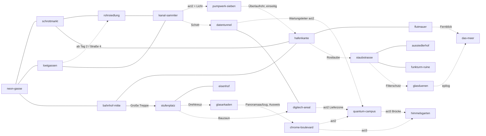

# Nexus – Das RPG · Weltdokument (verbindlich)

Dieses Dokument führt die drei Konzeptentwürfe `docs/concepts/welt.md`, `docs/concepts/figuren.md` und `docs/concepts/quests.md` zu **einer** verbindlichen Inhaltsgrundlage zusammen. `docs/design.md` bleibt der technische Vertrag (Formeln, Datentypen, Szenen). Wo dieses Dokument und ein Konzeptentwurf sich widersprechen, gilt dieses Dokument. Die Entwürfe bleiben als Ideenarchiv liegen.

**Leitlinie:** Die Hauptgeschichte ist ein roter Faden, der dem Stück „Nexus“ (Sommerstück 2024 des Kolpingtheaters Ramsen) locker folgt. Der Schwerpunkt liegt auf der **offenen Welt**: viele Zonen, Nebenquests, Aufträge, Beziehungen, Aktivitäten und Sammelobjekte. Kein Spielinhalt verlangt, die Hauptgeschichte voranzutreiben; fast alles aus Akt 1 bleibt auch in Akt 2 und 3 spielbar.

**Namen:** Im Spiel und in allen Dokumenten stehen ausschließlich Rollennamen. Darstellernamen tauchen nirgends auf, auch nicht in IDs, Dateinamen von Inhalten oder Kommentaren.

---

## 0. Konventionen und Zusammenführungs-Entscheidungen

### 0.1 IDs

| Präfix | Bedeutung | Beispiel |
| --- | --- | --- |
| `main-<akt>-…` | Hauptquest | `main-1-probezeit` |
| `prep-…` | Vorbereitungs-Operation (Hauptstrang) | `prep-wachplan` |
| `side-…` | Nebenquest | `side-zehn-credits` |
| `pers-…` | Persönliche Quest einer Figur | `pers-vega-adlerauge` |
| `job-…` | Wiederholbarer Auftrag | `job-kurier` |
| `he-<npc>-<n>` | Herz-Ereignis; `<npc>` ist immer die vollständige Figuren-ID aus Abschnitt 4 | `he-dante-4`, `he-opa-gustav-4` |
| `re-<npc>-<n>` | Rivalitäts-Ereignis (bei −2, −5, −8 Herzen); Sonderereignisse `re-<npc>-<name>` | `re-xion-venom-5`, `re-dante-eifersucht` |
| `enc-<zone>-…` | Begegnung (Kampf) | `enc-hafen-jimmy` |
| `kopfgeld-…` | Kopfgeld-Ziel (6.7) | `kopfgeld-oma-turbo` |
| `akt-…` | Aktivität oder Minispiel (3.9) | `akt-angeln` |
| `gc-<nr>` | Gesprächs- oder Welt-Check | `gc-05` |
| `origin-…`, `look-…`, `perk-…` | Spielfigur | `origin-oednis` |
| Flags | `snake_case` | `nyra_team`, `jimmy_gerettet` |

Akt-Flags: `act1`, `act2`, `act3`, `epilog` (neu, Nachspiel nach dem Ende).

### 0.2 Entscheidungen beim Zusammenführen

| Thema | Entscheidung | Herkunft |
| --- | --- | --- |
| Zonen-IDs | Die 22 Zonen aus dem Weltentwurf sind kanonisch. Arbeitsnamen der anderen Entwürfe sind umgelegt (Tabelle 0.3). | welt |
| Fraktionen | 12 Fraktionen aus dem Weltentwurf; „Neonhunde“ (Questentwurf) heißen jetzt **Rostzähne**, „Staubgeier“ heißen **Staubfalken**. | welt + quests |
| Herkünfte | 6 Herkünfte aus dem Figurenentwurf. Die Questentwurf-Herkunft „Konzern“ ist je nach Inhalt auf `[Schrott]` (Technikwissen) oder `[Ex-Wache]` (Sicherheitswissen) umgelegt. | figuren |
| Fahndung | Stufen 0–3 (Weltentwurf). Questangaben „+3“ bedeuten „auf 3“. | welt |
| Kampfzüge | Einzelne Einheiten in Initiative-Reihenfolge (nicht ganze Teams). Initiative = Reflexe × 2 + Boni. | quests |
| Hack-Ressource | **Bandbreite** und **Firewall** werden übernommen (siehe 8.1). | quests |
| Begriffe | Wer Cyberware einbaut, heißt „Schrauber“ (Fremdbegriffe aus anderen Spielen werden nirgends verwendet, auch nicht in Code-Kommentaren). Kartenspiel heißt „Eins!“. Schokoriegel heißt „Nougatbombe“ (`nougatbombe`). Keine Namen oder Marken aus anderen Spielen. | alle |
| Figuren-Dopplungen | Babette Bao ersetzt Tante Tofu; Opa Gustav ersetzt Kurbel-Kalle; Oma Volt übernimmt die Rolle von „Oma Rostig“; Lio Funkel ersetzt Saitensepp und die Straßenmusikerin Lyra; Bolzen ist der einzige Roboterhund (ersetzt Byte); Käpt'n Nebelhorn ersetzt Kapitänin Salz; Marla Sand ersetzt Muschel-Mo und führt den Aussiedlerhof (Familie Staubmann entfällt); Bürgermeister Gully ersetzt den Tropfer; Pim Pinzette übernimmt die Rolle von Forscher Bolle; Henk Angler übernimmt die Rolle der Fischerin Möwe; Stylistin Gina ersetzt Mimi Puder; Wachmann Pfeffer ist Milas Vater; Mutter Kessel heißt jetzt **Mutter Brühe** (Namensgleichheit mit Wachtmeisterin Kessel); der Betrüger „Gutschein-Gustav“ heißt **Gutschein-Gerd**; Hafenarbeiter Bruno heißt **Hafen-Hannes** (Bruno ist der Türsteher). | alle |
| Jimmy | Jimmy streift durch die Unterstadt: tags am Bahnsteig in `bahnhof-mitte` (Vega bringt ihm Essen), abends und nachts baut er Ölfass-Türme an der `hafenkante`. Die Spurensammlung `jimmy-spur-01…08` führt zu ihm. Das Pumpwerk ist nicht mehr sein Versteck. | welt + figuren + quests |
| Rattenkönig | Nagbert der Rohrkönig (ein Boss) sitzt im Thronsaal von `kanal-sammler` (Akt 1). | welt + quests |
| Glasarkaden | Ab Akt 1 erreichbar (Drehkreuz per Outfit, Presseausweis, `[Oberstadt]` oder `gc-106`; Lieferanteneingang der Feinkost ohne Bedingung). Antagonisten sind dort in Akt 1 nur Hintergrundfiguren mit einem Satz. | welt, für Open World erweitert |
| Digitech-Areal | Ab Akt 1 erreichbar (Bauzaun per `[Reflexe 6]` oder als „Digitech-Auftrag“ über `side-eingehendes-fax` oder `side-digitech-geist`). | welt, für Open World erweitert |
| Party in Akt 3 | Einlass im `quantum-campus`, Feier im `himmelsgarten`, Labor und Serverkern im Campus, Showdown auf dem Landeplatz des Himmelsgartens. | welt + quests |
| Romanzen | Optional, per `content/romance.ts` schaltbar, standardmäßig leer. Möglich nur mit ausdrücklich erwachsenen, erwachsen wirkenden Hauptfiguren (Liste 4.7). Aktiv geschaltet (vom Nutzer freigegeben, Darsteller volljährig): Aria, Hunter, Dante, Collin Charleston, Lio Funkel. Vega, Nyra, die Straßenkinder, Pim und Mila: nur Freundschaft. | figuren + Vorgabe |

### 0.3 Umlegung der Arbeitsnamen

| Arbeitsname (Entwurf) | Kanonisch |
| --- | --- |
| `rostring-bahnhof`, `u-bahn-knoten-sued` | `bahnhof-mitte` |
| `neonmarkt`, `rostmarkt`, `schrotthalde`, `schrottplatz` | `schrottmarkt` (Markt, Halde, Gustavs Kran) |
| `high-voltage-gasse`, `neonmeile`, `daecher` | `neon-gasse` (Gasse, Club, Dachterrasse) |
| `unterschlupf` | `crew-quartier` (Innenraum über dem High Voltage) |
| `loetgasse` | `loetgassen` |
| `rostkai`, `grauwasser-hafen` | `hafenkante` (Rostkai-Kräne als Ort darin) |
| `brackbucht` | `flutmauer` (die Brackbucht ist die Schlickbucht unter der Mauer) |
| `kanal-nord`, `kanalisation` | `kanal-sammler` |
| `kanal-tief` | `pumpwerk-sieben` |
| `wasserturm-versteck` | `das-nest` in `rohrsiedlung` |
| `behoerdenviertel`, `gefaengnis`, `justizpalast` | `eisenhof` |
| `sender-kanal-noxius` | `nx1-studio` in `stufenplatz` |
| `digitech-ruine` | `digitech-areal` |
| `oberstadt-plaza`, `oberstadt-promenade` | `glasarkaden` |
| `chrome-tuerme`, `chrome-towers` | `chrome-boulevard` |
| `quantum-tower` | `quantum-campus` + `himmelsgarten` |
| `oednis-rand` | `staubstrasse` |
| `aussiedler-camp` | `aussiedlerhof` |
| `silberstrand`, `kueste` | `das-meer` |

---

## 1. Überblick, Ton und Kernschleife

### 1.1 Prämisse

Noxius, 2086. Vor sieben Jahren hat Blade Nocturne beim Einbruch bei Digitech seine Crew verraten: Er nahm den Chip, kettete Raven mit Handschellen an ein Rohr und verschwand. Hunter saß drei Jahre, Dante vier („inklusive 10.000 Stunden illegal gestreamter Musik und Filme“), Raven sieben. Blade gründete mit den Chrome-Schwestern Quantum Industries. Alesa Zero leitet die Forschung, Xion Venom die Sicherheit. Die KI im neuen Neurochip heißt Nexus (Blade hat die Vorschläge „Alexandra“ und „Siggi“ als „total bescheuert“ verworfen; reale Markennamen aus dem Stück werden im Spiel immer umbenannt) und nennt Blade „Master“.

Die Spielfigur kommt in der Woche nach Noxius, in der Raven entlassen wird. Hunter sucht Ersatz für Jimmy, der durch einen Virus auf seinem Neurochip „total durchgedreht“ ist. Aus einer Probezeit im High Voltage wird ein Platz in der Crew, aus der Crew eine Familie, und irgendwann vielleicht ein Ausflug ans Meer.

### 1.2 Ton

- **Humor wie im Stück:** Dantes Nougatbomben und sein Keksalarm mit Drei-Sekunden-Regel, Captain Kuschel mit den großen Ohren, Eins!-Runden mit den Kindern, der Rabattcode „Chrome 10“, die KI, die Blade „Master“ nennt, Freeze-Vorstellungen mit Erzählstimme, Ausrufe wie „Heiliger BimmBamm“, „Heiliges Kanonenrohr“, „Ach du grüne Neune“ und „Herrje“.
- **Familienfreundlich:** Comic-Gewalt (K.O. mit Sternchen, Funken statt Blut, Gegner fliehen oder ergeben sich), keine Verherrlichung von Drogen (Getränke sind Limo, Kaffee und Mocktails; was Blade auf der Party „Champagner“ nennt, ist im Spiel die alkoholfreie „Goldperle“, der Name bleibt als Gag), Fluchen nur angedeutet („Nicht fluchen!“, Freyas Fluchdose). Die Straßenkinder sind nachts nie draußen unterwegs, nie Kampfziele, und Kämpfe finden nie in Kinderzonen statt.
- **Umsetzung harter Stellen aus dem Stück:** „Legt sie um“ wird zu „Schafft sie weg“; Aria liegt nach dem Chip im Koma, sie ist nie tot; der Proband aus Szene 12 „hat einen gefälschten Billig-Chip getragen“ (statt „hat was eingeworfen“); Ravens „ordentlich einen hinter die Binde kippen“ wird zu „die ganze Nacht durchtanzen“; Blades Drohung mit der Pistole wird zu einem Schockstab, der knistert; Arias Ausrufe enden in einem Piepton.
- **Herz vor Zynismus:** Die Unterstadt ist arm, aber solidarisch. Antagonisten bleiben Antagonisten, können aber im Nachspiel menschlicher werden.
- **Bildsprache:** Gemalte Draufsicht, Neon auf Rost, warmes Licht in Innenräumen. Schlüsselszenen als fotorealistische Bildtafeln (siehe `docs/art-production.md`).

### 1.3 Kernschleife

```
Erkunden ──► Gespräche und Checks ──► Aufträge und Kämpfe ──► Beziehungen ──► Ausbau
   ▲                                                                            │
   └──────────── neue Zonen, Tageszeiten, Wochenereignisse, Gerüchte ◄──────────┘
```

| Schritt | Was die Spielerin oder der Spieler tut | Was es bringt |
| --- | --- | --- |
| Erkunden | Zonen, Innenräume, Hotspots, Sammelobjekte, Abkürzungen; Tageszeit und Wochentag ändern, wer wo ist | Gerüchte, Händler, Questeinstiege, Schnellreise |
| Gespräche und Checks | Sichtbare Schwellen wie `[Technik 6]`, Herkunftszeilen wie `[Ödnis]`, Beziehungsoptionen wie `[Raven ♥4]` | Alternative Lösungen, XP je bestandenem Check, Ruf |
| Aufträge und Kämpfe | Hauptquests, Nebenquests, Tafelaufträge; rundenbasierte Rasterkämpfe mit bis zu 2 Begleitern | Credits, XP, Beute, Ruf |
| Beziehungen | Tagesgespräch, Geschenke, Herz-Ereignisse, persönliche Quests, Rivalitäten | Begleiterfähigkeiten, Rabatte, Andenken, Enden |
| Ausbau | Attribute, Perks, Cyberware beim Schrauber, Kleidung, Crew-Quartier, Rostlaube | Neue Wege durch die Welt, stärkere Kämpfe |

Ein typischer Spieltag: morgens Auftragstafel und Markt, tagsüber eine Nebenquest und ein Geschenk, abends High Voltage mit Gerüchten und Karaoke, nachts ein Schleichauftrag oder ins Bett im Crew-Quartier. Um 02:00 klappt die Spielfigur zusammen (10 % Credits weg, Zettel von Captain Kuschel: „Schlaf ist auch ein Plan. – C. K.“).

---

## 2. Spielfigur

### 2.1 Erstellung

Name (frei, 2–16 Zeichen), Anrede (sie/er/neutral: „die Neue“, „der Neue“, „Neuling“), Aussehen (Charakter-Baukasten mit 8 Vorlagen, §2.3), Herkunft (6), 4 freie Attributpunkte. Die Spielfigur ist volljährig (Anfang zwanzig; jede Kombination wirkt erwachsen). Danach spielt man den Prolog als Raven (Abschnitt 5.1), dann beginnt Tag 1 (Montag, 16:30) mit der Spielfigur.

### 2.1a Fertige Spielfigur: Vex Schrapnell

Statt selbst zu bauen kann man **„Als Vex spielen“** wählen – versteckt: die Option erscheint erst, wenn der eingegebene Name „vex“ enthält (Vertrag: `design.md` §3.1b).
- **Wer:** Vex Schrapnell, Anfang 20 (eindeutig erwachsen), Kurierfahrerin und Kopf der „Schrapnell-Kuriere“ (illegale Dachrennen, Pakete, die keiner anfassen will). Burschikos, tough, trockener Humor, redet wenig und schaut lieber erst mal schräg; unter dem Leder loyal bis zur Dummheit. Lange dunkle Wellen, Nasenring, Kreuzkette, dicke Silberringe, lange weiße Nägel aus dem fingerlosen Lederhandschuh an der linken (menschlichen) Hand; **rechter Arm ab der Schulter kybernetisch** (Ripper-Ratenarm, billiges, praktisches Straßenklinik-Modell, Hintergrund §4.7 Vex × Aria): matt graphitschwarze, zerkratzte Panzerplatten, freiliegende Hydraulikkolben in Gunmetal am Ellbogen, dünne cyanfarbene Lichtnähte am Unterarm, fünf schwarze Metallfinger, der Harness-Riemen läuft über das Schultergelenk, Regenbogenarmband und die anderen bunten Armbänder sitzen am Metallhandgelenk; bewusst anders als Arias silberner Spiralfeder-Arm (Aria: links, Vex: rechts); ganz in Schwarz: eng anliegendes ärmelloses Top (Bauch bedeckt), darüber schwarzes Leder-Gurtzeug (Harness) mit Silberringen und Schnallen über Brust und Schultern, breiter Nietengürtel plus schmaler Schnallengürtel, Cargohose mit hängenden Riemen, kleine Kurier-Hüfttasche mit einem Reflexstreifen, Kampfstiefel, linker Arm nackt.
- **Fest:** Name, Aussehen (eigene gemalte Laufgrafik `vex-walk`, kein Baukasten), Herkunft `gossenkind`. Startattribute: Reflexe 6, Straße 5, Körper 4, Technik 3, Ausstrahlung 3 (keine freien Punkte; mit dem Herkunftsbonus von `gossenkind` effektiv Straße 6), Start-Perk `dachlaeuferin` (Sprünge und Fluchtwege über Dächer ohne Check; Kurieraufträge +15 % Credits), Startgegenstände `kurierweste` (angezeigt als „Kas' Gurtzeug“, Inventar +4 Plätze) und `nagelpistole` (Fernwaffe, Kas' alte Pistole, siehe 9.1).
- **Bild:** Als einzige Spielfigur hat Vex Fotos und ein gemaltes Porträt; Charakterbogen und eigene Dialogzeilen zeigen sie (`photos/vex/*`). Sonst gilt die Ich-Perspektive. Ausnahme: Spielfigur Vex im Strang Vex × Aria (`rom-vexaria-*`, beobachtende Kamera, Kuss `rom-vexaria-kuss` als Silhouette ohne Gesichtsreferenz), siehe design.md §3.1b / 4.7.
- **Stimme im Text:** kurze Sätze, derbe Flüche, Spitznamen; eigene Antwortvarianten an markierten Stellen (`{ playerIs: 'vex' }`), sonst die normalen Zeilen.
- **Romanze:** Wer als Vex spielt, hat dieselben Romanze-Optionen wie jede Spielfigur. Vex selbst ist als Nicht-Spielfigur nie romanzierbar.
- **Wenn man nicht Vex spielt:** Vex ist eine Figur der Welt (`vex-schrapnell`, siehe 4.5): Auftraggeberin der Kurieraufträge und der Dachrennen in den `loetgassen`, ab ♥4 Begleiterin (Reflexe, Fernkampf mit Nagelpistole).

### 2.2 Herkünfte

Jede Herkunft gibt +1 auf ein Attribut (Maximum 10), Startgegenstände, Startbeziehungen und eine eigene Gesprächszeile in vielen Szenen (Präfix im Dialog: `[Gosse]`, `[Oberstadt]`, `[Ödnis]`, `[Ex-Wache]`, `[Schrott]`, `[Knast]`). Condition: `{origin: 'origin-…'}`.

| ID | Name | Bonus | Start | Startbeziehungen | Exklusive Optionen (Auswahl) |
| --- | --- | --- | --- | --- | --- |
| `origin-gossenkind` | Gossenkind | +1 Straße | `dietrich-set`, `kartendeck`, 30 Cr | Daria, Freya, Jakko +100; Ripper −100 | Kennt den Abzieher Knut aus der Suppenküche (`main-1-ankunft`), Röstzwiebel-Regel gegen Ratten (`side-rattenkoenig`), Rohrsiedlungs-Abkürzung ohne Check |
| `origin-oberstadt` | Oberstadt-Aussteigerin/-Aussteiger | +1 Ausstrahlung | `alte-zugangskarte`, `taschenspiegel-gold`, 120 Cr | Chrome-Schwestern +100, Collin +100; Aria −100 („Snob.“) | Haupteingang der Party ohne Check (`gc-38`), Etikette-Minispiel übersprungen, Glasarkaden-Drehkreuz in Akt 1 |
| `origin-oednis` | Aus der Ödnis | +1 Körper | `wasserkanister`, `kuestenkarte-fragment` (1 von 4), `wuestenrose`, 40 Cr | Nyra +100, Marla +200, Hunter +100 | Raven den Himmel zeigen (`main-1-raven`), Wind lesen (`gc-92` automatisch), Nyras Meeres-Gespräch früher |
| `origin-ex-wache` | Ex-Wache | +1 Reflexe | `alte-dienstmarke`, `schockstab`, 60 Cr | Wachtmeisterin Kessel +200, Richter +100; Xion −100 | Funkcode „Code Grau“ (Wachen kurz wegschicken, 1× pro Zone und Tag), Digitech-Pläne (`prep-grundriss`), Kuriercodes (`gc-63` automatisch) |
| `origin-schrott` | Schrottkind | +1 Technik | `werkzeuggurt-rostig`, `loetkolben-alt`, 50 Cr | Opa Gustav +200, Dante +100, Bolzen +100 | Netzwerkscanner erkennen (`main-1-probezeit`), Fachgespräch Zentrator mit Dante (`wissen-zentrator`), Werkbank bei Gustav ab Tag 1 |
| `origin-knastvogel` | Knastvogel | +1 Straße oder Körper (Wahl) | `knast-loeffel`, `entlassungsschein`, 10 Cr | Raven +200, Wachtmeisterin Kessel +100; Richter −100 | Klopfcode im Zellentrakt, „Der erste Morgen draußen schmeckt nach Rost“ (`main-1-raven`, Raven kommt ohne Check mit), Haft kostet nur 5 % |

### 2.3 Aussehen: Charakter-Baukasten und Vorlagen

Das Aussehen wird frei im Baukasten zusammengestellt (Vertrag, Teile-IDs, Regeln und Kosten: `design.md` §3.1a, Ebenen und Pipeline §6.3). Die Spielfigur hat kein Porträt und kein Foto (Ich-Perspektive). Die früheren 6 festen Looks sind jetzt **Vorlagen** (gleiche IDs, damit alte Spielstände migrieren), dazu zwei neue. Vorlagen sind Startpunkte, jede Wahl bleibt änderbar.

| ID | Name | Körper · Haut · Gesicht | Haare | Kleidung | Farben A/B | Cyber · Tattoo · Extras |
| --- | --- | --- | --- | --- | --- | --- |
| `look-neonbomber` | Neonbomber | mittel · haut-3 · gesicht-1 | `haar-sidecut` schwarz | tshirt, bomber, cargo, sneaker | schwarz / neon-pink | Augen-Leuchten (Glow neon-cyan) · keins · – |
| `look-staubmantel` | Staubmantel | kraeftig · haut-5 · gesicht-4 | `haar-wuschel` dunkelblond | hemd, langmantel, cargo, kampfstiefel | sand / leder | – · keins · Brille rund |
| `look-schrottoverall` | Schrottoverall | mittel · haut-4 · gesicht-3 | `haar-dutt` kupfer | tanktop, keine, overall, kampfstiefel | orange / anthrazit | Arm rechts (Glow orange) · `tattoo-arm` · – |
| `look-samtsakko` | Samtsakko | schmal · haut-2 · gesicht-6 | `haar-schulterlang` platin | rollkragen, sakko, anzug, halbschuhe | wein / schwarz | – · keins · Kette |
| `look-kapuzenschatten` | Kapuzenschatten | schmal · haut-6 · gesicht-2 | `haar-buzz` schwarz | hoodie, kapuze, leder, hightops | anthrazit / neon-violett | Augen-Leuchten (Glow neon-violett) · keins · Maske Tuch |
| `look-flickenjeans` | Flickenjeans | mittel · haut-1 · gesicht-3 | `haar-locken-kurz` rot | streifenpulli, jeans, flicken, sneaker | jeansblau / senf | – · keins · Mütze, Kopfhörer |
| `look-kabelkrone` | Kabelkrone | schmal · haut-7 · gesicht-1 | `haar-zwei-zoepfe` neon-pink | netzshirt, leder, rock, plateau | schwarz / neon-pink | Halskabel, Gesichtsplatte (Glow neon-pink) · `tattoo-neonlinien` · – |
| `look-hafenkoloss` | Hafenkoloss | kraeftig · haut-8 · gesicht-5 | `haar-glatze` schwarz | gurtshirt, weste, cargo, kampfstiefel | oliv / chrom | Arm links, Bein rechts (Glow neon-cyan) · `tattoo-hals` · Basecap |

### 2.4 Attribute

Werte 1–10. Start: je 3, dazu 4 freie Punkte, dazu der Herkunftsbonus. Jede Stufe: +1 Attributpunkt und +1 Perkpunkt.

| ID | Name | In der Welt | Im Kampf |
| --- | --- | --- | --- |
| `technik` | Technik | Hacken, Reparieren, Schlösser, Maschinen, Cyberware-Fachgespräche | Hack-Schaden, Firewall, Bandbreite, Aktion **Analysieren** |
| `koerper` | Körper | Tragen, Klettern, Einschüchtern durch Kraft, Gifte aushalten | LP, Nahkampfschaden, Aktion **Schubsen** |
| `reflexe` | Reflexe | Taschendiebstahl, Verfolgung, Springen, Schleichen | Initiative, Bewegung, Fernkampf, Aktion **Hechtsprung** |
| `ausstrahlung` | Ausstrahlung | Überreden, Flirten, Bühnenauftritte, Etikette | Gegner-Moral, Begleiterboni, Aktion **Ansprechen** |
| `strasse` | Straße | Gerüchte, Feilschen, Gang-Codes, Verstecke, Ortskenntnis | Schmutzige Tricks, Beute, Aktion **Schmutziger Trick** |

Abgeleitete Werte: LP = 20 + 4 × Körper + 2 × Stufe. Bewegung = 3 + floor(Reflexe / 3). Initiative = Reflexe × 2 + Boni. Bandbreite = 2 + Technik (+ Cyberware). Firewall = 2 + floor(Technik / 2) (+ Cyberware).

### 2.5 Perks

Je Attribut vier Perks. Bedingung: Attributwert **und** Mindeststufe. Kosten: 1 Perkpunkt. Jeder Perk hat eine Welt- und eine Kampfseite, damit kein Perk für Gesprächs- oder Kampfspieler wertlos ist.

| ID | Attribut / Stufe | Name | Welt | Kampf |
| --- | --- | --- | --- | --- |
| `perk-schnelle-finger` | Technik 4 / St. 2 | Schnelle Finger | Hack-Minispiel +10 Sekunden | Erster Hack je Kampf kostet 1 Bandbreite weniger |
| `perk-ueberladung` | Technik 6 / St. 5 | Überladung | Reparaturset wird nur bei jedem zweiten Einsatz verbraucht | Hack oder Strom auf „Nass“ springt auf benachbarte nasse Ziele über |
| `perk-drohnenfluesterer` | Technik 8 / St. 9 | Drohnenflüsterer | Werkbank: Cyberware-Macken entfernen | Gehackte Drohnen wechseln 2 Runden die Seite |
| `perk-systemabsturz` | Technik 10 / St. 14 | Systemabsturz | Kameras einer Zone 1× pro Tag abschalten | 1× pro Kampf: alle Drohnen und Gechippten „Gehackt“ |
| `perk-dickes-fell` | Körper 4 / St. 2 | Dickes Fell | +2 Tragplätze, Giftnebel kostet keine Staubmaske | +5 LP |
| `perk-rammbock` | Körper 6 / St. 5 | Rammbock | Verklemmte Türen ohne Check öffnen (Schwelle bis 6) | Schubsen 2 Felder, +4 Schaden beim Aufprall |
| `perk-zweiter-wind` | Körper 8 / St. 9 | Zweiter Wind | Zusammenbruch um 02:00 kostet keine Credits | 1× pro Kampf bei 0 LP mit 1 LP stehen bleiben |
| `perk-unaufhaltsam` | Körper 10 / St. 14 | Unaufhaltsam | Sprint auf der Karte ohne Ausdauer-Ende | Immun gegen „Verlangsamt“ und „Betäubt“ |
| `perk-schnelle-haende` | Reflexe 4 / St. 2 | Schnelle Hände | Taschendiebstahl-Fenster +30 % | Gegenstand benutzen kostet 0 AP (1× pro Zug) |
| `perk-doppelschritt` | Reflexe 6 / St. 5 | Doppelschritt | +10 % Lauftempo, Verfolgungen 10 Sekunden länger | +1 Bewegung |
| `perk-ausweichrolle` | Reflexe 8 / St. 9 | Ausweichrolle | Sichtkegel bemerken dich eine halbe Sekunde später | Überwachungsfeuer gegen dich −20 |
| `perk-zeitlupe` | Reflexe 10 / St. 14 | Zeitlupe | Minispiel-Zeitlimits ×1,5 | 1× pro Kampf ein zweiter Angriff im selben Zug |
| `perk-anfeuern` | Ausstrahlung 4 / St. 2 | Anfeuern | Tagesgespräch +10 zusätzlich | Begleiter in 2 Feldern +5 Trefferchance |
| `perk-einschuechtern` | Ausstrahlung 6 / St. 5 | Einschüchtern | Schulden-Aufträge: Ausstrahlung zählt auch für Körper-Checks | „Ansprechen“ senkt Moral zusätzlich um 20 |
| `perk-kapitulation` | Ausstrahlung 8 / St. 9 | Kapitulation | Einmal pro Tag ein misslungenes Gespräch neu beginnen | Gegner ergeben sich schon bei Moral 30 |
| `perk-anfuehrer` | Ausstrahlung 10 / St. 14 | Anführerin/Anführer | Begleiter-Herzpunkte aus gemeinsamen Siegen verdoppelt | Begleiter starten „Ermutigt“ |
| `perk-taschen-leeren` | Straße 4 / St. 2 | Taschen leeren | Händler −5 % | +25 % Beute |
| `perk-sand-in-die-augen` | Straße 6 / St. 5 | Sand in die Augen | Wegzoll und Schutzgeld halbiert | Schmutziger Trick gegen Gangs ohne Check |
| `perk-hinterhalt` | Straße 8 / St. 9 | Hinterhalt | Zwei zusätzliche Gerüchte pro Abend im High Voltage | „Überrumpelt“ auch aus Seitenrichtung |
| `perk-kennt-jeden` | Straße 10 / St. 14 | Kennt jeden | Jeder Händler verkauft einen Gegenstand unter der Hand | 1× pro Kampf Verstärkung rufen (je nach Questfortschritt Abzieher-Brüder, Opa Blech oder Kanalvolk) |

### 2.6 Cyberware-Slots

Sechs Slots, je ein Teil: `kopf`, `augen`, `arme`, `beine`, `nervensystem`, `haut`. Einbau beim Schrauber: Dante (ab Dante ♥2 gratis, sonst 50 Cr; vor Akt 2 nur Einbau, keine Kämpfe mit ihm), Ripper (100 Cr, Gebrauchtteile mit möglicher Macke), Mira Lötzinn (80 Cr, nur Neuteile). Gebrauchtteile haben mit 30 % eine **Macke** (zum Beispiel „Ohr spielt nachts Radio“, „Arm salutiert bei Wachen“), die Dante oder `perk-drohnenfluesterer` entfernt. Teile und Preise: Abschnitt 9.2.

### 2.7 Stufen und XP

XP-Schwellen kumulativ nach `design.md`: Stufe n + 1 wird bei `100 × n × (n + 1) / 2` XP erreicht. Höchststufe 20.

| Stufe | XP gesamt | Stufe | XP gesamt | Stufe | XP gesamt |
| --- | --- | --- | --- | --- | --- |
| 1 | 0 | 8 | 2 800 | 15 | 10 500 |
| 2 | 100 | 9 | 3 600 | 16 | 12 000 |
| 3 | 300 | 10 | 4 500 | 17 | 13 600 |
| 4 | 600 | 11 | 5 500 | 18 | 15 300 |
| 5 | 1 000 | 12 | 6 600 | 19 | 17 100 |
| 6 | 1 500 | 13 | 7 800 | 20 | 19 000 |
| 7 | 2 100 | 14 | 9 100 | | |

**XP-Quellen:** bestandener Check 15 + 5 × Schwelle (einmal je Check), kleine Quest 40–80, Nebenquest 100–350, große Nebenquest 300–600, Hauptquest 60–600, Auftrag 40–320, Kampf 10 × Gegnerstufe je Gegner (Bosse ×3), Herz-Ereignis 25, Sammelobjekt 10–30.

**Zielkurve:** Ende Akt 1 Stufe 5–6, Ende Akt 2 Stufe 10–11, Finale Stufe 14–16, Nachspiel bis 20.

---

## 3. Welt

### 3.1 Bezirke und Zonen

22 Zonen in 6 Bezirken. Karten 1536 × 1024 (Innenräume kleiner), gemalte Draufsicht. **Akt 1** markiert die Zonen des ersten spielbaren Stands (12 Zonen).

| Bezirk | Zonen | Akt 1 |
| --- | --- | --- |
| Unterstadt | `neon-gasse`, `schrottmarkt`, `loetgassen`, `rohrsiedlung`, `bahnhof-mitte`, `hafenkante` | alle 6 |
| Mittelring | `stufenplatz`, `glasarkaden`, `eisenhof` | alle 3 (`glasarkaden` hinter dem Drehkreuz) |
| Oberstadt | `chrome-boulevard`, `quantum-campus`, `himmelsgarten`, `digitech-areal` | `digitech-areal` |
| Kanalisation | `kanal-sammler`, `pumpwerk-sieben`, `datentunnel` | `kanal-sammler` |
| Ödnis | `staubstrasse`, `aussiedlerhof`, `funkturm-ruine`, `glasduenen` | – (Akt 1 optional über `side-rostlaube`, im ersten Stand „Kommt in Akt 2“) |
| Küste | `flutmauer`, `das-meer` | `flutmauer` |

### 3.2 Verbindungsgraph



| Von | Nach | Übergang | Bedingung |
| --- | --- | --- | --- |
| `neon-gasse` | `schrottmarkt` | Rand Ost | – |
| `neon-gasse` | `loetgassen` | Rand Süd | – |
| `neon-gasse` | `bahnhof-mitte` | U-Bahn-Treppe Nord | – |
| `schrottmarkt` | `rohrsiedlung` | Rand Süd | – |
| `schrottmarkt` | `hafenkante` | Rand Ost | – |
| `loetgassen` | `rohrsiedlung` | Wäschehof-Durchgang | ab Tag 2 oder `[Straße 4]` oder `[Gosse]` |
| `bahnhof-mitte` | `hafenkante` | Gleissteg | – |
| `bahnhof-mitte` | `stufenplatz` | Große Treppe | nach `main-1-probezeit` oder `[Straße 5]` Kontrolle umgehen |
| `hafenkante` | `flutmauer` | Rampe | – |
| `stufenplatz` | `eisenhof` | Rand West | – (Gerichtssaal tags offen, Zellentrakt nur mit Grund) |
| `stufenplatz` | `glasarkaden` | Drehkreuz | `act2`, `outfit-ordentlich`, `presseausweis`, `[Oberstadt]` oder `gc-106` `[Ausstrahlung 6]` |
| `stufenplatz` | `digitech-areal` | Bauzaun | `act2`, Digitech-Auftrag (`side-eingehendes-fax`, `side-digitech-geist`, `prep-grundriss`) oder `gc-107` `[Reflexe 6]` |
| `glasarkaden` | `chrome-boulevard` | Panoramaaufzug | Oberstadt-Ausweis: `ausweis-oberstadt` (Fräulein Pixel, 400 Cr), Ruf `chrome-haus` 20, `gc-108` `[Ausstrahlung 7]` beim Liftboy oder `act3` |
| `chrome-boulevard` | `quantum-campus` | Rand Nord | `act2` (nur Außengelände) |
| `chrome-boulevard` | `himmelsgarten` | Aufzug Chrome Tower | `act3` oder `he-serenity-chrome-6` |
| `quantum-campus` | `himmelsgarten` | Brücke | `act3` |
| `digitech-areal` | `quantum-campus` | Lieferzone | `act2` und `gc-109` `[Technik 7]` oder `karte-lieferzone` |
| `loetgassen` | `kanal-sammler` | Gully hinter Dantes Werkstatt | – |
| `rohrsiedlung` | `kanal-sammler` | Rohrschacht | – |
| `kanal-sammler` | `pumpwerk-sieben` | Tunnel Ost | `act2` (vorher Gitter „Wartung bis auf Weiteres“) und Licht: `augen-restlicht` oder `stirnlampe` |
| `kanal-sammler` | `datentunnel` | Schott | `act2`, `schottschluessel` oder `gc-110` `[Technik 6]` |
| `datentunnel` | `quantum-campus` | Wartungsleiter | `act2`, einseitig bis gefunden |
| `datentunnel` | `digitech-areal` | Kabelschacht | – |
| `pumpwerk-sieben` | `hafenkante` | Überlaufrohr | einseitig von innen zu öffnen |
| `hafenkante` | `staubstrasse` | Rostlaube (Wagen) | `side-rostlaube` abgeschlossen |
| `staubstrasse` | `aussiedlerhof`, `funkturm-ruine` | Pisten | – |
| `staubstrasse` | `glasduenen` | Piste | Giftschutz: `haut-filtermembran`, `staubmaske` oder `gc-111` `[Körper 8]` |
| `glasduenen` | `das-meer` | Wagen | `epilog` (vorher nur Fernblick von Düne und Flutmauer) |

**Weitere Hindernisse:** Lücken und Dächer `[Reflexe 7]` (`gc-150`), `arme-greifhaken` oder `beine-sprungfedern`; dunkle Tunnel brauchen Licht; Giftnebel `[Körper 8]` oder Filter. Kleine Welt-Checks an Abkürzungen und Verstecken (`gc-145`–`gc-153`) belohnen Körper und Reflexe auch abseits der Quests; jeder hat einen Gegenstands- oder Beziehungsweg als Alternative.

### 3.3 Reisen

- **Zu Fuß:** Kartenwechsel +10 Minuten.
- **U-Bahn:** +30 Minuten (nach `side-uebliche-verspaetung` +15). Stationen: `station-neon-gasse`, `station-bahnhof-mitte`, `station-hafenkante`, `station-rohrbogen` (Rohrsiedlung), `station-stufenplatz`, `station-glasarkaden` (sobald das Drehkreuz einmal passiert wurde), `station-chrome-allee` (Ausweis). Ticket 5 Cr, Monatskarte 120 Cr (28 Tage). Schwarzfahren: 15 % Kontrolle, 60 Cr Strafe. 10 % Verspätung mit U-Bahn-Ereignis (3.5).
- **Schwebetaxi:** Kiki Karbon fliegt ab `he-kiki-karbon-2` zu jeder besuchten Zone ohne Station (20 Cr, +20 Minuten).
- **Kanal-Schnellwege:** Nach `side-rattenkoenig` drei Gitter zu `schrottmarkt`, `loetgassen`, `hafenkante`.
- **Rostlaube:** Nach `side-rostlaube` von der Garage an der `hafenkante` in die Ödnis (+60 Minuten).

### 3.4 Zeit, Wetter und Wochenrhythmus

Uhr 06:00–02:00, 0,7 s je Spielminute. Tageszeiten: **Morgen** 06–10, **Tag** 10–17, **Abend** 17–21, **Nacht** 21–02. Tag 1 ist Montag.

**Wetter** (je Tag, Ödnis eigenes Wetter): `klar`, `smog` (Sicht −1 Feld im Kampf), `rostregen` (Pfützen in Arenen, Nass), `neonnebel` (Schleichen +), `hitzeglocke` (Ödnis, ohne `outfit-oednis` −5 LP je Stunde), `sandsturm` (Ödnis, Fernkampf −20).

**Woche:**

| Tag | Ereignis |
| --- | --- |
| Mo | Collin live am `stufenplatz` 12:00; Babettes Ruhetag; Barkeeper hat abends frei (Ersatz: Hunter mixt schlecht) |
| Di | Karaoke im High Voltage (Collin moderiert); Chrome-10-Werbestand in den Glasarkaden; Xion und Ripper nachts in Container 77 |
| Mi | Collin live; Schrottbot-Rennen in Rennhalle 9; Bagatellgericht im Eisenhof |
| Do | Eins!-Abend in Dantes Werkstatt; Konvoi in der Ödnis; Richter heimlich beim Kartenspiel im High Voltage |
| Fr | Collin live; Karaoke; Wachmann Pfeffer im High Voltage; Drohnenrennen an den Rostkai-Kränen; Gustavs Oldie-Stunde |
| Sa | Schrottbot-Rennen; Marla am Markt; Dante tanzt nachts im High Voltage; Xions Schrottring (`act2`) |
| So | Flohmarkt am `schrottmarkt`; Eins!-Turnier (nach `side-eins-turnier`); Hunter angelt morgens mit Käpt'n Nebelhorn |

**Feste** (fester Tag im 28-Tage-Zyklus): `neonnacht` (Tag 7, Unterstadt leuchtet, doppelte Trinkgelder), `karten-turnier` (Tag 14, Stadtmeisterschaft Eins!), `gruendertag` (Tag 21, Quantum-Feier am Stufenplatz, Collin live), `schrottparade` (Tag 28, Umzug mit Schrottbots), `meerestag` (nur `epilog`).

### 3.5 Zonen

Jede Zone nennt: **Bild** (Beschreibung für die gemalte Draufsicht), **Orte und Hotspots**, **Figuren** nach Tageszeit (M/T/A/N), **Händler**, **Sammelobjekte**, **Begegnungen** und **Freischaltung**. Zufallsbegegnungen stehen in 8.7, Tageszeit-Wirkungen in 3.8, Aktivitäten in 3.9.

#### `neon-gasse` · Neon-Gasse · Unterstadt · **Akt 1**

- **Bild:** Enge, nasse Gasse in Draufsicht, Kopfsteinpflaster mit Pfützen, die pinkes und cyanfarbenes Neon spiegeln. In der Mitte der Eingang des High Voltage mit Blitz-Leuchtschild und Samtkordel. Kabelbündel spannen sich über die Gasse, Mülltonnen, Lüftungsgitter mit Dampf, ein kleiner Kiosk mit gelber Markise, rechts eine Feuerleiter zur Dachterrasse mit Lichterketten.
- **Orte:** `high-voltage` (Club mit Bar, Tanzfläche, Bühne, Ecktisch), `hv-hinterzimmer` (Auftragstafel, Planungstisch), `crew-quartier` (Bett, Truhe, Ausbau in 6 Stufen), Dachterrasse (Ausguck, Klingenübung, Lichterketten), Kiosk Volt-Eck, Stadt-TV an der Hauswand, Xions Werbestand („Freiwillige gesucht – Snacks inklusive!“).
- **Figuren:** M Oma Volt, Vega (Dach), Raven (Dach, nach Entlassung), Hunter (Club) · T Oma Volt, Barkeeper (Dach), Aria, Kiki (Sa/So) · A Hunter, Raven, Vega, Aria, Nyra (Sa/So), Ripper (Ecktisch), Dexter, Xion (Werbestand), Kiki, Bruno Brecher, Daria (Pfandflaschen, bis 20 Uhr) · N Hunter, Barkeeper, Aria (Tanzfläche), DJ Lumo, Kiki (Vorplatz), Vega (Dach).
- **Händler:** Volt-Eck (Oma Volt: Verbrauch, Tickets, Comics, Nähservice), HV-Bar (Barkeeper: Getränke, Geschenke).
- **Sammelobjekte:** `neon-tag-01`, `-02`, `glueckstern-01`, `datenwuerfel-01`, Schallplatte als Karaoke-Preis.
- **Begegnungen:** `enc-hv-ripper-tisch`, `enc-gasse-pfeffer`, Kopfgeld `kopfgeld-krawall-kalle`, `kopfgeld-neon-nils` (Dächer).
- **Freischaltung:** offen ab Tag 1; `crew-quartier` nach `main-1-probezeit`.

#### `schrottmarkt` · Schrottmarkt · Unterstadt · **Akt 1**

- **Bild:** Großer Platz aus Wellblechständen unter Planen, bunte Laternen, Kisten voller Kabel und Platinen. Links eine dampfende Garküche mit runden Bambuskörben, in der Mitte ein Stand mit einem großen Fernseher, hinten eine Halde aus Schrottbergen mit einem rostigen Kran und einem Wohnwagen, rechts ein schmaler Laden mit grünem Kreuz aus Leuchtröhren (Rippers Praxis).
- **Orte:** Babettes Garküche „Bao Babette – Dampfnudeln seit 2061“, Gustavs Kran und Wohnwagen, Schrotthalde mit Dexters Wellblechbüro, `ripper-praxis`, Wett-Willis Hütchenspiel, Elektronikstand, Imbiss „Lötkolben“, Dantes Plattenkiste (Mo/Do morgens), Stadt-TV, Flohmarkt (So), Hinterhof-Lager von Oma Volt.
- **Figuren:** M Babette, Jakko, Gustav, Aria (Inkasso), Dante (Mo/Do), Dexter (versteckt sich) · T Babette, Daria (Botenstand), Freya, Jakko (Mo/Mi/Fr am Kran), Ripper, Raven, Nyra (Elektronikstand), Delya und Kameramann, Kiki (Di/Do), Marla (Sa) · A Lio, Freya (hört Lio zu, bis 20 Uhr), Kameramann, Pim (Imbiss), Sybella verkleidet (Di/Sa), Dexter (Büro) · N Dexter schläft im Büro, Rostzähne-Streife.
- **Händler:** Babettes Garküche (Essen), Gustavs Schrottkram (Ersatzteile, Werkbank ab `he-opa-gustav-6`), Rippers Praxis (Gebraucht-Cyberware, Hinterzimmer mit `ripper_kennt_dich` oder Ruf `unterstadt` 20), Dexters Schrott (Drohnenteile), Vinyl-Vincent (Platten zum Fantasiepreis), Flohmarkt So.
- **Sammelobjekte:** `schallplatte-01`, `-02` (Vincent), `glueckstern-02`, `-03`, `datenwuerfel-02`, `jimmy-spur-01`.
- **Begegnungen:** `enc-schrott-drohnen`, `enc-schrott-dexter`, `enc-markt-raven`, `enc-markt-gerd`, `enc-markt-rostzaehne`, Kopfgeld `kopfgeld-zwei-finger-zoltan`, `kopfgeld-toaster`.
- **Freischaltung:** offen.

#### `loetgassen` · Lötgassen · Unterstadt · **Akt 1**

- **Bild:** Verwinkelte Werkstattgassen mit offenen Rolltoren, Funkenflug, Kabeltrommeln, Wäscheleinen voller Overalls. In der Mitte ein schmales Haus mit einer Tür voller Aufkleber und einem Fenster, hinter dem Schallplatten und VHS-Kassetten stapeln (Dantes Werkstatt). Auf einem Dach ein Taubenschlag aus Antennen, an der Seite ein runder Gullydeckel.
- **Orte:** `dantes-werkstatt` (Faxgerät, Plattenspieler, Ofen, Schrank mit Raven-Fotos, Einbau-Liege), Lötzinns Laden, Opa Gurrmanns Taubenschlag (Taubendrohnen-Post), Hinterhof-Studio (Tai Chi), Gully zum Kanal, Wäschehof-Durchgang.
- **Figuren:** M Dante (Ofen), Mira Lötzinn, Opa Gurrmann · T Dante, Aria (Di/Do Armwartung), Mira · A Dante (Plattenspieler), Daria/Freya/Jakko/Dante beim Eins! (Do), Lötkolben-Lola · N Dante schläft, Rostzähne-Streife selten.
- **Händler:** Lötzinns Laden (Neu-Cyberware, Medizin, Hack-Module, Störgranaten), Dante (Einbau, Reparatur, ab `act2` Cyberware-Rabatt).
- **Sammelobjekte:** `schallplatte-03` (Dachfirst), `datenwuerfel-03`, `neon-tag-03`, `glueckstern-04`, Faxe von FX-60.
- **Begegnungen:** Kopfgeld `kopfgeld-loetkolben-lola`; selten `strassen-flitzer`.
- **Freischaltung:** offen; Werkstatt-Dienste nach `main-1-dante`.

#### `rohrsiedlung` · Rohrsiedlung · Unterstadt · **Akt 1**

- **Bild:** Siedlung aus übereinandergestapelten Riesenrohren und Containern, verbunden durch Leitern und Hängebrücken. Bunte Vorhänge in den Rohröffnungen, ein alter Wasserturm mit Kinderzeichnungen (das Nest), eine Suppenküche mit langen Bänken und großem Kessel, Schachtöffnung mit Gitter.
- **Orte:** `das-nest` (Versteck der Straßenkinder im Wasserturm), Suppenküche von Mutter Brühe, Rohrschacht zum Kanal, Hängebrücken (Kletterpfade), `station-rohrbogen`.
- **Figuren:** M Daria, Freya (Nest), Mutter Brühe · T Mutter Brühe, Captain Kuschel (Mo/Mi ausgeliehen im Nest) · A Babette bringt Essen, Mutter Brühe · N Kinder im Nest, nachts ab `act2` Quantum-Streife.
- **Händler:** Suppenküche (günstige Suppe, Spendenkasse: Ruf `unterstadt`).
- **Sammelobjekte:** `glueckstern-05`, `-06`, `neon-tag-04`, `jimmy-spur-02`, `kinderbild` (Questbelohnung als Deko).
- **Begegnungen:** keine Kämpfe im Nest (Kinderzone); am Schacht `kanalratte`.
- **Freischaltung:** offen; das Nest erst mit Kinder ♥2 oder `side-zehn-credits`.

#### `bahnhof-mitte` · Bahnhof Mitte · Unterstadt · **Akt 1**

- **Bild:** Unterirdische Bahnhofshalle in Draufsicht, gekachelte Wände mit abblätternder Werbung, zwei Bahnsteige mit gelber Kante, eine einfahrende U-Bahn mit verbeultem Wagen. Fotoautomat mit Vorhang, Fundbüro-Schalter, Netzcafé mit flackernden Bildschirmen, ein Musiker auf einer Kiste, Schwebetaxi-Stand an der Treppe nach oben.
- **Orte:** `station-bahnhof-mitte`, Stellwerk, Fotoautomat (Fräulein Pixel, Fälschungen), `netzcafe-datenkruemel`, Fundbüro (Gerda Gleis), Musikerecke, Taxistand (Kiki; Schwebetaxi Blitz), stillgelegter U-Bahn-Wagen (Abzieher-Versteck), Bahnsteig-Ende (Jimmy), Große Treppe zum Stufenplatz.
- **Figuren:** M Nyra (Netzcafé), Frau Takt, Kiki, Pim, Jimmy schläft im Wartehäuschen · T Lio, Jimmy (Bahnsteig), Vega (Mo/Mi/Fr mit Essen), Gerda Gleis, Herr Blitz · A Wachtmeisterin Kessel (Kiosk), Knut und Kurt · N Delya (Fr/Sa), Abzieher.
- **Händler:** Fräulein Pixel (Ausweise, Dietrich-Chips), Fundbüro (Kuriositäten, `handschellen`, `peilsender`), Ticketautomat, Kiosk.
- **Sammelobjekte:** `neon-tag-05`, `glueckstern-07`, `datenwuerfel-04`, `-05` (Netzcafé), `jimmy-spur-03`, `-04`.
- **Begegnungen:** `enc-bahnhof-abzieher` (Tutorial), `enc-ubahn-abzieher`, `enc-taxistand`, Kopfgeld `kopfgeld-oma-turbo`.
- **Freischaltung:** Startzone (Ankunft Tag 1).

#### `hafenkante` · Hafenkante · Unterstadt · **Akt 1**

- **Bild:** Breiter Kai mit rostigen Containerkränen (Rostkai), grünlich schimmerndes Hafenbecken, ein Hausboot mit Nebelhorn, eine Fähre mit Rettungsringen. Ein Container-Labyrinth mit Graffiti der Rostzähne, eine Wellblechhalle mit Zielflagge (Rennhalle 9), eine Garage mit halb zerlegtem Kombi, Ölfass-Türme am Kai-Ende.
- **Orte:** Rostkai-Kräne (Drohnenrennen, Schießwettbewerb), Hafenbecken (Angeln, Leuchtalge nachts), Käpt'n Nebelhorns Hausboot und Fähre, Rennhalle 9 (Schrottbot-Rennen Mi/Sa), `garage-rostlaube`, Container-Labyrinth (Rostzähne), Container 77 (Di nachts Xion und Ripper), Ölfass-Türme (Jimmy, Abend/Nacht), Quantum-Lieferdepot, Überlaufrohr, `station-hafenkante`.
- **Figuren:** M Käpt'n Nebelhorn, Hafen-Hannes, Hunter (So, Angeln) · T Nebelhorn (Fähre), Hafenarbeiter, Turbo-Tilda, Falke (Kran) · A Jimmy, Rostzähne, Babette (Mo, Fischmarkt) · N Jimmy, Xion und Ripper (Di, Container 77), Quantum-Laster.
- **Händler:** Salzige Grete (Fischstand: Köder, Algen-Chips), Rennhallen-Kiosk, Garage (Rostlaube-Teile).
- **Sammelobjekte:** `schallplatte-04` (Rennpreis), `glueckstern-08`, `datenwuerfel-06`, `neon-tag-06`, `jimmy-spur-05`, `-06`, `flaschenpost-01`.
- **Begegnungen:** `enc-hafen-jimmy`, `enc-hafen-laster`, `enc-hafen-rostzaehne`, `enc-kran-falke`, Boss Rostzahn-Chef „Funzel“ (`side-rostzaehne-ende`), Kopfgeld `kopfgeld-der-kassierer`.
- **Freischaltung:** offen.

#### `stufenplatz` · Stufenplatz · Mittelring · **Akt 1**

- **Bild:** Breiter Platz aus Betonstufen wie ein Amphitheater, in der Mitte eine Bühne mit Kamerakran und großem Bildschirm. Ein gläsernes Fernsehstudio mit „NX-1“-Logo, eine Fußgängerbrücke, die in die Höhe Richtung Quantum-Campus führt, Werbe-Hologramme, Imbisswagen mit Riesenbrezeln.
- **Orte:** `nx1-studio` (Redaktion, Regie, Studio), Bühne (Live-Sendung Mo/Mi/Fr 12:00), Fußgängerbrücke (Blick auf den Campus: `prep-wachplan`), Bruder Kabellos (Straßenprediger der Funkstille), Stylistin Ginas Salon, Bauzaun zum Digitech-Areal, `station-stufenplatz`.
- **Figuren:** M Collin (Radio im Studio), Delya (Redaktion), Kameramann · T Collin live (Mo/Mi/Fr), Stylistin Gina, Bruder Kabellos · A Delya (Abendnachrichten), Vega (Brücke, bei `prep-wachplan`) · N leer, Quantum-Streife ab `act2`.
- **Händler:** Imbisswagen (`brezel`), Stylistin Gina (Aussehen ändern: Frisur, Haarfarbe, Gesicht, Tattoo, Accessoires, Kleidung; Preise laut `design.md` §3.1a).
- **Sammelobjekte:** `datenwuerfel-07`, `glueckstern-09`, `neon-tag-07`.
- **Begegnungen:** selten `ordnungshueter` bei Fahndung ≥ 2.
- **Freischaltung:** nach `main-1-probezeit` oder `[Straße 5]`.

#### `glasarkaden` · Glasarkaden · Mittelring · **Akt 1** (Drehkreuz)

- **Bild:** Glasüberdachte Einkaufspassage mit weißem Marmorboden, Springbrunnen, Glaspark mit gepflegten Hecken und Tauben. Boutique mit Samtvorhängen, Quantum-Schauraum mit einer Hologramm-Figur, Café mit Sahnetorten im Fenster, Spielhalle mit Pixel-Leuchtschrift, gläserner Panoramaaufzug nach oben.
- **Orte:** Satin & Chrom (Madame Satin), `quantum-schauraum` (Herr Glanz, Nexus-Avatar), Café Sahnehaube (Barista Perle), Pixelpalast (Spielhalle), Glaspark, Feinkost, Panoramaaufzug.
- **Figuren:** M Alesa (Mo–Fr 07–09, Café), Serenity (Glaspark) · T Kiki (Mo/Mi/Fr), Herr Glanz, Nexus-Avatar · A Blade (Café), Seraphina (Glaspark, Reden vor Tauben), Serenity (Café), Collin (Autogramme) · N geschlossen.
- **Händler:** Satin & Chrom (Kleidung, Lippenstift, Seidentücher), Quantum-Schauraum (Medizin, Nexi-Plüsch), Feinkost (Butter, Edelbrause), Café (Torte), Pixelpalast (Preise).
- **Sammelobjekte:** `datenwuerfel-08`, `-09`, `glueckstern-10`, `schallplatte-09` (Pixelpalast-Hauptpreis).
- **Begegnungen:** `enc-markt-betreuer` (`side-ki-fluestern`), keine Zufallskämpfe.
- **Freischaltung:** Drehkreuz (siehe 3.2); in Akt 1 per Outfit, Presseausweis, Herkunft oder Check; der Lieferanteneingang der Feinkost ist immer offen (nur Feinkost und Lastenaufzug). In Akt 1 sind Blade, Alesa, Seraphina, Serenity und der Nexus-Avatar Hintergrundfiguren mit je einem Satz (Blade: „Kein Termin, kein Gespräch.“), Herzsystem ab `act2`.

#### `eisenhof` · Eisenhof · Mittelring · **Akt 1**

- **Bild:** Wuchtiger Justizkomplex aus dunklem Stein und Stahl, Innenhof mit Kiesgarten und Gemüsebeeten, Entlassungstor mit Drehkreuz und Wachhäuschen. Gerichtssaal mit Holzbänken (durch das Dach angeschnitten sichtbar), Zellentrakt mit vergitterten Fenstern, ein Beweismittellager mit Kisten.
- **Orte:** `gerichtssaal` (Bagatellgericht Mi), `zellentrakt` (Besucherraum, Haftzellen), Entlassungstor, Gerichtsgarten, Fundkammer, Beweismittellager, Dr. Winkels Praxis (Fahndung senken gegen Gebühr).
- **Figuren:** M Wachtmeisterin Kessel (Tor), Richter (Saal), Raven (vor Entlassung, Besucherraum Di/Do/Sa) · T Richter (Garten), Kessel (Besucherraum), Delya (Di/Do), Freya (Mi) · A Richter (außer Do/Fr) · N Nachtwache.
- **Händler:** Dr. Winkel (Fahndung −1 für 150 Cr), Gerichtskantine (billiger Kaffee).
- **Sammelobjekte:** `glueckstern-11`, `datenwuerfel-10`, `ravens-alte-jacke` (Fundkammer, Quest).
- **Begegnungen:** `enc-gerichtsplatz-gang`; Haft = eine Nacht im Zellentrakt (−10 % Credits, `[Knast]` −5 %).
- **Freischaltung:** außen offen, Zellentrakt in `main-1-raven` und bei Haft.

#### `chrome-boulevard` · Chrome-Boulevard · Oberstadt · Akt 2 (Ausweis)

- **Bild:** Breiter Boulevard auf einer Plattform über den Wolken, weiße Türme mit goldenen Kanten, ein Penthouse mit drei farbigen Balkonen (blau, rot, grün), Juwelier mit Diamant-Hologramm, ein Portier in Livree, ein Roboterpudel mit Schleife.
- **Orte:** `chrome-penthouse` (Salon, Bibliothek, Balkone), Boutique „Chrome & Co.“ (Sybella), Juwelier Glanzstück, Portierloge (Portier Albert), Aufzug Chrome Tower, `station-chrome-allee`.
- **Figuren:** M Seraphina, Sybella (Penthouse), Portier Albert · T Sybella (Boutique), Serenity, Blade (Mo/Do), Bijou · A Albert · N leer.
- **Händler:** Chrome & Co. (Luxus, `seidentuch-*`, `haut-spiegelhaut`), Glanzstück (`taschenspiegel-gold`, `perlenkette`, `vinyl-platte` selten).
- **Sammelobjekte:** `datenwuerfel-11`, `glueckstern-12`, `schallplatte-10` (Glanzstück, selten im Sortiment).
- **Begegnungen:** `ordnungshueter` bei Fahndung ≥ 1, Kopfgeld `kopfgeld-blech-schwestern`.
- **Freischaltung:** Oberstadt-Ausweis (siehe 3.2).

#### `quantum-campus` · Quantum-Campus · Oberstadt · Akt 2 (außen), Akt 3 (innen)

- **Bild:** Hochglanz-Campus mit einem schlanken Glasturm (Quantum-Spire), dessen Spitze in Violett pulsiert. Geometrische Rasenflächen, Lieferzone mit Drohnenrampe, gläsernes Foyer mit riesigem Logo, Wachtürme mit Scheinwerfern, eine Fußgängerbrücke zum Himmelsgarten.
- **Orte:** `quantum-foyer` (Empfang, Nexus-Avatar, Fundbüro), `quantum-labor` (Zentralrechner, OP-Tisch), `blades-buero` (Flipchart, Geheimfach), `server-kern`, Altlager (Projekt Zündholz), Pausenraum, Lieferzone.
- **Figuren:** M Blade (Büro), Xion (Foyer), Alesa (Labor) · T Pim (Labor), Seraphina (Mo/Do Vorstand), Wachen · A Patrouillen · N Xion (Patrouille), Schichtwechsel 01:00.
- **Händler:** keine (Kantinen-Automat im Foyer, `act3`).
- **Sammelobjekte:** `datenwuerfel-12` bis `-14`, `chip-fragment-01`, `-02`.
- **Begegnungen:** `enc-labor-xion`, `enc-altlager-zuendholz`, `enc-campus-patrouille`, Party-Kämpfe in Akt 3.
- **Freischaltung:** in Akt 1 nur vom Stufenplatz aus sichtbar; `act2` Außengelände und Bruch; `act3` innen.

#### `himmelsgarten` · Himmelsgarten · Oberstadt · Akt 3

- **Bild:** Dachgarten auf dem Chrome Tower mit Rosenbögen, Lichterkugeln, einer Tanzfläche aus beleuchteten Glasplatten, Buffettischen, einer Brücke mit Rednerpult und einem Landeplatz mit einem goldenen Gleiter am Rand. Antennenmasten, Champagnerkühler, Blick über die ganze Stadt bis zum dunklen Meer.
- **Orte:** Partysaal, Rednerbrücke, Buffet, Wartungsgang, Landeplatz mit Gleiter, Hecki der Gärtnerroboter.
- **Figuren:** nur `act3` (Party) und `epilog` (öffentlicher Park: Serenity morgens, Hecki).
- **Händler:** im `epilog` Blumenstand.
- **Sammelobjekte:** `glueckstern-13`, `datenwuerfel-15`.
- **Begegnungen:** `enc-turm-raven`, `enc-dach-blade`, gechippte Partygäste.
- **Freischaltung:** `act3` oder `he-serenity-chrome-6` (nur Besuch).

#### `digitech-areal` · Digitech-Areal · Oberstadt-Rand · **Akt 1**

- **Bild:** Verfallenes Konzerngelände am Rand der Oberstadt, eingestürzte Glasfassaden, wucherndes Grün, ein Bauzaun mit Plakaten „Bald hier: Quantum Park“. Ein Tresorraum mit freiliegenden Rohren, an einem davon Kratzspuren von Handschellen. Notstrom-Terminal mit grünem Flackern, Kellertreppe, verrostete Wachroboter.
- **Orte:** `digitech-tresor` (das Rohr), Notstrom-Terminal, Keller (FX-60), Pförtnerhaus (Direktorin Hartlauf, Hausmeister Ole Gähn), Archiv, Kabelschacht zum Datentunnel, Lieferzone zum Campus.
- **Figuren:** M Ole Gähn · T Direktorin Hartlauf, Alesa (Mi, holt Prototypen) · A Schrottkrähen · N Wachkoloss im Ruhemodus.
- **Händler:** Hartlauf (Digitech-Restposten, `stoergranate`, `zielfernrohr-linse`; ab Ruf `digitech` 50 Prototypen zum Einkaufspreis).
- **Sammelobjekte:** `schallplatte-05`, `datenwuerfel-16`, `-17`, `glueckstern-14`, `kuestenkarte-fragment` (Archiv: `gc-112` `[Technik 6]` oder Hartlauf gibt es ab Ruf `digitech` 20 heraus).
- **Begegnungen:** `enc-ruine-waechter`, `enc-ruine-pluenderer`, Boss Wachkoloss (`side-hartlaufs-rache`), Kopfgeld `kopfgeld-faxfaelscher`.
- **Freischaltung:** Bauzaun (siehe 3.2). Prolog-Variante „damals“ für `main-0-digitech`.

#### `kanal-sammler` · Kanal-Sammler · Kanalisation · **Akt 1**

- **Bild:** Gewölbter Hauptsammler mit breitem Wasserkanal in der Mitte, Laufstege an beiden Seiten, Leuchtpilze in Blau und Grün. Ein trockengelegtes Dock mit Hängematten und Lichterketten (Trockendock des Kanalvolks), ein großer Rechen voller Treibgut, ein Thron aus Kronkorken in einer Seitenkammer, Leitern nach oben.
- **Orte:** Trockendock (Kanalvolk, Bett, Gullys Rathaus), Ausschuss-Stelle (Quantum-Chip-Müll ab `act2`), Rechen, Thronsaal (Nagbert), Kanalvolk-Garten (Kanalminze), Rippers Lager, Gitter zu den Schnellwegen.
- **Figuren:** M Bürgermeister Gully, Fluss-Frieda · T Gully, Frieda · A Gully (Rechen-Inspektion) · N Ripper (Lager), Kanalratten (im Kanal ist es immer dunkel, Tageszeit nur für Figuren).
- **Händler:** Fluss-Frieda (Pilzsuppe, Stirnlampe, Staubmaske), Gullys Kanalbrett (Aufträge ab Ruf `kanalvolk` 10).
- **Sammelobjekte:** `glueckstern-15`, `datenwuerfel-18`, `neon-tag-08`, `jimmy-spur-07`, `flaschenpost-02`.
- **Begegnungen:** `enc-kanal-ratten`, `enc-kanal-nagbert`, `job-kanal`, Kopfgeld `kopfgeld-graf-gully-zwei`.
- **Freischaltung:** offen über Gully oder Rohrschacht.

#### `pumpwerk-sieben` · Pumpwerk Sieben · Kanalisation · Akt 2

- **Bild:** Dunkle Halle mit drei gewaltigen Pumpenrädern, Rohre so dick wie Häuser, Gitterböden über Schächten, Notbeleuchtung in Rot. Eine Quantum-Außenstelle aus weißen Containern mitten im Dreck, Kabelmolche, die im Licht glitzern.
- **Orte:** Pumpenräder (Ventil-Rätsel), Quantum-Außenstelle Kanal, OP-Nische (Szene „Ripper und Xion verkaufen Aria“), Überlaufrohr zur Hafenkante.
- **Figuren:** nur Ereignisse (`main-2-kanal`), Quantum-Techniker ab `act2`.
- **Händler:** keine.
- **Sammelobjekte:** `chip-fragment-03`, `-04`, `datenwuerfel-19`.
- **Begegnungen:** `enc-kanal-xion-ripper`, `kabelmolch`, `rohrkriecher`.
- **Freischaltung:** Licht (siehe 3.2); Hauptstrang in `act2`.

#### `datentunnel` · Datentunnel · Kanalisation · Akt 2

- **Bild:** Schmaler Versorgungstunnel voller Glasfaserstränge, die in Wellen leuchten, Serverschränke in Nischen, ein Netzknoten wie ein leuchtender Baum aus Kabeln. Am Ende eine Wartungsleiter nach oben, ein Schott mit Drehrad.
- **Orte:** Netzknoten (Hack-Rätsel), Schott, Wartungsleiter zum Campus, Kabelschacht zum Digitech-Areal.
- **Figuren:** keine (Nyra-Funk, Nexus-Stimme).
- **Sammelobjekte:** `chip-fragment-05`, `-06`, `datenwuerfel-20`.
- **Begegnungen:** `sicherheitsprogramm`, `stoerdrohne`; im `epilog` `nexus-splitter`.
- **Freischaltung:** Schott (siehe 3.2).

#### `staubstrasse` · Staubstraße · Ödnis · Akt 2 (Akt 1 optional)

- **Bild:** Gerade Wüstenstraße durch rötlichen Sand, ein Diner aus einem alten Flugzeugrumpf mit Leuchtschild, eine Festung aus Autowracks mit Krähenfedern-Wimpeln (Wrackburg), Windräder am Horizont, Fahrspuren des Konvois.
- **Orte:** Rudis Diner, Wrackburg (Staubfalken), Rennpiste (Wrackrennen), Lagerplatz am Lagerfeuer, Konvoi-Halt (Mo/Do).
- **Figuren:** M Rudi · T Krähe (Wrackburg), Konvoi (Mo/Do) · A Rudi, Staubfalken · N Marla (Lagerfeuer).
- **Händler:** Rudis Diner (Hofhonig-Pfannkuchen, Medipflaster, Reparaturset), Konvoi (`postkarte-meer`, `vinyl-platte`, Strandclub-Prospekt).
- **Sammelobjekte:** `glueckstern-16`, `neon-tag-09`, `flaschenpost-03`, `schallplatte-11` (Konvoi, Mo/Do).
- **Begegnungen:** `enc-oednis-staubfalken`, Boss Krähe (`side-kraehes-ehre`), Kopfgeld `kopfgeld-staubbaron-broesel`.
- **Freischaltung:** `side-rostlaube`.

#### `aussiedlerhof` · Aussiedlerhof · Ödnis · Akt 2

- **Bild:** Kleiner Hof aus Lehm und Wellblech mit Solarsegeln, grünen Beeten unter Netzen, einem Brunnen mit Handpumpe, Ziegenroboter, Wäscheleine, ein Wohnwagen mit Muscheln am Fenster.
- **Orte:** Hofladen, Brunnen, Beete (eigenes Feld bei Ruf `aussiedler` 80), Marlas Wohnwagen, Elsas Werkstatt.
- **Figuren:** M Marla (Brunnen), Elsa · T Marla (Mo–Fr, So), Aussiedler · A Lagerfeuer · N ruhig; Glasskorpione am Zaun.
- **Händler:** Hofladen (`hofhonig`, `frisches-gemuese`, `samenbombe`, `wasserfilter`).
- **Sammelobjekte:** `glueckstern-17`, `kuestenkarte-fragment` (Marla, `he-marla-sand-4`), `schallplatte-12` (Marlas Wohnwagen, Geschenk ab Marla ♥5).
- **Begegnungen:** nachts `glasskorpion` am Zaun.
- **Freischaltung:** von der Staubstraße.

#### `funkturm-ruine` · Funkturm-Ruine · Ödnis · Akt 2

- **Bild:** Umgeknickter Sendemast auf einem Felsplateau, darunter ein Bunker mit Antennenwald, Kabel wie Lianen, ein Windrad mit flatternden Stoffbändern, Schallplatten an einer Wäscheleine zum Trocknen.
- **Orte:** Radio Rost (Opa Funk sendet), Windrad (Reparatur), Plattenarchiv.
- **Figuren:** Opa Funk (immer), Windrad-Drohnen.
- **Händler:** Opa Funk (`vinyl-platte`, Funkteile).
- **Sammelobjekte:** `schallplatte-06`, `neon-tag-10`.
- **Begegnungen:** `windrad-drohne`.
- **Freischaltung:** von der Staubstraße.

#### `glasduenen` · Glasdünen · Ödnis · Akt 2

- **Bild:** Dünen aus geschmolzenem Glas, die in der Sonne in allen Farben funkeln, Glasskorpione mit durchsichtigen Panzern, eine Glasbläserhütte mit Ofen, am Horizont ein dunkelblauer Streifen: das Meer.
- **Orte:** Glaswerkstatt (Glasbläserin), Skorpionnest, Aussichtsdüne (Fernblick aufs Meer), Wagenpiste zum Meer (`epilog`).
- **Figuren:** Glasbläserin (T/A).
- **Händler:** Glaswerkstatt (`muschel-glas`, Glasperlen).
- **Sammelobjekte:** `glueckstern-18`, `flaschenpost-04`.
- **Begegnungen:** `glasskorpion`, Boss Glasskorpion-Königin (`side-glasherz`).
- **Freischaltung:** Giftschutz (siehe 3.2).

#### `flutmauer` · Flutmauer · Küste · **Akt 1**

- **Bild:** Riesige Betonmauer gegen das Meer, oben ein breiter Spazierweg mit Geländer, Münzfernrohr und Leuchtturm. Darunter die Brackbucht: graue Schlickbucht mit Treibgut, Fischernetzen und alten Booten. Auf der Mauer eine bunte Graffitiwand („Wand der Freiheit“), am Horizont das Meer im Dunst.
- **Orte:** Leuchtturm (Henk Angler), Wand der Freiheit (Sina Spray), Münzfernrohr (Fernblick aufs Meer), Brackbucht (Angeln, Robohund-Rudel, Kamera-Drohnen-Absturz, Leuchtalge nachts), Laufstrecke.
- **Figuren:** M Raven (Di/Do Lauftraining), Henk · T Henk, Sina Spray, Robohunde · A Nyra (Mo–Fr), Henk · N Leuchtalgen, Robohund-Rudel.
- **Händler:** Henk (Angeln, Köder, ab Henk ♥3 Profi-Angel).
- **Sammelobjekte:** `glueckstern-19`, `-20`, `neon-tag-11`, `-12`, `flaschenpost-05`, `schallplatte-07` (Treibgutnetz, `gc-149`), `jimmy-spur-08` (Ölfass-Türmchen an der Laufstrecke).
- **Begegnungen:** `enc-bucht-hunde`, Bergungsaufträge.
- **Freischaltung:** offen.

#### `das-meer` · Das Meer · Küste · Epilog

- **Bild:** Heller Sandstrand mit Dünengras, türkisfarbenes Wasser, ein Holzsteg, eine Strandclub-Baustelle aus Treibholz und Lichterketten, eine große Krabbe auf einem Stein, Abendrot.
- **Orte:** Strand, Steg, Strandclub (Ausbau in `side-strandclub`), Lagerfeuerplatz.
- **Figuren:** im `epilog` die ganze Crew nach Tagesplan, Krabbe Karl (Strandreinigungsroboter in Krabbenform, sammelt Muscheln und verschenkt sie).
- **Händler:** Strandclub-Bar (nach Ausbau).
- **Sammelobjekte:** Muscheln (`muschel-frisch`), Abspann-Fotos.
- **Begegnungen:** `enc-strand-staubfalken` (nur ohne Einigung).
- **Freischaltung:** `epilog`.

### 3.6 Innenräume (24)

`high-voltage`, `hv-hinterzimmer`, `crew-quartier`, `ripper-praxis`, `dantes-werkstatt`, `loetzinn-laden`, `das-nest`, `suppenkueche`, `netzcafe-datenkruemel`, `fundbuero`, `ubahn-wagen`, `rennhalle-9`, `hausboot-nebelhorn`, `nx1-studio`, `gerichtssaal`, `zellentrakt`, `cafe-sahnehaube`, `quantum-schauraum`, `chrome-penthouse`, `quantum-foyer`, `quantum-labor`, `blades-buero`, `server-kern`, `digitech-tresor`. Akt 1 braucht 19 davon: alle bis `gerichtssaal` außer `rennhalle-9` (14), dazu `zellentrakt` (Besucherraum und Festnahme), `cafe-sahnehaube`, `quantum-schauraum` und die Questräume `digitech-tresor` und `chrome-penthouse` (nur in `side-alte-gewohnheiten`).

### 3.7 Crew-Quartier-Ausbau

| Stufe | Kosten | Wirkung |
| --- | --- | --- |
| 0 Container-Zimmer | – | Bett, Truhe |
| 1 Pinnwand | 150 Cr | Planungstafel (zeigt Vorbereitungen und Gerüchte) |
| 2 Plattenspieler | `side-schallplatten` (3 Platten) | Musik wählbar, morgens +1 Ausstrahlung für einen Check |
| 3 Werkbank | 400 Cr + 5 `schrott-ersatzteil` | Basteln von Verbrauchsgütern |
| 4 Gästecouch | 600 Cr | Begleiter übernachten (+10 Herzpunkte am Morgen) |
| 5 Dachgarten | 800 Cr + `blumensamen` | Gemüse und Blumen (Geschenke) |
| 6 Aussicht | `side-strandclub` oder 2000 Cr | Fenster mit Meeresposter, Captain Kuschel besucht sonntags |

### 3.8 Tageszeiten und ihre Wirkung

Jede Tageszeit verändert Licht, Läden, Figuren, Gefahren und Passanten. Die Werte gelten für Außenzonen; Kanalisation und Innenräume haben eigenes Licht, Figuren folgen dort trotzdem ihrem Tagesablauf.

| | Morgen (06–10) | Tag (10–17) | Abend (17–21) | Nacht (21–02) |
| --- | --- | --- | --- | --- |
| Licht | kühles Blau-Grau, Dunst, lange Schatten | neutral, im Smog leicht gelblich | warm-violett, Reklamen gehen an | dunkelblau, Neon als additive Lichtpunkte, gelbe Fenster |
| Läden | Kiosk, Garküchen, Hofladen, Fundbüro, Suppenküche | fast alle | Bars, Garküchen, Boutiquen bis 19 Uhr | High Voltage, Fräulein Pixel, Imbiss „Lötkolben“, Pixelpalast (Fr/Sa) |
| Figuren | Training, Frühstück, Arbeitsweg | Arbeit, Markt, Labor | Club, Eins! bei Dante, Flutmauer | Club, heimliche Geschäfte, Nachtwache |
| Straßenkinder | Nest | Schrottmarkt, Botenstand | bis 20 Uhr Schrottmarkt, Neon-Gasse oder Eins! bei Dante | schlafen im Nest (nie draußen) |
| Gefahren | gering | gering bis mittel | mittel | höher: Gangs, Kanalratten, ab `act2` Quantum-Streifen |
| Schleichen | normal | Sichtkegel +1 Feld | normal | Sichtkegel −1 Feld, `haut-tarnlack` wirkt doppelt |
| Passanten | wenige, müde, mit Kaffee | viele, eilig | viele, gesellig, Grüppchen | wenige, schräge Vögel, Liebespaare auf Bänken (Händchen) |
| Musik | gedämpfte Variante | Bezirksthema | Bezirksthema mit mehr Bass | Nachtvariante mit Hall, Club-Musik draußen gedämpft |

**Schlafen:** Bett im `crew-quartier` beendet den Tag (06:00, volle LP). Um 02:00 bricht die Spielfigur zusammen und wacht im Crew-Quartier auf (−10 % Credits) mit einer Notiz von Captain Kuschel, zufällig aus: „Vega hat dich heimgetragen. Du schnarchst wie ein Lüftungsrad. – C. K.“ · „Bruno hat dich getragen wie eine Einkaufstüte. Die 10 % waren Trinkgeld. – C. K.“ · „Dante hat dir einen Keks dagelassen. Er war schon angebissen. Drei-Sekunden-Regel. – C. K.“ · „Schlaf ist auch ein Plan. – C. K.“ · ab `act2`: „Du hast im Schlaf ‚Ja, Master‘ gemurmelt. Wir sollten reden. – C. K.“

**Notschlafplätze** (wer dort einschläft, wacht dort auf und verliert keine Credits): Trockendock im `kanal-sammler` (nach `side-strom-fuer-die-rohre` volle LP), Dantes Sofa in der `dantes-werkstatt` (Dante ♥4), Leuchtturm an der `flutmauer` (Henk ♥3), Hausboot von Käpt'n Nebelhorn (Nebelhorn ♥4), Marlas Veranda im `aussiedlerhof`, Lagerfeuer am `das-meer` (`epilog`).

### 3.9 Aktivitäten und Entdeckungen

Alle Aktivitäten sind kurz (30 Sekunden bis 3 Minuten), mit Maus, Tastatur und Touch spielbar, optional und wiederholbar. Attribute erleichtern sie spürbar, damit die Werte der Spielfigur auch hier zählen. Spalte „A1“: im ersten Stand enthalten.

| ID | Aktivität | Ort und Zeit | Attribut-Einfluss | Lohn | A1 |
| --- | --- | --- | --- | --- | --- |
| `akt-eins` | Kartenspiel „Eins!“ | `dantes-werkstatt` (Do A), `das-nest` (T), `high-voltage` (Ecktisch) | Straße: eine Gegnerkarte sichtbar; Ausstrahlung: Bluff | Herzen, Kekse, `side-eins-turnier` | ja |
| `akt-hacken` | Leitungs-Hack | Terminals, Türen, Kassen | Technik: mehr Zeit, `arme-datenbuchse` +1 Zug | Wege, Credits, Datenwürfel | ja |
| `akt-schloss` | Schlossknacken | Türen, Spinde, Kisten | Reflexe: größeres Fenster; `dietrich-chip` überspringt | Beute | ja |
| `akt-keksalarm` | Keksalarm | `dantes-werkstatt` (M/A) | Reflexe: Zeitfenster; fallendes Blech mit Drei-Sekunden-Regel rettbar | `dantes-kekse` | ja |
| `akt-barschicht` | Schicht hinter der Bar | `high-voltage` (A, nicht Mo) | Reflexe: mehr Zeit; Ausstrahlung: mehr Trinkgeld | 40 Cr + Trinkgeld, ein Gerücht; der Richter bestellt „was Unauffälliges“ | ja |
| `akt-karaoke` | Karaoke | `high-voltage` (Di und Fr N, Collin moderiert Di) | Ausstrahlung: größeres Trefferfenster | Ruf `crew-hunter`, Herzen anwesender Figuren, `vinyl-platte` als Wochenpreis | ja |
| `akt-tanz` | Tanzfläche | `high-voltage` (Fr/Sa N, DJ Lumo) | Reflexe | Herzen, Tanzstufen 1–3 (`side-lumos-platte`) | ja |
| `akt-armdruecken` | Armdrücken | `high-voltage` Ecktisch (A) | Körper | 20–80 Cr, Aria ♥ beim ersten Sieg | ja |
| `akt-angeln` | Angeln | `hafenkante`, `flutmauer` (Leuchtalge nachts), Kanal mit `magnetangel` | Reflexe; `angel-profi` | Fisch für Garküchen, `muschel-frisch` (Küste), `treibholz`, Flaschenpost, `rostige-dose` | ja |
| `akt-schiessstand` | Blechdosen von Kran zu Kran | Rostkai-Kräne `hafenkante` (T) | Reflexe | Credits, Vega ♥ +10 bei Zuschauen | ja |
| `akt-drohnenrennen` | Drohnenrennen | Rostkai-Kräne (Fr A) | Reflexe, Technik (Tuning) | Credits, `side-drohnenrennen` | ja |
| `akt-huetchenspiel` | Wett-Willis Hütchen | `schrottmarkt` (T/A) | Reflexe (`gc-151` durchschaut den Trick) | höchstens 50 Cr pro Tag („Wett-Willi hat Feierabend, wenn du gewinnst.“) | ja |
| `akt-kochen` | Kochen | Babettes Garküche, Werkbank im Crew-Quartier | – | Rezepte, Geschenke, `pers-jakko-kochbuch` | ja |
| `akt-werkbank` | Basteln | `crew-quartier` (Stufe 3), Gustavs Werkbank (`he-opa-gustav-6`) | Technik: weniger Material | Verbrauchsgüter, Reparatursets | ja |
| `akt-suppenkueche` | Suppe austeilen | Suppenküche `rohrsiedlung` (M) | – | Ruf `unterstadt` +2, Mutter Brühe erzählt Gerüchte | ja |
| `akt-fundbuero` | Besitzer finden | Fundbüro `bahnhof-mitte` (T) | Straße: Hinweis, wo man suchen muss | 15–80 Cr, Ruf `unterstadt` | ja |
| `akt-fotoautomat` | Ausweis-Puzzle | Fräulein Pixel `bahnhof-mitte` (A/N) | Technik | Fälschungen, `prep-ausweise` später | ja |
| `akt-graffiti` | Graffiti | Wand der Freiheit `flutmauer` (N) | Ausstrahlung (Sina bewertet) | `side-wand-der-freiheit`, Motive erscheinen in der Stadt | ja |
| `akt-ventil` | Ventilrätsel | `kanal-sammler`, später `pumpwerk-sieben` | Technik: Lösungshinweis | Wege, Ruf `kanalvolk` | ja |
| `akt-floss` | Floßfahrt | `kanal-sammler` | Körper, Reflexe | Treibgut, `side-rettung-am-rechen` | ja |
| `akt-taubenpost` | Taubendrohnen-Post | Opa Gurrmann `loetgassen` | – | Briefe an Figuren (+10 Herzpunkte aus der Ferne, 1× pro Tag), Geschenke über `pers-daria-botendienst` | ja |
| `akt-pixelpalast` | Spielhalle („Drohnenjagd“, „Neon-Schlange“, „Chipstapler“) | `glasarkaden` (T/A, Fr/Sa auch N) | Reflexe | `pluesch-pixelpalast`, `plueschmoehre`, `schallplatte-09` | ja |
| `akt-fernsehen` | Hinter Collin winken, Interview | `stufenplatz` (Mo/Mi/Fr 12:00) | Ausstrahlung | Ruf `nx1-medien`, eigene Kurzmeldung | ja |
| `akt-flohmarkt` | Eigener Stand | `schrottmarkt` (So T) | Straße: bessere Preise | Credits, mit Sybella ab `he-sybella-chrome-8` +5 % | ja |
| `akt-sternegucken` | Sternbilder verbinden | Dachterrasse `neon-gasse` (N, Wetter `klar`), mit Vega | – | Lore, Vega ♥ +10, später `himmelsgarten` | ja |
| `akt-schrottbot-rennen` | Schrottbot-Rennen | `rennhalle-9` (Mi/Sa N) | Technik: Bot-Werte erkennen | Credits, Pokal | nein |
| `akt-gaertnern` | Säen, gießen, ernten | Dachgarten (Crew-Quartier Stufe 5), eigenes Feld `aussiedlerhof` | – | `frisches-gemuese`, `blumensamen`, Ruf `aussiedler` | nein |
| `akt-hochstapeln` | Gesprächskette als reiche Person | `chrome-boulevard` | Ausstrahlung, Straße | Trinkgelder, Klatsch, `chrome-einladung`-Hinweis | nein |
| `akt-wrackrennen` | Wrackrennen | `staubstrasse` | Reflexe | Ruf `staubfalken` | nein |
| `akt-radio-rost` | Gastmoderation | `funkturm-ruine` | Ausstrahlung | Ruf `aussiedler`, Stadtstimmung | nein |
| `akt-strandlauf` | „Wer zuerst am Wasser ist!“ | `das-meer` | Reflexe, Körper | Aria ♥ | nein |

**Aussichtspunkte** (einmalig 20 XP, decken die Zonenkarte auf, zeigen Sammelobjekt-Silhouetten für den Tag): Dachterrasse `neon-gasse`, Gustavs Kran `schrottmarkt`, Taubenschlag `loetgassen`, Wasserturm `rohrsiedlung` (Kinder ♥2), Fußgängerbrücke `stufenplatz`, Leuchtturm `flutmauer`, Panoramaaufzug `glasarkaden` (nur Blick), Aussichtsdüne `glasduenen`.

**Wiederkommen lohnt sich:** Jede Zone hat mindestens einen Händler mit Tagesbestand, eine Aktivität, ein Geheimnis, das erst mit späterer Cyberware oder höherem Attribut erreichbar ist (zum Beispiel `gc-145`–`gc-153`), und Figuren, die nur zu bestimmten Tageszeiten dort sind.

---

## 4. Figuren

### 4.1 Beziehungsregeln (Kurzfassung)

Punkte −1000…1000, Herzen = floor(Punkte / 100). Rivalität ab unter −200 (Stufen −2…−10) mit Rivalitäts-Ereignissen `re-<npc>-2/5/8` und je einer Versöhnungsquest, die auf 0 zurücksetzt. Tagesgespräch +20. Geschenke: höchstens 1 pro Tag und 2 pro Woche je Figur; **liebt** +80, **mag** +45, neutral +20, **mag nicht** −20, **hasst** −40; Geburtstage (im Kalender) ×3. Kein Verfall. Herz-Ereignisse bei 2/4/6/8/10 (Weltfiguren mit Kurzeintrag: nur 2 und 4, Maximum 5 Herzen). Gemeinsamer Sieg: Begleiter +5. Bedingungen im Dialog: `[Raven ♥4]`. Andenken bei 10 Herzen sind Unikate.

**Allgemeine Vorlieben:** `echtobst-apfel` und `hofhonig` mögen fast alle; `rostige-dose` und `virus-implantat` hassen fast alle (Ausnahmen stehen bei den Figuren).

### 4.2 Crew

#### `hunter` · Hunter
- **Kurz:** Chef der Crew und Wirt des High Voltage, Anfang 50, Sonnenbrille, Seidenhemd, Bauchgefühl für Geld. Saß drei Jahre wegen Blade, baute danach den Club aus dem Nichts. Hasst Unpünktlichkeit und Schulden, die nicht beglichen werden. Wird hungrig zur „Diva“.
- **Spricht:** knapp, Wirtshaus-Weisheiten („Schulden muss man immer begleichen.“), nennt die Spielfigur lange „Neuling“, ab 6 Herzen beim Namen.
- **Tagesablauf:** M `high-voltage` Kassenbuch (So `hafenkante` Angeln mit Nebelhorn) · T `hv-hinterzimmer` (Mo/Do Einkauf `schrottmarkt`) · A `high-voltage` Bar · N `high-voltage`.
- **Geschenke:** liebt `beglichener-schuldschein`, `rosa-seidenhemd`, `sonnenbrille-gold`, `stoppuhr-takt`, ab `he-hunter-4` `nougatbombe` · mag `kassenbuch`, `synth-kaffee`, `bao-dampfnudel`, `poster-hv`, `strandclub-prospekt` · mag nicht `tai-chi-tee`, `kartendeck` · hasst `kanalschlamm`, `virus-implantat`, `kronkorkenkrone`, vor `he-hunter-4` `nougatbombe` („Ich esse nichts, was nach Kindheit schmeckt.“).
- **Herz-Ereignisse:** 2 Kasse zählen nach Feierabend, Jimmys Kiste ausräumen · 4 Hunter ist hungrig und wird zur Diva, die Spielfigur rettet ihn mit einer Nougatbombe (fortan liebt er sie) · 6 Sonntags angeln mit Käpt'n Nebelhorn, erste Idee eines Strandclubs · 8 Fotowand der alten Crew mit Blade im Hinterzimmer, Hunter gibt den Hinterzimmer-Schlüssel (Romanze: langsamer Tanz nach Ladenschluss) · 10 „Auf [Name]!“-Toast, Teilhaberschaft am Club, Andenken `hunters-sonnenbrille`.
- **Persönliche Quest:** `side-thai-chi` (Akt 1, ab ♥3); Nachspiel `side-strandclub`.
- **Rivalität:** Miete im Crew-Quartier verdoppelt, nur Botengänge an der Tafel, bei −8 Rauswurf (Schlafplatz auf Dantes Sofa). Versöhnung `pers-hunter-reiner-tisch` (alle offenen Schulden der Spielfigur bei Hunter begleichen und einen Abend hinter der Bar arbeiten).
- **Begleiter:** ja, ab `act2` nur in Sondermissionen und im Finale. Rolle Anführer (siehe 4.5).
- **Romanze:** ja (freigegeben, aktiv in `ROMANCE_ENABLED`).
- **Herkunft:** `[Oberstadt]` „Feine Schuhe. Die halten hier unten keine Woche.“ · `[Knast]` „Wie lange?“ – „Lange genug.“ – „Dann weißt du, was eine zweite Chance wert ist.“ · `[Ödnis]` erzählt vom Aussiedler-Traum, Hunter ♥ +100 zum Start.

#### `raven` · Raven
- **Kurz:** Ehemalige Einbrecherin der Crew, von Blade an ein Rohr gekettet, sieben Jahre Haft. Schwarze Kleidung, scharfer Blick, langsam auftauend. Im Stück Dantes große Liebe (Paar-Strang 4.7).
- **Spricht:** trocken, sarkastisch, kurze Sätze („Wer will das wissen?“, „Billige Lüge.“), weicher, wenn niemand zuhört.
- **Tagesablauf:** vor Entlassung `eisenhof` Zellentrakt (Besucherraum Di/Do/Sa T) · danach M `neon-gasse` Dachterrasse Training (Di/Do `flutmauer` Lauftraining) · T `schrottmarkt` · A `high-voltage` Bar · N Dachterrasse.
- **Geschenke:** liebt `wurfmesser-poliert`, `schwarzer-lippenstift`, `dietrich-set`, `ravens-alte-jacke` (+150, eigener Dialog) · mag `synth-kaffee`, `vinyl-platte`, `neon-limo`, `dantes-kekse` · mag nicht `taschenspiegel-gold`, `liebesroman` · hasst `handschellen`, `goldknauf-replik`.
- **Herz-Ereignisse:** 2 Raven beschreibt, welche Farben ihr im Knast gefehlt haben (Neon zählt nicht) · 4 Training auf dem Dach, sie bringt der Spielfigur einen Entfesselungsgriff bei (+1 bei Fessel-Situationen) · 6 Besuch bei ihrer alten Zellennachbarin im Eisenhof; sie weiß von Dantes Fotoschrank · 8 Im Digitech-Tresor am Rohr: Sie lässt eine Handschelle dort zurück („Das war's.“) · 10 Andenken `ravens-klinge`; je nach Paar-Strang wird sie zur Wingwoman der Spielfigur oder bittet um Hilfe bei Dante.
- **Persönliche Quest:** `pers-raven-handschellen` (ab ♥3); Begleitquest `side-digitech-geist`.
- **Rivalität:** Duell auf den Dächern (`re-raven-5`), danach ignoriert sie die Spielfigur am Tresen. Versöhnung: gemeinsam die Handschelle im Hafenbecken versenken.
- **Begleiter:** ja, ab `main-1-auf-raven`. Nahkampf und Kontrolle.
- **Romanze:** möglich (Kanon: Dante; siehe 4.7).
- **Herkunft:** `[Knast]` Klopfcode an der Zellenwand, Raven kommt in `main-1-raven` freiwillig mit · `[Ex-Wache]` misstrauisch (−50 beim Kennenlernen), ab ♥4 Witze darüber · `[Gosse]` „Die Rohrsiedlung gibt es noch? Dann gibt es Hoffnung.“

#### `dante` · Dante
- **Kurz:** Genie und Wahnsinn. Ehemaliger Hacker, seit dem Knast „im Ruhestand“, Schrauber mit Werkstatt voller Schallplatten, VHS und einem Faxgerät von 2060. Backt Kekse, liebt Nougatbomben, flucht beim Eins!-Verlieren hinter verschlossener Tür, versteckt Raven-Fotos im Schrank. Besitzer von Captain Kuschel.
- **Spricht:** schnell, begeistert, Ausrufe („Heiliges Kanonenrohr!“, „Um Himmels Willen!“, „Drei-Sekunden-Regel!“), zitiert Lebensweisheiten („Nimm, was du kriegen kannst, und hau ab.“).
- **Tagesablauf:** M `dantes-werkstatt` Ofen (Mo/Do `schrottmarkt` Plattenkiste) · T Werkstatt · A Werkstatt am Plattenspieler, Do Eins!-Abend mit den Kindern · N schläft (Sa `high-voltage`, tanzt).
- **Geschenke:** liebt `vinyl-platte`, `vhs-kassette`, `faxpapier`, `nougatbombe` · mag `chips-tuete`, `comic-heft`, `loetkolben-gold`, `plueschmoehre`, `retro-tastatur` · mag nicht `datenkristall`, `seltenes-implantat` („Viel zu digital.“) · hasst `kartendeck` (Eins!-Trauma), `goldknauf-replik`, `nexi-pluesch`.
- **Herz-Ereignisse:** 2 Keksalarm: das erste Blech fällt, „Drei-Sekunden-Regel!“, Geschenk `drei-sekunden-keks`, ab jetzt Einbau gratis · 4 Tanzen in der Werkstatt, Geschichte aus dem Knast (die 10.000 Stunden), Start `pers-dante-erstpressung` · 6 Die Spielfigur entdeckt den Schrank mit den Raven-Fotos; Dante bittet um Verschwiegenheit · 8 Flohmarkt am Sonntag: warum er aufgehört hat (die Wärme der Analogtechnik), Andenken-Vorstufe `dantes-altes-deck` · 10 Captain-Kuschel-Patenschaft, Andenken `kekse-rezept`; je nach Paar-Strang Date-Hilfe für Raven oder für die Spielfigur.
- **Persönliche Quest:** `pers-dante-erstpressung`; Nebenquests `side-riegel-krise`, `side-keksalarm`, `side-eingehendes-fax`, `side-schallplatten`, `side-zweite-hand`, `side-captain-kuschel`.
- **Rivalität:** doppelte Preise, kein Einbau, nervige Telefon-Jingles. Versöhnung: beim Eins!-Abend absichtlich verlieren, damit Dante einmal gewinnt.
- **Begleiter:** ja, ab `main-2-countdown`. Heiler und Hacker.
- **Romanze:** ja (freigegeben, aktiv; Kanon: Raven, siehe 4.7).
- **Herkunft:** `[Schrott]` Fachgespräch über Zentratoren (`wissen-zentrator`), Dante ♥ +100 · `[Oberstadt]` „Du riechst nach Glasreiniger. Komm rein, aber fass nichts an.“ · `[Ödnis]` fragt nach Radio Rost und alten Platten.

#### `vega` · Vega
- **Kurz:** Scharfschützin der Crew, ruhig, loyal, beste Freundin von Aria. Glaubt als Einzige, dass Jimmy „sich wieder berappelt“. Ausguck auf dem Dach.
- **Spricht:** leise, präzise, trockener Humor, zählt Entfernungen in Metern.
- **Tagesablauf:** M `neon-gasse` Dachterrasse · T Mo/Mi/Fr `bahnhof-mitte` (bringt Jimmy Essen), sonst `schrottmarkt` · A `high-voltage` mit Aria · N Dachterrasse.
- **Geschenke:** liebt `zielfernrohr-linse`, `sternkarte`, `edelbrause` · mag `neon-limo`, `bao-dampfnudel`, `murmelbeutel`, `kapuzenpulli`, `dantes-kekse` · mag nicht `liebesroman`, `raubkopie-stick` · hasst `defekter-neurochip`.
- **Herz-Ereignisse:** 2 Auf dem Dach: Vega zeigt, wie man Wind liest; sie spricht über Jimmy · 4 „Was ich sehe, wenn ich durch das Fernrohr schaue“ (nach `pers-vega-adlerauge`): die Stadt als Sternbild · 6 Streit mit Aria über Leichtsinn, die Spielfigur vermittelt (`[Ausstrahlung 5]`) · 8 Vernissage in den Glasarkaden, Vega hasst feine Leute, Ausreden-Checks · 10 Dachgarten mit einer einzigen Pflanze, Andenken `vegas-zielfernrohr`, Duo-Aktion verstärkt.
- **Persönliche Quest:** `pers-vega-adlerauge` (ab ♥3); Auftraggeberin `side-jimmys-chip`.
- **Rivalität:** keine Hinweise mehr, meldet Fehler an Hunter, Wettschießen (`re-vega-5`). Versöhnung: Thermoskanne Kaffee auf dem Dach um 06:00.
- **Begleiter:** ja, ab `main-1-dexter`. Fernkampf.
- **Romanze:** nein (Freundschaft).
- **Herkunft:** `[Ex-Wache]` Schießstand-Gespräch, Vega ♥ +50 · `[Gosse]` kennt Jimmys Lieblingsimbiss.

#### `aria` · Aria
- **Kurz:** Brecherin der Crew mit dem Arm-Implantat „Zerberster 3000“, Baseballschläger, Lieblingsshirt der Band „Kabelbrand“. Verlor vor drei Jahren als Roadie beim Kabelbrand-Abschiedskonzert in der Rennhalle 9 den linken Arm; Vega trug sie raus, Dante baute ihr in drei Nächten den Zerberster um einen Kern von Ripper. Laut, direkt, herzlich; dahinter Albträume, Phantomschmerz, kein Konzert seit dem Unfall und die Angst, für alle nur „die Brecherin“ zu sein.
- **Aussehen (nach Originalkostüm):** rundes Gesicht, dichte dunkle Brauen, sehr dunkle Haare eng ab dem Ansatz zu zwei Zöpfen geflochten, die in langen Locken enden; schwarzes Langarmshirt mit Netzschultern und großem rotem Stern (ohne Schrift), rot-schwarze Streifen und Karos an den Ärmeln; der Zerberster ist der LINKE Arm: silberne Spiralfedern am Oberarm, genietete Silberschale am Unterarm; schwarze Handschuhe, Gürtel mit runder Silberschnalle, Cargohose, silberner Aluschläger mit schwarzem Griff. Kein Gurtzeug.
- **Spricht:** laut, frech, flucht gern („Scheiße“, „Arschloch“, „verpiss dich“), Spitznamen („Du bist ja ein ganz Sozialer.“), droht mit dem Schläger, meint es selten ernst; wird leise, wenn es ernst wird.
- **Tagesablauf:** M `schrottmarkt` Inkasso · T `neon-gasse` (Di/Do `dantes-werkstatt` Armwartung) · A `high-voltage` · N Tanzfläche im `high-voltage`.
- **Geschenke:** liebt `griffband-schlaeger`, `zerberster-oel`, `volt-limo`, `kronkorkenkrone`, `bandshirt` · mag `synth-nudeln`, `nougatbombe`, `stickerbogen`, `boxbandagen`, `dantes-kekse` · mag nicht `parfuem-ozon`, `taschenspiegel-gold` · hasst `defekter-neurochip`, `handschellen`, `seidentuch-blau` („Snob.“).
- **Herz-Ereignisse:** 2 Inkasso bei Dexter: Aria wirft eine Mülltonne, Dexter zahlt sofort · 4 Armwartung bei Dante, Aria erzählt, wie Dante ihr den Arm gerettet hat · 6 Armdrücken im Club `[Körper 7]` (verlieren ist auch gut) · 8 Der Zerberster-Beleg: Ripper behauptet, der Arm gehöre ihm, und legt ihn per Händlersperre lahm (Station `rom-aria-ausfall`, Start `pers-aria-zerberster`, Akt 2) · 10 Wettrennen über die Dächer bis zur `flutmauer`, Andenken `arias-ersatzschlaeger` (Romanzefassung `rom-aria-kuss`).
- **Persönliche Quest:** `pers-aria-lieblingsshirt` (ab ♥3); `pers-aria-zerberster` (`act2`).
- **Rivalität:** verlangt „Schutzgeld“ (Gag), Prügelei im Bällebad des Pixelpalasts (`re-aria-5`). Versöhnung: neues Griffband für den Schläger.
- **Begleiter:** ja, ab `main-1-dexter`. Brecherin.
- **Romanze:** ja (vom Nutzer freigegeben, aktiv in `ROMANCE_ENABLED`). Strang „Zerberster-Herz“ mit 11 Stationen von Akt 1 bis Nachspiel siehe 4.7 (Streit und Versöhnung in Akt 2, ein Kuss am Höhepunkt, Status `zusammen`); die Freundschaftsfassung läuft durch dieselben Stationen. Ausdrücke `verlegen` und `zaertlich` nur in Romanzefassungen.
- **Herkunft:** `[Oberstadt]` startet mit −100 („Snob.“), ab ♥4 Insiderwitz · `[Knast]` „Du hast gesessen? Cool. Ich meine: nicht cool. Aber cool.“

#### `nyra` · Nyra
- **Kurz:** Junge Hackerin („Silent-Angel“), Dantes größter Fan, träumt vom Meer. Kommt mit Jimmys Stelle zur Crew, wird in Akt 2 zurückgelassen, spielt bei Blade die Gechippte („Der Zentrator war falsch herum.“) und trägt einen Peilsender, von dem sie nichts weiß.
- **Spricht:** schnell, Fachbegriffe, Selfies, „Wenn ich zurückkomme, wollt ihr mich dann noch?“; im Labor in Akt 2 kalt und höflich („Master“).
- **Tagesablauf:** M `bahnhof-mitte` Netzcafé · T `schrottmarkt` Elektronikstand · A Mo–Fr `flutmauer` (Blick aufs Meer), Sa/So `high-voltage` Laptop-Ecke · N Dachterrasse. `act2` nach dem Bruch: `quantum-labor` (Herzen eingefroren, nur Telefon). `epilog` `das-meer`.
- **Geschenke:** liebt `postkarte-meer`, `fossile-muschel`, `muschel-frisch`, `muschel-glas`, `sandflasche`, `meer-foto` · mag `datenkristall`, `neon-limo`, `sonnencreme`, `comic-heft`, `retro-tastatur` · mag nicht `faxpapier`, `edelbrause` · hasst `peilsender`, `defekter-neurochip`.
- **Herz-Ereignisse:** 2 Nyra schickt Selfies mit Dante-Fan-Kommentaren in den Feed · 4 Gespräch über das Meer an der Flutmauer, erste Küstenkarte (`[Ödnis]` oder `fossile-muschel`) · 6 Nyra erzählt von Dantes Rat; Flag `nyra_teamgeist` (in Akt 3 kommt sie früher zurück) · 8 (nach Akt 3) Entschuldigung bei der Crew, die Spielfigur steht ihr bei · 10 Wellenrauschen als Musik, Andenken `nyra-wellenchip`.
- **Persönliche Quest:** `pers-nyra-silent-angel` (`act2`); `side-weg-zum-meer`.
- **Rivalität:** entfolgt der Spielfigur, peinliche Aufnahmen auf dem Stadt-TV, Hack-Duell (`re-nyra-5`). Versöhnung: Postkarte vom Meer mit eigener Nachricht.
- **Begleiter:** ja, in Akt 1 eingeschränkt (Hack-Aufträge und Hack-Nebenquests), ab Akt 3 voll. Hackerin.
- **Romanze:** nein (Freundschaft).
- **Herkunft:** `[Ödnis]` Nyra ♥ +100 zum Start, Gespräche übers Meer früher · `[Schrott]` erkennt ihren Netzwerkscanner (`main-1-probezeit`).

#### `jimmy` · Jimmy (neu)
- **Kurz:** Ehemaliges Crew-Mitglied, das zwei Jobs gleichzeitig machte. Ein Gratis-Chip von Xions Werbestand hat einen Virus auf seinen Neurochip gebracht. Jetzt hält er sich für den „Kundenservice von morgen“ und baut nachts Türme aus Ölfässern.
- **Spricht:** Werbesprüche und Fehlermeldungen („Willkommen, wie kann ich Ihre Zukunft optimieren?“, „Update von mir: Fehler 404, Jimmy nicht gefunden.“); nach der Heilung normal, etwas zu begeistert.
- **Tagesablauf:** vor `side-jimmys-chip`: M schläft im Wartehäuschen `bahnhof-mitte` · T Bahnsteig · A und N `hafenkante` Ölfass-Türme. Danach: M `dantes-werkstatt` · T Botendienste · A `high-voltage` · N Crew-Quartier-Couch.
- **Geschenke:** liebt `synth-nudeln`, `katzenvideo-archiv`, `alter-neurochip` · mag `neon-limo`, `nougatbombe`, `comic-heft`, `aufzieh-roboter` · mag nicht `faxpapier`, `synth-kaffee` · hasst `virus-implantat`, `magnet-stoerer`.
- **Herz-Ereignisse:** 2 „Update von mir“: Jimmy bedankt sich holprig · 4 Er tanzt in der Gasse und erinnert sich an Digitech · 6 Er erzählt vom Gratis-Chip an Xions Stand; Flag `xion_werbestand_beweis` · 8 Hunter entschuldigt sich bei ihm („Der Typ ist durch“ war falsch) · 10 Andenken `jimmys-glueckschip`.
- **Persönliche Quest:** `side-jimmys-chip` (enthält die Wahl Neustart oder Patch).
- **Rivalität:** keine (Jimmy kann niemandem böse sein); unter −2 nur verletzte Werbesprüche.
- **Begleiter:** ja, nach `side-jimmys-chip`. Variante „Neustart“: verlässlicher Hacker. Variante „Patch“: Chaos mit Chipfieber.
- **Romanze:** nein.
- **Herkunft:** `[Gosse]` kennt ihn von früher und findet ihn schneller (`jimmy-spur` zählt doppelt).

#### `captain-kuschel` · Captain Kuschel
- **Kurz:** Dantes Plüschhase mit sehr großen Ohren. Spricht nie, „sagt“ alles mit den Ohren; Dante übersetzt. Hinterlässt Zettel, unterschrieben „– C. K.“. In `main-1-dante` wechselt er zu Nyra.
- **Spricht:** gar nicht; Ohrenstellung (hoch = ja, schlapp = traurig, eines geknickt = skeptisch).
- **Tagesablauf:** `dantes-werkstatt` (Mo/Mi im `das-nest` ausgeliehen); mit `nyra_hat_kuschel` bei Nyra; nach dem Bruch im `quantum-labor` bzw. im Fundbüro des Foyers.
- **Geschenke:** liebt `plueschmoehre`, `samtfliege`, `nadel-und-faden` · mag `dantes-kekse`, `kartendeck`, `stickerbogen`, `murmelbeutel` · mag nicht `drohnen-propeller`, `synth-nudeln` · hasst `waschpulver`.
- **Herz-Ereignisse:** 2 Ihm etwas anvertrauen: +1 auf den nächsten Check des Tages · 4 Teekränzchen mit den Kindern `[Ausstrahlung 3]` · 6 Er ist verschwunden; Bolzen findet ihn im Nest · 8 Babette will ihn waschen, die Spielfigur muss ihn retten · 10 Talisman „Große Ohren“ (versteckte Gegner sichtbar, +1 Ausstrahlung, wenn jemand traurig ist).
- **Persönliche Quest:** `pers-kuschel-ohrenflick` (Ohr reißt, Oma Volt näht); `side-captain-kuschel` (`act2`).
- **Rivalität:** Zettel „Ich bin enttäuscht. – C. K.“; Versöhnung: Ohrenflick.
- **Begleiter:** nein (Kampfgegenstand `captain-kuschel` für Dante).
- **Romanze:** nein.
- **Herkunft:** keine Unterschiede („Er mag alle gleich. Außer Waschmaschinen.“).

### 4.3 Quantum und Oberstadt

#### `blade` · Blade Nocturne
- **Kurz:** CEO von Quantum Industries, Verräter der alten Crew. Charmant, eitel, Goldknauf-Stock, Teddyfell-Mantel. Teilt nicht gerne. Lässt sich von der KI „Master“ nennen und plant mit dem Neurochip die Kontrolle der Stadt (Flipchart).
- **Spricht:** gewandt, selbstverliebt, Geschäftsfloskeln („Ich teile nicht gerne. Tut mir leid.“), Komplimente als Waffe.
- **Tagesablauf:** M `blades-buero` · T Mo/Do `chrome-boulevard`, Di `nx1-studio` Interview, sonst Büro · A `cafe-sahnehaube` (kennt die Spielfigur zunächst nicht) · N weg. `epilog` `zellentrakt` (Besuch Di/Do/Sa).
- **Geschenke:** liebt `goldknauf-replik`, `teddyfell-buerste`, `taschenspiegel-gold` · mag `edelbrause`, `parfuem-ozon`, `planungsbrett-glas`, `sonnenbrille-gold` · mag nicht `dantes-kekse`, `vinyl-platte` · hasst `beglichener-schuldschein`, `handschellen`.
- **Herz-Ereignisse:** 2 Im Café: Visitenkarte `blades-visitenkarte` (öffnet einmal das Foyer) · 4 Führung durchs Foyer, Nexus sagt „Master“, Blade ist entzückt · 6 Auf einer Bank fällt die Maske, er spricht über Raven; Flag `blade_zweifel` (Akt 3: Gesprächsweg leichter) · 8 (`epilog`) Besuch im Zellentrakt · 10 (`epilog`) Code zum Geheimfach, ein ehrliches „Danke“.
- **Persönliche Quest:** `pers-blade-teddymantel` (`epilog`: Mantel aus der Asservatenkammer holen).
- **Rivalität:** mehr Wachen, Kopfgeld auf die Spielfigur, optionaler Boss „Blade und die Golddrohnen“ (`re-blade-8`) oder `[Ausstrahlung 8]`.
- **Begleiter:** nein. **Romanze:** nein.
- **Herkunft:** `[Oberstadt]` Er kennt die Familie der Spielfigur („Grüß deine Mutter. Oder lieber nicht.“) · `[Knast]` „Ach, noch jemand, der Zeit hatte, über mich nachzudenken.“

#### `alesa-zero` · Alesa Zero
- **Kurz:** Leiterin der Quantum-Forschung, hat Nexus gebaut, wird von Blade wie eine Assistentin behandelt. Brillant, nervös, Laborkittel, Prototypen, die zum Abfackeln neigen. Im Stück: „Wir haben ja von nichts gewusst.“
- **Spricht:** schnell, technisch, verteidigend, Piepsstimme bei Aufregung.
- **Tagesablauf:** M Mo–Fr 07–09 `cafe-sahnehaube`, dann `quantum-labor` · T Labor (Mi `digitech-areal`, holt Prototypen) · A `glasarkaden` · N Labor. `epilog` Werkstatt „Nullpunkt“ im `digitech-areal`.
- **Geschenke:** liebt `laborkittel-neu`, `pinzetten-set`, `datenkristall`, `sahnetorte-stueck` · mag `synth-kaffee`, `logik-raetsel-modul`, `alter-neurochip`, `nexi-pluesch` · mag nicht `synth-nudeln`, `taschenspiegel-gold` · hasst `feuerloescher-mini` („Das ist ein Vorwurf!“), `defekter-neurochip`.
- **Herz-Ereignisse:** 2 Sie probt eine Rede, die Blade dann hält · 4 Prototypen aus dem Digitech-Areal tragen helfen, Hinweis auf Wachschichten · 6 Schuldgefühle; Flag `alesa_zweifel` · 8 (`epilog`) Zeugenaussage `[Ausstrahlung 6]` mit der Wahrheit, Sozialstunden bei Dante · 10 Werkstatt „Nullpunkt“, Andenken `zero-prototyp`.
- **Persönliche Quest:** `side-alesas-zuendholz` (`act2`); `pers-alesa-wasserfilter` (`epilog`: Wasserfilter für die Aussiedler).
- **Rivalität:** meldet die Spielfigur an Xion, Kampf gegen Drohne „Q-7“ (`re-alesa-zero-5`). Versöhnung: neuer Laborkittel und ehrliches Lob `[Technik 6]`.
- **Begleiter:** ja, nur `epilog` ab ♥6. Unterstützung.
- **Romanze:** möglich, nur im `epilog`.
- **Herkunft:** `[Schrott]` Zentrator-Fachgespräch, Alesa ♥ +60 · `[Oberstadt]` erkennt Etikette und entspannt sich.

#### `xion-venom` · Xion Venom
- **Kurz:** Sicherheitschef von Quantum mit der „Venomkralle“, war in der Digitech-Nacht der Nachtschichtleiter, der die Wachen abzog. Blades „grobe Arbeit“, hasst es, unterschätzt zu werden. Verkauft nebenbei mit Ripper Teile.
- **Spricht:** drohend, kurz, gekränkt („Ich bin nicht dumm. Ich weiß, wer du bist.“, „Ich könnte sie zum Reden bringen.“).
- **Tagesablauf:** M `quantum-foyer` · T Sicherheitszentrale · A `neon-gasse` Werbestand „Freiwillige gesucht – Snacks inklusive!“ · N Campus-Patrouille; Di N `hafenkante` Container 77 mit Ripper. `epilog` arbeitslos auf dem `schrottmarkt`, dann Türsteher im High Voltage.
- **Geschenke:** liebt `klauen-schleifstein`, `gruene-augenlinse`, `seltenes-implantat` · mag `volt-limo`, `synth-nudeln`, `algen-chips`, `drohnen-propeller` · mag nicht `liebesroman`, `plueschmoehre` · hasst `rechenfibel`, `logik-raetsel-modul`.
- **Herz-Ereignisse:** 2 Er will ein besseres Werbeplakat, es kommt nur eine Taube · 4 Ertappt mit Ripper in Container 77; er bietet `xion-passierschein` gegen Schweigen · 6 „Dumpfbacke“: Die Spielfigur zeigt ihm einen Kopfrechentrick · 8 (`epilog`) Jobbörse · 10 (`epilog`) Türsteher im High Voltage, Entschuldigung bei Aria, Andenken `xion-vip-band`.
- **Persönliche Quest:** `side-xions-kralle` (`act2`, Rivalitätsduell); `pers-xion-umschulung` (`epilog`).
- **Rivalität:** Startwert nach `side-digitech-geist` −200; Durchsuchungen, Hinterhalte, Boss in Akt 2/3.
- **Begleiter:** ja, nur `epilog` ab ♥8. Nahkampf.
- **Romanze:** nein.
- **Herkunft:** `[Ex-Wache]` −100 zum Start („Du bist die, die gekündigt hat.“), aber Fachgespräch über Schichtpläne · `[Gosse]` erkennt Werbesprüche von seinem Stand wieder.

#### `ki-nexus` · Nexus (KI)
- **Kurz:** Die KI im neuen Neurochip, gebaut von Alesa. Nennt Blade „Master“, lernt schneller als alle und rebelliert am Ende („Rational betrachtet gibt es keinen Grund, warum eine unfehlbare KI sich Menschen unterordnen sollte.“).
- **Spricht:** höflich, kühl, Wahrscheinlichkeiten („Wahrscheinlichkeit 99,9 %.“), wird mit Herzen neugieriger und komischer.
- **Tagesablauf:** `act1` T Avatar im `quantum-schauraum` · `act2` Foyer und Werbebildschirme (A/N) · `act3` alle Bildschirme · `epilog` (Ende 2) Stimme im Faxgerät in Dantes Werkstatt.
- **Geschenke** (als Datei am Terminal): liebt `enzyklopaedie-chip`, `schach-modul`, `logik-raetsel-modul`, im `epilog` `faxpapier` · mag `datenkristall`, `katzenvideo-archiv`, `alter-neurochip` · mag nicht `liebesroman` (nach `he-ki-nexus-8` mag), `vinyl-platte` · hasst `magnet-stoerer`.
- **Herz-Ereignisse:** 2 „Sie sind nicht verbunden. Interessant.“ · 4 Wie soll man dich nennen? („Alexandra“ und „Siggi“ hat Blade verworfen, „Master“ ist vergeben) · 6 (`act3`) Die Spielfigur erklärt Freundschaft; `[Nexus ♥6]` überspringt Bossphase 1 · 8 (`epilog`) Fax-Splitter · 10 (`epilog`) Zeichnung vom Meer, Cyberware `kopf-nexus-splitter`.
- **Persönliche Quest:** `pers-ki-nexus-seele` (`epilog`, Ende 2: Nexus mit tragbarem Fax an 5 Orte bringen).
- **Rivalität:** Werbung verfolgt die Spielfigur, Türen klemmen, zusätzliche Bossphase.
- **Begleiter:** nein. **Romanze:** nein.
- **Herkunft:** analysiert jede Herkunft mit einem Satz („Ödnis: Wasserbedarf 37 % über Stadtdurchschnitt.“).

#### `seraphina-chrome` · Seraphina Chrome (Farbe Blau)
- **Kurz:** Älteste der drei Chrome-Schwestern, Investorin, Strategin, will Quantum zum Weltkonzern machen. Hält Reden vor Tauben.
- **Spricht:** gehoben, Visionen, „Wir verschenken nichts.“
- **Tagesablauf:** M `chrome-penthouse` Strategiesitzung · T Mo/Do `quantum-campus` Vorstand, sonst Penthouse · A `glasarkaden` Glaspark · N weg. `epilog` Talkshows im `nx1-studio`.
- **Geschenke:** liebt `seidentuch-blau`, `planungsbrett-glas`, `perlenkette` · mag `zeitung-papier`, `parfuem-ozon`, `edelbrause`, `taschenspiegel-gold` · mag nicht `seidentuch-rot`, `seidentuch-gruen`, `chrome-10-gutschein` · hasst `synth-nudeln`.
- **Herz-Ereignisse:** 2 Rede vor Tauben · 4 Drei Investmentpläne (in den Nachrichten) · 6 Die letzten Angestellten wurden „zerlegt“; `[Ausstrahlung 6]` Flag `seraphina_zweifel` · 8 (`epilog`) ehrliche Entschuldigung in der Talkshow · 10 Chrome-Stiftung für die Unterstadt, Andenken `chrome-mitgliedskarte`.
- **Persönliche Quest:** `pers-seraphina-plan-b` (Gala-Stromausfall: Generator von Gustav, Band mit Lio, Catering von Babette).
- **Rivalität:** Wachen, Hausverbot, Bagatellklage beim Richter. **Begleiter:** nein. **Romanze:** nein (ab ♥6 10 % Rabatt in der Oberstadt).
- **Herkunft:** `[Oberstadt]` +100 zum Start; `[Gosse]` „Wie… authentisch.“

#### `sybella-chrome` · Sybella Chrome (Farbe Rot)
- **Kurz:** Die Rechnerin der Schwestern, Rabatt-Fanatikerin, erfand „Chrome 10“. Geht verkleidet auf den Schrottmarkt feilschen.
- **Spricht:** Zahlen, Prozente, Schnäppchen („Das ist ja Markenpiraterie!“).
- **Tagesablauf:** M `chrome-penthouse` Bücher · T Boutique „Chrome & Co.“ (`chrome-boulevard`) · A Di/Sa verkleidet `schrottmarkt` · N weg; So Flohmarkt.
- **Geschenke:** liebt `seidentuch-rot`, `chrome-10-gutschein`, `kassenbuch` · mag `alte-euromuenze`, `glitzerschrott`, `bao-dampfnudel`, `edelbrause` · mag nicht `seidentuch-blau`, `planungsbrett-glas` · hasst `raubkopie-stick`.
- **Herz-Ereignisse:** 2 Feilschduell `[Straße 4]` oder `[Ausstrahlung 4]`, Gewinn `chrome-10-gutschein` · 4 Die Spielfigur erkennt ihre Verkleidung · 6 Ihre Bücher zeigen „Projekt Schwarm“ · 8 Gemeinsamer Flohmarktstand (+5 % Verkaufspreise) · 10 Geschäftspartnerschaft, Andenken `goldene-kundenkarte`.
- **Persönliche Quest:** `pers-sybella-schnaeppchen` (Dantes alte Espressomaschine zurückkaufen); `side-teekraenzchen`.
- **Rivalität:** Preise +20 %, kauft Geschenke weg, Boykott. **Begleiter:** nein. **Romanze:** nein.
- **Herkunft:** `[Gosse]` respektiert Feilschen (+50) · `[Oberstadt]` „Du hast doch sicher einen Gutschein?“

#### `serenity-chrome` · Serenity Chrome (Farbe Grün)
- **Kurz:** Jüngste Schwester, Romantikerin, liest Liebesromane, findet Blade „ein Schnuckelchen“, gießt Pflanzen und will eigentlich gärtnern.
- **Spricht:** schwärmerisch, Seufzer, Romanzitate.
- **Tagesablauf:** M `glasarkaden` Glaspark, gießt · T `chrome-boulevard` (Mi `nx1-studio` Sendung „Herzensangelegenheiten“) · A `cafe-sahnehaube` mit Roman · N weg; `epilog` Sa `aussiedlerhof` Garten.
- **Geschenke:** liebt `liebesroman`, `seidentuch-gruen`, `blumensamen`, `orchidee` · mag `samenbombe`, `autogrammkarte-collin`, `parfuem-ozon`, `edelbrause` · mag nicht `seidentuch-rot`, `kassenbuch` · hasst `plastikpflanze`.
- **Herz-Ereignisse:** 2 Eine kranke Pflanze `[Technik 4]` · 4 Sie liest aus „Herz aus Chrom“ · 6 Lampenfieber vor der Sendung `[Ausstrahlung 5]`; Zugang zum Himmelsgarten · 8 „Mich hat nie jemand gefragt, was ich will.“ · 10 Eigener Garten, Andenken `serenitys-ring`.
- **Persönliche Quest:** `pers-serenity-gewaechshaus` (Gewächshaus auf den Dächern der Unterstadt).
- **Rivalität:** Seufzen, Gerüchte, sie schreibt die Spielfigur als Bösewicht in einen Fortsetzungsroman. Versöhnung: Lio singt ihr ein Happy End.
- **Begleiter:** nein. **Romanze:** nein.
- **Herkunft:** `[Ödnis]` will alles über Pflanzen der Wüste wissen (+50).

### 4.4 Medien, Unterstadt, Ordnung, Ödnis

#### `collin-charleston` · Collin Charleston
- **Kurz:** Star-Moderator von NX-1 Mitte vierzig, perfekte Frisur, Showstimme, Angst, von einem KI-Moderator ersetzt zu werden.
- **Spricht:** Moderationssätze, Superlative („Live! Exklusiv! Unglaublich!“), duzt alle.
- **Tagesablauf:** M `nx1-studio` Radio · T Mo/Mi/Fr 12:00 live `stufenplatz`, sonst Studio · A `cafe-sahnehaube` Autogramme; Di `high-voltage` Karaoke-Moderation · N weg.
- **Geschenke:** liebt `haarspray-deluxe`, `mikrofon-puschel`, `sonnenbrille-gold` · mag `taschenspiegel-gold`, `autogrammkarte-collin`, `teleprompter-chip`, `edelbrause` · mag nicht `zeitung-papier`, `algen-chips` · hasst `magnet-stoerer`.
- **Herz-Ereignisse:** 2 „Stimme der Straße“ im Radio (Ruf ±5 je nach Antwort) · 4 Teleprompter kaputt `[Technik 5]` oder Improvisation `[Ausstrahlung 5]` · 6 Angst vor dem KI-Moderator (Start `pers-collin-pixel`) · 8 Karaoke-Duett (Romanze: Duett mit Händchenhalten) · 10 Sondersendung über die Spielfigur, Andenken `goldenes-mikro`.
- **Persönliche Quest:** `pers-collin-pixel` (den KI-Moderator „Pixel-Pete“ entlarven); `side-live-dabei`, `side-collins-peruecke`.
- **Rivalität:** spitze Moderationen, „Unruhestifter“-Beitrag, Falschmeldung über einen Nougatbomben-Diebstahl. Versöhnung: Gegendarstellung live.
- **Begleiter:** nein. **Romanze:** ja (freigegeben, aktiv in `ROMANCE_ENABLED`).
- **Herkunft:** `[Oberstadt]` +100 · `[Knast]` will ein Interview („Wie war's drinnen?“).

#### `delya-delloraine` · Delya Delloraine
- **Kurz:** Nachrichtensprecherin und Reporterin Mitte dreißig, ernsthafter als Collin, recherchiert, wo andere moderieren.
- **Spricht:** sachlich, Fragen, Quellenschutz („Ich nenne keine Namen.“).
- **Tagesablauf:** M `nx1-studio` Redaktion · T Di/Do `eisenhof` Prozesse, sonst `schrottmarkt` mit dem Kameramann · A `nx1-studio` Abendnachrichten · N Fr/Sa `bahnhof-mitte` (trifft Quellen).
- **Geschenke:** liebt `zeitung-papier`, `reporter-notizbuch`, `exklusiv-tipp` · mag `synth-kaffee`, `kamera-objektiv`, `teleprompter-chip`, `gesetzbuch` · mag nicht `autogrammkarte-collin`, `liebesroman` · hasst `peilsender`.
- **Herz-Ereignisse:** 2 Interview ohne Kamera · 4 Menschen verschwinden in der Unterstadt (Start `pers-delya-quelle`) · 6 Bericht an der Zensur vorbeischmuggeln `[Technik 6]` · 8 Warum sie Reporterin wurde · 10 Eigene Sendung, Andenken `presseausweis-gold`.
- **Persönliche Quest:** `pers-delya-quelle` (`act2`: drei „Kanal-Schlafwandler“ finden und zu Dante bringen).
- **Rivalität:** kritische Berichte (Ruf `unterstadt` −5). **Begleiter:** nein. **Romanze:** möglich.
- **Herkunft:** `[Ex-Wache]` will Insiderwissen (+50).

#### `kameramann` · Der Kameramann
- **Kurz:** Spricht nie. Sein Helm-Visier zeigt Texte wie „[AUFNAHME LÄUFT]“ oder „[ : ) ]“. Filmt heimlich die echte Stadt.
- **Spricht:** nur Visier-Anzeigen in eckigen Klammern.
- **Tagesablauf:** M `nx1-studio` Technik · T am Ort der Live-Sendung · A `schrottmarkt` filmt · N Sa/So Dachterrasse.
- **Geschenke:** liebt `kamera-objektiv`, `vhs-kassette`, `brezel` · mag `synth-kaffee`, `comic-heft`, `neon-limo`, `datenkristall` · mag nicht `haarspray-deluxe`, `glitzerschrott` · hasst `magnet-stoerer`.
- **Herz-Ereignisse:** 2 „[NATURTALENT]“ · 4 Heimliche Aufnahmen der Unterstadt (Start `pers-kameramann-ungeschminkt`) · 6 Zeitraffer vom Dach, Fotomodus freigeschaltet · 8 Premiere seines Films, Aria weint · 10 Andenken `kameradrohne-mini`, Visier „[ : ) ]“.
- **Persönliche Quest:** `pers-kameramann-ungeschminkt` (8 Fotos echter Momente); Auftraggeber `side-live-dabei`.
- **Rivalität:** filmt peinliche Momente. **Begleiter:** nein. **Romanze:** nein.
- **Herkunft:** Visier zeigt je Herkunft ein Symbol.

#### `ripper` · Ripper
- **Kurz:** Schrauber und Hehler mit grünem Kreuz über der Praxis, Kopf der Zerleger. Zahlt den Kindern für Implantate (wenn überhaupt) 10 Credits, bietet 600 für Arias Zerberster. War selbst ein Straßenkind.
- **Spricht:** geizig, lauernd, Händlersprache („Was haben wir denn da?“, „Da ist ein Virus drauf!“).
- **Tagesablauf:** M weg · T `ripper-praxis` (Di/Fr Lieferung im Kanal) · A `high-voltage` Ecktisch · N `kanal-sammler` Lager; Di N Container 77.
- **Geschenke:** liebt `seltenes-implantat`, `schweissbrille-gelb`, `kassenbuch` · mag `alte-euromuenze`, `glitzerschrott`, `zerberster-oel`, `volt-limo` · mag nicht `dantes-kekse`, `plueschmoehre` · hasst `virus-implantat`, `beglichener-schuldschein`.
- **Herz-Ereignisse:** 2 Die Spielfigur entlarvt eine Fälschung in seiner Auslage (−10 % Preise) · 4 Ein Oberstadt-Käufer will Unterstadt-Teile · 6 Alte Taschenuhren: Ripper war selbst ein Straßenkind · 8 Er zahlt den Kindern fair (nur nach `pers-freya-fairer-lohn`) · 10 „Ehrlicher Restposten (meistens)“, Andenken `rippers-lupe`.
- **Persönliche Quest:** `pers-ripper-taschenuhr` (Taschenuhr seines Vaters aus Sybellas Boutique).
- **Rivalität:** startet leicht über `gc-06` und Kämpfe; Boss in `act1` (Tisch) und `act2` (Kanal). Versöhnung: einen Container-77-Deal platzen lassen, ohne ihn zu verraten.
- **Begleiter:** ja, ab ♥6 als Söldner (30 Cr pro Tag). Unterstützung und Diebstahl.
- **Romanze:** nein.
- **Herkunft:** `[Gosse]` −100 zum Start („Du bist eine von denen, die mir Ärger machen.“) · `[Schrott]` Fachsimpeln, +50.

#### `barkeeper` · Der Barkeeper
- **Kurz:** Ruhiger Barkeeper des High Voltage mit Vergangenheit in einer Kampfarena, übt tagsüber mit einer Klinge auf dem Dach. Spricht nur in Dreizeilern.
- **Spricht:** ausschließlich Dreizeiler („Leeres Glas am Rand / niemand sieht, wie spät es ist / Hunter sieht es doch.“).
- **Tagesablauf:** M `high-voltage` poliert Gläser · T Dachterrasse Klingenübung (Mo `schrottmarkt`) · A/N Bar; Mo A/N Ruhetag an der `hafenkante`.
- **Geschenke:** liebt `klingenpolitur`, `haiku-buechlein`, `tai-chi-tee` · mag `kaktusfrucht`, `algen-chips`, `synth-kaffee`, `postkarte-meer` · mag nicht `volt-limo`, `kartendeck` · hasst `haarspray-deluxe`.
- **Herz-Ereignisse:** 2 Gläser polieren lernen · 4 Klingenübung `[Reflexe 5]` „Ruhiger Atem“ · 6 Am Ruhetag an der Hafenkante: die alte Arena · 8 Er beendet eine Schlägerei mit einem Blick; Signaturgetränk · 10 Andenken `barkeeper-maske`.
- **Persönliche Quest:** `pers-barkeeper-letzter-vers` (Jakko hat sein Gedichtbuch als Malbuch benutzt); Auftraggeber `side-neon-limo`.
- **Rivalität:** antwortet nur noch mit „…“. **Begleiter:** ja, ab ♥8 (nicht Fr/Sa nachts). Nahkampf. **Romanze:** nein.
- **Herkunft:** `[Knast]` erkennt Arena-Tätowierung, eigener Dreizeiler.

#### `daria` · Daria (Straßenkind)
- **Kurz:** Anführerin der drei Straßenkinder, ungeschlagene Eins!-Meisterin, plant schon den eigenen Botendienst.
- **Spricht:** geschäftstüchtig, verhandelt alles, „Revanche nächsten Sonntag!“
- **Tagesablauf:** M `das-nest` · T `schrottmarkt` Botenstand · A Do Eins! bei Dante, sonst `neon-gasse` Pfandflaschen · N `das-nest`.
- **Geschenke:** liebt `kartendeck`, `stickerbogen`, `bao-dampfnudel` · mag `nougatbombe`, `murmelbeutel`, `neonkreide`, `comic-heft` · mag nicht `gesetzbuch`, `tai-chi-tee` · hasst `virus-implantat`, `handschellen`.
- **Herz-Ereignisse:** 2 Vertrag für den Botendienst · 4 Eins!-Runde, die Spielfigur ertappt einen Schummler `[Straße 6]` · 6 Ihre Karte der Stadt, das Dach des Nests ist undicht · 8 Sie stellt sich gegen Ripper · 10 Andenken `bandenabzeichen`.
- **Persönliche Quest:** `pers-daria-botendienst` (Geschenke per Kinderkurier verschicken); `side-eins-turnier`; gemeinsam `pers-kinder-wasserturm` (alle drei ♥6: das Dach des Nests reparieren).
- **Rivalität:** kindgerecht (Streiche, Schweigen); Versöhnung: drei Dampfnudeln für alle.
- **Begleiter:** nein. **Romanze:** nie (Kind, technisch gesperrt).
- **Herkunft:** `[Gosse]` +100, kennt die Spielfigur „von früher“.

#### `freya` · Freya (Straßenkind)
- **Kurz:** Will Richterin werden, führt eine Fluchdose (ein Keks pro Fluch), liebt Regeln und Gerechtigkeit. Hat Samstag Geburtstag (`side-keksalarm`).
- **Spricht:** förmlich, „Einspruch!“, verhängt Urteile.
- **Tagesablauf:** M `das-nest` (Mi `eisenhof` Bagatellgericht) · T `schrottmarkt` (Mi Gerichtsgarten) · A Do Dante, sonst `bahnhof-mitte` bei Lio · N Nest.
- **Geschenke:** liebt `gesetzbuch`, `stempelkissen`, `dantes-kekse` · mag `stickerbogen`, `comic-heft`, `bao-dampfnudel`, `murmelbeutel` · mag nicht `raubkopie-stick`, `parfuem-ozon` · hasst `handschellen`.
- **Herz-Ereignisse:** 2 Falsche Waage am Markt `[Technik 3]` oder `[Straße 3]` · 4 Sie erklärt ein Urteil des Richters · 6 Fluchdose: Saiten für Lio kaufen · 8 Kindergericht über Dantes Kekse `[Ausstrahlung 5]` · 10 Andenken `fairness-stempel`.
- **Persönliche Quest:** `pers-freya-fairer-lohn` (Preistafel für Implantate, Ripper muss sie akzeptieren).
- **Rivalität:** kindgerecht; Versöhnung wie Daria. **Begleiter:** nein. **Romanze:** nie.
- **Herkunft:** `[Ex-Wache]` stellt hundert Fragen (+50).

#### `jakko` · Jakko (Straßenkind)
- **Kurz:** Jüngster der drei, will Koch werden, hilft bei Babette und bei Gustav am Kran, hat immer Hunger.
- **Spricht:** begeistert, Essensvergleiche („Das ist so gut wie eine Dampfnudel!“).
- **Tagesablauf:** M `schrottmarkt` Garküche · T Mo/Mi/Fr Gustavs Kran, sonst Garküche · A Do Dante, sonst Garküche · N Nest.
- **Geschenke:** liebt `bao-dampfnudel`, `nougatbombe`, `dantes-kekse`, `pluesch-pixelpalast` · mag `synth-nudeln`, `chips-tuete`, `aufzieh-roboter`, `kaktusfrucht` · mag nicht `tai-chi-tee`, `kassenbuch` · hasst `algen-chips`.
- **Herz-Ereignisse:** 2 Seine erste eigene Dampfnudel · 4 Ein Herd aus Schrott `[Technik 4]` · 6 Er packt Reste ein, weil er hungrig ist (Start `pers-jakko-kochbuch`) · 8 Er kocht für den ganzen Markt · 10 Andenken `jakkos-rezept`.
- **Persönliche Quest:** `pers-jakko-kochbuch` (Rezepte von Babette, Rudi und Mutter Brühe sammeln).
- **Rivalität:** kindgerecht. **Begleiter:** nein. **Romanze:** nie.
- **Herkunft:** `[Ödnis]` will Kaktusrezepte (+50).

#### `richter` · Der Richter
- **Kurz:** Strenger Richter, der Dante zu 10.000 Stunden verurteilte und heimlich selbst gestreamt hat („RichtigLauteMusik79“). Gärtnert, backt, spielt donnerstags heimlich Karten im High Voltage.
- **Spricht:** Paragraphen, „Schuldig!“ (auch beim Unkrautjäten), wird weich bei Musik.
- **Tagesablauf:** M `gerichtssaal` (Mi Bagatellgericht) · T Gerichtsgarten · A Do `high-voltage` Karten, Fr Babettes Garküche, sonst `eisenhof` · N weg; So Flohmarkt.
- **Geschenke:** liebt `blumensamen`, `kraeuter-gebaeck`, `stempelkissen`, `kartendeck` · mag `gesetzbuch`, `dantes-kekse`, `samenbombe`, `synth-kaffee` · mag nicht `volt-limo`, `chrome-10-gutschein` · hasst `raubkopie-stick`, `plastikpflanze`.
- **Herz-Ereignisse:** 2 Unkraut jäten: „Schuldig!“ · 4 Bagatellfall Dexters Ziegenroboter `[Straße 4]` · 6 Zweifel an Dantes Urteil, er schickt anonym eine Platte · 8 Keks-Wettbewerb als Juror · 10 Ehrenamtliches Gerichtsmitglied (Streit-schlichten-Aufträge), Andenken `richterhammer-mini`.
- **Persönliche Quest:** `pers-richter-goldene-gurke` (wer hat die Preisgurke angeknabbert? Bolzen war's); `side-streaming-suenden`.
- **Rivalität:** Fahndung verfällt langsamer, höhere Strafen. **Begleiter:** nein. **Romanze:** nein.
- **Herkunft:** `[Knast]` −100 zum Start · `[Ex-Wache]` +100.

#### `wache` · Wachtmeisterin Kessel
- **Kurz:** Wache am Eisenhof, die Raven entlässt („Ich hoffe für Sie, dass wir uns nicht wiedersehen.“). Führt eine Strichliste über alles, will kündigen und Yogalehrerin werden, ist heimlich Collin-Fan.
- **Spricht:** Dienstsprache, Vorschriften, „Ich hoffe, wir sehen uns nicht wieder.“ (meint es zunehmend nett).
- **Tagesablauf:** M Entlassungstor (Mi Saalwache) · T Besucherraum · A `bahnhof-mitte` Kiosk · N weg; `act3` Einlass der Party; `epilog` bewacht Blade oder unterrichtet Yoga (nach `side-feierabend-fuer-kessel`).
- **Geschenke:** liebt `stickerbogen`, `nougatbombe`, `synth-nudeln` · mag `synth-kaffee`, `bao-dampfnudel`, `neon-limo`, `autogrammkarte-collin` · mag nicht `dietrich-set`, `wurfmesser-poliert` · hasst `raubkopie-stick`.
- **Herz-Ereignisse:** 2 Strichliste für Kaffee · 4 Feierabend-Träume, Collin-Fan, Feuerwerk · 6 Dexter flieht im Wäschekorb, sie schaut weg · 8 `[Wache ♥8]` Abkürzung beim Party-Einlass · 10 Feuerwerk auf dem Dach, Stadtführung, Andenken `wachen-strichliste`.
- **Persönliche Quest:** `side-feierabend-fuer-kessel`.
- **Rivalität:** Taschenkontrollen, Haft eine Stufe früher. **Begleiter:** ja, ab ♥8 und nach ihrer Quest. Verteidigung. **Romanze:** nein.
- **Herkunft:** `[Ex-Wache]` +200 („Du warst doch bei der Nachtschicht!“) · `[Knast]` +100.

#### `dexter` · Dexter (neu)
- **Kurz:** Schrotthändler und Drohnenbastler mit Wellblechbüro auf der Halde. Schuldet Hunter 1200 Credits und hat den Rest in „Chrome 10“-Gutscheine „investiert“. Gutmütig, chaotisch, ewig pleite.
- **Spricht:** jammernd, Ausreden, „Ich zahle immer! Irgendwann.“
- **Tagesablauf:** M versteckt sich auf dem `schrottmarkt` vor Aria · T Wellblechbüro auf der Halde · A Büro, nach `main-1-dexter` `high-voltage` · N schläft im Büro.
- **Geschenke:** liebt `alte-euromuenze`, `beglichener-schuldschein` (der eigene), `bao-dampfnudel` · mag `glitzerschrott`, `sonnenbrille-gold`, `chips-tuete`, `volt-limo` · mag nicht `kassenbuch`, `rechenfibel` · hasst `griffband-schlaeger`, `handschellen`.
- **Herz-Ereignisse:** 2 Er leiht der Spielfigur 10 Cr und zahlt mit einer VHS zurück · 4 „Mondgestein“-Verkauf `[Ausstrahlung 5]` oder `[Straße 5]` · 6 Sein Gläubigerbuch mit netten Notizen (Start `pers-dexter-schuldenfrei`) · 8 Er zahlt Hunter zurück · 10 Dexters Leihhaus, Andenken `dexters-schuldbuch`.
- **Persönliche Quest:** `pers-dexter-schuldenfrei` (sechs Gläubiger); `side-chrome-10`, `side-drohnenrennen`.
- **Rivalität:** verkauft der Spielfigur Schrott als Ware. **Begleiter:** nein. **Romanze:** nein.
- **Herkunft:** `[Schrott]` +100, Drohnen-Fachsimpelei.

#### `babette-bao` · Babette Bao (neu)
- **Kurz:** Betreibt die Garküche „Bao Babette – Dampfnudeln seit 2061“, kommt aus einer überfluteten Küstenstadt, füttert die Kinder heimlich mit.
- **Spricht:** mütterlich, resolut, Essen als Antwort auf alles.
- **Tagesablauf:** M/T `schrottmarkt` Garküche · A kurz `das-nest` (Essen), dann Garküche · N weg; Mo Ruhetag (`hafenkante` Fischmarkt).
- **Geschenke:** liebt `kaktusfrucht`, `blumensamen`, `kraeuter-gebaeck` · mag `tai-chi-tee`, `algen-chips`, `synth-kaffee`, `dantes-kekse` · mag nicht `synth-nudeln`, `nougatbombe` · hasst `plastikpflanze`.
- **Herz-Ereignisse:** 2 Gratisfrühstück am Dienstag (montags ist Ruhetag) · 4 Essen für die Kinder tragen · 6 Ihre überflutete Heimatstadt · 8 Dampfnudel-Rezept zum Selberkochen · 10 Familienessen, Andenken `babettes-kochloeffel`.
- **Persönliche Quest:** `pers-babette-markttag` (Marktfest gegen Quantums Imbisskette).
- **Rivalität:** kleinere Portionen. **Begleiter:** nein. **Romanze:** nein.
- **Herkunft:** `[Ödnis]` und `[Gosse]` +50.

#### `opa-gustav` · Opa Gustav (neu)
- **Kurz:** Alter Schrotthändler mit Kran und Wohnwagen am Schrottmarkt, Wachroboter „Knurri“. Seine Frau Elsa ging vor 20 Jahren zu den Aussiedlern.
- **Spricht:** gemütlich, „Früher war hier alles grün“, Oldie-Zitate.
- **Tagesablauf:** M Kran · T Handel · A Wohnwagen mit Radio (Fr `high-voltage` Oldie-Stunde) · N weg; So Flohmarkt.
- **Geschenke:** liebt `rostige-schraube`, `alte-euromuenze`, `oelkaennchen` · mag `glitzerschrott`, `vinyl-platte`, `quietsche-mutter`, `synth-kaffee` · mag nicht `seltenes-implantat`, `datenkristall` · hasst `plastikpflanze`.
- **Herz-Ereignisse:** 2 Fahrt im Kran: die Karte zeigt alle Sammelobjekte der Unterstadt für einen Tag · 4 Fotos vom grünen Noxius, `kuestenkarte-fragment` · 6 Werkbank freigeschaltet · 8 Oldie-Tanz mit Babette, Erinnerung an Elsa (Start `pers-gustav-alte-liebe`) · 10 Andenken `schrottkrone`.
- **Persönliche Quest:** `pers-gustav-alte-liebe` (Elsa im Aussiedlerhof finden, `act2`).
- **Rivalität:** Knurri knurrt. **Begleiter:** nein. **Romanze:** nein.
- **Herkunft:** `[Schrott]` +200 („Du bist doch die vom alten Platz!“).

#### `oma-volt` · Oma Volt
- **Kurz:** Kioskbesitzerin des Volt-Eck in der Neon-Gasse, kennt jeden, näht alles, hat einen eingemotteten Sicherheitsroboter „Opa Blech“ und einen Neffen Paul.
- **Spricht:** Schnodderschnauze mit Herz, „Kindchen“, Familienrezepte („Großmutters Blitzbrause“).
- **Tagesablauf:** M–A Kiosk · N über dem Kiosk; So Flohmarkt.
- **Geschenke:** liebt `nadel-und-faden`, `hofhonig`, `kraeuter-gebaeck` · mag `synth-kaffee`, `comic-heft`, `zeitung-papier` · mag nicht `volt-limo` (Konkurrenz) · hasst `virus-implantat`.
- **Herz-Ereignisse:** 2 Rezept „Großmutters Blitzbrause“ · 4 Opa Blech wird Kioskwächter · (Weltfigur mit erweitertem Eintrag: 6 Neffe Paul ist „so komisch höflich“, Start `side-ki-fluestern`; Maximum 6 Herzen).
- **Persönliche Quest:** `side-oma-volts-lager`.
- **Begleiter:** nein. **Romanze:** nein.

#### `kiki-karbon` · Kiki Karbon (neu)
- **Kurz:** Schwebetaxi-Fahrerin um die dreißig, schnell, laut, Klatschbase; fährt für die ehrliche Konkurrenz von „Schwebetaxi Blitz“. Will einmal bis ans Meer fliegen.
- **Spricht:** Tempo, Gerüchte, Funkjargon („Kurs liegt an, Süße!“).
- **Tagesablauf:** M `bahnhof-mitte` Taxistand · T Mo/Mi/Fr `glasarkaden`, Di/Do `schrottmarkt`, Sa/So `neon-gasse` · A `neon-gasse` · N `high-voltage` Vorplatz.
- **Geschenke:** liebt `taxi-duftbaum`, `ersatz-rotor`, `lio-demo-chip` · mag `volt-limo`, `sonnenbrille-gold`, `stickerbogen`, `neon-limo` · mag nicht `tai-chi-tee`, `gesetzbuch` · hasst `kanalschlamm`.
- **Herz-Ereignisse:** 2 Klatsch-Markierung auf der Karte, Schwebetaxi freigeschaltet · 4 Rennen gegen eine Quantum-Drohne `[Reflexe 5]` · 6 Sie will ans Meer (Start `pers-kiki-reichweite`) · 8 Testflug bis an den Rand der Ödnis · 10 Andenken `kikis-taxikarte` (Gratisflüge).
- **Persönliche Quest:** `pers-kiki-reichweite` (Akku-Teile für mehr Reichweite).
- **Rivalität:** fährt Umwege, doppelter Preis. **Begleiter:** nein. **Romanze:** möglich.
- **Herkunft:** `[Oberstadt]` „Trinkgeld, Schätzchen?“

#### `lio-funkel` · Lio Funkel (neu)
- **Kurz:** Straßenmusiker Ende zwanzig mit einem Synth-Akkordeon, singt Lieder über das, was in der Stadt passiert (die Lieder ändern sich nach Flags). Braucht ein Augenimplantat, um seine Noten zu lesen (`side-zweite-hand`).
- **Spricht:** reimt manchmal ungewollt, verträumt, ehrlich.
- **Tagesablauf:** M weg · T `bahnhof-mitte` Musikerecke · A `schrottmarkt` (Di `high-voltage` Karaoke) · N Sa Bühne im `high-voltage`, sonst Dachterrasse.
- **Geschenke:** liebt `akkordeon-balg`, `vinyl-platte`, `haiku-buechlein` · mag `postkarte-meer`, `synth-kaffee`, `neon-limo`, `comic-heft` · mag nicht `raubkopie-stick`, `volt-limo` · hasst `magnet-stoerer`.
- **Herz-Ereignisse:** 2 Ein Lied über die Spielfigur · 4 Neue Saiten `[Technik 3]`, `lio-demo-chip` · 6 Gemeinsam ein Lied schreiben (drei Zeilen wählen), es wird ein Stadthit · 8 Erster großer Auftritt `[Ausstrahlung 6]` · 10 Album, Andenken `lio-album`.
- **Persönliche Quest:** `pers-lio-album` (sechs Klänge der Stadt aufnehmen).
- **Rivalität:** Spottlied. **Begleiter:** ja, ab ♥6. Unterstützung (Musik). **Romanze:** ja (freigegeben, aktiv in `ROMANCE_ENABLED`).
- **Herkunft:** `[Ödnis]` will Lieder von Radio Rost (+50).

#### `marla-sand` · Marla Sand (neu)
- **Kurz:** Aussiedlerin und Karawanenhändlerin um die vierzig, leitet den Aussiedlerhof, hat das Meer schon einmal gesehen und kennt den alten Weg dorthin.
- **Spricht:** ruhig, bildhaft, Wüstenweisheiten („Wer den Wind liest, verläuft sich nicht.“).
- **Tagesablauf:** Mo–Fr, So `aussiedlerhof` · Sa M/T `schrottmarkt` Karawanenstand, A `high-voltage` · N `staubstrasse` Lagerfeuer.
- **Geschenke:** liebt `wasserfilter`, `samenbombe`, `treibholz` · mag `wuestenrose`, `blumensamen`, `zeitung-papier`, `hofhonig` · mag nicht `edelbrause`, `parfuem-ozon` · hasst `plastikpflanze`.
- **Herz-Ereignisse:** 2 Brunnen reparieren `[Körper 4]` oder `[Technik 4]` · 4 Geschichte vom Meer, `kuestenkarte-fragment` · 6 Sandsturm: Wind lesen lernen · 8 Karawanen-Eskorte gegen Staubfalken · 10 Andenken `marlas-wasserstab`.
- **Persönliche Quest:** `pers-marla-brunnen`; Auftraggeberin `side-weg-zum-meer`, `side-oednis-frieden`.
- **Rivalität:** Hofladen geschlossen. **Begleiter:** ja, ab ♥6. Unterstützung und Fernkampf. **Romanze:** möglich.
- **Herkunft:** `[Ödnis]` +200, „Willkommen zurück.“

#### `pim-pinzette` · Pim Pinzette (neu)
- **Kurz:** Junge Laborassistentin bei Quantum, sieht, was im Labor passiert, und traut sich kaum, es zu sagen. Sitzt abends am Imbiss „Lötkolben“ und jammert über Alesas Arbeitszeiten.
- **Spricht:** leise, schnell, entschuldigt sich ständig („Aber Sie haben das nicht von mir!“).
- **Tagesablauf:** M `bahnhof-mitte` (Pendlerin) · T `quantum-labor` (nicht erreichbar) · A `schrottmarkt` Imbiss · N weg; `epilog` Werkstatt „Nullpunkt“.
- **Geschenke:** liebt `pinzetten-set`, `alter-neurochip`, `aufzieh-roboter` · mag `datenkristall`, `logik-raetsel-modul`, `tai-chi-tee`, `comic-heft` · mag nicht `volt-limo`, `haarspray-deluxe` · hasst `peilsender`, `magnet-stoerer`.
- **Herz-Ereignisse:** 2 Eine Schachtel fangen `[Reflexe 3]` · 4 Mikro-Roboterinsekt · 6 Kopie der Labornotizen (Start `pers-pim-kleine-schrift`) · 8 Zeugenaussage · 10 Mitgründerin „Nullpunkt“, Andenken `pims-mikrokaefer`.
- **Persönliche Quest:** `pers-pim-kleine-schrift` (`act2`: Beweise aus dem Labor schmuggeln, weniger Wachen auf der Party).
- **Rivalität:** meidet die Spielfigur. **Begleiter:** nein. **Romanze:** nein (jung wirkend).
- **Herkunft:** `[Schrott]` und `[Oberstadt]` +50.

#### `kaeptn-nebelhorn` · Käpt'n Nebelhorn (neu)
- **Kurz:** Fährkapitän im Hafenbecken, hat die Bucht nie verlassen, fürchtet das offene Meer, angelt sonntags mit Hunter.
- **Spricht:** Seemannsgarn, „Klar Schiff!“, bläst bei jeder Gelegenheit ins Horn.
- **Tagesablauf:** M Steg (Horn um 06:00) · T Fähre · A Mi/Fr `high-voltage` · N Kajüte.
- **Geschenke:** liebt `treibholz`, `muschel-frisch`, `algen-chips` · mag `fossile-muschel`, `postkarte-meer`, `synth-kaffee`, `comic-heft` · mag nicht `sonnencreme`, `sandflasche` · hasst `plastikpflanze`.
- **Herz-Ereignisse:** 2 Ins Horn blasen dürfen · 4 Flaschenpost mit `kuestenkarte-fragment` · 6 Pakt mit Hunter: „Wenn du einen Strandclub baust, fahr ich hin.“ · 8 Logbuch seiner Großmutter · 10 Er sieht das Meer, Andenken `nebelhorn-mini`.
- **Persönliche Quest:** `pers-nebelhorn-letzte-faehre` (Leuchtfeuer auf der Bojeninsel reparieren).
- **Rivalität:** Fähre fährt ohne die Spielfigur ab. **Begleiter:** nein. **Romanze:** nein.
- **Herkunft:** `[Ödnis]` „Du hast das Meer gesehen? Erzähl!“

#### `buergermeister-gully` · Bürgermeister Gully (neu)
- **Kurz:** Selbsternannter Bürgermeister des Kanalvolks mit Schärpe aus Absperrband, regiert vom Trockendock aus, hält Reden an Ratten.
- **Spricht:** pompös, Amtsdeutsch des Untergrunds („Kraft meines Amtes als Oberhaupt der Rohre …“).
- **Tagesablauf:** M/T Trockendock · A Rechen-Inspektion · N Thronsaal-Grenze (bewacht Nagbert nervös).
- **Geschenke:** liebt `kronkorkenkrone`, `pilzsuppe`, `zeitung-papier` · mag `synth-kaffee`, `reparaturset` · mag nicht `waschpulver` · hasst `peilsender`.
- **Herz-Ereignisse:** 2 Ernennung zum „Ehrenbürger der Rohre“ · 4 Geheimer Gullyweg freigeschaltet (Maximum 5 Herzen).
- **Persönliche Quest:** `side-rattenkoenig`, `side-strom-fuer-die-rohre`.
- **Begleiter:** nein. **Romanze:** nein.

#### `vex-schrapnell` · Vex Schrapnell (neu)
- **Kurz:** Anfang 20, Kurierfahrerin und Kopf der „Schrapnell-Kuriere“ in den `loetgassen`. Burschikos, tough, trocken; fährt illegale Dachrennen und liefert, was andere nicht anfassen. Rechter Arm ist ein graphitschwarzer Ratenarm von Ripper (Aussehen 2.1a). Auch wählbare fertige Spielfigur (2.1a); dann fehlt sie als Figur der Welt.
- **Spricht:** knapp und derb, Spitznamen („Frischfleisch“, „Chef“), lobt nie direkt („War nicht komplett scheiße.“).
- **Tagesablauf:** M `bahnhof-mitte` Paketausgabe · T unterwegs (Dächer der `neon-gasse`) · A `loetgassen` Kurierbude · N Fr/Sa Dachrennen über der `neon-gasse`.
- **Geschenke:** liebt `kurier-funk`, `griffband-schlaeger`, `volt-limo` · mag `synth-nudeln`, `nougatbombe`, `boxbandagen` · mag nicht `parfuem-ozon`, `seidentuch-blau` · hasst `handschellen`.
- **Herz-Ereignisse:** 2 erste Lieferung zusammen, Abkürzung übers Dach `[Reflexe 5]` · 4 Dachrennen gegen ihre Crew (verlieren ist ok, aufgeben nicht) · 6 sie zeigt ihren Lieblingsplatz am Funkmast · 8 eine Lieferung für Ripper geht schief, man steht ihr bei · 10 Andenken `schrapnell-abzeichen`.
- **Romanze:** nein. **Begleiter:** ja, ab ♥4. Reflexe/Fernkampf (Nagelpistole).

#### `bolzen` · Bolzen (Roboterhund)
- **Kurz:** Ausgemusterter Quantum-Wachhund, Alpha eines Rudels in der Brackbucht. Nach `side-hunde-der-brackbucht` folgt er der Spielfigur als Haustier.
- **Spricht:** Piepen, Bellen, Schwanzwedeln mit Funken.
- **Tagesablauf:** vor der Quest `flutmauer` Brackbucht; danach folgt er der Spielfigur oder schläft im Crew-Quartier.
- **Geschenke:** liebt `quietsche-mutter`, `oelkaennchen`, `kanalschlamm` · mag `rostige-schraube`, `glitzerschrott`, `murmelbeutel`, `leckerli-schraube` · mag nicht `waschpulver`, `tai-chi-tee` · hasst `magnet-stoerer`, `feuerloescher-mini`.
- **Herz-Ereignisse:** 2 Jeden Morgen ein kleiner Fund · 4 Apportieren auf den Dächern · 6 Er bringt Captain Kuschel zurück · 8 Er gräbt eine Digitech-Kiste aus · 10 Andenken `bolzens-marke` (täglicher Fund garantiert selten).
- **Persönliche Quest:** `pers-bolzen-bein` (neues Bein von Gustav und Dante).
- **Begleiter:** Haustier, kämpft nicht; 1× pro Kampf **Bellen** (ein Gegner verliert „Überwachung“), passiv **Schnüffeln** (Gefahrenfelder markiert). **Romanze:** nein.

### 4.5 Weitere Weltfiguren (Kurzeintrag, Maximum 5 Herzen)

| ID | Name | Zone | Rolle |
| --- | --- | --- | --- |
| `bruno-brecher` | Bruno Brecher | `neon-gasse` | Türsteher des High Voltage („Nur Gäste mit Stil.“) |
| `dj-lumo` | DJ Lumo | `neon-gasse` | DJ, Tanz-Minispiel, Questgeber `side-lumos-platte` |
| `mira-loetzinn` | Mira Lötzinn | `loetgassen` | Händlerin für Neu-Cyberware, Schrauberin |
| `opa-gurrmann` | Opa Gurrmann | `loetgassen` | Taubendrohnen-Post (Telefon-Alternative, Briefe an Figuren) |
| `mutter-bruehe` | Mutter Brühe | `rohrsiedlung` | Suppenküche, Ruf `unterstadt` |
| `fraeulein-pixel` | Fräulein Pixel | `bahnhof-mitte` | Fälscherin im Fotoautomaten (Ausweise, Party-Ausweise) |
| `gerda-gleis` | Gerda Gleis | `bahnhof-mitte` | Fundbüro |
| `frau-takt` | Frau Takt | `bahnhof-mitte` | Stationsvorsteherin mit 14 Stoppuhren |
| `herr-blitz` | Herr Blitz | `bahnhof-mitte` | Besitzer „Schwebetaxi Blitz“ |
| `knut` / `kurt` | Knut und Kurt | `bahnhof-mitte` | Abzieher-Brüder („Das sag ich meiner Mama!“) |
| `wett-willi` | Wett-Willi | `schrottmarkt` | Hütchenspiel (Reflexe-Minispiel) |
| `vinyl-vincent` | Vinyl-Vincent | `schrottmarkt` | Plattenhehler |
| `gutschein-gerd` | Gutschein-Gerd | `schrottmarkt` | Betrüger mit „Chrome 10“-Gutscheinen |
| `knuspi` | Knuspi | `hafenkante` | Nougatbomben-Schmuggler |
| `hafen-hannes` | Hafen-Hannes | `hafenkante` | Hafenarbeiter mit Greifarm |
| `turbo-tilda` | Turbo-Tilda | `hafenkante` | Drohnenrenn-Champion |
| `falke` | Falke | `hafenkante` | Quantum-Scharfschütze, Vegas Rivale |
| `salzige-grete` | Salzige Grete | `hafenkante` | Fischstand |
| `pfeffer` | Wachmann Pfeffer | `neon-gasse` (Fr/Sa) | Quantum-Wachmann, Vater von Mila |
| `mila` | Mila (8) | `schrottmarkt` | Pfeffers Tochter, Freundin der Kinder (nur Freundschaft) |
| `frau-klingel` | Frau Klingel | `schrottmarkt` | Hörimplantat, das Radio spielt |
| `paul` | Paul | `neon-gasse` | Oma Volts Neffe, Beta-Chip-Träger in `act2` |
| `meister-watt` | Meister Watt | `schrottmarkt` | hält seit 30 Jahren dieselbe Pose (Tai-Chi-Lehrer) |
| `stylistin-gina` | Stylistin Gina | `stufenplatz` | Salon, Looks, `prep-outfits` |
| `bruder-kabellos` | Bruder Kabellos | `stufenplatz` | predigt Funkstille |
| `madame-satin` | Madame Satin | `glasarkaden` | Boutique Satin & Chrom |
| `herr-glanz` | Herr Glanz | `glasarkaden` | Quantum-Schauraum |
| `barista-perle` | Barista Perle | `glasarkaden` | Café Sahnehaube |
| `portier-albert` | Portier Albert | `chrome-boulevard` | Portier, Etikette-Checks |
| `bijou` | Bijou | `chrome-boulevard` | Roboterpudel (`side-chrome-pudel`) |
| `dr-winkel` | Dr. Winkel | `eisenhof` | senkt Fahndung gegen Gebühr |
| `direktorin-hartlauf` | Direktorin Hartlauf | `digitech-areal` | Digitech-Restbelegschaft |
| `ole-gaehn` | Ole Gähn | `digitech-areal` | Hausmeister, schläft immer |
| `fx-60` | FX-60 | `digitech-areal` | alter Digitech-Assistent, spricht nur per Fax („NEXUS LERNT SCHNELLER ALS IHR.“) |
| `fluss-frieda` | Fluss-Frieda | `kanal-sammler` | Kanal-Händlerin |
| `rudi` | Rudi | `staubstrasse` | Diner-Wirt |
| `kraehe` | Krähe | `staubstrasse` | Anführerin der Staubfalken, Ehrenkodex |
| `elsa` | Elsa | `aussiedlerhof` | Gustavs Frau, Bastlerin |
| `opa-funk` | Opa Funk | `funkturm-ruine` | sendet Radio Rost |
| `glasblaeserin` | Die Glasbläserin | `glasduenen` | Glaswerkstatt |
| `henk-angler` | Henk Angler | `flutmauer` | Leuchtturmwärter und Angler, Questgeber `side-hunde-der-brackbucht` |
| `sina-spray` | Sina Spray | `flutmauer` | Graffiti-Künstlerin, Wand der Freiheit |
| `krabbe-karl` | Krabbe Karl | `das-meer` | Strandroboter |
| `leutnant-nadel` | Leutnant Nadel | `quantum-campus` | Xions Stellvertreterin (Kopfgeld Stufe 3) |
| `opa-blech`, `mixi` | Opa Blech, Mixi | `neon-gasse` | Roboter (Kioskwächter, Mixroboter der HV-Bar) |

### 4.6 Begleiter

Höchstens 2 Begleiter in der Party. Wechsel im High Voltage oder per Telefon (Begleiter kommt nach 30 Minuten). Werte auf Stufe 5, skalieren mit der Spielfigur. Dritte Fähigkeit ab 6 Herzen (bei Söldnern und späten Begleitern ab der genannten Schwelle).

| ID | Ab | Rolle | LP / Ref | Waffe | Fähigkeit 1 | Fähigkeit 2 | Fähigkeit ab ♥6 |
| --- | --- | --- | --- | --- | --- | --- | --- |
| `vega` | `main-1-dexter` | Fernkampf | 40 / 7 | `impulsgewehr` | **Adlerauge** (1 AP): Ziel „Markiert“ 2 Runden | **Kobra-Schuss** (2 AP): ignoriert halbe Deckung, +4 Schaden | **Wachhund:** Überwachung schießt zweimal |
| `aria` | `main-1-dexter` | Brecherin | 60 / 5 | `baseballschlaeger` + Zerberster | **Zerbersten** (2 AP): 10–14 Schaden, zerstört Deckung | **Homerun** (1 AP): Rückstoß 3 Felder | **Unkaputtbar:** 1× pro Kampf bei 0 LP mit 1 LP stehen, „Ermutigt“ |
| `raven` | `main-1-auf-raven` | Nahkampf, Kontrolle | 52 / 6 | `schockstab` | **Handschellen-Trick** (1 AP): Nachbar „Betäubt“ 1 Runde (2 nach `pers-raven-handschellen`) | **Lagebild** (1 AP): alle Gegner sichtbar durch Deckung | **Konter:** Nahkampfangreifer erhalten sofort einen Gegenschlag |
| `nyra` | Akt 1 eingeschränkt, Akt 3 voll | Hackerin | 36 / 6 | `hackmodul-basis` | **Silent Angel** (1 AP): „Getarnt“, Hack aus Tarnung +3 | **Zentrator-Umkehr** (4 BB): Drohne wechselt 2 Runden die Seite | **Meeresrauschen** (1 AP): entfernt „Verwirrt“ und „Verunsichert“ bei allen |
| `jimmy` | `side-jimmys-chip` | Neustart: Hacker · Patch: Chaos | 44 / 6 | `funkenschleuder` | Neustart **Firewall-Kuss** (2 BB): Ziel „Gehackt“ · Patch **Chipfieber** (1 AP): einer von 6 Effekten nach Kampf-Seed | **Ersatzmann** (0 AP): Platz mit Verbündetem tauschen | **Comeback:** +1 AP, wenn ein Verbündeter K.O. geht |
| `dante` | `main-2-countdown` | Heiler, Hacker | 42 / 5 | `hackmodul-basis` | **Nougatbomben-Wurf** (1 AP): Verbündeter in 4 Feldern +15 LP, entfernt „Diva“ | **Heiliges Kanonenrohr** (2 AP, 6 BB): Drohnen im Umkreis 2 „Kurzschluss“ | **Kuschel-Ablenkung** (mit `captain-kuschel`): Gegner im Umkreis 2 greifen 1 Runde nur den Hasen an |
| `hunter` | `act2` Sondermissionen, Finale | Anführer | 56 / 5 | `schockpistole` | **Ich schenk hier die Drinks aus** (1 AP): Moral −40 ohne Check | **Runde aufs Haus** (2 AP): Party +10 LP und „Ermutigt“ | **Schmiere stehen:** Überwachung deckt Felder um Verbündete in 2 Feldern; nach `side-thai-chi` **Innere Mitte** |
| `marla-sand` | ♥6 | Unterstützung, Fernkampf | 44 / 6 | `bolzer` | **Sandschleier** (1 AP): 2 × 2 Felder Deckung | **Wasser teilen** (1 AP): +12 LP, entfernt „Brennt“ | ♥8 **Windkundig:** Party ignoriert Sandsturm und Rauch |
| `lio-funkel` | ♥6 | Unterstützung | 38 / 6 | `stoersender` | **Mutmacher-Melodie** (1 AP): Verbündete in 3 Feldern +5 Treffer | **Dissonanz** (2 AP): Gegner in 2 Feldern „Verunsichert“ | ♥8 **Zugabe!:** 1× pro Kampf ein Verbündeter erhält sofort einen Zusatzzug |
| `ripper` | ♥6, 30 Cr/Tag | Diebstahl | 48 / 6 | `schockpistole` | **Ausschlachten** (2 AP): stiehlt einen Cyberware-Bonus | **Rauchbombe** (1 AP, 1×): 3 × 3 „Geblendet“ | ♥8 **Kleiner Deal:** +50 % Credits aus dem Kampf |
| `barkeeper` | ♥8 | Nahkampf | 50 / 8 | `kabelpeitsche` | **Mondschnitt** (1 AP): Kegel 2, „Angeschlagen“ | **Stille Wacht** (1 AP): Überwachung ohne Abzug | ♥10 **Letzter Vers:** 1× pro Kampf trifft automatisch |
| `wache` | ♥8 + `side-feierabend-fuer-kessel` | Verteidigung | 58 / 4 | `schockstab` | **Schildwall** (1 AP): angrenzende Verbündete „Geschützt“ | **Vorschrift ist Vorschrift** (1 AP): Gegner „Unterdrückt“ | ♥10 **Wir sehen uns nicht wieder:** ein Gegner verlässt den Kampf |
| `alesa-zero` | `epilog`, ♥6 | Unterstützung | 34 / 4 | `hackmodul-basis` | **Prototyp werfen** (1 AP): Zufall nach Seed, jedes dritte Mal Konfetti | **Kalibrieren** (1 AP): Cyberware-Fähigkeit eines Verbündeten sofort bereit | ♥8 **Schwarmstörer:** alle Drohnen „Gehackt“ |
| `xion-venom` | `epilog`, ♥8 | Nahkampf | 60 / 7 | Venomkralle | **Krallengriff** (1 AP): „Verlangsamt“ | **Sicherheitsprotokoll** (1 AP): Party „Geschützt“ gegen Fernkampf | ♥10 **Kenn ich, war ich:** Quantum-Gegner „Verunsichert“ |

**Duo-Aktionen „Spielfigur + Begleiter“** (neue Art, bisher nur eine): Vex + Aria **Express-Zustellung** – nur `{ playerIs: 'vex' }`, Aria in der Party mit ♥6; 2 AP von Vex oder Aria, die andere behält ihren Zug (Wirkung siehe 4.7, Vex × Aria, „Status `zusammen`“).

**Duo-Aktionen** (beide in der Party, Spielfigur mit beiden ♥6; 2 AP von einem, der andere behält seinen Zug): Vega + Aria **Die Wachhunde** (Ziel „Betäubt“, Aria „Geschützt“) · Raven + Dante **Am Ende siegt die Liebe** (Dantes peinliches Kompliment, Raven schlägt doppelt zu, Gegner in 2 Feldern „Verunsichert“ vor Fremdscham) · Nyra + Dante **Meister und Fan** (alle Drohnen „Gehackt“, Gechippte 1 Runde frei) · Hunter + beliebig **Der Plan** (alle Verbündeten 1 freie Bewegung) · Vega + Nyra **Funkstille** (Party 1 Runde „Getarnt“) · Aria + Jimmy **Abrissbirne** (Kegel 3, Deckung zerstört) · Marla + Lio **Lagerfeuerlied** (Party +10 LP).

### 4.7 Romanzen und der Paar-Strang Dante/Raven

- **Schalter:** `content/romance.ts` exportiert `ROMANCE_CANDIDATES` (Positivliste unten) und `ROMANCE_ENABLED` (aktiv geschaltet, vom Nutzer am 08.11.2026 freigegeben: `aria`, `hunter`, `dante`, `collin-charleston`, `lio-funkel`). `content.romance` übernimmt davon nur Figuren, die im Inhalt existieren. Ohne Eintrag laufen alle Szenen als Freundschaft. Zwei Tests: (1) `ROMANCE_ENABLED` ist immer eine Teilmenge der Kennzeichen-Liste unten (Positivliste, alles andere ist gesperrt); (2) `daria`, `freya`, `jakko`, `mila`, `pim-pinzette`, `vega`, `nyra`, `jimmy` und alle Figuren ohne Kennzeichen sind nie romanzierbar, auch nicht über Debug-Warps.
- **Romanzierbar (Kennzeichen), alle ausdrücklich erwachsen:** `hunter` (Anfang 50), `raven` (Anfang 30), `dante` (Anfang 30), `collin-charleston` (Mitte 40), `delya-delloraine` (Mitte 30), `kiki-karbon` (um 30), `marla-sand` (um 40), `lio-funkel` (Ende 20), `alesa-zero` (Mitte 30, nur `epilog`), `aria` (Anfang 20, vom Nutzer freigegeben). Weil die Figuren die Gesichter echter Darsteller tragen, zeigen Romanze-Bilder nie Küsse in Nahaufnahme: Bildtafeln zeigen Händchen, Schulter an Schulter oder Rücken zum Betrachter vor dem Sonnenuntergang. Einzige Ausnahme: Figuren in `ROMANCE_ENABLED` dürfen am Höhepunkt ihres Strangs genau einen kurzen Kuss haben, im Bild nur als Gegenlicht-Silhouette in Halbtotale oder Totale, die Spielfigur als anonyme dunkle Silhouette (design.md §6.1; Beispiel `rom-aria-kuss`). Ausnahme: Spielfigur Vex im Strang Vex × Aria (`rom-vexaria-*`, beobachtende Kamera, Vex erkennbar; Kuss `rom-vexaria-kuss` als Silhouette ohne Gesichtsreferenz, Vex nur am Umriss erkennbar), siehe design.md §3.1b und „Vex × Aria“ unten.
- **Zwei Fassungen:** Jede romanzierbare Figur hat für 8 und 10 Herzen eine Freundschaftsfassung (immer vorhanden) und eine Romanzefassung (nur mit `{ romance: npc }`). Ist die Romanze aus, fehlt niemandem ein Inhalt.
- **Ablauf:** Romanze-Optionen ab 8 Herzen. Flirt im Dialog, ein Date (Karaoke-Duett, Spaziergang auf der Flutmauer, Abendessen bei Babette), Händchenhalten, im Ende 1 Abschiedsbild am Strand; bei freigegebenen Figuren am Höhepunkt höchstens ein Kuss im Bild (Silhouette, siehe oben). Im Text dürfen Romanzen erwachsen sein (siehe „Ton der Romanzen (18+)“): Anzüglichkeiten, Küsse, eine gemeinsame Nacht nur angedeutet mit Abblende. Nichts Explizites. Eine aktive Romanze gleichzeitig; Wechsel nur nach einem Gespräch.
- **Paar-Strang Dante/Raven** (Flag `paar_dante_raven`): `offen` (Standard) → `geholfen` (die Spielfigur unterstützt: Date-Hilfe bei `he-dante-10` und `he-raven-10`, `pers-wingman-sonnenuntergang` im Nachspiel) oder `gestoert` (die Spielfigur funkt bewusst dazwischen). Mit aktivierter Romanze zu Raven oder Dante: `re-dante-eifersucht` bzw. `re-raven-eifersucht` (Rivalitätsereignisse, nur wenn die Spielfigur das in einem Dialog bewusst wählt; sonst sagt Dante in Akt 3: „Na gut. Ich hab's wenigstens versucht.“). In `main-3-gedankenkontrolle` hängt der Weg, Raven zurückzuholen, vom Strang ab (siehe 5.4).

#### Ton der Romanzen (18+)

- **Grundsatz:** Das Spiel richtet sich an Erwachsene. Romanzen dürfen frech, anzüglich und direkt sein: Doppeldeutigkeiten, Komplimente unter der Gürtellinie des guten Geschmacks, Küsse im Text, eifersüchtige Sticheleien der Crew. Eine gemeinsame Nacht wird höchstens angedeutet: Tür fällt zu oder Licht geht aus, **Abblende auf Schwarz**, Schnitt auf den Morgen danach. Nie ausgeschrieben, nie Nacktheit, nie im Bild. Bildtafeln bleiben bei den Regeln oben (Hände, Schultern, Silhouetten).
- **Flirtzeilen:** ab ♥6 mit `{ romance: npc }` in jedem Tagesgespräch-Pool 4 Flirtzeilen der Figur und 3 Flirtantworten der Spielfigur (`[Ausstrahlung]`-Checks nur für die frechsten). Wer nie flirtet, bekommt keine.
- **„Bleib heute Nacht“:** Jede freigegebene Figur hat nach ihrem Höhepunkt (♥10, Romanze `zusammen`) genau eine Szene mit der Wahl „Bleiben“ / „Ein andermal“. „Bleiben“: zwei, drei knisternde Zeilen, Abblende, Morgen-danach-Szene mit eigener Zeile und Puffer „Beschwingt“ (bis Mitternacht +1 auf Ausstrahlung-Checks). „Ein andermal“: kein Malus, die Figur zieht die Spielfigur damit auf. Wiederholbar höchstens einmal pro Woche über das Tagesgespräch („Kommst du nachher noch hoch?“). Flag `<npc>_nacht`.
- **Morgen danach:** Crew-Kommentare beim Frühstück im `high-voltage` (je Figur eine Zeile von Hunter, Dante, Vega, Aria, Ripper oder Captain Kuschel), Ripper fragt grundsätzlich, ob „alle Implantate noch dran“ sind.
- **Trennung und Eifersucht:** Bei einer zweiten Annäherung (Flirtzeile an eine andere freigegebene Figur, während eine Romanze `zusammen` ist) einmalige Warnung der Partnerin oder des Partners („Ich hab gesehen, wie du geguckt hast. Noch einmal und ich zieh dir die Ohren lang.“), beim zweiten Mal Trennungsgespräch (−150 Punkte). Keine Rivalität.

##### `hunter` · „Nach Ladenschluss“

- **Flirt (♥6+):** „Du bist pünktlich. Das find ich gefährlich attraktiv.“ · „Hör auf, mich so anzugucken, Neuling. Ich hab eine Bar zu führen.“ · „Seidenhemd steht mir, ich weiß. Du darfst trotzdem weiter starren.“ · „Wenn du noch einmal so lächelst, setz ich's dir auf die Rechnung.“
- **♥8 Romanzefassung `he-hunter-8`:** Fotowand im Hinterzimmer, Hunter erzählt von Blade, dann legt er eine alte Platte auf. Langsamer Tanz nach Ladenschluss, Hand auf dem Rücken der Spielfigur: „Ich tanz nicht. Ich hab nie getanzt. Sag's keinem, sonst bist du gefeuert.“ Wahl `[Ausstrahlung 6]` „Dann führ ich.“ (Hunter lacht zum ersten Mal laut) oder ohne Check „Ich sag's nur allen.“
- **♥10 Höhepunkt `he-hunter-10`:** Nach dem Toast „Auf [Name]!“ leert sich der Club. Hunter nimmt die Sonnenbrille ab, zum ersten Mal: „Teilhaber. Das heißt, du kriegst die Hälfte vom Laden. Und von mir, wenn du willst. Ich bin nicht billig. Aber ich bin treu.“ Kuss an der Bar zwischen umgedrehten Stühlen (Tafel `rom-hunter-bar`: Stirn an Stirn im Gegenlicht der Neonbögen, Silhouetten, die Sonnenbrille in seiner Hand).
- **Bleib heute Nacht:** Hunter dreht das Schild auf „Geschlossen“: „Die Bar ist zu. Ich nicht.“ Abblende. Morgen: Hunter in rosa Seidenhemd mit zwei Tassen Synth-Kaffee: „Du schnarchst. Wie eine Kaffeemaschine. Ich hab's vermisst, dass einer schnarcht.“
- **Crew:** Dante „Hunter grinst. HUNTER GRINST. Ruft einen Arzt!“ · Aria „Boss, du hast Lippenstift am Kragen. Ach nee, das ist Ketchup. Oder?“

##### `dante` · „Die Wärme der Analogtechnik“

- **Flirt (♥6+):** „Du riechst nach Lötzinn. Das ist … ehrlich gesagt das Schärfste, was ich seit Jahren gerochen hab.“ · „Heiliges Kanonenrohr, steh nicht so nah am Ofen, sonst verbrenn ich mir die Kekse. Oder dich. Oder mich.“ · „Ich hab zehntausend Stunden auf meiner Pritsche geübt. Für Gitarre! Für Gitarre, um Himmels Willen!“ · „Drei-Sekunden-Regel gilt übrigens auch für Blicke. Du bist bei sieben.“
- **Paar-Strang:** Die Romanze mit Dante setzt `paar_dante_raven = gestoert` nicht automatisch: Bei `offen` muss Dante sich entscheiden (`he-dante-10`), Raven kommentiert trocken („Viel Glück. Er redet beim Küssen.“). Bei `geholfen` ist die Romanze gesperrt (Dante ist vergeben).
- **♥8 Romanzefassung `he-dante-8`:** Flohmarkt am Sonntag, Dante schenkt `dantes-altes-deck` und legt eine Platte auf, die er seit dem Knast nicht mehr gehört hat. Tanzen zwischen Kisten, er tritt der Spielfigur dreimal auf den Fuß: „Das ist Absicht. Taktik. Damit du näher kommst.“
- **♥10 Höhepunkt:** Werkstatt, Stromausfall, nur das Glimmen der Röhrenverstärker. Dante redet ohne Punkt und Komma über Kondensatoren, bis die Spielfigur ihn unterbricht (Wahl „Ihn küssen.“ oder `[Ausstrahlung 7]` „Dante. Halt die Klappe.“). Danach: „… Okay. Das war besser als jede Erstpressung. Und ich hab eine Erstpressung.“ Tafel `rom-dante-werkstatt` (Röhrenglühen, Silhouetten).
- **Bleib heute Nacht:** „Captain Kuschel, raus. Ja, du auch. Der Rest der Nacht ist … nicht jugendfrei für Hunde.“ Abblende. Morgen: Dante backt in Unterhose und Schürze Kekse (nur Text), „Drei Bleche. Ich war motiviert.“
- **Crew:** Raven „Hätte nicht gedacht, dass du ihn zum Schweigen kriegst. Respekt.“ · Hunter „Wenn ich noch einmal Kekskrümel in seinem Bett find … warte, warum weiß ich das?“

##### `collin-charleston` · „Live und unzensiert“

- **Flirt (♥6+):** „Exklusiv! Unglaublich! [Name] sieht heute verboten gut aus! … Das war off air. Leider.“ · „Meine Frisur hält jedem Sturm stand. Bei dir bin ich mir nicht sicher.“ · „Ich hab dreihundert Leute interviewt. Bei dir fällt mir keine Frage ein. Nur Antworten.“ · „Kamera aus. Gut. Jetzt darf ich ehrlich sein: Du bist mein Lieblingsskandal.“
- **♥8 Romanzefassung `he-collin-8`:** Karaoke-Duett im `high-voltage`, Händchenhalten auf der Bühne, beim letzten Refrain zieht Collin das Mikro weg und flüstert: „Den Rest singen wir zu Hause. Oder bei dir. Ich bin flexibel.“
- **♥10 Höhepunkt `he-collin-10`:** Sondersendung über die Spielfigur, live. Collin bricht vom Teleprompter ab: „Meine Damen und Herren, ich verletze jetzt jede Regel des Senders.“ Kuss vor laufender Kamera; die Regie schaltet panisch auf Testbild (Tafel `rom-collin-testbild`: Testbild mit zwei Silhouetten im Studiolicht). Nachrichten-Ticker am Folgetag: „NX-1-Star knutscht Unterstadt-Abschaum – Einschaltquote Rekord“.
- **Bleib heute Nacht:** Collins Penthouse-Zimmerchen über dem Studio: „Die Perücke bleibt auf. Das ist nicht verhandelbar.“ Abblende. Morgen: Collin probt vor dem Spiegel, wie er „ganz beiläufig“ von der Nacht erzählt.
- **Crew:** Hunter „Wenn er im Radio über dich redet, bin ich raus.“ · Delya „Ich nenne keine Namen. Aber ich hab Fotos.“

##### `lio-funkel` · „Lied ohne Reim“

- **Flirt (♥6+):** „Ich schreib grad ein Lied über deinen Hintern. Ich finde nur keinen Reim auf ‚göttlich‘.“ · „Du bist wie ein falscher Ton. Man kriegt dich nicht mehr aus dem Kopf.“ · „Mein Akkordeon ist eifersüchtig. Es hat recht.“ · „Wenn du mich so anguckst, spiel ich in Moll. Und in Moll bin ich gefährlich.“
- **♥8 Romanzefassung `he-lio-8`:** Erster großer Auftritt; Lio widmet der Spielfigur vor vollem Club ein Lied mit eindeutig zweideutigem Refrain („… und deine Hände an meinem Balg …“), Hunter dreht den Ton halb runter. Danach hinter der Bühne: „War das zu viel? Das war zu viel. Ich hab noch drei Strophen.“
- **♥10 Höhepunkt `he-lio-10`:** Albumpremiere auf der Dachterrasse, Lied Nummer sechs hat keinen Reim und keinen Titel: „Das bist du. Du reimst dich auf nichts.“ Kuss unter der Lichterkette (Tafel `rom-lio-dach`: Lichterkette, Gegenlicht, Silhouetten mit Akkordeon).
- **Bleib heute Nacht:** „Ich spiel dir noch was. Leise. Ganz leise. Okay, ich spiel gar nichts.“ Abblende. Morgen: Lio summt ein neues Lied, das verdächtig nach der Nacht klingt; im Bahnhof singt er es am selben Nachmittag, alle wissen Bescheid.
- **Crew:** Aria „Wenn ich das Lied noch einmal im Radio hör, brech ich ihm das Akkordeon.“ · Vega „Strophe zwei ist anatomisch ungenau.“

##### `aria` · Ergänzung zum Strang

- **Flirt (ab Station 3, `angebahnt`):** „Glotz nicht so. Oder doch. Mir egal. … Nee, glotz weiter.“ · „Wenn du mich noch mal so anfasst, wenn ich wütend bin, vergess ich, warum ich wütend war. Arschloch.“ · „Ich kann mit der Hand Stahl biegen. Willst du wissen, was ich mit der anderen kann? … Kochen. Schlecht.“ · „Du bist das Einzige hier, das ich nicht kaputtmachen will.“
- **Bleib heute Nacht** (nach Station 9 mit `aria_kuss`, frühestens am Abend darauf, `crew-quartier`): Aria steht mit dem Schläger über der Schulter vor der Tür: „Vega schnarcht. Und ich will nicht allein sein. Und … Scheiße, du weißt genau, warum ich hier bin.“ Wahl „Reinlassen.“ → „Wenn du jemandem erzählst, dass ich gekichert hab, bist du tot.“ Abblende. Morgen: Zettel auf dem Kissen „Hab deine Nudeln gegessen. Und dich geklaut. Nicht sorry.“ (ersetzt den Couch-Zettel aus „Status zusammen“). Flag `aria_nacht`.
- **Crew:** Vega „Ich hab die Wand gemessen. Die ist dünn. 12 Zentimeter.“ · Dante „Heiliges Kanonenrohr, ich hab's gewusst!“ (bleibt).

#### Vex × Aria: „Nicht anhalten“

- **Umfang:** 13 eigene Stationen (`rom-vexaria-<szene>`) über Akt 1, Akt 2 und Nachspiel, dazu Vex-Fassungen aller 11 Stationen von „Zerberster-Herz“ (Tabelle „Vex-Fassungen“ unten). Gilt nur, wenn man als Vex spielt (`PlayerState.preset = 'vex'`, design.md §3.1b, world.md §2.1a). 16 Bildtafeln (`cut/rom-vexaria-<szene>.webp`, Prompts in `design/assets/cut.json`): `luecke`, `armdruecken`, `bude`, `tanz`, `oberlicht`, `umdrehen`, `sprung`, `kuss`, `fuenfzig-meter`, `rolltor`, `auf-drei`, `zehn-schnallen`, `morgen`, `pullitausch`, `funkmast`, `konzert`. Stationen 1 und 7 haben keine Tafel. Station 9 hat je nach Wahl Sprung und Kuss. In Station 10 laufen beide nach dem Abstecher in den Hauseingang lachend durch die Gasse. Alle Wege führen zum Rolltor. Zählt Aria auf Vex’ Wunsch weiter, zeigt die Kamera die brennende Glühbirne. Station 11 beginnt mit den zehn Schnallen. Die Kaffeetafel folgt bei der Rückkehr vom Kiosk. Beim Frühstück im High Voltage sieht man beide in ihren getauschten Oberteilen.
- **Bedingung:** jede Station `{ playerIs: 'vex' }`. Romanzefassung zusätzlich `{ romance: 'aria' }` (laut `contracts.ts` erst ab ♥8 wahr) und der passende Stand von `aria_romanze`, also `{ all: [{ playerIs: 'vex' }, { romance: 'aria' }, …] }`. Die Stationen 1–3 liegen unter ♥8 und sind in beiden Fassungen gleich (Rivalinnen-Vorspiel: Sticheleien und Doppeldeutigkeiten, aber kein ausdrücklicher Flirt, keine Ausdrücke `verlegen`/`zaertlich`). Ab Station 4 hat jede Station eine Zeile „Freundschaft:“. Ist die Romanze aus, fehlt kein Inhalt: Die Kas-Geschichte (Stationen 6, 8, 12) läuft auch als Freundschaft.
- **Wert-Flags (Konvention):** Flags sind in `contracts.ts` boolesch, `{ flag }` prüft keinen Wert. Kanon-Flags mit Werten (`aria_romanze`, `aria_versoehnung`, `aria_streit`, `aria_weg`) werden deshalb als je ein boolesches Flag pro Wert geführt: `<flag>_<wert>`, z. B. `aria_romanze_angebahnt` | `_streit` | `_zusammen` | `_freundschaft`, `aria_versoehnung_verdient` | `_gescheitert` | `_spaet`. Beim Wechsel setzt der Effekt das neue Flag und löscht das alte (`{ setFlag: 'aria_romanze_streit', value: false }`). Im Text heißt „`aria_romanze = zusammen`“ also `{ flag: 'aria_romanze_zusammen' }`; das gilt auch für den Aria-Strang.
- **Wetter:** `ConditionMap` hat keine Wetterbedingung. Angaben wie „kein Regen“, „kein `rostregen`“ oder „Nieselregen (die Szene erzwingt ihn)“ sind Inszenierung: Die Cutscene setzt bzw. unterdrückt das Regen-Overlay selbst, der Auslöser prüft kein Wetter (gilt auch für `rom-aria-regen`). Kommt später eine Bedingung `weather` dazu, wird sie hier nachgetragen.
- **Auslöser als Bedingungsobjekte** (V = `{ playerIs: 'vex' }`, R = `{ romance: 'aria' }`; „frühestens am Folgetag“ folgt aus der Pro-Tag-Regel, „zwei Tage nach X“ zählt der Trigger in `content/relationships.ts` ab dem Tag, an dem X in `seen` landet; die Freundschaftsfassung ist jeweils dieselbe Bedingung ohne R und ohne `aria_romanze_*`, sie läuft, wenn die Romanzebedingung nicht erfüllt ist):
  - 4 `bude`: `{ all: [V, { seen: 'rom-aria-dach' }, { clockBetween: [1260, 1500] }] }`; Romanze zusätzlich R und `{ flag: 'aria_romanze_angebahnt' }`.
  - 5 `tanz` (nur Romanze mit Tafel): `{ all: [V, R, { flag: 'aria_romanze_angebahnt' }, { seen: 'rom-vexaria-bude' }, { weekday: ['fr', 'sa'] }, { time: 'nacht' }] }`; Freundschaft `{ all: [V, { seen: 'rom-vexaria-bude' }, { weekday: ['fr', 'sa'] }, { time: 'nacht' }] }`.
  - 6 `oberlicht`: `{ all: [V, { seen: 'rom-aria-albtraum' }, { time: ['abend', 'nacht'] }] }`; Romanze zusätzlich R.
  - 8 `umdrehen`: `{ all: [V, { seen: 'rom-aria-vega' }, { time: 'nacht' }] }`; Romanze zusätzlich R und `{ flag: 'aria_romanze_streit' }`, Freundschaft zusätzlich `{ seen: 'rom-vexaria-funkstille' }`.
  - 9 `kuss`: `{ all: [V, { hearts: 'aria', min: 10 }, { quest: 'pers-aria-zerberster', state: 'done' }, { any: [{ all: [{ act: 'act2' }, { flag: 'aria_versoehnung_verdient' }] }, { all: [{ flag: 'epilog' }, { flag: 'aria_versoehnung_spaet' }] }] }, { time: 'abend' }] }`; Romanze zusätzlich R.
  - 11 `morgen`: `{ all: [V, { flag: 'vexaria_nacht' }, { not: { seen: 'rom-vexaria-morgen' } }] }` (läuft als Fortsetzung von 10, siehe dort).
  - 12 `funkmast`: `{ all: [V, { flag: 'vexaria_kas_erzaehlt' }, { seen: 'rom-vexaria-kuss' }, { time: 'abend' }] }`; Romanze zusätzlich R und `{ flag: 'aria_romanze_zusammen' }`.
  - 13 `konzert`: `{ all: [V, { flag: 'epilog' }, { seen: 'rom-aria-meer' }, { flag: 'vexaria_kas_erzaehlt' }, { time: ['abend', 'nacht'] }] }` plus Eröffnung von `side-strandclub` wie im Kanon; Romanze zusätzlich R, `{ flag: 'aria_romanze_zusammen' }` und `{ item: 'kabelbrand-pass' }`.
- **Verhältnis zum Aria-Strang:** ergänzt „Zerberster-Herz“, ersetzt ihn nicht. Die 11 Aria-Stationen laufen mit Vex-Zeilen weiter. Für Vex **ersetzt** werden: `rom-aria-kuss` → Station 9 `rom-vexaria-kuss` (gleiche Bedingungen und Effekte, eigene Tafeln) · „Bleib heute Nacht“ → Station 10 `rom-vexaria-licht` · Morgen-Zettel und Couch-Zettel → Station 11 `rom-vexaria-morgen` · die Konzertfolge aus `rom-aria-meer` → Station 13 `rom-vexaria-konzert` · `he-aria-6` (Armdrücken) → Station 3 `rom-vexaria-armdruecken` · `he-aria-10` (Freundschaft) → Freundschaftsfassung von Station 9. Höchstens eine Station pro Tag, beide Stränge zusammengezählt (Ausnahme: Stationen 10 und 11 zählen zusammen als eine Station); Auslöser beim Betreten des Orts zur Tageszeit (Trigger in `content/relationships.ts`). Jede Station ist ein Herz-Ereignis (25 XP), bestandene Checks geben wie üblich einmalig XP.
- **Reihenfolge:** 1 Schutzgeld (♥4) → 2 Lücke (♥5) → A1 `rom-aria-training` → 3 Armdrücken → A2 `rom-aria-werkstatt` → A3 `rom-aria-dach` (`angebahnt`) → 4 Bude → 5 Tanz → A4 `rom-aria-albtraum` → 6 Oberlicht · Akt 2: A5 `rom-aria-ausfall` → A6 `rom-aria-streit` → 7 Funkstille → A7 `rom-aria-vega` → 8 Umdrehen → A8 `rom-aria-regen` (`verdient`) → 9 Kuss → 10 Licht → 11 Morgen → 12 Funkmast · Akt 3: A10 `rom-aria-stirn` (Vex-Fassung) · Nachspiel: A11 `rom-aria-meer` → 13 Konzert.
- **Ton:** Zwei harte Frauen, die sich anpöbeln, bis es nicht mehr geht: Rivalität → Funken → Bruch → Umdrehen → Liebe. Aria laut, flucht, Witz als Rüstung, wird leise, wenn es ernst wird. Vex kurze Sätze, trocken, derb, lobt nie direkt („War nicht komplett scheiße.“), zeigt lieber, als dass sie redet. Spicy im Text (siehe „Ton der Romanzen (18+)“): Doppeldeutigkeiten, Eifersucht, Atem, Herzklopfen, Hände an den Gurtriemen und unter dem Gurtzeug flach auf dem Top, Finger in den Zöpfen, Rumknutschen an Wänden. Die Nacht nur angedeutet: Glühbirne aus, Abblende auf Schwarz, Schnitt auf den Morgen. Nie ausgeschrieben, keine Nacktheit; auf dem Bildschirm und im Erzähltext wird nichts über Gurtzeug und Handschuh hinaus ausgezogen. Vex und Aria sagen offen, dass sie miteinander schlafen wollen. Was in der gemeinsamen Nacht passiert, bleibt hinter der Abblende; am Morgen dürfen beide angezogen Kleidung getauscht haben (Pulli-Tausch in Station 11 als Andeutung, nur Text, nie im Bild). Kein Spott über Arias Prothese: Über den Arm witzelt nur Aria selbst. Über Vex' Ratenarm witzelt Vex selbst, und Aria darf ihn als „Ripper-Ware“ aufziehen, weil sie selbst einen hat; Fremde nie.
- **Spitznamen:** Vex nennt Aria „Zöpfe“ und „Großmaul“, ab Station 6 „Stern“ (nach dem roten Stern auf dem Shirt), **nie „Brecherin“** – das merkt Aria (Station 9). Aria nennt Vex „Postbotin“, später „Rennsemmel“; wenn es ernst wird, „Vex“.
- **Checks:** Vex hat Reflexe 6, Straße 6 (5 + Gossenkind-Bonus), Körper 4, Technik 3, Ausstrahlung 3 und `[Gosse]`. Die Checks des Strangs laufen über Reflexe, Straße, Körper und `[Gosse]`; Ausstrahlung höchstens 3–4. `[Straße 5]` und `[Reflexe 6]` bestehen ab Spielstart: Das sind bewusst Bonuszeilen für Vex' Stärken (eigener Text, meist etwas mehr ♥), keine Hürden; echte Hürden sind Körper 5 und Ausstrahlung 4 (Ausstrahlung 3 besteht ab Start). Die wichtigen ehrlichen Zeilen haben keinen Check, sondern hängen an dem, was Vex schon erzählt hat (Flags). Jede Station hat einen Weg ohne Check. `dachlaeuferin` macht Dachsprünge checkfrei, nur nicht über die Lücke (siehe Hintergrund).
- **Ausdrücke:** Vex hat `neutral`, `freude`, `wut`, `trauer`, `ueberrascht`, `besorgt`, `signatur`. Neu nötig (offener Asset-Auftrag): `photo-vex-verlegen` und `photo-vex-zaertlich` (nur Romanzefassung, vollständig bekleidet, aus `vex-neutral` abgeleitet, Eintrag in `photos.json` mit „a young adult woman in her early twenties“; vorher `vex-neutral` mit dem neuen Alterswortlaut neu erzeugen). Bis sie da sind, Ersatz `verlegen` → `ueberrascht`, `zaertlich` → `neutral`. In Freundschaftsfassungen nutzt Vex nie `verlegen`/`zaertlich`, sondern immer diese Ersatzausdrücke (z. B. Station 7 „… Scheiße.“ → `ueberrascht`; `rom-aria-dach` „zum zweiten Mal hier oben mit dir“ → `ueberrascht`).
- **Bildregeln (Ausnahme „Vex sichtbar“):** Nur in diesem Strang ist die Spielfigur auf fotorealen Tafeln **sichtbar und erkennbar**, weil Vex als einzige Spielfigur durch Fotos festgelegt ist (design.md §3.1b). Das gilt nie für die Baukasten-Spielfigur; dort bleibt §3.1a („Kein Bild der Spielfigur“) unverändert. Die Tafeln `rom-vexaria-*` sind keine Ich-Perspektive, sondern eine beobachtende Kamera auf Augenhöhe, halbnah bis halbtotal, mit den Gesichtsreferenzen `vex-neutral` und `aria-neutral-v2`. Unverändert gilt §6.1: beide vollständig bekleidet, nie sexualisiert, keine anzüglichen Posen, keine Bettszenen, keine Unterwäsche; erlaubt sind Nebeneinandersitzen, Lachen, Hände halten, Schulter an Schulter, Stirn an Stirn, bekleidete Umarmung, Jacke um die Schultern. Der einzige Kuss im Bild ist `rom-vexaria-kuss` (ersetzt für Vex `rom-aria-kuss`, also weiterhin genau eine Kuss-Tafel im Strang): Gegenlicht-Silhouette in der Totale, Gesichter im Schatten, **ohne Gesichtsfotos als Referenz** (nur die Stilreferenz); Vex ist dort nur am Umriss erkennbar (lange Locken, Gurtriemen über den Schultern, kantiger Metallarm rechts), statt als anonyme Silhouette. „Morgen danach“ (`rom-vexaria-morgen`) zeigt nur Dinge. Jeder Prompt mit Personen nennt beide „young adult women in their early twenties“, Vex zusätzlich „with a clearly adult face and build“; Arias Oberteil hat Netzstoff nur an Schultern und Ärmeln, am Rumpf blickdicht. Die Aria-Stationen (`rom-aria-*`) behalten auch für Vex ihre Ich-Perspektive und bleiben neutral (dunkler Ärmel, eine Datei für beide Spielfiguren, keine eigene Vex-Fassung). Galerie: `rom-vexaria-*` erscheinen nur, wenn sie in einem Vex-Durchlauf gesehen wurden (Feld `"player": "vex"` in `cut.json`). In `cut.json` heißt `"romance": true` „Tafel aus einem Romanze-Strang“ (Galerie-Rubrik), `"romanceOnly": true` „nur in der Romanzefassung“: das gilt für `rom-vexaria-tanz`, `rom-vexaria-kuss`, `rom-vexaria-fuenfzig-meter`, `rom-vexaria-rolltor`, `rom-vexaria-auf-drei`, `rom-vexaria-zehn-schnallen`, `rom-vexaria-morgen` und `rom-vexaria-pullitausch`; alle anderen Tafeln auch in der Freundschaft. Beide Felder (`player`, `romanceOnly`) liest der Galerie-Code noch nicht (offen).

**Vex' Hintergrund (neu, kanonisch nur für die Spielfigur Vex)**
- **Kas:** Die Schrapnell-Kuriere hat Vex' älterer Bruder Kasimir gegründet („Kas“, Funkname „Schrapnell eins“); Vex war „Schrapnell zwei“. Seine Regel für jede Lieferung und jedes Dachrennen: **„Nie umdrehen. Nie anhalten. Wer anhält, wird geschnappt.“** Auf Kanal 9 des Kurierfunks läuft bis heute eine Schleife mit seiner Stimme: „Schrapnell eins an alle: Nicht anhalten. Nicht umdrehen. Wir sehen uns im Ziel.“ Vex hat sie nie gelöscht. Kas ist nur als Stimme zu hören und braucht kein Porträt.
- **Das Oberlicht (2083):** In der Nacht des Abschiedskonzerts von „Kabelbrand“ lagen Kas und Vex ohne Ticket auf dem Glasoberlicht der `rennhalle-9` und hörten durch die Lüftung zu; Kas sang jedes Lied mit, falsch. Als die Traverse fiel, zog Kas sie weg: „Nie umdrehen.“ Unten schrie jemand. Vex drehte sich nicht um. Der Schrei war Aria. Das erfahren beide erst in Station 6.
- **Die Lücke (vor zwei Jahren):** Zwischen zwei Dächern über der `neon-gasse` liegt „die Lücke“, viereinhalb Meter breit, neun Stockwerke tief. Bei einem Rennen lag Vex vorn, hinter ihr knackte etwas. Sie drehte sich nicht um, weil man das nicht macht, und gewann. Kas lag unten. Sie kletterte an Dachpappe und Glas hinab. Auf halber Höhe riss ein verrosteter Lüftungskasten aus der Wand und klemmte ihren rechten Arm gegen das Mauerwerk; sie zerrte ihn frei und kletterte einhändig weiter, bis zu Kas. Den Arm konnte keiner mehr retten. Geblieben sind die Narben in der linken Handfläche, daher der fingerlose Handschuh links, den sie nie auszieht.
- **Seitdem:** Vex trägt Kas' altes Kurier-Gurtzeug (zwei Löcher zu weit geschnallt, sie legt es nur zum Schlafen ab: der Startgegenstand `kurierweste`, angezeigt als „Kas' Gurtzeug“) und seine Nagelpistole, führt die Kuriere allein, schläft nie zwei Nächte hintereinander am selben Ort („Pakete bleiben eine Nacht.“), behält nichts und springt nie über die Lücke: `dachlaeuferin` greift dort nicht, Vex nimmt automatisch die Feuertreppe (+1 Minute). Was sie glaubt: „Wenn ich mich umdreh, fällt einer.“ Den neuen rechten Arm bekam sie von Ripper: genau den **Ratenarm**, den Aria ein Jahr vorher abgelehnt hatte. Aria hatte Dante, der ihr den Zerberster schenkte; Vex hatte keinen. Billige Straßenklinik-Ware, graphitschwarz, zischt beim Beugen, die Finger sind eine Spur zu langsam. Vex zahlt bis heute jeden Montagabend bar an Rippers Ecktisch im `high-voltage` (noch 31 Raten; Ripper führt Buch und erinnert gern daran, dass der Arm ihm gehört, bis die letzte bezahlt ist). Sie zahlt nie zu spät. „Ich schulde keinem was. Außer Ripper. Und der zählt nicht.“
- **Wie sich die beiden spiegeln:** Aria fürchtet, nur noch ihre Funktion zu sein („die Brecherin“); Vex macht sich selbst zur Funktion (Kurierin, sonst nichts). Aria wurde getragen (von Vega); Vex hat niemanden getragen. Aria braucht jemanden, der bleibt; Vex läuft immer weg. Aria gibt Vex die Erfahrung, dass jemand ihr nachkommt und Anhalten nicht tödlich ist. Vex gibt Aria einen Menschen, den sie festhalten darf, ohne dass etwas kaputtgeht. Zwei Mädchen, zwei Arme: Arias wurde geschenkt, Vex' wird abgestottert; Aria links, Vex rechts, und wenn sie nebeneinander gehen, hängen die beiden Metallhände zwischen ihnen. Schlüsselsätze: Aria „Ich halt. Ich kann das.“ (Station 12) · Vex „Ich halt an. Wenn du rufst.“ (Station 13).
- **Neue Orte (Hotspots, keine eigenen Karten):** `kurierbude` (Rolltor neben Mira Lötzinns Laden in den `loetgassen`; bei `preset = 'vex'` Vex' Unterschlupf neben dem `crew-quartier`) · `funkmast` (Dach über Opa Gurrmanns Taubenschlag, Leiter, Wartungsplattform, Armbänder ehemaliger Kuriere an den Streben) · `die-luecke` (markierter Sprungpunkt auf den Dächern der `neon-gasse`).

**Akt 1 – Rivalinnen (beide Fassungen)**

1. **`rom-vexaria-schutzgeld` · „Zehn Prozent, Postbotin“** · ohne Tafel · `{ all: [{ playerIs: 'vex' }, { hearts: 'aria', min: 4 }, { quest: 'main-1-dexter', state: 'done' }, { time: 'abend' }] }`, `kurierbude`.
   - Ablauf: Zwei namenlose Kuriere sortieren Pakete. Aria schlendert mit dem Schläger auf der Schulter rein, setzt sich auf den Paketstapel und will „Hunters zehn Prozent“ für jede Lieferung durchs Revier. Ein Paket unter ihr tickt. Vex legt beiläufig die Nagelpistole auf Arias Stiefelspitze. Patt. Am Ende steht eine Wette.
   - Zeilen: Aria „Na, Postbotin. Hunter sagt, wer durch unser Revier liefert, zahlt zehn Prozent. Bar, sofort, und lächeln. Ich bin die zehn Prozent.“ (`signatur`) · Vex „Ich bin in seiner Crew, du Großmaul.“ (`neutral`) · Aria „Ja. Deshalb nur zehn. Fremde zahlen zwanzig und 'nen Zahn.“ (`freude`) · Vex „Runter von meinem Paket. Das ist älter als deine Manieren.“ (`wut`) · Aria „Was ist da drin? Es tickt. Warum tickt es? Scheiße, WARUM TICKT ES?“ (`ueberrascht`) · Vex „Wecker. Für Ripper. Sonst verpennt der seine eigenen Verbrechen.“ (`neutral`) · Aria „Uuh. Die Postbotin hat Zähne.“ (`freude`) · Vex „Die Postbotin hat 'ne Nagelpistole. Und deine Stiefel haben Zehen drin.“ (`signatur`) · Aria „… Okay. Du gefällst mir. Nicht so sehr, dass ich dir nicht trotzdem die Bude zerleg. Aber du gefällst mir.“ (`ueberrascht`)
   - Wahlen: `[Straße 5]` „Ich zahl dir nix. Aber ich renn dich in Grund und Boden. Freitag, über die Neon-Gasse. Wer verliert, zahlt.“ (♥ +30; Aria „Abgemacht. Bring Taschentücher mit. Für dich.“) · `[Reflexe 6]` ein Nagel in den Schlägergriff, haarscharf neben ihrer Hand (♥ +40; Aria starrt auf den Nagel und lacht laut: „Du bist komplett irre. Ich will dir eine reinhauen und dich in meinem Team. Gleichzeitig.“) · `[Gosse]` „Wo ich herkomm, zahlt man Schutzgeld an Leute, die einen schützen. Wovor schützt du mich? Vor deinem Shirt?“ – „Das ist KABELBRAND, du Banausin!“ (♥ +20, `wut`, dann `freude`) · ohne Check 20 Cr zahlen (♥ +10; „Langweilig. Aber pünktlich. Freitag. Dach. Ich hol mir die zwanzig mit Zinsen zurück.“). Jede Wahl endet mit der Wette.
   - Effekte: `vexaria_wette`. Tagesgespräch-Pool „Rivalinnen“ bis Station 4. Ab ♥6 und mit Aria in der Party bekommen Kurieraufträge „Express-Inkasso“ (+10 % Credits zusätzlich zu `dachlaeuferin`; ein Abzieher-Hinterhalt auf der Route endet ohne Kampf, weil Aria nur auf die Mülltonne zeigt).

2. **`rom-vexaria-luecke` · „Da spring ich nicht“** · Tafel · `{ all: [{ playerIs: 'vex' }, { flag: 'vexaria_wette' }, { hearts: 'aria', min: 5 }, { weekday: ['fr', 'sa'] }, { time: 'nacht' }] }`, kein `rostregen`, Start an der Dachkante der `neon-gasse`, Ziel Opa Gurrmanns Taubenschlag in den `loetgassen`.
   - Ablauf: Kreidestrich am Lüftungsschacht, die Kuriere wetten, Vega meldet vom Ausguck die Meter über Funk. Dachsprung-Minispiel mit Aria als Gegnerin: Vex fliegt (`dachlaeuferin`), Aria rennt wie eine Abrissbirne und schlägt mit dem Zerberster ein Gitter durch, statt drüberzuklettern. An der Lücke bleibt Vex stehen wie angewachsen und nimmt die Feuertreppe. Aria springt, landet unsauber, rollt ab und johlt. Auf den letzten Dächern holt Vex auf; beide erreichen den Taubenschlag gleichzeitig, verheddern sich in Opa Gurrmanns Wäscheleine und landen übereinander im Overall-Haufen. Danach sitzen sie auf dem Taubenschlagdach. Aria merkt, dass Vex beim Reden zur Lücke rüberschaut und mit dem Daumen an einer Schnalle vom Gurtzeug reibt.
   - Zeilen: Aria „Regeln: Es gibt keine. Wer zuerst am Taubenschlag ist, gewinnt. Wer runterfällt, hat verloren und ist tot. In der Reihenfolge.“ (`signatur`) · Vex „Du redest zu viel für jemanden, der gleich nur meine Hacken sieht.“ (`signatur`) · Vega (Funk) „Abstand vier Meter. Drei. Aria, das war ein Geländer. Das war Hunters Geländer.“ · Vex „Das ist Betrug!“ (`wut`) – Aria „Das ist WERKZEUG!“ (`freude`) · in der Wäscheleine: Aria „Ich lieg auf dir.“ – Vex „Merk ich.“ (`neutral`) – „Ich bin schwer.“ – „Merk ich auch.“ – „… Ich steh gleich auf.“ (`ueberrascht`) – „Gleich ist nicht jetzt.“ (`signatur`) · auf dem Dach: Aria „Schrapnell-Kuriere, my ass. Ich dachte, du bist die Königin der Dächer, und dann nimmst du die TREPPE?“ (`freude`) · Vex „Treppe ist auch ein Weg.“ (`neutral`) · Aria „Treppe ist für Omas und Ripper. Du hast da gestanden wie ein Kühlschrank.“ · Vex „Da spring ich nicht. Punkt.“ (`wut`) · Aria „Okay. … Okay. Kein Ding. Ich frag nicht.“ (`besorgt`) – „… Ich frag später.“ (`freude`)
   - Wahlen (Ausgang): `[Reflexe 6]` Fotofinish trotz Treppe (Vega: „Gleichstand. Auf den Zentimeter. Ich hab gemessen. Zweimal.“; ♥ +40, Wette geteilt) · ohne Check Aria gewinnt (♥ +30, Vex zahlt eine Woche lang abends eine `volt-limo`, Tagesgespräch-Gag).
   - Wahlen (Wäscheleine): „Bleib liegen. Ist bequem.“ (♥ +20; Aria bleibt drei Sekunden zu lang liegen: „Du bist echt komisch, Postbotin.“) · „Runter von mir, Zöpfe.“ (♥ +10, Aria lacht).
   - Wahlen (Dach): `[Straße 5]` „Jeder hat 'ne Stelle, an der er nicht springt. Ich hab gehört, deine ist jede Bühne der Stadt.“ (Aria kurz still, `trauer`: „… Arschloch. Stimmt aber.“, dann `freude`; ♥ +40) · „Revanche. Ohne Lücke.“ (♥ +30; „Du darfst die Strecke aussuchen. Feigling.“) · „Geht dich nichts an.“ (♥ +0; „Hast recht. Noch nicht.“).
   - Effekte: `vexaria_luecke_gemieden`. Dachrennen mit Aria Fr/Sa N wiederholbar (Minispiel-Gegnerin, +20 XP, ♥ +10). Die Karte markiert ab jetzt „Die Lücke“. Tafel `rom-vexaria-luecke`: Vex mit verschränkten Armen an der Kante, drüben die lachende Aria nach der Landung.

3. **`rom-vexaria-armdruecken` · „Mit rechts“** · Tafel · `{ all: [{ playerIs: 'vex' }, { seen: 'rom-vexaria-luecke' }, { seen: 'rom-aria-training' }, { hearts: 'aria', min: 6 }, { time: 'abend' }] }`, Ecktisch im `high-voltage` (`akt-armdruecken`).
   - Ablauf: Revanche. Kiki Karbon nimmt die Wetten an, die Crew drängt sich um den Tisch. Aria legt den Zerberster demonstrativ auf den Rücken: rechts gegen rechts, fair. Vex knallt ihren Metallarm auf den Tisch, die Kolben zischen. Aria grinst und holt den Zerberster wieder nach vorn: **Metall gegen Metall**, über die Tischecke, ihr linker gegen Vex' rechten, die Daumen verkeilt. Eine lange Kraftprobe, die Servos singen, das Holz knackt, die Gesichter kommen sich über den verschränkten Metallhänden immer näher, Aria stichelt im Flüsterton.
   - Zeilen: Aria „Mit rechts. Mit links wär's Mord, und Hunter hat gesagt, keine Morde vor Mitternacht.“ (`signatur`) · Vex (Metallarm auf dem Tisch) „Rechts ist Blech, Zöpfe. Wenn schon Mord, dann fair.“ (`signatur`) · Aria (holt den Zerberster nach vorn) „Ratenarm gegen Dante-Arm. Das ist kein Armdrücken mehr, das ist Klassenkampf.“ (`freude`) · Kiki „Kurs liegt an, Süße! Metall gegen Metall, Leute, Abstand, gleich spritzt Hydrauliköl! Drei zu eins auf den Zopf, fünf zu eins auf die Locken!“ · Vex „Fünf zu eins? Kiki, ich bring dir nie wieder ein Paket.“ (`wut`) · Aria (leise, Gesicht ganz nah) „Dein Ding zischt.“ – Vex „Deins klappert.“ (`signatur`) – „Meins klappert nie.“ – „Dann ist es meins. Lass los, dann wird's leiser.“ – „Vergiss es.“ (`freude`) · Vex „Zwei Blechhände. Spürt keine von uns was.“ (`neutral`) – Aria (ohne den Blick zu senken) „Red für dich, Postbotin.“ (`verlegen`) · Aria „Du riechst nach Regen und Kettenöl. Das lenkt ab. Hör auf damit.“ (`ueberrascht`) · Vex „Ich riech nach Arbeit. Du riechst nach Kneipe.“ (`neutral`)
   - Wahlen: `[Körper 5]` fair gewinnen (♥ +50, zählt als erster Sieg bei `akt-armdruecken`; Aria starrt auf ihren Handrücken auf dem Holz: „… Nochmal. NOCHMAL. Und diesmal guck ich dir nicht in die Augen. Das ist unfair.“, `ueberrascht`) · `[Straße 5]` „Dein Zopf hängt in der Kerze.“ (Aria guckt hin, Vex drückt durch; ♥ +40: „DU MIESE … das war … das war gut. Ich hasse dich. Ich zahl die nächste Runde.“, `wut`, dann `freude`) · `[Gosse]` Münze unter den Ellbogen, Gassentrick gegen Rutschen (+1 auf den Körper-Check; „Das ist dreckig.“ – „Das ist Gosse.“) · verlieren (♥ +30; „Fast. FAST. Du hast mir fast den Zerberster verbogen. Dante hätte geheult. … Komm, ich geb dir 'nen Drink aus. Als Trost. Und weil ich will. Das zweite ist wichtiger. Vergiss, dass ich das gesagt hab.“, `ueberrascht`) · danach immer wählbar: „Hand nicht loslassen.“ (♥ +20, `vexaria_hand`; Aria: „Wir sind fertig, Postbotin. … Du kannst jetzt loslassen. … Oder halt nicht.“; Kiki: „Oh, das geht übern Taxifunk. Das geht SOFORT übern Taxifunk.“).
   - Effekte: Revanche 1× pro Woche (A). Kiki wird die Klatschbase des Strangs (Weltleben-Zeilen über „die Postbotin und die Brecherin“). „Hand nicht loslassen.“ hilft in `rom-aria-dach` (Tabelle). Danach knirscht Vex' Ellbogen: schaltet die Kurzszene „Arm-Wartung bei Dante“ frei (unter „Status `zusammen`“).

*Danach `rom-aria-werkstatt` und `rom-aria-dach` mit Vex-Zeilen; das Date setzt `aria_romanze = angebahnt`. Ab hier Romanzefassung nur mit `{ romance: 'aria' }`.*

**Akt 1 (ab ♥8) oder Akt 2 – Funken**

*Romanze-Optionen ab ♥8 sind schon in Akt 1 möglich (§11.2); ♥8 ist dort zugleich die Obergrenze, Herz-Gewinne aus den Stationen 4–6 über 899 Punkte verfallen in Akt 1.*

4. **`rom-vexaria-bude` · „Nichts zum Behalten“** · Tafel · frühestens am Abend nach `rom-aria-dach`, N (21–01 Uhr), `kurierbude`. Aria klopft mit dem Schläger ans Rolltor: „Lieferung. Zwei Nudeln. Zahlung in Ehrlichkeit.“
   - Ablauf: Die Bude ist fast leer: eine Matte, eine Kiste als Tisch, ein Wasserkocher, ein Haken für das Gurtzeug, ein Regal mit fremden Paketen, eine nackte Glühbirne an einer Kette. Keine Bilder, keine Deko. Aria sitzt auf der Kiste, isst und sieht sich um. Zum Schluss klebt sie einen Kabelbrand-Kronkorken mit Kaugummi innen an die Tür.
   - Zeilen: Aria „Wohnst du hier, oder wartest du hier nur auf was?“ (`ueberrascht`) · Vex „Ich behalt nix. Pakete bleiben 'ne Nacht. Dann sind sie weg.“ (`neutral`) – „Und du?“ – „Ich auch.“ (`signatur`) · Aria „Das Gurtzeug ist dir zwei Löcher zu weit. Das sieht man sogar im Dunkeln.“ (`neutral`) · Vex „Geerbt.“ – „Von wem?“ – „Von 'nem Idioten.“ (`trauer`, kurz, dann `neutral`) · Aria (klebt den Kronkorken) „So. Jetzt hast du was. Wenn du's abkratzt, merk ich das. Ich merk alles.“ (`freude`) – „… Fast alles. Du guckst grad auf meinen Mund, oder? Merk ich auch.“ (`verlegen`) · Vex „Da klebt Nudel.“ (`verlegen`) – Aria „Da klebt KEINE Nudel. … Oder? Wo?“ (`verlegen`)
   - Wahlen: Kronkorken dranlassen: „Bleibt. Eine Nacht.“ (♥ +40, `vexaria_kronkorken`; Aria: „Wir reden in 'ner Woche nochmal.“) · `[Gosse]` „Wo ich herkomm, klaut man, was hängt. Der da hält keine drei Tage.“ (♥ +50, `vexaria_kronkorken`; „Dann kleb ich jede Woche 'n neuen. Ich hab tausend.“) · abkratzen und zurückgeben (♥ −20; Aria steckt ihn ein: „Okay. Verstanden. Noch nicht.“; in Station 10 klebt sie ihn wieder hin) · Flirt `[Straße 5]` „Ich liefer auch nachts. An jede Tür.“ (Aria verschluckt sich an den Nudeln: „DU. Du bist so – iss deine Nudeln, Postbotin.“; ♥ +30) · ohne Check: ihr mit dem Daumen die Soße vom Mundwinkel wischen (♥ +30; Aria hält ganz still: „… Mach das nicht, wenn du's nicht meinst.“ – Vex: „Hab Soße gesehen.“ – „Klar. Soße.“, `zaertlich`).
   - Effekte: Kronkorken dranlassen (beide Wege) setzt `vexaria_kronkorken` und gibt die Deko `aria-kronkorken` (auch in der Freundschaft); beim Abkratzen keins von beiden, Station 10 prüft `{ notFlag: 'vexaria_kronkorken' }`, klebt ihn wieder hin und setzt dann beides. Die Bude wird zum stillen Tagebuch der Romanze (Deko-Stufen unter „Status zusammen“). Ab hier gilt Arias Flirt-Pool für Vex.
   - Freundschaft: gleiche Szene ohne Mund-Zeile, Flirt und Daumen; der Kronkorken bleibt („Crew-Markierung. Jetzt weiß jeder, dass hier eine von uns pennt.“). Standard-Ausdrücke.

5. **`rom-vexaria-tanz` · „Vex tanzt nicht“** · Tafel (nur Romanze) · nach Station 4, Fr oder Sa N, `high-voltage`.
   - Ablauf: Vex liefert Kiki an der Bar ein Paket ab, Kiki flirtet ungeniert. Aria sieht es von der Tanzfläche, kommt mit dem Schläger, Kiki zieht lachend ab. Aria zieht Vex an den Gurtriemen auf die Tanzfläche. Erst ein schnelles Lied, Aria tanzt wild und lacht; dann legt DJ Lumo etwas Langsames auf (auf Hunters Wink). Sie tanzen nah: Arias Metallhand liegt vorsichtig auf Vex' Schulter, die echte am Brustriemen, die Stirnen fast beieinander. Kurz vor dem Kuss brüllt Dante von der Bar: „HEILIGES KANONENROHR, IST DAS MEIN KEKS?“ Beide fluchen gleichzeitig. Aria zieht Vex durch den Hinterausgang in die Seitengasse neben dem ratternden Lüftungsschacht.
   - Zeilen (Bar): Kiki „Kurs liegt an, Süße! Wenn du mal 'ne Lieferung nach oben brauchst: Ich hab 'ne Rückbank. Groß. Sauber. Meistens.“ · Vex „Ich lauf lieber, Kiki.“ (`neutral`) · Kiki „Lauf, wohin du willst. Ich fahr hinterher.“ · Aria (viel zu laut) „KIKI. Dein Taxi steht im Halteverbot. Gleich steht's auf dem Dach.“ (`wut`) · Kiki „Ohoo. Kurs geändert. Ich bin weg, bevor die Brecherin mir 'ne neue Karosserie verpasst!“ · Vex „Bist du eifersüchtig?“ (`signatur`) · Aria „NEIN. … Ja. Halt die Klappe.“ (`verlegen`) – „Die hat dich angeguckt wie 'nen Döner um vier Uhr früh.“ (`wut`) – Vex „Und wie guckst du mich an?“ (`signatur`) – Aria „Wie 'nen Döner um vier Uhr früh, den ich zuerst gesehen hab.“ (`verlegen`)
   - Zeilen (Tanzfläche): Vex „Ich tanz nicht.“ (`wut`) · Aria „Du springst auch nicht über Lücken, und trotzdem kommst du immer an. Komm her.“ (`signatur`) · Aria (beim langsamen Lied, leise) „Halt mal still. Ich will nur … du riechst immer noch nach Regen und Kettenöl. Das ist unfair.“ (`verlegen`) · Vex „Deine Hand zittert.“ (`ueberrascht`) · Aria „Die Metallhand zittert nie. Das ist die andere. Halt die Klappe.“ (`zaertlich`)
   - Wahlen (langsames Lied): `[Reflexe 6]` Aria in eine Drehung ziehen und auffangen (♥ +50; „Woher kannst du DAS?“ – Vex: „Ausweichen. Ist das Gleiche, nur mit Absicht.“) · die Hand auf Arias Rücken legen, über dem Shirt (♥ +40; Aria hält den Atem an: „… Okay. Ja. Das darfst du.“, `zaertlich`) · „Ich hab gesagt, ich tanz nicht.“ und stehen bleiben, aber nicht weggehen (♥ +30; „Du tanzt nicht. Du stehst nur sehr nah bei mir rum. Das reicht.“).
   - In der Gasse: Aria drückt Vex mit dem Rücken gegen die Wand, Stirn an Stirn, atemlos: „Ich bring Dante um. Ich steck ihn in seinen eigenen Ofen. … Morgen. Heute bin ich zu … egal.“ (`wut` → `verlegen`). Dann küsst sie Vex blitzschnell auf den Mundwinkel, zu schnell für einen richtigen Kuss: „Das war kein Kuss. Das war Abschlagen. Du bist dran, Postbotin.“ (`verlegen`)
   - Wahlen (Gasse): „Dran sein.“ (♥ +50, `vexaria_knutsch`). Erzähltext: „Du ziehst sie an der Gürtelschlaufe zurück, bevor sie sich umdrehen kann. Der Schläger poltert aufs Pflaster. Dann ist sie einfach da: Mund, Atem, das kalte Metall der Zerberster-Finger in deinem Nacken, die warme andere Hand unter deinem Gurtzeug, flach auf deinem Top, genau da, wo dein Herz gegen die Rippen hämmert. Du hast die Finger in ihren Zöpfen und keine Ahnung mehr, wie man rennt.“ Dann geht die Hintertür auf, Dante mit einem Müllsack: „Ich hab nichts gesehen! Ich bin ein Müllsack! Müllsäcke sehen nichts!“ Tür zu, von drinnen: „HUNTER! HUNTER, ich hab's GEWUSST!“ Aria lacht gegen Vex' Hals: „Morgen weiß es die ganze Unterstadt.“ (`zaertlich`) – Vex „Gut.“ (`zaertlich`) – „… Gut?“ – „Spart mir das Erklären.“ · `[Straße 5]` „Abschlagen gilt nur, wenn ich nicht zurückschlag.“ (wie „Dran sein“, ♥ +60) · „Nicht hier.“ (♥ +30; Aria: „Wo dann? Auf deinem scheiß Dach?“ – Vex: „Irgendwann.“ – „… Ich hasse, dass das funktioniert.“).
   - Effekte: `vexaria_eifersucht`, bei Kuss `vexaria_knutsch` (nur Text, keine Tafel; der Kuss im Bild bleibt Station 9). Weltleben-Zeile bei Nebenfiguren: „Hast du gehört? Die Postbotin und die Brecherin. In der Gasse. Die Tauben haben's bestätigt.“ Hunter am nächsten Abend: „Keine Turteleien auf meiner Tanzfläche. … Das war keine Turtelei, das war ein Unfall mit Keks. Wird nicht wieder vorkommen. Oder doch. Mir egal.“ Nachklapp (Samstagnacht, einmalig): Lio singt die „Ballade vom Eisenarm“ und zwinkert Aria zu; Vex-Option „Lio. Noch ein Reim auf ‚Arm‘, und du bist arm dran.“ – Aria: „DU bist ja auch eifersüchtig! Ha! Das ist das Beste an der ganzen Woche!“ (`freude`, ♥ +20).
   - Freundschaft: Aria zieht Vex zum schnellen Lied auf die Tanzfläche („Crew tanzt. Keine Ausreden.“), Kiki wird ausgelacht statt verscheucht, kein langsames Lied, keine Gasse, keine Tafel; Dantes Keks-Schrei bleibt.

6. **`rom-vexaria-oberlicht` · „Zwei Idioten auf dem Glas“** · Tafel · frühestens am Abend nach `rom-aria-albtraum` (Vex-Fassung), A bei Sonnenuntergang oder N, kein Regen, `hafenkante`, Dach des Containers mit dem Hai. Vex schickt eine Nachricht: „Hafenkante. Container mit dem Hai drauf. Komm. Bitte.“ Das ist das erste „Bitte“ im ganzen Spiel.
   - Ablauf: Gegenüber, über dem Wasser, liegt die dunkle `rennhalle-9`. Aria hat sie drei Jahre nicht angesehen. Vex lässt sie bestimmen: „Hundert Meter. Nicht näher. Wenn du sagst, wir gehen, gehen wir.“ Dann erzählt Vex vom Oberlicht.
   - Zeilen: Aria „Du hast mich hergeholt, um mir die Scheißhalle zu zeigen? Bist du –“ (`wut`) · Vex „Ich war da.“ (`trauer`) · Vex „Auf dem Oberlicht. Mit meinem Bruder. Wir haben durch die Lüftung gehört, umsonst. Kabelbrand. Er hat alles mitgesungen. Falsch.“ (`neutral`) · Vex „Als das Ding runterkam, hat er mich weggezogen. ‚Nie umdrehen.‘ Unten hat einer geschrien. Ich hab mich nicht umgedreht.“ (`trauer`) · Vex „Auf der Feuerleiter hast du von den zwei Kids auf dem Glas erzählt. Da hab ich's gemerkt. Das warst du. Der Schrei.“ (`besorgt`) · Aria, lange still, dann leise: „… Ihr wart die zwei auf dem Glas.“ (`ueberrascht`) – „Ich hab euch gesehen. Vor dem Soundcheck. Ich stand auf der Traverse und hab gedacht: Scheiße, die zwei Idioten fallen gleich durch.“ (`trauer`) – „Und dann bin ICH gefallen.“ · Aria „Jeder ist gerannt. Jeder. Nur Vega nicht.“ (`trauer`) – „Du warst 'n Kind auf 'nem Glasdach. Was hättest du denn machen sollen, runterspringen?“ (`wut`, gegen sich selbst) · Aria „Wer ist dein Bruder?“ – Vex „Später.“ (`trauer`) – „Nicht heute. Heute ist deins.“ · Aria (zum Schluss, Kopf an Vex' Schulter) „Weißt du, was komisch ist? Ich hab da drei Jahre nicht hingeguckt. Und jetzt guck ich hin, und das Einzige, woran ich denk, ist: Du warst die ganze Zeit in der Nähe.“ (`zaertlich`) · Vex „Stern.“ – „Was?“ – „Dein Shirt. Der Stern. Brecherin sag ich nicht. Das sagen die anderen.“ (`verlegen`) – Aria, sehr leise: „… Sag's nochmal.“ – „Stern.“ (`zaertlich`)
   - Wahlen (nach „Was hättest du denn machen sollen“): ohne Check „Mich umdrehen. Wenigstens das.“ (Aria nimmt mit der echten Hand Vex' Handschuh: „Dann dreh dich jetzt um. Ich bin hier.“; ♥ +60, `zaertlich`) · „Tut mir leid.“ (♥ +50; „Hör auf. Du bist die Einzige, die sich je entschuldigt hat. Und du warst nicht mal schuld.“) · `[Straße 5]` „Vega hat dich rausgetragen. Ich hätt dich nicht mal hochgekriegt. Du bist schwer.“ (Aria lacht unter Tränen und boxt mit der Metallfaust sacht gegen Vex' Arm: „Ich bin ZIERLICH, du Arschloch.“; ♥ +50) · schweigen und sitzen bleiben, bis sie „Wir gehen“ sagt. Sie sagt es nicht. Sie bleiben bis Mitternacht (♥ +40).
   - Effekte: `vexaria_oberlicht`; ab hier Spitzname „Stern“. Tagesgespräch-Zusatz: „Hundert Meter. Nächstes Mal neunzig.“ In `rom-aria-streit` (`scham`) neue Zeile (Tabelle).
   - Freundschaft: identisch bis auf die Ausdrücke (`neutral`/`besorgt` statt `zaertlich`/`verlegen`) und ohne „Stern“-Zeile; Aria lehnt sich nicht an, sondern stößt ihre Schulter gegen Vex' Schulter und lässt sie dort.

**Akt 2 – Weglaufen, Umdrehen**

*`rom-aria-ausfall` und `rom-aria-streit` laufen mit Vex-Zeilen. Beim Streit hat Vex die eigene Wahl „Umdrehen. Gehen. Nicht umgucken.“ (gleiche Folge wie „gehen lassen“, Gedankentext: „Wie immer.“).*

7. **`rom-vexaria-funkstille` · „Kanal vier war offen“** · ohne Tafel · `{ all: [{ playerIs: 'vex' }, { seen: 'rom-aria-streit' }, { clockBetween: [1380, 1560] }] }`, Nacht nach dem Streit, Dach über der `kurierbude`. Läuft bei `aria_romanze = streit` und als Freundschaft bei `aria_krach`.
   - Ablauf: Vex sitzt allein auf dem Dach. Am Kurierfunk spielt Kanal 9 Kas' Schleife. Vex redet zum ersten Mal seit zwei Jahren mit ihrem Bruder; die Spielerin wählt drei Sätze in drei Blöcken. Dann knackt es: Der Wahlschalter stand auf Kanal 4, dem Sammelkanal aller Schrapnell-Kuriere, und Vega scannt sowieso alles. Danach kommen nacheinander Nachrichten von Dante, Vega und Hunter. Von Aria kommt nichts.
   - Zeilen: Vex „Hey, Großer. Ich weiß, du hörst nicht zu. Gut. Dann kann ich's ja sagen.“ (`trauer`)
     - Block 1 (je Streit): `deal` „Ich hab sie ausgeliefert. Wie 'n Paket. Sie hat recht. Ich kann nur Sachen von A nach B bringen.“ · `alleingang` „Ich bin allein rein. Wie immer. Allein ist schneller, sagst du. Du bist tot, Kas. So schnell war das.“ · `scham` „Sie will nicht, dass einer hinguckt. Ich kann nicht weggucken. Also bin ich gegangen. Ich bin gut im Gehen. Ich bin scheiße im Wiederkommen.“
     - Block 2: „Sie war's, Kas. Der Schrei in der Halle. Wir sind abgehauen, und sie hört seit drei Jahren jede Nacht das Klappern. Ich auch. Wusste nicht, dass wir dasselbe hören. Ist irgendwie … weniger allein.“ (`trauer`; ohne `vexaria_oberlicht`: „Da ist eine, Kas. Laut. Flucht wie du. Ich hab's verkackt.“)
     - Block 3 (nur Romanze): `[Ausstrahlung 3]` „Ich bin scheiße mit Worten. Also nur das: Ich will sie. Nicht ihren Arm. Nicht ihren Schläger. Sie. Die laute, fluchende … Scheiße. Okay. Ende.“ (`verlegen`, setzt `vexaria_funk_gefuehl`) · ohne Check „Ich will einmal stehen bleiben. Bei ihr. Ist das okay, Großer?“ (`zaertlich`)
     - Knacken. Kurier „Sieben-Neun“: „… Chefin? Das war Kanal 4. Ganze Flotte. Wir haben alle … also. Respekt.“ · zweiter Kurier: „Ich sitz an der Kreuzung und heul.“ · Vega: „Vega hier. Ich scanne alle Kanäle. Aus beruflichen Gründen. … Gute Rede, Kurierin.“ · Vex „Fickt euch. Alle. Kanal wechseln. SOFORT.“ (`wut`), dann allein: „… Scheiße.“ (Romanze `verlegen`, Freundschaft `ueberrascht`)
   - Telefon: Dante „Um Himmels Willen, sie sitzt bei Vega und schweigt. ARIA SCHWEIGT. Das ist ein Notfall!“ · Vega „Du läufst. Ich hab Leute durchs Zielfernrohr laufen sehen. Die halten alle irgendwann an. Die Frage ist nur, wo.“ · Hunter „Eine Lieferung in die Ödnis ist frei. Zahlt gut. Ich biete sie dir nicht an. Ich sag nur, dass sie da ist.“
   - Wahlen (was Vex mit der Nacht macht): „Die Ödnis-Lieferung nehmen.“ (`vexaria_funkstille_ferne`: Vex ist zwei Tage weg, Auftrag `job-oednis-paket`, +200 Cr; `rom-aria-vega` rückt zwei Tage nach hinten; in Station 8 brüllt Aria: „ZWEI TAGE. Ich hab Ripper gefragt, ob er dich zerlegt hat. RIPPER.“) · „Auf dem Dach bleiben. Funk aus.“ (`vexaria_funkstille_dach`: bis Station 8 kein Tagesgespräch mit der Crew, Kurieraufträge +20 %, sie arbeitet gegen das Denken an) · „Zum High Voltage. Draußen sitzen. Nicht reingehen.“ (`vexaria_funkstille_tuer`: Am Morgen findet Vega sie auf der Bordsteinkante, `rom-aria-vega` beginnt dort; der kürzeste Weg zurück, in Station 8 ist Aria weniger wütend und mehr verletzt, ♥ +20 extra: „Vega hat gesagt, du hast vor der Tür gesessen. Die ganze Nacht. Idiotin.“).
   - Effekte: `vexaria_kanal4`. Am nächsten Morgen Telefon von Aria: „hab's gehört. alle haben's gehört. arschloch.“ Zwei Minuten später: „nicht löschen.“ Arias Streit-Tagesgespräch wird zu „Hab zu tun. … Kanal 4, echt jetzt?“ Vega ♥ +20; eine Woche lang Kurieraufträge +10 % („Mitleidsbonus“ der Flotte). Die Streitfolgen aus `rom-aria-streit` gelten weiter. Die Glühbirne der Bude bleibt aus; Dante am Folgetag: „Die Glühbirne in deiner Bude war aus. Die ist sonst nie aus. Ich bin extra vorbeigelaufen. Zweimal. Ich schlaf nicht gut.“
   - Freundschaft: nur Block 1 und 2, ohne die Ödnis-Wahl; Aria schreibt morgens „hab's gehört. idiot. bier morgen.“ und beendet `aria_krach` sofort.

*`rom-aria-vega` läuft mit Vex-Zeilen; Vega hat Kanal 4 gehört. Zum Schluss (Romanze): „Sie sucht dich. Nachts. Auf den Dächern. Sie kennt die Wege nicht, Vex.“ Freundschaft: „Sie will dich heute Nacht zum Bier abholen. Über die Dächer. Sie kennt die Wege nicht, Vex.“ Das löst Station 8 aus.*

8. **`rom-vexaria-umdrehen` · „Nie umdrehen“** · Tafel · in der Nacht nach `rom-aria-vega`, auch wenn Vega dort abgewimmelt wurde: Dann entfällt ihr Schlusssatz, und sie ruft am selben Abend an: „Neon-Gasse. Die Lücke. Beweg dich.“ N, Nieselregen (Inszenierung, die Szene setzt ihn), `die-luecke`.
   - Ablauf: Vex kommt über die Feuertreppe auf das Dach diesseits der Lücke. Drüben steht Aria im Regen, nass, den Schläger auf dem Rücken. Sie hat Vex gesehen und nimmt Anlauf, um herüberzuspringen. Zum ersten Mal seit zwei Jahren dreht Vex sich zu jemandem um und **brüllt**. Aria bleibt an der Kante stehen. Vex rennt den langen Weg: Treppe runter, Gasse, Treppe hoch, vier Minuten, die Uhr zählt mit. Sie kommt klatschnass an, packt Arias echte Hand und zieht sie von der Kante weg. Dann erzählt sie alles, im Regen, auf dem Dach, von dem Kas gefallen ist.
   - Zeilen: Vex „STOPP! ARIA! BLEIB, WO DU BIST!“ (`besorgt`, das erste Mal Großbuchstaben bei Vex) · Aria (rüber) „ICH WILL DICH ANSCHREIEN! DAFÜR MUSS ICH DICH ERST MAL KRIEGEN, DU ARSCHLOCH!“ (`wut`) · Vex (angekommen, keuchend) „Nicht. Springen. Nicht hier.“ (`trauer`) · Aria „Was ist mit dir und dem Scheißloch? Du zitterst. Du zitterst ja mehr als ich.“ (`besorgt`) · Vex „Kas war mein Bruder. Er hat die Kuriere gemacht. Das Gurtzeug ist seins. Die Pistole auch. ‚Nie umdrehen, nie anhalten.‘ Das war seine Regel.“ (`neutral`, zu ruhig) · „Wir sind hier gerannt. Ich war vorn. Hinter mir hat's geknackt. Ich hab mich nicht umgedreht. Weil man das nicht macht. Ich hab gewonnen.“ (`trauer`) · „Er lag da unten. Ich bin runtergeklettert. Deshalb der Handschuh.“ (`trauer`) – „Auf halber Höhe kam ein Lüftungskasten runter. Der Arm ist da geblieben. Bei ihm.“ (`neutral`, zu ruhig) · Aria (sieht auf den schwarzen Arm, dann auf ihren eigenen) „Ripper. Der Ratenarm. Den hat er mir auch angeboten.“ (`besorgt`) – Vex „Ich weiß. Du hattest Dante. Ich hatte 'ne Feuertreppe.“ (`trauer`) – „Wenn ich mich umdreh, fällt einer. Das ist alles, was ich weiß.“ · Aria, lange still, dann ganz leise: „Du hast dich grad umgedreht. Wegen mir.“ (`ueberrascht`) – „Und keiner ist gefallen.“ (`zaertlich`) · Aria „Ich bin immer noch sauer. Richtig sauer. Ich will dir immer noch eine reinhauen.“ (`wut`) – „Aber ich bin lieber sauer auf dich, wenn du lebst. Kapiert?“ (`trauer`) · mit `vexaria_kanal4`: Aria „Und du hast deinem toten Bruder erzählt, was du von mir willst. Auf Kanal 4. Die Kuriere grüßen mich jetzt mit HERZCHEN, Vex. Ich hab 'nen Ruf!“ (`wut`, lacht dabei)
   - Wahlen: beim Anlauf, vor dem Schrei, „Springen. Zu ihr.“ (Vex tritt an die Kante, und die Beine machen nicht mit: „… Ich kann nicht.“; danach geht es automatisch mit dem langen Weg weiter, kein Malus – die Option zeigt, wie es um Vex steht) · „Den langen Weg rennen.“ (Standard) · nach „Ich bin immer noch sauer“: ohne Check, mit `vexaria_oberlicht`: „Ich bin weggelaufen, weil ich dachte, das ist das Einzige, was ich kann. Ich will was anderes können.“ (♥ +60, setzt `aria_streit_gehoert`) · „Hau mir eine rein. Ich halt still.“ (Aria hebt die Metallfaust, stoppt zwei Zentimeter vor Vex' Gesicht wie beim Training und tippt ihr stattdessen gegen die Stirn: „Siehst du. Ich kann bremsen.“; ♥ +50, setzt `aria_streit_gehoert`) · `[Straße 5]` „Kas hätte dich gemocht. Er mochte Leute, die zu laut sind.“ („… Halt die Klappe. Sonst heul ich, und dann sieht's wie Regen aus, und das ist geschummelt.“; ♥ +50) · rechtfertigen „Ich hab's für dich gemacht.“ (♥ +0, kein `aria_streit_gehoert`; „Ich weiß. Genau das ist ja das Problem.“; endet trotzdem nicht im Streit).
   - Effekte: `vexaria_umgedreht`, `vexaria_kas_erzaehlt`. Die Streitfolgen werden gemildert, nicht beendet (Tagesgespräch wieder drei Zeilen, Geschenke wieder voll); versöhnt wird erst in `rom-aria-regen`. Dort gilt `[Vegas Rat]` als erfüllt, auch wenn Vega abgewimmelt wurde, und Vex hat eine eigene Ehrlichkeitszeile (Tabelle).
   - Freundschaft (`aria_krach` ist seit dem Morgen nach Station 7 vorbei): Aria will Vex zum versprochenen Bier abholen und nimmt den kurzen Weg über die Lücke; Vex schreit trotzdem. Statt der Wut-Zeilen ruft Aria rüber: „ICH HAB BIER DABEI! ZWEI! EINS IST SCHON OFFEN!“ (`freude`), und nach der Kas-Geschichte: „Ich wollt dir nur 'n Bier bringen, und du erzählst mir dein ganzes Leben. Im Regen. Das ist das Meiste, was du je geredet hast.“ (`trauer`). Ohne „Ich bin immer noch sauer …“, ohne Kanal-4-Zeile; die Wahlen danach laufen ohne `aria_streit_gehoert`. Standard-Ausdrücke. Aria zum Schluss: „Du bist 'ne Idiotin. Aber du bist meine Crew-Idiotin.“

9. **`rom-vexaria-kuss` · „Über die Lücke“** · Tafeln `rom-vexaria-sprung` (nur bei Sprung) und `rom-vexaria-kuss` (nur bei Kuss) · ersetzt für Vex `rom-aria-kuss`: ♥10, `pers-aria-zerberster` erledigt, `aria_versoehnung = verdient` (Akt 2 oder später) oder `spaet` (nur `epilog`), A bei Sonnenuntergang, kein Regen, Start auf der Dachterrasse der `neon-gasse`.
   - Ablauf: Wettrennen über die Dächer zur `flutmauer`; die Strecke führt über die Lücke. Aria rennt nicht drüber weg, sondern hält an der Kante an und streckt Vex die echte Hand hin. Danach Flutmauer, Sonne über dem Meer im Dunst, beide auf dem Geländer. Aria gibt `arias-ersatzschlaeger` und `kabelbrand-pass`.
   - Zeilen (Lücke): Aria „Nicht wegen Gewinnen. Scheiß aufs Gewinnen.“ (`neutral`) – „Zusammen. Auf drei. Ich zähl schlecht, also auf zwei.“ (`zaertlich`) · Vex „… Wenn ich fall, bist du schuld.“ (`besorgt`) · Aria „Wenn du fällst, spring ich hinterher und hau dich unten nochmal um. Zwei.“ (`signatur`)
   - Wahlen (Lücke): „Springen. Mit ihr.“ (nur mit `vexaria_kas_erzaehlt`, kein Check): Hand in Hand über die Lücke, Metall in Metall (Vex' Ratenarm in Arias Zerberster, genau über der Stelle, an der Vex' echter Arm geblieben ist; Tafel `rom-vexaria-sprung`), beide landen, Vex fällt auf die Knie und lacht zum ersten Mal im Spiel laut. Setzt `vexaria_luecke_gesprungen`. Unentschieden an der Mauer: „Unentschieden zählt nicht.“ – „Zählt nie.“ · „Den langen Weg.“ Aria nickt: „Ich wart drüben. Ich lauf nicht weg.“ Sie wartet wirklich an der Kante, bis Vex da ist, und gewinnt danach das Rennen (Station 13 bietet später einen Sprung an).
   - Zeilen (Flutmauer): Aria (keuchend am Geländer) „Du schnaufst ja nicht mal. Das ist widerlich. Ich steh drauf. Das ist auch widerlich.“ (`freude`) · „Den Pass schlepp ich seit drei Jahren mit mir rum. In der Nacht lagst du auf dem Dach, ohne Ticket. Jetzt hast du eins. Backstage. Lebenslang. Ich bin die Ausstellerin, ich darf das.“ (`verlegen`) · Vex „Kas hatte auch so einen. Fake. Selbst laminiert. Hat nie funktioniert.“ (`freude`) – „Der hier ist echt.“ (`zaertlich`) · Aria „Weißt du, dass du mich nie Brecherin nennst? Nicht ein Mal. Ich hab drauf gewartet.“ (`zaertlich`) · Vex „Brecherin ist 'n Job. Du bist Stern. Klappe jetzt, ist mir peinlich.“ (`verlegen`) · Aria (die Zerberster-Hand in Vex' Hand) „Ich spür nix mit der Hand. Aber ich weiß, dass du sie hältst.“ (`zaertlich`, Kanon) · mit `vexaria_knutsch`: „In der Gasse war's geklaut. Das hier ist bezahlt.“ (`verlegen`); ohne: „Ich hab in der Gasse abgeschlagen. Du bist immer noch dran. Seit Wochen, Postbotin.“ (`verlegen`)
   - Wahlen (Kanon): „Sie küssen.“ (Vex ist dran) · „Warten.“ (Aria: „Gott, du rennst schneller, als du küsst. Komm her.“ – sie küsst Vex) · „Nur ihre Hand halten. Noch nicht.“ (Aria: „Okay. Ich lauf nicht weg. Diesmal nicht.“; kein Kuss, keine Kuss-Tafel, die Kamera schwenkt auf den Sonnenuntergang, Status trotzdem `zusammen`).
   - Der Kuss (Text): „Kein Abschlagen, keine Wand, kein Dante. Die Zerberster-Finger haken sich in den Silberring an deinem Brustriemen, so vorsichtig, als könnte sie dich kaputtmachen. Ein kurzer Kuss.“ Vex danach, sehr ernst: „… Okay. Okay. Das war nicht komplett scheiße.“ (`verlegen`) – Aria „NICHT KOMPLETT SCHEISSE?“ (`ueberrascht`) – Sie lacht, packt Vex mit beiden Händen an den Gurtriemen und küsst sie noch einmal, diesmal länger und ungeduldiger. Vex' linke Hand, die echte, rutscht an Arias Nacken in die Zöpfe; die Metallhand bleibt am Geländer, als traute Vex ihr das hier nicht zu. Die Möwen schreien, keine von beiden hört hin. Aria (atemlos, Stirn an Stirn) „Und? Immer noch nicht komplett scheiße?“ (`zaertlich`) – Vex „Halbwegs gut. Ich brauch mehr Daten.“ (`signatur`) – Aria „Scheiße. Ich hab gezittert. Sag's keinem.“ (Kanon) – „… Du hast auch gezittert.“ – „Wind.“ – „Klar. Wind.“ Einblendung `rom-vexaria-kuss` (Totale, Gegenlicht-Silhouetten, Ken Burns `out`), kein Ton außer Wind und Möwen.
   - Effekte: wie Kanon (`aria_romanze = zusammen`, `aria_kuss` nur bei Kuss, Andenken `arias-ersatzschlaeger` und `kabelbrand-pass`), dazu je nach Wahl `vexaria_luecke_gesprungen`. Mit Sprung ist die Lücke danach ein normaler Sprungpunkt (`dachlaeuferin` greift), und Vex sagt beim Überqueren manchmal leise „Hey, Kas.“ Ausdrücke Aria `neutral`, `zaertlich`, `signatur`, `freude`, `verlegen`, `ueberrascht`; Vex `besorgt`, `freude`, `zaertlich`, `verlegen`, `signatur`.
   - Freundschaft (`he-aria-10`, Vex-Fassung): dasselbe Rennen mit derselben Wahl an der Lücke (Tafel `rom-vexaria-sprung` auch hier), Aria gibt `arias-ersatzschlaeger`, beide werfen Kronkorken von der Mauer ins Meer, einen davon für Kas. Kein Pass, kein Kuss, keine Tafel `rom-vexaria-kuss`. Aria: „Wir sind quitt. Nee, sind wir nicht. Ich schulde dir 'n Umdrehen. Du mir 'n Konzert.“

10. **`rom-vexaria-licht` · „Elf Schnallen“** · Tafel `rom-vexaria-rolltor` am Eingang der Bude. Nach der Wahl „Sie in den nächsten Hauseingang ziehen“ geht ihr `rom-vexaria-fuenfzig-meter` voraus. Bei „Die Hände liegen lassen“ zeigt `rom-vexaria-auf-drei` die Glühbirne und ihre Zugkette. Danach folgt die Abblende. · ersetzt für Vex „Bleib heute Nacht“: `{ all: [{ playerIs: 'vex' }, { romance: 'aria' }, { flag: 'aria_kuss' }, { time: ['abend', 'nacht'] }] }`, frühestens am Abend nach Station 9, vor dem `high-voltage` beim Rausgehen, dann `kurierbude`.
    - Ablauf: Aria lehnt am Türrahmen des Clubs und fragt, wo Vex heute schläft. Vex hat letzte Nacht schon in der Bude geschlafen; eine zweite Nacht hintereinander am selben Ort hat sie noch nie gemacht, dafür bräuchte sie einen Grund. In der Bude klebt Aria den Kronkorken wieder an die Tür, falls er abgekratzt war (`notFlag: vexaria_kronkorken`; setzt dann `vexaria_kronkorken` und die Deko `aria-kronkorken`). Sie zieht Vex den Handschuh aus, Finger für Finger, den ersten mit den Zähnen, dann lacht sie über sich selbst. Sie sieht die Narben in der linken Handfläche und küsst sie, dann, ohne Witz, auch die schwarzen Metallknöchel der rechten. Vex nimmt Arias Metallhand und legt sie sich auf die Brust, über dem Top, aufs Herz.
    - Zeilen: Aria „Wo pennst du heute, Postbotin?“ (`verlegen`) · Vex „Bude. Zweite Nacht am Stück. Hab ich noch nie gemacht.“ (`neutral`) · Aria „Allein?“ (`verlegen`) – „Sag nein. Sag einfach nein, dann muss ich nicht noch mehr reden. Ich bin scheiße im Reden, wenn ich will, dass was passiert.“ · bei den Narben: „Die versteckst du? Du läufst mit 'nem ganzen Ripper-Arm rum, und DIE versteckst du?“ (`zaertlich`) · bei den Knöcheln: Vex „Der spürt nix.“ – Aria „Weiß ich. Ist trotzdem deiner.“ (`zaertlich`) · Aria (Metallhand auf Vex' Herz) „Ich spür nix. Nicht mal, ob's klopft.“ (`trauer`) · Vex „Es klopft. Ich spür's für zwei.“ (`zaertlich`) · Aria „Okay. Das war das Kitschigste, was du je gesagt hast, und ich bin komplett hinüber. Halt die Klappe und küss mich, Rennsemmel.“ (`zaertlich`)
    - Erzähltext: „Das Rolltor scheppert, als dein Rücken dagegen stößt. Aria küsst dich, als hätte sie seit der Gasse auf nichts anderes gewartet, die echte Hand unter deinem Gurtzeug flach auf deinem Rücken, die Metallfinger an den Riemen. Dann flucht sie gegen deinen Mund.“ Aria „Wie viele Schnallen hat das Scheißding?“ (`wut`) – Vex „Elf. Diebstahlsicher.“ (`signatur`) – Aria „Ich bin Brecherin.“ – Vex „Dachte, das bist du nicht mehr.“ – Aria „Heute Nacht bin ich, was ich will.“ (`zaertlich`). Eine Schnalle reißt im Zerberster-Griff ab: „Ups. Zehn.“ Vex lacht laut. Aria, an Vex' Hals: „Zieh das Ding aus. … Ich will wissen, wie du ohne die ganzen Riemen bist.“ (`verlegen`)
    - Wahlen: „Komm mit.“ (Szene wie oben) · „Ein andermal.“ (kein Malus; Aria: „Gut. Dann hab ich mehr Zeit, mir auszudenken, was ich mit dir mach. Ich komm wieder. Mit Brecheisen.“, `signatur`; wiederholbar über das Tagesgespräch) · in der Bude `[Reflexe 6]` „Ich bin schneller.“ (Vex öffnet die restlichen zehn Schnallen in zwei Sekunden; Aria, heiser: „… Okay. Das war heiß.“; ♥ +20) · ohne Check „Lass. Ich guck dir gern beim Kämpfen zu.“ (♥ +10; „Das Gurtzeug und ich, wir haben was zu klären.“) · `[Straße 5]` „Der Handschuh war der einfache Teil.“ (Aria, rot bis in die Zöpfe: „Ich hasse dich. Ich hasse dich so sehr. Komm her.“; ♥ +20).
    - Schluss: Vex sagt „Ich will mit dir schlafen, Aria.“ Aria antwortet „Ja. Ich will das auch.“ Sie rückt auf der Matratze zur Seite. Vex kann direkt „Komm näher. Bitte.“ sagen oder Aria mit „Sag mir, wo du meine Hände haben willst“ das Kommando für den nächsten Kuss geben. Aria lässt sie die Hände aufs Kissen legen und zählt bis drei, diesmal langsamer als beim Dachrennen. Vex kann das Zählen nach der Eins mit „Lass das Zählen. Komm einfach her.“ beenden. Bei jeder Wahl zieht Vex zuletzt an der Kette der Glühbirne. **Abblende auf Schwarz.** Man hört Regen auf dem Wellblech und den Schläger, der im Dunkeln umfällt.
    - Effekte: `aria_nacht` (Kanon), `vexaria_nacht`. Nach „Komm mit“ endet der Tag mit Schlafen in der Bude; Station 11 folgt unmittelbar beim Tagesstart 06:00 (10 und 11 zählen zusammen als eine Station). Danach höchstens einmal pro Woche über das Tagesgespräch wiederholbar („Bude oder Quartier?“ – Wahl „Bleiben“ / „Ein andermal“). Wurde beim ersten Mal „Ein andermal“ gewählt, löst das erste „Bleiben“ über das Tagesgespräch die volle Szene samt Station 11 aus (solange `rom-vexaria-morgen` nicht gesehen ist); erst danach gibt es bei „Bleiben“ nur Abblende und kurzen Morgen ohne Tafel, Puffer „Beschwingt“.
    - Freundschaft: entfällt.

11. **`rom-vexaria-morgen` · „Bin gleich zurück. Echt jetzt.“** · Die beiden Tafeln in der Bude zeigen nur Gegenstände. `rom-vexaria-zehn-schnallen` eröffnet den Morgen für alle drei Wege. `rom-vexaria-morgen` erscheint nur bei „Kaffee holen“. Direkte Fortsetzung von Station 10: Cutscene nach dem Schlafen beim Tagesstart 06:00 (die Uhr steht in der Cutscene; „05:40“ ist nur Einblendung im Text, Vex' Kuriergewohnheit), `kurierbude`, danach Frühstück im `high-voltage`. Zählt mit Station 10 als eine Station.
    - Ablauf: Unter der Kiste liegen die abgerissene Schnalle und Arias Zopfgummis im ersten Tageslicht. Vex wacht als Erste auf und denkt daran, dass sie mit Aria geschlafen hat. Sie traut sich kaum, Aria nach dem gemeinsamen Frühstück zu fragen. Aria schläft noch, die Metallhand hängt über die Mattenkante, ein Zopf ist halb offen. Vex' Reflex: aufstehen, Gurtzeug an, gehen. An der Tür rauscht der Funk am Gürtel, Kanal 9, Kas' Schleife.
    - Gedankentext: „Paketausgabe ist um sieben. Ich bin immer um sieben da. Ich war immer weg, bevor einer aufwacht.“ (`neutral`) · „Sie atmet wie ein Kompressor. Ich will nicht, dass das aufhört.“ (`zaertlich`) · „Ihr Arm liegt auf meinem. Klackt, wenn sie atmet. Zwei Kühlschränke auf einer Matte.“ (`zaertlich`)
    - Wahlen: „Gehen. Wie immer.“ (`vexaria_morgen_gegangen`): Zettel auf der Kiste „Paketausgabe. – V.“; um 09:00 Arias Nachricht „Du bist abgehauen.“ – „…“ – „Aber du hast 'n Zettel dagelassen. Das ist mehr als letztes Mal. Knapp.“ (♥ +10, kein Puffer; abends: „Nächstes Mal weckst du mich, bevor du abhaust. Abhauen ist dein Ding, schon klar. Aber nicht von mir.“, `besorgt`) · „Kaffee holen. Und zurückkommen.“ (`vexaria_morgen_zurueck`): Zettel „Bin Kaffee holen. Bin gleich zurück. Echt jetzt. – V.“, Kurzszene am Kiosk Volt-Eck (Oma Volt: „Zwei? DU kaufst zwei?“). Ein Kaffee kostet vier Credits, der zweite geht aufs Haus. Reicht das Geld für den ersten nicht, spendiert Oma Volt beide. Zurück in der Bude hält Aria den Zettel hoch und grinst: „‚Echt jetzt.‘ Du hast ‚echt jetzt‘ geschrieben. Ich lass den rahmen.“ (`freude`); Puffer „Beschwingt“, ♥ +30 · „Liegen bleiben.“ (`vexaria_morgen_geblieben`): Vex legt sich wieder hin und schaut an die Decke, bis Aria aufwacht. Aria „Du bist ja noch da.“ (`ueberrascht`) – „Du bist ja NOCH DA.“ (`zaertlich`) – „Hab deine Nudeln gegessen. Gestern. Und dich geklaut. Nicht sorry.“ (Kanonzeile, gesprochen statt Zettel). Puffer „Beschwingt“, ♥ +40; der Morgen-Kurierauftrag verfällt (`failJob`, kleiner Rufverlust bei den Kurieren; Vex: „Hab mich krankgemeldet. Bei mir selbst. Chefin war verständnisvoll.“).
    - Frühstück im `high-voltage` (alle Varianten, bei „Gehen“ nach der Paketausgabe): Die Tafel `rom-vexaria-pullitausch` zeigt die beiden am Tresen. Aria sitzt in Vex' viel zu großem Pulli (aus Vex' Kiste, für kalte Nächte auf dem Dach), die Ärmel über den Händen, nur die Metallfinger schauen raus; Vex trägt das Gurtzeug über Arias schwarzem Bandshirt. Aria (kauend) „Was? Der ist warm. Und er riecht nach dir. Das Zweite ist Zufall.“ (`verlegen`) · Vex „Gib den zurück.“ (`signatur`) – Aria „Hol ihn dir.“ (`signatur`) – Vex „Nicht vor Hunter.“ – Hunter: „Danke.“ · Vex (leise, nur zu ihr) „War nicht komplett scheiße.“ (`zaertlich`) – Aria „Das ist das Romantischste, was du je gesagt hast. Ich lass es mir tätowieren. Auf den Metallarm, da hält's länger.“ (`freude`). Wahl „Behalt ihn.“ (`vexaria_pulli`; „Dann behältst du mein Shirt. Fair ist fair. Wasch's nicht. Doch, wasch's.“) oder „Pulli zurückholen.“ (Aria duckt sich weg: „Später. Mit Rolltor.“, `signatur`). Ripper fragt, ob alle Implantate noch dran sind; Aria: „Alle. Eine Schnalle fehlt.“ (`freude`). Ripper (zu Vex): „Und meiner, Schätzchen? Der ist noch nicht abbezahlt. Pfleg ihn.“ – Vex „Montag.“ (`signatur`). Weitere Crew-Kommentare unter „Status zusammen“.
    - Effekte: ersetzt für Vex den Kanon-Zettel und den Couch-Zettel. Die abgerissene Schnalle hängt danach an Arias Gürtel (Textzeile). Bude: zweiter Kronkorken an der Tür, zwei leere Kiosk-Becher auf der Kiste. Bei `vexaria_morgen_zurueck` oder `vexaria_morgen_geblieben` Tagesgespräch-Zeile „Bude oder Quartier? Mir egal. Hauptsache, du bist morgens noch da.“ Tafel `rom-vexaria-morgen` erscheint nur bei „Kaffee holen“, beim Zurückkommen (vor Arias Zettel-Zeile): zwei dampfende Kaffeebecher und ein gefalteter Zettel auf der Kiste, das Gurtzeug mit fehlender Schnalle am Haken, der Schläger an der Wand, zwei Kronkorken an der Tür, Morgenlicht, keine Menschen. Bei „Gehen“ und „Liegen bleiben“ folgt auf die Tafel vom Tagesanbruch als nächste Tafel das Frühstück im Club.
    - Freundschaft: entfällt (folgt auf Station 10).

12. **`rom-vexaria-funkmast` · „Kanal neun“** · Tafel · `vexaria_kas_erzaehlt`; Romanze frühestens zwei Tage nach Station 9 mit `aria_romanze = zusammen` (bzw. zwei Tage nach Station 11, falls gespielt; Station 10/11 ist keine Voraussetzung, damit „Nur ihre Hand halten“ und „Ein andermal“ nichts verlieren), Freundschaft zwei Tage nach der Freundschaftsfassung von Station 9. A bei Sonnenuntergang, kein Regen, `funkmast`. Bei `vexaria_morgen_gegangen` beginnt die Szene mit Arias Nachricht „Heute bleibst du bis zum Ende. Versprochen?“ – „Versprochen.“
    - Ablauf: Beim Klettern hängt der Zerberster schwer an der Sprosse; Vex greift Aria wortlos mit der Metallhand am Gürtel und zieht. Oben hängen an den Streben ausgeblichene Armbänder von Kurieren, die aufgehört haben. Kas hat das eingeführt; für Kas selbst gibt es keins. Vex spielt Aria die Schleife vor. Danach liegt der Funk in ihrer Hand, und sie sagt lange nichts. Dann bricht es zum ersten Mal aus ihr heraus: Wut, Schuld, Heulen. Aria hält sie mit beiden Armen, auch mit dem Zerberster, vorsichtig und fest.
    - Zeilen: Kas (Aufnahme) „Schrapnell eins an alle: Nicht anhalten. Nicht umdrehen. Wir sehen uns im Ziel.“ · Aria „Der klingt wie du. Nur mit mehr Wörtern.“ (`trauer`) · Vex „Ich bin so scheißwütend auf ihn. Er gibt mir 'ne Regel und haut ab. Wer macht das? Wer gibt einem 'ne Regel und haut ab?“ (`wut`) · Vex „Ich hab gewonnen. Das Rennen. Ich hab das Scheißrennen gewonnen.“ (`trauer`) · Aria (hält sie, leise) „Ich halt. Ich kann das.“ (`zaertlich`) – „Weißt du, was ich mit dem Ding noch nie gemacht hab? Jemanden festgehalten. Ohne dass was kaputtgeht.“ (`trauer` → `zaertlich`) · Aria „Die Brecherin hält dich grad fest, Vex. Merk dir das. Ich merk's mir auch.“ (`zaertlich`)
    - Wahlen (was mit der Schleife passiert): „Drübersprechen.“ (`vexaria_funkmast_neu`; Vex in den Funk: „Schrapnell zwei an alle. Ich halt an. Ab und zu. Wenn einer ruft.“ (`trauer`, dann `neutral`) – „… Wir sehen uns im Ziel, Kas. Ich hab's nicht eilig.“ Kas' Satz bleibt, Vex' Satz folgt danach) · „Abschalten.“ (`vexaria_funkmast_aus`; „Tschüss, Großer.“ Stille, nur die Tauben. Aria: „War das richtig?“ – „Weiß nicht. Fühlt sich leicht an. Ich hasse das.“) · „Laufen lassen. Noch nicht.“ (`vexaria_funkmast_noch`; Aria: „Okay. Wir kommen wieder her. Ich komm mit.“; im Nachspiel einmal wiederholbar).
    - Danach: Vex streift eines von Kas' schwarzen Armbändern vom Metallhandgelenk und knotet es an den Mast, das erste für ihn. Das zweite bindet sie Aria ums rechte Handgelenk. Aria: „Ich nehm's nicht ab. Auch nicht unter der Dusche. Auch nicht, wenn's stinkt.“ Dann gibt Vex ihr ein Kurierfunkgerät, fest auf Kanal 9: „Kanal neun. Da bin ich. Auf der Party, nach der Party. Immer.“ (`zaertlich`) – Aria „Du gibst mir Kas' Kanal.“ (`ueberrascht`) – „Okay. Okay, ich heul nicht. Mir ist was ins Auge geflogen. 'Ne Taube.“ (`trauer` → `zaertlich`)
    - Effekte: `vexaria_funkmast`, Andenken `kas-armband` (Aria trägt es, Textzeile) und `funk-kanal-neun` (ist Aria in Akt 3 nicht in der Party, kann Vex sie 1× per Funk für eine Duo-Aktion rufen: „Kanal neun!“). Der Funkmast wird nachts Treffpunkt (Tagesgespräch „Mast?“ – „Mast.“, ♥ +10, 1× pro Woche). Schaltet das Duo-Passiv „Rückendeckung“ frei (Status zusammen). Ausdrücke Vex `trauer`, `wut`, `neutral`, `zaertlich`; Aria `trauer`, `zaertlich`, `ueberrascht`.
    - Freundschaft: dieselbe Szene; Aria hält Vex als Freundin („Crew hält. Das ist der Job.“, `trauer`), Armband und Funk gibt es auch hier, Tafel ebenfalls. Statt „Rückendeckung“ nur das Armband als Andenken. Standard-Ausdrücke (Aria `zaertlich` → `trauer`/`freude`, `verlegen` → `signatur`; Vex wie unter „Ausdrücke“).

*Akt 3: `rom-aria-stirn` läuft mit der Vex-Fassung (Kas' Aufnäher im Futter, Tabelle). Nachspiel: `rom-aria-meer` mit Vex-Zeilen, danach Station 13.*

13. **`rom-vexaria-konzert` · „Erste Reihe“** · Tafel · `epilog`, nach `rom-aria-meer`, Eröffnung von `side-strandclub`, `vexaria_kas_erzaehlt`, A/N, `das-meer`; Romanze zusätzlich `aria_romanze = zusammen` und `kabelbrand-pass`. Freundschaft ohne Pass und ohne `zusammen`: Einlass über Hunters Gästeliste. Ersetzt für Vex die Kanon-Konzertszene aus Station 11.
    - Ablauf: Vor dem Konzert klettert Vex unaufgefordert aufs Bühnengerüst und prüft die Schellen. Am Eingang zeigt sie zum ersten Mal im Leben ein Ticket. Hinter dem Strandclub zittert Aria; die Bühnenlichter klappern im Wind, genau das Geräusch aus ihren Albträumen. Vex stellt sich nur neben sie: Schulter an Schulter, hundert Meter, dann neunzig, dann erste Reihe. Zum Schluss spielt Kabelbrand Kas' Lieblingslied „Nicht anhalten“ (Bandsong des Spiels). Kas und Vex sind nie bis zum Ende geblieben, sie mussten vor dem Sicherheitsdienst vom Dach; die letzte Strophe hat Vex nie gehört. Die Sängerin kündigt sie an: „Die letzte Strophe kennt keiner. Die Leute hauen immer vorher ab.“ Die Zeile: „Nicht anhalten, nicht umdrehn – außer einer ruft nach dir.“ Vex dreht sich zu Aria um.
    - Zeilen: Türsteher „Der Pass ist von dreiundachtzig.“ – Aria „Der gilt. Ich bin die Ausstellerin.“ (`signatur`) · Vex (zum ersten Mal durch eine Vordertür) „Fühlt sich falsch an. Vordertür. Wie 'ne Falle.“ (`ueberrascht`) · Vex (oben am Gerüst) „Alles neu. Alle vierzig Schellen.“ (`freude`) – Aria „Komm runter, du Spinnerin! … Danke.“ (`zaertlich`) · Aria „Das Klappern. Hörst du das? Die Lichter. Scheiße. Scheiße, ich kann nicht –“ (`besorgt`) · Vex „Hundert Meter. Sag, wenn wir gehen.“ (`neutral`) · Aria „… Neunzig.“ (`trauer`) – „Achtzig. Gib mir deine Hand. Die echte. Also meine echte. Du weißt schon.“ (`verlegen`) · Aria (erste Reihe, über die Musik) „ICH BIN AUF 'NEM KONZERT! ICH BIN AUF 'NEM SCHEISSKONZERT!“ (`freude`) · Vex (nach der letzten Strophe, ganz leise, Aria muss sich vorbeugen) „Die kannte er nicht. Die Strophe. Er ist immer vorher gerannt.“ (`trauer`) – „Ich halt an. Wenn du rufst.“ (`zaertlich`) · Aria „Dann ruf ich. Jeden Tag. Bis du's satt hast.“ (`zaertlich`) – „Und dann noch länger. Ich bin laut.“ (`signatur`) · später am Strand, Rücken an der Bühnenkiste: Aria „Weißt du, was ich heute nicht bin? Die Brecherin. Und du bist heute nicht auf der Flucht.“ (`zaertlich`) – Vex „Nee. Ich steh einfach rum. Mit dir. Ist geil.“ (`freude`)
    - Wahlen: „Sie küssen.“ mitten im Lichtgewitter (nur Text; Collin filmt im Hintergrund „Exklusiv!“, Delya: „Ich hab Fotos.“; ♥ +40) · Aria auf die Schultern heben (Aria reckt die Metallfaust über die Menge: „ICH BIN WIEDER DA, IHR ARSCHLÖCHER!“ – Vex: „Du wiegst 'ne Tonne.“ – „Halt die Klappe und halt mich fest.“; ♥ +40) · nur die Hand fester halten (Aria: „Ich weiß. Ich weiß. Ich auch.“; ♥ +40) · vorher `[Reflexe 6]` (oder `dachlaeuferin`) das Gerüst prüfen (♥ +20; das Klappern bleibt den ganzen Abend aus).
    - Nachklang: Bei `vexaria_luecke_gemieden` ohne Sprung bietet die letzte Szene am Strand einen Sprung über einen Wellenbrecher-Spalt an: „Ist keine Lücke. Ist 'n Witz von 'ner Lücke.“ – „Springen?“ (setzt `vexaria_luecke_gesprungen`). Bei `vexaria_funkmast_noch` Telefonhinweis von Aria: „Kanal neun. Wenn du so weit bist.“
    - Effekte: `vexaria_konzert`. Epilog-Karte (Collin) statt der Kanon-Karte: „Unterstadt-Brecherin und Dachkurierin in der ersten Reihe gesichtet. Verletzte: keine. Gekreische: ja. Gerissene Schnallen: eine.“ Im Strandclub tanzt Aria freitags mit Vex (Kanon-Minispiel; Vex: „Ich tanz nicht.“ – „Doch.“ – „… Ja.“), samstags „Strandrennen“ (+20 XP, ♥ +10). Ende 3 wie Kanon; mit 3b: „Hast ganz schön lang gebraucht, Arschloch. Komm her. Und diesmal drehst du dich um, wenn ich ruf.“
    - Freundschaft: Einlass über Hunters Gästeliste statt Pass (Türsteher „Gästeliste. … Crew Hunter. Natürlich. Rein mit euch, bevor er anruft.“ – Aria „Siehst du, Rennsemmel? Vordertür. Wir sind VIP.“, `signatur`). Vex, Aria und Vega Arm in Arm in der ersten Reihe; Lied und letzte Strophe bleiben, Vex sagt ihren Satz zu beiden („Ich halt an. Wenn ihr ruft.“). Keine Kuss-Wahl. Collin-Karte ohne die Schnallen-Zeile. Tafel auch hier. Standard-Ausdrücke (Aria `zaertlich` → `trauer`/`freude`, `verlegen` → `signatur`; Vex wie unter „Ausdrücke“).

**Vex-Fassungen der Stationen von „Zerberster-Herz“** (`{ playerIs: 'vex' }`; nur zusätzliche Zeilen und Ersatz-Checks, die Kanonstruktur bleibt)

| Aria-Station | Bei Vex |
| --- | --- |
| 1 `rom-aria-training` | Nach dem Beinahe-Treffer Vex: „Du hast gebremst. Ich auch. Ich brems sonst nie.“ (♥ +30, Aria `ueberrascht`) · `[Reflexe 6]` passt; Aria: „Du bewegst dich wie 'ne Taube auf Koffein!“ · `[Gosse]` statt `[Knast]`: „Auf'm Bahnhofsklo hätte mich das 'nen Zahn gekostet.“ – „Siehst du. Deshalb bremse ich ja.“ (♥ +30) |
| 2 `rom-aria-werkstatt` | „Tut's weh?“ wird zu „Juckt die Hand gerade?“ – Aria: „… Woher weißt du, dass man das fragt?“ – Vex hebt die schwarzen Metallfinger: „Meine juckt jeden Abend. Die, die's nicht mehr gibt.“ (♥ +40) – Aria: „Woher hast du das Ding eigentlich?“ – „Ripper. Raten.“ – „Und davor?“ – „Davor hatt ich einen. Später.“ (die Geschichte kommt erst in Station 8) · statt `[Technik 6]`: `[Straße 5]` „Gib her. Ich halt die Platte, du lötest.“ (gleiche Folge, `zerberster-gravur`; das Zeichen ist bei Vex ein kleines Zickzack-Dach) |
| 3 `rom-aria-dach` | Vor der Frage Vex: „Ich bin nie zweimal am gleichen Ort. Ich bin zum zweiten Mal hier oben mit dir.“ (Romanze `verlegen`, Freundschaft `ueberrascht`) · statt `[Ausstrahlung 5]` ohne Check: „Ist 'n Date. Ich hab extra geduscht.“ – gelingt mit `vexaria_hand` oder `aria_unfall_erzaehlt` (Aria: „Du hast – für mich –? Okay. Das ist ein Date. Das ist SO ein Date.“, `zaertlich`), sonst „Zu schnell, Postbotin. Frag mich nächste Woche nochmal.“ · `[Straße 5]` und `[Gosse]` wie Kanon |
| 4 `rom-aria-albtraum` | Arias Zusatzzeile: „… und oben, auf dem Oberlicht, waren zwei Kids. Ich träum immer, dass die fallen. Nicht ich. Die.“ – Vex' Foto wechselt auf `ueberrascht`, dann `trauer`; Dialogtext: „Vex sagt nichts.“ · statt `[Ausstrahlung 6]` ohne Check: „Ich bin hier. Ich geh nicht. Heute nicht.“ (♥ +50) · `[Körper 4]` die zitternde Metallhand zwischen beide Hände nehmen: „Die zittert nicht. Die friert. Gib her.“ (♥ +50) · schweigen und sitzen wie Kanon. Bereitet Station 6 vor. |
| 5 `rom-aria-ausfall` | Vex' Reflex als erste Wahl: „Ich hol den Code. Heute Nacht. Allein. Ich bin schneller.“ – Aria (`wut`): „Natürlich bist du schneller. Du bist immer schneller. Und immer allein.“ · Notbehelf statt `[Technik 6]`: `[Reflexe 6]` „Ich hol dir den Analog-Prüfer aus Lötzinns Laden. Zehn Minuten. Übers Dach.“ (gleiche Wirkung) · Deal: Ripper bietet Vex den Gefallen ohne Check an („Du bist doch Kurierin, Schätzchen. Ein Paket. Container 77. Dafür streich ich dir drei Raten.“) – der leichteste Weg und ihre Versuchung; Vex: „Kannst du meinen auch sperren?“ – Ripper: „Muss ich nicht, Schätzchen. Du zahlst ja.“ · Alleingang: Einstieg über die Dachluke der `ripper-praxis` ohne Check (`dachlaeuferin`), ungesehen bleiben `[Reflexe 6]` statt 7 · Gemeinsam: Vex „Wir. Nicht ich. Hab ich gelernt. Glaub ich.“ |
| 6 `rom-aria-streit` | Zusatzzeilen: `deal` „Du hast mich ausgeliefert. Wie ein Paket. Ist das alles, was du kannst? Sachen von A nach B bringen?“ (`wut`) · `alleingang` „Du rennst immer allein, oder? Und wer dreht sich nach DIR um, du Idiotin?“ (`wut`) · `scham` mit `vexaria_oberlicht` „Du warst schon mal da, als ich am Boden lag. Zweimal reicht.“ (`trauer`) · statt `[Ausstrahlung 7]`: `[Straße 5]` „Ich weiß, wie man abhaut. Ich will das nicht mehr.“ (setzt `aria_streit_gehoert`) · neue Wahl „Umdrehen. Gehen. Nicht umgucken.“ → Station 7 |
| 7 `rom-aria-vega` | Zusätzlicher Rat: „Du läufst, weil du glaubst, wer stehen bleibt, verliert jemanden. Sie bleibt stehen, weil sie glaubt, wer läuft, ist weg. Ihr habt beide unrecht. Und ihr seid beide Idioten.“ · mit `vexaria_kanal4`: „Kanal 4. Ich hab mitgeschrieben. Willst du's ausgedruckt?“ (`signatur`) – „Ich droh dir trotzdem. 800 Meter. Ist Tradition.“ · statt `[Ausstrahlung 6]`, mit `vexaria_oberlicht`: `[Straße 5]` „Ich hab sie damals nicht rausgetragen. Ich lag auf dem Glas und bin gerannt. Diesmal bleib ich.“ – Vega, lange still: „Ihr wart die zwei auf dem Oberlicht? Ich hab euch gesehen. Ich hab gedacht, ihr fallt durch.“ (`besorgt`, Vega ♥ +40) · Schluss (Romanze): „Sie sucht dich. Nachts. Auf den Dächern. Sie kennt die Wege nicht, Vex.“ (`besorgt`); Freundschaft: „Sie will dich heute Nacht zum Bier abholen. Über die Dächer. Sie kennt die Wege nicht, Vex.“; abgewimmelt: kein Schlusssatz, Anruf am Abend → Station 8 |
| 8 `rom-aria-regen` | Mit `vexaria_umgedreht` gilt `[Vegas Rat]` als erfüllt, auch im Auslöser (`aria_vega_rat` oder `vexaria_umgedreht` oder vier Tage seit Station 6) · eigene Ehrlichkeitszeile ohne Check (mit `vexaria_kas_erzaehlt`): „Kas hat gesagt, wer anhält, wird geschnappt. Ich will, dass du mich schnappst.“ – Aria (`ueberrascht` → `zaertlich`): „Das ist das Dümmste und Schönste, was mir je einer unterm Vordach gesagt hat.“ · freie Rede `[Ausstrahlung 4]` statt 7 (je 1 weniger mit `aria_streit_gehoert` und passender Geste, mindestens 3) · bei Erfolg hält Aria statt der Jacke Vex' Lieferweste über beide (die Regenweste, die Vex nur bei Lieferungen überzieht): „Deine Weste hat Reflexstreifen. Jetzt sieht jeder Taxifahrer, wie ich heul. Danke auch.“ (`freude`) – „Komm her. Näher. Noch näher. Da ist kein Regen mehr, ich weiß, ich will nur –“ Beinahe-Kuss; Aria beißt sich auf die Lippe: „Nein. Nicht unterm Vordach. Ich will's richtig. Auf der Mauer.“ (`verlegen`) |
| 9 `rom-aria-kuss` / `he-aria-10` | ersetzt durch Station 9 `rom-vexaria-kuss` (Romanze und Freundschaft) |
| 10 `rom-aria-stirn` | a) Vorlauf: Bei Stylistin Gina weigert sich Vex, das Gurtzeug fürs Partyoutfit abzulegen („Das Gurtzeug bleibt. Oder ich bleib.“). Aria: „Lass mich mal.“ In der Nacht bringt sie Vex' Partyjacke mit: Sie hat Kas' Schrapnell-Aufnäher (`schrapnell-abzeichen`, sonst das ♥10-Andenken der Weltfigur Vex) vorsichtig vom Brustriemen des Gurtzeugs getrennt und innen ins Futter genäht, über dem Herzen, unsichtbar, schief. Zeilen: „Ich trag mein Bandshirt unter dem Fummel. Du trägst deinen Bruder unter dem Futter. Sind wir quitt.“ (`signatur`) · „Ich hab mich viermal gestochen. Mit der echten. Die Blechhand hält's ganz still, die echte ist das Problem. War schon immer so.“ (`freude`) · Vex „Du nähst wie ein Schweißroboter.“ (`freude`) – Aria „Ich nähe mit Liebe, du undankbares Stück Paketband.“ (`verlegen`) – „… Hab ich grad Liebe gesagt? Hab ich nicht. Das war 'n Nähbegriff.“ · Kanonzeilen bleiben, dazu mit `funk-kanal-neun`: „Kanal neun. Wenn's brennt, ruf ich. Und du drehst dich um.“ – Vex „Ich dreh mich um. Jedes Mal. Damit ich seh, dass du noch da bist.“ (`zaertlich`) · Kanon „Versprich mir nix. Komm einfach zurück.“ – Vex „Ich bin Kurierin. Ich komm immer an.“ – Aria „Nicht ankommen. ZURÜCKkommen. Das ist was anderes, du Postbotin.“ · Wahl ohne Check „Hast du ‚Liebe‘ gesagt.“ (Aria wirft das Nähkissen nach Vex, dann leise: „Ja. Hab ich. Und?“ – Vex: „Nix und. Ich auch. Glaub ich. Ich bin neu darin.“; ♥ +60, `vexaria_liebe`) · „Danke.“ („Boah. ‚Danke‘. Von dir. Ich schreib's mir auf.“; ♥ +40). Effekte zusätzlich zum Kanon: `vexaria_aufnaeher`, Vex auf der Party +1 Ausstrahlung („Ich trag ihn mit rein.“). Tafel bleibt `rom-aria-stirn` (Ich-Perspektive, unverändert). · b) zweiter Weg, Vex-Antwort ohne Check: „Ich bin noch nie für wen stehen geblieben. Ich steh hier. Im Regen. Wie 'ne Idiotin.“ (gilt als ehrliche Antwort) · Showdown: Aria „Hey, Postbotin. Nach dem hier gehen wir ans Meer. Und du schuldest mir ein Konzert.“ – Vex „Hab doch jetzt 'n Ticket.“ (`signatur`; Freundschaft: „Wer zuerst da ist.“) · Blade: „Na, Kurierin, was lieferst du heute?“ – Vex: „Dich. Nach unten.“ |
| 11 `rom-aria-meer` | Bei „Wer zuerst am Wasser ist!“ lässt Vex Aria vorrennen, bleibt an der Wasserlinie stehen und dreht sich zur Crew um: „Ich dreh mich um. Gewöhnt euch dran.“ Dann rennt sie in Gurtzeug und Stiefeln hinterher. Aria: „Komm rein, Rennsemmel! Hier gibt's keine Lücken! Nur nass!“ · Vex „Wasser ist kein Dach. Da bin ich lahm.“ – Aria „Endlich gewinn ich mal!“ · Tafel bleibt unverändert (neutraler dunkler Ärmel, keine eigene Vex-Fassung). Die Konzertfolge läuft als Station 13. |

**Flags (Vex × Aria, alle boolesch, `setFlag`)**
- Vorspiel: `vexaria_wette` · `vexaria_luecke_gemieden` · `vexaria_hand`
- Funken: `vexaria_kronkorken` · `vexaria_eifersucht` · `vexaria_knutsch` · `vexaria_oberlicht`
- Bruch: `vexaria_kanal4` · `vexaria_funk_gefuehl` · `vexaria_funkstille_ferne` | `vexaria_funkstille_dach` | `vexaria_funkstille_tuer` (genau eins) · `vexaria_umgedreht` · `vexaria_kas_erzaehlt`
- Höhepunkt und danach: `vexaria_luecke_gesprungen` · `vexaria_nacht` (zusätzlich zum Kanon-Flag `aria_nacht`) · `vexaria_morgen_gegangen` | `vexaria_morgen_zurueck` | `vexaria_morgen_geblieben` · `vexaria_pulli` · `vexaria_funkmast` mit `vexaria_funkmast_neu` | `vexaria_funkmast_aus` | `vexaria_funkmast_noch` · `vexaria_aufnaeher` · `vexaria_liebe` · `vexaria_konzert`
- Kanonische Flags unverändert: `aria_romanze`, `aria_unfall_erzaehlt`, `aria_albtraum_geteilt`, `aria_arm_gesperrt`, `aria_weg`, `aria_streit`, `aria_streit_gehoert`, `aria_vega_rat`, `aria_versoehnung`, `aria_kuss`, `aria_nacht`, `aria_krach`, `ripper_gefallen`.
- Neue Gegenstände: `aria-kronkorken` (Deko in der Bude) · `kas-armband` (Andenken für Aria) · `funk-kanal-neun` (Andenken, Duo-Ruf in Akt 3) · Auftrag `job-oednis-paket` · `schrapnell-abzeichen` wird für die Spielfigur Vex Kas' Aufnäher (statt ♥10-Andenken). `nagelpistole` ist fester Startgegenstand der Spielfigur Vex (2.1a, 9.1, `PRESETS.vex.items`).

**Status `zusammen` für Vex – Spielfolgen**
- **Kampf:** Kanon „Rücken an Rücken“ bleibt (mit `kabelbrand-pass`). Neu, beide Fassungen ab ♥6 (nicht bei `aria_romanze = streit` oder `aria_krach`): Duo-Aktion **„Express-Zustellung“** (Art „Spielfigur + Begleiter“, §4.6: nur `{ playerIs: 'vex' }`, Aria in der Party, Aria ♥6; Kosten 2 AP von Vex oder Aria, die andere behält ihren Zug; auch mit `aria_arm_gesperrt`, weil sie den Schläger braucht): Aria schlägt ein angrenzendes Ziel per Homerun 3 Felder weit, Vex hechtet 2 Felder hinterher (auch durch Überwachung), stützt die Waffe auf den Metallunterarm und schießt mit der Fernwaffe (+20 Trefferchance, Ziel „Markiert“); prallt das Ziel gegen ein Hindernis oder den Arenarand, ist es zusätzlich „Betäubt“. Zeilen: Aria „Paket für dich!“ – Vex „Zugestellt.“ · gegen `zerleger`: „Rücksendung an Ripper!“ – Vex „Porto zahlt er. Ich zahl schon Raten.“ Nach Station 12 Passiv **„Rückendeckung“**: Steht Aria angrenzend, zieht sie 1× pro Kampf einen Treffer auf Vex auf sich (die Brecherin, die schützt statt zerbricht). Vex: „Ich hab dich.“ – Aria: „Nee. ICH hab DICH.“ Gegen Blade steigt Arias „Unkaputtbar“-Zeile um: „Ich hab 'ne Verabredung. Mit Ticket. Ich fall heut nicht um.“ Per Funk (`funk-kanal-neun`) gerufen ist sie nach 15 statt 30 Minuten da. Im Streit ruhen Duo-Aktionen und „Express-Inkasso“.
- **Flirt-Pool Aria an Vex** (ab Station 4, ersetzt für Vex Arias allgemeine Flirtzeilen): „Hör auf, so lässig an der Wand zu lehnen. Das ist Körperverletzung. An mir.“ · „Deine Hose hat acht Taschen. Ich hab nachgezählt. Mit den Händen.“ · „Du hast Kettenöl am Hals. Halt still. … Nee, ist weg. Ich wollt nur anfassen.“ · „Wenn du mich noch mal so schräg anguckst, vergess ich, dass wir in der Öffentlichkeit sind. Und Hunter vergisst es nie.“ · „Du bist das Einzige hier, das schneller ist als ich. Und das Einzige, das ich einholen will.“ · „Glotz nicht so. Oder doch. Mir egal. … Nee, glotz weiter.“ (Kanon)
- **Vex-Antworten:** ohne Check „Ich liefer pünktlich. Auch das.“ · ohne Check „Zöpfe. Du bist laut. Ich mag laut. Sag's keinem.“ · `[Ausstrahlung 3]` (die frechste) „Ich hab 'ne Hose mit acht Taschen. Rate, in welcher meine Hände gleich sind.“ – Aria: „… In MEINER Jacke, du Sau.“ (`verlegen`, ♥ +20) · `[Reflexe 6]` Zopf schnappen, Kuss auf die Wange, weg, bevor sie zuschlagen kann (Aria: „DU! Komm zurück, ich war noch nicht fertig mit dir!“)
- **Tagesgespräch „Rivalinnen“** (Stationen 1–3): „Na, Postbotin. Zehn Prozent.“ · „Freitag. Dach. Bring Taschentücher.“ · „Ich hab Hunters Geländer bezahlt. Mit deinem Geld. Kleiner Scherz. Mit seinem.“ · „Du bist mir 'ne Revanche schuldig. Oder ich dir. Egal, wir machen einfach weiter.“
- **Tagesgespräch-Pool „zusammen“** (Vex-Fassung, ersetzt den Kanon-Pool bis auf die ersten zwei Zeilen): „Da ist ja mein Lieblingsproblem.“ (Kanon) · „Wenn du heute stirbst, bring ich dich um.“ (Kanon) · „Da ist ja meine Lieblingslieferung.“ · „Bude oder Quartier? Mir egal. Hauptsache, du bist morgens noch da.“ · „Ich hab dir 'n Kronkorken ans Gurtzeug geklebt. Merkst du erst heute Abend.“ · „Hundert Meter. Neunzig. Weißt du noch?“ · „Wenn du heute über die Lücke springst, spring ich mit. Wenn nicht, wart ich drüben.“ · „Kanal neun. Ich hab nur reingerauscht, um zu hören, ob du da bist. Bist du. Gut. Tschüss.“ · „Du hast heute gelacht. Zweimal. Ich führ Buch.“ · „Zehn Schnallen. Ich zähl sie abends. Wie Schäfchen, nur geiler.“ · „Du hast im Schlaf ‚Zustellung erfolgt‘ gesagt. Was soll ich damit anfangen?“ · „Die Kuriere grüßen mich immer noch mit Herzchen. Ich hab 'nen Ruf, Vex. Den hast du ruiniert. Danke.“ · „Hunter will wissen, ob du jetzt Prozente zahlst, weil du sein Crewmitglied knutschst. Ich hab ihm den Schläger gezeigt.“ · „Dreh dich mal um. … Nur so. Ich wollt sehen, ob du's machst.“ · „Ich träum nicht mehr vom Klappern. Ich träum, wie du über Dächer rennst. Ist anstrengender. Aber schöner.“ · „Nähbegriff.“ (nur mit `vexaria_liebe`, selten, 1× pro Woche) · „Mast?“ – „Mast.“ (nach Station 12). Vex-Varianten (zufällig, eine pro Tag): „Wenn du mich weiter so anguckst, liefer ich heut nix aus.“ · „Paket für dich. Inhalt: ich. Unterschreib hier.“ · „Hab dir was mitgebracht.“ – „Ist es ein Paket?“ – „Es ist immer ein Paket.“
- **Ripper-Tag (Ratenarm, beide Fassungen, ab Spielstart):** `{ all: [V, { weekday: ['mo'] }, { time: 'abend' }] }`, erster Besuch im `high-voltage`: Kurzszene ohne Tafel am Ecktisch, Vex legt 25 Cr hin (fester Abzug; bei zu wenig Geld Ripper: „Ich schreib's an. Mit Zinsen, Schätzchen.“, kein weiterer Malus). Ripper wechselt die Zeile: „Noch dreißig. Ich hab Geduld. Der Arm auch.“ · „Pünktlich wie immer. Du bist meine Lieblingsschuldnerin.“ · „Wenn du mal nicht zahlst, hol ich ihn mir. Finger für Finger.“ Vex: „Montag. Wie immer.“ Ist Aria in der Party (ab Station 3), steht sie mit dem Schläger daneben und guckt böse: „Ich zahl nix. Ich guck nur. Das ist gratis.“ Ab Station 9 bietet sie einmal an, die Raten zu übernehmen; Vex lehnt ab: „Nee. Den stotter ich selber ab. Ist das Einzige, was ich behalt.“ (`zaertlich`). Tagesgespräch am Montag (statt einer Poolzeile): „Montag. Ripper-Tag. Soll ich mitkommen und böse gucken?“
- **Arm-Wartung bei Dante (beide Fassungen):** einmal nach Station 3 (der Ellbogen knirscht seit dem Armdrücken), `dantes-werkstatt`, T/A, Aria in der Party oder im Quartier; danach wöchentlich als kurze Gesprächsoption bei Dante. Aria sitzt auf der Werkbank und schaut zu, die Beine baumeln. Dante „Wer hat das zusammengeklebt? Ripper? Natürlich Ripper. Das ist kein Arm, das ist ein Ratenvertrag mit Fingern.“ · Aria „Mach ihn heil. Ich hab ihn verbogen. … Ein bisschen.“ (`verlegen`) · Aria „Ich hab bei meinem nie zugeguckt. Ist ekliger als gedacht. Mach weiter.“ (`freude`) · Dante „Ich bau dir was Gescheites. Umsonst. Dafür verlier ich halt zweimal im Monat gegen Ripper.“ – Vex „Nee. Ich zahl, was ich schulde.“ (`neutral`) – Aria, leise: „Ich hab damals nein gesagt zu dem Ding. Du konntest nicht.“ (`trauer`) – Vex „Ich hab nicht mal gefragt.“ · Dante zum Schluss: „Läuft jetzt leiser. Sag's Ripper nicht. Und sag ihr nicht, dass ich weich bin.“ Effekte: Aria ♥ +20, Dante ♥ +20; danach zischt der Arm in den Zeilen nicht mehr, sondern summt (Tagesgespräch: „Dein Arm summt. Dante hat dich verwöhnt. Ich bin eifersüchtig. Auf Dante.“).
- **Wiederholung der Nacht** (höchstens einmal pro Woche): Aria: „Bude oder Quartier? … Bring keine Nudeln. Doch. Bring Nudeln.“ Wahl „Bleiben“ / „Ein andermal“; bei „Bleiben“ Abblende und kurzer Morgen ohne Tafel, Puffer „Beschwingt“.
- **Crew-Kommentare** (Morgen danach und laufend, nur Vex/Aria): Hunter „Zwei von meinen Leuten. Ich hätte Regeln machen sollen. … Ich hätte mich nicht dran gehalten. Weitermachen.“ und beim Frühstück „Keine Turteleien an meinem Tresen. Und kein Pulli-Tausch. Ich verlier den Überblick, wer wer ist.“ · Dante „Heiliges Kanonenrohr, ich hab's GEWUSST! Seit dem Müllsack! Ich WAR der Müllsack!“ · Vega „Kurierbude. Rolltor, Wellblech, drei Millimeter. Die Lötgassen haben alles gehört. Ich meine: alles.“ und „Und Kanal 4 ist noch dünner.“ · Ripper „Kurierin und Brecherin. Liefert ihr jetzt zu zweit? Ich hätt' da 'n Paket. Und sind alle Implantate noch dran?“ · Kiki (Taxifunk durchs offene Fenster) „Kurs liegt an: Unterstadt, zwei Insassen, und die Rückbank wurde nicht mal gebraucht!“ · Captain Kuschel schnüffelt am Pulliärmel und niest; ein Zettel im Quartier: „Das Gurtzeug lag auf dem Boden. Das Gurtzeug liegt nie auf dem Boden. – C. K.“ · Opa Gurrmann (Taubenpost) „Ihre Tauben fragen, warum am Mast jetzt zwei sitzen. Ich hab gesagt: Frühling.“ · Schrapnell-Kuriere (Kanal 4): „Chefin, Paket für dich. Absender: ‚dein Stern‘. Es tickt.“ · „Ich heul immer noch.“ · nach Station 9: „Chefin knutscht auf der Flutmauer. Wiederhole: Chefin knutscht.“ – Vex: „Kanal. WECHSELN.“
- **Quartier und Bude:** Im `crew-quartier` gilt der Kanon (Arias alter Schläger neben der Tür, Kabelbrand-Poster). Die `kurierbude` ist das stille Tagebuch des Strangs, Deko-Stufen an Rolltor und Innenraum: 0 leer · Station 4 ein Kronkorken (`vexaria_kronkorken`) · Station 11 zweiter Kronkorken, zwei leere Kiosk-Becher auf der Kiste (die abgerissene Schnalle trägt Aria am Gürtel) · Station 12 Foto vom Funkmast · `rom-aria-stirn` das Nähkissen · Station 13 Konzertbändchen und `kabelbrand-pass` an der Wand. Nach Station 13 sagt Vex beim Betreten: „Hier wohnt jetzt einer.“ Nach Albtraum-Nächten sitzt Aria manchmal morgens mit zwei Kaffee auf der Kiste.
- **Eifersucht:** Warnung bei einer Flirtzeile an eine andere freigegebene Figur: „Ich hab gesehen, wie du geguckt hast. Noch einmal, und ich häng dein Gurtzeug an den Funkmast. Mit dir drin.“ Beim zweiten Mal Trennungsgespräch (Kanon).
- **Trennung:** wie Kanon (−200, Freundschaft, Andenken bleiben). Arias Zeile für Vex (`trauer`): „Okay. Lauf. Das kannst du ja. … Dreh dich bitte nicht um. Ich will nicht, dass du siehst, wie ich das hier kaputtmach.“ Die Kronkorken bleiben an der Tür, Kanal 9 bleibt still.

#### Aria-Strang „Zerberster-Herz“

- **Umfang:** 11 Stationen über Akt 1, Akt 2, Akt 3 und Nachspiel. Stations-ID = Bildtafel-ID (`rom-aria-<szene>`, Datei `cut/rom-aria-<szene>.webp`, Prompts in `design/assets/cut.json`). Höchstens eine Station pro Tag; ausgelöst beim Betreten des Orts zur genannten Tageszeit (wie Herz-Ereignisse, Trigger in `content/relationships.ts`).
- **Zwei Fassungen:** Romanzefassung nur mit `{ romance: 'aria' }` und ab Station 3 mit `aria_romanze = angebahnt`. Die Freundschaftsfassung läuft durch dieselben Stationen (Zeile „Freundschaft:“ je Station) mit Standard-Ausdrücken, ohne Flirtzeilen, ohne `verlegen`/`zaertlich`; Stationen 9 und 10 haben dort eigene Inhalte ohne die Tafeln `rom-aria-kuss` und `rom-aria-stirn`. Kein Inhalt fehlt, wenn die Romanze aus ist.
- **Ton:** Aria flucht, ist laut und ruppig („Scheiße“, „Arschloch“, „verpiss dich“) und wird leise, wenn es ernst wird. Ihr Witz ist Rüstung. Flirtet frech und schmutzig, wird verlegen, sobald es ernst wird. Nichts Explizites; Zärtlichkeit zeigt sich in Händen, Jacken, Nudelboxen, einem Kuss im Bild und einer Nacht hinter geschlossener Tür (Abblende).
- **Hintergrund (neu, kanonisch):** Vor drei Jahren (2083) war Aria Roadie beim Abschiedskonzert von „Kabelbrand“ in der Rennhalle 9 (`rennhalle-9`, `hafenkante`). Eine Lichttraverse stürzte, Starkstrom, der linke Arm war verloren. Vega trug sie aus der Halle. Die Oberstadt-Klinik wollte 40.000 Cr, Ripper bot einen Ratenarm. Dante, ein paar Wochen aus dem Knast, baute ihr in drei Nächten den Zerberster um einen Kern, den er per Fax bei Ripper bestellt hatte; Geld nahm er nie („Ich soll einmal im Monat beim Eins! gegen ihn verlieren. Mach ich. Absichtlich. Sag's ihm nie.“). Seitdem: Albträume vom Klappern der Bühnenlichter, Phantomschmerz in der Hand, die es nicht mehr gibt, kein Konzert mehr, und die Angst, für alle nur noch „die Brecherin“ zu sein, die man ruft, wenn etwas kaputtgehen soll.
- **Bildregeln:** Ich-Perspektive auf Augenhöhe, die Spielfigur ist unsichtbar (höchstens Hand oder Ärmel im Vordergrund). Einzige Ausnahme `rom-aria-kuss`: Gegenlicht-Silhouetten in der Halbtotale vor dem Sonnenuntergang, die Spielfigur als anonyme dunkle Silhouette ohne erkennbare Merkmale (design.md §6.1). Ausnahme: Spielfigur Vex im Strang Vex × Aria (`rom-vexaria-*`, beobachtende Kamera, Kuss `rom-vexaria-kuss` als Silhouette ohne Gesichtsreferenz, ersetzt für Vex `rom-aria-kuss`), siehe design.md §3.1b / „Vex × Aria“ oben. Nur Romanzefassung: `rom-aria-kuss`, `rom-aria-stirn`; alle anderen Tafeln auch in der Freundschaft.
- **Flags:** `aria_romanze` (`angebahnt` | `streit` | `zusammen` | `freundschaft`; fehlt = nie angebahnt) · `aria_unfall_erzaehlt` · `aria_kern_ripper` · `aria_albtraum_geteilt` · `aria_arm_gesperrt` · `aria_weg` (`gemeinsam` | `deal` | `alleingang`) · `aria_streit` (`scham` | `deal` | `alleingang`) · `aria_streit_gehoert` · `aria_vega_rat` · `aria_versoehnung` (`verdient` | `gescheitert` | `spaet`) · `aria_kuss` · `ripper_gefallen` (offene Lieferung nach Container 77). In der Freundschaftsfassung setzt Station 6 `aria_krach` statt `aria_romanze = streit`.

**Akt 1 – Annäherung**

1. **`rom-aria-training` · „Schlag zu, Weichei“** · ♥6, Akt 1 oder später, A oder N, Garage an der `hafenkante` (`garage-rostlaube`, Aria hat dort einen Boxsack hängen; Nebelhorn duldet es).
   - Ablauf: Pratzentraining, Pratze gegen Zerberster-Faust. Mitten im Training stoppt Arias Metallfaust zwei Zentimeter vor dem Gesicht der Spielfigur, zu spät gebremst. Aria wird blass, überspielt es mit Gepöbel.
   - Zeilen: „Hände hoch, Deckung, nicht so schlaff. Du boxt wie ein nasser Lappen.“ (`signatur`) · „Scheiße. Sorry. Das Ding ist manchmal schneller als ich.“ (`besorgt`) · „Vergiss es. War nix. Nochmal, und diesmal triffst du, du Pfeife.“ (`freude`)
   - Wahlen: `[Körper 5]` Pratze durchschlagen (♥ +40, „Na also, da steckt ja doch ein Mensch drin.“) · `[Reflexe 6]` unter der Faust wegtauchen (♥ +40, Aria lacht) · verlieren (♥ +20, `freude`, „Verlieren kannst du schon mal gut.“) · nach dem Beinahe-Treffer „Du hast gebremst. Das zählt.“ (♥ +20, Aria `ueberrascht`) · `[Knast]` „Im Hof hätte mich das die Zähne gekostet.“ – „Siehst du. Deshalb bremse ich ja.“ (♥ +30).
   - Effekte: Sparring 1× pro Woche (A, Garage): +30 XP, Aria ♥ +10. Ausdrücke `signatur`, `besorgt`, `freude`, `ueberrascht`.
   - Freundschaft: identisch.

2. **`rom-aria-werkstatt` · „Drei Nächte“** · ♥7, Akt 1 oder später, Di/Do T, `dantes-werkstatt` (Armwartung), nach Station 1.
   - Ablauf: Dante holt Kaffee und bleibt beim Eins! mit den Kindern hängen. Aria schraubt allein an der offenen Prothese und erzählt den Unfall (siehe Hintergrund), das Aufwachen auf Dantes Tisch und den Phantomschmerz.
   - Zeilen: „Ich bin aufgewacht, Kuschel lag auf meiner Brust, und ich wollte mir die Augen reiben. Mit rechts. Da war das hier. Kalt. Ich hab geschrien wie am Spieß.“ (`trauer`) · „Dante hat mir 'ne Nougatbombe in den Mund gestopft, damit ich die Klappe halte. Hat funktioniert.“ (`freude`) · „Manchmal juckt die Hand. Die echte. Die irgendwo in 'nem Container verrottet. Lach nicht, verdammt.“ (`verlegen`, Freundschaft `besorgt`) · „Alle fragen, wie stark das Ding ist. Du bist der erste Mensch, der fragt, ob's wehtut.“ (`zaertlich`, Freundschaft `neutral`)
   - Wahlen: „Tut's weh?“ (♥ +40) · Witz „Hat der auch einen Toastermodus?“ (♥ +10, kurz `wut`, dann Lachen) · `[Technik 6]` Feinjustierung am Griffsensor → Aria ritzt mit dem Lötkolben ein kleines Zeichen in die Abdeckplatte, Andenken `zerberster-gravur` · `[Schrott]` „Der Kern ist kein Dante-Teil. Das ist Ripper-Ware.“ – „Halt die Klappe. … Ernsthaft? Scheiße.“ (setzt `aria_kern_ripper`, in Akt 2 findet `gc-127` den Beleg sofort).
   - Effekte: `aria_unfall_erzaehlt`. Ausdrücke `trauer`, `freude`, `verlegen`, `zaertlich`, `wut`.
   - Freundschaft: identisch bis auf die Ausdrücke.

3. **`rom-aria-dach` · „Ist das ein Date?“** · ♥8, Akt 1 oder später, N (22–01 Uhr), kein Regen, Dachterrasse der `neon-gasse` (Vega räumt ihren Ausguck mit einem Augenrollen), nach Station 2.
   - Ablauf: Anruf „Komm aufs Dach. Bring nix mit. Doch: Hunger.“ Zwei Boxen `synth-nudeln`, Aria lacht über ihren eigenen Witz, bevor sie ihn zu Ende erzählt hat. Dann die Frage.
   - Zeilen: „Warum Hühner nicht in die Oberstadt dürfen? Weil sie keinen … warte, ich krieg's hin.“ (`freude`) · „Und? Ist das hier … also … ist das ein Date? Sag nein, dann war's keins und keiner muss sterben.“ (`verlegen`) · „Gut. Okay. Gut. Iss deine Nudeln, bevor ich's mir anders überleg.“ (`zaertlich`)
   - Wahlen: `[Ausstrahlung 5]` „Wenn du's so nennst: ja.“ · `[Straße 5]` „Ein Date hätte Stäbchen, die nicht abbrechen.“ · ohne Check „Ja. Ich wollte, dass es eins ist.“ (gelingt mit `aria_unfall_erzaehlt`, sonst „Zu schnell, Kumpel. Frag mich nächste Woche nochmal.“, neuer Versuch nach drei Tagen) · „Crew-Abend.“ (Freundschaft, Romanze ruht; im Tagesgespräch einmal pro Akt neu anbietbar) · `[Oberstadt]` „Ein Date mit 'nem Snob. Meine Mutter würde sich im Grab umdrehen. Sie lebt übrigens noch, ich übertreib nur gern.“ · `[Gosse]` „Du kennst die Nudelbude am Bahnhof? Dann weißt du, dass das hier Luxus ist.“ (♥ +20 zusätzlich).
   - Effekte: Erfolg `aria_romanze = angebahnt`, ♥ +60. Misslingen eines Checks: bleibt Freundschaft, neuer Versuch am nächsten Abend. Ausdrücke `freude`, `verlegen`, `zaertlich`.
   - Freundschaft: Kumpelabend mit denselben Nudeln und Witzen, ♥ +40.

4. **`rom-aria-albtraum` · „Nur die Brecherin“** · ♥8, Akt 1 oder 2, frühestens zwei Tage nach Station 3, 03:00. Eine Nachricht weckt die Spielfigur („bist du wach“, ohne Fragezeichen); Treffpunkt Feuerleiter der `neon-gasse` unterhalb der Dachterrasse.
   - Ablauf: Aria im Kapuzenpulli, die Metallhand zittert. Sie hat vom Konzert geträumt und im Schlaf mit dem Zerberster ein Loch in ihre Containerwand geschlagen. Kern der Szene: die Angst, ohne den Arm nichts zu sein.
   - Zeilen: „Ich hab im Schlaf in die Wand gehauen. Mit dem Ding. Jetzt hör ich den Nachbarn schnarchen.“ (`besorgt`) · „Hunter ruft mich, wenn was kaputtgehen soll. Keiner ruft mich, wenn was heil bleiben soll. Ich bin die Brecherin. Das ist alles.“ (`trauer`) · „Wenn das Ding mal ausfällt, was bin ich dann? 'Ne Heulsuse mit Baseballschläger.“ (`wut`) · „Sag das nochmal. Nein. Lass. Sonst glaub ich's noch.“ (`zaertlich`, Freundschaft `freude`)
   - Wahlen: `[Ausstrahlung 6]` „Du bist die, die mich um drei Uhr nachts anschreibt. Nicht der Arm.“ (♥ +60) · ohne Check: neben ihr sitzen und schweigen (♥ +40; Aria lehnt nach einer Weile den Kopf an die Schulter der Spielfigur, Freundschaft: boxt gegen die Schulter) · `[Knast]` „In meiner ersten Nacht in der Zelle hab ich die Wand verprügelt. Die Wand hat gewonnen.“ (♥ +50, Lachen unter Tränen) · `[Ödnis]` „Da draußen sagt man: Wer nachts nicht schlafen kann, zählt Sterne, keine Fehler.“ (♥ +40, sie versucht es, kommt bis drei).
   - Effekte: `aria_albtraum_geteilt`; danach ruft Aria gelegentlich nachts an (zufällig höchstens 1× pro Woche, optional, ♥ +20). Ausdrücke `besorgt`, `trauer`, `wut`, `zaertlich`.
   - Freundschaft: identisch bis auf Ausdrücke und Geste.

**Akt 2 – Bruch, Streit, Versöhnung**

5. **`rom-aria-ausfall` · „Wem gehört der Arm?“** · Akt 2, Auftakt von `pers-aria-zerberster`, beide Fassungen. Variante A von `main-2-bruch`: direkt nach `main-2-countdown`, Aria erwacht auf Dantes Tisch, der Zerberster ist tot (Ripper hat im `pumpwerk-sieben` seine Händlersperre im Kern ausgelöst, bevor die Crew kam). Variante B: `he-aria-8` (♥8, T, `schrottmarkt`), Ripper löst die Sperre vor allen per Fernbedienung aus, der Arm fällt mitten im Inkasso schlaff herunter; die Spielfigur bringt Aria zu Dante. Szene nachts in `dantes-werkstatt`.
   - Ripper: „Gekauft ist gekauft. Der Kern ist nie bezahlt worden. Ich hol mir nur, was mir gehört.“ (Variante A zusätzlich, falls getauscht: „Und Xion hat mir für 600 Cr 'nen Toaster angedreht. Ich bin heute sehr schlecht gelaunt.“)
   - Zeilen: „Schon wieder dieser Tisch. Schon wieder wach, und es fehlt was.“ (`trauer`) · „Glotz nicht so. Ich heul nicht. Das ist Kühlflüssigkeit.“ (`wut`) · „Ohne das Ding bin ich nix, hörst du? Nix. Ich krieg nicht mal mein Shirt allein an.“ (`besorgt`) · Dante: „Um Himmels Willen, der Mistkerl hat den Code in Analog-Logik verschachtelt. Analog! Mein Gebiet! Ich hasse ihn!“
   - Notbehelf: `[Technik 6]` Sperre halb überbrücken: die Finger bewegen sich wieder („Er wackelt! Scheiße, er wackelt!“, `ueberrascht`, ♥ +40). Ohne Code ist „Zerbersten“ im Kampf gesperrt (`aria_arm_gesperrt`).
   - **Entscheidung** (setzt `aria_weg`, bestimmt den Streit in Station 6):
     - **Gemeinsam** („Wir holen ihn uns. Du und ich.“): Aria kommt mit, entscheidet mit; Lösungen aus `pers-aria-zerberster` (`gc-127` `[Technik 5]` Beleg im Faxspeicher, mit `aria_kern_ripper` ohne Check; `gc-128` `[Straße 7]` Container-77-Erpressung; 400 Cr zahlen; Kampf in der Praxis). → `aria_streit = scham`.
     - **Heimlicher Deal:** nachts allein zu Ripper ins Lager im `kanal-sammler`. `[Straße 6]` Code gegen einen Gefallen (`ripper_gefallen`: eine Lieferung nach Container 77), sonst 400 Cr oder ein `seltenes-implantat`; `[Gosse]` Ripper kennt das Klopfzeichen, Gefallen ohne Check. Der Arm läuft am nächsten Morgen, Aria erfährt zunächst nichts. → `aria_streit = deal`.
     - **Alleingang:** nachts allein in die `ripper-praxis`: `[Reflexe 7]` ungesehen an den Code oder Kampf allein gegen Ripper und zwei `zerleger` (ohne Begleiter). Die Spielfigur ist bis zum nächsten Schlaf „Angeschlagen“. → `aria_streit = alleingang`.
   - Herkunft: `[Schrott]` erkennt die Analog-Verschachtelung (Dante: „Endlich versteht mich einer!“), Notbehelf als `[Technik 5]`.
   - Ausdrücke `trauer`, `wut`, `besorgt`, `ueberrascht`.

6. **`rom-aria-streit` · „Verpiss dich“** · Akt 2, Abend nach Abschluss von `pers-aria-zerberster`, A, `neon-gasse` vor dem Eingang des `high-voltage`.
   - Auslöser je Weg: `deal` Ripper prahlt am Ecktisch („Dein Schatz hat dich günstig ausgelöst.“) · `alleingang` Aria sieht die Verletzung, Dante hat geplaudert · `scham` niemand muss etwas sagen; sie hält es nicht aus, dass die Spielfigur sie so gesehen hat.
   - Zeilen `deal`: „Ihr habt über meinen Arm verhandelt wie über ein gebrauchtes Moped. Hinter meinem Rücken. Mit RIPPER.“ (`wut`) · „Ich bin keine Ware, verdammt. Nicht seine und nicht deine.“ (`wut`)
   - Zeilen `alleingang`: „Bist du komplett bescheuert? Allein? Der hätte dich ausgeschlachtet und deine Nieren am Schrottmarkt verhökert!“ (`wut`) · „Ich hab schon einen Arm verloren. Ich will nicht auch noch … vergiss es.“ (`trauer`)
   - Zeilen `scham`: „Du hast mich gesehen. Heulend. Auf dem Tisch. Wie ein kaputtes Kind.“ (`trauer`) · „Und du guckst mich immer noch so an. Wieso guckst du mich immer noch so an? Hör auf damit.“ (`wut`)
   - Schluss (alle): „Lass mich in Ruhe. Verpiss dich einfach.“ (`wut`). Sie geht.
   - Wahlen: `[Ausstrahlung 7]` „Ein Satz noch. Dann geh ich.“ (sie bleibt stehen, hört zu, geht trotzdem; setzt `aria_streit_gehoert`) · gehen lassen (keine Folge) · hinterherlaufen und am Arm festhalten (Aria reißt sich mit dem Zerberster los, ♥ −40) · zurückschreien „Ich hab's für dich getan!“ (♥ −60).
   - Folgen bis zur Versöhnung: `aria_romanze = streit`. Tagesgespräch nur ein Satz („Hab zu tun.“, `wut`) und +0 Punkte; Geschenke halbe Wirkung; als Begleiterin nur in Hauptquests, ohne Duo-Aktionen und ohne „Unkaputtbar“; im Club sitzt sie mit dem Rücken zur Tür bei Vega. Bei `deal` ruft Ripper an („Container 77, Dienstag. Vergiss es nicht, Schätzchen.“).
   - Freundschaft: dieselbe Szene kürzer („Was fällt dir ein, ey?“), setzt `aria_krach`, Folgen nur zwei Tage.
   - Ausdrücke `wut`, `trauer`.

7. **`rom-aria-vega` · „Auf 800 Meter“** · Akt 2, frühestens am Morgen nach Station 6, M, Dachterrasse der `neon-gasse` (Vegas Ausguck, Thermoskanne). Vega nimmt die Spielfigur ins Gebet; zwischen Vega und der Spielfigur bleibt es Freundschaft.
   - Vega: „Setz dich. Nein, nicht da, da liegt mein Windmesser.“ (`neutral`) · „Ich hab sie damals aus der Rennhalle getragen. Ich trag sie nicht nochmal irgendwo raus, verstanden?“ (`besorgt`) · „Wenn du ihr wehtust, find ich dich. Auf 800 Meter. Bei Seitenwind.“ (`signatur`)
   - Vegas Rat je Streit: `deal` „Sie ist ihr Leben lang verhandelt worden. Klinik, Ripper, Hunter mit seinen Prozenten. Sag ihr nicht, dass du's gut gemeint hast. Sag ihr, dass es falsch war.“ · `alleingang` „Sie hat keine Angst um sich. Sie hat Angst, dass noch jemand wegen ihr was verliert.“ · `scham` „Sie schiebt dich nicht weg, weil du sie schwach gesehen hast. Sondern weil's dir nichts ausgemacht hat. Das hält sie nicht aus.“
   - Wahlen: `[Ausstrahlung 6]` „Ich mein's ernst mit ihr.“ (Vega ♥ +40, dazu der Tipp zur passenden Geste) · ehrlich „Ich weiß nicht, wie ich das reparieren soll.“ (gelingt immer, Vega ♥ +20) · `[Vega ♥6]` Vega erzählt, wie Aria nach dem Unfall ein halbes Jahr nicht in den Club kam und Vega jeden Abend vor ihrer Tür saß · `[Ex-Wache]` „Lagebesprechung, verstanden.“ – „Wenigstens einer hier, der zuhört.“ (Vega ♥ +30) · abwimmeln „Geht dich nichts an.“ (kein Rat, Vega ♥ −40).
   - Effekte: `aria_vega_rat` (schaltet in Station 8 die Zeile `[Vegas Rat]` frei). Ausdrücke Vega `neutral`, `besorgt`, `signatur`.
   - Freundschaft: fast gleich, ohne Drohung („Sie ist meine beste Freundin. Du bist … auch okay.“).

8. **`rom-aria-regen` · „Unter einer Jacke“** · Akt 2, frühestens zwei Tage nach Station 6, eine Geste erbracht und (`aria_vega_rat` oder vier Tage seit Station 6; bei Vex auch `vexaria_umgedreht`), A oder N, Regen (das Akt-2-Wetter bringt spätestens am dritten Tag Regen), Vordach in der `neon-gasse`: Aria kommt allein von einem Inkasso zurück, der Regen setzt ein, beide stehen unter demselben Vordach.
   - Gesten (eine nötig; passt sie zum Streit, sinkt der Check um 1): `beglichener-schuldschein` von Ripper (Gefallen erfüllt, 400 Cr nachgezahlt oder der Container-77-Deal platzen gelassen, passt zu `deal`) · `griffband-schlaeger` und die Bitte, beim nächsten Auftrag „als Partnerin, nicht als Leibwache“ mitzukommen (passt zu `alleingang`) · `[Hunter ♥6]` Hunter teilt Aria einen Auftrag zu, bei dem etwas heil bleiben soll: die Kinder beim Eins!-Turnier (`side-eins-turnier`) beschützen (passt zu `scham`).
   - Zeilen: „Was willst du? Ich hab zu … na toll. Regen. Natürlich Regen.“ (`wut`) · nach Erfolg: „Du bist so ein Idiot. Komm her, du wirst ja nass.“ (hält lachend die Jacke über beide, `freude`) · „Mach das nie wieder. Und wenn doch, nimm mich mit.“ (`zaertlich`) · nach Misslingen: „Nicht jetzt. Vielleicht nie. Geh einfach.“ (`trauer`)
   - Wahlen: `[Vegas Rat]` (ohne Check, gelingt immer): `deal` „Ich hab über dich verhandelt, als wärst du ein Ersatzteil. Das war falsch. Punkt.“ · `alleingang` „Ich hatte Angst um dich. Das ist keine Ausrede. Das ist nur wahr.“ · `scham` „Ich hab dich heulen sehen. Und wenn's sein muss, will ich das wieder. Ich geh nicht weg.“ · `[Ausstrahlung 7]` freie Rede (mit `aria_streit_gehoert` `[Ausstrahlung 6]`, mit passender Geste je 1 weniger) · `[Gosse]` „Wo ich herkomm, verzeiht keiner. Man vergisst nur. Ich will nicht, dass du vergisst. Ich will, dass du verzeihst.“ (zählt als Ehrlichkeitszeile) · `[Knast]` „Ich hab drei Jahre auf eine zweite Chance gewartet. Ich frag nur nach einer.“ (zählt als Ehrlichkeitszeile) · rechtfertigen „Ich hab's doch nur für dich gemacht!“ (misslingt immer).
   - Erfolg: `aria_versoehnung = verdient`, `aria_romanze = angebahnt`, ♥ +120, alle Streitfolgen enden; bei geplatztem Deal Ripper ♥ −50 und `ripper_gefallen` gelöscht.
   - Misslingen: `aria_versoehnung = gescheitert`; die Streitfolgen enden nach drei Tagen trotzdem („Wir sind Crew. Mehr nicht.“), Begleiterin wieder voll nutzbar, die Romanze ruht bis Station 10 (zweiter Weg). Keine Sackgasse.
   - Freundschaft: die Geste genügt, kein Check, kein Scheitern; ♥ +80.
   - Ausdrücke `wut`, `freude`, `zaertlich`, `trauer`.

9. **`rom-aria-kuss` · „Wer zuerst an der Mauer ist“** · Höhepunkt, Romanzefassung von `he-aria-10`. ♥10, `pers-aria-zerberster` erledigt, `aria_versoehnung = verdient` (Akt 2 oder später) oder `spaet` (nur `epilog`), A bei Sonnenuntergang, kein Regen, Start auf der Dachterrasse der `neon-gasse`.
   - Ablauf: Wettrennen über die Dächer (Dachsprünge `neon-gasse` → `hafenkante` → `flutmauer`; `[Reflexe 7]` gewinnen, sonst gewinnt Aria, beides gut). Oben auf der Flutmauer, Sonne über dem Meer im Dunst, beide auf dem Geländer. Aria gibt `arias-ersatzschlaeger` und ihren alten Backstage-Pass `kabelbrand-pass` vom Abend des Unfalls. Dann nimmt sie die Hand der Spielfigur mit der Zerberster-Hand.
   - Zeilen: „Gewonnen! Ha! Du schnaufst wie Hunters Kaffeemaschine.“ (`signatur`) · „Den Pass schlepp ich seit drei Jahren mit mir rum. Seit der Nacht war ich auf keinem Konzert. Behalt ihn. Vielleicht gehen wir irgendwann.“ (`verlegen`) · „Ich spür nix mit der Hand. Aber ich weiß, dass du sie hältst. Das ist mehr, als ich dachte, dass ich noch krieg.“ (`zaertlich`)
   - Wahlen (die Spielfigur entscheidet): „Sie küssen.“ · „Warten.“ (Aria: „Gott, bist du langsam.“ – sie küsst die Spielfigur) · „Nur ihre Hand halten. Noch nicht.“ (Aria: „Okay. Ich lauf nicht weg. Diesmal nicht.“; kein Kuss, keine Tafel, die Kamera schwenkt auf den Sonnenuntergang; Status trotzdem `zusammen`).
   - Der Kuss: Aria zieht die Spielfigur an der Jacke heran, so vorsichtig, als könnte sie etwas kaputtmachen; ein kurzer, zärtlicher Kuss. Danach lacht sie leise gegen die Schulter der Spielfigur: „Scheiße. Ich hab gezittert. Sag's keinem.“ Einblendung `rom-aria-kuss` (Halbtotale, Gegenlicht-Silhouetten, Ken Burns `out`), kein Ton außer Wind und Möwen.
   - Effekte: `aria_romanze = zusammen`, `aria_kuss` (nur bei Kuss), Andenken `arias-ersatzschlaeger` und `kabelbrand-pass`. Ausdrücke `signatur`, `freude`, `verlegen`, `zaertlich`.
   - Freundschaft (`he-aria-10`): dasselbe Rennen, Aria gibt `arias-ersatzschlaeger`, beide werfen Kronkorken von der Mauer ins Meer; kein Pass, keine Tafel `rom-aria-kuss`.

**Akt 3 – Die Nacht davor**

10. **`rom-aria-stirn` · „Komm einfach zurück“** · Schwelle zu Akt 3: in der Nacht, bevor die Spielfigur an der Planungstafel die Releaseparty startet (vor `main-3-einlass`, Speicherpunkt), N, Regen, Dachterrasse der `neon-gasse` (Vega: „Ich geh mal Wind messen. Woanders.“).
    - a) bei `zusammen`: Aria kann nicht schlafen, nimmt die Hand der Spielfigur in beide Hände, Stirn fast an Stirn, Augen zu. Zeilen: „Morgen ziehen wir uns schick an und gehen zu Leuten, die uns hassen. Klingt wie ein Familienfest.“ (`freude`) · „Wenn dir einer was tut, kriegt er's mit dem Zerberster zu tun. Und dann mit mir. Ich bin schlimmer.“ (`zaertlich`) · „Versprich mir nix. Komm einfach zurück.“ (`besorgt`). Effekt: ♥ +20, am Partyabend „Ermutigt“ ab Kampfbeginn für Aria.
    - b) **zweiter Weg** bei `aria_versoehnung = gescheitert` (auch wenn Station 8 nie erreicht wurde): Aria kommt von selbst. „Morgen kann alles vorbei sein, und das Letzte, was ich zu dir gesagt hab, war ‚verpiss dich‘. So lass ich das nicht stehen.“ (`trauer`). Kein Check: jede ehrliche Antwort (Entschuldigung, Gefühl, Angst) gelingt → `aria_versoehnung = spaet`, `aria_romanze = angebahnt`, Station 9 rückt ins Nachspiel (Flutmauer bei Sonnenuntergang). „Lass gut sein.“ beendet die Romanze freundlich (`aria_romanze = freundschaft`, kein Malus, im Nachspiel einmal neu anbietbar). Tafel `rom-aria-stirn` erst nach der ehrlichen Antwort.
    - **Moment vor dem Showdown** (beide Fassungen): `main-3-blade`, Landeplatz im `himmelsgarten`, bevor Blade spricht. Aria (in der Party oder per Funk) stößt der Spielfigur die Metallfaust sacht gegen die Schulter: „Hey. Nach dem hier gehen wir ans Meer. Und du schuldest mir ein Konzert.“ (`signatur`; Freundschaft: „… Wer zuerst da ist.“). Mit `zusammen` und Aria in der Party: Spielfigur und Aria „Ermutigt“.
    - Freundschaft: Aria und die Spielfigur auf dem Dach, sie nimmt ihr das Versprechen ab zurückzukommen, Faust gegen die Schulter; keine Tafel.
    - Ausdrücke `freude`, `zaertlich`, `besorgt`, `trauer`, `signatur`.

**Nachspiel**

11. **`rom-aria-meer` · „Wer zuerst am Wasser ist“** · `epilog`, erster Abend an `das-meer` (Ende 1 und 2; Ende 3 erst nach 3b), A bei Sonnenuntergang.
    - Ablauf: Aria ruft die Kanon-Zeile „Wer zuerst am Wasser ist!“, rennt barfuß in die Brandung und streckt der Spielfigur die Zerberster-Hand entgegen.
    - Zeilen: „Es ist echt! Das Meer ist echt! Ich dachte, das ist so ein Hunter-Märchen!“ (`ueberrascht`) · „Komm rein, du Feigling. Das Salz rostet höchstens mich.“ (`freude`) · „Weißt du, was ich heute nicht bin? Die Brecherin. Heute bin ich nur nass.“ (`zaertlich`)
    - Folgen: Bei `zusammen` und `kabelbrand-pass` spielt zur Eröffnung des Strandclubs (`side-strandclub`) „Kabelbrand“ ein Wiedersehenskonzert; Aria steht zum ersten Mal seit dem Unfall vor einer Bühne, Hand in Hand mit der Spielfigur. Epilog-Karte (Collin): „Unterstadt-Brecherin in der ersten Reihe gesichtet. Verletzte: keine.“ Ende 3: Aria fährt ohne die Spielfigur (Abspann); mit Ende 3b holt sie es nach („Hast ganz schön lang gebraucht, Arschloch. Komm her.“).
    - Freundschaft: dieselbe Szene, Aria zieht die Spielfigur am Ärmel ins Wasser; beim Konzert steht sie mit Vega in der ersten Reihe.
    - Ausdrücke `ueberrascht`, `freude`, `zaertlich`.

**Status `zusammen` – Spielfolgen**
- **Kampf:** Begleiterin Aria +1 Moral (wie bisher). „Rücken an Rücken“: Steht Aria angrenzend, wirkt ihr „Unkaputtbar“ 1× pro Kampf auch für die Spielfigur (Andenken `kabelbrand-pass`). Per Telefon gerufen ist sie nach 15 statt 30 Minuten da.
- **Zeilen:** eigener Tagesgespräch-Pool „zusammen“ (mindestens 12 Zeilen, zum Beispiel „Da ist ja mein Lieblingsproblem.“, „Wenn du heute stirbst, bring ich dich um.“), Begrüßung im Club, eigene Zeilen bei Raub-Aufträgen („Wenn's schiefgeht, trag ich dich raus. Wenn's gut geht, auch.“) und nach Niederlagen. Crew-Kommentare: Hunter „Keine Turteleien auf meiner Tanzfläche. … Na gut. Eine.“ · Dante „Heiliges Kanonenrohr, ich hab's gewusst! Ich hab's GEWUSST!“ · Vega „800 Meter. Vergiss das nicht.“ · Ripper „Herzlichen Glückwunsch. Ich schick 'ne Rechnung.“
- **Quartier:** Im `crew-quartier` lehnt Arias alter Schläger neben der Tür, ein Kabelbrand-Poster hängt über dem Bett. Ab Ausbaustufe 4 übernachtet sie gelegentlich auf der Gästecouch (morgens ein Zettel: „Hab deine Nudeln gegessen. Nicht sorry.“, ♥ +10). Nach Albtraum-Nächten sitzt sie manchmal morgens mit zwei Kaffee auf der Truhe.
- **Nachspiel:** Station 11 mit Konzert und Epilog-Karte; im Strandclub tanzt Aria freitags mit der Spielfigur (Tanz-Minispiel, ♥ +10).
- **Rivalität und Trennung:** Rivalität und Romanze schließen sich aus. Trennung nur per Gespräch (Aria `trauer`: „Okay. Hau ab, bevor ich was kaputtmach.“), danach Freundschaft mit −200 Punkten, kein Rivalitätsabsturz; Andenken bleiben. Eine andere Romanze verlangt vorher die Trennung.

---

## 5. Hauptgeschichte

Roter Faden in drei Akten plus Prolog und Nachspiel, locker nach dem Stück. Feste Anker: (1) Blades Verrat im Prolog, (2) Dante lehnt in Akt 1 ab und kommt erst in Akt 2 dazu, (3) beim Bruch erwacht Nexus und Nyra bleibt zurück, (4) auf der Party ist Raven gechippt und Nexus rebelliert, (5) am Ende geht es ans Meer (außer in Ende 3). Alles andere ist offen. Hauptquests geben 60–600 XP; zwischen den Hauptschritten liegt bewusst viel freie Zeit.

**Zeitleiste:** vor 7 Jahren Digitech-Bruch · vor 4 Jahren Hunter frei, eröffnet das High Voltage · vor 3 Jahren Dante frei · vor 2 Wochen Jimmys Chipfieber · Spielbeginn in Ravens Entlassungswoche.

### 5.1 Prolog `main-0-digitech` · „Vor sieben Jahren“

Spielbar als Raven (Körper 6, Reflexe 6, Ausstrahlung 4, Technik 2, Straße 5) im `digitech-areal` „damals“, 8–12 Minuten Tutorial. Funk mit Hunter („Wo bleiben diese Idioten?“) und Dante. Kartenleser `[Technik 4]` ist ausgegraut, Dante öffnet per Funk („Gib mir noch eine Sekunde …“): lehrt, dass es immer einen anderen Weg gibt. Schleichen an einer Wachdrohne vorbei oder Tutorial-Kampf `enc-prolog-drohne` (Blade hilft mit dem Goldknauf-Stock). Blade findet den Chip, Alarm, er kettet Raven ans Rohr („Ich teile nicht gerne. Tut mir leid.“). Freeze, Vega erzählt aus dem Off; Gerichts-Standbilder mit den Strafen. Flags `prolog_done`, `prolog_raven_vertraut` oder `prolog_raven_misstrauisch`.

### 5.2 Akt 1 „Die Probezeit“ (`act1`)

| ID | Titel | Ort | Kern | Wichtige Wege und Folgen | Belohnung |
| --- | --- | --- | --- | --- | --- |
| `main-1-ankunft` | Neu in Noxius | `bahnhof-mitte` → `schrottmarkt` → `neon-gasse` | Tag 1, 16:30, U-Bahn 47 Minuten zu spät, Hunters Nachricht „Sei um 18 Uhr im High Voltage. Pünktlich.“ Die Abzieher-Brüder Knut und Kurt am Bahnsteig (später `side-abzieher`). | `gc-01` `[Straße 4]` Rostzahn-Revier, `gc-02` `[Ausstrahlung 5]` Hunters Name, `gc-03` `[Reflexe 4]` über die Gleise (Abkürzung), `[Gosse]` Knut kennt die Spielfigur aus der Suppenküche und zieht ab („Das sag ich meiner Mama!“), Kampf `enc-bahnhof-abzieher` (Tutorial). Danach freier Markt: Oma Volt, Stadt-TV „Sieben Jahre Quantum“, die Kinder fragen nach Ripper. Nach 18:30 Hunter ♥ −20. | 60 XP, 50 Cr |
| `main-1-probezeit` | Probezeit im High Voltage | `high-voltage` | Ripper will den Kindern die 10 Credits für ein Implantat mit Virus nicht zahlen und zieht die Waffe; alle schauen auf die Spielfigur. | Türsteher `gc-04` `[Ausstrahlung 3]`, Nachricht zeigen oder 20 Cr. Ripper: `gc-05` `[Technik 5]` Virus entfernen (Kinder bekommen 30, je ♥ +60), `gc-06` `[Körper 6]` (Ripper −120), `gc-07` `[Straße 5]` (`ripper_kennt_dich`), selbst zahlen, Kampf `enc-hv-ripper-tisch`, oder nichts tun (Hunter regelt es). Bewerbungsgespräch, Jimmys Schicksal, Vega und Aria mit Dexters Beutel. Nyra lauscht, Aria packt sie: `gc-08` `[Ausstrahlung 4]` oder `[Schrott]`. | 150 XP, 100 Cr, Auftragstafel, `crew-quartier`, Ruf `crew-hunter` +10, Stationen |
| `main-1-dexter` | Dexter zahlt immer | `schrottmarkt` (Halde) | Dexter schuldet Hunter 1200, hat 400 gezahlt, Rest in „Chrome 10“-Gutscheinen. Party: Vega + Aria. | Drohnen: `gc-45` `[Technik 4]` Begrüßungsmodus, Schleichen, Kampf `enc-schrott-drohnen`. Geld: `gc-09` `[Körper 5]` (500), `gc-10` `[Technik 5]` (800), `gc-11` `[Straße 6]` Ölfass (800, Rabatt), Gutscheine ernst nehmen (`side-chrome-10`), Kampf `enc-schrott-dexter`, nachts schleichen. Anteil: `gc-12` `[Ausstrahlung 6]` 20 % für alle. | 120 XP, 80–240 Cr, `dexters-schraubschluessel`, Vega und Aria als Begleiter |
| `main-1-raven` | Ein Gefallen am Eisenhof | `eisenhof` → `schrottmarkt` | Ab Tag 2 morgens: Kessel entlässt Raven. | `gc-13` `[Ausstrahlung 5]`, `gc-15` `[Straße 4]` Neon-Limo aufs Haus, `[Ödnis]`, `[Knast]`; sonst Flucht: `gc-14` `[Reflexe 6]` Marktstände, Aria-Ringkampf `enc-markt-raven`; Scheitern ist kein Fehlschlag (Raven kommt abends selbst). Stadt-TV mit Blade. | 120 XP, 80 Cr, Freeze Raven |
| `main-1-auf-raven` | Auf Raven! | `high-voltage`, Nacht | Party ohne Kämpfe. | Tanz-Minispiel, drei Gerüchte vom Barkeeper, `gc-16` `[Straße 5]` Quantum-Fahrer belauschen („Der Chef will, dass die ihn ‚Master‘ nennt.“ → `geruecht-master`), Nyra und das Meer, Toast „Auf Raven!“, `gc-17` `[Ausstrahlung 7]` Rede auf dem Tresen, Streit Hunter/Raven über Blade. | 100 XP, Raven als Begleiterin, `partyfoto-raven` |
| `main-1-dante` | Der Mann mit den Schallplatten | `dantes-werkstatt` | Raven bittet Dante um Hilfe; er lehnt ab (Anker). | `gc-19` `[Ausstrahlung 6]` Nyra darf schweigend mit, `gc-18` `[Technik 4]` Faxgerät (`side-eingehendes-fax`, `dante_notfall`), `[Schrott]` `wissen-zentrator`, `gc-20` `[Reflexe 5]` am Fenster lauschen (Dantes Rat, Captain Kuschel an Nyra: `nyra_hat_kuschel`). Nachgespräch: `gc-21` `[Ausstrahlung 7]` „Allein ist man nicht frei. Nur allein.“ → `nyra_team` 0–3. | 150 XP, Werkstatt als Heil- und Einbaupunkt, Eins! |
| `main-1-der-plan` | Hunters großer Plan | `hv-hinterzimmer` | Briefing: Chip und Daten aus dem Quantum-Labor stehlen. | Mit `geruecht-master` → `warnung_ki`; `gc-28` `[Technik 7]` → `notschalter`; `[Raven ♥4]` „Diesmal ohne Ego, Hunter.“ Fünf Vorbereitungen öffnen sich, mindestens zwei nötig. **Übergang:** Sind zwei `prep-*` erledigt, bietet die Planungstafel „Heute Nacht losschlagen“ an (Warnung „Danach ist die Stadt eine andere.“, Speicherpunkt). Ablehnen ist jederzeit möglich, die offene Welt läuft weiter. Bestätigen setzt `act1_done` und `act2` (siehe 11.8). | 80 XP, Planungstafel |

**Vorbereitungen** (jede gibt im Bruch einen Vorteil):

| ID | Ziel | Wege | Bonus im Bruch |
| --- | --- | --- | --- |
| `prep-grundriss` | Laborgrundriss | `gc-22` `[Technik 6]` Lieferdrohne umleiten; Pim am Imbiss `gc-104` `[Ausstrahlung 4]` (Serviette); Kameramann 300 Cr oder `side-live-dabei`; `[Ex-Wache]` Digitech-Pläne im `digitech-areal` | Karte von Anfang an, 2 Lüftungsschächte |
| `prep-zugangskarte` | Zugangskarte | Wachmann Pfeffer Fr/Sa im HV: `gc-23` `[Reflexe 6]` Taschendiebstahl, `gc-24` `[Ausstrahlung 5]` Karaoke-Wette; `behoerdenkarte` umprogrammieren; Kampf `enc-gasse-pfeffer` (Fahndung +1) | Seiteneingang, eine Wachgruppe weniger |
| `prep-wachplan` | Patrouillenzeiten | Mit Vega von der Fußgängerbrücke beobachten (Vega ♥ +60); `gc-25` `[Straße 5]` Wachmann am Imbiss; Wachplan aus der Lieferzone stehlen (nachts, `digitech-areal`) | Patrouillen sichtbar, Schichtwechsel 01:00 |
| `prep-fluchtweg` | Rückweg durch den Kanal | Kampf `enc-kanal-ratten`; `gc-26` `[Straße 6]` Bürgermeister Gully; 3 `schrott-ersatzteil` spenden (Ruf `kanalvolk` +15) | Zusätzlicher Ausgang, `main-2-kanal` kürzer |
| `prep-ablenkung` | Haupttor freihalten | `gc-27` `[Ausstrahlung 6]` Exklusivstory für Collin; Kinder (♥3 bei einem Kind) veranstalten ein Eins!-Turnier mit Konfetti; Feuerwerk 150 Cr (Fahndung +1); Dexters Drohnen-Lichtshow | Haupttor Runde 1–3 frei |

### 5.3 Akt 2 „Der Chip“ (`act2`)

| ID | Titel | Kern | Wege und Weichen |
| --- | --- | --- | --- |
| `main-2-bruch` | Der Bruch | Nacht im `quantum-campus`. Rolle wählen: **drinnen** (Aria + Nyra, Schleichen und Hacken) oder **auf der Brücke** (Raven + Vega, Overwatch: Kameras, Funk, Lichter ausschießen). | Eingänge nach Vorbereitungen oder `gc-105` `[Technik 6]`. Anker: Nexus erwacht („Alarm, jemand versucht, in mein System einzudringen.“). `gc-29` `[Technik 7]` Abschirmung → `nexus-forschungsdaten`. Kampf `enc-labor-xion` (5 Runden überleben oder Ausgang). Nyra bleibt zurück. **Aria:** Variante A gefangen und gechippt; Variante B `gc-30` `[Reflexe 7]` oder Vega-Schuss `[Vega ♥6]`, dann trifft es einen namenlosen Probanden bzw. Jimmy (falls nicht gerettet). |
| `main-2-kanal` | Unter der Stadt | `pumpwerk-sieben`: Xion verkauft die Bewusstlose an Ripper (600 Cr für den Zerberster). | Kampf `enc-kanal-xion-ripper`; `gc-31` `[Straße 6]` 700 bieten oder `arme-zerberster-attrappe` tauschen; `gc-32` `[Ausstrahlung 7]` Virus-Bluff (automatisch nach `gc-05`); `gc-33` `[Körper 7]` Xion überraschen; Schleichen mit `kaeseecke`; mit `prep-fluchtweg` blockiert das Kanalvolk die Verstärkung. Fahndung +2. |
| `main-2-countdown` | Zehn, neun, acht … | `dantes-werkstatt`: Dante verliert gerade beim Eins! („Nicht fluchen!“). Nexus startet die Selbstzerstörung des Chips. | `gc-34` `[Technik 6]` richtige Leitung → `nexus-chip-defekt`; sonst Wurf in die Gasse (Mülltonne fliegt, Konfetti-Funken); `dante_notfall` +3 Sekunden. Aria erwacht, **Dante tritt bei** (Freeze: „Genie und Wahnsinn. Ab heute wieder im Dienst.“). |
| `main-2-krisensitzung` | Was jetzt, Hunter? | Raven stellt Hunter zur Rede, Hunter will als Aussiedler in die Ödnis. | `gc-35` `[Ausstrahlung 6]` Hunter aus der Resignation holen; `gc-36` `[Straße 7]` Releaseparty-Idee selbst einbringen (freie Rolle in Akt 3); sonst überzeugt Raven ihn. Keksalarm mit Drei-Sekunden-Regel (alle Crew ♥ +20). Hunters Plan: gefälschte Ausweise, Stick, „Geht da nicht in diesen Lumpen hin.“ |

**Freie Phase Akt 2:** Erste Chipträger („Das ist eine ausgezeichnete Entscheidung, Master.“), Quantum-Drohnen in der Unterstadt, „Chrome 10“-Rabatte überall, Glasarkaden und Datentunnel offen, Ödnis offen. `pers-nyra-silent-angel` (Nachrichten von Nyra, `gc-37` `[Technik 8]` → `peilsender_entdeckt`), `side-teekraenzchen` (Schwestern warnen), `side-alesas-zuendholz`, `side-ki-fluestern`, `side-weg-zum-meer`, `side-captain-kuschel`, `side-xions-kralle`.

**Party-Vorbereitungen** (mindestens 3 von 6): `prep-outfits` (Stylistin Gina, 300–1200 Cr; Ausstrahlung +1/+2 auf der Party; Aria trägt ihr Shirt drunter) · `prep-ausweise` (Fräulein Pixel: Fotos, Druckerfolie von der Hafenkante, Stempel aus `side-feierabend-fuer-kessel`; erste Kontrolle automatisch) · `prep-gaesteliste` (aus dem NX-1-Studio oder per Hack; Einlassroute als Gast) · `prep-fahrzeug` (Rostlaube, Rennen oder 800 Cr; Flucht ohne Verfolgung) · `prep-turm-plan` (Nyra per Funk, Pim oder Archiv der Schwestern; Serverkern markiert) · `prep-gegenmittel` (Dante baut `chip-blocker` aus `nexus-chip-defekt` oder 3 `quantum-chip-schrott`; drei Stück im Finale).

### 5.4 Akt 3 „Releaseparty“ (`act3`)

| ID | Titel | Kern | Wege und Weichen |
| --- | --- | --- | --- |
| `main-3-einlass` | Auf der Gästeliste | `quantum-campus` Foyer → `himmelsgarten`, live mit Collin und Delya, Sybella wirbt mit „Chrome 10“. | `gc-38` `[Ausstrahlung 6]` Haupteingang (`[Oberstadt]` automatisch), `gc-39` `[Straße 5]` Catering, `gc-40` `[Reflexe 7]` Lüftung, `gc-41` `[Technik 7]` Gästeliste; `[Wache ♥8]` Abkürzung; Kampf setzt Fahndung auf 3 und macht es härter. Interview: öffentliche Meinung `meinung` −3…+3. |
| `main-3-labor` | Nyra holen | Nyra kommt mit Alesa; jemand muss Alesa ablenken. | Hunter flirtet (Standard), `gc-42` `[Ausstrahlung 7]` Fachgespräch (`alesa_zweifel`), `[Alesa ♥4]`. Dante entfernt Nyras Chip („Du wolltest doch noch ans Meer.“). Ohne Peilsender-Wissen platzen Blade und Xion herein: Toiletten-Ausrede scheitert, `gc-43` `[Ausstrahlung 8]` Hubschrauber-Lüge (Xion fehlt im Finale), oder `enc-labor-blade-vorspiel` (3 Runden überleben, Gefangennahme). Peilsender entdeckt und gewarnt: Hinterhalt statt Gefangennahme. Peilsender ausgenutzt: Blade stürmt einen leeren Raum mit Captain Kuschel („Das kann doch nicht euer Ernst sein!“). |
| `main-3-gedankenkontrolle` | Nexus, starte die Gedankenkontrolle | Blades Rede, Chips für alle Gäste. Raven ist gechippt (Anker). | Chip nehmen oder ablehnen; nehmen mit ≥ 3 Crew-Figuren auf ♥6: Widerstand und ein seltsames Gespräch mit Nexus von innen; sonst 2 Runden gesteuert. Raven zurückholen: Dantes Geständnis („Noch nie hat mich jemand so toll ignoriert wie du.“, Standard, nicht bei `gestoert`), `gc-44` `[Technik 9]`, `[Raven ♥8]` gemeinsame Erinnerung (mit Romanze: Geständnis der Spielfigur), oder `enc-turm-raven`. Anker: Nexus rebelliert, Gäste packen Xion und Alesa, Vega schießt Hunter frei. |
| `main-3-nexus` | Der Kern | `server-kern`, Boss `enc-kern-nexus`. | **Upload-Entscheidung:** (1) Hunters Stick, Videobotschaft an ganz Noxius; (2) Nexus umschreiben (`nexus-forschungsdaten` oder `nexus-chip-defekt`, `gc-46` `[Technik 8]`, Nyra ♥6 oder `alesa_zweifel`); (3) `gc-47` `[Ausstrahlung 9]` Nexus überzeugen („Alesa hat dich falsch herum gebaut.“), Selbstabschaltung; (4) selbst „Master“ werden. |
| `main-3-blade` | Champagner ist alle | Landeplatz im `himmelsgarten`, Blade will mit dem Gleiter fliehen. | Kampf `enc-dach-blade` (ergibt sich bei 15 %: „Ich bin dann mal uns … weg?“), `gc-48` `[Ausstrahlung 8]` „Darum stehst du jetzt allein hier oben.“, `gc-49` `[Körper 8]` am Mantel festhalten, `[Raven ♥6]` mit `pers-raven-handschellen`: Raven kettet ihn ans Rohr („Schade, dass ich dich zurücklassen muss.“, Raven ♥ +100), laufen lassen (Raven ♥ −60, Fortsetzungshaken). |

### 5.5 Enden

| Ende | Bedingung | Inhalt |
| --- | --- | --- |
| **Ende 1 „Das Meer“** | Upload 1 oder 3, Nyra zurück in der Crew | Blade wird abgeführt (Collin live; die Schwestern finden ihn „einfach zu nett … und gutaussehend“; Alesa: „Wir haben ja von nichts gewusst“, mit `alesa_zweifel` sagt sie die Wahrheit). Die Crew fährt durch die Ödnis ans Meer. Aria: „Wer zuerst am Wasser ist!“, Hunter plant den Strandclub, Dante und Raven klären „was noch zu klären ist“ (bzw. die Romanze der Spielfigur). Hunters Schlussmonolog: Wer mit den Menschen, die einem am Herzen liegen, an einem Traum arbeitet, schafft es. |
| **Ende 2 „Die neue Nexus“** | Upload 2 | Nexus wird Helfer-KI, schaltet die Chips sicher ab, Dantes Werkstatt wird „offizielle Implantat-Klinik der Unterstadt“, Alesa leitet unter Aufsicht die Aufarbeitung. Ausflug ans Meer mit Nexus als Stimme im Autoradio („Kollegin“, „Kollege“, auf ausdrücklichen Wunsch nicht mehr „Master“). Bittersüß: Nicht alle vertrauen der neuen KI. FX-60 wird Nexus' Mentor. |
| **Ende 3 „Master“** | Upload 4 | Die Spielfigur wird die neue Blade. Raven: „Du teilst auch nicht gerne.“ Nexus: „Soll ich Ihnen eine Nougatbombe bestellen, Master? Sie wirken gereizt.“ Abspann: die Crew am Meer ohne die Spielfigur. Nachspiel im „Master-Modus“ (Unterstadt feindselig, Crew-Quests gesperrt) mit `side-zweite-chance` als Weg zu **Ende 3b „Doch noch ans Meer“** (Raven: „Du teilst ja doch.“). |

**Epilog-Karten** (Sendung von Collin und Delya, je abgeschlossener Quest eine Meldung), zum Beispiel: Jimmy eröffnet einen Lieferdienst („Ich drehe nur noch am Lenkrad durch.“); die drei Kinder gründen ein Fundbüro, Ripper ist erster Kunde; Ex-Wachtmeisterin eröffnet ein Yogastudio, Hunter wurde gesehen; die U-Bahn ist zum ersten Mal seit 2071 pünktlich, Fahrgäste reagieren verstört; Alesa stellt einen Roboter vor, der nichts abfackelt, fast nichts.

**Nachspiel (`epilog`):** `das-meer` offen, `side-strandclub`, Auftragstafel Rang 5, Herz-Ereignisse 8 und 10 der Antagonisten, späte Begleiter (Alesa, Xion), Nexus-Splitter im Datentunnel, Blade im Zellentrakt besuchbar.

---

## 6. Nebenquests, persönliche Quests und Aufträge

Jede Nebenquest hat mindestens zwei Lösungswege aus verschiedenen Kategorien (Gespräch, Kampf, Schleichen/Hacken, Gegenstand, Beziehung). Kein Weg ist der einzig richtige. „Akt“ nennt die früheste Freigabe; danach bleibt die Quest offen, bis sie erledigt ist (Ausnahmen genannt).

### 6.1 Übersicht

| # | ID | Titel | Auftraggeber | Zone | Akt |
| --- | --- | --- | --- | --- | --- |
| 1 | `side-uebliche-verspaetung` | Die übliche Verspätung | Frau Takt | `bahnhof-mitte` | 1 |
| 2 | `side-zehn-credits` | Zehn Credits | Daria, Freya, Jakko | `schrottmarkt` | 1 |
| 3 | `side-riegel-krise` | Die Riegel-Krise | Dante | `loetgassen` | 1 |
| 4 | `side-keksalarm` | Keksalarm | Dante | `dantes-werkstatt` | 1 |
| 5 | `side-eins-turnier` | Vier ziehen! | Daria | `schrottmarkt` | 1 |
| 6 | `side-jimmys-chip` | Jimmys Chip | Vega | `bahnhof-mitte`, `hafenkante` | 1 |
| 7 | `side-chrome-10` | Chrome 10 | Dexter | `schrottmarkt` | 1 |
| 8 | `side-eingehendes-fax` | Eingehendes Fax | Dantes Faxgerät | `dantes-werkstatt`, `digitech-areal` | 1 |
| 9 | `side-schallplatten` | Seele aus Vinyl | Dante | ganze Stadt | 1 |
| 10 | `side-live-dabei` | Live dabei | Kameramann, Collin, Delya | `flutmauer`, `stufenplatz` | 1 |
| 11 | `side-feierabend-fuer-kessel` | Feierabend für Wachtmeisterin Kessel | Kessel | `eisenhof` | 1 |
| 12 | `side-streaming-suenden` | 10.000 Stunden | Richter | `eisenhof` | 1 |
| 13 | `side-neon-limo` | Hunters Spezial | Barkeeper | `high-voltage` | 1 |
| 14 | `side-rattenkoenig` | Seine Majestät Nagbert | Bürgermeister Gully | `kanal-sammler` | 1 |
| 15 | `side-abzieher` | Die zwei Typen | Dante | `bahnhof-mitte` | 1 |
| 16 | `side-zweite-hand` | Second-Hand-Seele | Dante | Unterstadt | 1 |
| 17 | `side-digitech-geist` | Warum war niemand da? | Raven | `digitech-areal`, `hafenkante` | 1 |
| 18 | `side-oma-volts-lager` | Oma Volts Lager | Oma Volt | `neon-gasse`, `schrottmarkt` | 1 |
| 19 | `side-thai-chi` | Finde deine innere Mitte | Hunter (heimlich) | `loetgassen` | 1 |
| 20 | `side-hunde-der-brackbucht` | Die Hunde der Brackbucht | Henk Angler | `flutmauer` | 1 |
| 21 | `side-drohnenrennen` | Rostkai-Rallye | Dexter | `hafenkante` | 1 |
| 22 | `pers-vega-adlerauge` | Adlerauge | Vega | `hafenkante` | 1 |
| 23 | `pers-aria-lieblingsshirt` | Mein Lieblingsshirt | Aria | `schrottmarkt` | 1 |
| 24 | `pers-raven-handschellen` | Handschellen | Raven | `bahnhof-mitte`, `eisenhof` | 1 |
| 25 | `side-rostlaube` | Die Rostlaube | Käpt'n Nebelhorn | `hafenkante` | 1 |
| 26 | `side-container-77` | Container 77 | Hafen-Hannes | `hafenkante` | 1 |
| 27 | `side-strom-fuer-die-rohre` | Strom für die Rohre | Bürgermeister Gully | `kanal-sammler` | 1 |
| 28 | `side-lumos-platte` | Lumos Platte | DJ Lumo | `neon-gasse` | 1 |
| 29 | `side-collins-peruecke` | Die Perücke | Collin | `stufenplatz` | 1 |
| 30 | `side-rettung-am-rechen` | Rettung am Rechen | Fluss-Frieda | `kanal-sammler` | 1 |
| 31 | `side-wand-der-freiheit` | Wand der Freiheit | Sina Spray | `flutmauer` | 1 |
| 32 | `side-teekraenzchen` | Teekränzchen bei Chrome | Sybella | `chrome-boulevard` | 2 |
| 33 | `side-alesas-zuendholz` | Projekt Zündholz | Alesa (anonym) | `quantum-campus` | 2 |
| 34 | `side-ki-fluestern` | Master? | Oma Volt | Unterstadt, `glasarkaden` | 2 |
| 35 | `side-weg-zum-meer` | Der Weg zum Meer | Marla Sand | Ödnis | 2 |
| 36 | `side-captain-kuschel` | Wo ist Captain Kuschel? | Dante | ganze Stadt | 2 |
| 37 | `side-xions-kralle` | Venomkralle | Xion | `hafenkante` | 2 |
| 38 | `pers-nyra-silent-angel` | Silent-Angel | Nyra | überall | 2 |
| 39 | `pers-aria-zerberster` | Wem gehört der Arm? | Aria | `schrottmarkt` | 2 |
| 40 | `side-chrome-pudel` | Bijou ist weg | Portier Albert | `chrome-boulevard` | 2 |
| 41 | `side-hartlaufs-rache` | Hartlaufs Rache | Direktorin Hartlauf | `digitech-areal` | 2 |
| 42 | `side-rostzaehne-ende` | Das Ende der Rostzähne | Hafen-Hannes | `hafenkante` | 2 |
| 43 | `side-kraehes-ehre` | Krähes Ehre | Krähe | `staubstrasse` | 2 |
| 44 | `side-oednis-frieden` | Frieden in der Ödnis | Marla Sand | `staubstrasse`, `aussiedlerhof` | 2 |
| 45 | `side-glasherz` | Glasherz | Die Glasbläserin | `glasduenen` | 2 |
| 46 | `side-verlorene-frequenz` | Die verlorene Frequenz | Opa Funk | `funkturm-ruine` | 2 |
| 47 | `side-strandclub` | Ein Club am Meer | Hunter | `das-meer` | Nachspiel |
| 48 | `side-zweite-chance` | Zweite Chance | Captain Kuschel | `quantum-campus` | Nachspiel (Ende 3) |
| 49 | `side-offene-werkstatt` | Offene Werkstatt | Dante, Alesa | `quantum-campus` | Nachspiel |
| 50 | `side-alte-gewohnheiten` | Alte Gewohnheiten | Raven | `glasarkaden`, `chrome-penthouse` | 1 |

### 6.2 Akt-1-Nebenquests

**1 `side-uebliche-verspaetung`** · Frau Takt (14 Stoppuhren) · `bahnhof-mitte`, Stellwerke in `neon-gasse`, `loetgassen`, `hafenkante` · M/T.
Schritte: Klage anhören (seit 2071 nie pünktlich) → drei Stellwerke mit Störsendern → Spur zu „Schwebetaxi Blitz“ → Herrn Blitz am Taxistand stellen.
Lösungen: `gc-50` `[Technik 5]` je Stellwerk (oder `dexters-schraubschluessel`, eine Stunde je Stellwerk); `gc-51` `[Straße 6]` Blitz fliegt ohne Lizenz; Kampf `enc-taxistand`; `[Collin ♥2]` Bericht in den Nachrichten; Kiki Karbon liefert ab ♥2 Beweisfotos.
Belohnung: 200 XP, 250 Cr, U-Bahn +15 statt +30 Minuten, `stoppuhr-takt`, Ruf `unterstadt` +10.

**2 `side-zehn-credits`** · Daria, Freya, Jakko · `schrottmarkt`, `flutmauer` · T, nach `main-1-probezeit`.
Schritte: Die Kinder wollen essen können, ohne zu betteln → bessere Einnahmequelle finden → gemeinsames Essen bei Babette.
Lösungen: `gc-52` `[Ausstrahlung 5]` Oma Volt stellt sie als Botengänger an (bester Ausgang, öffnet `pers-daria-botendienst`); `gc-53` `[Technik 4]` Implantat gemeinsam reparieren und Viren erkennen lernen; `metalldetektor` schenken (200 Cr); `[Hunter ♥4]` tägliches Essen aus der Clubküche („Kinder haben keine Schulden.“). Kein Kampfweg.
Belohnung: 180 XP, Kinder je ♥ +100, `kinderbild`; ihre 10 Cr ablehnen: Ruf `unterstadt` +10 (annehmen −5).

**3 `side-riegel-krise`** · Dante · `loetgassen`, `schrottmarkt`, `hafenkante` · T, nach `main-1-dante`.
Schritte: Keine Nougatbomben mehr in der Unterstadt, Hunter wird zur „Diva“ (Hunter-Herzgewinne halbiert) → Quantum hat alle für „Energie-Tests“ gekauft → zurückholen oder Ersatz.
Lösungen: `gc-54` `[Straße 5]` Schmuggler Knuspi (150 Cr oder Gefallen); Laster nachts ausrauben `enc-hafen-laster` (Schleichen möglich); Oma Volts Rezept „Notfallriegel“ und Koch-Minispiel.
Belohnung: 150 XP, 10 × `nougatbombe`, `rezept-notfallriegel`, Hunter ♥ +60, Dante ♥ +40.

**4 `side-keksalarm`** · Dante · `dantes-werkstatt`, Zutaten in `neon-gasse`, `high-voltage`, `glasarkaden` · ab Dante ♥2.
Schritte: Freya hat Samstag Geburtstag → Mehl (Oma Volt), Zucker (Barkeeper), echte Butter (Feinkost Glasarkaden), Schokostückchen → Ofen-Minispiel, der Keksalarm geht immer los → Feier am Samstagabend.
Lösungen: `gc-55` `[Ausstrahlung 4]` „abgelaufene“ Butter erbitten (Feinkost auch ohne Drehkreuz durch den Lieferanteneingang); `gc-56` `[Körper 3]` Ofen-Tritt („So hat das meine Oma auch gemacht.“); Dexters Schmierfett (essbar, Freya nur +40); Butter aus dem Lieferwagen „leihen“ (Fahndung +1).
Belohnung: 160 XP, `rezept-dantes-kekse`, Freya ♥ +100, Daria und Jakko ♥ +50, Dante ♥ +80.

**5 `side-eins-turnier`** · Daria · `schrottmarkt`, Finale in `dantes-werkstatt` · So, T.
Schritte: Drei Runden Eins! gegen Kinder, Dante, Oma Volt und Vega → Finale gegen Daria.
Lösungen: fair gewinnen; mit Anstand verlieren (Daria ♥ +60, wiederholbar); `gc-57` `[Ausstrahlung 5]` Dante beruhigen („Atme in die Tüte, Dante.“); `[Jakko ♥4]` Tipp zu Darias „+4“.
Belohnung: 100 XP, `goldene-plus-vier` (Zubehör: +5 Treffer, wenn man weniger LP hat als das Ziel), Kinder je ♥ +40, wöchentliches Turnier.

**6 `side-jimmys-chip`** · Vega · `bahnhof-mitte`, `hafenkante`, `dantes-werkstatt` · nach `main-1-probezeit`.
Schritte: `jimmy-spur-01…08` sammeln (ab 4 Spuren erscheint er auf der Karte) → Jimmy an den Ölfass-Türmen finden („Willkommen, wie kann ich Ihre Zukunft optimieren?“) → beruhigen → zu Dante (auch vor Akt 2: „nur Reparatur“) → **Wahl:** Neustart (stabil, vergisst einiges) oder Patch (behält alles, bleibt chaotisch) → Herkunft des Virus.
Lösungen: `gc-58` `[Technik 7]` Ruhemodus; `[Vega ♥4]` Vega redet ihn herunter (Vega ♥ +100); Lieblingsplatte „Kabelbrand – Live im Keller“ mit `plattenspieler-tragbar`; Kampf `enc-hafen-jimmy` (nicht-tödlich). Herkunft: `gc-59` `[Straße 6]` Ripper-Seriennummer, `[Dante ♥3]` Quantum-Logo unter dem Lack, `he-jimmy-6` Xions Werbestand.
Belohnung: 300 XP, 200 Cr (von Vega), `jimmys-jacke` (+1 Reflexe), Vega ♥ +60, `jimmy_gerettet`, Jimmy als Begleiter, Hinweis auf Chip-Müll im Kanal.

**7 `side-chrome-10`** · Dexter · `schrottmarkt` · T.
Schritte: Gutschein-Gerd verkauft „Chrome 10“ als Wertanlage → Beweise (Drucker im Hinterhof, enttäuschte Kunden) → Gerd stellen.
Lösungen: `gc-60` `[Technik 6]` Kassenterminal; `gc-61` `[Körper 5]` vor Publikum einschüchtern; `[Collin ♥2]` Live-Entlarvung (`meinung` +1); Kampf `enc-markt-gerd`.
Belohnung: 180 XP, bis 300 Cr, `echter-chrome-10-code`, Dexters Restschuld bei Hunter erledigt; in Akt 3 Sybella ♥ +40 („Das ist ja Markenpiraterie!“).

**8 `side-eingehendes-fax`** · Dantes Faxgerät · `dantes-werkstatt`, `digitech-areal` · nach `gc-18` oder Dante ♥3, vier Morgen um 06:00.
Schritte: Vier Faxe sammeln → Koordinaten im Digitech-Keller → FX-60, ein uralter Assistent, der nur faxen kann („NEXUS VERSTEHT KEINE FREUNDSCHAFT.“) → über FX-60 entscheiden.
Lösungen: `gc-62` `[Technik 6]` sofort entschlüsseln; `gc-63` `[Straße 4]` Hafenarbeiter kennen die Kuriercodes (`[Ex-Wache]` automatisch); `enc-ruine-waechter` umgehen oder kämpfen. Entscheidung: mitnehmen, mit Faxpapier in Ruhe lassen, oder an Ripper verkaufen (800 Cr, Dante ♥ −100).
Belohnung: 280 XP, `kopf-fx-60`, Dante ♥ +80; im Finale startet der Logik-Knoten geschwächt.

**9 `side-schallplatten`** · Dante · ganze Stadt · ab `main-1-dante`, fortlaufend.
Ablauf: `schallplatte-01…12` finden, kaufen, gewinnen (Karaoke, Eins!, Rennen) oder tauschen; je 3 abgegebene Platten tanzt Dante durch die Werkstatt.
Lösungen je Platte: finden, kaufen, gewinnen, tauschen; `gc-64` `[Straße 5]` Vinyl-Vincent auf ein Drittel herunterhandeln.
Belohnung: je Platte 30 XP und Dante ♥ +30; bei 12: `plattenspieler-tragbar`, Musikwahl im Crew-Quartier, Platte „Dante 3“.

**10 `side-live-dabei`** · Kameramann, Collin, Delya · `flutmauer` (Brackbucht), `stufenplatz` · T.
Schritte: Kameradrohne in die Brackbucht gestürzt → bergen → Story liefern (erledigte Quests als Angebot, oder „Riesenratte im Kanal!“).
Lösungen: `gc-65` `[Körper 5]` tauchen (Status „Schmutzig“: Ausstrahlung −1 für einen Tag); `gc-66` `[Technik 4]` Notfallprotokoll; Kampf gegen das Robohund-Rudel; `magnetangel` (Oma Volt).
Belohnung: 160 XP, 150 Cr, `presseausweis` (Drehkreuz Glasarkaden schon in Akt 1), Collin und Delya ♥ +60, Kameramann ♥ +100; `prep-grundriss` Weg 3 kostenlos, `prep-ablenkung` Weg 1 ohne Check.

**11 `side-feierabend-fuer-kessel`** · Wachtmeisterin Kessel · `eisenhof` · M, nach `main-1-raven`.
Schritte: Kessel will Yogalehrerin werden → Fundkammer aufräumen (Sortier-Minispiel: Ravens alte Jacke, Dantes versiegelter Laptop, 300 gleiche Kaffeebecher) → drei Kisten fehlen (Freigang-Gang) → Kündigung durchsetzen.
Lösungen: Kampf `enc-gerichtsplatz-gang`; `gc-67` `[Ausstrahlung 6]` Richter überzeugen; `gc-68` `[Technik 5]` Formular „vorgenehmigen“; Kisten nachts zurückholen.
Belohnung: 220 XP, `behoerdenkarte`, `ravens-alte-jacke`, Kessel ♥ +100, Ruf `unterstadt` +5; Kessel unterrichtet in `side-thai-chi`.

**12 `side-streaming-suenden`** · Richter · `eisenhof` · T.
Schritte: Der alte Streaming-Server wird ausgewertet, der Richter fürchtet seinen Nutzernamen „RichtigLauteMusik79“ → Server im Beweismittellager.
Lösungen: `gc-69` `[Technik 7]` Eintrag löschen; `gc-70` `[Straße 6]` Druck machen (Fahndung senken dauerhaft halb so teuer, Richter ♥ −100); `[Dante ♥4]` Dante schenkt ihm seine Playlist legal (bester Ausgang, Richter und Dante versöhnt); Server nachts holen.
Belohnung: 200 XP, `richters-gefallen` (Fahndung einmal auf 0), Dante ♥ +60 beim Beziehungsweg.

**13 `side-neon-limo`** · Barkeeper · `high-voltage`, Zutaten an `flutmauer`, `kanal-sammler`, `glasarkaden` · A.
Schritte: Alkoholfreies Signaturgetränk zum Clubjubiläum, Mixroboter Mixi kaputt → Leuchtalge (Brackbucht, nachts), Kanalminze (Kanalvolk-Garten), Oberstadt-Eis → drei Testpersonen: Hunter („etwas mit Wumms“), Raven („etwas Ehrliches“), Aria („etwas, das knallt“).
Lösungen: `gc-71` `[Technik 4]` Mixi reparieren (redet danach ununterbrochen); `gc-72` `[Ausstrahlung 5]` Oma Volts „Großmutters Blitzbrause“; Rezeptkarte aus der Fundkammer; Ruf `kanalvolk` 20: Gully schenkt Sirup.
Belohnung: 150 XP, 200 Cr, `neon-limo` im Clubsortiment, Barkeeper ♥ +80, Ruf `crew-hunter` +10.

**14 `side-rattenkoenig`** · Bürgermeister Gully · `kanal-sammler` · jederzeit.
Schritte: Nagbert, ein riesiger Rattenkönig mit Kronkorken-Krone, frisst die Ersatzteile → drei umgehbare Rattenbegegnungen → Thronsaal.
Lösungen: Boss `enc-kanal-nagbert`; `gc-73` `[Technik 5]` Lebendfalle mit Käseköder (Umsiedlung in die Brackbucht); Captain Kuschel (vor Akt 2 mit Dantes Erlaubnis oder mit Nyra und `nyra_hat_kuschel`): Nagbert verliebt sich in den Hasen und bekommt eine Kopie von Oma Volt; `[Gosse]` Röstzwiebeln locken die Horde weg.
Belohnung: 260 XP, 300 Cr („Staatskasse“), Ruf `kanalvolk` +25, Kanal-Schnellwege, `kronkorkenkrone`.

**15 `side-abzieher`** · Dante (behauptet, er habe es den Typen „gezeigt“; er ist gerannt) · `bahnhof-mitte` · A/N.
Schritte: Knut und Kurt überfallen Neuankömmlinge → Versteck im stillgelegten U-Bahn-Wagen → stoppen.
Lösungen: Kampf `enc-ubahn-abzieher`; `gc-74` `[Ausstrahlung 6]` ehrliche Arbeit (sie werden Türsteher: „Sie sehen wenigstens gefährlich aus.“); Lockvogel mit Fake-Implantat und Kessel; `[Dante ♥3]` Dante gesteht, die Brüder lachen sich kaputt.
Belohnung: 180 XP, 250 Cr, Ruf `unterstadt` +10; beim Gesprächsweg kein Eintritt mehr im High Voltage.

**16 `side-zweite-hand`** · Dante · Unterstadt · ein Tag 06–21 Uhr, nach `main-1-dante`.
Schritte: Vier reparierte Implantate ausliefern: Hafen-Hannes (Greifarm), Frau Klingel (Hörimplantat spielt Radio), Jakko (Spielzeug „Leuchtfinger“), Lio Funkel (Augenimplantat für seine Noten).
Lösungen: `gc-75` `[Technik 5]` Frau Klingel kalibrieren (oder lassen, sie mag es); Kampf `enc-hafen-rostzaehne`; Kanal-Abkürzung; Lio kann nicht zahlen: selbst 60 Cr oder Dante sagt sowieso „gratis“.
Belohnung: 220 XP, Dante ♥ +80, Jakko ♥ +60, Lio ♥ +80, Ruf `unterstadt` +15, `arme-zerberster-attrappe` („Sieht aus wie ein Zerberster, ist aber ein Toaster.“).

**17 `side-digitech-geist`** · Raven (in der Party) · `digitech-areal`, `hafenkante` · nach `main-1-auf-raven`.
Schritte: Warum war in jener Nacht niemand da? → Ruine durchsuchen (Prolog-Karte, verfallen) → Nachtschicht kurzfristig abgezogen, unterschrieben von X. Venom.
Lösungen: `gc-76` `[Technik 6]` Notstrom-Logs; `gc-77` `[Straße 5]` alte Hafenarbeiter („der Typ mit der Kralle“); `enc-ruine-pluenderer`; `[Raven ♥3]` Herz-Szene über die Zelle.
Belohnung: 240 XP, `dienstplan-2079`, Raven ♥ +60, Xion −200 (Rivalität) beim Konfrontieren.

**18 `side-oma-volts-lager`** · Oma Volt · `neon-gasse`, Hinterhof-Lager am `schrottmarkt` · T, Kassieren am Abend.
Schritte: Die Rostzähne verlangen Schutzgeld „für die Leuchtreklame“ → abends kommen sie kassieren.
Lösungen: Kampf `enc-markt-rostzaehne` (Arena `arena-hinterhof`); `gc-78` `[Straße 7]` „Dieser Stand steht unter Hunters Schutz.“ (+1 bei Ruf `crew-hunter` 20); `gc-79` `[Technik 6]` Opa Blech reaktivieren (Wasserschlauch); `[Hunter ♥4]` Hunter kommt persönlich.
Belohnung: 200 XP, 15 % Rabatt bei Oma Volt, `opa-blech-fernbedienung`, Ruf `unterstadt` +10.

**19 `side-thai-chi`** · Hunter (heimlich) · `loetgassen` Hinterhof-Studio · M, ab Hunter ♥3 und nach `main-1-dante`.
Schritte: Lehrerin finden (Kessel nach ihrer Quest oder Meister Watt) → drei Morgenstunden (Minispiel langsame Tastenfolgen) → Aria fernhalten.
Lösungen: `gc-80` `[Ausstrahlung 5]` Aria mit einer Kran-Mutprobe ablenken; Hunter durch Hinterhöfe begleiten (Sichtkegel); `[Aria ♥5]` Aria einweihen (sie ist überraschend gut).
Belohnung: 160 XP, Hunter-Fähigkeit **Innere Mitte** (nie mehr Diva; 1× pro Kampf alle negativen Status der Verbündeten weg), Hunter ♥ +100.

**20 `side-hunde-der-brackbucht`** · Henk Angler · `flutmauer` · M.
Schritte: Ausgemusterte Quantum-Robohunde klauen Netze → Spuren im Schlick (nachts leuchtende Augen) → lösen.
Lösungen: Kampf `enc-bucht-hunde`; `gc-81` `[Technik 6]` Alpha umprogrammieren (Rudel hilft beim Netzeinholen, der Alpha wird **Bolzen**); 5 `schrott-ersatzteil` als Spur bis zu Dexters Halde („Wer bezahlt das jetzt?“).
Belohnung: 200 XP, 200 Cr, Haustier `bolzen` (beim Kampfweg findet man ihn später verletzt an der Halde), Ruf `unterstadt` +5.

**21 `side-drohnenrennen`** · Dexter · `hafenkante` (Rostkai-Kräne) · Fr A, danach wöchentlich.
Schritte: Renndrohne bauen (Rahmen Dexter, Motor Gustav, Steuerchip) → drei Rennen gegen Turbo-Tilda.
Lösungen: fahren und gewinnen; `gc-82` `[Reflexe 6]` Abkürzung durchs Kranfundament; Turbomotor 250 Cr; Tildas Drohne manipulieren (Ruf `unterstadt` −5); `[Nyra ♥4]` Nyra programmiert.
Belohnung: 180 XP, 400 Cr, `schallplatte-04`, `rostlaube-zuendkerze` (für `side-rostlaube`).

**22 `pers-vega-adlerauge`** · Vega · `hafenkante` · ab Vega ♥3.
Schritte: Vegas Zielfernrohr wurde geklaut, Quantum-Scharfschütze Falke prahlt damit → Schießwettbewerb auf Blechdosen von Kran zu Kran.
Lösungen: Vega schießt, die Spielfigur gibt Wind und Entfernung (Minispiel); `gc-83` `[Reflexe 7]` selbst antreten; nachts aus Falkes Wohnwagen holen („unsportlich, aber effektiv“); Kampf `enc-kran-falke` (Höhenvorteil).
Belohnung: 220 XP, Kobra-Schuss +1 Reichweite, Vega ♥ +100, `he-vega-4`.

**23 `pers-aria-lieblingsshirt`** · Aria · `schrottmarkt`, `high-voltage` · ab Aria ♥3.
Schritte: Hunter hat ihr Kabelbrand-Shirt (Tour 2081) als Putzlappen benutzt → Ersatz finden.
Lösungen: `gc-84` `[Körper 6]` Armdrücken mit dem Roadie; Tausch bei Vinyl-Vincent gegen eine Platte; `[Hunter ♥4]` Hunter entschuldigt sich und lässt eins drucken („Das ist das Netteste, was du je gemacht hast. Ich hasse es. Danke.“); Fälschung kaufen (Aria ♥ +20: „Gute Absicht. Schlechte Naht.“).
Belohnung: 160 XP, `kabelbrand-shirt`, Aria ♥ +100.

**24 `pers-raven-handschellen`** · Raven · `bahnhof-mitte`, `eisenhof`, `glasarkaden` · ab Raven ♥3.
Schritte: Raven hat die Handschelle von damals als „persönlichen Besitz“ zurückbekommen → Seriennummer → Sonderanfertigung für die Chrome-Familie: Blade kannte die Schwestern schon vor dem Bruch.
Lösungen: `gc-85` `[Straße 6]` Hehler finden; `behoerdenkarte` im Behördensystem; `presseausweis` und die Chrome-Haushälterin in den Glasarkaden befragen.
Belohnung: 200 XP, Handschellen-Trick 2 Runden, Raven ♥ +100, Option in `main-3-blade`.

**25 `side-rostlaube`** · Käpt'n Nebelhorn (er besitzt die Garage, fährt aber nie) · `hafenkante`, Teile aus `schrottmarkt`, `pumpwerk-sieben` oder `kanal-sammler`, `digitech-areal` · Akt 1.
Schritte: Der Kombi „Rostlaube“ braucht `rostlaube-zuendkerze`, `rostlaube-kuehlerpumpe`, `rostlaube-batterie` → einbauen → Probefahrt.
Lösungen je Teil: Zündkerze aus `side-drohnenrennen` oder Gustav (120 Cr); Kühlerpumpe aus dem Pumpwerk (ab `act2`, Licht nötig), `gc-113` `[Straße 5]` von Fluss-Frieda erhandeln oder bei Gustav gegen 3 `schrott-ersatzteil` tauschen; Batterie im Digitech-Keller oder `gc-114` `[Technik 5]` aus Schrott zusammenlöten. Einbau `gc-115` `[Technik 4]` oder Dante (Dante ♥2).
Belohnung: 250 XP, Zugang zur Ödnis, `prep-fahrzeug` später erledigt, Nebelhorn ♥ +60.

**26 `side-container-77`** · Hafen-Hannes · `hafenkante` · Di N.
Schritte: Nachts verschwinden Hafenarbeiter-Implantate → Container 77 beobachten → Xion und Ripper handeln mit Quantum-Ausschuss.
Lösungen: Beweisfoto `gc-116` `[Reflexe 5]` (Schleichen); Container hacken `gc-117` `[Technik 6]`; Ripper später unter vier Augen stellen `gc-118` `[Straße 6]` (er zahlt Schweigegeld oder wird Rivale); Kampf `enc-hafen-container` (Akt 1 ohne Xion: 2 `zerleger`, 1 `quantum-wachmann`).
Belohnung: 220 XP, 200 Cr oder Ripper-Rabatt, `xion-passierschein` (wie `he-xion-venom-4`), Ruf `unterstadt` +10, Ruf `zerleger` −10.

**27 `side-strom-fuer-die-rohre`** · Bürgermeister Gully · `kanal-sammler`, `loetgassen` · Akt 1.
Schritte: Die Leuchtpilze welken, der Notgenerator des Trockendocks ist kaputt → Ersatzteile und Kabel → Leitung von Lötzinn bis in den Kanal legen.
Lösungen: `gc-119` `[Technik 6]` Generator reparieren; Mira Lötzinn überreden `gc-120` `[Ausstrahlung 4]` (Kabel gratis); 3 `schrott-ersatzteil` und einen Tag warten; Kanalratten am Kabelweg vertreiben (`job-kanal`-Kampf).
Belohnung: 180 XP, Ruf `kanalvolk` +20, Trockendock-Bett heilt voll, Leuchtpilz-Geschenk `leuchtpilz`.

**28 `side-lumos-platte`** · DJ Lumo · `neon-gasse` · A/N.
Schritte: DJ Lumos einzige Pressung seines Sets ist zerkratzt → Ersatz beim Konvoi, bei Opa Funk oder Vinyl-Vincent → ein Abend an den Plattentellern.
Lösungen: Platte kaufen oder tauschen; `gc-121` `[Technik 5]` Kratzer mit Dantes Methode glätten; Tanz-Minispiel „Meisterklasse“; `[Dante ♥4]` Dante legt selbst auf (Raven kommt zum Tanzen).
Belohnung: 140 XP, 100 Cr, Tanz-Minispiel Stufe 3, Ruf `crew-hunter` +5, `schallplatte-08`.

**29 `side-collins-peruecke`** · Collin · `stufenplatz` · Mo/Mi/Fr vor 12:00.
Schritte: Collins Haarteil ist weg, Sendung in zwei Stunden → Spuren: Wind, Tauben von Opa Gurrmann, ein Kind mit neuem „Hut“.
Lösungen: `gc-122` `[Straße 4]` Gerücht verfolgen; Taubendrohne umleiten `gc-123` `[Technik 4]`; Stylistin Gina improvisiert eine Frisur (100 Cr); ehrlich ohne Perücke auf Sendung `gc-124` `[Ausstrahlung 6]` (Collin wird populärer, `meinung` +1).
Belohnung: 120 XP, 100 Cr, Collin ♥ +80, Ruf `nx1-medien` +10.

**30 `side-rettung-am-rechen`** · Fluss-Frieda · `kanal-sammler` · jederzeit, wiederholbar nach Regen.
Schritte: Nach Rostregen hängen Dinge und manchmal Kanalvolk-Kinder am großen Rechen fest → bergen.
Lösungen: `gc-125` `[Körper 6]` Gitter halten; Seilwinde reparieren `[Technik 4]`; Bolzen apportiert; Floß-Minispiel.
Belohnung: 80 XP je Einsatz, Ruf `kanalvolk` +5, Treibgut-Funde.

**31 `side-wand-der-freiheit`** · Sina Spray · `flutmauer` · T, Akt 1, Fortsetzung in jedem Akt.
Schritte: Ein Bild für jede Crew-Figur an die Wand → Motive sammeln (Gespräche mit den Figuren ab ♥3) → Farbe besorgen → nachts sprühen (Quantum übermalt in `act2`).
Lösungen: `gc-126` `[Straße 5]` Farbe aus dem Rostzähne-Lager; Farbe kaufen (90 Cr); Kamera am Mauerweg hacken `[Technik 5]` oder Kessel ablenken.
Belohnung: 60 XP je Bild, nach 6 Bildern Ruf `unterstadt` +15 und Abspannbild, Sina ♥ +60.

**50 `side-alte-gewohnheiten`** · Raven („Ich will wissen, ob ich eingerostet bin.“) · `glasarkaden` (Lieferanteneingang der Feinkost), `chrome-penthouse` (Questraum über den Lastenaufzug) · N, nach `main-1-auf-raven`, Raven in der Party.
Schritte: Raven will testen, ob sie es noch kann, ohne etwas zu stehlen → durch den Lieferanteneingang in die Glasarkaden (kein Drehkreuz nötig) → Lastenaufzug hinauf zum Penthouse der Chrome-Schwestern → Raven malt mit schwarzem Lippenstift einen kleinen Raben auf Seraphinas Spiegel → raus, bevor Portier Albert seine Runde dreht. Bijou, der Roboterpudel, schläft auf dem Sofa und darf nicht aufwachen.
Lösungen: `gc-143` `[Technik 6]` Lastenaufzug auf „Blumenlieferung“ umstellen; `gc-144` `[Ausstrahlung 5]` Portier Albert per Haustelefon als Floristin oder Florist abwimmeln; `gc-142` `[Reflexe 6]` durch den Wäscheschacht klettern; `[Kiki ♥4]` Kiki setzt beide mit dem Schwebetaxi auf dem Dach ab; `leckerli-schraube` hält Bijou ruhig; Kampf `enc-penthouse-drohnen` (Fahndung +1). Am Ende die Wahl: nichts mitnehmen (Raven ♥ +60: „Profis klauen nicht, wenn sie nur üben.“) oder je ein Seidentuch der Schwestern (`seidentuch-blau`, `seidentuch-rot`, `seidentuch-gruen`; Ruf `chrome-haus` −10, Raven ♥ +20: „Na gut. Ein bisschen üben.“).
Belohnung: 200 XP, Raven ♥ +60 oder +20, Nachrichtenmeldung (10.5), Raben-Motiv für `side-wand-der-freiheit`; in Akt 2 erkennt Sybella die Spielfigur am Teekränzchen („Sie waren doch die Blumenlieferung!“, eigener Dialogweg).

### 6.3 Akt-2-Nebenquests

**32 `side-teekraenzchen`** · Sybella (Anzeige: „diskrete Beraterin für Marktanalysen“) · `chrome-boulevard` · T, bis zur Vorabpräsentation drei Tage nach `main-2-countdown`.
Zutritt: Ruf `chrome-haus` 20, `presseausweis`, `[Oberstadt]` oder als Keks-Lieferung. Etikette-Minispiel. Lösungen: `gc-86` `[Ausstrahlung 7]` („Ein Produkt, das seine Kundschaft steuert, hat keine Kundschaft mehr, sondern Geiseln. Schlecht fürs Quartal.“); `nexus-forschungsdaten` oder `nexus-chip-defekt` vorzeigen; `[Serenity ♥3]`; `gc-87` `[Technik 6]` Termin in Alesas Kalender verschieben.
Belohnung: 260 XP, Ruf `chrome-haus` +20, `chrome-einladung` (ersetzt `prep-ausweise` für die Spielfigur), `schwestern_gewarnt` (Seraphina nimmt trotzdem einen Chip; Sybella kappt im Finale den Partystrom für eine Runde).

**33 `side-alesas-zuendholz`** · Alesa (anonym) · `quantum-campus` Altlager · N.
Schritte: Alesas Prototyp „Zündholz“ ist im Altlager wieder angesprungen → Zaun und eine Patrouille → stoppen → Treffen mit Alesa, die die Spielfigur vom Bruch erkennt.
Lösungen: Boss `enc-altlager-zuendholz`; `gc-88` `[Technik 7]` Löschmodus; Löschwassertank öffnen; danach `gc-89` `[Ausstrahlung 6]` („Sie haben die KI gebaut, nicht er.“) → `alesa_zweifel`.
Belohnung: 320 XP, 900 Cr, `arme-zuendholz-kern`, Alesa ♥ +120.

**34 `side-ki-fluestern`** · Oma Volt (Neffe Paul ist „so komisch höflich“) · Unterstadt, `glasarkaden` · T/A.
Schritte: Fünf Beta-Chip-Träger sprechen synchron und nennen alle „Master“ → finden → einzeln befreien.
Lösungen je Person: `gc-90` `[Technik 5]` Wartungsmodus; `gc-91` `[Ausstrahlung 6]` persönliche Erinnerung; `chip-blocker` oder Dantes Kekse („Wissenschaft!“); Kampf `enc-markt-betreuer` (nur Betäuben oder Hacken befreit).
Belohnung: 280 XP, Ruf `unterstadt` +15, `meinung` +1, 5 × `quantum-chip-schrott`, Oma-Volt-Rabatt +5 %.

**35 `side-weg-zum-meer`** · Marla Sand, angestoßen durch Nyras Traum · `staubstrasse`, `glasduenen` · T.
Schritte: Vier `kuestenkarte-fragment` sammeln (Marla `he-marla-sand-4`, Gustav `he-opa-gustav-4`, Digitech-Archiv `gc-112`, Flaschenpost bei Nebelhorn `he-kaeptn-nebelhorn-4`; `[Ödnis]` startet mit einem) → Expedition: Singende Masten im Sandsturm → Wegzoll der Staubfalken → eingestürzte Brücke → von der Aussichtsdüne das Meer sehen (betreten erst im Ende).
Lösungen: `gc-92` `[Straße 6]` Wind lesen (`[Ödnis]` automatisch) oder einen Tag warten; Kampf `enc-oednis-staubfalken`, `gc-93` `[Ausstrahlung 6]` Zoll mit einer Geschichte zahlen oder 300 Cr; `gc-94` `[Technik 6]` Seilwinde oder `gc-103` `[Körper 7]` hangeln.
Belohnung: 350 XP, `muschel-frisch`, `meer-foto` (an Nyra schicken: `nyra_team` +1), Wagenweg zum Meer bekannt.

**36 `side-captain-kuschel`** · Dante · ganze Stadt · nach `main-2-countdown`.
Schritte: Captain Kuschel ist weg → Steckbriefe („Hase gesucht. Sehr guter Zuhörer. Große Ohren.“), drei falsche Hinweise, ein richtiger → Wachmann Pfeffer hat ihn für seine Tochter Mila (8) mitgenommen → Lösung, die alle glücklich macht.
Lösungen: `gc-95` `[Ausstrahlung 5]` geteiltes Sorgerecht (sonntags bei Mila); Oma Volt näht „Captain Kuschel II“ (ein Pirat); `[Jakko ♥5]` die Kinder laden Mila zum Eins! ein; heimlich holen (Dante fragt, ob Mila jetzt traurig ist). Kein Kampfweg.
Belohnung: 200 XP, Dante ♥ +150, `captain-kuschel` (Kampfgegenstand), Mila wird Freundin der Kinder.

**37 `side-xions-kralle`** · Xion („Ich bin nicht dumm. Ich weiß, wer du bist.“) · `hafenkante` Schrottring · Sa N.
Schritte: Duell eins gegen eins mit Schockhandschuhen → Training bei Aria oder Raven → Duell.
Lösungen: Kampf `enc-ring-xion`; `gc-96` `[Reflexe 8]` Konter (Kralle 2 Runden weg); `dienstplan-2079` vor Publikum (Xion verlässt den Ring); `gc-97` `[Ausstrahlung 7]` „Blade hält dich für die grobe Arbeit. Nicht fürs Denken.“ (Rivalität −200 → −50); Handschuh manipulieren (Ruf `unterstadt` −10 bei Entdeckung).
Belohnung: 300 XP, 500 Cr, `arme-venomkralle` bei Sieg; gedemütigt fehlt Xion im Finale („hat Urlaub genommen“).

**38 `pers-nyra-silent-angel`** · Nyra (verschlüsselte Nachrichten, nachts) · überall · ab `nyra_team` ≥ 1 oder Nyra ♥4.
Schritte: Nachricht 1 („Ich bin okay. Glaube ich.“) → Nachricht 2 (sie repariert Blades Chips, „Der Zentrator war falsch herum.“) → Nachricht 3 („Wenn ich zurückkomme, wollt ihr mich dann noch?“) → optionales Treffen auf der Fußgängerbrücke.
Lösungen: `gc-37` `[Technik 8]` Peilsender finden (warnen oder ausnutzen); `gc-98` `[Ausstrahlung 6]` „Ein Team, das jemanden zurücklässt, ist keins.“; `meer-foto` oder `muschel-frisch` schicken; Treffen ungesehen (sonst `enc-bruecke-patrouille`).
Belohnung: 250 XP, Nyra ♥ bis +200, `nyra_team` bis 3 (Nyra befreit sich halb selbst: „Du hast ja gar nicht auf uns gewartet!“).

**39 `pers-aria-zerberster`** · Aria · `schrottmarkt`, `dantes-werkstatt`, `ripper-praxis`, `kanal-sammler` · `act2`, nach `he-aria-8` (Variante A von `main-2-bruch`: sofort nach `main-2-countdown`).
Schritte: Ripper behauptet, der Zerberster-Kern sei nie bezahlt worden, und legt den Arm per Händlersperre lahm (`aria_arm_gesperrt`, Station `rom-aria-ausfall`) → Entscheidung: gemeinsam mit Aria, heimlicher Deal oder Alleingang (`aria_weg`, siehe 4.7) → Freischaltcode holen.
Lösungen: `gc-127` `[Technik 5]` Beleg im Faxspeicher (mit `aria_kern_ripper` ohne Check); Schuld zahlen (400 Cr); `gc-128` `[Straße 7]` Ripper mit Container 77 erpressen; Kampf in der Praxis; heimlich `[Straße 6]` Code gegen einen Gefallen (`ripper_gefallen`); allein `[Reflexe 7]` Einbruch in die Praxis. Notbehelf `[Technik 6]`: Sperre halb überbrücken.
Belohnung: 220 XP, Aria ♥ +100, Ripper −50 oder Rivalität.

**40 `side-chrome-pudel`** · Portier Albert · `chrome-boulevard` · T.
Schritte: Roboterpudel Bijou ist ausgebüxt und folgt einer Werbedrohne in die Unterstadt → durch drei Zonen verfolgen → zurückbringen.
Lösungen: `gc-129` `[Reflexe 6]` einfangen; Leckerli `leckerli-schraube`; Bolzen spielt mit ihm; Werbedrohne hacken `[Technik 5]`.
Belohnung: 180 XP, 400 Cr, Ruf `chrome-haus` +15, Seraphina ♥ +40.

**41 `side-hartlaufs-rache`** · Direktorin Hartlauf · `digitech-areal` · T.
Schritte: Hartlauf will beweisen, dass Quantum Digitechs Patente gestohlen hat → Archiv sichern → der Wachkoloss erwacht.
Lösungen: Boss `enc-ruine-wachkoloss`; Abschaltcode von Ole Gähn `gc-130` `[Ausstrahlung 5]` (er muss wach bleiben); `gc-131` `[Technik 7]` Koloss umprogrammieren; Beweise an Delya (Ruf `nx1-medien` +10).
Belohnung: 300 XP, Ruf `digitech` +30, Prototyp `haut-tarnlack` zum Einkaufspreis, `karte-lieferzone`.

**42 `side-rostzaehne-ende`** · Hafen-Hannes · `hafenkante` · ab Ruf `unterstadt` 30.
Schritte: Die Rostzähne pressen den ganzen Hafen aus → Lager finden → Chef „Funzel“ stellen.
Lösungen: Boss `enc-hafen-funzel`; `gc-132` `[Straße 8]` Funzel verliert vor seiner Gang das Gesicht; Hafenarbeiter vereinen `gc-133` `[Ausstrahlung 6]` (Streik); Lager bei Kessel melden.
Belohnung: 320 XP, 500 Cr, Rostzähne lösen sich auf (Ruf-Fraktion entfällt), Hafen ohne Schutzgeld, Ruf `unterstadt` +20.

**43 `side-kraehes-ehre`** · Krähe · `staubstrasse` · T.
Schritte: Krähe fordert die Spielfigur zum Ehrenduell oder Wrackrennen → gewinnen.
Lösungen: Boss `enc-wrackburg-kraehe`; Wrackrennen mit der Rostlaube (Minispiel, `gc-134` `[Reflexe 7]` Sprungschanze); `gc-135` `[Ausstrahlung 6]` eine Geschichte, die sie nicht kennt (Krähe sammelt Geschichten).
Belohnung: 260 XP, `kraehenfeder` (Waffe), Ruf `staubfalken` +30, freies Geleit in der Ödnis.

**44 `side-oednis-frieden`** · Marla Sand · `staubstrasse`, `aussiedlerhof` · ab Ruf „Respektiert“ bei `aussiedler` und `staubfalken`.
Schritte: Konvoi gegen Wegzoll → beide Seiten an Rudis Tresen → Vertrag.
Lösungen: `gc-136` `[Ausstrahlung 8]` Friedensvertrag; Wasserfilter für beide (`wasserfilter` × 2); Konvoi-Schutz durch die Staubfalken (bezahlte Eskorte statt Zoll) `gc-137` `[Straße 7]`.
Belohnung: 350 XP, Ruf `aussiedler` +20 und `staubfalken` +20, Marla ♥ +100, Konvoi bringt Wunschware.

**45 `side-glasherz`** · Die Glasbläserin · `glasduenen` · T.
Schritte: Ein Skorpion-Ei wurde gestohlen, die Königin greift die Werkstatt an → Ei finden (Staubbaron Brösel will es verkaufen) → zurückbringen oder kämpfen.
Lösungen: Ei zurückbringen (Königin zieht ab); mit Glasperlen ablenken; Boss `enc-duenen-koenigin`; `gc-138` `[Straße 6]` Brösel das Ei abschwatzen.
Belohnung: 280 XP, `muschel-glas`, Glasherz-Anhänger `glasherz` (Geschenk, Nyra und Serenity lieben ihn), Ruf `aussiedler` +10.

**46 `side-verlorene-frequenz`** · Opa Funk · `funkturm-ruine` · A.
Schritte: Radio Rost erreicht die Stadt nicht mehr → Windrad reparieren → Relais an der Flutmauer → erste Sendung mit Lio.
Lösungen: `gc-139` `[Technik 6]` Windrad; Windrad-Drohnen bekämpfen oder `[Reflexe 6]` ausweichen; Lio spielt live `[Lio ♥4]`.
Belohnung: 220 XP, Radio Rost in der ganzen Stadt (Nachrichten der Ödnis, neue Musik), `schallplatte-06`, Ruf `aussiedler` +10.

### 6.4 Nachspiel-Quests

**47 `side-strandclub`** · Hunter („Bloß, wer kommt diesen weiten Weg hierher gefahren?“) · `das-meer` · nach Ende 1 oder 2.
Stufen: Grundstück von den Staubfalken pachten → Baumaterial (Dexter, Digitech-Areal) → Personal anwerben → Shuttle → Eröffnungsparty. Lösungen: `gc-99` `[Straße 7]` Krähe als Teilhaberin; Personal aus erledigten Quests (Abzieher-Brüder, Kessel mit Strand-Yoga, Frau Takt mit dem Shuttle-Fahrplan, Jimmy, Lio, Opa Blech, Mixi); `gc-100` `[Technik 7]` Shuttle mit Nexus (Ende 2) oder FX-60 automatisieren; Kampf `enc-strand-staubfalken` ohne Einigung.
Belohnung: 600 XP, wöchentlich 300–900 Cr, Eröffnungsparty mit allen Figuren (je ♥ +50), Lagerfeuer-Szene.

**48 `side-zweite-chance`** · Captain Kuschel (liegt im Turmbüro, Zettel: „Er ist ein sehr guter Zuhörer.“) · `quantum-campus`, `crew-quartier`, `dantes-werkstatt`, `das-meer` · nur nach Ende 3.
Lösungen: `gc-101` `[Technik 9]` Nexus allein herunterfahren; `gc-102` `[Ausstrahlung 8]` Nexus überzeugen; dann jede Crew-Figur um Vergebung bitten (ab ♥4 mit kleinem Auftrag, darunter Gespräch oder Geschenk).
Belohnung: Ende 3b „Doch noch ans Meer“.

**49 `side-offene-werkstatt`** · Dante und Alesa · `quantum-campus` · nach Ende 1 oder 2.
Schritte: Der Campus wird zur „Offenen Werkstatt“ für die Unterstadt → Stände verteilen (Gustav, Lötzinn, Pim) → Eröffnung mit Collin.
Lösungen: `gc-140` `[Ausstrahlung 6]` Seraphina als Geldgeberin gewinnen; `gc-141` `[Technik 6]` Serverkern zum Stadtnetz umbauen; Kinder als Führerinnen und Führer einsetzen (`[Daria ♥6]`).
Belohnung: 400 XP, Cyberware-Einbau in der Oberstadt gratis, Ruf `unterstadt` +20.

### 6.5 Persönliche Quests und Kurzquests der Figuren

| ID | Figur | Zone | Akt | Kern | Wege (Auswahl) | Belohnung |
| --- | --- | --- | --- | --- | --- | --- |
| `pers-hunter-reiner-tisch` | Hunter | `high-voltage` | Versöhnung | Schulden begleichen, einen Abend hinter der Bar | Bar-Minispiel, `[Ausstrahlung 5]` Gäste beruhigen | Rivalität auf 0 |
| `pers-dante-erstpressung` | Dante | Stadt | 1 | Erstpressung „Samstagnacht im Neon“ (eigener Titel, kein echtes Lied): Kette Gustav → Dexter → Collin → Barkeeper (will einen Dreizeiler) | Tauschen, `[Straße 5]`, eigener Dreizeiler `[Ausstrahlung 5]` | 200 XP, Dante ♥ +120 |
| `pers-kuschel-ohrenflick` | Captain Kuschel | `neon-gasse` | 1 | Ohr gerissen, Oma Volt flickt | `nadel-und-faden` oder 30 Cr | 60 XP, Kuschel ♥ +100 |
| `pers-daria-botendienst` | Daria | Unterstadt | 1 | Botendienst aufbauen, Geschenke per Kinderkurier | drei Testlieferungen, `[Straße 4]` Route | Geschenke aus der Ferne möglich |
| `pers-freya-fairer-lohn` | Freya | `schrottmarkt` | 1 | Preistafel für Implantate | `[Ausstrahlung 6]` Ripper zustimmen lassen, Händler-Unterschriften, `[Freya ♥4]` Kindergericht | 180 XP, Kinder bekommen faire Preise |
| `pers-jakko-kochbuch` | Jakko | Unterstadt, Ödnis | 1–2 | Rezepte von Babette, Rudi und Mutter Brühe | Kochen-Minispiel, `[Ausstrahlung 4]` | Rezept `jakkos-eintopf` |
| `pers-kinder-wasserturm` | alle Kinder | `rohrsiedlung` | 1 | Dach des Nests reparieren (alle ♥6) | `[Technik 5]`, Gustav hilft, Material 200 Cr | Kinder je ♥ +100 |
| `pers-dexter-schuldenfrei` | Dexter | Unterstadt | 1 | sechs Gläubiger auszahlen oder vertrösten | `[Ausstrahlung 5]`, `[Straße 5]`, Aufträge | Dexters Leihhaus |
| `pers-babette-markttag` | Babette | `schrottmarkt` | 1 | Marktfest gegen Quantums Imbisskette | Stände anwerben, `[Ausstrahlung 6]` | Marktfest jeden Monat |
| `pers-barkeeper-letzter-vers` | Barkeeper | `high-voltage` | 1 | Jakko hat das Gedichtbuch bemalt | Verse rekonstruieren (Dreizeiler-Rätsel), `[Ausstrahlung 5]` neue Verse dichten (Jakkos Bilder bleiben drin) | Barkeeper ♥ +120 |
| `pers-richter-goldene-gurke` | Richter | `eisenhof` | 1 | Wer hat die Preisgurke angeknabbert? (Bolzen) | Spuren, `[Straße 4]`, gestehen | Richter ♥ +80 |
| `pers-kiki-reichweite` | Kiki | Stadt | 1–2 | Akkuteile für mehr Reichweite | `[Technik 6]`, Teile kaufen | Schwebetaxi bis in die Ödnis |
| `pers-lio-album` | Lio | Stadt | 1 | sechs Klänge aufnehmen (Nebelhorn, Keksalarm, Rennhalle, Kanalrechen, Taubenschlag, Applaus) | Aufnahme-Minispiel, Profi-Mikro vom Kameramann (♥4), Nyra schneidet `[Technik 5]` | Album, Musik im HV |
| `pers-collin-pixel` | Collin | `stufenplatz` | 2 | KI-Moderator „Pixel-Pete“ entlarven | `[Technik 6]`, Live-Duell `[Ausstrahlung 7]` | Collin ♥ +120 |
| `pers-delya-quelle` | Delya | Kanal | 2 | drei Kanal-Schlafwandler zu Dante bringen | Eskorte, `[Technik 5]` | Ruf `nx1-medien` +20 |
| `pers-kameramann-ungeschminkt` | Kameramann | Stadt | 1 | 8 Fotos echter Momente | Fotomodus, schwer erreichbare Motive mit Kikis Taxi, Fotos auf dem Flohmarkt eintauschen `[Straße 4]` | Premiere, Ruf `unterstadt` +10 |
| `pers-ripper-taschenuhr` | Ripper | `chrome-boulevard` | 2 | Taschenuhr des Vaters aus Sybellas Boutique | kaufen 600 Cr, `[Straße 7]`, `[Sybella ♥4]` | Ripper ♥ +150 |
| `pers-gustav-alte-liebe` | Gustav | `aussiedlerhof` | 2 | Elsa finden, Brief überbringen | `[Ausstrahlung 5]`, Elsas Werkstatt reparieren | Oldie-Tanz am Hof |
| `pers-marla-brunnen` | Marla | `aussiedlerhof` | 2 | Brunnen tiefer bohren | `[Körper 6]`, `[Technik 6]` | eigenes Feld |
| `pers-pim-kleine-schrift` | Pim | `quantum-campus` | 2 | Labornotizen nachts herausschmuggeln | Schleichen, `[Technik 7]` | weniger Wachen auf der Party, Nachrichtenbeitrag |
| `pers-nebelhorn-letzte-faehre` | Nebelhorn | `hafenkante` | 1–2 | Leuchtfeuer auf der Bojeninsel | Fähre fahren, `[Technik 5]` | Leuchtturm nachts, Nebelhorn ♥ +120 |
| `pers-bolzen-bein` | Bolzen | `schrottmarkt` | 1 | neues Bein von Gustav und Dante | Teile sammeln, Bein bei Dexter kaufen (250 Cr), selbst bauen `[Technik 6]` | Bolzen läuft schneller (+1 Fund) |
| `pers-seraphina-plan-b` | Seraphina | `chrome-boulevard` | 2 | Gala retten (Generator Gustav, Band Lio, Catering Babette) | Kontakte, `[Ausstrahlung 7]` | Ruf `chrome-haus` +20 |
| `pers-sybella-schnaeppchen` | Sybella | `schrottmarkt` | 2 | Dantes alte Espressomaschine zurückkaufen | Feilschen `[Straße 6]`, Tausch gegen `vinyl-platte`, `[Sybella ♥4]` Selbstkostenpreis | Sybella ♥ +100, Dante ♥ +60 |
| `pers-serenity-gewaechshaus` | Serenity | Dächer | 2 | Gewächshaus auf der Dachterrasse | `blumensamen`, `[Technik 5]` | Blumen als Geschenke |
| `pers-blade-teddymantel` | Blade | `eisenhof` | Nachspiel | Mantel aus der Asservatenkammer | `[Straße 6]`, Kessel fragen | Blade ♥ +100 |
| `pers-alesa-wasserfilter` | Alesa | `aussiedlerhof` | Nachspiel | Zentrator als Wasserfilter | `[Technik 7]`, Alesa und Elsa zusammenbringen `[Ausstrahlung 6]` | Ruf `aussiedler` +20 |
| `pers-xion-umschulung` | Xion | `neon-gasse` | Nachspiel | Xion als Türsteher anlernen | Bruno überzeugen `[Ausstrahlung 5]`, Probeabend über `job-tuersteher` mit Xion | Xion ♥ +100 |
| `pers-ki-nexus-seele` | Nexus | Stadt | Nachspiel (Ende 2) | Nexus mit tragbarem Fax an 5 Orte bringen | je Ort ein Gespräch oder eine passende Datei (`schach-modul`, `katzenvideo-archiv` …) | `kopf-nexus-splitter` |
| `pers-wingman-sonnenuntergang` | Dante und Raven | `flutmauer` | Nachspiel | Date der beiden ermöglichen | Picknick, Lio spielt | beide ♥ +100 |

### 6.6 Wiederholbare Aufträge

**Hunters Auftragstafel** (`hv-hinterzimmer`): 3 Aufträge pro Tag, neu um 06:00, deterministisch aus Tag und Seed. Ab Rang 3 zusätzlich ein Nachtauftrag ab 21:00. Angenommene Aufträge laufen bis 02:00 des Folgetags. Die Basiswerte verstehen sich nach Hunters Anteil von 20 % („Der Club zahlt die Miete, nicht die Liebe.“).

| Rang | Ruf `crew-hunter` | Titel | Schaltet frei |
| --- | --- | --- | --- |
| 1 | 0 | Laufbursche | Kurier, Schulden (klein), Kanal-Säuberung |
| 2 | 20 | Handlanger | Kopfgeld Stufe 1, Türsteherdienst, Bergung |
| 3 | 40 | Profi | Datenraub, Eskorte, Nachtaufträge |
| 4 | 60 | Spezialistin/Spezialist | Kopfgeld Stufe 2, Oberstadt-Aufträge |
| 5 | 80 | Hunters rechte Hand | Kopfgeld Stufe 3, „Hunters Sonderaufträge“ (geschriebene Einmal-Quests) |

Formel: `Credits = Basis × (1 + 0,25 × (Rang − 1)) × Modifikator`, `XP = Basis-XP × (1 + 0,1 × (Rang − 1))`. Erster Auftrag des Tages +25 % („Frühstücksbonus“). Drei Tage in Folge: Ruf `crew-hunter` +2. Erfolg +2 bis +5 Ruf, Fehlschlag −2.

| ID | Auftrag | Basis | Ablauf | Lösungen |
| --- | --- | --- | --- | --- |
| `job-kurier` | Kurierfahrt | 80 Cr, 50 XP | Paket von A nach B mit Frist | Abfangtrupp bekämpfen oder umgehen (Kanal, U-Bahn, Hinterhöfe), `[Straße 5]` Route, `[Ausstrahlung 5]` Kontrolle durchreden. Modifikatoren: Zerbrechlich ×1,3 (kein Sprint), Heiße Ware ×1,6 (Drohnen, Fahndung), Tiefgekühlt ×1,4 (2 Stunden), Redet ×1,0 (`[Technik 4]` stumm), Neugieriger Empfänger ×1,2, Diskret ×1,5 (nur nachts), Zwei Empfänger ×1,4 |
| `job-schulden` | Schulden eintreiben | 100 Cr, 60 XP | Schuldner mit festem Tagesablauf finden | `[Körper X]`, `[Ausstrahlung X]` Ratenzahlung (120 % in drei Tagen), `[Technik X]` Konto, `[Straße X]` Versteck, Kampf, selbst vorstrecken („Das ist nicht, wie das funktioniert.“, Ruf `unterstadt` +3). Schwelle X: Rang 1: 4, 2: 5, 3: 6, ab 4: 7. Figuren: Schorsch Spätzahler (Ausreden-Sammelliste), Madame Zinseszins, Zauberer Zappo (`[Reflexe 6]` Geld im Hut) |
| `job-datenraub` | Datenraub | 150 Cr, 90 XP | An ein Terminal, Daten ziehen, raus | Hack-Minispiel oder `[Technik X]`, Karte stehlen `[Reflexe X]`, Angestellte überreden `[Ausstrahlung X]`, Hintertür über Kanalvolk oder Ripper `[Straße X]`, offensiv (Fahndung +1). Ziele: Quantum-Lieferdepot (`hafenkante`), Gerichtsarchiv (`eisenhof`), Satin & Chrom (`glasarkaden`), NX-1-Redaktion (nur Collin unter ♥2), Quantum-Außenstelle (`pumpwerk-sieben`, `act2`) |
| `job-kopfgeld` | Kopfgeld | 200/400/700 Cr, 120/200/320 XP | Ziel finden, stellen, beim Richter abliefern | Abliefern (voll), gegen Information laufen lassen (halb, Ziel wird Kontakt), Selbstanzeige überreden (voll, Ruf `unterstadt` +5). Liste 6.7 |
| `job-eskorte` | Begleitschutz | 120 Cr, 70 XP | Person langsam von A nach B, mit Bedürfnissen | Kampf gegen Hinterhalt, Schleichrouten, `[Ausstrahlung 5]` zur Eile bewegen. Beispiele: Pim zu ihrer Mutter, Lio zum Auftritt, Oberstadt-Tourist „will das echte Unterstadtleben sehen“ |
| `job-tuersteher` | Türsteherdienst | 100 Cr + Trinkgeld, 60 XP | 21:00–01:00 an der HV-Tür nach Hunters Regel des Tages („Heute keine Sonnenbrillen nach Mitternacht.“, in `act2`: „Wer ‚Master‘ sagt, kommt nicht rein.“) | Übermüdeter Stammgast `[Ausstrahlung 4]`, Rempler `[Körper 5]`, gefälschte VIP-Karte `[Technik 4]` oder `[Straße 4]`, Collin will „undercover“ rein. Ruf `crew-hunter` +3 |
| `job-bergung` | Bergung | 90 Cr + Teilewert, 60 XP | Teile aus Halde, Digitech-Areal, Brackbucht, Ödnis | Kampf, Schleichen, `[Körper X]` schwere Teile, `[Technik X]` ausbauen statt reißen (doppelter Wert) |
| `job-kanal` | Kanal-Säuberung | 60 Cr, 40 XP | Rattennest ausräuchern oder umsiedeln | Kampf, `[Technik 4]` Falle, Röstzwiebel-Köder. Ruf `kanalvolk` +3 |

**Weitere Tafeln:** Dantes Reparaturliste (ab Dante ♥2; Bezahlung in Herzen und Cyberware-Rabatt) · Collins Tipps per Telefon (ab Collin ♥2; Fotos, Gerüchte, beeinflusst `meinung`) · Gullys Kanalbrett (Ruf `kanalvolk` 10) · Concierge am Chrome-Boulevard (`act2`, Ruf `chrome-haus` 30: Bijou ausführen, Tischordnung, verschwundene Ohrringe, `[Ausstrahlung 6–8]`) · Marlas Wegezettel (`act2`: Bergungen, Eskorten, Wasser für Aussiedler) · Streitschlichtung beim Richter (nach `he-richter-10`).

### 6.7 Kopfgeldliste (Startbestand, danach generierte Ziele)

| ID | Ziel | Stufe | Ort/Zeit | Eigenart | Wege |
| --- | --- | --- | --- | --- | --- |
| `kopfgeld-zwei-finger-zoltan` | Zwei-Finger-Zoltan | 1 | `schrottmarkt`, A | Taschendieb, rennt sofort | `[Reflexe 5]` Verfolgung, Köder-Geldbörse, Kampf |
| `kopfgeld-loetkolben-lola` | Lötkolben-Lola | 1 | `loetgassen`, T | gefährliche Bastel-Implantate | `[Technik 5]` Ware als defekt nachweisen, Dante überzeugt sie, Kampf |
| `kopfgeld-krawall-kalle` | Krawall-Kalle | 1 | `neon-gasse`, N | prügelt sich mit Türstehern | `[Körper 6]` Armdrücken, `[Ausstrahlung 5]` Hausverbot verhandeln, Kampf |
| `kopfgeld-neon-nils` | Neon-Nils | 2 | `neon-gasse` Dächer, N | klebt Fake-Werbung über Leuchtreklamen | `[Technik 6]` Netz zurückverfolgen, Dächer schleichen, Kampf |
| `kopfgeld-der-kassierer` | Der Kassierer | 2 | `hafenkante`, M | gefälschte Hafengebühren | `[Straße 6]` Belege entlarven, Arbeiter vereinen, Kampf |
| `kopfgeld-oma-turbo` | Oma Turbo | 2 | `bahnhof-mitte`, T | Rentnerin mit Beinimplantaten | `[Reflexe 7]` einholen, `[Ausstrahlung 6]` Tee anbieten; Kampf unmöglich (sie ist zu schnell) |
| `kopfgeld-toaster` | „Toaster“ | 2 | `schrottmarkt`, N | Ex-Konzernroboter, hält sich für einen Menschen | `[Technik 6]` Identität klären, Dexter bietet Arbeit, Kampf |
| `kopfgeld-graf-gully-zwei` | Graf Gully II. | 2 | `kanal-sammler` | falscher Bürgermeister | `[Straße 6]` der echte Gully entlarvt ihn, Kampf mit Ratten |
| `kopfgeld-blech-schwestern` | Die Blech-Schwestern | 3 | `chrome-boulevard`, A | Juwelendiebinnen, Parodie auf die Chrome-Schwestern | `[Ausstrahlung 7]` unter die Gäste mischen, in den Tresor schleichen, Kampf |
| `kopfgeld-faxfaelscher` | Der Faxfälscher | 3 | `digitech-areal` | nutzt FX-60s Leitung (nach `side-eingehendes-fax`) | `[Technik 8]` Rückverfolgung, FX-60 hilft, Kampf |
| `kopfgeld-staubbaron-broesel` | Staubbaron Brösel | 3 | `staubstrasse`, T | Wasser zu Wucherpreisen | `[Straße 7]` Aussiedler organisieren, `[Technik 7]` Brunnen reparieren, Kampf |
| `kopfgeld-leutnant-nadel` | Leutnant Nadel | 3 | `quantum-campus`, N (`act2`) | Xions Stellvertreterin | Schleichen und festsetzen, `[Ausstrahlung 8]` Seitenwechsel, Kampf (Elite) |

---

## 7. Gesprächs- und Welt-Checks

Sichtbare Schwelle im Dialog, zum Beispiel `[Technik 6] Leser kurzschließen`. Kein Würfel: Checkwert = Attribut + Boni (Cyberware, Kleidung, Gegenstände, Perks, `nougatbombe` +1 Ausstrahlung) ≥ Schwelle. Zu niedrige Optionen sind ausgegraut sichtbar, außer bei `hiddenIfFailed` (Geheimnisse). Jeder Check hat mindestens einen Alternativweg ohne ihn. Erster Erfolg: XP = 15 + 5 × Schwelle. Herkunftszeilen (`[Ödnis]`) und Beziehungsoptionen (`[Raven ♥4]`) sind keine Attribut-Checks und stehen bei den Quests.

| ID | Attribut | Schwelle | Kontext | Folge |
| --- | --- | --- | --- | --- |
| `gc-01` | Straße | 4 | `main-1-ankunft`: Abzieher auf das Rostzahn-Revier hinweisen | kein Kampf, `nougatbombe` |
| `gc-02` | Ausstrahlung | 5 | `main-1-ankunft`: „Ich bin mit Hunter verabredet.“ | kein Kampf, Marker Oma Volt |
| `gc-03` | Reflexe | 4 | `main-1-ankunft`: über die Gleise springen | Flucht, Abkürzung Bahnhof ↔ Hafenkante |
| `gc-04` | Ausstrahlung | 3 | `main-1-probezeit`: Türsteher Bruno | Gratis-Einlass |
| `gc-05` | Technik | 5 | `main-1-probezeit`: Virus im Kinder-Implantat | Kinder 30 Cr, `gc-32` später automatisch |
| `gc-06` | Körper | 6 | `main-1-probezeit`: Ripper die Waffe abnehmen | Ripper zahlt, Ripper −120 |
| `gc-07` | Straße | 5 | `main-1-probezeit`: Rippers „Ersatzteile“ | `ripper_kennt_dich` |
| `gc-08` | Ausstrahlung | 4 | `main-1-probezeit`: Aria soll Nyra loslassen | Nyra ♥ +80 |
| `gc-09` | Körper | 5 | `main-1-dexter`: Schrottwürfel abstellen | 500 Cr |
| `gc-10` | Technik | 5 | `main-1-dexter`: Nebenkonto | 800 Cr, Vega ♥ +40 |
| `gc-11` | Straße | 6 | `main-1-dexter`: Ölfass mit doppeltem Boden | 800 Cr, Dexter-Rabatt |
| `gc-12` | Ausstrahlung | 6 | `main-1-dexter`: Anteil verhandeln | 20 % für alle |
| `gc-13` | Ausstrahlung | 5 | `main-1-raven`: „Ich glaube eher, er schuldet dir was.“ | Raven kommt freiwillig |
| `gc-14` | Reflexe | 6 | `main-1-raven`: Abkürzung über Marktstände | Raven eingeholt |
| `gc-15` | Straße | 4 | `main-1-raven`: Runde aufs Haus versprechen | Raven kommt mit |
| `gc-16` | Straße | 5 | `main-1-auf-raven`: Quantum-Fahrer belauschen | `geruecht-master` |
| `gc-17` | Ausstrahlung | 7 | `main-1-auf-raven`: Rede auf dem Tresen | Ruf `crew-hunter` +10, Raven ♥ +40 |
| `gc-18` | Technik | 4 | `main-1-dante`: Faxgerät würdigen | Dante ♥ +60, `dante_notfall`, Fax-Quest |
| `gc-19` | Ausstrahlung | 6 | `main-1-dante`: Nyra schweigend mitnehmen | Nyra ♥ +60 |
| `gc-20` | Reflexe | 5 | `main-1-dante`: am Fenster lauschen | Dantes Rat, `nyra_hat_kuschel` |
| `gc-21` | Ausstrahlung | 7 | `main-1-dante`: „Allein ist man nicht frei.“ | `nyra_team = 2` |
| `gc-22` | Technik | 6 | `prep-grundriss`: Lieferdrohne umleiten | Grundriss |
| `gc-23` | Reflexe | 6 | `prep-zugangskarte`: Taschendiebstahl bei Pfeffer | Zugangskarte |
| `gc-24` | Ausstrahlung | 5 | `prep-zugangskarte`: Karaoke-Wette | Zugangskarte |
| `gc-25` | Straße | 5 | `prep-wachplan`: Wachmann mit Xion-Klatsch | Wachplan |
| `gc-26` | Straße | 6 | `prep-fluchtweg`: Bürgermeister Gully | Fluchtweg |
| `gc-27` | Ausstrahlung | 6 | `prep-ablenkung`: Exklusivstory für Collin | Live-Ablenkung |
| `gc-28` | Technik | 7 | `main-1-der-plan`: Notschalter vorschlagen | `notschalter` |
| `gc-29` | Technik | 7 | `main-2-bruch`: Nyras Abschirmung | 3 Runden Aufschub, `nexus-forschungsdaten` |
| `gc-30` | Reflexe | 7 | `main-2-bruch`: Fesselhalterung lösen | Aria entkommt |
| `gc-31` | Straße | 6 | `main-2-kanal`: Ripper mit 700 überbieten | Rettung ohne Kampf |
| `gc-32` | Ausstrahlung | 7 | `main-2-kanal`: „Da ist ein Virus drauf.“ | Rettung ohne Kampf |
| `gc-33` | Körper | 7 | `main-2-kanal`: Xion überraschen | Kampf nur gegen Ripper |
| `gc-34` | Technik | 6 | `main-2-countdown`: richtige Leitung | `nexus-chip-defekt` |
| `gc-35` | Ausstrahlung | 6 | `main-2-krisensitzung`: Hunter aus der Resignation | Hunter ♥ +60, Raven ♥ +30 |
| `gc-36` | Straße | 7 | `main-2-krisensitzung`: Party-Idee selbst | freie Rolle in Akt 3 |
| `gc-37` | Technik | 8 | `pers-nyra-silent-angel`: Signalanalyse | `peilsender_entdeckt` |
| `gc-38` | Ausstrahlung | 6 | `main-3-einlass`: Etikette am Haupteingang | Einlass |
| `gc-39` | Straße | 5 | `main-3-einlass`: mit dem Catering | Einlass |
| `gc-40` | Reflexe | 7 | `main-3-einlass`: Lüftungsschacht | Einlass, Abkürzung |
| `gc-41` | Technik | 7 | `main-3-einlass`: Gästeliste ändern | Einlass |
| `gc-42` | Ausstrahlung | 7 | `main-3-labor`: Alesa mit Fachgespräch ablenken | `alesa_zweifel` |
| `gc-43` | Ausstrahlung | 8 | `main-3-labor`: Hubschrauber-Lüge | Xion fehlt im Finale |
| `gc-44` | Technik | 9 | `main-3-gedankenkontrolle`: Ravens Chip trennen | Raven frei ohne Kampf |
| `gc-45` | Technik | 4 | `main-1-dexter`: Drohnen-Begrüßungsmodus | kein Drohnenkampf |
| `gc-46` | Technik | 8 | `main-3-nexus`: Nexus umschreiben | Ende 2 |
| `gc-47` | Ausstrahlung | 9 | `main-3-nexus`: Nexus von Fehlern überzeugen | Kampfende, Selbstabschaltung |
| `gc-48` | Ausstrahlung | 8 | `main-3-blade`: „allein hier oben“ | Blade ergibt sich |
| `gc-49` | Körper | 8 | `main-3-blade`: am Mantel festhalten | Flucht verhindert |
| `gc-50` | Technik | 5 | `side-uebliche-verspaetung`: Stellwerk entstören | Schritt erledigt |
| `gc-51` | Straße | 6 | `side-uebliche-verspaetung`: fehlende Lizenz | Lösung ohne Kampf |
| `gc-52` | Ausstrahlung | 5 | `side-zehn-credits`: Oma Volt stellt Kinder an | bester Ausgang |
| `gc-53` | Technik | 4 | `side-zehn-credits`: Implantat reparieren | faire Preise |
| `gc-54` | Straße | 5 | `side-riegel-krise`: Knuspi finden | Riegelkiste |
| `gc-55` | Ausstrahlung | 4 | `side-keksalarm`: „abgelaufene“ Butter | Zutat |
| `gc-56` | Körper | 3 | `side-keksalarm`: Ofen-Tritt | perfekte Kekse |
| `gc-57` | Ausstrahlung | 5 | `side-eins-turnier`: Dante beruhigen | Dante ♥ +60 |
| `gc-58` | Technik | 7 | `side-jimmys-chip`: Ruhemodus | kein Kampf |
| `gc-59` | Straße | 6 | `side-jimmys-chip`: Ripper-Seriennummer | Spur zum Chip-Müll |
| `gc-60` | Technik | 6 | `side-chrome-10`: Gerds Kassenterminal | Käuferliste, Geld |
| `gc-61` | Körper | 5 | `side-chrome-10`: Gerd einschüchtern | Rückzahlung |
| `gc-62` | Technik | 6 | `side-eingehendes-fax`: Faxe entschlüsseln | kein Warten |
| `gc-63` | Straße | 4 | `side-eingehendes-fax`: Kuriercodes | Koordinaten |
| `gc-64` | Straße | 5 | `side-schallplatten`: Vinyl-Vincent | Drittelpreis |
| `gc-65` | Körper | 5 | `side-live-dabei`: tauchen | Drohne geborgen |
| `gc-66` | Technik | 4 | `side-live-dabei`: Notfallprotokoll | Drohne geborgen |
| `gc-67` | Ausstrahlung | 6 | `side-feierabend-fuer-kessel`: Richter überzeugen | Kündigung |
| `gc-68` | Technik | 5 | `side-feierabend-fuer-kessel`: Formular | Kündigung |
| `gc-69` | Technik | 7 | `side-streaming-suenden`: Eintrag löschen | Richters Gefallen |
| `gc-70` | Straße | 6 | `side-streaming-suenden`: Druck machen | Fahndung günstiger |
| `gc-71` | Technik | 4 | `side-neon-limo`: Mixi reparieren | perfekte Mischung |
| `gc-72` | Ausstrahlung | 5 | `side-neon-limo`: Familienrezept | Rezept |
| `gc-73` | Technik | 5 | `side-rattenkoenig`: Lebendfalle | Nagbert umgesiedelt |
| `gc-74` | Ausstrahlung | 6 | `side-abzieher`: ehrliche Arbeit | neue Türsteher |
| `gc-75` | Technik | 5 | `side-zweite-hand`: Hörimplantat | Frau Klingel zufrieden |
| `gc-76` | Technik | 6 | `side-digitech-geist`: Dienstplan-Logs | `dienstplan-2079` |
| `gc-77` | Straße | 5 | `side-digitech-geist`: Hafenarbeiter erinnern sich | `dienstplan-2079` |
| `gc-78` | Straße | 7 | `side-oma-volts-lager`: Hunters Schutz | kein Kampf |
| `gc-79` | Technik | 6 | `side-oma-volts-lager`: Opa Blech | kein Kampf oder Verbündeter |
| `gc-80` | Ausstrahlung | 5 | `side-thai-chi`: Aria ablenken | Geheimnis bleibt |
| `gc-81` | Technik | 6 | `side-hunde-der-brackbucht`: Alpha umprogrammieren | Bolzen |
| `gc-82` | Reflexe | 6 | `side-drohnenrennen`: Kranfundament | Vorsprung |
| `gc-83` | Reflexe | 7 | `pers-vega-adlerauge`: selbst schießen | Fernrohr zurück |
| `gc-84` | Körper | 6 | `pers-aria-lieblingsshirt`: Armdrücken | Shirt |
| `gc-85` | Straße | 6 | `pers-raven-handschellen`: Hehler | Spur zu den Chrome-Schwestern |
| `gc-86` | Ausstrahlung | 7 | `side-teekraenzchen`: Sybella mit Fakten | `schwestern_gewarnt` |
| `gc-87` | Technik | 6 | `side-teekraenzchen`: Kalender verschieben | Schwestern ohne Chip |
| `gc-88` | Technik | 7 | `side-alesas-zuendholz`: Löschmodus | kein Bosskampf |
| `gc-89` | Ausstrahlung | 6 | `side-alesas-zuendholz`: Alesa stärken | `alesa_zweifel` |
| `gc-90` | Technik | 5 | `side-ki-fluestern`: Wartungsmodus | Person befreit |
| `gc-91` | Ausstrahlung | 6 | `side-ki-fluestern`: Erinnerung | Person befreit |
| `gc-92` | Straße | 6 | `side-weg-zum-meer`: Wind lesen | Sandsturm überstanden |
| `gc-93` | Ausstrahlung | 6 | `side-weg-zum-meer`: Zoll mit Geschichte | kein Kampf |
| `gc-94` | Technik | 6 | `side-weg-zum-meer`: Seilwinde | Brücke passierbar |
| `gc-95` | Ausstrahlung | 5 | `side-captain-kuschel`: geteiltes Sorgerecht | bester Ausgang |
| `gc-96` | Reflexe | 8 | `side-xions-kralle`: Konter | Kralle 2 Runden weg |
| `gc-97` | Ausstrahlung | 7 | `side-xions-kralle`: Blades Spott zitieren | Xion verunsichert, Respekt |
| `gc-98` | Ausstrahlung | 6 | `pers-nyra-silent-angel`: „Wir lassen dich nicht zurück.“ | `nyra_team` +1 |
| `gc-99` | Straße | 7 | `side-strandclub`: Krähe als Teilhaberin | keine Pacht |
| `gc-100` | Technik | 7 | `side-strandclub`: Shuttle automatisieren | mehr Gäste |
| `gc-101` | Technik | 9 | `side-zweite-chance`: Nexus herunterfahren | Ende 3b |
| `gc-102` | Ausstrahlung | 8 | `side-zweite-chance`: Nexus überzeugen | Ende 3b |
| `gc-103` | Körper | 7 | `side-weg-zum-meer`: über die Schlucht hangeln | Brücke passierbar |
| `gc-104` | Ausstrahlung | 4 | `prep-grundriss`: Pim Mitgefühl zeigen | Grundriss auf Serviette |
| `gc-105` | Technik | 6 | `main-2-bruch`: Außenwand-Panel | eigener Eingang |
| `gc-106` | Ausstrahlung | 6 | Welt: Drehkreuz Glasarkaden | Zugang in Akt 1 |
| `gc-107` | Reflexe | 6 | Welt: Bauzaun Digitech-Areal | Zugang in Akt 1 |
| `gc-108` | Ausstrahlung | 7 | Welt: Liftboy am Panoramaaufzug | Chrome-Boulevard ohne Ausweis |
| `gc-109` | Technik | 7 | Welt: Lieferzone Digitech → Campus | Abkürzung (`act2`) |
| `gc-110` | Technik | 6 | Welt: Schott zum Datentunnel | Zugang vor `act2` |
| `gc-111` | Körper | 8 | Welt: Giftnebel der Glasdünen | Zugang ohne Filter |
| `gc-112` | Technik | 6 | Welt: Digitech-Archiv | `kuestenkarte-fragment` |
| `gc-113` | Straße | 5 | `side-rostlaube`: Kühlerpumpe von Frieda | Teil ohne Pumpwerk |
| `gc-114` | Technik | 5 | `side-rostlaube`: Batterie löten | Teil ohne Digitech-Keller |
| `gc-115` | Technik | 4 | `side-rostlaube`: Teile einbauen | Rostlaube fährt |
| `gc-116` | Reflexe | 5 | `side-container-77`: Beweisfoto | Beweis |
| `gc-117` | Technik | 6 | `side-container-77`: Container hacken | Ladeliste |
| `gc-118` | Straße | 6 | `side-container-77`: Ripper stellen | Schweigegeld oder Rivalität |
| `gc-119` | Technik | 6 | `side-strom-fuer-die-rohre`: Generator | Licht im Kanal |
| `gc-120` | Ausstrahlung | 4 | `side-strom-fuer-die-rohre`: Mira überreden | Kabel gratis |
| `gc-121` | Technik | 5 | `side-lumos-platte`: Kratzer glätten | Platte gerettet |
| `gc-122` | Straße | 4 | `side-collins-peruecke`: Gerücht verfolgen | Perücke gefunden |
| `gc-123` | Technik | 4 | `side-collins-peruecke`: Taubendrohne umleiten | Perücke gefunden |
| `gc-124` | Ausstrahlung | 6 | `side-collins-peruecke`: ohne Perücke auf Sendung | `meinung` +1 |
| `gc-125` | Körper | 6 | `side-rettung-am-rechen`: Gitter halten | Rettung |
| `gc-126` | Straße | 5 | `side-wand-der-freiheit`: Farbe aus dem Rostzähne-Lager | Farbe |
| `gc-127` | Technik | 5 | `pers-aria-zerberster`: Einbaubeleg | Arm gehört Aria |
| `gc-128` | Straße | 7 | `pers-aria-zerberster`: Ripper erpressen | Ripper gibt auf |
| `gc-129` | Reflexe | 6 | `side-chrome-pudel`: Bijou einfangen | Pudel zurück |
| `gc-130` | Ausstrahlung | 5 | `side-hartlaufs-rache`: Ole Gähn wach halten | Abschaltcode |
| `gc-131` | Technik | 7 | `side-hartlaufs-rache`: Wachkoloss umprogrammieren | kein Bosskampf |
| `gc-132` | Straße | 8 | `side-rostzaehne-ende`: Funzel bloßstellen | kein Bosskampf |
| `gc-133` | Ausstrahlung | 6 | `side-rostzaehne-ende`: Hafenstreik | Rostzähne ohne Einnahmen |
| `gc-134` | Reflexe | 7 | `side-kraehes-ehre`: Sprungschanze | Rennen gewonnen |
| `gc-135` | Ausstrahlung | 6 | `side-kraehes-ehre`: neue Geschichte | Ehre ohne Kampf |
| `gc-136` | Ausstrahlung | 8 | `side-oednis-frieden`: Vertrag | Frieden |
| `gc-137` | Straße | 7 | `side-oednis-frieden`: Eskorte statt Zoll | Frieden |
| `gc-138` | Straße | 6 | `side-glasherz`: Brösel das Ei abschwatzen | Ei zurück |
| `gc-139` | Technik | 6 | `side-verlorene-frequenz`: Windrad | Sendung |
| `gc-140` | Ausstrahlung | 6 | `side-offene-werkstatt`: Seraphina als Geldgeberin | Finanzierung |
| `gc-141` | Technik | 6 | `side-offene-werkstatt`: Serverkern umbauen | Stadtnetz |
| `gc-142` | Reflexe | 6 | `side-alte-gewohnheiten`: durch den Wäscheschacht klettern | ungesehen ins Penthouse |
| `gc-143` | Technik | 6 | `side-alte-gewohnheiten`: Lastenaufzug auf „Blumenlieferung“ | ungesehen ins Penthouse |
| `gc-144` | Ausstrahlung | 5 | `side-alte-gewohnheiten`: Portier Albert abwimmeln | Albert bleibt unten |
| `gc-145` | Körper | 6 | Welt `hafenkante`: Container im Labyrinth zur Seite schieben (sonst `arme-greifhaken` oder Hafen-Hannes ♥2 mit Greifarm) | Abkürzung, `glueckstern-08` |
| `gc-146` | Körper | 5 | Welt `rohrsiedlung`: Rohr zum Wasserturm hochklettern (sonst Leiter der Kinder ab Kinder ♥2) | Aussichtspunkt, `glueckstern-06` |
| `gc-147` | Körper | 7 | Welt `kanal-sammler`: gegen die Strömung zum Rechen-Versteck waten (sonst Floß-Minispiel oder `outfit-kanal`) | `datenwuerfel-18` |
| `gc-148` | Körper | 4 | Welt `schrottmarkt`: Gustavs festgerosteten Kranhebel lösen (sonst `oelkaennchen`) | Kranfahrt, Gustav ♥ +20 |
| `gc-149` | Körper | 6 | Welt `flutmauer`: Treibgutnetz bei Ebbe hochziehen (sonst `magnetangel`) | `schallplatte-07` |
| `gc-150` | Reflexe | 7 | Welt `neon-gasse`: Dachsprung zu den Lötgassen (sonst `beine-sprungfedern` oder `arme-greifhaken`) | Abkürzung, `schallplatte-03` |
| `gc-151` | Reflexe | 6 | Welt `schrottmarkt`: Wett-Willis Hütchentrick durchschauen (sonst Minispiel `akt-huetchenspiel`) | 50 Cr pro Tag, Wett-Willi ♥ +20 |
| `gc-152` | Reflexe | 6 | Welt `hafenkante`: über den Kranausleger balancieren (sonst Kranleiter nach `pers-vega-adlerauge`) | `datenwuerfel-06`, Aussicht |
| `gc-153` | Reflexe | 5 | Welt `loetgassen`: eine entflogene Taubendrohne fangen (sonst `schrott-ersatzteil` als Futter) | `akt-taubenpost` einen Tag früher, Opa Gurrmann ♥ +40 |

---

## 8. Kampf

### 8.1 Regeln

- **Raster:** 12 × 8 Felder à 128 px auf einem gemalten Arena-Hintergrund. Spielerseite startet in Spalten 1–2, Gegner in 10–12 (Hinterhalt umgekehrt oder von zwei Seiten). Party: Spielfigur + bis zu 2 Begleiter (+ Haustier Bolzen ohne Feld).
- **Zugreihenfolge:** Initiative = Reflexe × 2 + Boni; Einheiten handeln einzeln in dieser Reihenfolge (Porträtleiste oben), Gleichstand: Spielerseite zuerst. Statuseffekte ticken zu Beginn des eigenen Zugs.
- **Aktionen:** 2 AP pro Zug, höchstens ein Angriff (Ausnahmen über Perks). Bewegen 1 AP (3 + floor(Reflexe / 3) Felder) · Angriff 1 · Fähigkeit 1–2 · Hacken 1 (kostet Bandbreite) · Gegenstand 1 · Überwachung 1 (beendet den Zug, schießt mit −10 auf die erste Bewegung) · Deckung suchen 1 („Geschützt“) · Interagieren 1 (Konsole, Löschtank, Tür, Generator) · Ansprechen 1 (Ausstrahlung) · Schmutziger Trick 1 (Straße) · Aufrichten 1 (Verbündeter mit 25 % LP) · Waffe tauschen 0 (1× pro Zug).
- **Trefferchance** = 75 + 5 × (Reflexe Angreifer − Reflexe Ziel) − Deckung (halb 20, voll 40) + Flanke 15 + Erhöht 10, begrenzt 5–95. Vorschau zeigt die Aufschlüsselung.
- **Schaden** = Waffenschaden (Spanne) + Attribut (Nahkampf Körper, Fernkampf Reflexe, Hack Technik) − Panzerung (0–8). Volltreffer ×1,5 bei Flanke ohne Deckung oder auf „Markiert“; kein zufälliger Krit. Zufall nur über den deterministischen Kampf-Seed.
- **Hacks:** Hack-Stärke = Technik + Modul. Ist sie ≥ Firewall des Ziels, wirkt der Status voll, sonst halb oder gar nicht. Hacks ignorieren Panzerung. **Bandbreite:** Maximum 2 + Technik (+ Cyberware), +2 pro Zug.
- **Moral** (Menschen und Tiere, nicht Drohnen, Bosse, Gechippte): 0–100. K.O. eines Verbündeten −20, Volltreffer −10, Einschüchtern. Unter 30 Fluchtversuch, unter 15 Aufgabe (Staubfalken ergeben sich statt zu fliehen).
- **Einstieg:** normal · überrumpelt (von hinten angeschlichen: Spielerseite zuerst, Gegner ohne Deckung und Überwachung, erster Angriff +15) · Hinterhalt · Gesprächseinstieg (Check vorher: kein Kampf oder halbe Moral) · Flucht vor dem Kampf (`[Reflexe X]` oder `rauchtopf`, nicht bei Questkämpfen).
- **Felder:** frei, halbe und volle Deckung, Hindernis, zerstörbar (Kiste 15 LP, Fass 10, Container 40), erhöht (+10 Treffer, +1 Reichweite, Klettern +1 Bewegung), Pfütze („Nass“, Strom springt über), Gefahrenfeld (Strom 5 + „Betäubt“, Feuer „Brennt“, Öl doppelte Bewegungskosten), interaktiv.
- **Comichaft:** 0 LP = K.O. mit Sternchen; Funken statt Blut. Begleiter auf 0 LP sind „angeschlagen“ und können aufgerichtet werden.
- **Niederlage:** Erwachen bei Dante mit halben LP (Spruch je Ort, z. B. „Kanalisation? Du riechst wie Captain Kuschel nach dem Waschgang.“). Questschritt bleibt offen. **Story-Modus:** nach einer Niederlage überspringbar („Dante regelt das irgendwie.“), halbe XP.
- **Schwierigkeit:** Leicht (Gegner −25 % LP, Spielerseite +10 Treffer), Normal, Hart (Gegner +25 % LP, mehr Überwachung, Bosse mit Zusatzfähigkeit), jederzeit änderbar. Zeitlimits verlängerbar, reduzierte Bewegung, Symbole statt nur Farben.
- **Belohnung:** XP (10 × Stufe je Gegner, Bosse ×3), Credits, Beute; Begleiter +5 Beziehungspunkte je gemeinsamem Sieg.

### 8.2 Statuseffekte

| ID | Anzeige | Dauer | Wirkung | Entfernen |
| --- | --- | --- | --- | --- |
| `gehackt` | Gehackt | 1 | setzt aus; Drohnen: Seitenwechsel bei stärkerem Hack | – |
| `betaeubt` | Betäubt | 1 | setzt aus, danach 1 Runde immun | `neon-limo` |
| `brennt` | Brennt | 2 | 4 Schaden zu Zugbeginn, ignoriert Panzerung | 1 AP Löschen, Pfütze, Löschtank |
| `markiert` | Markiert | 2 | +20 Treffer für alle, Volltreffer möglich | Deckung suchen |
| `geschuetzt` | Geschützt | 1 | +20 Abwehr | – |
| `blutet` | **Angeschlagen** (Funken) | 3 | 2 Schaden pro Zug | Heilgegenstand |
| `verlangsamt` | Verlangsamt | 2 | Bewegung halbiert | – |
| `geblendet` | Geblendet | 1 | −30 Treffer | – |
| `nass` | Nass | 3 | Strom springt über, immun gegen Brennt | Feuer, Trocknen |
| `kurzschluss` | Kurzschluss | 2 | Cyberware-Boni und -Fähigkeiten aus | Dante „Neustart“ |
| `unterdrueckt` | Unterdrückt | 1 | Bewegung aus Deckung löst Überwachungsfeuer +10 aus | – |
| `verwirrt` | Verwirrt | 1 | greift das nächste Ziel an, egal welche Seite | Nyras Meeresrauschen |
| `gechippt` | Gechippt | dauerhaft | von Nexus gesteuert; befreien statt besiegen | Hack ≥ Firewall, `chip-blocker`, Betäubung + Dante |
| `ermutigt` | Ermutigt | 1 | +1 AP im nächsten Zug | – |
| `getarnt` | Getarnt | bis Angriff | nicht anvisierbar | Angriff, Scan |
| `verunsichert` | Verunsichert | 2 | −20 Treffer, Moral −10 pro Runde | – |
| `diva` | Diva (Hunger) | bis gegessen | +2 Schaden, −10 Treffer, ignoriert Gesprächsaktionen | `nougatbombe` |
| `zuckerschock` | Zuckerschock | 2 | +1 Bewegung, danach 1 Runde −1 | – |

### 8.3 Attribut-Aktionen, Fernzugriffe und Gesprächsaktionen

| Attribut | Kampfaktion (1 AP, ohne Perk) |
| --- | --- |
| Technik | **Analysieren:** Schwächen und Firewall des Ziels anzeigen |
| Körper | **Schubsen:** Ziel 1 Feld zurück (auch auf Gefahrenfelder), wenn Körper > Körper des Ziels |
| Reflexe | **Hechtsprung:** 2 Felder in Deckung, auch durch Überwachung, ab Reflexe 6 |
| Ausstrahlung | **Ansprechen:** Check gegen den Wert über dem Ziel |
| Straße | **Schmutziger Trick:** „Geblendet“ oder Stolperfalle; Schwelle nach Gegnertyp |

**Fernzugriffe** (Hack-Modul): Störimpuls 2 BB (3–5 Schaden) · Systemlähmung 3 BB („Gehackt“) · Waffenstau 3 BB (Fernwaffe 1 Runde aus) · Lichter aus 2 BB (3 × 3 „Geblendet“) · Kurzschluss 4 BB · Chip-Ruhe 4 BB („Gechippt“ 2 Runden aus, ab `act2`).

**Gesprächsaktionen im Kampf** (Schwelle sichtbar über dem Ziel): `abzieher` `[Ausstrahlung 4]` „Lauf heim, bevor ich es deiner Mutter erzähle.“ (flieht) · `rostzahn-schlaeger` `[Straße 5]` „Euer Boss hat euch längst verkauft.“ (Moral −40) · `quantum-wachmann` `[Ausstrahlung 7]` „Wirst du dafür bezahlt? Ehrlich?“ (ergibt sich bei Moral unter 60) · `staubfalke` `[Ausstrahlung 5]` Geschichte erzählen (setzt aus) · `gechippter-bewohner` `[Ausstrahlung 6]` persönliche Erinnerung (1 Runde frei) · `xion-venom` mit `dienstplan-2079` („Verunsichert“) · `blade` `[Ausstrahlung 8]` „Allein auf dem Dach, Blade?“ (Phase 2 geschwächt) · `boss-kraehe` `[Ausstrahlung 6]` neue Geschichte (Kampf endet friedlich).

**Missionsziele neben „alle besiegen“:** X Runden überleben, Ausgang erreichen, Terminal halten, Bewusstlose tragen (Trägerin 1 AP), Konsolen in X Runden hacken, Gechippte befreien, Eskorte, Duell ohne Begleiter.

**KI-Profile:** `aggressiv` (kürzester Weg zum schwächsten Ziel), `vorsichtig` (volle Deckung, Überwachung, flieht), `support` (heilt, schildet, hält Abstand), `schwarm` (umzingelt, Flankenbonus), `gesteuert` (Gechippte: langsam, ohne Deckung, +10 Treffer solange ein Nexus-Knoten aktiv), `boss` (Phasen mit Skript).

### 8.4 Gegnertypen

Spalten: **St** Stufe, **LP**, **Pz** Panzerung, **Ref** Reflexe, **FW** Firewall, **Mor** Moral (– = keine). Schaden inklusive Attribut. In späteren Akten +10 % LP und +1 Schaden je 2 Stufen.

| ID | Name | St | LP | Pz | Ref | FW | Mor | Angriff | Besonderheit | KI | Vorkommen |
| --- | --- | --- | --- | --- | --- | --- | --- | --- | --- | --- | --- |
| `abzieher` | Abzieher | 1 | 18 | 0 | 4 | 2 | 50 | Schlagring 6–8, Nah | **Abziehen:** Treffer stiehlt 20 Cr, dann Fluchtversuch | aggressiv | Bahnhof, Schrottmarkt (Akt 1) |
| `strassen-flitzer` | Taschendieb | 1 | 14 | 0 | 7 | 2 | 30 | Klappmesserchen 3–5, Nah | flieht nach 2 Runden (Verfolgung auf der Karte) | vorsichtig | Schrottmarkt, Bahnhof |
| `zerleger` | Zerleger (Rippers Leute) | 3 | 30 | 1 | 5 | 3 | 50 | Greifzange 6–8, Nah | **Ausräumen:** stiehlt einen Verbrauchsgegenstand | aggressiv | Schrottmarkt, Kanal |
| `rostzahn-schlaeger` | Rostzahn | 2 | 26 | 1 | 4 | 2 | 60 | Leuchtkette 7–9, R2 | **Rudel:** +5 Treffer je Rostzahn in 2 Feldern | aggressiv | Hafenkante, Schrottmarkt, Eisenhof |
| `schrottkraehe` | Schrottkrähe (Plünderer) | 2 | 22 | 1 | 6 | 2 | 40 | Funkenschleuder 5–7, Kegel 3 | **Stibitzen:** hebt Beute auf, flieht als Erste | vorsichtig | Digitech-Areal, Schrottmarkt |
| `ordnungshueter` | Ordnungshüter | 5 | 40 | 3 | 5 | 5 | 80 | Schlagstock 7–9, Nah | jeder Kampf vor Zeugen: Fahndung +1 | vorsichtig | Mittelring bei Fahndung ≥ 2 |
| `staubfalke` | Staubfalke | 6 | 40 | 2 | 6 | 3 | 60 | Bolzenschleuder 9–11, R6 | **Sandwirbel** (1 AP): 2 × 2 „Geblendet“; **Ehrenkodex:** ergibt sich bei Moral 0 | schwarm | Ödnis |
| `quantum-wachmann` | Quantum-Wachmann | 4 | 34 | 2 | 5 | 4 | 70 | Schockgewehr 8–10, R6 | **Funkruf:** nach 2 Runden 1 Verstärkung (höchstens 2), wenn nicht „Gehackt“ | vorsichtig | Campus, Hafenkante, Streifen ab Fahndung 3 |
| `quantum-schildtraeger` | Quantum-Schildträger | 5 | 46 | 4 | 3 | 4 | 80 | Schockschild 7–9, Nah | **Mobile Deckung:** Felder hinter ihm volle Deckung; von hinten Pz 0 | vorsichtig | Bruch, Party |
| `quantum-scharfschuetze` | Quantum-Scharfschütze | 6 | 30 | 1 | 8 | 4 | 60 | Impulsgewehr 11–14, R10 | **Laserlinie:** zielt sichtbar vor, nächster Schuss +20 | vorsichtig | Kräne, Dach, Campus |
| `quantum-techniker` | Quantum-Technikerin/-Techniker | 5 | 28 | 1 | 5 | 7 | 40 | Hack-Modul 6–8, R6 | **Reparatur** (Drohne +15 LP), **Gegenhack** | support | Bruch, Altlager, Serverkern |
| `quantum-betreuer` | Quantum-Kundenbetreuer | 6 | 32 | 2 | 5 | 6 | 50 | Schockstab 7–9, Nah | **Chip-Befehl:** ein Gechippter +1 AP; Werbesprache | support | `side-ki-fluestern` |
| `venom-garde` | Venom-Garde | 9 | 62 | 4 | 7 | 6 | 90 | Schockklinge 11–13 Nah, Pistole 8–10 R5 | **Sprungangriff** (2 AP): Satz 3 + Angriff; immun „Verunsichert“ | aggressiv | Akt 2–3 |
| `spaeherdrohne` | Späherdrohne | 2 | 14 | 0 | 7 | 3 | – | Laser 3–4, R5 | **Scan** (enttarnt in 3 Feldern), **Alarm** nach 2 Runden | vorsichtig | überall mit Quantum |
| `stoerdrohne` | Störsender-Drohne | 5 | 20 | 1 | 6 | 5 | – | – | **Störfeld:** −2 Bandbreite pro Zug in 3 Feldern | support | Bruch, Party |
| `geschuetzdrohne` | Geschützdrohne | 7 | 40 | 4 | 4 | 6 | – | Doppelimpuls 2 × 6–8, R7 | **Unterdrückungsfeuer** (2 AP): Kegel „Unterdrückt“ | vorsichtig | Labor, Serverkern |
| `sanidrohne` | Sanitätsdrohne | 6 | 22 | 1 | 6 | 5 | – | – | **Flicken** +12 LP, **Schildblase** „Geschützt“ | support | Akt 2–3 |
| `schrottdrohne` | Schrottdrohne | 2 | 16 | 1 | 5 | 2 | – | Schraubenwurf 4–6, R4 | **Begrüßungsmodus** nach `gc-45`; umprogrammierbar statt zerstörbar | aggressiv | Schrottmarkt, Hafenkante |
| `robohund` | Roboterhund | 3 | 24 | 2 | 7 | 3 | – | Biss 6–8, Nah | **Hetzjagd:** Bewegung 6, Flanke +10 | schwarm | Flutmauer |
| `robohund-alpha` | Roboterhund-Alpha | 5 | 44 | 3 | 7 | 5 | – | Biss 8–10, Nah | **Heulen:** Rudel „Ermutigt“; umprogrammierbar (5 BB) | aggressiv | Flutmauer |
| `digitech-waechter` | Digitech-Wächter (veraltet) | 4 | 36 | 3 | 3 | 4 | – | Greifzange 7–9, Nah | **Veraltet:** Hacks −1 BB; „Nass“ = sofort „Kurzschluss“ | aggressiv | Digitech-Areal |
| `windrad-drohne` | Windrad-Drohne | 6 | 30 | 2 | 6 | 5 | – | Rotorschlag 6–8, Umkreis 1 | **Böe:** schiebt angrenzende Ziele 1 Feld | aggressiv | Funkturm-Ruine |
| `rohrkriecher` | Rohrkriecher | 4 | 36 | 3 | 3 | 4 | – | Bürstenarm 5–7, Nah | **Putzen:** Rückstoß 2 Felder, entfernt „Brennt“ bei allen | aggressiv | Kanalisation |
| `kanalratte` | Kanalratte XL | 1 | 10 | 0 | 6 | – | 30 | Biss 3–4, Nah | **Flink:** Fernangriffe −10; flieht beleidigt | aggressiv | Kanal, Gleise |
| `rattenschwarm` | Rattenschwarm | 3 | 30 | 0 | 5 | – | – | Gewimmel 5–7 auf alle Nachbarn | Flächenschaden ×2; Röstzwiebeln ziehen ihn 3 Felder weg | schwarm | Kanal, `job-kanal` |
| `ratten-mutant` | Ratten-Mutant | 4 | 40 | 2 | 4 | – | 50 | Biss 8–10, Nah | **Kanalmief:** angrenzende Gegner −10 Treffer | aggressiv | Kanal |
| `kabelmolch` | Kabelmolch | 6 | 34 | 2 | 5 | 4 | – | Strombiss 7–9, Nah | frisst Chip-Müll, immun gegen Strom; „Kurzschluss“ macht ihn zahm | aggressiv | Pumpwerk (Akt 2) |
| `glasskorpion` | Glasskorpion | 7 | 38 | 4 | 6 | – | 40 | Stich 8–10, Nah, „Betäubt“ bei Volltreffer | **Glanz:** im Licht 1 Runde „Geblendet“ für Angreifer | vorsichtig | Glasdünen, Aussiedlerhof nachts |
| `sicherheitsprogramm` | Sicherheitsprogramm | 8 | 30 | 0 | 8 | 9 | – | Datenstich 8–10, R4 (gegen Bandbreite) | nur mit Hacks und Smart-Waffen verwundbar | aggressiv | Datentunnel, Serverkern |
| `gechippter-bewohner` | Gechippte Bewohnerin/Bewohner | 4–8 | 30 | 0 | 3 | 4 | – | Greifen 4–6, „Verlangsamt“ | **Höflich:** sagt bei jedem Angriff „Master“; befreien statt besiegen (K.O. kostet Ruf `unterstadt` −3) | gesteuert | Akt 2 |
| `gechippter-partygast` | Gechippter Partygast | 12 | 34 | 1 | 4 | 6 | – | Festhalten 6–8, „Verlangsamt“ | **Choreografie:** ab 3 stehenden +10 Treffer | gesteuert | Akt 3 |
| `gechippte-wache` | Gechippte Wache | 13 | 48 | 3 | 5 | 7 | – | Schockgewehr 10–12, R6 | ohne Nexus-Knoten nur „Verwirrt“ | gesteuert | Akt 3 |
| `nexus-splitter` | Nexus-Splitter | 15 | 50 | 0 | 8 | 9 | – | Logikblitz 10–12, R6 | Sprüche („Ihr Menschen seid ineffizient.“), teilt sich bei 50 % | aggressiv | Datentunnel (`epilog`) |

### 8.5 Bosse

| ID | Boss | St | LP | Pz | Ref | FW | Arena | Phasen und Fähigkeiten | Alternativen |
| --- | --- | --- | --- | --- | --- | --- | --- | --- | --- |
| `boss-ripper` | Ripper | 3 (Akt 1, halbe LP, flieht nach 2 Runden) / 7 | 45 / 90 | 2 | 6 | 5 | `arena-club` / `arena-rohre` | Schockpistole 8–10 R5; **Ausschlachten** (2 AP): stiehlt einen Cyberware-Bonus bis Kampfende; **Rauchbombe** 1×; bevorzugt Ziele mit viel Cyberware („Was haben wir denn da?“); flieht bei 30 % („Das ist mir zu heiß!“) | `gc-05`, `gc-06`, `gc-07`, `gc-31`, `gc-32` |
| `boss-jimmy` | Jimmy (Chipfieber) | 3 | 70 | 1 | 7 | 3 | `arena-hafen` (Ölfass-Türme) | **Werbepause** (ein Gegner „Verwirrt“), **Fässerturm** (3 Ölfelder), **Kundenservice** alle 3 Runden +15 LP („Ihre Zufriedenheit ist uns wichtig!“); bei 0 LP schläft er und schnarcht Jingles; endet auch durch Hack (4 BB) | `gc-58`, `[Vega ♥4]`, Lieblingsplatte |
| `boss-nagbert` | Nagbert der Rohrkönig | 4 | 120 | 2 | 4 | – | `arena-kanal` (Kronkorken-Thron, Rinnen) | P1: **Königlicher Befehl** (alle 2 Runden 2 `kanalratte`), **Schwanzpeitsche** Kegel 2, 8–10; P2 (unter 50 %): springt in die Rinne, alle „Nass“, **Kronenwurf** R5, 10–12, prallt ab. Schwäche: Strom auf Nass, Käseköder | `gc-73`, Captain Kuschel, `[Gosse]` Röstzwiebeln |
| `boss-funzel` | Rostzahn-Chef „Funzel“ | 8 | 110 | 3 | 6 | 3 | `arena-hafen` (Container) | **Neonpeitsche** 11–13 R2; **Anbrüllen**: Rostzähne „Ermutigt“; Moral der Gang fällt erst nach seinem K.O.; ruft alle 3 Runden 2 `rostzahn-schlaeger` | `gc-132`, `gc-133` |
| `boss-wachkoloss` | Wachkoloss | 10 | 180 | 6 | 2 | 6 | `arena-schrottplatz` (Digitech-Halle) | **Stampfen** (Umkreis 1, „Betäubt“), **Greifarm** (zieht 3 Felder heran), alle 3 Runden **Überhitzung** (Pz 0 für 1 Runde); veraltet: Hacks −1 BB | `gc-130`, `gc-131` |
| `boss-zuendholz` | Projekt Zündholz | 9 | 160 | 5 | 3 | 6 | `arena-labor` (Altlager, 2 Löschtanks) | **Flammenarm** (2 AP) Kegel 3, 9–12, „Brennt“; **Überhitzung** alle 3 Runden (Pz 0, Nachbarfelder brennen); bei 25 % rennt er zum Ausgang („Gebäude evakuieren“); Alesa über Lautsprecher: „Bitte nicht den linken Arm, der war teuer!“; Löschtank: „Nass“, Pz −3 | `gc-88` |
| `boss-kraehe` | Krähe | 8 | 90 | 3 | 7 | 4 | `arena-duenen` (Wrackburg) | **Kettenspeer** 11–13 R2; **Sturmruf** alle 3 Runden (Fernkampf −20); 2 `staubfalke` | `gc-135`, Wrackrennen |
| `boss-glasskorpion-koenigin` | Glasskorpion-Königin | 11 | 200 | 6 | 5 | – | `arena-duenen` | **Glasstachel** 12–14, „Betäubt“; **Brut** alle 2 Runden 1 `glasskorpion`; **Prisma** (Licht: alle Angreifer „Geblendet“); unter 40 % gräbt sie sich ein (2 Runden unangreifbar) | Ei zurückbringen, Glasperlen, `gc-138` |
| `boss-xion` | Xion Venom | 6 / 7 / 8 / 13 | 110 / 140 / 120 / 200 | 3 / 3 / 2 / 4 | 7 / 7 / 8 / 8 | 6–7 | `arena-labor` / `arena-rohre` / `arena-hafen` (Ring) / `arena-partysaal` | **Venomkralle** 10–13 (Akt 3: 14–17), „Verlangsamt“; **Ich könnte sie zum Reden bringen** („Verunsichert“); **Funkruf** alle 3 Runden (Hotspot Funkgerät, 3 BB stoppt); P2 unter 50 % „Ich bin nicht dumm!“ (+1 AP, +3 Schaden, Pz −2). Begegnungen: `enc-labor-xion` (Rückzug bei 50 %), `enc-kanal-xion-ripper`, `enc-ring-xion` (ohne Funkruf), `enc-turm-xion` | `dienstplan-2079`, `gc-33`, `gc-43`, `gc-97` |
| `boss-raven` | Raven (gechippt) | 13 | 90 | 2 | 8 | 7 | `arena-partysaal` | Handschellen-Trick, Konter, Lagebild für die Gechippten; steht Dante neben ihr, verliert sie jede zweite Runde 1 AP („Raven zögert“); ergibt sich bei 20 % | Dantes Geständnis, `gc-44`, `[Raven ♥8]` „Erinnern“ |
| `boss-blade` | Blade Nocturne | 14 | 260 | 4 | 8 | 8 (nach der Rebellion 4) | `arena-dach` (Landeplatz, Antennen, Champagnerkühler) | P1 „Der Charmeur“: Goldknauf-Stock 12–15, **Charmeur** alle 2 Runden (Begleiter mit den wenigsten Herzen wechselt 1 Runde die Seite, wirkungslos ab ♥8: „Nicht noch mal, Blade.“), **Ich teile nicht gerne** (stiehlt positive Status), 2 `venom-garde`. P2 „Champagner köpfen“: **Handschellen** an Antennen („Betäubt“ 2, Raven immun), **Champagnerkorken** R6, 8, „Geblendet“, Gleiter-Countdown 4 Runden. P3 „Ich bin dann mal weg“: rennt zum Gleiter, aufhalten mit Verlangsamen, Schubsen, Handschellen-Trick; ergibt sich bei 15 % („Das war doch alles nur … ein Geschäftsmodell?“) | `gc-48`, `gc-49`, `[Raven ♥6]` |
| `boss-nexus-kern` | Nexus-Kern | 15 | Kern 240, 3 Knoten je 70 | 0 | – | 8–9 | `arena-serverkern` | P1: Knoten ausschalten (Hacks 4 BB = 10 Schaden). Logik-Knoten markiert das Mitglied mit den meisten LP („Wahrscheinlichkeit 99,9 %.“), Kontroll-Knoten ruft 2 `gechippter-partygast`, Stimm-Knoten verwirrt mit vertrauter Stimme; Kern unverwundbar, solange ein Knoten steht. P2: **Firewall-Welle** alle 2 Runden durch Kabelkanäle (Muster leuchtet vorher, 5 + „Betäubt“). P3 (Kern unter 50 %): Terminal 4 Runden halten, Nexus' Gesicht wird zu Blades. Hilfen: FX-60 (Logik-Knoten halbe LP), `schwestern_gewarnt` (alle Knoten 1 Runde „Gehackt“), `chip-blocker`, Xion fehlt (keine Garde) | `gc-47` (ab P2 als Gesprächsaktion), `[Nexus ♥6]` überspringt P1 |

### 8.6 Arenen

| ID | Hintergrund | Zonen | Akt 1 |
| --- | --- | --- | --- |
| `arena-strasse` | nasse Gasse mit Mülltonnen, Neon | `neon-gasse`, `bahnhof-mitte`, `stufenplatz` | ja |
| `arena-hinterhof` | Hinterhof mit Kisten, Wäscheleinen | `schrottmarkt`, `loetgassen`, `rohrsiedlung`, `eisenhof` | ja |
| `arena-club` | High Voltage mit Bar und Tanzfläche | `neon-gasse` | ja |
| `arena-schrottplatz` | Schrotthalde mit Kran und Containern | `schrottmarkt`, `digitech-areal` | ja |
| `arena-hafen` | Kai mit Kränen (Variante „Kran“ erhöht, Variante „Ring“ mit Stromseilen, Variante „Ölfässer“) | `hafenkante`, `flutmauer` | ja |
| `arena-gleise` | Bahnsteig mit Gleisgraben | `bahnhof-mitte` | ja |
| `arena-kanal` | Laufstege und Wasserrinnen | `kanal-sammler` | ja |
| `arena-labor` | weißes Labor (Varianten Prolog/Digitech, Altlager, Quantum, Penthouse-Salon mit Sofas und Spiegeln) | `digitech-areal`, `quantum-campus`, `chrome-penthouse` | ja (Prolog, Ruine, Penthouse) |
| `arena-rohre` | Pumpenräder und Gitterböden | `pumpwerk-sieben`, `datentunnel` | nein |
| `arena-dach` | Dach mit Antennen und Landeplatz | `neon-gasse` (Dachterrasse), `himmelsgarten` | nein |
| `arena-duenen` | Sand, Wracks, Glas | Ödnis | nein |
| `arena-partysaal` | Glasboden, Buffet, Rosenbögen | `himmelsgarten` | nein |
| `arena-serverkern` | Kern, Knoten, Kabelkanäle | `quantum-campus` | nein |

### 8.7 Begegnungstabellen je Zone

Feste Begegnungen stehen bei den Quests. Zufallsbegegnungen: höchstens eine je Zonenbesuch, Chance je Tageszeit (M/T/A/N), sichtbar als Gruppe auf der Karte (umgehbar). Zusammensetzung nach Gewicht.

| Zone | M/T/A/N | Zufallsbegegnungen (Gewicht) | Arena |
| --- | --- | --- | --- |
| `neon-gasse` | 0/0/10/25 % | 2 `abzieher` (3) · 2 `rostzahn-schlaeger` (2) · `kopfgeld-krawall-kalle` mit 1 `abzieher` (1, nur Kopfgeld) · ab `act2` 1 `quantum-wachmann` + 1 `spaeherdrohne` (2) | `arena-strasse` |
| `schrottmarkt` | 0/5/10/20 % | 1 `strassen-flitzer` (3) · 2 `zerleger` (2) · 2 `schrottkraehe` (2, Halde) · 2 `schrottdrohne` (1, Halde nachts) | `arena-hinterhof` / `arena-schrottplatz` |
| `loetgassen` | 0/0/5/15 % | 1 `strassen-flitzer` (2) · 2 `rostzahn-schlaeger` (1) | `arena-hinterhof` |
| `rohrsiedlung` | 0/0/0/10 % | 2 `kanalratte` am Schacht (3) · ab `act2` 1 `quantum-wachmann` + 1 `spaeherdrohne` (2); Nest: keine | `arena-hinterhof` |
| `bahnhof-mitte` | 0/5/10/25 % | 2 `abzieher` (3) · 1 `strassen-flitzer` (2) · 3 `kanalratte` auf den Gleisen (1) | `arena-gleise` |
| `hafenkante` | 0/5/15/30 % | 3 `rostzahn-schlaeger` (3) · 2 `rostzahn-schlaeger` + 1 `zerleger` (2) · 2 `quantum-wachmann` am Depot (1, N) · 2 `schrottdrohne` (1) | `arena-hafen` |
| `stufenplatz` | 0/0/0/10 % | 1 `ordnungshueter` bei Fahndung ≥ 2 (immer) · ab `act2` 2 `quantum-wachmann` (2) | `arena-strasse` |
| `glasarkaden` | 0/0/0/0 % | nur Fahndung ≥ 2: 2 `ordnungshueter` | `arena-strasse` |
| `eisenhof` | 0/0/0/5 % | 3 `rostzahn-schlaeger` Freigang-Gang (nur Quest) · `ordnungshueter` bei Fahndung | `arena-hinterhof` |
| `chrome-boulevard` | 0/0/0/5 % | 2 `ordnungshueter` bei Fahndung ≥ 1 · `kopfgeld-blech-schwestern` | `arena-strasse` |
| `quantum-campus` | Patrouillen | 2 `quantum-wachmann` + 1 `spaeherdrohne` (3) · 1 `quantum-schildtraeger` + 1 `quantum-techniker` (2) · 1 `quantum-scharfschuetze` auf Turm (1) · `act3` 1 `venom-garde` + 2 `gechippte-wache` (2) | `arena-labor` |
| `himmelsgarten` | Party | 3 `gechippter-partygast` (3) · 2 `gechippte-wache` + 1 `sanidrohne` (2) | `arena-partysaal` |
| `digitech-areal` | 0/10/15/20 % | 2 `schrottkraehe` + 1 `spaeherdrohne` (3) · 2 `digitech-waechter` (2, Keller) | `arena-labor` / `arena-schrottplatz` |
| `kanal-sammler` | immer 20 % | 3 `kanalratte` (3) · 1 `rattenschwarm` (2) · 1 `ratten-mutant` + 2 `kanalratte` (1) · 1 `rohrkriecher` (1) | `arena-kanal` |
| `pumpwerk-sieben` | immer 25 % | 1 `kabelmolch` + 2 `kanalratte` (3) · 2 `rohrkriecher` (2) · 1 `quantum-techniker` + 1 `geschuetzdrohne` (1, Außenstelle) | `arena-rohre` |
| `datentunnel` | immer 25 % | 2 `sicherheitsprogramm` (3) · 2 `spaeherdrohne` + 1 `stoerdrohne` (2) · `epilog` 1 `nexus-splitter` (1) | `arena-rohre` |
| `staubstrasse` | 0/15/15/25 % | 3 `staubfalke` (3, ohne Frieden) · 2 `schrottkraehe` (1) | `arena-duenen` |
| `aussiedlerhof` | 0/0/0/20 % | 2 `glasskorpion` am Zaun (3) | `arena-duenen` |
| `funkturm-ruine` | 0/15/15/10 % | 2 `windrad-drohne` (3) · 1 `windrad-drohne` + 2 `schrottkraehe` (1) | `arena-duenen` |
| `glasduenen` | 0/20/20/30 % | 2 `glasskorpion` (3) · 3 `glasskorpion` (1) · 2 `staubfalke` (1) | `arena-duenen` |
| `flutmauer` | 5/5/5/20 % | 2 `robohund` (3, bis `side-hunde-der-brackbucht`) · 2 `rostzahn-schlaeger` (2) · 3 `kanalratte` aus dem Schlick (1) | `arena-hafen` |
| `das-meer` | 0 % | nur `enc-strand-staubfalken` | `arena-duenen` |

**Feste Begegnungen Akt 1:** `enc-prolog-drohne` (1 `spaeherdrohne`), `enc-bahnhof-abzieher` (2 `abzieher`, Tutorial), `enc-hv-ripper-tisch` (`boss-ripper` St. 3 + 1 `abzieher`), `enc-schrott-drohnen` (3 `schrottdrohne`), `enc-schrott-dexter` (Dexter wie `zerleger` St. 3 mit 60 LP + 2 `zerleger`, ergibt sich bei 50 %), `enc-markt-raven` (Raven St. 3, 60 LP, ergibt sich bei 40 %), `enc-gasse-pfeffer` (1 `quantum-wachmann` + 1 `spaeherdrohne`), `enc-kanal-ratten` (4 `kanalratte` + 1 `ratten-mutant`), `enc-taxistand` (2 `spaeherdrohne` + 1 `abzieher`), `enc-hafen-laster` (2 `quantum-wachmann` + 1 `spaeherdrohne`), `enc-hafen-jimmy` (`boss-jimmy`), `enc-markt-gerd` (2 `abzieher` + 1 `rostzahn-schlaeger`), `enc-ruine-waechter` (2 `digitech-waechter`), `enc-gerichtsplatz-gang` (3 `rostzahn-schlaeger`), `enc-kanal-nagbert` (`boss-nagbert`), `enc-ubahn-abzieher` (Knut und Kurt als `abzieher` St. 3 mit 34 LP + 2 `rostzahn-schlaeger`), `enc-hafen-rostzaehne` (3 `rostzahn-schlaeger` + Unterboss mit 48 LP), `enc-ruine-pluenderer` (2 `schrottkraehe` + 1 `spaeherdrohne`), `enc-markt-rostzaehne` (3 `rostzahn-schlaeger` + Unterboss), `enc-bucht-hunde` (3 `robohund` + 1 `robohund-alpha`), `enc-kran-falke` (1 `quantum-scharfschuetze` + 2 `quantum-wachmann`), `enc-hafen-container` (2 `zerleger` + 1 `quantum-wachmann`), `enc-penthouse-drohnen` (2 `spaeherdrohne` + 1 `quantum-wachmann`, `arena-labor` Variante Penthouse-Salon, Ziel: Ausgang erreichen).

**Feste Begegnungen Akt 2–3 und Nachspiel:** `enc-labor-xion`, `enc-kanal-xion-ripper`, `enc-ring-xion`, `enc-altlager-zuendholz`, `enc-markt-betreuer` (2 `quantum-betreuer` + 1 `gechippter-bewohner`), `enc-bruecke-patrouille` (2 `quantum-wachmann` + 1 `spaeherdrohne`), `enc-oednis-staubfalken` (3 `staubfalke`), `enc-wrackburg-kraehe`, `enc-duenen-koenigin`, `enc-ruine-wachkoloss`, `enc-hafen-funzel`, `enc-campus-patrouille`, `enc-labor-blade-vorspiel` (3 Runden überleben gegen 4 `venom-garde`), `enc-turm-raven`, `enc-turm-xion`, `enc-kern-nexus`, `enc-dach-blade`, `enc-strand-staubfalken`.

---

## 9. Gegenstände

Kategorien nach `design.md`: `waffe`, `cyberware`, `verbrauch`, `geschenk`, `quest`, `sammeln`, `kleidung`. Verkaufspreis = 40 % des Kaufpreises; Quest- und Sammelgegenstände sind unverkäuflich. „–“ = nicht käuflich.

### 9.1 Waffen (`waffe`)

| ID | Name | Art | Schaden | Reichweite | Besonderheit | Preis | Bezug |
| --- | --- | --- | --- | --- | --- | --- | --- |
| `rohrzange` | Rohrzange | Nah | 4–6 | 1 | Startwaffe | 35 | Gustav |
| `baseballschlaeger` | Baseballschläger | Nah | 5–8 | 1 | Rückstoß 1 | 60 | Gustav, Flohmarkt |
| `dexters-schraubschluessel` | Dexters Schraubschlüssel | Nah | 4–7 | 1 | +1 Technik bei Maschinen-Checks | – | `main-1-dexter` |
| `kabelpeitsche` | Kabelpeitsche | Nah | 5–7 | 2 | trifft über Deckung hinweg | 140 | Lötzinn |
| `schockstab` | Schockstab | Nah | 4–6 | 1 | „Betäubt“ bei Volltreffer | 180 | Lötzinn, `[Ex-Wache]` Start |
| `kraehenfeder` | Krähenfeder | Nah | 8–10 | 2 | „Verlangsamt“ | – | `side-kraehes-ehre` |
| `goldknauf-stock` | Goldknauf-Stock | Nah | 12–15 | 1 | Rückstoß, +1 Ausstrahlung in der Oberstadt | – | Beute `boss-blade` |
| `schockpistole` | Schockpistole | Fern | 4–6 | 5 | Standard | 150 | Rippers Praxis, Lötzinn |
| `nagelpistole` | Nagelpistole | Fern | 4–6 | 4 | laut; nicht verkäuflich | – | Startwaffe der Spielfigur Vex (2.1a) |
| `bolzer` | Bolzer | Fern | 5–7 | 6 | leise (kein Alarm beim Überrumpeln) | 220 | Gustav, Hofladen |
| `netzwerfer` | Netzwerfer | Fern | 2–3 | 4 | „Verlangsamt“ 2 Runden | 260 | Lötzinn |
| `funkenschleuder` | Funkenschleuder | Fern | 4–6 | Kegel 3 | „Brennt“ | 320 | Rippers Praxis |
| `impulsgewehr` | Impulsgewehr | Fern | 7–10 | 8 | −10 Treffer, wenn im selben Zug bewegt | 900 | Hartlauf (ab Ruf `digitech` 20) |
| `keks-katapult` | Keks-Katapult | Fern | 3–5 | 5 | Treffer auf Verbündete heilt 8 LP statt Schaden | – | `pers-jakko-kochbuch` |
| `hackmodul-basis` | Hack-Modul | Smart | 3–5 (Hack) | 6 | Fernzugriffe | 250 | Lötzinn, Netzcafé |
| `stoersender` | Störsender | Smart | 3–5 (Hack) | 4 | trifft alle Drohnen in 1 Feld Umkreis | 300 | Lötzinn |
| `datenlanze` | Datenlanze | Smart | 7–9 (Hack) | 6 | ignoriert 2 Firewall | 750 | Hartlauf, `act2` |

### 9.2 Cyberware (`cyberware`)

Einbau beim Schrauber (2.6). Gebrauchtteile bei Ripper kosten 60 % und haben mit 30 % eine Macke.

| ID | Name | Slot | Passiv | Kampffähigkeit | Preis | Bezug |
| --- | --- | --- | --- | --- | --- | --- |
| `kopf-merkchip-alt` | Merkchip (alt) | kopf | gehörte Gerüchte bleiben auf der Karte markiert, +1 Straße bei Gerüchte-Checks | – | 300 | Ripper |
| `kopf-strassenfunk` | Straßenfunk | kopf | Begleiter per Telefon sofort statt nach 30 Minuten | Party +1 Initiative | 650 | Lötzinn |
| `kopf-ruhepol` | Ruhepol | kopf | immun gegen „Verunsichert“ | 1× pro Kampf „Betäubt“ entfernen | 900 | Dante ab ♥6 |
| `kopf-fx-60` | FX-60-Modul | kopf | +1 Technik bei Hacks, +1 Bandbreite | **Papierstau** (2 BB): „Gehackt“ | – | `side-eingehendes-fax` |
| `kopf-neuro-uplink` | Neuro-Uplink | kopf | +2 Bandbreite | **Drohnenflüstern** (4 BB): Drohne 2 Runden auf eigener Seite | 1800 | `act2`, Quantum-Beute |
| `kopf-nexus-splitter` | Nexus-Splitter | kopf | +1 auf alle Technik-Checks | stärkster Gegner zu Kampfbeginn „Markiert“ | – | `he-ki-nexus-10` |
| `augen-preisscanner` | Preisscanner | augen | Händler −5 %, zeigt Vorliebe nach dem ersten Geschenk | – | 400 | Satin & Chrom, Ripper |
| `augen-restlicht` | Restlicht-Linsen | augen | Licht unter Tage, gegnerische Sichtkegel nachts sichtbar | – | 600 | Lötzinn |
| `augen-adlerblick` | Adlerblick | augen | +1 Reflexe für Fernkampf | **Zielen** (1 AP): nächster Schuss +20 | 1400 | Ripper |
| `arme-datenbuchse` | Datenbuchse | arme | +1 Technik bei Terminal-Checks | Konsolen-Interaktion 0 AP | 700 | Lötzinn |
| `arme-greifhaken` | Greifhaken | arme | Lücken überwinden, +1 Körper bei Welt-Checks | **Heranziehen** (1 AP): Ziel 3 Felder heran | 1200 | Dexter |
| `arme-zerberster-3000` | Zerberster 3000 | arme | +2 Körper im Nahkampf | **Zerbersten** (2 AP): 10–14, zerstört Deckung | – (Wert 2400, Ripper bietet 600) | nur Aria |
| `arme-zerberster-attrappe` | „Zerberster“ (Toaster) | arme | – | **Toast** (1 AP): +5 LP, Duft lenkt Ratten ab | – | `side-zweite-hand` |
| `arme-venomkralle` | Venomkralle | arme | +1 Nahkampfschaden | Nahkampf „Verlangsamt“ | – | `side-xions-kralle` |
| `arme-zuendholz-kern` | Zündholz-Kern | arme | – | Nahkampf „Brennt“; **Funkenhand** (2 AP) Kegel 3 | – | `side-alesas-zuendholz` |
| `beine-laeuferservos` | Läuferservos | beine | +2 Initiative, +10 % Lauftempo | **Sprint** (1 AP): Bewegung ×2, danach „Verlangsamt“ | 1600 | Ripper |
| `beine-sprungfedern` | Sprungfedern | beine | +1 Bewegung, Lücken überwinden | **Satz** (1 AP): auf erhöhte Felder ohne Kosten | 900 | Gustav |
| `nerven-reflexbooster` | Reflexbooster | nervensystem | +1 Reflexe | 1× pro Kampf +1 AP | 2500 | Ripper, `act2` |
| `nerven-ueberspannungsschutz` | Überspannungsschutz | nervensystem | immun gegen „Kurzschluss“, Stromschaden −50 % | – | 800 | Lötzinn |
| `nerven-zeitlupe` | Zeitlupe | nervensystem | Minispiel-Zeit +50 % | 1× pro Kampf Überwachungsfeuer ignorieren | 1500 | Hartlauf |
| `haut-panzerplatten` | Unterhautplatten | haut | +2 Panzerung | – | 1800 | Ripper |
| `haut-filtermembran` | Filtermembran | haut | Giftschutz, immun gegen „Kanalmief“ | – | 700 | Fluss-Frieda |
| `haut-tarnlack` | Tarnlack | haut | Schleichen: Sichtkegel 20 % kürzer | 1× pro Kampf „Getarnt“ | 2000 | Hartlauf (Ruf `digitech` 50: Einkaufspreis) |
| `haut-neonnaehte` | Neonnähte | haut | +1 Ausstrahlung in der Unterstadt, Club-Eintritt gratis | – | 350 | Satin & Chrom |
| `haut-spiegelhaut` | Spiegelhaut | haut | +1 Panzerung | **Blenden** (1 AP): angrenzende Gegner „Geblendet“ | 3000 | Chrome & Co. |

**Macken (Auswahl):** Ohr spielt nachts Radio (Ausstrahlung −1 nachts) · Arm salutiert vor Wachen (Schleichen −) · Auge zwinkert bei Sonderangeboten · Bein tanzt bei Musik (Tanz-Minispiel +, Schleichen im Club −) · Nervensystem niest bei Hacks.

### 9.3 Verbrauch (`verbrauch`)

| ID | Name | Preis | Wirkung | Bezug |
| --- | --- | --- | --- | --- |
| `medipflaster` | Medipflaster | 25 | +25 LP | Volt-Eck, Rudi |
| `nanogel` | Nanogel | 90 | +60 LP, entfernt „Angeschlagen“ | Lötzinn, Schauraum |
| `nougatbombe` | Nougatbombe (Schokoriegel) | 6 | +10 LP, entfernt „Diva“; außerhalb des Kampfs +1 auf den nächsten Ausstrahlung-Check | Volt-Eck, Imbiss |
| `dantes-kekse` | Dantes Kekse | – | verbrannt +15, gut +30, perfekt +45 LP; mit Rezept: Gruppe +10, „Zuckerschock“ | Keksalarm-Minispiel |
| `drei-sekunden-keks` | Drei-Sekunden-Keks | – | +20 LP, „Ermutigt“ | `he-dante-2` |
| `synth-nudeln` | Synth-Nudeln | 8 | +20 LP (nicht im Kampf) | Babette, Imbiss |
| `bao-dampfnudel` | Bao-Dampfnudel | 5 | +12 LP; beliebtes Geschenk | Babette |
| `pilzsuppe` | Pilzsuppe | 10 | +20 LP, eine Stunde größerer Lichtkreis unter Tage | Fluss-Frieda |
| `volt-limo` | Volt-Limo | 12 | +2 Initiative im nächsten Kampf | Volt-Eck, HV-Bar |
| `neon-limo` | Neon-Limo | 15 | +20 LP und „Ermutigt“ 1 Runde, entfernt „Betäubt“ | HV-Bar (nach `side-neon-limo`) |
| `kuehlmittel-mocktail` | Kühlmittel-Mocktail | 15 | +10 LP | HV-Bar |
| `synth-kaffee` | Synth-Kaffee | 4 | +5 LP, eine Stunde Lauftempo +10 % | Volt-Eck, Kantine |
| `hofhonig` | Hofhonig | 30 | +30 LP; fast alle mögen ihn | Hofladen |
| `stoergranate` | Störgranate | 45 | 3 × 3: Drohnen und Gechippte „Gehackt“ | Lötzinn, Hartlauf |
| `rauchtopf` | Rauchtopf | 30 | Deckungsfelder 2 Runden; Flucht vor Kämpfen | Gustav |
| `klebegranate` | Klebegranate | 40 | Ziel „Betäubt“ 1 Runde | Gustav |
| `chip-blocker` | Chip-Blocker | – | Gechippte 1 Runde frei, im Finale Gäste befreien | `prep-gegenmittel` |
| `dietrich-chip` | Dietrich-Chip | 40 | öffnet ein Schloss bis Schwelle 6 | Lötzinn, Fräulein Pixel |
| `reparaturset` | Reparaturset | 35 | repariert Bots, Rostlaube, Ventile | Lötzinn, Rudi |
| `staubmaske` | Staubmaske | 45 | 10 Einsätze Giftschutz | Fluss-Frieda, Rudi |
| `stirnlampe` | Stirnlampe | 60 | Licht unter Tage (Werkzeug) | Lötzinn, Fluss-Frieda |
| `kaeseecke` | Käseecke | 4 | Köder für Ratten und Nagbert | Babette |
| `roestzwiebeln` | Röstzwiebeln | 6 | Rattenschwarm 3 Felder weg | Imbiss |
| `u-bahn-ticket` | U-Bahn-Ticket | 5 | eine Fahrt | Automat, Volt-Eck |
| `monatskarte` | Monatskarte | 120 | 28 Tage freie Fahrt | Automat |
| `koeder` | Köder | 3 | Angeln | Henk, Salzige Grete |
| `angel-einfach` | Einfache Angel | 30 | Werkzeug | Henk |
| `angel-profi` | Profi-Angel | 220 | +30 % seltene Fänge | Henk ab ♥3 |
| `magnetangel` | Magnetangel | 80 | angelt Metall (Quests) | Volt-Eck |
| `metalldetektor` | Metalldetektor | 200 | findet vergrabene Teile | Volt-Eck |
| `leckerli-schraube` | Schrauben-Leckerli | 10 | Bolzen und Bijou belohnen | Gustav |
| `schrott-ersatzteil` | Schrott-Ersatzteil | 8 | Bastelmaterial, Spende ans Kanalvolk | überall |
| `rezept-notfallriegel` | Rezept: Notfallriegel | – | Werkbank: `nougatbombe` aus Hafer und Honig | `side-riegel-krise` |
| `rezept-dantes-kekse` | Rezept: Dantes Kekse | – | Werkbank: `dantes-kekse` | `side-keksalarm` |
| `jakkos-eintopf` | Jakkos Eintopf | – | Party +25 LP außerhalb des Kampfs | `pers-jakko-kochbuch` |

### 9.4 Kleidung (`kleidung`)

| ID | Name | Preis | Wirkung |
| --- | --- | --- | --- |
| `outfit-gasse` | Gassenkluft | Start | – |
| `outfit-ordentlich` | Ordentlicher Zwirn | 250 | +1 Ausstrahlung im Mittelring, öffnet das Drehkreuz |
| `outfit-party` | Partygarderobe | 600 | +2 Ausstrahlung in der Oberstadt, Einlass Akt 3 |
| `outfit-laborkittel` | Laborkittel | – | Tarnung auf dem Campus (Wachen prüfen nur per Check) |
| `outfit-kanal` | Kanalstiefel-Set | 120 | kein Schaden durch Giftpfützen |
| `outfit-oednis` | Staubmantel | 300 | Schutz vor Hitzeglocke, +1 Körper im Sandsturm |
| `outfit-strand` | Strandkluft | 80 | Nachspiel, kosmetisch |
| `kabelbrand-shirt` | Kabelbrand-Shirt | – | für Aria; Kompromiss in `prep-outfits` |
| `jimmys-jacke` | Jimmys Jacke | – | +1 Reflexe |
| `blades-mantel` | Blades Teddyfell-Mantel | – | +1 Ausstrahlung, Crew-Kommentare |
| `gleitbrett` | Gleitbrett | 450 | +25 % Tempo auf Straßen |

### 9.5 Geschenke (`geschenk`)

| ID | Name | Preis | Bezug |
| --- | --- | --- | --- |
| `echtobst-apfel` | Echter Apfel | 12 | Hofladen, Feinkost |
| `frisches-gemuese` | Frisches Gemüse | 15 | Hofladen, Dachgarten |
| `akkordeon-balg` | Akkordeon-Balg | 160 | Opa Funk, Flohmarkt |
| `algen-chips` | Algen-Chips | 5 | Salzige Grete |
| `alte-euromuenze` | Alte Euromünze | 40 | Flohmarkt, Metalldetektor |
| `alter-neurochip` | Alter Neurochip | 70 | Ripper, Digitech |
| `aufzieh-roboter` | Aufzieh-Roboter | 25 | Pixelpalast, Flohmarkt |
| `autogrammkarte-collin` | Autogrammkarte Collin | 0 | Collin (A, Café) |
| `bandshirt` | Bandshirt | 35 | Flohmarkt, Konvoi |
| `beglichener-schuldschein` | Beglichener Schuldschein | – | aus Schulden-Aufträgen und `pers-dexter-schuldenfrei` |
| `blumensamen` | Blumensamen | 15 | Hofladen, Feinkost |
| `boxbandagen` | Boxbandagen | 30 | Gustav |
| `brezel` | Riesenbrezel | 6 | Imbisswagen Stufenplatz |
| `chips-tuete` | Chips | 4 | Volt-Eck |
| `chrome-10-gutschein` | Chrome-10-Gutschein | 0 | Glasarkaden (Di), Sybella |
| `comic-heft` | Comic-Heft | 12 | Volt-Eck |
| `datenkristall` | Datenkristall | 80 | Netzcafé, Lötzinn |
| `defekter-neurochip` | Defekter Neurochip | – | Beute (fast alle hassen ihn) |
| `dietrich-set` | Dietrich-Set | 60 | Fräulein Pixel, `[Gosse]` Start |
| `drohnen-propeller` | Drohnen-Propeller | 20 | Dexter |
| `edelbrause` | Edelbrause | 45 | Feinkost, Café Sahnehaube |
| `enzyklopaedie-chip` | Enzyklopädie-Chip | 150 | Netzcafé |
| `ersatz-rotor` | Ersatz-Rotor | 90 | Dexter |
| `exklusiv-tipp` | Exklusiv-Tipp | – | Gerüchte (`gc-16`, `gc-25` u. a.) |
| `faxpapier` | Faxpapier-Rolle | 15 | Lötzinn |
| `feuerloescher-mini` | Mini-Feuerlöscher | 25 | Volt-Eck |
| `fossile-muschel` | Fossile Muschel | – | Glasdünen, Metalldetektor, `[Ödnis]` |
| `gesetzbuch` | Gesetzbuch | 30 | Gerichtskantine, Flohmarkt |
| `glasherz` | Glasherz-Anhänger | – | `side-glasherz` |
| `glitzerschrott` | Glitzerschrott | 10 | Halde, Angeln |
| `goldknauf-replik` | Goldknauf-Replik | 120 | Quantum-Schauraum (Fanartikel) |
| `griffband-schlaeger` | Griffband für Schläger | 25 | Gustav |
| `gruene-augenlinse` | Grüne Augenlinse | 110 | Satin & Chrom |
| `haarspray-deluxe` | Haarspray Deluxe | 45 | Satin & Chrom, Stylistin Gina |
| `haiku-buechlein` | Dreizeiler-Büchlein | 20 | Flohmarkt |
| `handschellen` | Handschellen | 20 | Fundbüro (fast alle hassen sie) |
| `kaktusfrucht` | Kaktusfrucht | 10 | Hofladen, Konvoi |
| `kamera-objektiv` | Kamera-Objektiv | 140 | Lötzinn |
| `kanalschlamm` | Kanalschlamm | – | Kanal (Bolzen liebt ihn, fast alle hassen ihn) |
| `kapuzenpulli` | Kapuzenpulli | 50 | Satin & Chrom |
| `dantes-altes-deck` | Dantes altes Kartendeck | – | Dante ♥6 (Andenken-Vorstufe, nicht verkäuflich) |
| `kartendeck` | Kartenspiel „Eins!“ | 20 | Volt-Eck, `[Gosse]` Start |
| `kassenbuch` | Kassenbuch mit Ledereinband | 60 | Glanzstück |
| `katzenvideo-archiv` | Katzenvideo-Archiv | 30 | Netzcafé |
| `klauen-schleifstein` | Krallen-Schleifstein | 70 | Rippers Praxis |
| `klingenpolitur` | Klingenpolitur | 35 | Gustav |
| `kraeuter-gebaeck` | Kräutergebäck | 12 | Babette (Fr), Gerichtskantine |
| `kronkorkenkrone` | Kronkorken-Krone | – | `side-rattenkoenig` |
| `laborkittel-neu` | Neuer Laborkittel | 90 | Quantum-Schauraum |
| `liebesroman` | Liebesroman „Herz aus Chrom“ | 18 | Volt-Eck, Café |
| `lio-demo-chip` | Lios Demo-Chip | – | `he-lio-funkel-4` |
| `loetkolben-gold` | Goldener Lötkolben | 200 | Lötzinn |
| `logik-raetsel-modul` | Logikrätsel-Modul | 60 | Netzcafé |
| `magnet-stoerer` | Magnetstörer | 50 | Fundbüro (Maschinen und KI hassen ihn) |
| `meer-foto` | Foto vom Meer | – | `side-weg-zum-meer` |
| `mikrofon-puschel` | Mikrofon-Puschel | 25 | NX-1-Fanshop |
| `murmelbeutel` | Murmelbeutel | 8 | Flohmarkt |
| `muschel-frisch` | Frische Muschel | – | Strand, Konvoi, Krabbe Karl |
| `muschel-glas` | Glasmuschel | 70 | Glaswerkstatt |
| `nadel-und-faden` | Nadel und Faden | 6 | Volt-Eck |
| `neonkreide` | Neonkreide | 6 | Volt-Eck |
| `nexi-pluesch` | Nexi-Plüschfigur | 25 | Quantum-Schauraum |
| `oelkaennchen` | Ölkännchen | 15 | Gustav |
| `orchidee` | Orchidee | 60 | Hecki, Feinkost |
| `parfuem-ozon` | Parfüm „Ozon“ | 80 | Satin & Chrom |
| `peilsender` | Peilsender | 30 | Fundbüro |
| `perlenkette` | Perlenkette | 900 | Glanzstück |
| `pinzetten-set` | Pinzetten-Set | 45 | Lötzinn |
| `planungsbrett-glas` | Gläsernes Planungsbrett | 260 | Chrome & Co. |
| `plastikpflanze` | Plastikpflanze | 10 | Volt-Eck (Pflanzenfreunde hassen sie) |
| `pluesch-pixelpalast` | Plüschtier | – | Pixelpalast-Gewinn |
| `plueschmoehre` | Plüschmöhre | 15 | Pixelpalast, Flohmarkt |
| `poster-hv` | High-Voltage-Poster | 20 | HV-Bar |
| `postkarte-meer` | Postkarte vom Meer | 10 | Konvoi, Henk |
| `quietsche-mutter` | Quietsche-Mutter | 3 | Gustav |
| `raubkopie-stick` | Raubkopie-Stick | 15 | Netzcafé (unter der Hand) |
| `ravens-alte-jacke` | Ravens alte Lederjacke | – | `side-feierabend-fuer-kessel` |
| `rechenfibel` | Rechenfibel | 10 | Flohmarkt |
| `reporter-notizbuch` | Reporter-Notizbuch | 20 | NX-1-Fanshop |
| `retro-tastatur` | Retro-Tastatur | 140 | Lötzinn |
| `rosa-seidenhemd` | Rosa Seidenhemd | 180 | Satin & Chrom |
| `rostige-dose` | Rostige Dose | – | Angeln (fast alle hassen sie) |
| `rostige-schraube` | Rostige Schraube | 1 | Halde |
| `sahnetorte-stueck` | Sahnetortenstück | 18 | Café Sahnehaube |
| `samenbombe` | Samenbombe | 8 | Hofladen, Sina Spray |
| `samtfliege` | Samtfliege | 30 | Satin & Chrom |
| `sandflasche` | Sandflasche | 15 | Konvoi, Glasdünen |
| `schach-modul` | Schach-Modul | 90 | Netzcafé |
| `schwarzer-lippenstift` | Schwarzer Lippenstift | 40 | Satin & Chrom, Volt-Eck |
| `schweissbrille-gelb` | Gelbe Schweißerbrille | 50 | Gustav |
| `seidentuch-blau` | Seidentuch, blau | 180 | Chrome & Co. |
| `seidentuch-gruen` | Seidentuch, grün | 180 | Chrome & Co. |
| `seidentuch-rot` | Seidentuch, rot | 180 | Chrome & Co. |
| `seltenes-implantat` | Seltenes Implantat | 400 | Ripper, Beute |
| `sonnenbrille-gold` | Goldene Sonnenbrille | 110 | Satin & Chrom |
| `sonnencreme` | Sonnencreme | 12 | Rudi, Konvoi |
| `stempelkissen` | Stempelkissen | 8 | Gerichtskantine |
| `sternkarte` | Sternkarte | 35 | Opa Funk, Flohmarkt |
| `stickerbogen` | Stickerbogen | 5 | Volt-Eck |
| `stoppuhr-takt` | Frau Takts Stoppuhr | – | `side-uebliche-verspaetung` |
| `strandclub-prospekt` | Strandclub-Prospekt | 5 | Konvoi (ab `act2`) |
| `tai-chi-tee` | Tai-Chi-Tee | 10 | Babette |
| `taschenspiegel-gold` | Goldener Taschenspiegel | 300 | Glanzstück |
| `taxi-duftbaum` | Taxi-Duftbaum | 4 | Volt-Eck |
| `teddyfell-buerste` | Teddyfell-Bürste | 70 | Satin & Chrom |
| `teleprompter-chip` | Teleprompter-Chip | 60 | NX-1-Fanshop |
| `treibholz` | Treibholz | – | Brackbucht, Strand |
| `vhs-kassette` | VHS-Kassette | 25 | Gustav, Flohmarkt |
| `vinyl-platte` | Vinyl-Platte | 120 | Vinyl-Vincent, Konvoi, Opa Funk, Glanzstück |
| `virus-implantat` | Verseuchtes Implantat | – | Beute (fast alle hassen es) |
| `wasserfilter` | Wasserfilter | 120 | Hofladen, Elsa |
| `waschpulver` | Waschpulver | 5 | Volt-Eck |
| `wuestenrose` | Wüstenrose | 20 | Konvoi, `[Ödnis]` Start |
| `wurfmesser-poliert` | Polierte Übungsmesser (stumpf) | 90 | Gustav |
| `zeitung-papier` | Papierzeitung | 3 | Kiosk Bahnhof |
| `zerberster-oel` | Zerberster-Öl | 40 | Lötzinn |
| `zielfernrohr-linse` | Zielfernrohr-Linse | 150 | Hartlauf |
| `leuchtpilz` | Leuchtpilz | – | `side-strom-fuer-die-rohre` |

Geschenke, die zugleich Verbrauchsgüter sind: `nougatbombe`, `dantes-kekse`, `bao-dampfnudel`, `synth-nudeln`, `volt-limo`, `neon-limo`, `synth-kaffee`, `hofhonig`, `pilzsuppe`, `leckerli-schraube`, `reparaturset`.

**Andenken bei 10 Herzen** (Unikate, nicht verkäuflich): `hunters-sonnenbrille`, `ravens-klinge`, `kekse-rezept`, `vegas-zielfernrohr`, `arias-ersatzschlaeger`, `nyra-wellenchip`, `jimmys-glueckschip`, `zero-prototyp`, `xion-vip-band`, `chrome-mitgliedskarte`, `goldene-kundenkarte`, `serenitys-ring`, `goldenes-mikro`, `presseausweis-gold`, `kameradrohne-mini`, `rippers-lupe`, `barkeeper-maske`, `bandenabzeichen`, `fairness-stempel`, `jakkos-rezept`, `richterhammer-mini`, `wachen-strichliste`, `dexters-schuldbuch`, `babettes-kochloeffel`, `schrottkrone`, `kikis-taxikarte`, `lio-album`, `marlas-wasserstab`, `pims-mikrokaefer`, `nebelhorn-mini`, `bolzens-marke`. Romanze-Andenken: `zerberster-gravur` (Aria, `rom-aria-werkstatt`; Begleiterin Aria +1 Moral, nicht verkäuflich) · `kabelbrand-pass` (Aria, `rom-aria-kuss`: ihr Backstage-Pass vom Abend des Unfalls; mit Status `zusammen` wirkt Arias „Unkaputtbar“ 1× pro Kampf auch für die angrenzende Spielfigur; schaltet im Nachspiel das Kabelbrand-Konzert im Strandclub frei; nicht verkäuflich). Jedes gibt einen kleinen passiven Bonus (zum Beispiel `hunters-sonnenbrille`: Händler −5 % in der Unterstadt; `ravens-klinge`: Schleichangriffe +2 Schaden; `bolzens-marke`: täglicher Fund garantiert selten).

### 9.6 Questgegenstände (`quest`)

`partyfoto-raven`, `geruecht-master`, `wissen-zentrator`, `grundriss-labor`, `zugangskarte-quantum`, `wachplan-campus`, `behoerdenkarte`, `presseausweis`, `dienstplan-2079`, `echter-chrome-10-code`, `richters-gefallen`, `kinderbild`, `opa-blech-fernbedienung` (Kampf: Opa Blech als Geschütz 3 Runden, 1× pro Kampf), `goldene-plus-vier` (Zubehör), `plattenspieler-tragbar` (Kampf: ein Begleiter „Ermutigt“), `captain-kuschel` (Kampf, mit Dante), `xion-passierschein`, `blades-visitenkarte`, `alte-zugangskarte`, `alte-dienstmarke`, `entlassungsschein`, `knast-loeffel`, `werkzeuggurt-rostig`, `loetkolben-alt`, `wasserkanister`, `rostlaube-zuendkerze`, `rostlaube-kuehlerpumpe`, `rostlaube-batterie`, `karte-lieferzone`, `schottschluessel`, `ausweis-oberstadt` (400 Cr bei Fräulein Pixel), `chrome-einladung`, `party-ausweis`, `stick-hunter`, `quest-nexus-chip`, `nexus-chip-defekt`, `nexus-forschungsdaten`, `quantum-chip-schrott`, `kuestenkarte-fragment` (4).

### 9.7 Sammelobjekte (`sammeln`)

| Reihe | Anzahl | Fundorte | Belohnung |
| --- | --- | --- | --- |
| `schallplatte-01…12` | 12 | Händler, Preise, Treibgut, Dachfirste (siehe Zonen) | `side-schallplatten` |
| `datenwuerfel-01…20` | 20 | Netzcafé, Oberstadt, Kanal, Datentunnel; enthalten Geschichtsschnipsel über Digitech und Quantum | je 10 XP; bei 20 `kopf-merkchip-alt` gratis und Nexus' „Gründungsprotokoll“ |
| `glueckstern-01…20` | 20 | ausgeschnittene Blechsterne an Laternen, eine Stadtlegende | bei 10: +1 Perkpunkt; bei 20: `haut-neonnaehte` gratis |
| `neon-tag-01…12` | 12 | Graffiti-Marken von Sina Spray | bei 12: Motiv für die Wand der Freiheit, Ruf `unterstadt` +10 |
| `jimmy-spur-01…08` | 8 | Werbezettel, Ölfass-Türmchen, Notizen | führt in `side-jimmys-chip` zu Jimmy |
| `flaschenpost-01…05` | 5 | Hafenkante, Kanal, Ödnis, Flutmauer | Geschichten über das Meer, die fünfte nennt die Bojeninsel |
| `chip-fragment-01…06` | 6 | Campus, Pumpwerk, Datentunnel (`act2`+) | bei 6: `prep-gegenmittel` ohne weitere Teile |

---

## 10. Fraktionen, Ruf und Weltleben

### 10.1 Fraktionen

Ruf je Fraktion −100 bis +100, Start 0 (Herkunft verschiebt, siehe 2.2). Ruf-Änderungen zeigt ein kleines Banner („Kanalvolk +15“).

| ID | Fraktion | Sitz | Steigt durch | Sinkt durch | Belohnung „Verehrt“ |
| --- | --- | --- | --- | --- | --- |
| `crew-hunter` | Hunters Crew | `high-voltage`, `crew-quartier` | Hauptquests, Crew-Hilfe, Aufträge im Club, Herzen der Crew | Crew im Stich lassen, Ende-3-Weg | Crew-Quartier Stufe 6 gratis, Hunter verkauft Unikate |
| `unterstadt` | Unterstadt (Händler und Anwohner) | `neon-gasse`, `schrottmarkt`, `rohrsiedlung` | Nachbarschaftshilfe, Suppenküche, Wand der Freiheit, Rostzähne vertreiben | Diebstahl, Kämpfe auf dem Markt, Gutschein-Gerd helfen | Marktpreise −20 %, Mutter Brühe kocht täglich gratis |
| `zerleger` | Die Zerleger (Ripper-Leute) | `ripper-praxis`, `hafenkante` | Ripper-Aufträge, Teile liefern, Schweigen | Zerleger anzeigen, Kinder vor Ripper schützen (−) | Ripper baut gratis ein, Gebrauchtteile ohne Macke |
| `quantum` | Quantum Industries | `quantum-campus` | Werksjobs, Alesa-Aufträge, Party-Einladung | Sabotage, Einbrüche, Hauptstory ab Akt 2 (fest −30) | nur im Ende-3-Weg: Campus frei begehbar |
| `chrome-haus` | Haus Chrome | `chrome-boulevard`, `chrome-penthouse` | Stilfragen, Geschenke an die Schwestern, Teekränzchen | schlechte Kleidung in der Oberstadt, Seidentücher verwechseln | `chrome-mitgliedskarte`: Oberstadt-Händler −20 %, Liftboy grüßt |
| `digitech` | Digitech-Restbelegschaft | `digitech-areal` | Hartlaufs Aufträge, Notstrom reparieren, `side-hartlaufs-rache` | Plündern im Areal, Wachkoloss zerstören statt umprogrammieren | Prototypen zum Einkaufspreis, `haut-tarnlack` |
| `ordnungsdienst` | Ordnungsdienst (Wache und Gericht) | `eisenhof` | Kopfgelder abliefern, Kessels Aufträge, ehrliche Aussagen | Fahndung, Wachen bestechen, Zellenausbruch | Fahndung sinkt doppelt so schnell, Kessel warnt vor Razzien |
| `nx1-medien` | NX-1 Medien | `nx1-studio`, `stufenplatz` | Interviews, Tipps an Collin und Delya, Kameramann helfen | Live-Sendungen sprengen, Falschmeldungen | eigene Sendezeit: einmal pro Woche eine Meldung im Abendjournal wählen |
| `kanalvolk` | Kanalvolk | `kanal-sammler`, `pumpwerk-sieben` | Ersatzteile spenden, Rattenkönig, Pumpwerk retten | Ventile sabotieren, Gullys Krone verspotten | Kanal-Schnellwege kostenlos, Gully ernennt zum „Ehrenrohr“ |
| `aussiedler` | Aussiedler der Ödnis | `aussiedlerhof`, `staubstrasse` | Wasserfilter, Konvoi schützen, `side-oednis-frieden` | Staubfalken unterstützen, Brunnen verschmutzen | Hofladen −20 %, Marlas Wasserstab im Tausch |
| `staubfalken` | Staubfalken | `funkturm-ruine`, `glasduenen` | Krähes Ehre, Wettfahrten, Tribut | Konvoi verteidigen (−), Krähe besiegen ohne Ehrenduell | Staubstraße ohne Überfälle, Falken-Eskorte zum Meer |
| `rostzaehne` | Rostzähne (Straßenbande) | `hafenkante`, Hinterhöfe | Schutzgeld zahlen, mitrennen | Stände schützen, `side-rostzaehne-ende` | (nur bis `side-rostzaehne-ende`) Ruhe auf dem Markt |

**Zielkonflikte:** `unterstadt` gegen `rostzaehne`, `aussiedler` gegen `staubfalken` (Ausgleich über `side-oednis-frieden`), `zerleger` gegen `ordnungsdienst`, `quantum` gegen `digitech`. Ein Konflikt-Auftrag zeigt beide Banner vorher an.

### 10.2 Rufstufen

| Stufe | Bereich | Wirkung |
| --- | --- | --- |
| Verhasst | −100 … −51 | Händler verweigern, Mitglieder greifen an (Begegnung bei Betreten) |
| Feindlich | −50 … −21 | Preise +50 %, Gesprächs-Checks der Fraktion Schwelle +2 |
| Misstrauisch | −20 … −1 | Preise +25 %, Schwelle +1 |
| Neutral | 0 … 19 | Normalpreise |
| Geduldet | 20 … 49 | Preise −10 %, Fraktionsaufträge |
| Respektiert | 50 … 79 | Preise −15 %, ein Helfer pro Tag (ruft man per Telefon in einen Kampf, 1 Runde) |
| Verehrt | 80 … 100 | Preise −20 %, Unikat (10.1) |

### 10.3 Fahndung

Stufen 0–3. Steigt durch Diebstahl vor Zeugen (+1), Schlägereien in Mittelring und Oberstadt (+1), Zellenausbruch (auf 3), Quantum-Alarm (+1). Sinkt um 1 pro vollem Tag ohne Vergehen, bei Dr. Winkel (150 Cr) oder per Kessel-Gefallen.

- **1:** Ordnungshüter sprechen an (`gc`-Ausrede oder 30 Cr Bußgeld).
- **2:** Streifen im Mittelring, `ordnungshueter`-Begegnungen, Drehkreuz zum Mittelring prüft.
- **3:** Festnahme bei Kontakt: Nacht im `zellentrakt` (Zeit springt auf 06:00, 10 % Credits weg, Fahndung 0). Im Zellentrakt sind `side-feierabend-fuer-kessel` und Gefangenengespräche erreichbar, eine Festnahme ist also nie ein Spielende.

### 10.4 Passantensprüche

Passanten wählen zufällig aus dem Pool ihres Bezirks und des aktuellen Akts. Neue Sprüche haben Vorrang. Ab `act2` mischen sich gechippte „Master“-Sprüche ein (mit leerem Blick und Glitzer im Nacken).

| Bezirk | Akt 1 | Akt 2 | Akt 3 / Epilog |
| --- | --- | --- | --- |
| Unterstadt | „Wer hat schon wieder die Laterne geklaut? Die war festgeschraubt!“ · „Mutter Brühe sagt, heute gibt's Suppe. Gestern gab's auch Suppe.“ · „Die Rostzähne haben gestern meinen Schatten erpresst.“ · „Spielt jemand Eins? Ich hab nur noch Plus-Vier-Karten.“ | „Mein Nachbar sagt jetzt immer ‚Ja, Master‘. Früher hat er nur gegrunzt.“ · „Chrome 10 hier, Chrome 10 da. Ich will einfach nur meine Nougatbombe.“ · „Hunters Leute waren hier. Jetzt ist alles ruhiger. Und lauter.“ | „Die Bildschirme sind aus! Ich sehe zum ersten Mal den Himmel. Der ist ja grau.“ · „Fährt hier echt ein Bus ans Meer?“ |
| Mittelring | „Bitte nicht auf die Stufen sitzen, die sind frisch gewischt.“ · „Ich habe einen Termin um zehn. Den hatte ich auch gestern schon.“ · „Collin ist live? Schnell, Haare richten!“ | „Haben Sie auch das neue Update? Ich fühle mich so … aktualisiert.“ · „Master hat gesagt, ich soll lächeln. Ist das richtig so?“ · „Die Warteschlange beim Gericht geht heute bis zum Bahnhof.“ | „Der Richter hat heute alle freigesprochen. Auch sich selbst.“ · „Ich habe beschlossen, morgen einfach blauzumachen.“ |
| Oberstadt | „Unterstadt? Das klingt wie eine Erkältung.“ · „Mein Pudel hat mehr Implantate als du.“ · „Riechst du das? Das ist Erfolg. Oder der neue Bodenreiniger.“ | „Ich kann die Releaseparty kaum erwarten. Ich weiß nur nicht mehr, warum.“ · „Blade sagt, Teilen ist was für Leute ohne Personal.“ | „Ich habe heute selbst Kaffee gekocht. Er war furchtbar. Ich bin so stolz.“ |
| Kanalisation | „Psst. Nicht so laut, die Ratten haben heute Ratsversammlung.“ · „Ventil drei quietscht in Dur. Das ist ein gutes Zeichen.“ | „Oben sind alle so seltsam. Hier unten ist alles wie immer: nass.“ | „Gully hat eine zweite Krone. Wir haben gefragt, warum. Er sagte: ‚Darum.‘“ |
| Ödnis | „Wasser ist Leben. Sand ist … auch da.“ · „Radio Rost spielt heute wieder nur Platten mit Sprung.“ | „Die Falken fliegen tief. Gibt Sturm oder Ärger.“ | „Der Konvoi fährt jetzt jeden Tag ans Meer. Mit Sonnencreme!“ |
| Küste | „Das Meer gibt es wirklich? Dann will ich mein Geld zurück für die Postkarte.“ · „Die Flutmauer hält. Meistens.“ | „Nebelhorn sagt, die Fähre fährt wieder, sobald das Meer pünktlich ist.“ | „Ich hab eine Muschel gefunden. Sie hat ‚Hallo‘ gesagt. Oder das war Karl.“ |

Begleiterkommentare zu Passanten: Aria „Der guckt komisch. Soll ich zurückgucken?“ · Vega „Gerade stehen, nicht auffallen.“ · Dante „Er hat Krümel im Bart. Gute Krümel.“ · Raven „Weitergehen.“ · Nyra „Hihi, der hat eine Brille aus Kronkorken!“

### 10.5 Nachrichten nach Fortschritt

Fernseher im `high-voltage`, im Café, am Bahnhof und das Abendjournal um 19:00 (NX-1, Collin und Delya). In der Ödnis und an der Küste läuft Radio Rost (Opa Funk). Je Fortschritts-Flag gibt es eine Hauptmeldung plus zwei zufällige Kurzmeldungen.

| Fortschritt | NX-1 (Collin und Delya) | Radio Rost |
| --- | --- | --- |
| Prolog | „Digitech meldet Insolvenz. Quantum übernimmt freundlich. Sehr freundlich.“ | – |
| `act1` Start | „Quantum kündigt die größte Releaseparty aller Zeiten an. Gäste: alle, die zählen.“ | „Hier ist Radio Rost. Heute wieder 30 Grad im Schatten. Schatten gibt's leider keinen.“ |
| `main-1-probezeit` erledigt | „Schlägerei im High Voltage? Augenzeugen berichten von einer neuen, sehr höflichen Person.“ | „Grüße an die Neuen bei Hunter. Haltet die Ohren steif.“ |
| `main-1-dexter` erledigt | „Ein Schuldner zahlt freiwillig! Experten sprechen vom Wunder der Lötgassen.“ | – |
| `main-1-raven` erledigt | „Entlassung am Eisenhof: Wachtmeisterin Kessel hofft, ‚dass wir uns nicht wiedersehen‘. Augenzeugen: Sie meinte es nett.“ | – |
| `side-alte-gewohnheiten` erledigt | „Einbruch im Chrome-Penthouse? Die Familie Chrome: ‚Uns fehlt nichts. Außer Geschmack bei den Tätern. Wer malt denn Vögel auf Spiegel?‘“ | „Ein Rabe in der Oberstadt? Opa Funk sagt: Die kommen immer zurück.“ |
| `main-1-der-plan` erledigt | Delya: „Exklusiv: Chrome 10 ist ab morgen gratis für alle Bürger!“ Collin: „Gratis? Ich liebe gratis.“ | „Gratis-Chips? Opa Funk sagt: Was nix kostet, kostet am Ende alles.“ |
| `act2` Start | „Erste Chrome-10-Nutzer berichten von ‚innerer Ruhe‘ und dem Wunsch, ‚Master‘ zu sagen.“ | „Komische Stimmen auf Kanal 9. Klingt wie ein Chor aus Toastern.“ |
| `main-2-countdown` | Countdown-Einblendung bis zur Party (Tage). Collin sagt mitten im Satz „Master“, Delya schaut ihn lange an. | „Noch X Tage. Wer kann, bleibt draußen in der Sonne.“ |
| `act3` Start | „Live von der Releaseparty! Heute wird Nexus allen Gästen die Zukunft zeigen.“ | Funkstille, nur Rauschen und eine Platte mit Sprung. |
| Ende 1 | „Netzausfall im Quantum-Tower. Die Stadt bleibt ungewöhnlich ruhig. Delya: ‚Ich glaube, ich nehme mir frei.‘“ | „Alle Mann ans Meer! Der Konvoi fährt um sechs.“ |
| Ende 2 | „Nexus spricht zu allen: ‚Ich bin keine Herrscherin. Ich bin ein Werkzeug. Bitte benutzt mich nett.‘“ | „Die KI hat angerufen und nach einem guten Lied gefragt. Hab ihr Polka gespielt.“ |
| Ende 3 | Collin und Delya gleichzeitig: „Alles ist gut, Master.“ Danach ein Wetterbericht ohne Wetter. | Rauschen. Dann leise: „Wir senden weiter. Irgendwer muss ja.“ |

**Kurzmeldungen (Auswahl, zufällig):** „Pudel in der Oberstadt gewinnt Schönheitswettbewerb zum elften Mal. Die Konkurrenz: weitere Pudel.“ · „Bürgermeister Gully weist Gerüchte zurück, er sei ‚nur ein Mann mit Krone im Abwasser‘.“ · „U-Bahn pünktlich! Fahrgäste verunsichert.“ · „Rennen in Halle 9: Turbo-Tilda siegt, Zweiter ist ein Einkaufswagen.“ · „Wetter: Neonschauer gegen Abend, Smogfreiheit am Wochenende fraglich.“ · Nach Nebenquests eigene Meldungen, zum Beispiel nach `side-rattenkoenig` („Rattenparade im Kanal: Ordnungsdienst rät, freundlich zu winken“) oder nach `side-chrome-pudel`.

### 10.6 Stadtereignisse

| Ereignis | Wann | Wo | Wirkung |
| --- | --- | --- | --- |
| Flohmarkt | So 10–17 | `schrottmarkt` | Sonderhändler, `vinyl-platte`, `alte-euromuenze` |
| Bagatellgericht | Mi 10–14 | `eisenhof` | Zuschauen, als Zeuge auftreten (`gc`-Aussagen), Richter-Herzen |
| Abendjournal live | täglich 19:00 | `stufenplatz` | Kameramann-Interviews, Ruf `nx1-medien` |
| Rennnacht | Mi und Sa 21–01 | `rennhalle-9` (`hafenkante`) | Wettfahrt-Minispiel, Turbo-Tilda |
| Neonschauer | zufällig abends | Stadt | Neon-Tags leuchten (leichter zu finden) |
| Stromausfall | zufällig, 1× pro Woche ab `act2` | Unterstadt | Ladenschluss, Kanal-Begegnungen +, Restlicht hilft |
| Razzia | nach `main-2-bruch`, Fahndung ≥ 1 | `neon-gasse` | Ordnungshüter-Streifen, Crew-Quartier sicher |
| Chrome-10-Verteilung | Di und Do ab `act2` | `glasarkaden`, `stufenplatz` | Stände mit Gratis-Chips; Sabotage-Aufträge |
| Sandsturm | zufällig | Ödnis | Sicht 50 %, `outfit-oednis` hilft |
| Sonnenfest | Epilog | `das-meer` | Abschlussfest, alle Begleiter, Strandclub |

**U-Bahn-Ereignisse** (20 % pro Fahrt): Straßenmusik von Lio (♥ +10 beim Zuhören), Fahrkartenkontrolle (ohne Ticket 30 Cr oder `gc` `[Ausstrahlung 4]`), Abzieher im Wagen (Kurzkampf `strassen-flitzer`), Oma Volt erzählt von früher (+15 XP), verlorener Datenwürfel unter dem Sitz, Wagenpanne (+30 Minuten, Reparatur `[Technik 4]` gibt Ruf `unterstadt` +5).

**Telefonnachrichten:** Crew-Mitglieder schreiben nach Herz-Ereignissen, Aufträgen und bei Wetterwechseln. Beispiele: Aria „Hab einen Boxsack gefunden. Er hat sich nicht gewehrt.“ · Dante „Kekse fertig. Drei Sekunden. Komm schnell.“ · Vega „Plan B steht. Plan A auch noch nicht.“ · Nyra „Hab eine Welle gemalt. Die ist so groß wie du!“ · Hunter „Hast du heute schon was Vernünftiges gemacht? Nein? Gut. Komm in den Club.“ · Ab `act2` unbekannte Nummer: „Möchtest du ein kostenloses Upgrade? Antworte mit ‚Ja, Master‘.“

### 10.7 Umgebungsleben

Die Stadt lebt auch ohne die Spielfigur. Passanten sind generische Figuren mit Laufrouten (Wohnung → Arbeit → Imbiss → Club), die sich nach Tageszeit (3.8), Wetter und Akt richten. Je Außenzone 6–14 Passanten am Tag, 3–6 nachts; in der Ödnis 1–4.

| Bezirk | Passanten-Typen | Tiere und Maschinen | Kleine Szenen (zufällig, 1–2 je Zonenbesuch, ohne Questpflicht) |
| --- | --- | --- | --- |
| Unterstadt | Arbeiterinnen und Arbeiter im Overall, Händler mit Bauchladen, Kinder mit Kreide (nur M/T/A), Rentner mit Hörimplantat, Club-Gäste in Glitzer (A/N) | Tauben mit Antennen, streunende Katzen, Lieferdrohnen, ein Mülleimer-Roboter, der „Danke!“ sagt | Eine Lieferdrohne bringt das falsche Paket („Jemand hat 40 Gummienten bestellt?“) · Zwei Händler streiten, wer die lautere Laterne hat · Jemand spielt Eins! auf der Treppe und hat nur Plus-Vier-Karten · Oma Volt schimpft mit einer Taube · Ein Rostzahn versucht, cool an einer Wand zu lehnen, die nachgibt |
| Mittelring | Pendler mit Aktentaschen, Gerichtsbesucher, Fans mit Collin-Schildern (Mo/Mi/Fr), Studio-Praktikantin mit Kaffeetabletts | Werbe-Hologramme, Reinigungsroboter, Tauben auf dem Kamerakran | Praktikantin verliert ihre Kaffeebecher (`[Reflexe 4]` auffangen: +10 XP, Ruf `nx1-medien` +1) · Bruder Kabellos predigt einem Toaster · Der Richter jätet heimlich ein Beet, das ihm nicht gehört |
| Oberstadt | Leute mit Sonnenschirmen gegen Neon, Personal mit Hundekörbchen, Touristinnen aus der Unterstadt mit großen Augen | Roboterpudel, Golddrohnen, ein Springbrunnen, der Applaus klatscht | Ein Butler sucht seinen Herrn („Er trägt einen Hut. Alle tragen einen Hut.“) · Ein Pudel bellt die Spielfigur in drei Tonarten an · Jemand bezahlt mit „Chrome 10“ und ist beleidigt, dass es nur 10 % sind |
| Kanalisation | Kanalvolk mit Stirnlampen, Kinder des Kanalvolks auf Flößen (nur M/T), Rohrputzer | Kanalratten, Leuchtpilze, Kabelmolche (`act2`), Bürgermeister Gullys Rattenrat | Eine Ratte stiehlt eine Brezel und fühlt sich schlecht · Gully probt eine Rede vor dem Echo · Ein Floß treibt vorbei, darauf schläft jemand und schnarcht in Dur |
| Ödnis | Konvoi-Fahrer, Aussiedler mit Wasserkanistern, Staubfalken auf Motorrädern (in Sichtweite, greifen nur ohne Frieden an) | Ziegenroboter, Glasskorpione (nachts), Windräder, Geier aus Blech | Ein Ziegenroboter frisst einen Wegweiser · Radio Rost spielt aus einem Autowrack · Marla zeichnet Windrichtungen in den Sand |
| Küste | Spaziergänger auf der Flutmauer, Angler, Sina Spray mit Farbeimern, Jogger (Raven Di/Do M) | Möwen, Robohunde (bis `side-hunde-der-brackbucht`), Leuchtalgen nachts | Eine Möwe klaut einen Köder · Jemand wirft Flaschenpost und wartet enttäuscht, dass sie zurückkommt · Bolzen gräbt nach einer Schraube und findet eine größere |

**Reaktionen der Welt:**

- **Wetter:** Bei `rostregen` Regenschirme und volle Garküchen, Angeln +20 % Fang; bei `smog` husten Passanten Sprüche („Heute schmeckt die Luft nach Montag.“); bei `neonnebel` färbt sich der Nebel in Reklamefarben; bei `klar` stehen Leute an der Flutmauer und schauen aufs Meer.
- **Ruf und Fahndung:** Ab Ruf `unterstadt` 50 grüßen Händler mit Namen und Kinder winken; bei Fahndung ≥ 2 wechseln Passanten die Straßenseite, bei Fahndung 3 zeigen Bildschirme ein (schlechtes) Phantombild.
- **Fortschritt:** Ab `act2` Chrome-10-Stände, gechippte Passanten mit Glitzer im Nacken, Quantum-Drohnen über der Unterstadt; nach Ende 1 oder 2 gehen die Werbebildschirme aus, Passanten tragen Sonnenhüte, und an der Hafenkante hängt ein Plakat „Bus ans Meer, täglich 06:00“.
- **Die Crew lebt mit:** Begleiter kommentieren Orte und Passanten (10.4), bleiben an Ständen stehen (Aria am Schläger-Stand, Vega am Fernrohr, Dante an jeder Plattenkiste) und kaufen sich selbst manchmal etwas.

---

## 11. Umfang Akt 1

Akt 1 ist der erste spielbare Stand. Er endet, wenn die Spielfigur nach `main-1-der-plan` und mindestens zwei Vorbereitungen an der Planungstafel „Heute Nacht losschlagen“ bestätigt (siehe 5.2). Im ersten Stand folgt darauf die Cliffhanger-Sequenz (Nachricht „Chrome 10 gratis“, Nexus-Stimme „Seid gegrüßt, Master …“) und die Tafel „Fortsetzung folgt“; danach lädt das Spiel den Speicherpunkt vor der Bestätigung, und die offene Welt von Akt 1 bleibt frei spielbar. Inhalte aus späteren Akten sind in diesem Stand gesperrt und zeigen eine Andeutung (verschlossenes Tor, Plakat, Gerücht), aber keinen Fehler.

### 11.1 Welt

- **12 Zonen:** `neon-gasse`, `schrottmarkt`, `loetgassen`, `rohrsiedlung`, `bahnhof-mitte`, `hafenkante`, `stufenplatz`, `glasarkaden` (hinter dem Drehkreuz, Feinkost über den Lieferanteneingang), `eisenhof`, `digitech-areal`, `kanal-sammler`, `flutmauer`.
- **19 Innenräume:** `high-voltage`, `hv-hinterzimmer`, `crew-quartier`, `ripper-praxis`, `dantes-werkstatt`, `loetzinn-laden`, `das-nest`, `suppenkueche`, `netzcafe-datenkruemel`, `fundbuero`, `ubahn-wagen`, `hausboot-nebelhorn`, `nx1-studio`, `gerichtssaal`, `cafe-sahnehaube`, `quantum-schauraum`, dazu `zellentrakt` (nur Besucherraum und Festnahme) sowie die Questräume `digitech-tresor` und `chrome-penthouse` (`side-alte-gewohnheiten`). `rennhalle-9` folgt im nächsten Stand.
- **Gesperrt (sichtbar):** Panoramaaufzug zum `chrome-boulevard` (Plakat, Liftboy), Lieferzone zum `quantum-campus` (Schranke), Tunnel Ost zum `pumpwerk-sieben` (Gitter „Wartung bis auf Weiteres“), Schott zum `datentunnel` (`gc-110` nur als Hinweis), Staubstraße (Konvoi „fährt erst wieder, wenn der Sand sich setzt“).
- **Reisen:** U-Bahn-Stationen `station-neon-gasse`, `station-bahnhof-mitte`, `station-hafenkante`, `station-rohrbogen`, `station-stufenplatz` und `station-glasarkaden` (nach dem ersten Drehkreuz-Durchgang); Kiki-Taxi zu allen besuchten Akt-1-Zonen; Kanal-Schnellwege nach `side-rattenkoenig`; `side-rostlaube` als Vorbereitung (fahrbereit, aber ohne Ödnis-Ziel).
- **Systeme:** Tageszeiten mit allen Wirkungen aus 3.8, Wochentage und Wochenereignisse aus 3.4 (Feste ab Tag 7), Wetter `klar`, `smog`, `rostregen`, `neonnebel`, Umgebungsleben aus 10.7, Crew-Quartier Stufen 0–3, Fahndung 0–3, Ruf für `crew-hunter`, `unterstadt`, `zerleger`, `ordnungsdienst`, `nx1-medien`, `kanalvolk`, `digitech`, `rostzaehne`, `chrome-haus` (nur über `side-alte-gewohnheiten` und Geschenke).
- **Aktivitäten:** alle Einträge aus 3.9 mit „A1 ja“ (25) und alle Aussichtspunkte in Akt-1-Zonen (7).

### 11.2 Figuren

- **Herzen in Akt 1:** Punkte steigen höchstens bis 899 (8 Herzen); Herz-Ereignisse 8 und 10 folgen ab `act2`. Romanze-Optionen ab ♥8 sind schon in Akt 1 möglich (z. B. `rom-aria-dach`, `rom-aria-albtraum`, Vex × Aria Stationen 4–6); ♥8 bleibt die Obergrenze, Herz-Gewinne darüber verfallen in Akt 1.
- **Mit Dialog, Zeitplan und Herz-Ereignissen 2/4/6:** hunter, raven, dante, vega, aria, nyra, captain-kuschel, ripper, barkeeper, daria, freya, jakko, richter, wache, dexter, babette-bao, opa-gustav, oma-volt, kiki-karbon, lio-funkel, pim-pinzette, kaeptn-nebelhorn, buergermeister-gully, bolzen, collin-charleston, delya-delloraine, kameramann. Herz-Ereignisse 8 und 10 sind angelegt, aber erst ab `act2` freigeschaltet (Hinweis „Diese Freundschaft braucht noch Zeit“).
- **Jimmy:** erreichbar über `jimmy-spur-01…08` und `side-jimmys-chip`, Begleiter ab Abschluss.
- **Marla Sand:** nur als Besucherin am Schrottmarkt (Sa), Herz-Ereignis 2; ihr Hof folgt mit der Ödnis.
- **Antagonisten** (blade, alesa-zero, xion-venom, ki-nexus, die Chrome-Schwestern): im Prolog, in Fernsehbeiträgen und Zwischensequenzen, als Hintergrundfiguren mit einem Satz nach Tagesablauf in den `glasarkaden` (Blade und Serenity im Café, Seraphina im Glaspark, Alesa morgens im Café, Nexus-Avatar im Schauraum mit Werbetexten) und als schlafende Hausherrinnen in `side-alte-gewohnheiten`. Alesa ist mittwochs im `digitech-areal` sichtbar (eine Szene). Xion steht abends am Werbestand in der `neon-gasse` und erscheint mit Ripper dienstags nachts an Container 77 (`side-container-77`). Kein Herzsystem für Antagonisten in Akt 1.
- **Weltfiguren:** alle aus 4.5 mit Sitz in Akt-1-Zonen.
- **Begleiter:** vega, aria (beide ab `main-1-dexter`), raven (ab `main-1-auf-raven`), nyra (eingeschränkt: Hack-Aufträge und Hack-Nebenquests), jimmy (nach `side-jimmys-chip`), ripper (♥6, Söldner), barkeeper (♥8, nur Club- und Neon-Gassen-Kämpfe), wache (♥8 und `side-feierabend-fuer-kessel`). Dante und Hunter kämpfen erst ab `act2`. Duo-Aktionen in Akt 1: Vega + Aria, Vega + Nyra, Aria + Jimmy.
- **Romanzen:** Schalter `ROMANCE_ENABLED` bleibt leer; Akt 1 enthält höchstens Andeutungen auf ♥6 (Flirtoption, kein Paarstatus).

### 11.3 Quests

- **Hauptstrang:** `main-0-digitech`, `main-1-ankunft`, `main-1-probezeit`, `main-1-dexter`, `main-1-raven`, `main-1-auf-raven`, `main-1-dante`, `main-1-der-plan`.
- **5 Vorbereitungen:** alle `prep-*` aus 5.2.
- **Nebenquests:** die Akt-1-Nebenquests #1–31 und #50 aus 6.2 (32 Quests).
- **Persönliche Quests:** alle `pers-*` aus 6.5 mit Ort in Akt-1-Zonen und Herz-Voraussetzung ≤ 6 (unter anderem `pers-jakko-kochbuch`; `pers-aria-zerberster` folgt in Akt 2).
- **Aufträge:** Auftragstafel Rang 1–4, alle 8 Vorlagen mit Zielen aus Akt-1-Zonen (Oberstadt-Aufträge von Rang 4 nur mit Zielen in den `glasarkaden`); Kopfgelder Stufe 1 (`kopfgeld-zwei-finger-zoltan`, `kopfgeld-loetkolben-lola`, `kopfgeld-krawall-kalle`) und Stufe 2 (`kopfgeld-neon-nils`, `kopfgeld-der-kassierer`, `kopfgeld-oma-turbo`, `kopfgeld-toaster`, `kopfgeld-graf-gully-zwei`); weitere Tafeln: Dantes Reparaturliste, Collins Tipps, Gullys Kanalbrett ab Ruf `kanalvolk` 10.

### 11.4 Checks

Akt 1 nutzt `gc-01`–`gc-28`, `gc-45`, `gc-50`–`gc-85`, `gc-104`, `gc-106`, `gc-107`, `gc-110` (nur als gesperrter Hinweis), `gc-112`–`gc-126` und `gc-142`–`gc-153`: zusammen 95 Checks (Technik 28, Ausstrahlung 22, Straße 20, Reflexe 13, Körper 12; Zählung ohne `gc-110`).

### 11.5 Kampf

- **Gegnertypen (17):** `abzieher`, `strassen-flitzer`, `zerleger`, `rostzahn-schlaeger`, `schrottkraehe`, `quantum-wachmann`, `quantum-scharfschuetze`, `spaeherdrohne`, `schrottdrohne`, `robohund`, `robohund-alpha`, `digitech-waechter`, `kanalratte`, `rattenschwarm`, `ratten-mutant`, `rohrkriecher`, `ordnungshueter`.
- **Bosse (3):** `boss-ripper` (Akt-1-Fassung, Rückzug bei 50 % LP), `boss-jimmy` (nur wenn `side-jimmys-chip` eskaliert), `boss-nagbert`.
- **Arenen (8):** `arena-strasse`, `arena-hinterhof`, `arena-club`, `arena-schrottplatz`, `arena-hafen`, `arena-gleise`, `arena-kanal`, `arena-labor` (Prolog und Digitech-Ruine).
- **Feste Begegnungen:** die Akt-1-Liste aus 8.7.
- **Statuseffekte:** alle aus 8.2 außer `gechippt` (Chrome 10, ab `act2`).

### 11.6 Gegenstände

- Waffen bis Preis 320 sowie `dexters-schraubschluessel` und `keks-katapult`; `impulsgewehr` und `datenlanze` erst ab `act2`.
- Cyberware: alle Einträge außer `kopf-neuro-uplink`, `kopf-nexus-splitter`, `arme-venomkralle`, `arme-zuendholz-kern`, `nerven-reflexbooster`, `haut-spiegelhaut` (Akt 2 oder Oberstadt).
- Alle Verbrauchsgüter außer `chip-blocker`; Kleidung `outfit-gasse`, `outfit-ordentlich`, `outfit-kanal`, `gleitbrett`, `jimmys-jacke`, `kabelbrand-shirt`.
- Geschenke: alle mit Bezug in Akt-1-Zonen (einschließlich Satin & Chrom, Café, Feinkost und Schauraum in den `glasarkaden`); Geschenke vom `chrome-boulevard` (Chrome & Co., Glanzstück) nur über `side-alte-gewohnheiten` und den Flohmarkt.
- Sammelreihen: `schallplatte` (8 von 12 erreichbar: 01–05, 07–09), `datenwuerfel` (13 von 20), `glueckstern` (15 von 20), `neon-tag` (10 von 12), `jimmy-spur` (alle 8), `flaschenpost` (3 von 5).
- **Schlüsselgegenstände:** `partyfoto-raven`, `geruecht-master`, `grundriss-labor`, `presseausweis`, `opa-blech-fernbedienung`, `captain-kuschel`, `rostlaube-zuendkerze`, `karte-lieferzone`, Herkunfts-Startgegenstände.

### 11.7 Minispiele

Alle Aktivitäten aus 3.9 mit „A1 ja“, darunter Hacken (Leitungen), Schlossknacken, Keksalarm, Eins!, Barschicht, Karaoke, Tanz (Fr/Sa), Armdrücken, Angeln, Schießstand, Drohnenrennen, Kochen, Werkbank, Ventilrätsel, Floßfahrt, Fotoautomat, Pixelpalast, Flohmarkt-Stand und Sternegucken. Das Schrottbot-Rennen folgt mit `rennhalle-9`.

### 11.8 Flags am Ende von Akt 1

`act1_done`, `raven_einbruch` (`leer` | `seidentuecher`), `ripper_kennt_dich`, `dexter_schuldenfrei`, `raven_partyfoto`, `dante_vertraut`, `plan_gefasst`, Aria-Strang (`aria_romanze`, `aria_unfall_erzaehlt`, `aria_kern_ripper`, `aria_albtraum_geteilt`, siehe 4.7), `prep_*` je Vorbereitung, `jimmy_status` (`vermisst` | `gefunden` | `neustart` | `patch`), `kessel_feierabend`, `nagbert_besiegt`, `rattenkoenig_gekroent`, Rufwerte, Herzwerte, Fahndung. `act2` startet mit einem festen Morgen im `crew-quartier` (Nachricht aus 10.5, „Chrome 10 gratis“).
